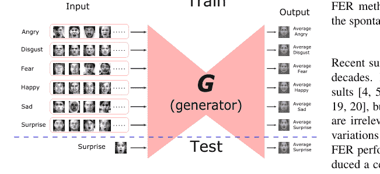

# 1. INTRODUCTION

Fig. 1: IF-GAN identity-free expressive face generation.

FER 系统在人机交互中发挥着重要作用，例如动画和交互式游戏。CNN 近期在 FER 上取得了良好结果，但高个体间面部属性变化并未被显式考虑，并且如 [1] 中所述，学习到的特征可能捕获更多与 FER 任务无关的身份相关信息。这促使通过显式从图像中移除身份信息来减少身份相关变化。如果 f(I) 是输入图像 I 的 CNN 提取的面部表示，并且是 f(I) = g(f_id(I), f_exp(I)) 的非线性函数的结果，其中 f_id(I) 为身份相关特征，f_exp(I) 为表情相关特征，则在寻找 f(I) 时可以专注于 f_exp(I) 并最小化 f_id(I)。

图 1 说明了所提出的 IF-GAN 通过将输入图像的表情特征转移到从训练数据集中所有受试者计算得到的合成“平均”面部来移除身份特征。生成的图像具有相同的合成“平均”身份，仅在显示的表情上有所不同，因此可用于无身份表情分类。

总之，我们的主要贡献是：

- 使用 IF-GAN 进行无身份 FER，将任意受试者的表情转移到“平均”身份；
- 开发一个端到端系统，同时执行表情合成和识别。

IF-GAN 在四个面部表情数据集上超越了基线 CNN 和最先进的 FER 方法，包括自发面部表情数据集 RAF-DB。
