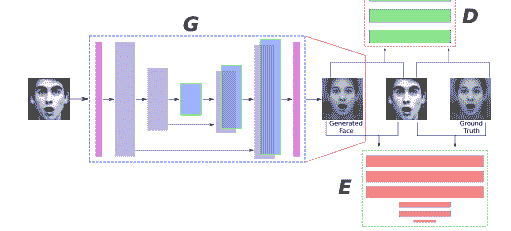
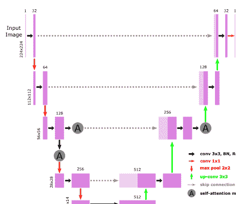
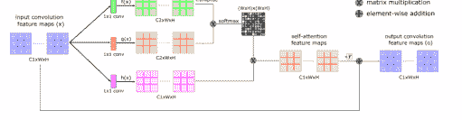

# 3. METHODOLOGY

Fig. 2: The IF-GAN architecture consists of: (1) a “U-Net” [23] generator (G), (2) a “PatchGAN” [24] discriminator (D) that only penalizes structures at the scale of patches, and (3) a ResNet-101 [25] expression classifier (E), pre-trained on ImageNet. In contrast to DeRL [12] and IA-gen [1], G, D, and E are jointly optimized during the IF-GAN training. Note that only G and E are employed during testing.

## 3.1. An Overview of the Proposed IF-GAN

IF-GAN 将表情从输入图像转移到合成“平均”身份，然后生成“平均”表情图像用于无身份表情分类。

设 I_S,E 为任意真实受试者的面部图像，具有任意表情，设 I_A,E 为从具有相同表情的所有受试者计算得到的“平均表情”图像。生成器（G）学习将表情信息 f_exp(I_S,E) 从输入 I_S,E 转移到“平均”受试者，并生成具有与 I_S,E 相同表情的图像 Ĩ_A,E。与常规 GAN 和 cGAN 不同，IF-GAN 中采用了表情分类器（E）以确保 Ĩ_A,E 与输入图像 I_S,E 具有相同的表情。

Fig. 3: U-Net-based generator with self-attention modules. Purple boxes correspond to multi-channel convolution feature maps; lilac boxes are feature maps copied from the encoding path, where the number of channels is above each box and the spatial size of feature maps are on the box’s lower left corner. Gray dashed arrows denote skip connection operations. Note the three self-attention modules: one on a skip connection and another two on the encoding and decoding paths. Best viewed in color.

如图 2 所示，IF-GAN 具有生成器（G）、判别器（D）和表情分类器（E）。G 接收输入受试者表情图像 I_S,E 并生成表情“平均”受试者面部图像 I_A,E。然后，假元组 {I_S,E, Ĩ_A,E, 0} 和真元组 {I_S,E, I_A,E, 1} 被输入判别器进行真假分类。最后，{I_S,E, I_A,E, l_e} 和 {I_S,E, Ĩ_A,E, l_e}，带有表情标签 l_e，被用于微调表情分类器。

Fig. 4: Illustration of the self-attention module. Input feature maps are shown with their tensor shapes, e.g., C1×W×H for C1 channels of W×H feature maps. Green/red boxes are 1×1 convolution channel reductions resulting in C2 channels. Magenta boxes are 1×1 convolutions with C1 channel results. Softmax, performed on each row, normalizes the attention coefficients. Trainable parameter (γ) scales self-attention feature maps. Best viewed in color.

此外，在生成器顶部添加了自注意力模块（图 3），以有效捕获空间上遥远的关系并生成更好的表情图像。图 4 显示了自注意力模块如何将输入特征图上所有位置的特征的加权和计算为某一位置的响应。

## 3.2. IF-GAN 的损失函数

IF-GAN 的损失函数如下所示：

ℒ = λ₁ · ℒ_cGAN(G, D) + λ₂ · ℒ_L1(G) + λ₃ · ℒ_softmax(E) + λ₄ · ℒ_IL(E)

其中超参数 λ₁, λ₂, λ₃ 和 λ₄ 用于平衡四个项。ℒ_L1 是生成富有表现力人脸的主导损失，而 ℒ_softmax 是对富有表现力人脸进行分类的主导监督信号。ℒ_cGAN 必须与 ℒ_L1 共同优化，以更好地产生具有真实数据分布的输出。根据 [5]，较大的 ℒ_IL 会导致特征不可分离且收敛缓慢。因此，ℒ_L1 和 ℒ_softmax 的权重高于其他损失。

cGAN 损失函数 ℒ_cGAN(G, D) 定义为：

ℒ_cGAN(G, D) = 𝔼[log D({I_SE, I_AE})] + 𝔼[log(1 − D({I_SE, G(I_SE)}))]

其中 G(I_SE) 是生成的图像 Î_AE，{I_SE, G(I_SE)} 是一个伪造元组，而 {I_SE, I_AE} 是一个真实元组。

与判别器 D 竞争时，G(·) 使用 L1 距离学习真实数据分布：

ℒ_L1(G) = 𝔼[‖I_AE − G(I_SE)‖₁]

E 与 D 和 G 共同训练，使用 softmax 损失和表情标签 l_e 来定义表情损失：

ℒ_softmax(E) = 𝔼[log p(l_e | {I_SE, I_AE})] + 𝔼[log p(l_e | {I_SE, G(I_SE)})]

岛损失 ℒ_IL(E) [5]，其同时减少类内变化并增加类间差异，与 softmax 损失联合使用来训练表情分类器 E：

ℒ_IL(E) = Σ_{i=1}^M ‖x_i − c_{y_i}‖₂² + α Σ_{j=1}^N Σ_{k≠j}^N ( (c_k · c_j)/(‖c_k‖₂‖c_j‖₂) + 1 )

其中 M 是图像数量；N 是表情类别数；c_k 和 c_j 表示第 k 个和第 j 个表情中心；(·) 表示点积；α = 0.03 平衡两项。最小化岛损失使同类样本更接近，同时与其它样本分离。
