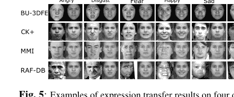
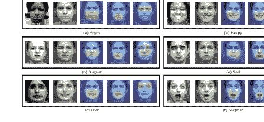

# 4. 实验

## 4.1. 实验数据集

BU-3DFE [26]：遵循 [1, 12]，我们使用了 1,200 张六种基本表情的高强度图像，即最后两个等级，即愤怒、厌恶、恐惧、快乐、悲伤和惊讶。

CK+ [27, 28]，有 118 名受试者，包含 327 个视频，每个视频标记为七种表情之一，即轻蔑和六种基本表情。如 [5] 中所述，从标记为六种基本表情之一的 309 个视频中取最后三帧，形成了 927 张图像的实验数据集。

MMI [29] 有 31 名受试者展示六种基本表情的 208 个正面序列。如 [4]，我们收集了中间三个峰值帧，共计 624 张图像。

RAF-DB [7] 是一个包含数千名受试者、各种头部姿势、光照条件和遮挡的自发 FER 大型数据集。我们使用了 RAF-DB 单标签子集（12,271 张训练图像和 3,068 张测试图像），标记为中性或六种基本表情之一。

对于姿势面部表情数据集，我们使用了 10 折交叉验证策略，即每个数据集被划分为 10 个子集，按受试者互斥。对于每次运行，有 8 个训练、一个验证和一个测试子集。报告结果为 10 次运行的平均值。RAF-DB 实验使用了标准的训练和测试集。

## 4.2. 预处理

我们使用了给定的裁剪 RAF-DB 人脸图像。BU-3DFE、CK+ 和 MMI 人脸区域基于 MTCNN [30] 检测到的眼中心和鼻尖进行对齐，然后缩放至 256 × 256，并进行随机水平翻转和随机 -5° 和 5° 旋转，在训练期间随机裁剪为 224 × 224 补丁。测试时使用中心裁剪补丁。

### 表 1：三个姿势数据集上的性能比较。

| Method | BU-3DFE | CK+ | MMI |
|---|---|---|---|
| Center Loss [21] | – | 92.25 | 73.40 |
| Island Loss [5] | – | 94.39 | 74.68 |
| IACNN [4] | – | 95.37 | 71.55 |
| DLP-CNN [7] | – | 95.78 | – |
| FN2EN [10] | – | 96.80 | – |
| IA-gen [1] | 76.83 | 96.57 | – |
| Lopes et al. [8] | 72.89 | 96.76 | – |
| APM [15] | – | – | 74.04 |
| PPDN [6] | – | 97.3 | – |
| FERLfTc [14] | 82.89 | – | – |
| uGMM-MIK [18] | – | – | 73.2 |
| DeRL [12] | 84.17 | 97.3 | 73.23 |
| ResNet-101 | 82.5 | 94.82 | 71.15 |
| IF-GAN w/o attention | 84.25 | 95.79 | 73.56 |
| IF-GAN | 85.25 | 97.52 | 75.48 |

## 4.3. CNN 实现细节

ResNet-101 [25]，在 ImageNet [31] 上预训练，是我们的基线模型，也是 IF-GAN 中的表情分类器 E。对于评估，基线和 IF-GAN 在每个数据集的训练集上进行微调，并将其他三个数据集用作额外训练数据。对于姿势 FER 数据集的每次 10 折评估运行，通过对训练集中同标签的富有表现力图像进行平均，得到六个“平均”身份富有表现力图像。

1 在我们的实验中，我们经验性地设置 λ₁ = 1，λ₂ = 20，λ₃ = 10 和 λ₄ = 1。

2 为了公平比较，岛损失也被采用。

由于 RAF-DB 中存在显著的姿势变化，“平均”身份富有表现力/中性图像是通过对仅包含正面人脸的三个姿势数据集中具有相同表情标签的所有图像进行平均得到的。IF-GAN 因此实现了姿势不变和身份无关的 FER。

基线和 IF-GAN 使用 PyTorch [32] 实现，并使用 Adam [33] 优化，mini-batch 大小为 50，β1 = 0.9，β2 = 0.99，权重衰减参数为 1e-4，共 100 个 epoch。学习率 μ，初始为 1e-4，每 10 个 epoch 按 0.9 因子降低。

## 4.4. 实验结果

### 表 2：RAF-DB 上的性能比较。

| Method | Accuracy |
|---|---|
| Island Loss [5] | 83.64 |
| Center Loss [7] | 83.68 |
| DLP-CNN [7] | 84.13 |
| gACNN [17] | 85.07 |
| APM [15] | 85.17 |
| LDL-ALSG [13] | 85.53 |
| IPA2LT(LTNet) [11] | 86.77 |
| RAN [19] | 86.90 |
| Covariance Pooling [9] | 87.00 |
| SCN [20] | 88.14 |
| ResNet-101 | 86.31 |
| IF-GAN w/o attention | 87.32 |
| IF-GAN | 88.33 |

如表 1 和表 2 所示，IF-GAN 配备自注意力模块不仅优于基线 ResNet-101 和无自注意力模块的 IF-GAN，而且在四个数据集上均实现了与其它比较方法相比的最新技术水平。在 CK+ 上，DeRL [12] 和 PPDN [6] 达到了最新技术水平，但 DeRL [12] 不能端到端训练，因此计算成本高，而 PPDN [6] 使用参考中性图像，这在大多数实际应用中不可用。

## 4.5. 表情迁移分析

图 5：四个数据集上表情迁移结果的示例。

图 5 展示了从输入图像生成的“平均”身份富有表现力图像。生成的面部图像完全去除了输入图像的身份信息，同时保留了表情信息。

## 4.6. 注意力图分析

图 6：通过可视化来自最后 U-Net 层自注意力模块的注意力图，演示了特征图之间的长程依赖学习，这些图最接近生成的图像。每个框中，第一张图像是输入富有表现力图像，第二张图像是生成的“平均”身份富有表现力图像，最后三张图像是针对三个查询位置指示的三个点学习的注意力图。建议彩色查看。

为了理解图 3 中 56 × 56 特征图之后自注意力模块学习了什么，我们在图 6 中对不同输入图像可视化了来自最后 U-Net 层自注意力模块的注意力图。我们注意到，自注意力模块学习根据强度、纹理和边缘的相似性而非仅仅空间邻近性来建模区域之间的关系。此外，大多数注意力图在嘴唇、鼻子、脸颊、眼睛和眉毛周围高亮显示，与心理学研究 [34] 一致。例如，在图 6 (e) 中，三个查询位置的三个注意力图分别聚焦于眼睛和眉毛、嘴唇和脸颊区域，并且与一组面部动作单元 AUs [35] 高度相关，AUs 描述了一个表情。在图 6 (d) 中，生成快乐表情时高亮的区域位于脸颊周围，AU6（颊上提）和嘴角周围，AU12（嘴角拉动）。在图 6 (f) 中，与惊讶表情相关的区域 [28]，即 AU5（上睑上提）和 AU27（张口），被最突出地高亮。自注意力模块对其他表情也表现出类似的观察。
