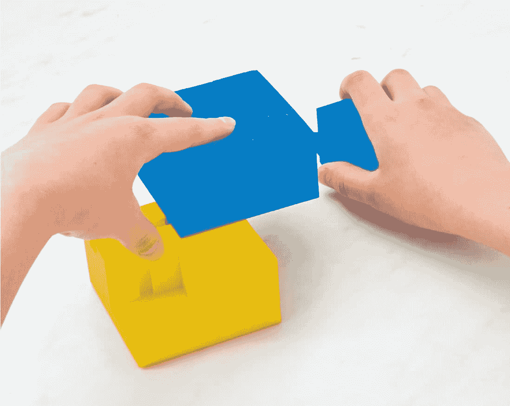
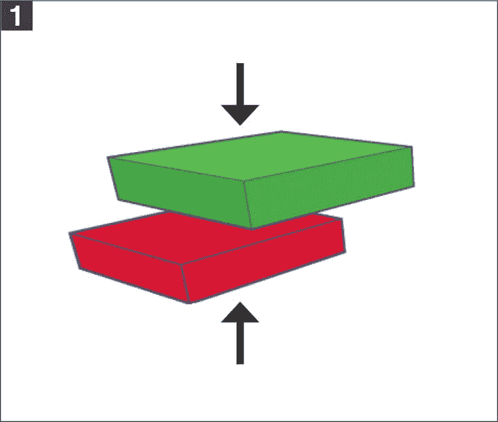
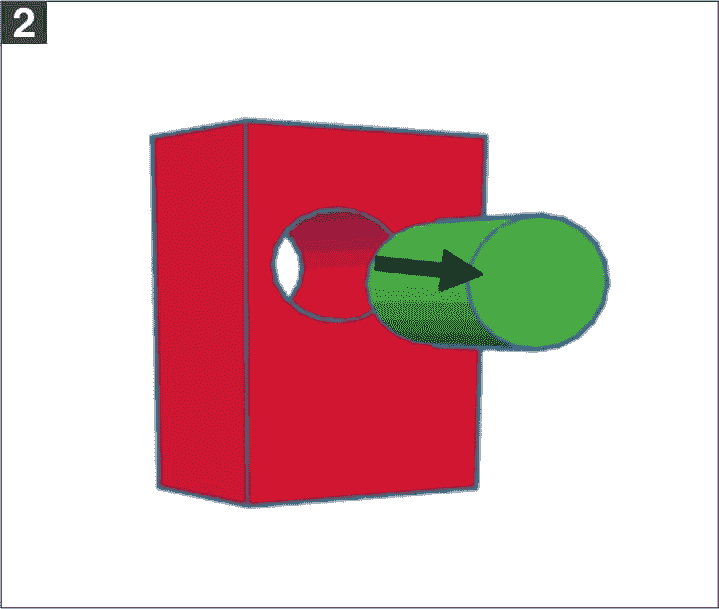
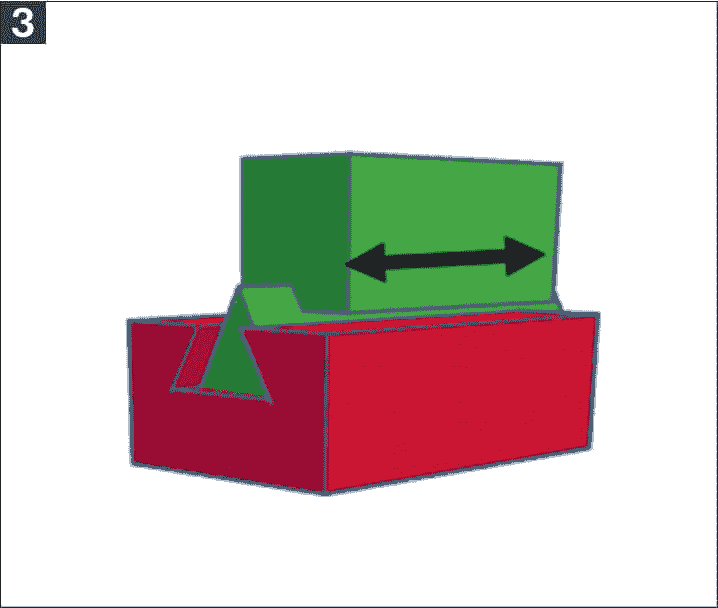
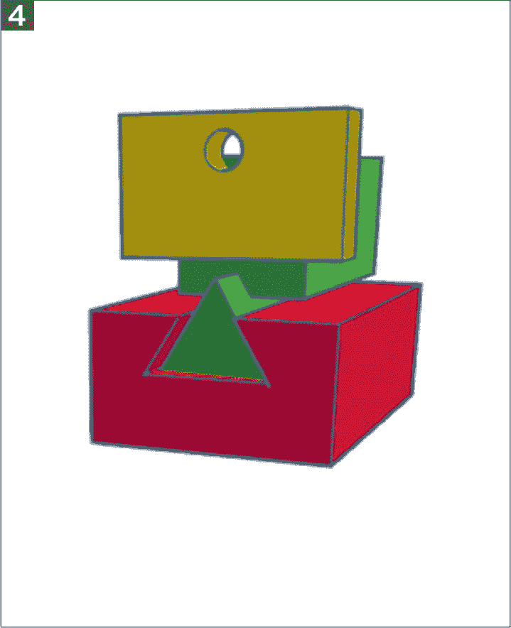
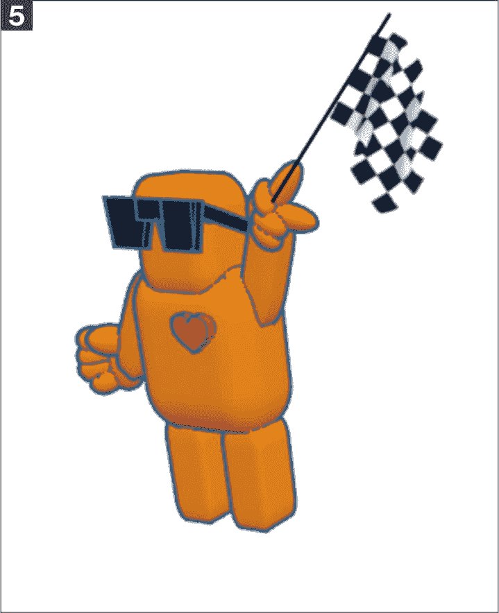
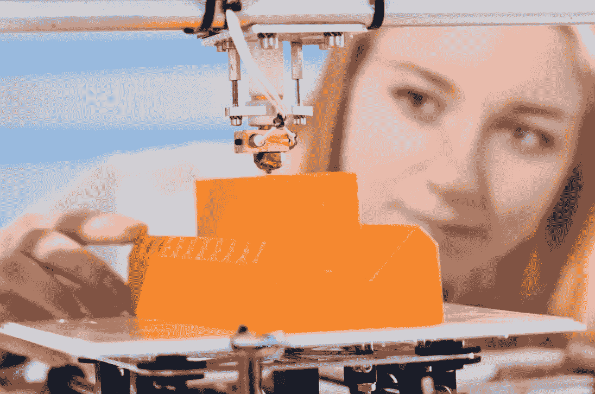
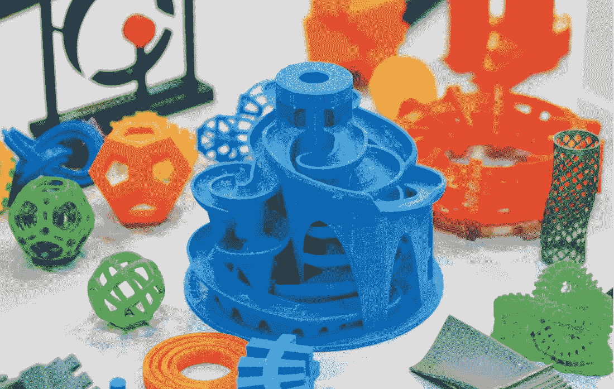

# 少儿 3D 打印与创客实验室：利用 CAD 设计与 STEAM 创意打造惊人项目（第 22 卷）（少儿实验室系列 22）

## 导航

1.  封面
2.  内容开始
3.  1
4.  4
5.  5
6.  6
7.  7
8.  8
9.  9
10. 11
11. 10
12. 12
13. 13
14. 14
15. 15
16. 16
17. 17
18. 18
19. 19
20. 20
21. 21
22. 22
23. 23
24. 24
25. 25
26. 26
27. 27
28. 28
29. 29
30. 30
31. 31
32. 32
33. 33
34. 34
35. 35
36. 36
37. 37
38. 38
39. 39
40. 40
41. 41
42. 42
43. 43
44. 44
45. 45
46. 46
47. 47
48. 48
49. 49
50. 50
51. 51
52. 52
53. 53
54. 54
55. 55
56. 56
57. 57
58. 58
59. 59
60. 60
61. 61
62. 62
63. 63
64. 64
65. 65
66. 66
67. 67
68. 68
69. 69
70. 70
71. 71
72. 72
73. 73
74. 74
75. 75
76. 76
77. 77
78. 78
79. 79
80. 80
81. 81
82. 82
83. 83
84. 84
85. 85
86. 86
87. 87
88. 88
89. 89
90. 90
91. 91
92. 92
93. 93
94. 94
95. 95
96. 96
97. 97
98. 98
99. 99
100. 100
101. 101
102. 102
103. 103
104. 104
105. 105
106. 106
107. 107
108. 108
109. 109
110. 110
111. 111
112. 112
113. 113
114. 114
115. 115
116. 116
117. 119
118. 118
119. 120
120. 121
121. 122
122. 123
123. 124
124. 125
125. 126
126. 127
127. 128
128. 129
129. 130
130. 131
131. 132
132. 133
133. 134
134. 135
135. 136
136. 137
137. 138
138. 139
139. 140
140. 141
141. 142
142. 143
143. 144
144. 3
145. 2

## 简介

### 欢迎来到 CAD 设计与 3D 打印！

# 3D 打印与儿童创客实验室

在《3D 打印与儿童创客实验室》中，我们通过*材料操控*的概念，探讨设计实体对象的过程。

许多物体由通常以固定形状和尺寸提供的原材料制成——例如金属卷、纸张、铁条等——我们可以通过操控这些原材料来创建想要的物体。这包括组合不同形状、改变尺寸、拆解、部分连接，以及连接两种或多种不同材料。通常，这些操作需要中间步骤：粘合以组合、锯切以拆解、或铰链以制作柔性连接。相比之下，在计算机辅助设计（通常称为 `CAD`）的世界里，这些步骤可以被消除。在本书中，我们将逐一探讨这些过程，并构建各种物体来解释它们在 `CAD` 中如何工作。

《3D 打印与儿童创客实验室》还展示了如何在两个不同的 `CAD` 程序中创建设计：`Tinkercad` 和 `SketchUp`。这两个应用程序都是免费的；你只需要一个互联网连接和一个网页浏览器即可访问。虽然两者对初学者都相当容易上手，但我们使用 `Tinkercad` 制作大多数项目，因为它的学习曲线更短。剩余项目在 `SketchUp` 中制作，它与 `Tinkercad` 不同，使用必须转换为 3D 的预设 2D 对象。

除了提供通过 `CAD` 开发可视化设计能力的工具，我们还提供关于如何通过 3D 打印制造它们的指导。3D 打印的便利性提供了在探索每个版本的设计和性能时修改和重印的机会。设计物体的方法有很多；看看哪种最高效，或者哪种创建或操作起来最具挑战性。

你即将踏上一段将改变你对物理世界看法的旅程。享受梦想、设计和制作的乐趣！

**在本书中，我们将探索如何通过 `CAD` 和 3D 打印以多种方式操控和组合材料与元素：**

1. **创建永久接头和/或合并材料**

   

2. **移除材料（打孔或切割）**

   

3. **创建临时接头/合并材料/有限接头**

   

4. **通过一系列操控制作复杂材料**

   

5. **混合不同类型的材料（金属、织物、有机材料等）**

## 3D 打印基础

3D 打印的过程本质上是一种制造技术，使用各种材料加热到允许其形成不同形状的温度，来创建三维物体（相对于在纸上进行的 2D 文档打印）。由于价格合理的桌面 3D 打印机在市场和当地图书馆大量普及，它在过去几十年中获得了极大的流行度。它是创建原型、定制物品或家用物品替换零件（其中一些在本书中讨论）的便捷方式。

3D 打印有多种类型；然而，本书讨论的一种也被称为增材制造。3D 打印机本质上在二维平面铺设材料，然后不断在前一层之上添加层以创建三维物体。材料（`filament`）被送入 `extruder`，在那里被加热到约 `215°C`，此时熔化，`extruder` 将其从 `nozzle` 挤出，很像从管子挤出的牙膏。`extruder` 基于由设计确定的命令序列在三个方向移动（左右、前后、上下）。设计通常在独立于打印机的软件中创建（如 `Tinkercad` 或 `SketchUp`）。完成的软件文件被发送到 3D 打印机软件，后者将其解释为 3D 打印机可理解的文件。打印机软件将其转换为 `extruder` 的运动命令。大多数 3D 打印机允许在打印中途暂停，这是查看打印机如何确定物体内部设计的好方法。打印机出厂时带有各种默认设置，以最小化打印物体的时间和材料。然而，大多数打印机允许用户修改默认设置，因此你可以选择加热 `filament` 的温度、外壁厚度、填充量、填充图案和其他细节。

 
