# 1. 使用 Tinkercad 制作 3D 项目

在本单元中，我们学习 `Tinkercad` 的基础知识，这是一个免费、易用、在线的计算机辅助设计（`CAD`）程序，用于为 3D 打印设计物体。该程序将帮助我们通过修改 3D 基础形状来开发设计和创建技能。我们将创建 20 多个项目，在每个实验室所学基础上构建越来越复杂的物体。让我们开始制作吧！

## Tinkercad 入门

`Tinkercad` 是一种计算机辅助设计（`CAD`）软件，通过使用其预创建的 3D 形状库来创建 3D 数字模型。`Tinkercad` 账户可以在 [`Tinkercad.com`](http://Tinkercad.com) 免费在线创建。创建账户并登录后，软件会提示你完成几个教程。建议完成所有教程以熟悉软件。

完成教程后，你将进入一个提供**创建新设计**选项的页面（图 1）。点击此选项。

**图 1：** 点击 `Create New Design` 按钮开始在 `Tinkercad` 中工作。

这将带你进入创建设计的页面。请注意页面的以下部分：

- **左上角是文件名。** `Tinkercad` 会自动创建一个随机名称。通过点击并输入所需名称来重命名文件。

- **文件名正下方的顶部功能区** 拥有在工作平面上 **复制**、**粘贴**、**复制**、**删除**、**撤销** 和 **重做** 工作的工具。图 2 中的箭头标识了顶部功能区。悬停按钮可查看其用途。

- **顶部功能区右侧** 有更多工具：**组合**、**取消组合**、**导入**、**导出** 和其他。见图 2 右侧。

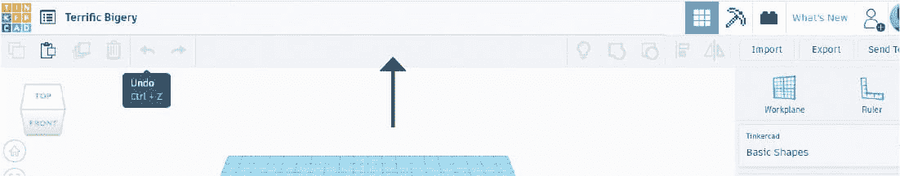

**图 2：** 顶部功能区有文件名，其下方有 `Copy`、`Paste`、`Duplicate`、`Delete`、`Undo` 和 `Redo` 按钮。

- **页面左侧** 有工作平面查看工具：**缩放**、**顶视图**、**前视图** 和 **主页视图**。详见图 3。点击视图进行探索。

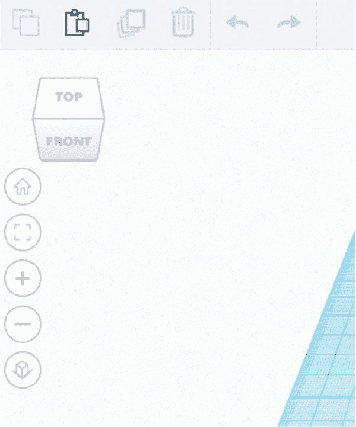

**图 3：** 左侧是 `Zoom`、`Top View`、`Front View` 和 `Home View` 工具，控制视图大小和角度。

- **页面中央部分** 是 **工作平面**。这是创建和操控设计的主要暂存区域，使用来自页面各部分的工具。工作平面标有网格，以协助准确放置设计和形状。网格比例可通过工作平面右下角的 **编辑网格** 按钮修改。图 4 中的箭头标记了 **捕捉网格** 菜单，允许增量尺寸变化的幅度变化。

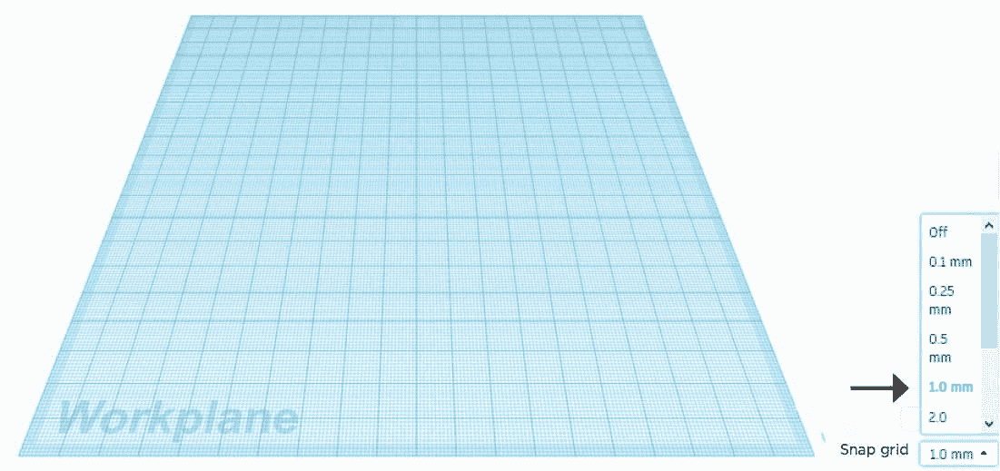

## Tinkercad 工作平面概览

### 图 4：网格按钮控制工作平面比例

*网格按钮控制工作平面的比例和尺寸增量。*

 工作平面右侧有各种预创建的工具，可用于创建各种形状。下拉菜单可用于访问比基本形状更多的形状。右侧还有其他工具，例如**标尺**（图 5）。

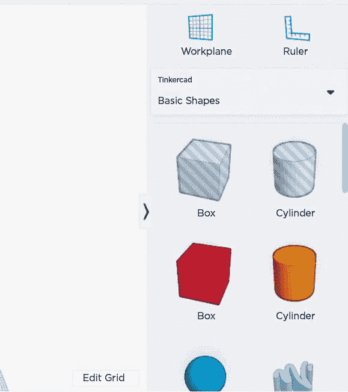

### 图 5：预创建的形状和工具

*预创建的形状和工具。**标尺**也位于右侧。*

 有各种触发器可用于操纵形状的大小和方向。图 6 标识了一些基本触发器。箭头 1 标识每条边中点处的黑色方块；可用于增加或减少边/维度的长度，既可以直接拖动，也可以点击后输入边/维度的所需值。箭头 2 标识每个形状角落的白色方块。这可用于同时修改两个维度的大小。箭头 3 标识可用于增加或减少形状高度的触发器。箭头 4、5 和 6 用于绕不同轴旋转形状，而箭头 7 用于垂直移动形状，使其靠近或远离工作平面。

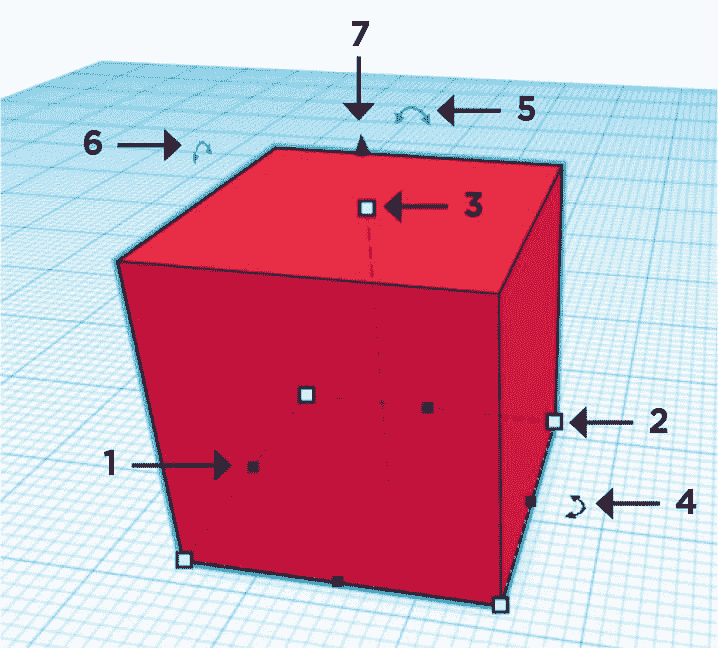

### 图 6：形状操纵触发器

*触发器可帮助您更改工作平面上形状的大小、方向和位置。*

Tinkercad 中还有其他工具和技巧将提升您的计算机辅助设计技能，其中一些将在本书的其余部分中讨论。请继续自行探索，寻找浏览软件的不同或更简单的方法。

## 实验 1：直边基本形状 — 方棱柱

在我们的第一个实验中，我们将学习如何使用 Tinkercad 创建基本的二维 (2D) 和三维 (3D) 形状，然后通过 3D 打印机将这些设计转化为我们可以触摸和握持的真实物体。

具有直边的基本 3D 形状（如立方体）的尺寸以长度、宽度和高度来衡量。对于具有曲边的形状（如圆柱体），弯曲部分的大小由“半径”决定。我们必须记住这些名称，因为我们将用它们来讨论我们的物体和设计。图 1 显示了直边形状的测量术语。

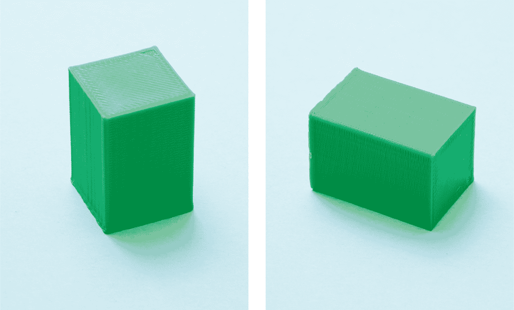

### 设计流程

1. 首先绘制一个方棱柱的草图（参见图 1 以获取指导）。

   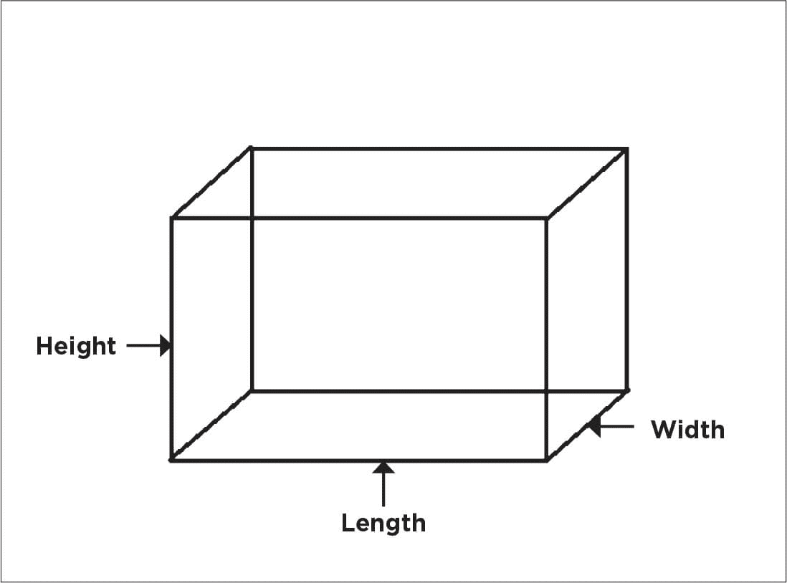

   **图 1：** *直边形状的尺寸为长度、宽度和高度。*

2. 使用 CAD 软件 Tinkercad，从**基本形状**菜单中将一个红色方块拖放到工作平面上，创建一个边长为 20 毫米的立方体（图 2）。

   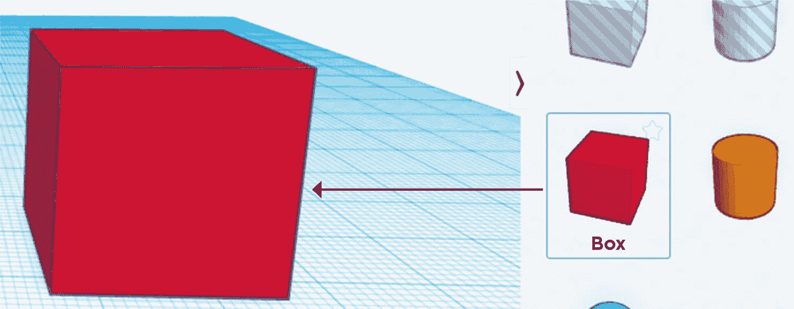

   **图 2：** *从菜单中选择一个红色立方体。*

3. 接下来，修改立方体的尺寸，使其成为一个高 50 毫米的拉伸立方体，即方棱柱。点击并向上拖动立方体顶部的白色方块以调整高度。选中时方块会变为红色（图 3）。

   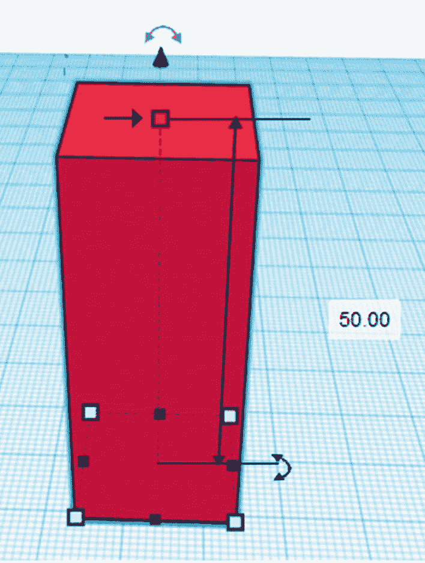

   **图 3：** *点击并拖动高度按钮将立方体向上拉伸。*

4. 通过点击底面任意角落的小白色方块，检查边长尺寸以确保它们仍为 20 毫米（图 4）。

   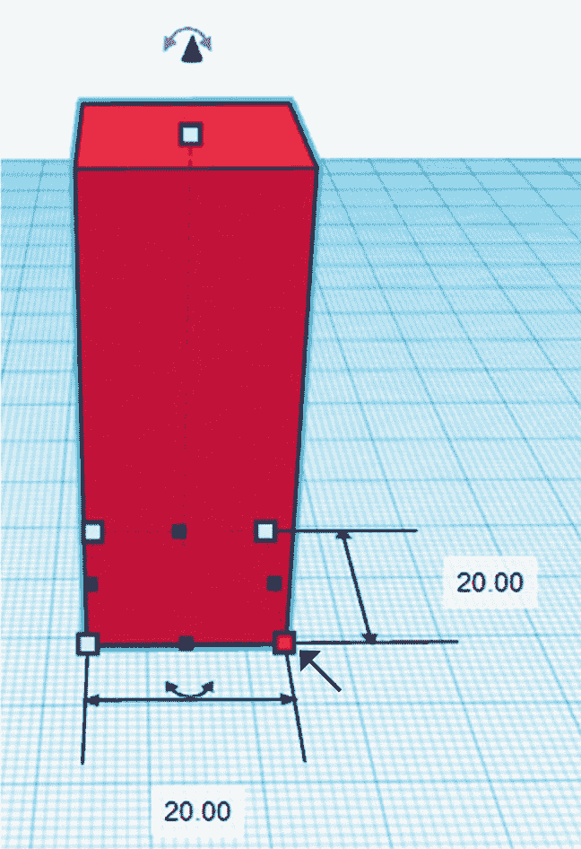

   **图 4：** *点击角落的白色方块尺寸调整工具可显示边长尺寸。*

5. 复制上述的方棱柱，或从**基本形状**菜单中使用一个立方体。

6. 接下来，修改立方体的尺寸，使其高/厚 2 毫米（一个扁平的立方体）。点击并向下拖动白色方块以调整高度（图 5）。

   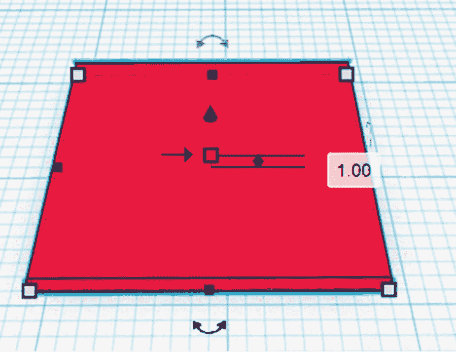

   **图 5：** *向下拖动白色方块使立方体高 2 毫米。*

### 3D 打印清单

#### 打印 CAD 模型前

- [ ] 请参阅此处所示的 3D 打印基础知识以获取打印技巧。
- [ ] 打印方棱柱。
- [ ] 打印完成后，用锉刀清除多余材料。

#### 质量控制与产品测试

- [ ] 检查打印物体是否有单独的塑料丝层。

### 动脑筋

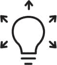

思考这些问题并记下可能的答案。您可以通过修改并打印新版本的设计来测试它们。

- **打印出的物体比你预期的要轻还是要重？你认为为什么会这样？**
- **你有机会在打印过程中看到物体的内部吗？它看起来像什么？**

## 实验 2：曲边基本形状 — 圆柱体

在本实验中，我们将把基本技能扩展到创建具有曲边的形状。

请记住，具有直边的基本 3D 形状（如立方体）的尺寸以长度、宽度和高度来衡量。对于具有曲边的形状（如圆柱体），弯曲部分的大小由半径或直径来衡量。半径是从底面中心到曲线边缘的距离，直径是半径的两倍，或是穿过中心从一边到另一边的距离。学习这些名称将有助于您设计曲面物体。图 1 显示了曲边形状的测量术语。

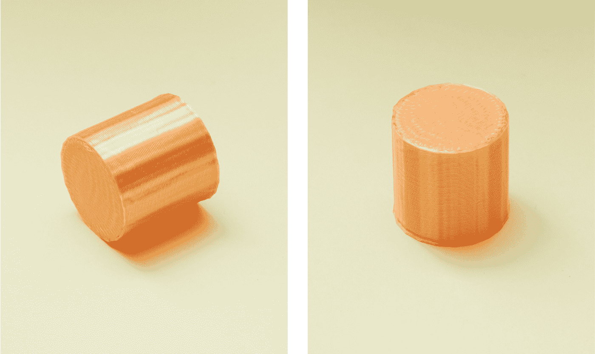

### 设计流程

1. 首先绘制一个圆柱体的草图（参见图 1 以获取指导）。

   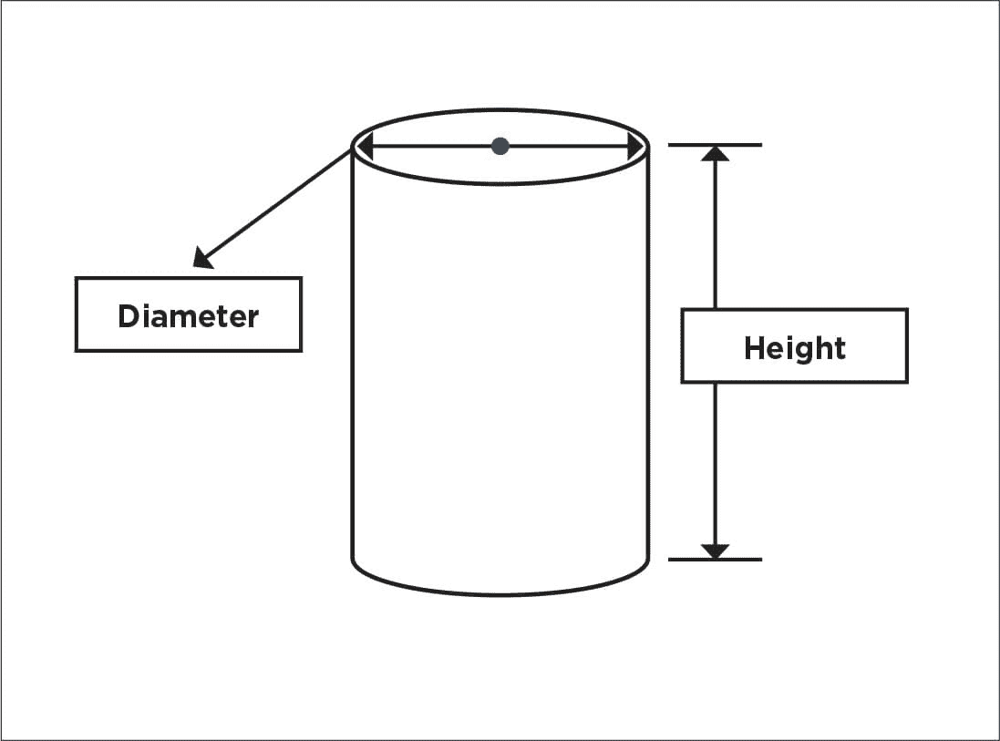

   **图 1：** *显示高度和直径的圆柱体草图。*

2. 使用 CAD 软件 Tinkercad，从**基本形状**菜单中将一个圆柱体拖放到工作平面上来创建圆柱体（图 2）。

   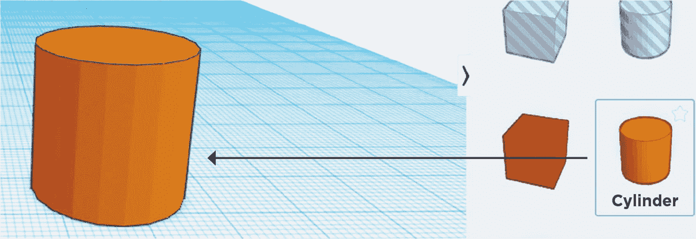

   **图 2：** *从菜单中选择**圆柱体**。*

3. 接下来，修改圆柱体的尺寸，使其高 50 毫米（一个拉伸的圆柱体）。点击并向上拖动圆柱体顶部的白色方块以调整高度。选中后它会变为红色（图 3）。

   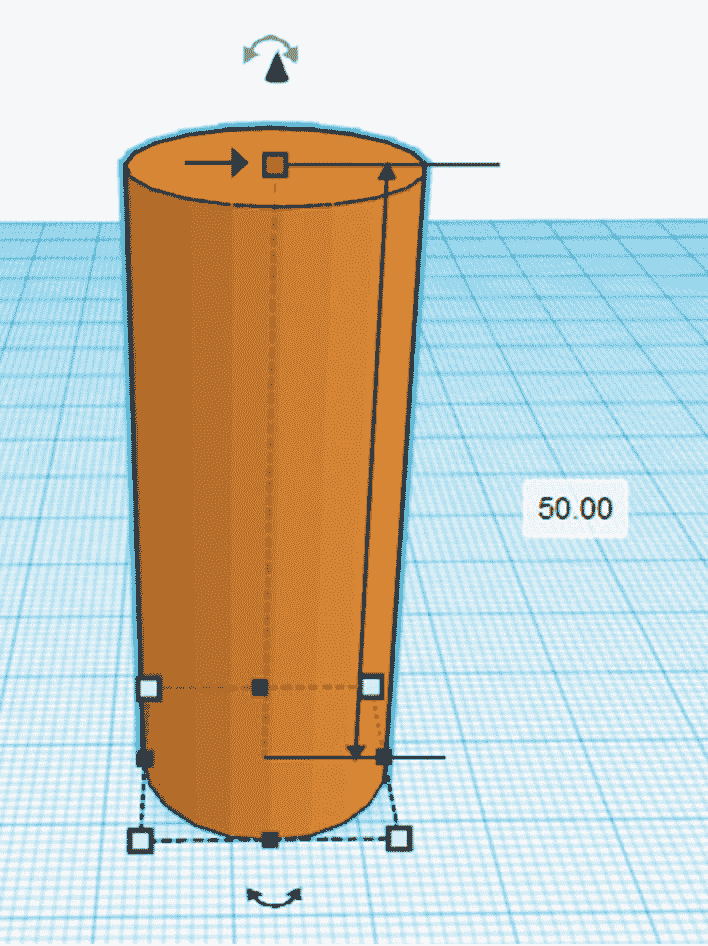

   **图 3：** *点击并拖动高度按钮以更改圆柱体的高度。*

4. 通过点击底部任意角落的小黑色箭头，检查圆柱体的尺寸以确保其半径为 10 毫米（或直径 20 毫米）（图 4）。

   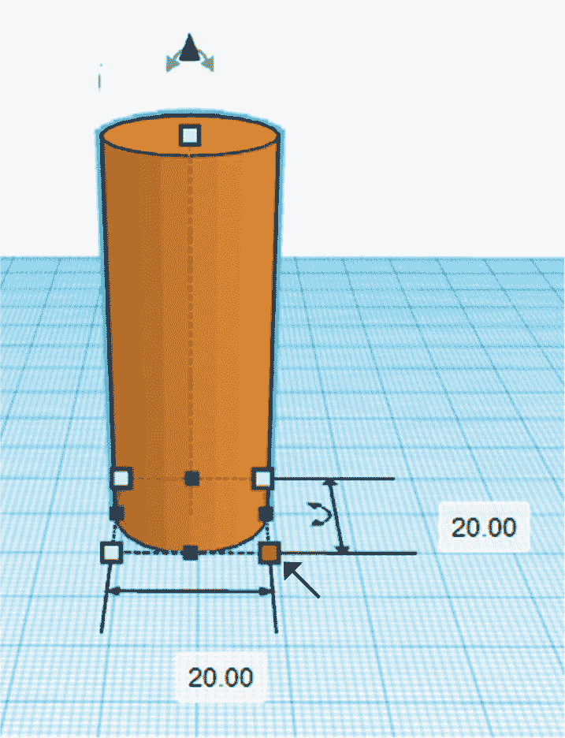

   **图 4：** *点击底部角落的黑色方块尺寸调整工具以查看圆柱体的直径。*

5. 复制上述的圆柱体，或从**基本形状**菜单中使用一个圆柱体。

6. 修改圆柱体的尺寸，使其高/厚 1 毫米（一个扁平的圆柱体）。点击并向上拖动白色方块以调整高度（图 5）。

   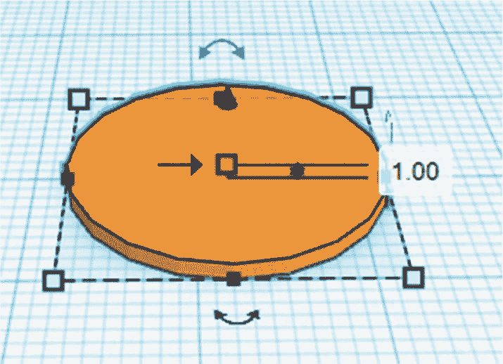

   **图 5：** *使用高度调整按钮将圆柱体压扁。*

### 3D 打印清单

#### 打印 CAD 模型前

- [ ] 请参阅此处所示的 3D 打印基础知识以获取打印技巧。
- [ ] 打印圆柱体。
- [ ] 打印完成后，用锉刀清除多余材料。

#### 质量控制与产品测试

- [ ] 检查打印物体是否有单独的塑料丝层。

### 动脑筋

思考这些问题并记下可能的答案。您可以通过修改并打印新版本的设计来测试它们。

- **你注意到圆柱体的曲面（其纹理、其“圆度”）有什么特点吗？**

你有机会在打印过程中看到物体的内部吗？它看起来怎么样？

## 实验 3：七巧板拼图

在本实验中，我们将运用在实验 1 和 2 中学到的创建基本形状的技能，来创建复杂形状并制作一个七巧板拼图。

在 Tinkercad 中，我们只需创建两个或多个基本形状，然后将它们拖动至相互接触或连接，即可创建复杂形状。我们将创建一个七巧板几何 2D 拼图，以更好地理解这一过程。

### 设计流程

1. 从形状工具箱将 `Roof` 拖放到工作平面上，创建一个小三角形（图 2）。Roof 是一个三棱柱。

   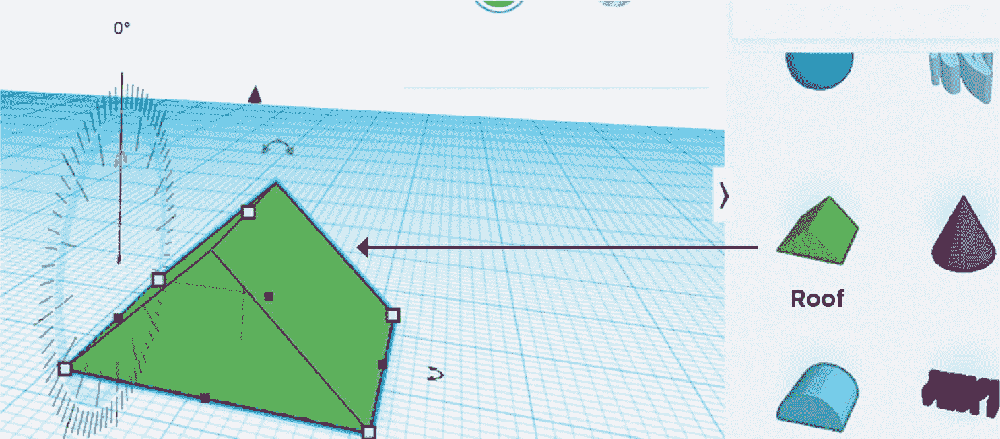

   **图 2：** 从形状工具箱将 `Roof` 拖放到工作平面上。

2. 将三棱柱旋转至侧放，使其平铺如图 3 所示。然后将三棱柱压扁至 3 mm 高度。

   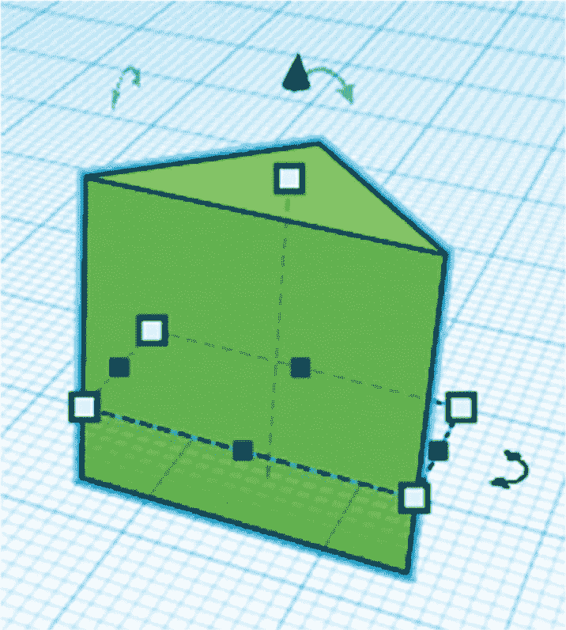

   **图 3：** 旋转三棱柱/屋顶使其侧放。

3. 现在确保三棱柱形成直角的两边与工作平面上的网格线平行（图 4）。

   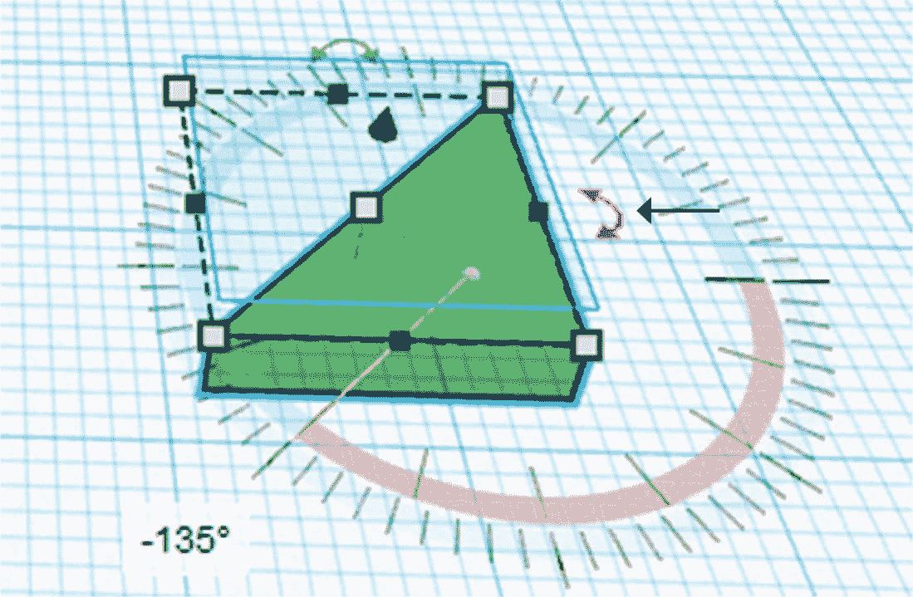

   **图 4：** 将直角邻边与工作平面网格线对齐。

4. 放大三棱柱，使形成直角的两边均为 7 mm（图 5）。复制这个小三角形，然后将这两个副本移至工作平面的一端。

   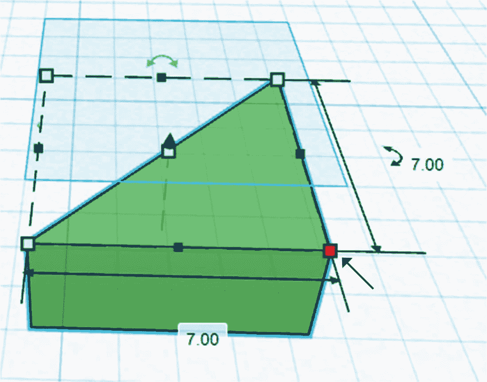

   **图 5：** 将三棱柱边长调整为 7 mm。

5. 重复步骤 1-4，从小三角形制作中三角形。

6. 放大小三棱柱，使形成直角的两边为 10 mm（图 6）。将其移至工作平面的一端。

   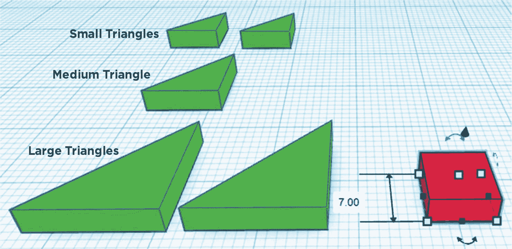

   **图 6：** 各种三角形及使用 `Cube` 工具构建正方形。

7. 复制中三棱柱并放大，使形成直角的两边为 14 mm。复制这个大三角形，然后将这两个副本移至工作平面的一端。

8. 通过从形状工具箱将 `Cube` 拖放到工作平面上来制作正方形。将立方体压扁至 3 mm 高度。

9. 现在确保立方体形成直角的边与工作平面上的网格线平行，就像我们在图 4 中所做的那样。

10. 放大立方体，使每条边均为 7 mm（图 6）。将其移至工作平面的一端。

11. 通过复制上述步骤中制作的两个小三角形来制作平行四边形。如图 7 所示旋转并合并它们。

    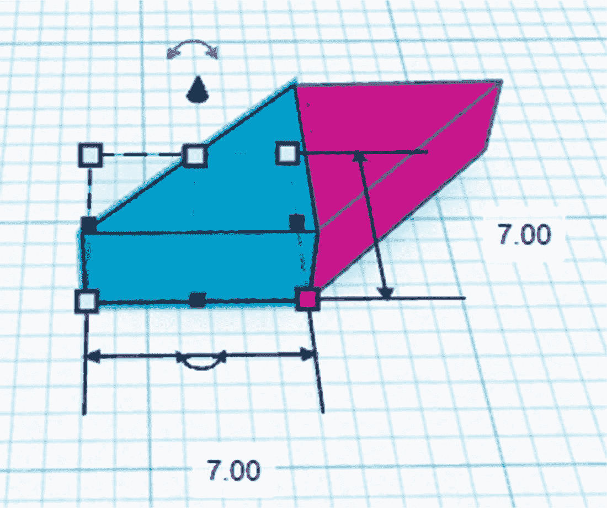

    **图 7：** 旋转并合并两个小三角形以形成平行四边形。

12. 将所有三角形、正方形和平行四边形的厚度调整为 3 mm。

### 3D 打印检查清单

#### 打印 CAD 模型前

-  请参阅 此处 所示的 3D 打印基础知识以获取打印技巧。
-  打印七巧板零件。
-  打印完成后，用锉刀清理多余材料。

#### 质量控制与产品测试

-  检查打印件上是否有清晰的塑料丝层。

### 思考一下

考虑这些问题并记录可能的答案。你可以通过修改并打印新版本的设计来测试它们。

**你拼装拼图时用了什么策略？**

**零件之间有什么关系吗？如果有，请解释。**

## 实验 4：设计首饰

在本实验中，我们将学习如何通过创建孔洞来从实体形状中移除材料。在 Tinkercad 中，我们只需使用 `Hole` 工具并将其插入实体对象的所需位置，即可创建一个孔。我们将通过设计耳环来提升在 CAD 中创建孔洞的技能。

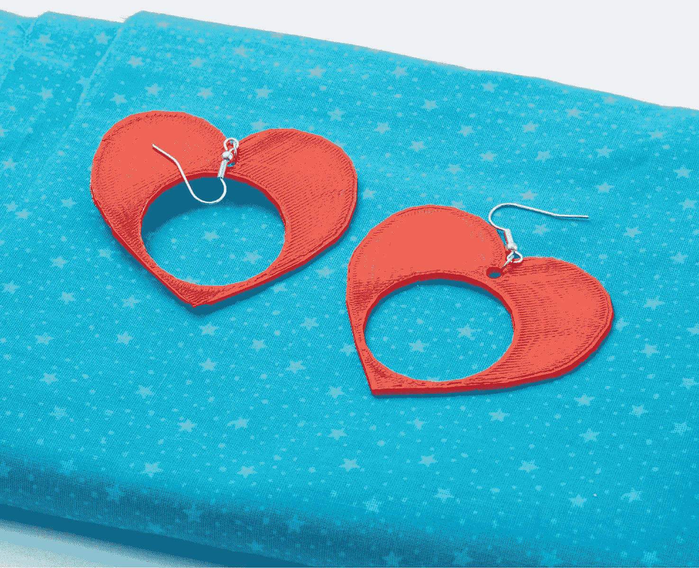

### 设计流程

1. 将 `Solid Cube` 拖放到工作平面上。此示例中尺寸不重要，但要保持较小，以便轻松放入工作平面。

2. 将 `Cylinder Hole` 拖放到工作平面上，使其不接触初始立方体（图 1）。确保圆柱体的高度远高于立方体。确保圆柱体的其余尺寸约为立方体的一半。

   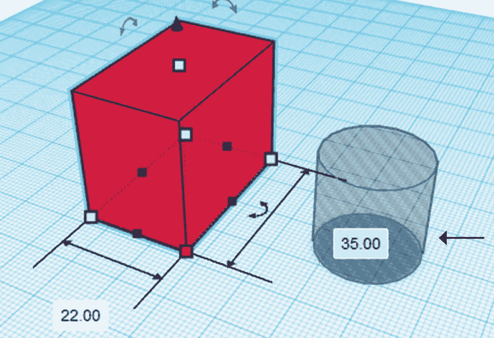

   **图 1：** 工作平面上的立方体和圆柱体孔。

3. 将圆柱体旋转 90 度使其水平放置。点击弯曲的 `Rotate` 工具（图 2）。

   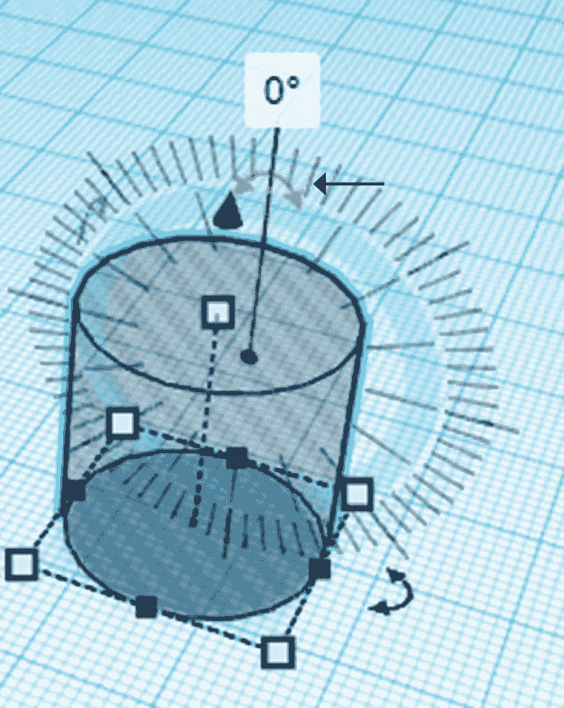

   **图 2：** 点击圆柱体孔的弯曲形状旋转工具以旋转圆柱体。

4. 现在，移动圆柱体孔，使其穿过立方体侧面的中心（图 3）。

   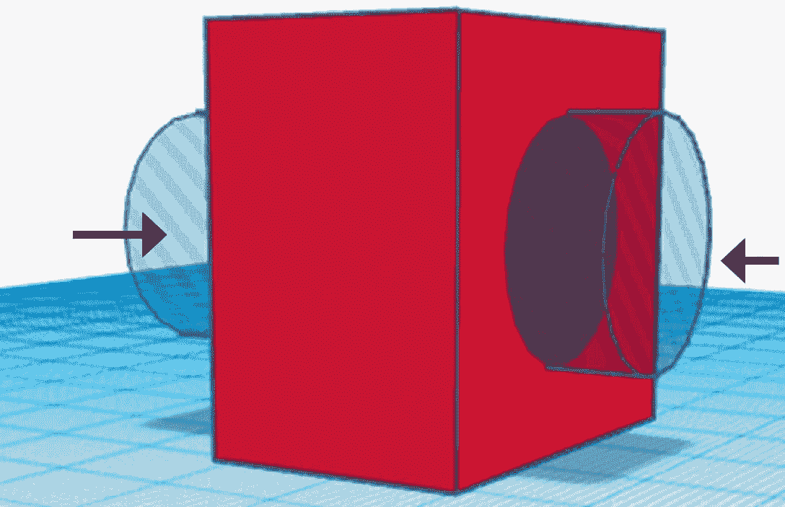

   **图 3：** 定位圆柱体孔，使其穿过立方体中心。

5. 选择两个对象并点击 `Group` 按钮（图 4）。这会将孔合并到实体对象中，在实体对象上形成一个孔（图 5）。

   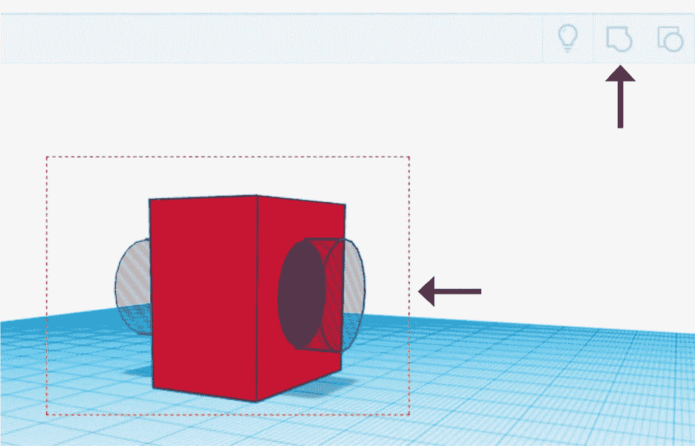

   **图 4：** 将圆柱体孔和立方体编组。

   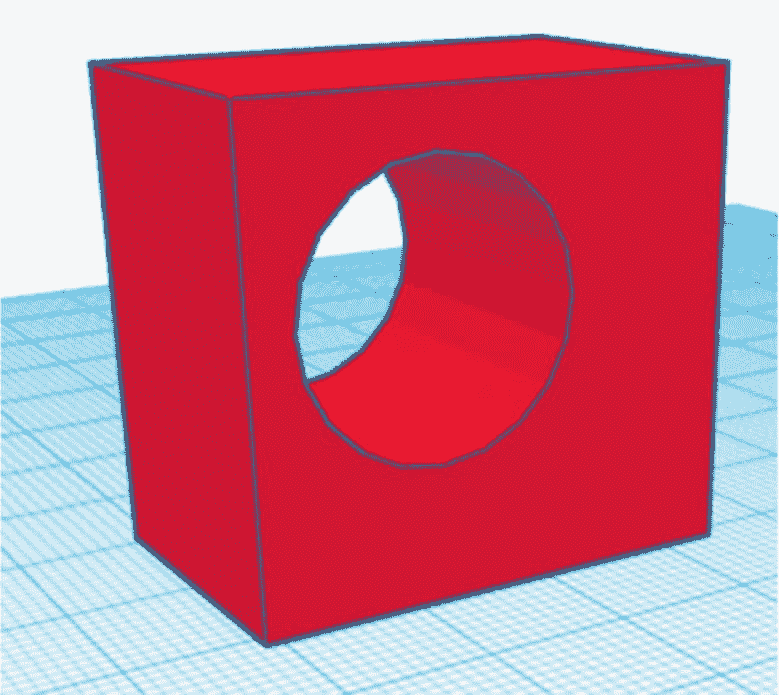

   **图 5：** 现在实心立方体中形成了一个圆孔。

6. 你可以通过修改圆柱体孔的长度来修改孔的周长。选择对象并点击 `Ungroup` 以修改单个对象。

#### 制作耳环

1. 我们将制作的耳环基本设计如图 6 所示。注意基本元素：耳环的实体形状、一个大孔和一个用于连接耳钩的小孔。

   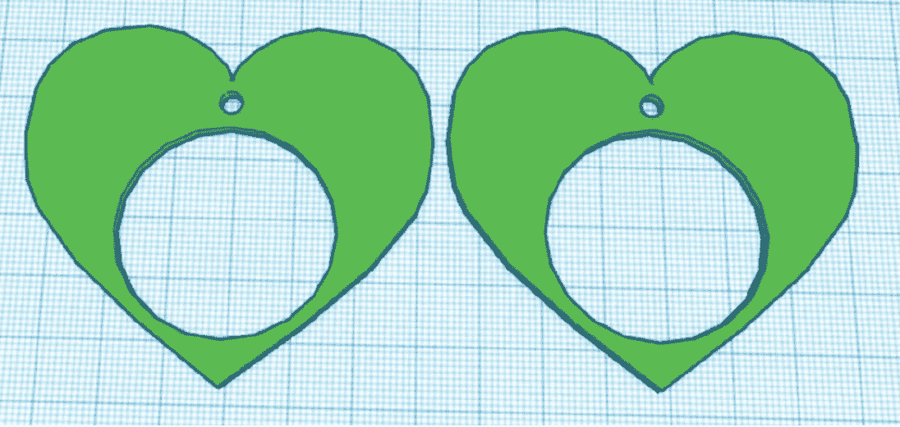

   **图 6：** 三个形状组成耳环设计：一个心形、一个大孔和一个小孔。

2. 从 `Basic Shapes` 菜单将一个实心心形拖放到工作平面上。尺寸应基于你想要的耳环大小（图 7）。

   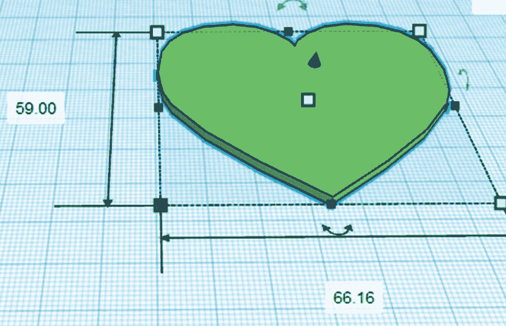

   **图 7：** 工作平面上的实心心形耳环。

3. 按照 此处 所示的步骤 2 至 5，在此形状上制作一个尽可能大的孔。制作耳环无需旋转它（图 8）。

   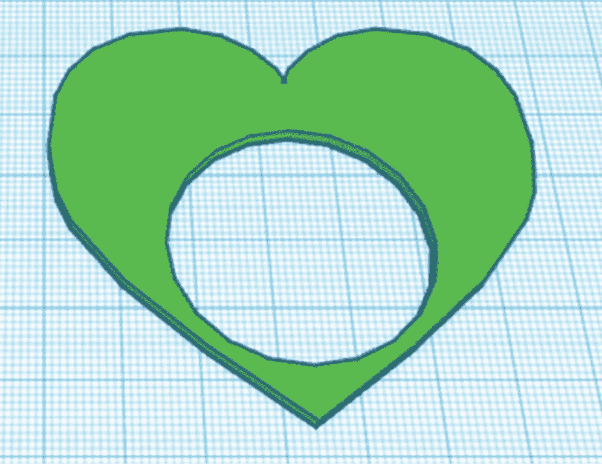

   **图 8：** 在实心心形中创建一个大孔。

4. 在心形顶部中心再制作一个直径为 2-4 mm 的小孔。这是我们放置挂钩以将耳环固定在耳朵上的位置（图 9）。

   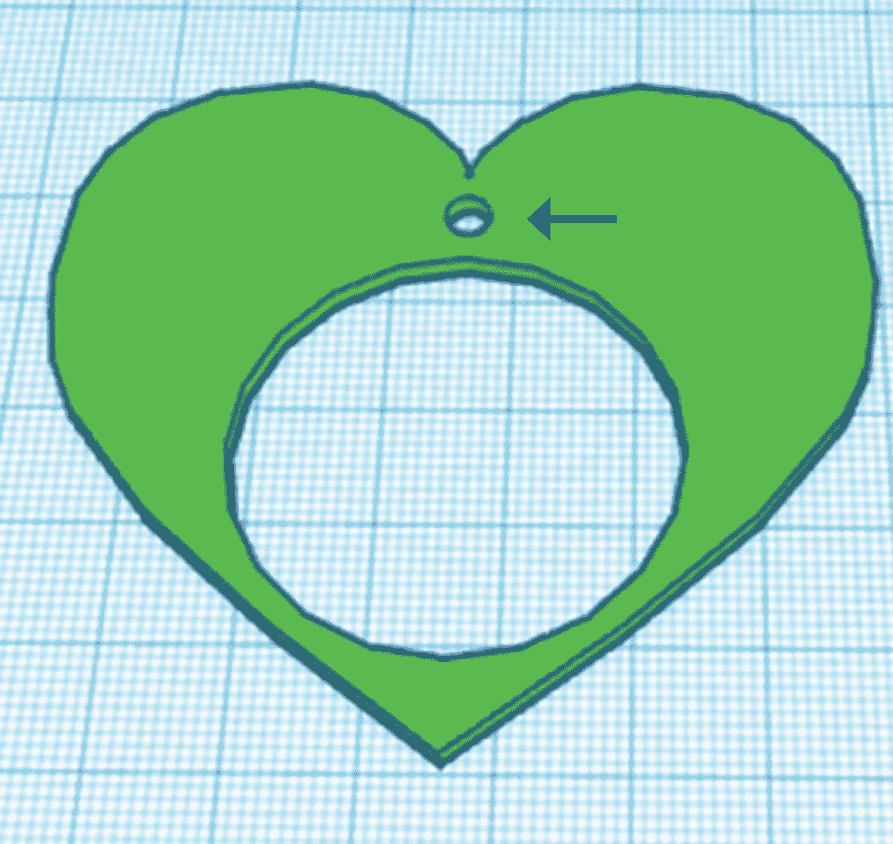

   **图 9：** 在耳环实体上制作一个用于耳钩的小孔。

5. 选择所有零件并将它们编组。复制耳环以制作一对耳环。

### 3D 打印检查清单

#### 打印 CAD 模型前

-  请参阅 此处 所示的 3D 打印基础知识以获取打印技巧。
-  打印耳环套装。
-  打印完成后，用锉刀清理多余材料。

#### 质量控制与产品测试

-  检查打印件上是否有清晰的塑料丝层。

### 思考一下

考虑这些问题并记录可能的答案。你可以通过修改并打印新版本的设计来测试它们。

**物体上的孔的大小有限制吗？**

**挂钩孔可以在耳环的角落吗？为什么？为什么不？**

## 实验 5：衣帽钩/窗帘扣带

### 衣帽钩设计

到目前为止，我们已经学习了在实验 3 中通过将两个基本形状相加来设计复杂形状。我们还在实验 4 中学习了如何通过创建孔洞来移除材料。现在我们将学习设计更复杂的形状，这些形状涉及在同一个设计中添加和移除材料。我们将设计的物体是一个衣帽钩，它也可以用作窗帘/帷幔支架。窗帘支架的形状与衣帽钩相同，只是方向是水平的而不是垂直的。

### 设计流程

1. 构建一个长 70 毫米、宽和高均为 10 毫米的拉伸立方体（图 1）。这是我们 J 形的杆部。

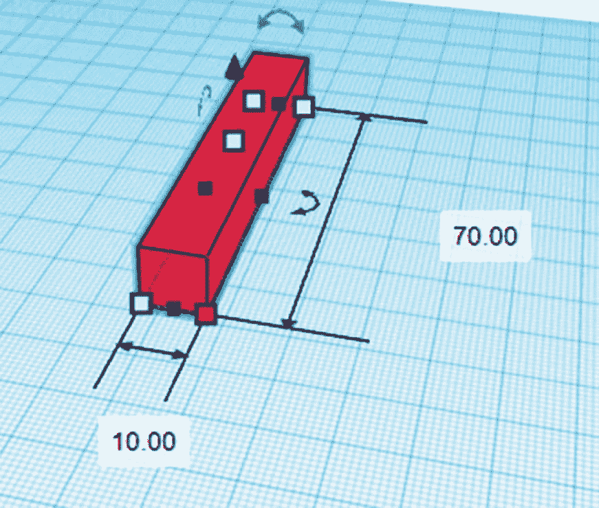

**图 1：** *通过调整立方体尺寸创建衣帽钩的杆部。*

2. 将一个 `Donut Slice`（甜甜圈切片）拖放到工作平面上（图 2）。`Donut Slice` 工具可以通过 `Shape Generator`（形状生成器）下拉菜单中的 `All`（全部）找到。向下滚动直到找到甜甜圈切片工具。将甜甜圈厚度的半径设置为尽可能接近 5 毫米。将弧长设置为略大于 0.5。这将确保您的外套不会从钩子上滑落。将甜甜圈本身的半径设置为接近 20 毫米。这个甜甜圈切片将成为 J 形的弯曲部分。

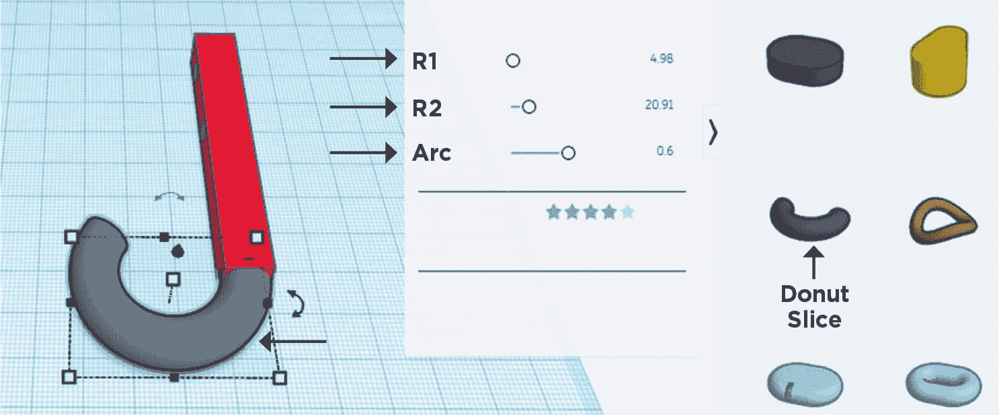

**图 2：** *甜甜圈切片构成了钩子的弯曲部分。*

3. 将甜甜圈切片曲线移动以与 J 形的杆部合并，如图 2 所示。此时设计的衣帽钩尖端宽度与主体相同，这与 这里 所示的 3D 打印锥形尖端钩子图片看起来不同。

4. 如果需要锥形钩子，我们可以通过使用 `Rectangular Hole`（矩形孔）工具从尖端移除材料来实现。

5. 现在使用实验 4 中的相同流程（见 这里）在 J 形的杆部制作两个孔。每个孔的直径必须为 5 毫米，且距离边缘至少 2 毫米。两个孔之间的距离必须至少为 5 毫米（图 3）。用于将钩子固定在墙上的螺丝将穿过这些孔。

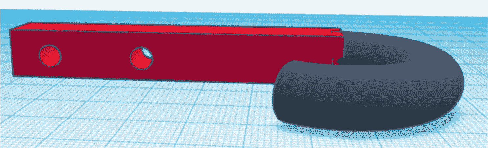

**图 3：** *为 J 形钩创建螺丝孔。*

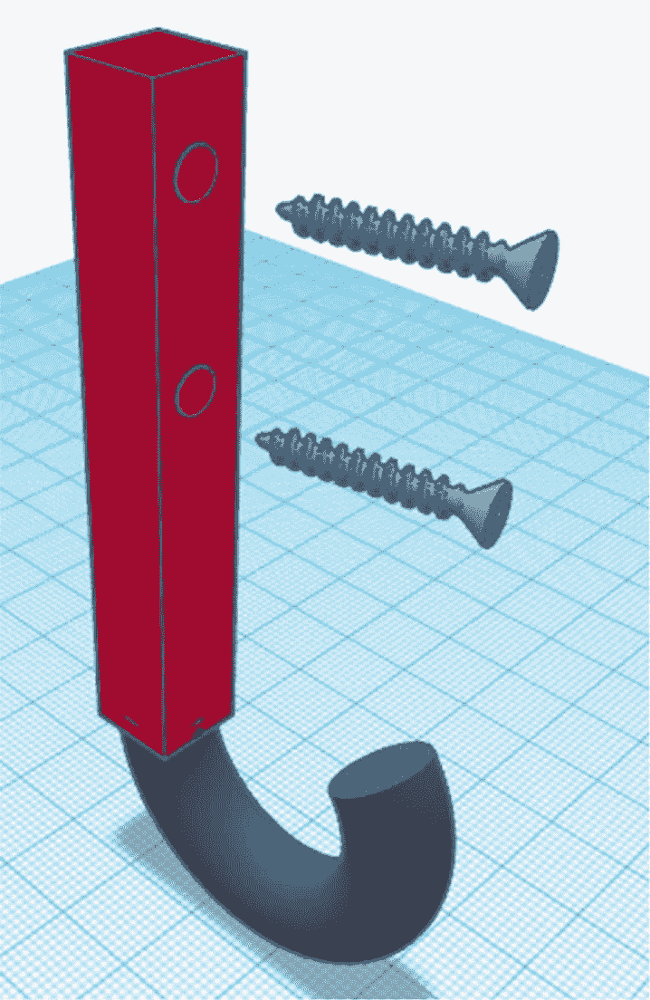

**图 4：** *将螺丝插入钩子的螺丝孔以安装钩子。*

### 3D 打印检查清单

#### 打印 CAD 模型前

 请参阅 这里 所示的 3D 打印基础知识以获取打印技巧。

 将 J 形旋转使其平躺在打印床上，如图 3 所示。

 打印衣帽钩。

 打印完成后，用锉刀清除任何多余材料。

#### 质量控制与产品测试

 将您的产品带到当地的五金店，寻找适合孔径的螺丝。

 检查产品：螺丝孔是否能容纳购买的螺丝，是否适合您计划安装钩子的表面。

 测试产品以确保钩子能挂住外套。

### 思考一下

考虑这些问题并记下可能的答案。您可以通过修改并打印新版本的设计来测试它们。

**如果甜甜圈切片的弧长是 0.4 而不是 0.6 会发生什么？**

**为什么孔距离边缘至少要 2 毫米？**

| 实验 | 描述 |
| --- | --- |
| 6 | 当地建筑项目：建模当地地标 |

## 实验 6：当地建筑项目：建模当地地标

到目前为止，我们已经学会了通过添加和移除材料来设计复杂形状。在本实验中，您将运用 CAD 建模技能来复刻您社区中的建筑。

我们将遵循一种系统的方法，该方法建立在前几个实验步骤的基础之上。其目的是培养对基本建筑学的理解，学习一些当地历史，并提高我们的 CAD 技能。

示例项目展示了位于纽约市曼哈顿上西区社区的几座建筑。

### 设计流程

1. 对于您的第一个结构，识别其各个部分（1-基座/地基，2-主体，3-屋顶/塔楼，4-立面/精细元素[窗户、柱子]），如图 1 和 2 所示，其中我们以格兰特墓和纽约市的一家银行为设计示例，识别了它们的构成元素。

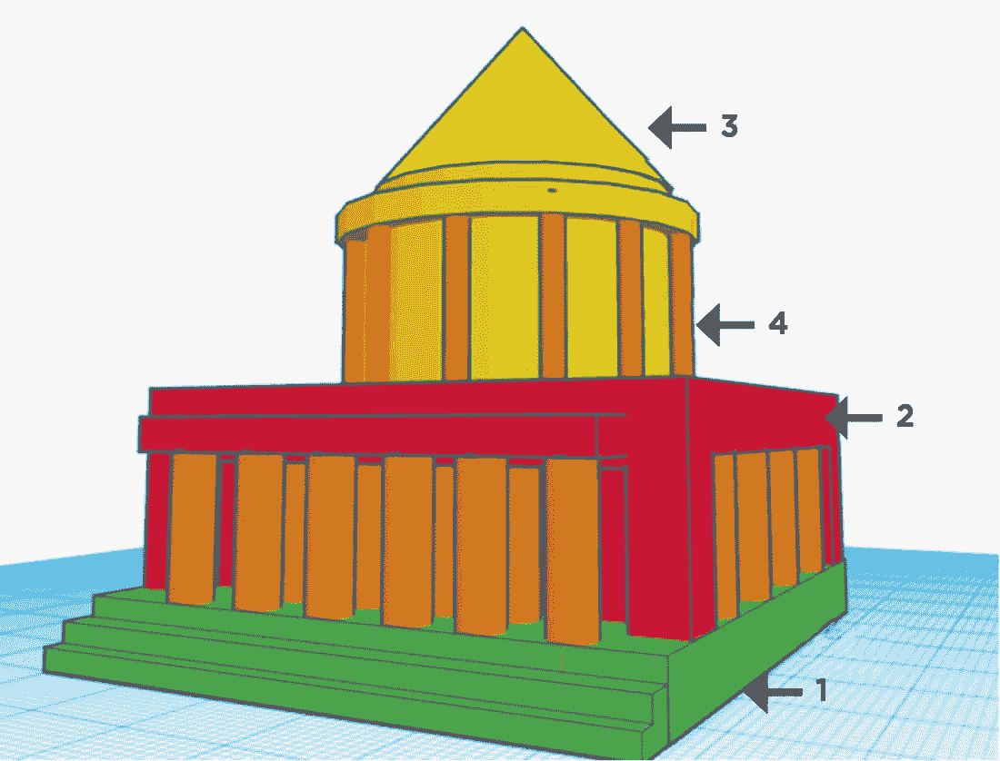

**图 1：** *标识出各部分的格兰特墓 CAD 模型。*

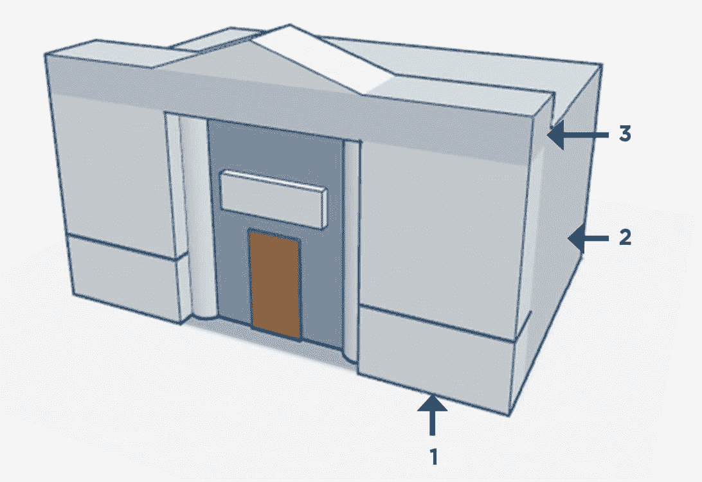

**图 2：** *标识出各部分的苹果储蓄银行 CAD 模型。*

2. 决定基座/地基最长边的尺寸（通常不超过 2 英寸/5.1 厘米）。我们为墓碑选择了 1 英寸/2.5 厘米，因为我们的街道长度为 2 英寸/5.1 厘米，社区大小约为 50 英寸/127 厘米。

3. 决定基座的宽度和结构的总高度（必须反映真实结构的比例）。我们选择了略小于 1 英寸，因为墓碑大致呈正方形。

4. 在 Tinkercad 中建模结构的每个元素。

5. 按照步骤 1-4 建模其余结构。

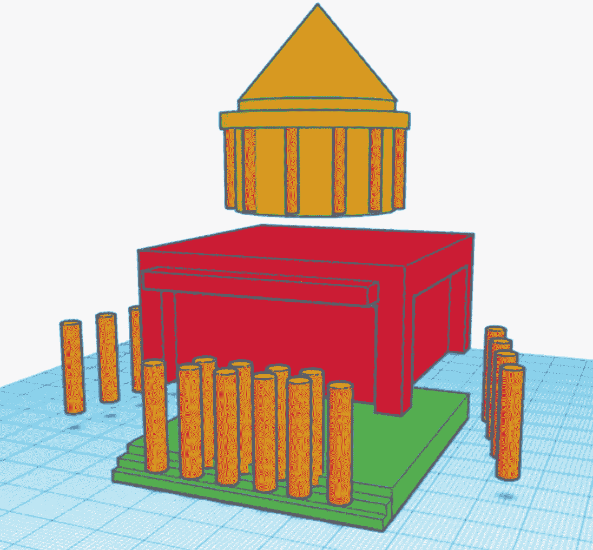

**图 3：** *格兰特墓的各个部分正在组装中。*

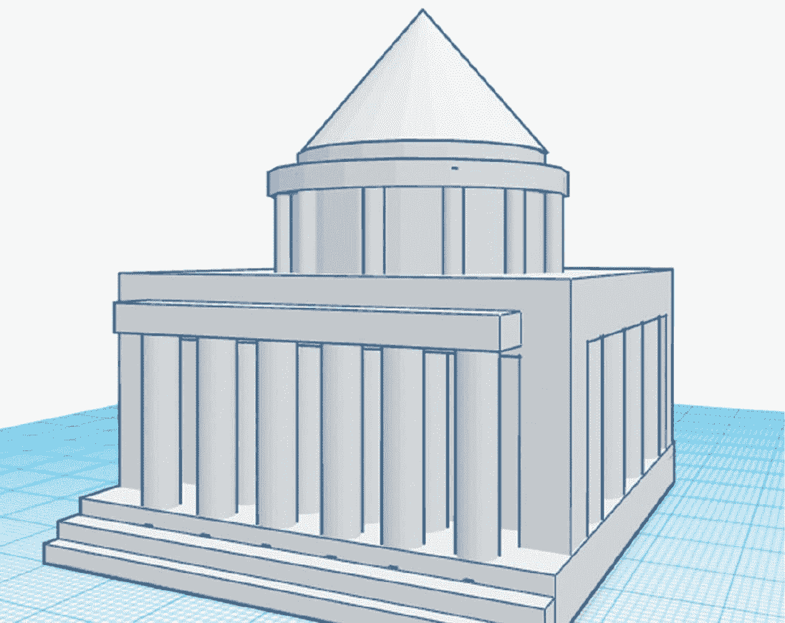

**图 4：** *显示格兰特墓各部分组装视图的图像。*

### 3D 打印检查清单

#### 打印 CAD 模型前

 请参阅 这里 所示的 3D 打印基础知识以获取打印技巧。

 打印完成后，用锉刀清除任何多余材料，并将结构放置在地图上的适当位置。

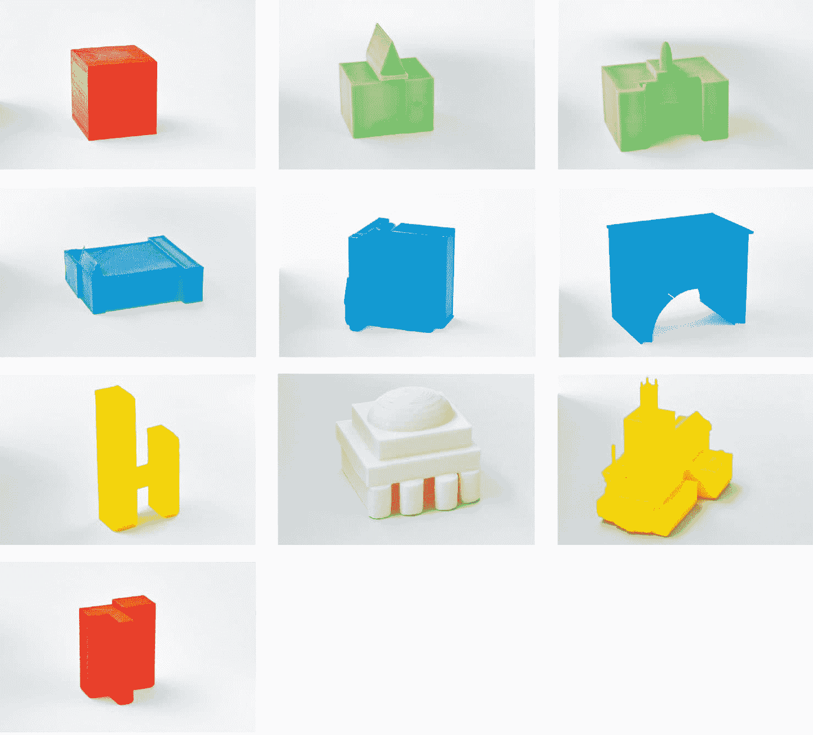

**图 5-14：** *纽约市上西区建筑项目的已完成 3D 打印模型。*

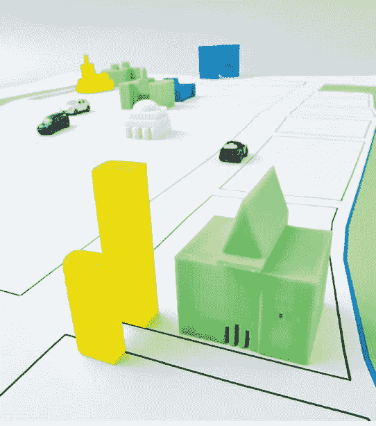

**图 15：** *放置在地图上的纽约市上西区社区建筑项目的已完成 3D 打印模型。*

#### 质量控制与产品测试

检查打印件：

 模型的比例与真实结构相符。与其他元素相比，模型的任何元素看起来是否太大或太小？

 每个模型与真实结构的建筑相似度。

### 思考一下

考虑这些问题并记下可能的答案。您可以通过修改并打印新版本的设计来测试它们。

**您的结构中融合了哪两种不同的建筑风格？**

**您认为为什么为这些结构选择了一种建筑风格而非另一种？**

| 实验 | 描述 |
| --- | --- |
| 7 | 发梳 |

## 实验 7：发梳

在本实验中，我们将从结合历史、建筑和 CAD 技能来了解我们的社区，转向探索如何通过降低材料的刚性来增加其柔韧性。我们将设计并打印一个发梳来研究这一过程。

### 设计流程

1. 使用 `Box`（盒子）和 `Cylinder`（圆柱体）工具创建梳子的单个齿。拉伸盒子使其细长。拉伸圆柱体使其略呈椭圆形。然后在圆柱体最宽处（也称为其直径）将这两个步骤合并。尺寸应约为 2.5 毫米厚，长度约为 1 英寸（2.5 厘米）。圆柱体使齿具有圆润的边缘，以防止刮伤头皮。将拉伸的盒子和拉伸的圆柱体组合在一起形成单个齿。

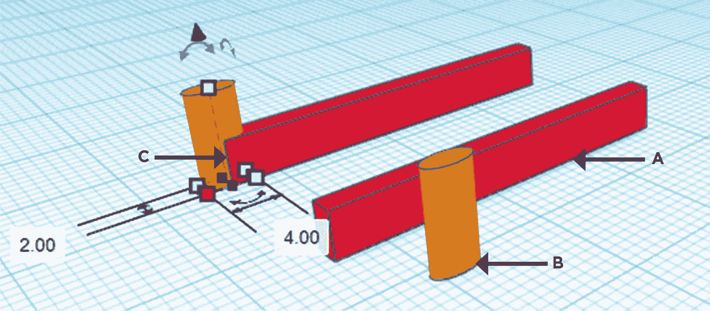

**图 1：** *拉伸的盒子 (A)、拉伸的圆柱体 (B) 以及在圆柱体最宽处组装的齿 (C)。*

### 梳子

#### 设计步骤

2. 复制约 8 到 12 个齿，间距约 1.5 mm。使用梳头将齿在一端连接起来。使用拉伸盒创建梳头，厚度至少应为 2.5 mm，长度需足以容纳所有齿（图 2）。

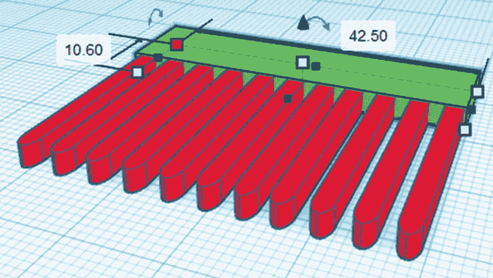

**图 2：** *梳头的拉伸盒厚度至少应为 2.5 mm，长度需足以容纳所有齿。*

3. 使用另一个拉伸盒创建手柄，厚度与梳头相同，并将其连接到梳头。手柄长度由手掌宽度决定，通常约为 90 mm。图 3 显示了手柄和握持处的镂空。

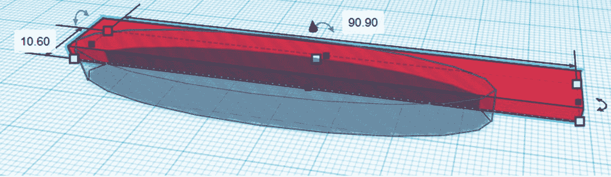

**图 3：** *梳子的手柄和握持处的镂空。*

4. 图 4 展示了完成的梳子设计。你可以在手柄上镂空一些形状，用于装饰或实用目的。

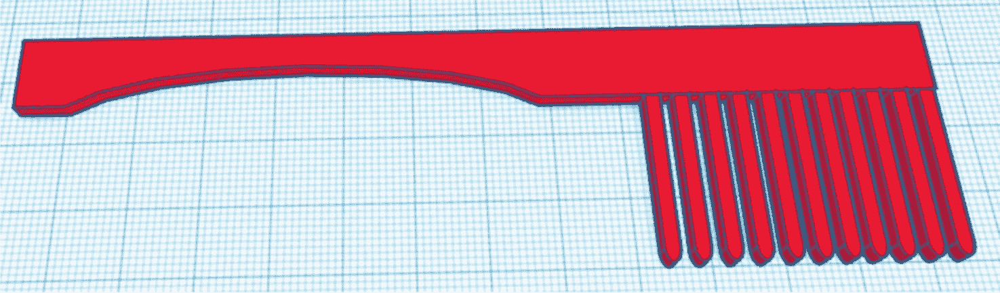

**图 4：** *完成的梳子设计。*

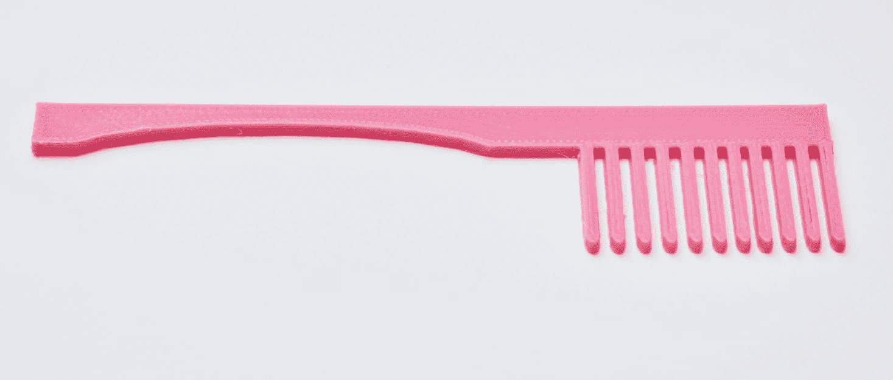

### 3D 打印清单

#### 打印 CAD 模型前

- [ ] 请参阅此处所示的 3D 打印基础知识以获取打印技巧。
- [ ] 打印梳子。
- [ ] 打印后，用锉刀清除多余材料。

#### 质量控制与产品测试

- [ ] 检查齿是否平整或翘曲（向上弯曲）。请参阅图 5，它对比了两把梳子：一把齿翘曲，一把齿平直。如果齿翘曲，请修改设计以加厚齿，和/或在重新打印前确保所有齿都贴合在打印平台上。

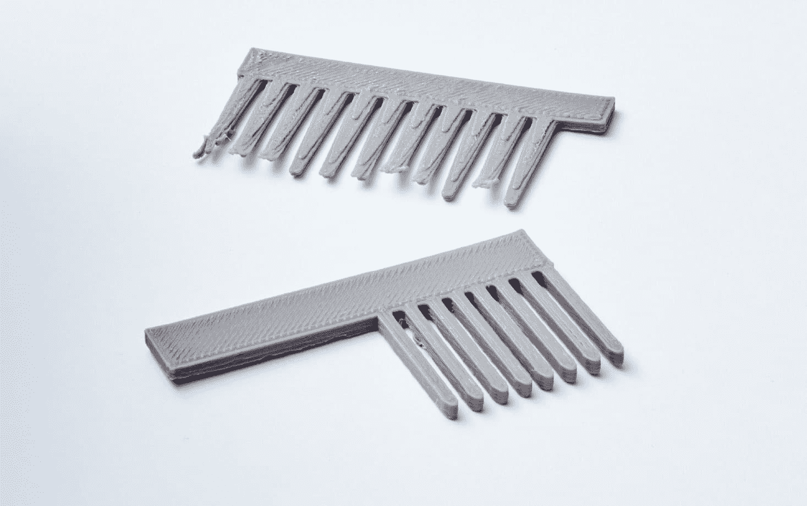

**图 5：** *检查打印件的齿是否翘曲，并根据需要调整设计。*

- [ ] 如果齿平直，用锉刀清除多余材料。
- [ ] 测试成品梳子，看其梳过头发时有多顺滑，不会卡住。它适用于某些发质，但不适用于其他发质吗？

### 思考一下

思考这些问题并记录可能的答案。你可以通过修改并打印新版本的设计来测试它们。

**如果齿距为 3 mm 而不是 1.5 mm，会发生什么？**

**这把梳子多少齿才算太多？**

---

| 实验 | | 回形针 |
| --- | --- | --- |

## 实验 8：回形针

在实验 7 中，我们创建了一把仅一端固定齿的梳子，以使齿的另一端在梳头发时具有一定的灵活性。在本实验中，我们通过移除固定部分来拓展创建灵活结构的概念。回形针是一种理想的产品，它足够刚性以夹住一叠纸，同时又足够灵活以弯曲并夹在纸叠上。

### 设计过程

1. 在 **`形状生成器—全部`**（箭头 1）中，使用 **`智能环面 2`**（箭头 2）创建两个环面，一个比另一个小，厚度均为 2 mm。较大的环面（箭头 3）大约为 75 mm × 35 mm，而较小的环面（箭头 4）应套在其内部，大约为 50 mm × 20 mm（图 1）。

**图 1：** *使用两个环面形状建模回形针。*

2. 使用 **`挖孔`** 工具在较大环面的右上角切去一小部分（图 2）。

**图 2：** *使用盒状挖孔切去较大环面的一部分，以增加回形针的灵活性。*

3. 如图 3 所示，使用 **`长方体`** 连接两个环面。

**图 3：** *用* **`长方体`** *连接两个环面以形成夹子。*

### 3D 打印清单

#### 打印 CAD 模型前

- [ ] 请参阅此处所示的 3D 打印基础知识以获取打印技巧。
- [ ] 打印回形针。
- [ ] 打印后，用锉刀清除多余材料。

#### 质量控制与产品测试

- [ ] 测试产品夹住一叠纸的能力。

### 思考一下

思考这些问题并记录可能的答案。你可以通过修改并打印新版本的设计来测试它们。

**如何修改设计以使回形针变得不那么灵活？**

**你会对设计做何修改以使回形针更灵活？**

---

| 实验 | | 面条勺 |
| --- | --- | --- |

## 实验 9：面条勺

我们许多人都喜欢享用一大碗面条。然而，如果你有合适的勺子，做面条会容易得多，因为面条滑溜溜的，很难盛装。在本实验中，我们设计一个带孔的面条勺。孔可用于量取一份面条和沥水。但请记住，并非每个人的食量都相同。

注意，成品（较小）打印勺仅可用于冷却或冷面条，且仅限测试用途。请勿用于热面条，或用于盛装食用的面条。

### 设计过程

1. 使用 **`半球体`** 工具创建两个半球体。大的实心半球体约为 30 mm × 30 mm，较小的是一个约为 27 mm × 27 mm 的挖孔，如图 1 所示。

**图 1：** *创建一个实心半球体和一个半球体挖孔，用于面条勺的圆顶形部分。*

2. 重叠两个球体使它们同心（较小的在较大的内部）。我们正在制作壁厚约为 1.5 mm 的勺子。将重叠的球体一起旋转，使平面朝上，如图 2 所示。

**图 2：** *重叠两个球体并旋转，使平面朝上。*

3. 将两个半球体组合并调整大小。长度约为 55 mm，宽度 30 mm，高度约 13 mm，如图 3 所示。

**图 3：** *组合半球体并调整大小。*

4. 现在通过拉伸 **`盒子`** 工具创建三个 **`长方体挖孔`**。每个长条的宽度取决于你想要面条勺齿之间的间隙有多宽。下图显示为 6 mm。排列它们，使面条勺的齿大致等距分布（图 4）。

**图 4：** *使用长方体挖孔创建面条勺的齿。*

5. 使用 **`组合`** 工具将所有挖孔长条和勺子组合在一起，得到带齿的勺子，如图 5 所示。

**图 5：** *将挖孔长条和勺子球体组合在一起。*

6. 使用 **`圆柱体挖孔`** 工具在勺子中心创建一个孔（图 6）。

**图 6：** *使用圆柱体挖孔在勺子中间打孔。*

7. 将圆柱体挖孔和勺子组合以完成勺子上的孔。如图 7 所示添加手柄。

**图 7：** *添加手柄并将所有部件组合在一起。*

8. 将整个设计旋转 180 度，使其平铺（面朝下）在工作平面上。这将是打印时的方向。

### 思考一下

思考这个问题并记录可能的答案。你可以通过修改并打印新版本的设计来测试它们。

**如何修改设计以使面条勺更好地抓取湿面条？**

### 3D 打印清单

## 实验 10：粉碎字母表：测试结构强度

### 打印 CAD 模型前

 请参阅此处所示的 3D 打印基础知识以获取打印技巧。

 打印意面勺。

 打印完成后，用锉刀清除多余材料。

### 质量控制与产品测试

 测试产品抓取湿意面的能力。**切勿用于热意面，且切勿用于盛装食物。**

在前几个实验中磨练了操控材料形状和尺寸的技能后，我们现在将探索简单结构的强度如何受结构朝向的影响。根据受力部件的朝向不同，不同的结构会表现出更强/更不灵活或更弱/更灵活的特性。

本实验需要使用机械台钳，大多数大型五金店均有出售，价格合理，测试过程中还需佩戴护目镜。可选：您也可以选择使用测力计以获得更精确的读数。图中展示的是 Nextech DFS500 数字推拉力计。

### 设计流程

1.  选择多种形状各异的字母，例如 A、B、C 和 T。
2.  在同一工作平面上使用**文字和数字**工具设计这些形状。每个字母的长度应为 20 毫米，高度 3 毫米，宽度应与字母形状成比例（图 1）。

**图 1：** *Tinkercad 拥有用于字母和数字的工具。*

3.  调整打印属性/配置，确保在开始打印前形状的填充率为 5%（请在您的 3D 打印机设置中进行此操作）。每种形状打印两个。

### 3D 打印检查清单

#### 打印 CAD 模型前

 请参阅此处所示的 3D 打印基础知识以获取打印技巧。

 每个字母打印两个。

 打印完成后，用锉刀清除多余材料。

### 强度测试流程

**此过程期间必须佩戴护目镜！**

1.  将机械台钳安装在稳固的桌面上。
2.  将第一个字母横向放入台钳，沿其宽度方向夹紧，直到台钳钳口夹住它，但不要夹得太紧以免使字母变形。请参见图 2，图中展示了字母 A 在第一部分沿其长度方向放入台钳钳口，在第二部分沿其宽度方向放入。

**图 2：** *将字母放入台钳钳口，先沿长度方向，再沿宽度方向，以测试每个字母在不同朝向下的性能。*

3.  当您开始转动台钳手柄时：
    -   记录字母开始变形时的圈数
    -   记录发生变形的字母部位——顶部、底部、中间、字母主干、字母曲线
    -   记录变形方向——水平、垂直或对角线
4.  使用同一字母的新打印件，但这次将其以不同朝向放入台钳，沿其长度方向（图 2），直到台钳钳口夹住它，但不要夹得太紧以免使字母变形（图 3）。

**图 3：** *字母 E 沿其长度方向放入台钳钳口。*

5.  将步骤 3 的变形信息记录在如下所示的表格中。您的数据会因打印材料、字母大小以及所用台钳类型的不同而有所差异。

| **字母** | **朝向** | **开始变形的手柄圈数** | **变形部位** | **变形方向** |
|------------|-----------------|--------------------------------------------|----------------------|------------------------------|
| T          | 沿长度方向    | 5                                          | T 的中央主干    | 水平                   |
| T          | 沿宽度方向     | 6                                          | T 的顶部横干        | 水平                   |
| E          | 沿长度方向    |                                            |                      |                              |
|            |                 |                                            |                      |                              |
|            |                 |                                            |                      |                              |
|            |                 |                                            |                      |                              |
|            |                 |                                            |                      |                              |

### 思考一下

考虑以下问题并记下可能的答案。您可以通过修改并打印新版本的设计来测试它们。

**有字母在从台钳中取出后能恢复原状吗？如果有，为什么？**

## 实验 11：人工珊瑚礁

在前十个实验中，我们通过添加、移除、合并和调整材料大小，学习了各种设计技术。现在我们将探索更复杂的技术，即调整设计以使其与其他材料/环境发生相互作用。

本实验涉及调整一个放置在水中的设计，以便我们可以修改其周围的水流。这将通过一个设计人工珊瑚礁的项目来实现。珊瑚礁为小鱼提供庇护，同时也会扰动流动的水，使其减速，以便珊瑚和鱼类能从水中获取食物/营养。我们可以使用流体仿真软件来测试珊瑚礁设计。

### 设计流程

1.  珊瑚礁的框架可以是任何形状，包括非基本形状。在我们的示例中，我们将使用一个带有水平和垂直孔洞的矩形框架，如图 1 所示。通常，没有任何尺寸应大于 50 毫米。孔洞可以是任何形状。我们选择了矩形孔洞，如图 1 和图 2 所示。

**图 1：** *将多个矩形孔洞滑入立方体中以设计珊瑚礁模型。*

**图 2：** *将孔洞与立方体组合。*

2.  在中央梁上创建一个偏心孔。同样，该孔可以位于任何角落，可以是任何形状。目的是使进入框架的水改变方向并减速（图 3）。

**图 3：** *在中央梁上添加一个偏心孔。*

3.  在框架上添加各种形状，以部分遮挡一些大孔（防止大鱼进入），并创建角落来改变水流方向并使其减速。请参见图 4，箭头 1 和 2 指出了珊瑚礁中的小角落。

**图 4：** *使用各种形状在珊瑚礁中创建角落。*

4.  可选：从 Tinkercad 下载 .STL 文件副本并将其导入 Autodesk Flow Design 软件，该软件可模拟液体流经设计的过程。调整流源以使其与珊瑚礁模型对齐（图 5，箭头 1 指向流源，箭头 2 指向珊瑚礁模型）。启动流动并观察因珊瑚礁设计而产生的变化。观察是否有蓝色条纹（图 5，箭头 3）。这表明水颗粒已显著减速。请参见图 5 查看仿真视图。

**图 5：** *Autodesk Flow Design 软件模拟液体流经珊瑚礁的过程。深蓝色表示减速最明显的流动区域。*

### 3D 打印检查清单

#### 打印 CAD 模型前

 请参阅此处所示的 3D 打印基础知识以获取打印技巧。

 打印人工珊瑚礁。

 打印完成后，用锉刀清除多余材料。

#### 可选质量控制与产品测试

### 思考一下

考虑这个问题并记下可能的答案。您可以通过修改并重新测试新版本的设计来验证它们。

### 珊瑚礁结构如何减缓礁石中的水流？

## 实验 12：哨子设计

在上一个实验中，我们设计了一个人工珊瑚礁结构来改变水流。在本实验中，我们将设计一个结构来改变/引导气流。哨子将吹入的空气引导至边缘流过以产生声音。在 CAD 中设计哨子是一个需要多个步骤的复杂过程。

### 设计过程

1. 使用 `Cylinder` 工具创建一个直径 27 毫米、高 20 毫米的哨子主体。在左上角添加一个与圆柱体等高（20 毫米）的 `Box`，宽 7 毫米，长约 25 毫米。确保盒子在与圆柱体相接处是齐平的。图 1 箭头 1 显示了它们接触的点。将圆柱体和盒子 `Group`（组合）在一起。

**图 1：** *连接哨子主体的圆柱体和盒子。*

2. 现在我们将把哨子主体挖空。创建另一个直径 23 毫米的圆柱体。移动它，使其均匀地嵌入步骤 1 的圆柱体内部（同心）。再添加一个宽 4 毫米、比步骤 1 中的盒子稍长的盒子。对齐步骤 2 中的盒子和圆柱体，使它们像步骤 1 那样齐平（图 2）。将步骤 2 中的盒子和圆柱体 `Group`（组合）并转换为孔。将其移离工作平面 2 毫米。然后，将步骤 1 和 2 中的盒子和圆柱体 `Group`（组合）以形成挖空的哨子主体。参见图 3，注意箭头 1 标记的盒子和圆柱体的齐平接合处。

**图 2：** *使用圆柱体孔和盒子孔挖空哨子主体。*

**图 3：** *注意盒子和圆柱体的齐平接合处。*

3. 吹嘴孔内部需要呈锥形。从 `Basic Shapes`（基本形状）工具箱中使用 `Wedge`（楔形）工具创建一个楔形，将其连接到吹嘴内部以使其成锥形。楔形应按图 4 所示旋转。其较宽端厚度应约为 1.50 毫米（图 4 中箭头 1）。将其连接到吹嘴孔内部，如图所示。调整 `SnapGrid`（捕捉网格），以便进行小于 1 毫米的修改。楔形与其连接的吹嘴下表面之间不应有间隙。详见图 4。

**图 4：** *使用楔形使哨子吹嘴内部成锥形。*

4. 创建哨子发声孔。首先，我们将在哨子顶部创建一个孔。使用 `Box` 工具制作一个宽 3 毫米、高 18 毫米的盒子孔（图 5）。移动它，使其大致与吹嘴孔楔形的较宽端对齐（箭头 1）。移动它，使其位于工作平面上方 2 毫米处。将其与哨子主体 `Group`（组合）。

**图 5：** *为哨子创建并对齐发声孔。*

5. 现在我们需要使远离吹嘴一侧的发声孔边缘成锥形。使用 `Wedge` 工具创建一个楔形孔，如图 6 所示。它需要绕几个轴旋转，以按图像所示定向。其较宽端应为 3.8 毫米。确保对齐它，使其较窄端如图 6 所示与哨子主体在单一边缘相接。将楔形孔与哨子主体合并。

**图 6：** *使用楔形孔使发声孔边缘成锥形。*

6. 通过创建一个直径 15 毫米的 `Sphere`（球体）并将其定位在工作平面上方 1.9 毫米处来设计哨子豌豆（哨丸）。它应位于哨子内部，如图 7 所示。

**图 7：** *哨子豌豆是哨子内部的一个球体。*

7. 使用我们在步骤 1 中制作的哨子主体圆柱体和盒子的副本。将其压扁至 2.1 毫米并对齐以覆盖步骤 6 的哨子设计。移动它，使其位于工作平面上方 18.9 毫米处，以确保没有间隙。将其与哨子主体 `Group`（组合）以完成设计。完成的哨子见图 8。

**图 8：** *使用哨子主体压扁的副本制作盖子以完成哨子。*

## 实验 13：基本燕尾榫接头

有时我们需要设计成柔性结构，以便增加/减少运动和/或组装/拆卸它们，以满足功能性和/或打印限制。关节（类似于我们身体里的关节）可用于此目的。有许多不同类型的关节。有些限制特定方向的运动，如手指的指关节；其他的允许旋转运动，如肩关节。在本实验中，我们将使用燕尾榫接头来限制一个方向的运动，以便我们可以组装和拆卸两个部件。

### 设计过程

1. 建模燕尾榫接头的榫槽（母榫）部分。使用 `Box` 工具创建一个 20 毫米 x 35 毫米、高 12 毫米的盒子。

2. 使用三棱柱 `Roof`（屋顶）工具在盒子中创建燕尾形榫槽。屋顶的宽度应比盒子窄至少 2 毫米。对于本项目，即 12 毫米。高度应与盒子大致相同。移动屋顶使其在盒子宽度方向上居中，并从盒子顶部伸入不到一半的位置（图 1）。箭头 1 显示屋顶伸入盒子不到一半，这很重要。

**图 1：** *将三棱柱（屋顶）定位在盒子内部。*

3. 将屋顶转换为孔并与盒子 `Group`（组合）以完成接头的榫槽部分（图 2）。它看起来应该像盒子上一个形状像燕尾的通孔。

**图 2：** *将三棱柱和盒子组合可创建燕尾形榫槽/缺口。*

4. 使用 `Box` 或 `Cylinder` 工具创建一个长 20 毫米、高 15 毫米的实体形状，开始制作接头的榫头（公榫）部分。

5. 使用 `Roof` 工具创建第二个屋顶，其宽度比步骤 2 中用于榫槽部分的屋顶窄 2 毫米。高度应矮 1 毫米（图 3）。

**图 3：** *创建一个稍窄的榫头，使其能滑入榫槽。*

6. 将第二个屋顶与步骤 4 中的盒子/圆柱体合并。屋顶嵌入盒子/圆柱体的部分应不到一半，以便它能滑入榫槽部分。图 3 中的箭头 1 显示屋顶嵌入榫头部分的盒子不到一半。

7. 将步骤 4 中的屋顶和盒子/圆柱体 `Group`（组合）以完成榫头部分。将其移动到与榫槽部分配合的位置，以便检查配合情况。图 4 左侧显示错误配合（箭头 1），右侧显示正确配合（箭头 2 显示榫头和榫槽部分之间的轻微间隙）。箭头 3 所示的间隙对接头影响不大，可以小于 1 毫米。

**图 4：** *将组合后的榫头部分滑入榫槽。正确的配合有轻微间隙。*

8. 测试配合并根据需要调整尺寸后，将榫头部分移离榫槽部分，使它们分开以便打印。如果在步骤 4 中使用了盒子，你需要将榫头部分旋转 90 度，使其竖立在其末端上（图 5）。这将确保打印过程中没有悬垂。

**图 5：** *定位好用于 3D 打印的完成设计。*

### 3D 打印清单

#### 打印 CAD 模型前

 请参阅此处所示的 3D 打印基础知识以获取打印技巧。

 打印燕尾榫接头。

## 实验 14：手机支架

### 设计流程

1. 我们从设计说明中提到的四个要素开始，绘制一张我们想要的手机支架外观的草图。请参考图 1，但您可以改变某些方面，例如挡边、靠背和底座的形状。

**图 1：** *一张带手机的手机支架草图。*

2. 接下来，我们使用 CAD 软件根据步骤 1 的草图对产品的各个要素进行建模。

- 创建底座（厚度 2 mm，宽度约 40 mm，长度约 80 mm [图 2 中的 #2]）。

**图 2：** *带燕尾榫接头的手机支架的挡边 (1)、底座 (2)、榫槽 (3)、榫头 (4) 和靠背/支架 (5)。*

- 创建挡边（高出底座约 2 mm，长度约 10 mm [图 2 中的 #1]）。
- 创建燕尾榫接头的 `socket` 榫槽部分，连接在底座上，最长边约 20 mm，或为底座宽度的一半（图 2 中的 #3）。
- 创建与 `socket` 尺寸匹配的燕尾榫接头 `tail` 榫头部分（图 2 中的 #4）。
- 创建靠背/支架并将其连接到燕尾榫接头的 `tail` 部分（宽 20 mm 的靠背 [图 2 中的 #5]）。
- 在底座上添加一个镂空。这不是必须的，但可以节省材料。详见图 3。镂空的大小可根据您想节省的材料量而变化。

**图 3：** *手机支架的组装视图。*

### 3D 打印清单

#### 打印 CAD 模型前

- [ ] 查看此处所示的 3D 打印基础知识以获取打印技巧。
- [ ] 将靠背-燕尾榫接头的 `tail` 榫头部分旋转，使其平放在打印平台上（图 4）。

**图 4：** *定位好用于 3D 打印的完成手机支架设计。*

- [ ] 考虑创建一些孔以节省材料（见图 3 中底座上的长方形孔）。
- [ ] 确保燕尾榫接头 `tail` 榫头部分的尺寸略小于 `socket` 榫槽部分的尺寸。
- [ ] 打印手机支架。
- [ ] 打印完成后，用锉刀清除任何多余材料。

#### 质量控制与产品测试

测试产品的：

- [ ] 接头组装和拆卸是否顺畅。
- [ ] 支架能否将手机直立支撑。

### 思考一下

考虑以下问题并记下可能的答案。您可以通过修改并打印新版本的设计来测试它们。

**为什么我们需要榫头部分的尺寸略小于榫槽部分？**

**挡边如何帮助实现设计目标？**

**您如何/可以如何调整您的设计，使其在拆卸时尽可能平整？**

---

## 实验 15：带球窝关节的相机支架

在实验 14 中，我们使用了可拆卸的燕尾榫接头以增加功能性。现在，我们将使用另一种接头——球窝关节，以允许相机支架旋转。我们将使用带槽的 `socket` 窝，因为这允许设计有更大的公差。

### 设计流程

#### 创建带底座的开槽窝

1. 使用 `Sphere` 球体工具创建一个直径 25 mm 的 `Sphere` 球体。然后使用 `Rectangular Hole` 长方体挖孔工具切掉顶部约 1/4，如图 1 所示。将长方体挖孔和球体 `Group` 组合在一起，得到初始的 `socket` 窝框架（图 2）。

**图 1：** *将长方体挖孔定位在球体上方以切除球体顶部。*

2. 现在我们将挖空 `socket` 窝框架。创建一个直径 23 mm 的 `Sphere Hole` 球体挖孔。移动它，使其均匀地嵌入步骤 1 的球体内部（同心）（图 2）。将内部挖孔球体和外部 `socket` 球体 `Group` 组合，形成挖空的 `socket` 窝。

**图 2：** *将长方体挖孔和球体组合。*

3. 现在我们将在 `socket` 窝壁上创建槽，使其具有柔性以便球体能插入。创建一个 `Rectangular Prism Hole` 长方体挖孔并按图 3 所示定向。注意槽要延伸至 `socket` 窝高度约一半处。如图 3 所示再创建两个槽。

**图 3：** *使用长方体挖孔在挖空的球体上切出槽。*

4. 将槽挖孔和挖空的 `socket` 窝 `Group` 组合，完成 `socket` 窝框架。将整个 `socket` 窝垂直向上移动 1 mm，并在其正下方添加一个 2 mm 的底座，如图 4 所示。

**图 4：** *组合了槽挖孔和球体并置于底座上的完成窝设计。*

5. 要创建关节的球体，只需使用 `Sphere` 球体工具创建一个直径比 `socket` 窝内径小 1 mm 的球体。我们使用了 22 mm 作为球体直径。在顶部添加一个小盒子作为球体的把手（图 5）。

**图 5：** *创建关节球体并添加盒子作为把手。*

6. 相机安装座必须作为一个单独的部件创建，以便于 3D 打印。相机安装座是一个基本的托架，通过过盈配合将相机固定在其中。只需创建一个相机安装座，使用实验 13 中的燕尾榫接头（见此处）连接到球体把手上。这将需要两个部分：燕尾榫接头配合件和托架。连接到托架的燕尾榫接头配合件（图 6 中的箭头 2）是使用 `Shape Generators Tool Box` 形状生成器工具箱中的 `Double Trapezoid` 双梯形工具创建的（图 6 中的箭头 1）。

**图 6：** *带有由双梯形创建的燕尾榫接头部分的相机支架托架。*

7. 托架是使用多个 `Box` 盒子工具创建的，形状如图 6 箭头 3 所示。相机将紧贴在托架中，因此托架的宽度应与您的相机厚度相匹配（某些手机相机约为 7 mm）。然后将托架和步骤 6 中的托架配合 `Double Trapezoid` 双梯形合并（图 6）。

8. 燕尾榫接头配合件上的 `socket` 槽/缺口和把手上的 `tail` 榫头（图 7）是使用实验 13 中的燕尾榫接头创建步骤创建的（见此处）。

**图 7：** *定位用于 3D 打印的相机支架部件。*

### 3D 打印清单

#### 打印 CAD 模型前

- [ ] 查看此处所示的 3D 打印基础知识以获取打印技巧。

### 球窝式相机支架

#### 3D 打印检查清单

#### 打印 CAD 模型前

-  由于存在悬垂结构，请为球体和托架座使用底板或支撑结构。
-  打印相机支架。
-  打印完成后，用锉刀清除多余材料。移除底板或支撑结构。

#### 质量控制与产品测试

-  测试产品安装相机并使其能 360 度旋转的能力。按图 8 所示进行组装。

**图 8：** *相机支架的组装部件。*

#### 思考一下

思考以下问题并记录可能的答案。你可以通过修改并打印新版本的设计来验证它们。

- **如果球体直径与窝内径的差值仅为 0.5 mm，会发生什么？**
- **为什么窝里会有槽？**

---

## 实验 16：可锁定球窝式相机支架

### 设计流程

#### 创建键槽

1. 我们首先对齐上一实验中的带槽窝段和球段。将窝的材质转换为`透明`（图 1，箭头 2），以便确保它们正确对齐——即球体与窝内侧四周间隙相等（图 1，箭头 1）。

   

   **图 1：** *将球关节的窝部分转换为透明。*

2. 分离这两个部分，但保持它们在对齐时的相同高度和角度。

3. 现在我们将创建一个锁孔，以便将支架锁定在垂直位置。创建一个 `2 mm × 2 mm × 20 mm` 的 `长方体孔`。将其与窝在约窝高度一半处合并（注意距工作平面的高度；见图 2 中的箭头）。将长方体孔与窝`组合`，在窝中形成锁孔（图 3）。

   

   **图 2：** *在窝中创建一个长方体孔。*

   

   **图 3：** *窝中完成的长方体孔。*

4. 现在我们将在球段创建键座，以便将支架锁定在垂直位置。复制步骤 2 中的 `长方体孔`。将其与球体在距工作平面相同高度、相同角度处合并（如步骤 2 所示）（图 4）。将长方体孔与球段`组合`，在球体上创建键座（图 5）。

   

   **图 4：** *在球关节的球段上创建一个匹配的长方体孔作为键座，其高度和角度与窝段中的孔相同。*

   

   **图 5：** *球窝关节中完成的键座。*

5. 要创建键，只需使用 `梯形` 工具创建一个梯形。较宽的一端应为 `1.5 mm × 1.5 mm`，长度为 `10 mm`（图 6）。

   

   **图 6：** *使用梯形创建键。*

### 3D 打印检查清单

#### 打印 CAD 模型前

-  请参阅 `此处` 所示的 3D 打印基础知识以获取打印技巧。
-  打印可锁定相机支架。
-  打印完成后，用锉刀清除多余材料。移除底板或支撑结构。

#### 质量控制与产品测试

-  测试产品旋转并将相机锁定在垂直位置的能力。

### 思考一下

思考以下问题并记录可能的答案。你可以通过修改并打印新版本的设计来验证它们。

- **如果我们在窝段的槽位置制作键座，会发生什么？**

---

## 实验 17：3D 拼图

### 设计流程

1. 我们首先创建一个 `20 mm × 20 mm` 的盒子。复制这个盒子。我们现在有两个小拼图块。

2. 然后创建一个 `44 mm × 20 mm` 的盒子并复制它。我们现在也有两个较大的拼图块。图 2 显示了所有四个块。

   

   **图 2：** *为拼图形状创建四个盒子。*

3. 识别配合面。这是关键，以便确保每个接头都有配合的榫头和榫槽（图 3）。

   

   **图 3：** *识别拼图中哪些表面将相互邻接。图中相邻的 M 和 F 表面将相互配合。*

4. 现在为所有块创建燕尾榫接头。遵循实验 13（见 `此处`）中的步骤以确保良好的配合。图 4 显示了一个大块和一个小块的燕尾榫接头。图 5 显示了带有燕尾榫接头的所有块。

   

   **图 4：** *一个较大和一个较小拼图块上的燕尾榫接头。*

   

   **图 5：** *所有带有完成的燕尾榫接头的拼图块。*

### 3D 打印检查清单

#### 打印 CAD 模型前

-  请参阅 `此处` 所示的 3D 打印基础知识以获取打印技巧。
-  打印拼图。
-  打印完成后，用锉刀清除多余材料。

#### 质量控制与产品测试

-  测试产品，看看你是否能将拼图拼合在一起。

### 思考一下

思考以下问题并记录可能的答案。你可以通过修改并打印新版本的设计来验证它们。

- **你能改变组装顺序吗？如果不能，你会如何修改设计以便能够改变顺序？**

---

## 实验 18：身体部位：人手

### 设计流程

1. 使用两个不同的 `盒子` 工具创建手掌。创建一个宽 `73 mm × 16 mm` 的手掌（图 1）。下部座部分是大拇指一侧。

   

   **图 1：** *使用两个盒子创建手掌模型，下部代表大拇指一侧。*

### 指关节与手指关节

#### 步骤 2：创建球窝
我们现在将使用 `Connector`（连接器）工具箱中的 `Socket`（球窝）工具来创建指关节球窝关节的窝（图 2 箭头指示了球窝工具）。我们不会调整 `Socket` 工具的大小，因为它与 `Ball`（球头）工具匹配，用于关节的其余部分。

**图 2：** *为指关节添加球窝。*

#### 步骤 3：创建球头与手指（近端指骨）
使用 `Connector` 工具箱中的 `Ball` 工具创建球窝关节的球头，从而创建球头与手指（近端指骨）（图 3）。我们不会调整 `Ball` 工具的大小，因为它与我们在第 2 步中创建的 `Socket` 工具相匹配。

**图 3：** *向圆柱体添加球头以创建手指。*

#### 步骤 4：创建手指
要创建手指，请使用 `Cylinder`（圆柱体）工具，并根据每根手指的比例长度进行设置。将长度和宽度与您自己的手指相匹配（图 3）。

#### 步骤 5：为其余手指重复操作
重复步骤 3 和 4 以创建其余手指，如图 4 所示。在每根手指的另一端添加一个指关节（见步骤 2），如图 4 所示。近端指骨将连接到这个指关节上。

**图 4：** *在远离球关节的一端为手指添加指关节球窝。*

#### 步骤 6：创建中指骨
通过重复步骤 2-4 来创建中指骨和匹配的指关节球头（图 5，#1）。

**图 5：** *为每根手指添加指尖。*

#### 步骤 7：添加指尖
使用 `Paraboloid`（抛物面）工具添加指尖，如图 5 箭头 2 所示。为所有手指重复步骤 5 和 6。

### 3D 打印清单

#### 打印 CAD 模型前
   请参阅 `#page_9` 所示的 3D 打印基础知识以获取打印技巧。

   打印手部模型。

   打印完成后，用锉刀清除任何多余材料。

#### 质量控制与产品测试
   将球头装入球窝中组装所有指关节（图 6）。

**图 6：** *带有手指和手掌的组装手部 CAD 视图。*

   测试产品弯曲手指的能力。

### 思考一下
考虑这个问题并记下可能的答案。您可以通过修改并打印新版本的设计来测试它们。

**实验 15 中设计的球窝关节如果用于指关节，会如何改变手指的运动方式？**

---

## 实验 19：人体手臂

| 实验 | 身体系统 |
|------|-------------|
| 19   | 人体手臂   |

在本实验中，我们将扩展复杂人体部位的设计技能，设计一个人体手臂。我们的模型经过简化，只有一根前臂骨而不是两根，且手部作为一个整体。

### 设计流程

#### 步骤 1：创建肩关节
创建肩关节。肩关节使用我们在实验 15 中创建的球窝关节建模（见 `#page_80`）。如图 1 所示，球窝内径为 23 毫米，球头直径为 22 毫米。

**图 1：** *使用球窝关节创建肩部模型。*

#### 步骤 2：创建上臂
我们将上臂建模为锥形管状。我们使用了 `High Resolution Tube`（高分辨率管）形状生成器工具。详情和尺寸请参见图 2，箭头 1。

**图 2：** *使用* `High Resolution Tube` *制作上臂。*

#### 步骤 3：创建肘关节
肘关节可以使用我们在步骤 1 中用于肩关节的同一个球窝关节进行建模。我们只需复制它并调整大小以适应上臂较小的一端，如图 1 所示。肘关节球窝的内径为 18 毫米。肘关节球头的直径为 17 毫米。

#### 步骤 4：创建前臂
前臂使用与上臂相同的工具建模（图 3）。较大一端的尺寸必须与肘关节球头的尺寸相匹配。

**图 3：** *复制上臂并调整大小以创建前臂。*

#### 步骤 5：创建腕关节
腕关节也可以使用球窝关节建模。球窝尺寸必须与前臂较窄一端相匹配。

#### 步骤 6：创建手部
手部通过腕关节连接到手腕。图 4 所示的手部是根据实验 18 中的手部（见 `#page_94`）建模的，但作为一个没有关节的整体。

**图 4：** *制作一个没有关节的简单手部形状。*

#### 步骤 7：为打印重新定位零件
打印前，我们需要重新定位一些零件。每个关节的球窝连接到其上方的部分，球头连接到手臂零件序列中的下一个部分。打印布局见图 5。

**图 5：** *3D 打印的零件定位。*

### 3D 打印清单

#### 打印 CAD 模型前
   请参阅 `#page_9` 所示的 3D 打印基础知识以获取打印技巧。

   打印手臂。

   打印完成后，用锉刀清除任何多余材料。移除任何底座或支撑。

#### 质量控制与产品测试
   组装所有零件（图 6）。测试产品的活动范围。

**图 6：** *显示带有关节的组装手臂的 CAD 图像。*

### 思考一下
考虑这个问题并记下可能的答案。您可以通过修改并打印新版本的设计来测试它们。

**如果将实验 18 中为指关节设计的球窝关节用于肩关节，会如何改变肩部的运动方式？**

---

## 实验 20：具有多种弦类型的迷你吉他

| 实验 | 主题 |
|------|-------|
| 20   | 具有多种弦类型的迷你吉他 |

在本实验中，我们将学习各种材料如何与相同的结构相互作用以产生不同的声音。我们将设计一把迷你吉他，并使用不同材料作为吉他弦来测试声音。

### 设计流程

#### 创建琴身

##### 步骤 1：设计吉他琴身
吉他琴身是非基本形状，难以使用基本形状的组合进行建模。我们将使用 `Basic Shapes`（基本形状）工具箱中的 `Scribble`（涂鸦）工具来设计吉他琴身。图 1 展示了如何使用 `Scribble` 工具设计粗略的 3D 实体吉他琴身。图像中的箭头 1 标识了要使用的工具。

**图 1：** *使用* `Scribble` *工具设计吉他琴身。*

##### 步骤 2：平滑琴身
步骤 1 中创建的琴身看起来很粗糙。使用 `Erase`（擦除）工具将其平滑，如图 2 所示。图像中的箭头 1 标识了 `Erase` 工具，箭头 2 展示了如何将其应用于平滑吉他琴身的边缘。单击 `Done`（完成）按钮以完成形状编辑。图 3 显示了初步平滑琴身后的 3D 吉他琴身。继续通过平滑边缘来编辑琴身，以获得所需的吉他琴身形状。图 4 显示了初步平滑与最终吉他琴身之间的对比。

**图 2：** *使用擦除功能平滑涂鸦。*

**图 3：** *初步平滑后的吉他琴身形状。*

**图 4：** *初始吉他形状与平滑完成后最终形状的对比。*

##### 步骤 3：创建音孔
音孔是在吉他琴身顶面中心制作一个圆柱形孔来创建的。该孔必须距离吉他琴身底面 2 毫米。音孔的尺寸和位置见图 5。

**图 5：** *在吉他琴身上制作音孔。*

### 吉他设计：挖空与组装

4. 吉他琴体目前是一个中间有孔的实心物体。然而，为了改善音质，它需要被挖空。我们将使用 `Shape Generator—All`（形状生成器—全部）工具箱中的 `New Banana`（新香蕉）工具。当此形状转换为孔（而非实体）时，有助于挖空吉他琴体，同时最大限度地减少 3D 打印过程中的悬垂。图 6 显示了嵌入透明吉他琴体中的新香蕉孔形状。确保吉他琴体的顶面和底面始终保持 2 毫米厚，共鸣孔处除外。

**图 6：** *使用* `New Banana` *工具挖空吉他琴体。*

5. 琴颈、品柱和琴头由一系列基本形状组成。品柱厚度不应超过 2 毫米。请参阅图 7 查看示例设计。

**图 7：** *使用基本形状创建吉他琴颈、品柱和琴头。*

6. 琴码将吉他弦架高在琴体上方，使其能自由振动以产生清晰的声音。琴码是使用基本盒子形状创建的（图 8）。注意将琴码与吉他琴头上对应的琴码对齐（图 8，箭头 1）。

**图 8：** *使用盒子创建琴码和吉他弦导管。*

7. 弦导管引导琴弦沿吉他背部延伸以便固定。图 8 箭头 2 处吉他琴体侧面的凸起和图 9 中吉他琴体背面的凸起展示了导管设计的示例。注意确保吉他琴体在所有位置始终保持 2 毫米厚度，顶部中央的共鸣孔除外。

### 3D 打印检查清单

#### 打印 CAD 模型前

 请参阅此处所示的 3D 打印基础知识以获取打印技巧。

 打印吉他。

 打印完成后，用锉刀清除多余材料。移除任何底板或支撑结构。

#### 质量控制与产品测试

 使用橡皮筋作为琴弦组装吉他（图 9）。使用塑料和橡皮筋测试产品音质。此外，使用细绳、真正的吉他钢丝和铜丝测试音质。记录差异。

**图 9：** *吉他背部，显示琴弦凹槽。*

**图 10：** *组装好琴弦的 3D 打印吉他。*

### 思考一下

考虑以下问题并记录可能的答案。你可以通过修改并打印新版本的设计来测试它们。

**为什么我们使用新香蕉工具而不是基本形状工具来挖空吉他？**

## 实验 21：逆向工程

有时我们会遇到设计极其精良、我们可能想要复制的物体。然而，它们可能拥有隐藏的部件，导致设计不明显。

在这种情况下，我们必须逆转制造过程：拆解、测量、绘制草图并在 CAD 中建模。这个过程称为逆向工程。通常，你想选择零件少于 15 个的物体进行逆向工程。在本实验中，我们将逆向工程一支具有七个部件的机械操作伸缩式钢笔。我们将使用现成的墨水芯。

### 设计流程

#### 创建笔身外壳

1. 作为逆向工程的第一步，我们需要拆解产品。图 1 显示了钢笔的拆解部件。测量不同部件。

**图 1：** *钢笔的组装视图和拆解视图，以及用于比较的 3D 打印钢笔组装视图。*

2. 我们将使用基本 3D 元素来表示形状进行建模。笔身外壳看起来像一个一端变细的空心圆柱体。我们将其建模为一个常规空心 `Cylinder`（圆柱体）（图 2，箭头 1）和一个常规空心 `Cone`（圆锥体）的组合，该圆锥体在窄端被切断（图 2，箭头 2）。圆锥体一端被切断是为了让墨水芯能从外壳伸出。圆锥尖端的孔径必须为 2.5 毫米（或略大于你将使用的墨水芯直径）。笔身外壳总长约 76 毫米，但会根据所用墨水芯而有所不同。

**图 2：** *通过连接圆柱体和切断的圆锥体制作笔身外壳。*

#### 创建笔头外壳

3. 笔头外壳可以建模为一个一端开口的常规空心 `Cylinder`（圆柱体）。圆柱体的直径应与笔身外壳圆柱体的直径相同（图 3）。笔头外壳还将有两个孔供开关按钮伸出，如图 3 箭头 1 所示。笔头外壳长度为 32 毫米。

**图 3：** *制作带有槽和圆孔的笔头外壳。*

4. 按钮是用户与钢笔交互的点。向下按压时，它将墨水芯推出外壳；向上按压时，墨水芯缩回外壳。

5. 按钮安装在一个滑动于笔头外壳内的内管上。该内管比笔头外壳内径小 1 毫米，长约 25 毫米。我们在上面添加两个间距 5 毫米的缺口；这形成了一根称为按钮条的薄条。在图 4 中，箭头 1 标识缺口，箭头 2 标识复位按钮条。内管高度比笔头外壳高约 5 毫米。

**图 4：** *制作带有缺口和按钮条的内管。*

6. 接下来，我们在按钮条上添加按钮和锁扣以创建开关按钮/执行器。按钮尺寸为 2 毫米 × 2 毫米。锁扣是一个直径 2 毫米的球体。按钮和锁扣的尺寸应小于笔头外壳上对应的孔。在图 5 中，箭头 1 标识锁扣，箭头 2 标识开/关按钮。

**图 5：** *在按钮条上添加按钮和锁扣。*

7. 每次按下按钮，按钮条都必须弯曲。通过将按钮条与内管分离，然后使用 `S-wall`（S 型壁）工具（模拟弹簧）将其重新连接到管子上，即可为按钮条添加此功能。`S-wall` 工具的一端连接到内管底部，另一端连接到按钮条。高度应设置为使按钮与笔头外壳上的孔对齐。图 6 显示了透明内管，以便我们轻松看到 `S-wall` 工具。箭头 1 显示在哪里可以找到该工具，箭头 2 显示工具在设计中的位置和方向。

**图 6：** *添加 S-wall 作为按钮条的弹簧。*

#### 创建紧固件：连接笔头外壳与笔身外壳

8. 笔头外壳通过螺旋法固定到笔身外壳上。可以使用 `ISO Metric Thread`（ISO 公制螺纹）工具为笔头外壳创建螺栓。还需在螺栓中心插入一个 `Hole`（孔）供墨水芯通过。孔径应为 3.5 毫米（取决于墨水芯直径）。图 7 显示了透明笔头外壳，以便我们查看 ISO 公制螺纹和通孔。

**图 7：** *为笔头外壳添加螺栓和孔。*

9. 我们还需要在笔身外壳上制作相应的螺母，以便螺栓拧入。为了制作螺母，我们在一个直径与笔身外壳大致相同的圆柱体上创建一个孔（形状为公制螺纹刀具形状）。请注意，螺母用公制螺纹刀具的直径必须比螺栓用公制螺纹刀具的直径大 0.5 毫米，以确保螺母和螺栓顺利配合。图 8 箭头 1 显示了螺母的制作过程，箭头 2 显示了安装在笔身外壳上的螺母。

**图 8：** *将紧固件的螺母部分添加到笔身外壳中。*

### 3D 打印检查清单

#### 打印 CAD 模型前

 请参阅 `这里` 所示的 3D 打印基础知识以获取打印技巧。

 打印笔身。

 打印完成后，用锉刀清除多余材料。

#### 质量控制与产品测试

 将内管组装到笔头外壳中，并在插入笔芯和弹簧后将其固定到笔身外壳上。

 旋转并锁定外壳到位。

 按下 `On/Off` 按钮将笔芯推出外壳，再按一次将笔尖缩回。请参见图 9 了解组装序列的分解视图。

**图 9：** *3D 打印笔部件的组装序列。*

### 思考一下

思考这个问题并记录可能的答案。你可以通过修改并打印新版本的设计来测试它们。

**如果我们在第 6 步中交换按钮和锁扣的位置，会发生什么？**

| 实验室 | 标题 |
| --- | --- |
| 22 | Thingiverse：可下载的 3D 模型 |

在上一个实验室中，我们对一支伸缩笔进行了逆向工程。我们发现需要设计许多部件，且按钮机构有点卡滞。在实验室 17 中，我们设计了一个 3D 拼图，同样需要燕尾榫接头有严格的公差。在这些情况下，使用他人预先设计好的符合我们规格的模型可能更高效。有几个在线网站正好提供此类设计的资源库。Thingiverse 就是其中之一。

### 设计流程

1.  Thingiverse 链接：[`https://www.Thingiverse.com/`](https://www.Thingiverse.com/)
2.  搜索并找到一个完成的设计进行仿制。访问 Thingiverse 网站并搜索 3D 拼图。
3.  选定所需设计后，点击它以访问下载文件页面。我们使用了“可打印互锁拼图”。下载前仔细检查设计，确保其符合你的要求。
4.  打开 Tinkercad 并点击 `Create New Design` 进入空白工作平面页面。使用 `Import Tool`（图 1 箭头所指）将完成的设计文件导入工作平面。对所有需要导入的文件重复此操作。

**图 1：** *将设计文件导入 Tinkercad。*

5.  进行任何你想要的编辑。我们将拼图块编辑为原始尺寸的一半（图 2）。

**图 2：** *编辑后的拼图块大小是原始的一半。*

### 3D 打印检查清单

#### 打印 CAD 模型前

 请参阅 `这里` 所示的 3D 打印基础知识以获取打印技巧。

 打印拼图。

 打印完成后，用锉刀清除多余材料。移除任何底座或支撑结构。

#### 质量控制与产品测试

 将拼图块组装在一起。
