# 2 使用 SketchUp 制作 3D 项目

在本单元中，我们将学习 SketchUp 的基础知识，这是一款免费、易用的在线程序，用于设计 3D 打印物体。该程序将帮助我们提升技能，使用离散的基本形状元素来设计和创建物体。我们将创建一些项目，建立在每个实验室所学知识的基础上，创建日益复杂的物体，并与 Tinkercad 软件项目的设计相呼应。让我们开始制作吧！

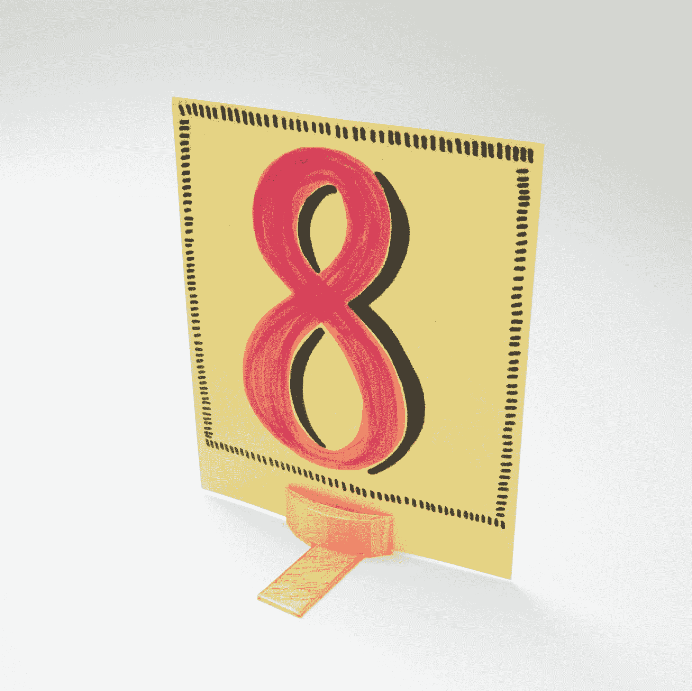

## SketchUp 入门

SketchUp 是一种计算机辅助设计 (CAD) 软件，通过使用其预创建的 2D 形状和形状元素库来创建 3D 数字模型。也有学生版可供选择，价格大幅优惠。安装软件并启动后，软件会提示一个类似于图 1 所示的屏幕。点击 `Start Using SketchUp` 或 `Start Modeling` 按钮继续。

这将带你进入创建设计的窗口（图 1）。如果提示选择设计页面的度量单位，请选择毫米 (mm) 或英寸 (in.)。稍后你可以根据正在进行的设计项目进行修改。设计窗口包含以下用于不同用途的部分。

`Top Ribbon` 包含多个下拉菜单——`File`、`Edit`、`View`、`Draw`、`Tools`。点击每一个查看选项。`File` 下拉菜单是保存设计和导出打印的关键。`Edit` 下拉菜单包含重要的 `Undo` 功能。

`Design Icon Ribbon` 该功能区位于顶部功能区正下方，包含用于创建设计的各种图标。将鼠标悬停在上面可查看每个图标的功能。图 1 显示了 `Select` 工具。

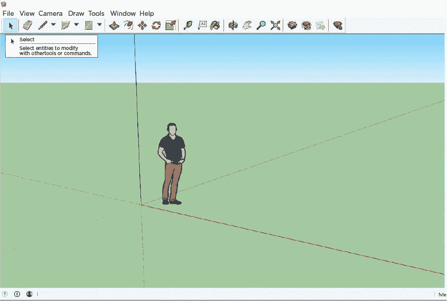

**图 1：** *SketchUp 设计图标功能区中的选择工具。*

`Central Design Area` 包含坐标轴和人物的整个区域是你的主要设计工作区。只需点击人物并按键盘上的删除键即可删除它。坐标轴作为参考指南添加，如果需要也可以移除。

`Right Pane` 右侧面板在设计阶段提供关键支持和额外选项。图 2 标识了右侧面板。点击任意下拉按钮——`Materials`、`Instructor`、`Entity Info`——了解更多信息。Instructor 功能至关重要，因为它提供了关于如何使用设计图标功能区中每个工具的详细视觉动画。

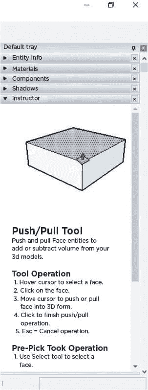

**图 2：** *SketchUp 窗口中的右侧面板为各种工具提供用户支持。*

`Bottom Pane` 底部面板提供关于使用设计工具/图标的进一步指导。它还显示工作区中绘制对象的尺寸。图 3（见下页）显示了绘制的一个矩形的尺寸，以及底部面板和右侧面板中绘制矩形的指导。

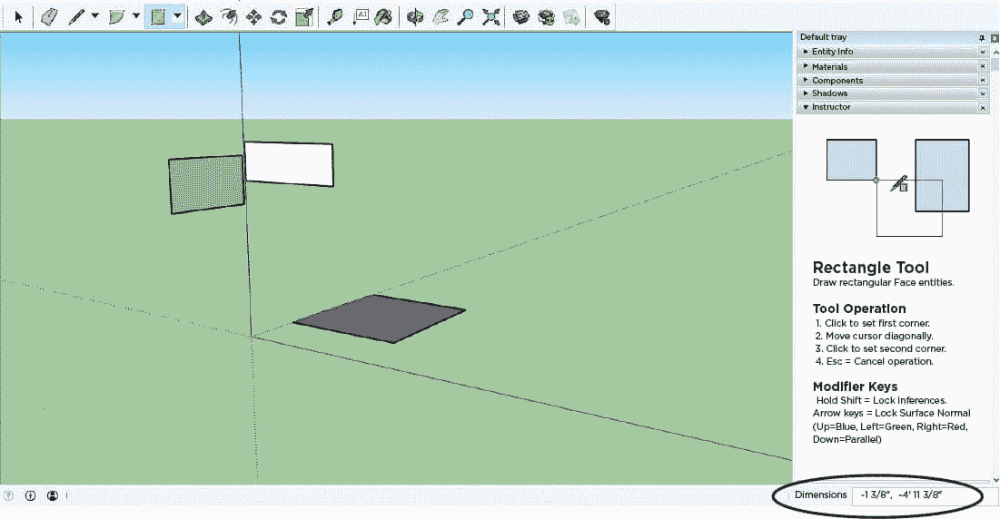

**图 3：** *底部面板中的形状尺寸。*

`Triggers` 一旦在 SketchUp 中绘制了形状或元素，你可以相对于原始形状或相对于工作区添加其他形状或元素。图 4 显示了相对于前一个形状的端点添加形状。形状也可以添加到另一个形状的中点（图 5）。形状可以从边（图 6）、面（图 7）或形状或轴上的任意点添加。

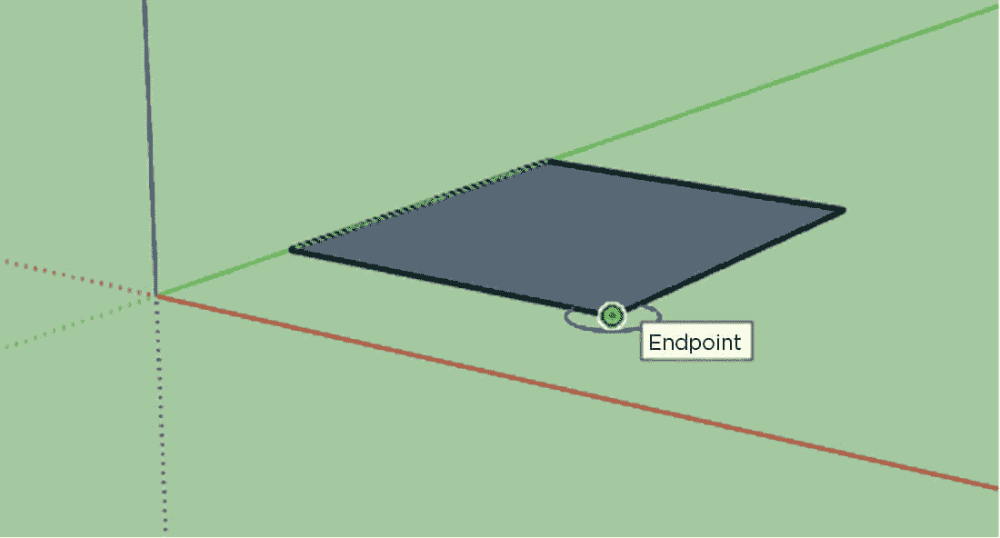

**图 4：** *相对于前一个形状的端点添加形状。*

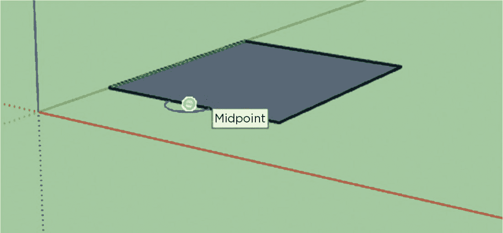

**图 5：** *将形状添加到另一个形状的中点。*

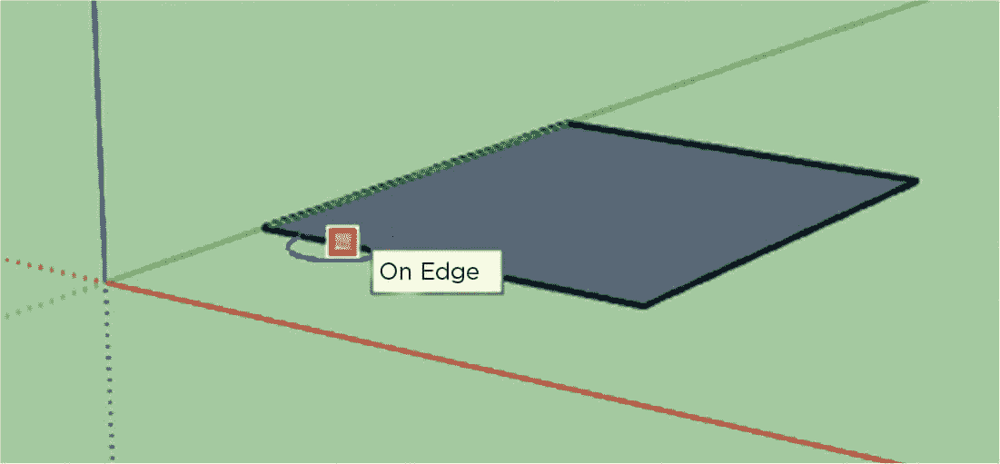

**图 6：** *将形状添加到另一个形状的边上。*

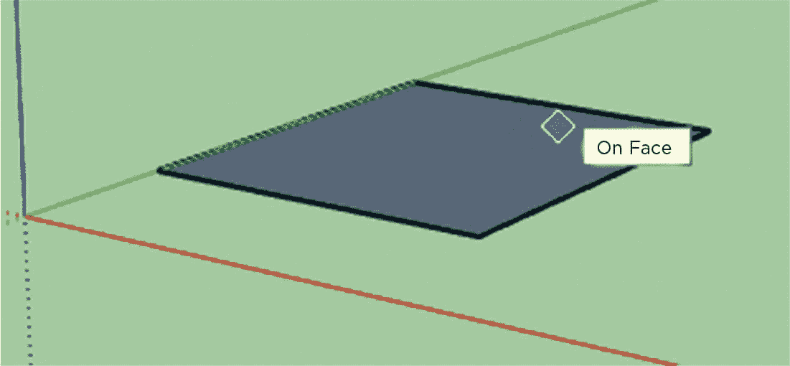

### 图 7：一个形状被添加到另一个形状的面上。

## 从 SketchUp 导出 STL 文件

大多数 3D 打印机接受特定的 .STL 格式文件。在 SketchUp 中，你需要从扩展仓库下载扩展软件，将你的设计转换为 .STL 格式。图 8 展示了如何进入扩展仓库。

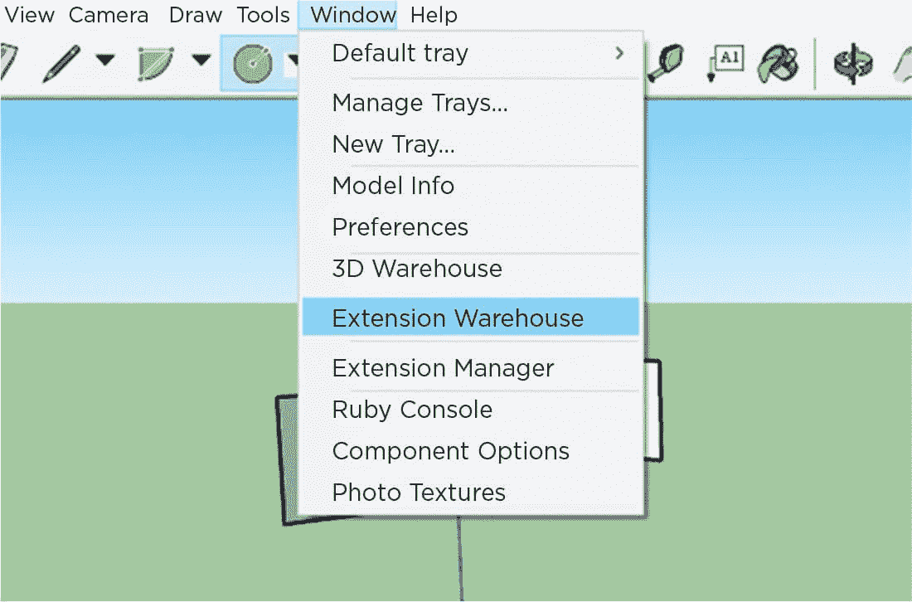

**图 8：** *如何在 SketchUp 中导航至* `Extension Warehouse` *。*

请注意，与 Tinkercad 不同，在 Tinkercad 中你可以右键单击并拖动以更改视图，而在 SketchUp 中，你必须使用图标功能区中的工具来更改视图——`Pan`（平移）和 `Zoom`（缩放）。SketchUp 中还有其他工具和技巧可以提升你的计算机辅助设计技能，其中一些将在本单元的实验中讨论。请继续自行探索软件的不同/更简便导航方式。

## 实验 23：基本 3D 形状

在本实验中，我们将学习如何使用 SketchUp 创建基本 3D 形状。与提供预创建 3D 形状工具箱的 Tinkercad 不同，SketchUp 提供的是 2D 形状工具箱。我们可以通过拉伸这些 2D 形状——沿特定方向伸展它们——来创建 3D 形状。

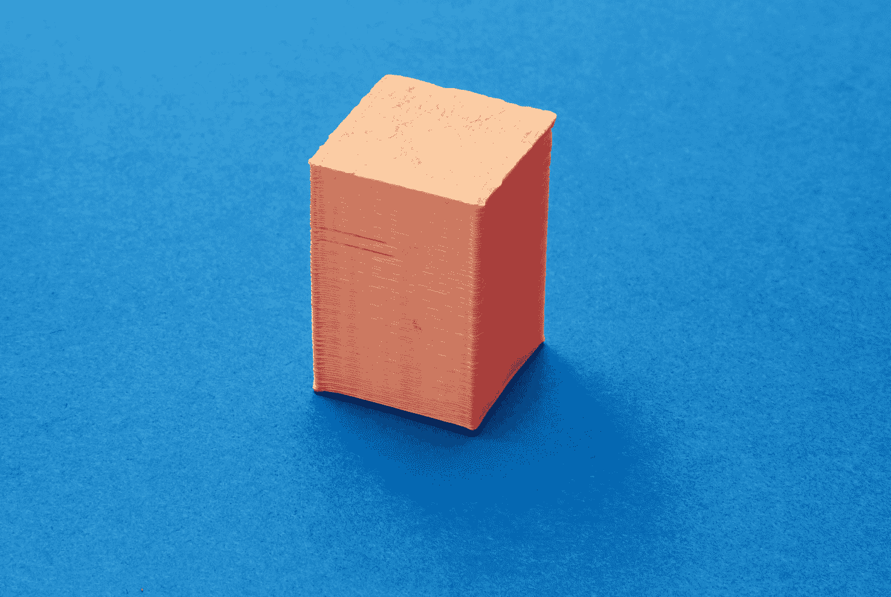

### 设计流程

#### 创建基本盒子/长方体和圆柱体：

1. 从屏幕顶部功能区的菜单中选择 `Rectangle`（矩形）工具。然后点击并拖动光标创建一个矩形，尺寸要足够小以便在屏幕上查看（图 1）。你可以在工作区的任意位置绘制矩形。

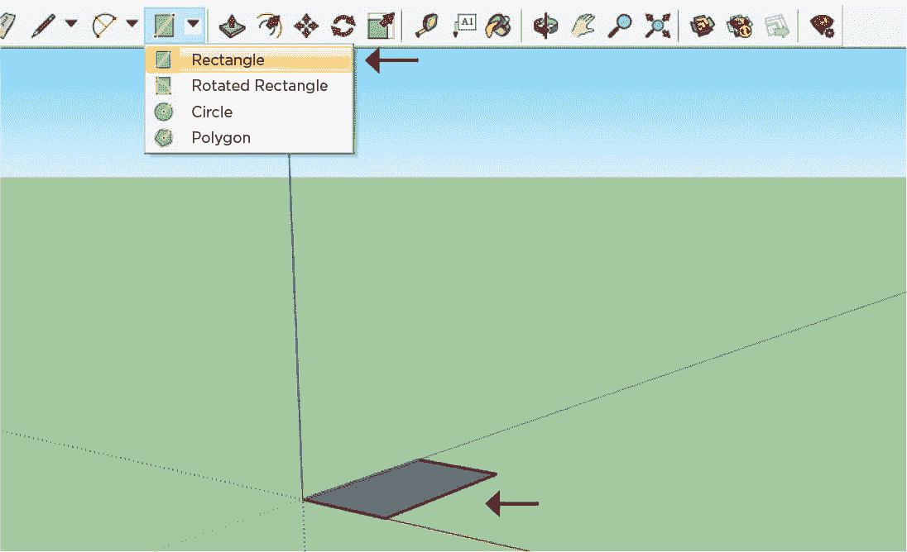

**图 1：** *通过从菜单中选择* `Rectangle` *工具来绘制矩形。*

2. 现在从功能区选择 `Push/Pull`（推/拉）工具（图 2）。将其指向 2D 矩形的顶面（图 2）并拖动至所需高度（约 1 英寸，或 25 毫米）。请随意使用 `Push/Pull` 工具重新调整高度，以熟悉该工具的手感。

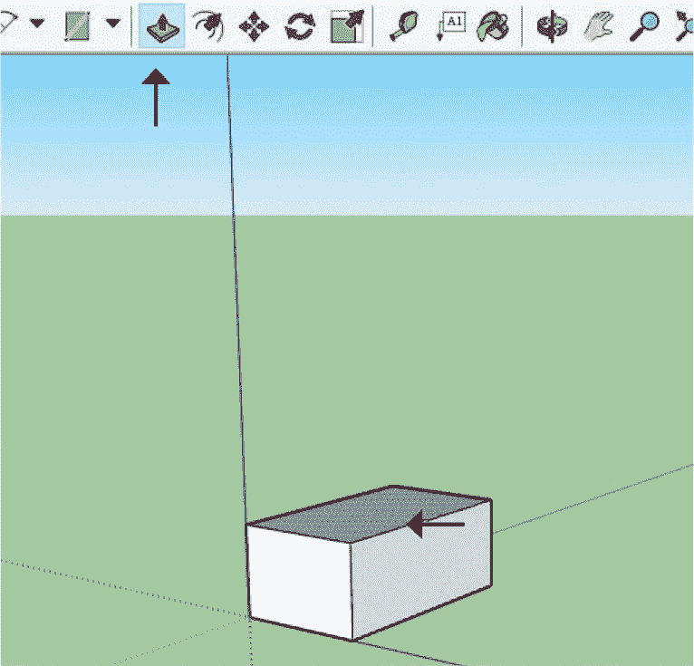

**图 2：** *使用* `Push/Pull` *工具拉伸矩形。*

3. 你可以使用 `Tape Measure`（卷尺）工具测量 3D 形状的尺寸（图 3）。卷尺工具右侧的 `Text`（文本）工具可让你标注尺寸，只需选择它，然后点击所需的待测边缘即可。

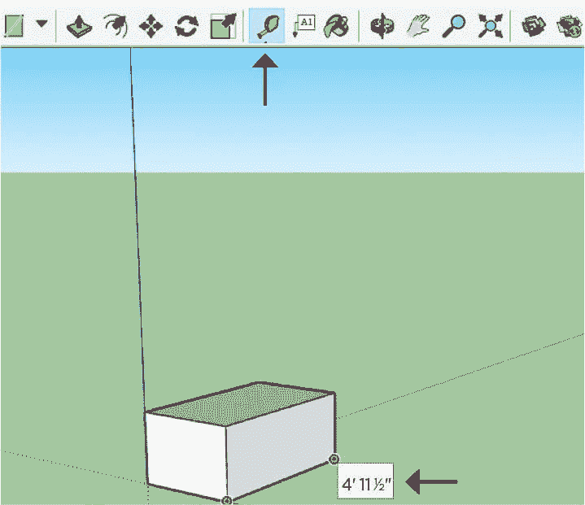

**图 3：** *使用* `Tape Measure` *工具查找形状的尺寸。使用* `Text` *工具添加标签。*

4. 现在，创建一个圆柱体。类似于上述步骤 1，选择 `Circle`（圆形）工具（图 4）并绘制一个平铺在工作区上的圆。请注意，圆的轮廓颜色会发生变化，以匹配其对应的轴。

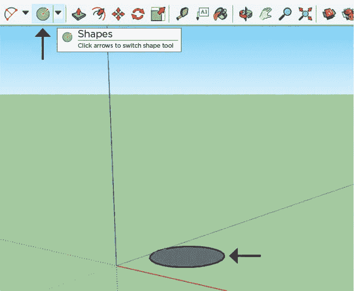

**图 4：** *使用* `Circle` *工具向工作区添加一个圆。*

5. 按照步骤 2 操作，拉伸圆形以将其转换为圆柱体（图 5）。

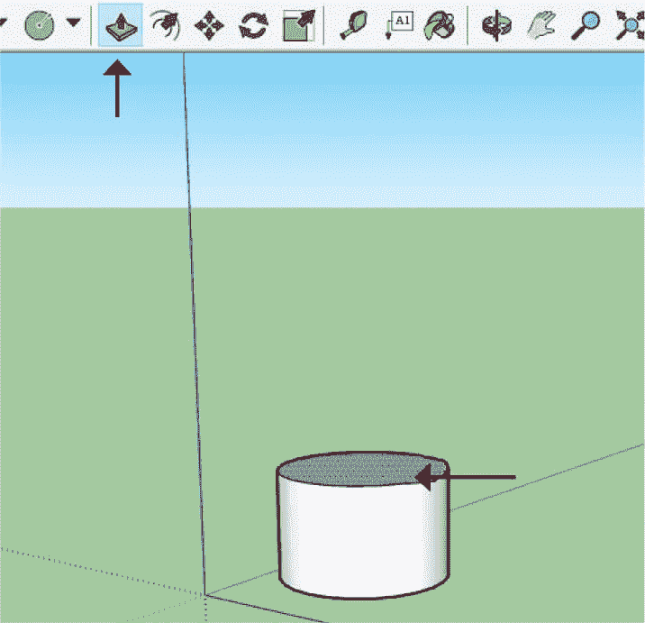

**图 5：** *将圆拉伸成圆柱体。*

### 3D 打印检查清单

#### 打印 CAD 模型前

- 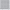 请参阅此处链接所示的 3D 打印基础知识以获取打印技巧。
-  打印圆柱体。
-  打印完成后，用锉刀清除多余材料。

#### 质量控制与产品测试

-  检查打印件上的塑料丝单独层次。

### 思考一下

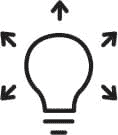

考虑以下问题并记录可能的答案。你可以通过修改并打印新版本的设计来测试它们。

- **在 Tinkercad 中设计与在 SketchUp 中设计的程序性差异是什么？**
- **哪一个更容易学习，为什么？**

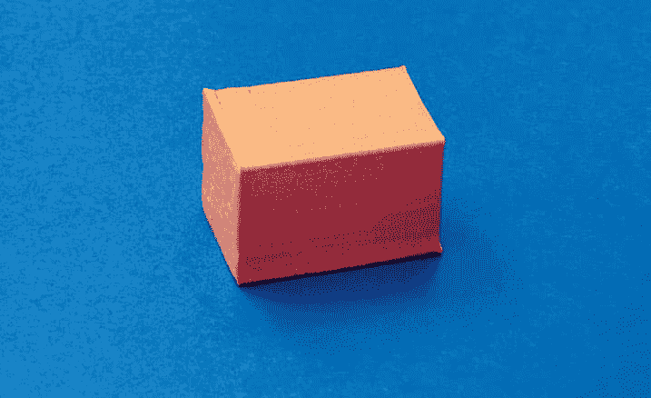

## 实验 24：从 3D 物体移除材料

在本实验中，我们将学习如何使用 SketchUp 在 3D 形状中创建基本孔洞。与提供孔洞工具的 Tinkercad 不同，在 SketchUp 中，我们必须使用 `Push/Pull` 工具将孔“推”入 3D 形状内部。

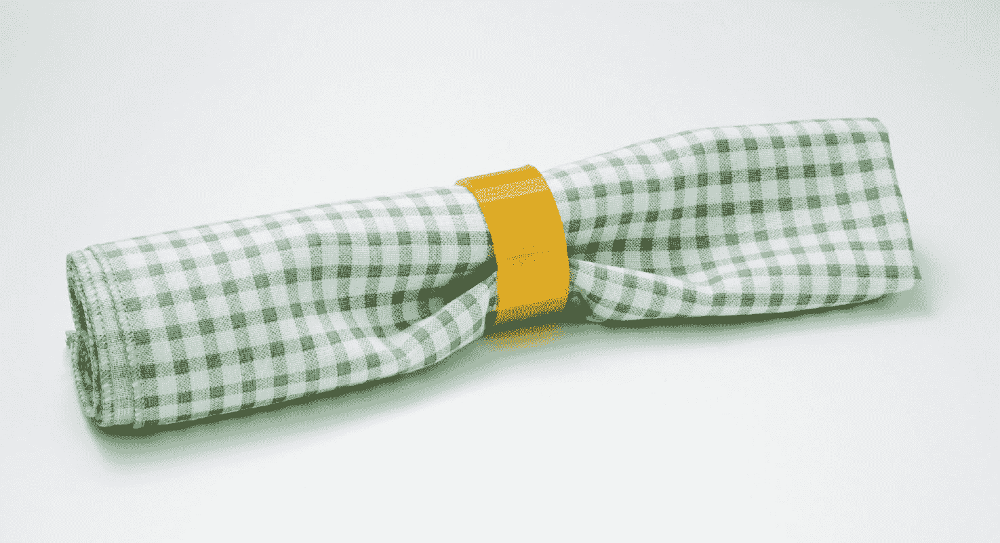

### 设计流程

1. 在 SketchUp 中绘制一个直径约为 2 英寸的圆柱体，类似于实验 23（见此处）。图 1 中的箭头 1 显示使用 `Circle` 工具绘制的初始圆，箭头 2 显示使用 `Push/Pull` 工具将圆拉伸成圆柱体。

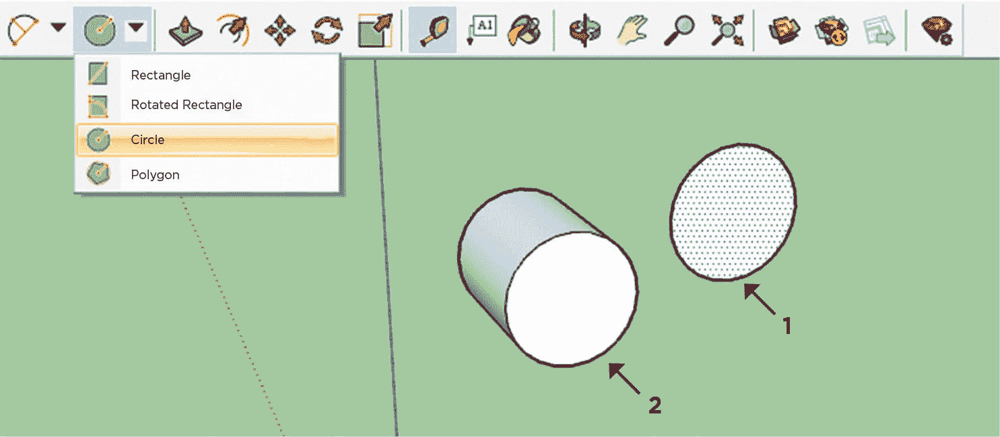

**图 1：** *创建一个圆柱体。*

2. 我们现在在圆柱体的前表面绘制另一个圆。第二个圆的尺寸略小于圆柱体 1；这将决定纸巾环孔洞的大小。图 2 中的箭头 1 显示用于孔洞的圆。箭头 2 显示将其推回圆柱体至圆柱体底部边缘。请注意，如果不推至边缘，材料会被推向相反方向形成另一个圆柱体。

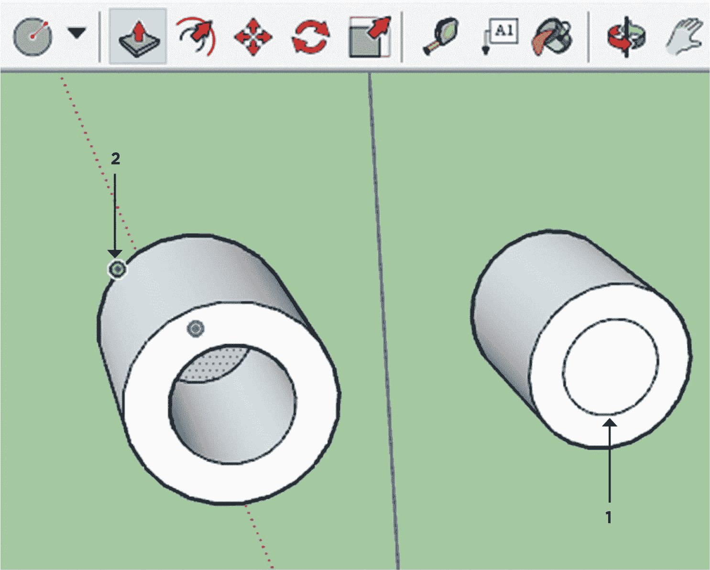

**图 2：** *在 SketchUp 中使用* `Push/Pull` *工具绘制圆形孔洞。*

### 3D 打印检查清单

#### 打印 CAD 模型前

-  请参阅此处链接所示的 3D 打印基础知识以获取打印技巧。
-  确保长方体和圆柱体的底面接触工作平面/打印床。
-  将设计移至工作平面中心，且彼此不接触。
-  打印纸巾环。
-  打印完成后，用锉刀清除多余材料。

#### 质量控制与产品测试

-  测试纸巾环，查看其是否能夹住纸巾。

### 思考一下

考虑以下问题并记录可能的答案。你可以通过修改并打印新版本的设计来测试它们。

- **如果将孔洞的推拉延伸至圆柱体底部边缘之外，会发生什么？**

## 实验 25：移除材料并组合基本形状

在本实验中，我们将扩展 SketchUp 基本形状制作知识，制作组合形状以设计菜单架。餐厅通常会将特色菜列在单张纸上。菜单架需要能夹住纸张，并防止菜单耷拉下来。防止单张纸耷拉的一种方法是将其弯曲或赋予其一定的曲率，从而增加其刚性。

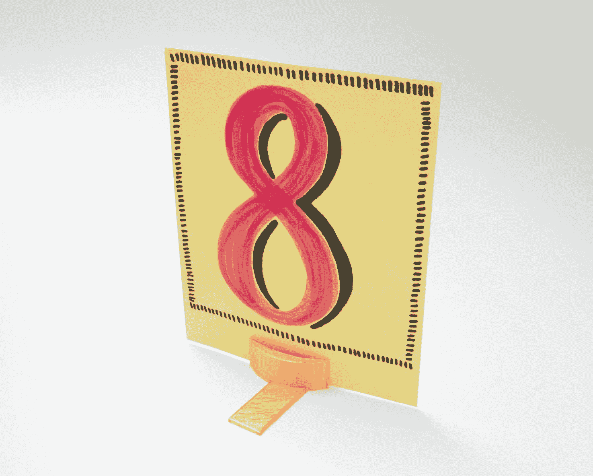

### 设计流程

1. 菜单架的底座只是一条狭窄的矩形条，厚度不超过 2 毫米。长度应超过 50 毫米（图 1）。

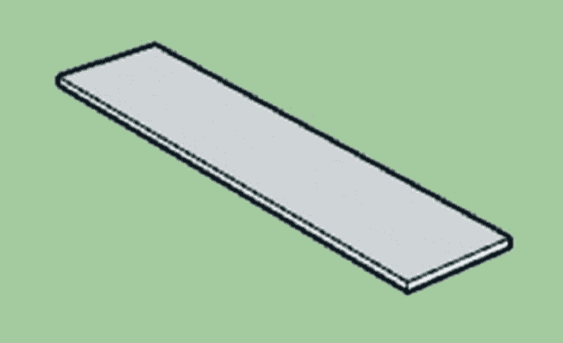

**图 1：** *从矩形条创建菜单架的底座。*

2. 通过使用实验 23 中的流程（见此处）创建圆柱体，来设计弧形墙。绘制一个圆，圆心位于圆柱体圆周上，且该圆几乎完全覆盖圆柱体（图 2）。

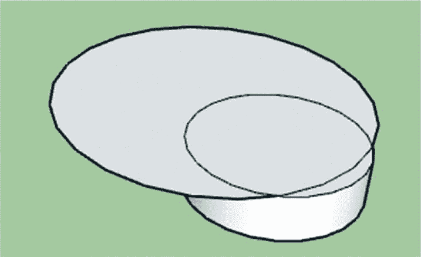

**图 2：** *制作一个圆柱体并添加一个切割圆。*

3. 使用 `Push/Pull` 工具拉伸重叠的圆，制作一个厚度与第一个圆柱体相同的圆柱体（图 3）。

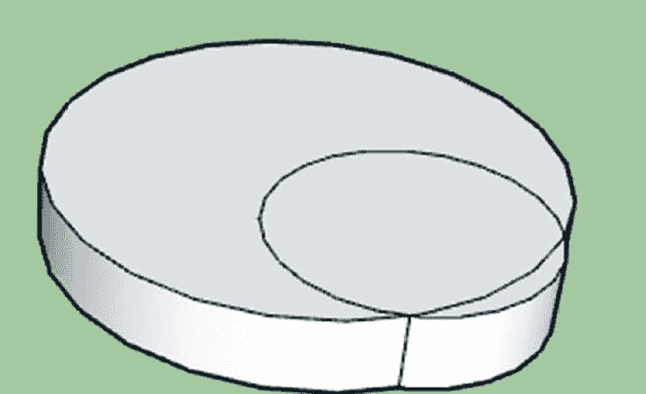

**图 3：** *将切割圆变成圆柱体。*

4. 使用 `Erase`（橡皮擦）工具擦除除菜单架墙壁所需的小部分以外的所有面和线（图 4）。

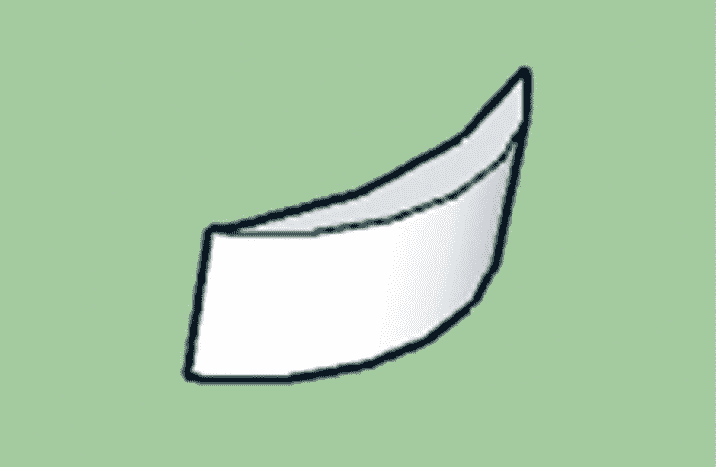

**图 4：** *擦除除将作为菜单架墙壁之一的新月形以外的所有内容。*

### 3D 打印检查清单

#### 打印 CAD 模型前

- 请参阅此处所示的 3D 打印基础以获取打印技巧。
- 确保底座的底部表面接触工作平面/打印平台。
- 将设计移动到工作平面中心，且彼此不接触。
- 打印菜单架。
- 打印完成后，用锉刀清除多余材料。

#### 质量控制与产品测试

- 测试菜单架，查看其能否夹持一张纸而不使纸张瘫软。

### 思考一下

思考这些问题并记录可能的答案。你可以通过修改并打印新版本的设计来测试它们。

**这个菜单架能帮助任何长度的纸张保持直立吗？为什么？**

---

## 实验 26：跑车尾翼

机翼允许改变其两侧的气流。飞机机翼倾斜安装，以便飞机通过获得升力起飞。然而，汽车则相反。我们希望汽车即使在高速行驶时也能保持与路面接触。我们将为汽车设计一个尾翼，以对其施加向下的压力。汽车上的尾翼也称为扰流板。

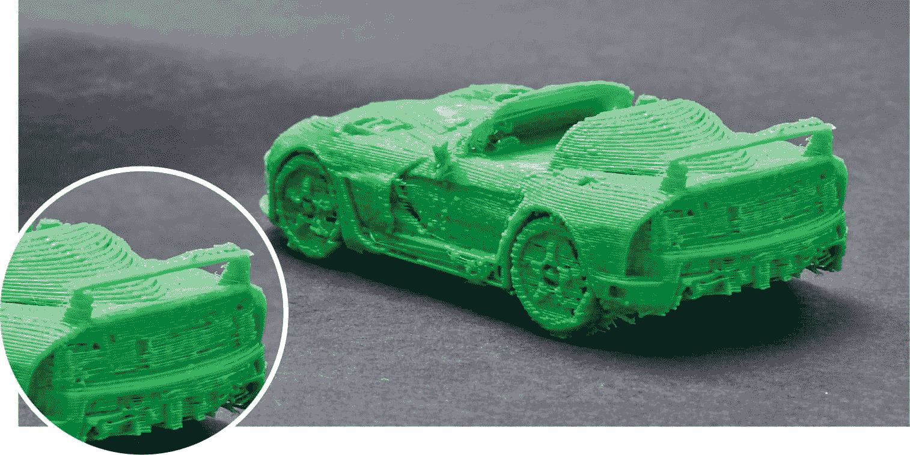

### 设计流程

1. 使用 SketchUp 中的 **3D 仓库** 工具寻找一个合适的汽车模型。将该模型导入到 SketchUp 工作平面上（图 1）。

   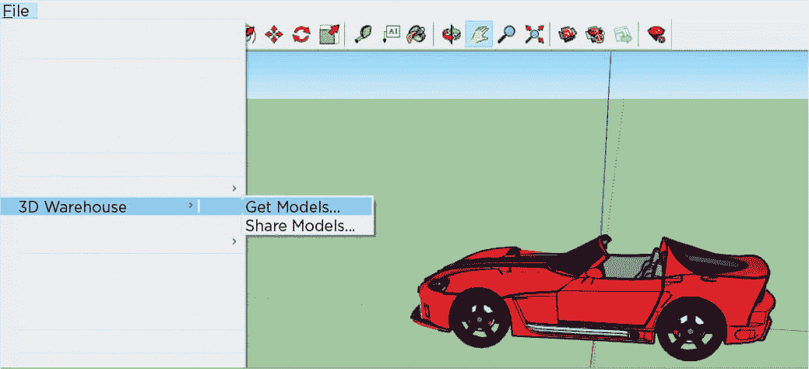

   **图 1：** *在 3D 仓库中寻找预创建的设计。*

2. 使用 **线条** 工具绘制尾翼支架，为模型设计尾翼（图 2）。

   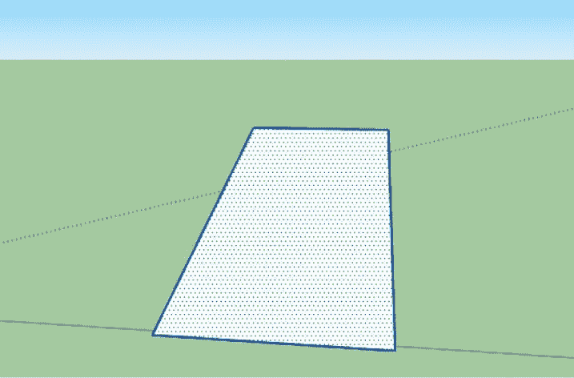

   **图 2：** *为尾翼绘制一个支架。*

3. 拉伸支架并复制一个。移动它们使其间距约为 50 毫米，但间距不得超过汽车宽度（图 3）。

   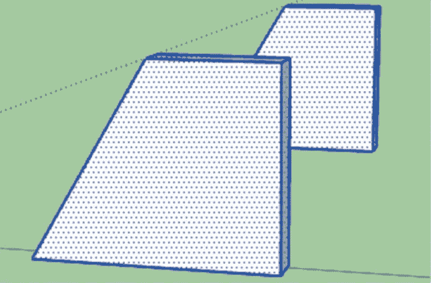

   **图 3：** *将尾翼支架拉伸至所需厚度。*

4. 使用 **矩形** 工具绘制一个连接两个支架顶部边缘的矩形尾翼。将矩形拉伸至约 2 毫米厚度（图 4）。

   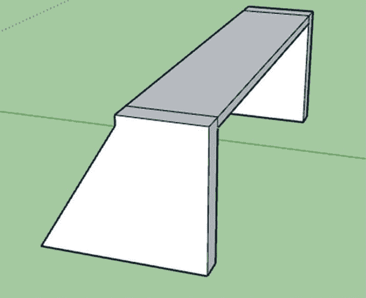

   **图 4：** *设计尾翼。*

5. 将尾翼和支架作为一个整体移动到汽车尾部，如图 5 所示。

   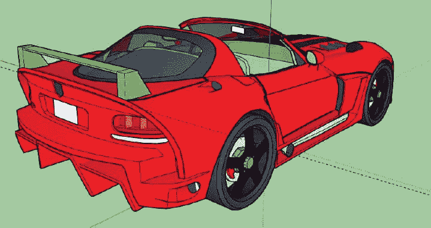

   **图 5：** *合并尾翼和支架并移动到汽车上。*

6. 可选：测试尾翼设计在保持汽车下压力方面的效率。下载 `.STL` 文件的副本并将其加载到 **Autodesk Flow Design** 软件中，该软件将模拟液体/气流通过设计的情况。调整流场源使其与汽车尾翼对齐。启动流场模拟并观察因尾翼而导致的流场变化。寻找蓝色条纹；这表示该点气流较慢。我们希望尾翼顶部气流较慢以最大化下压力（图 6）。

   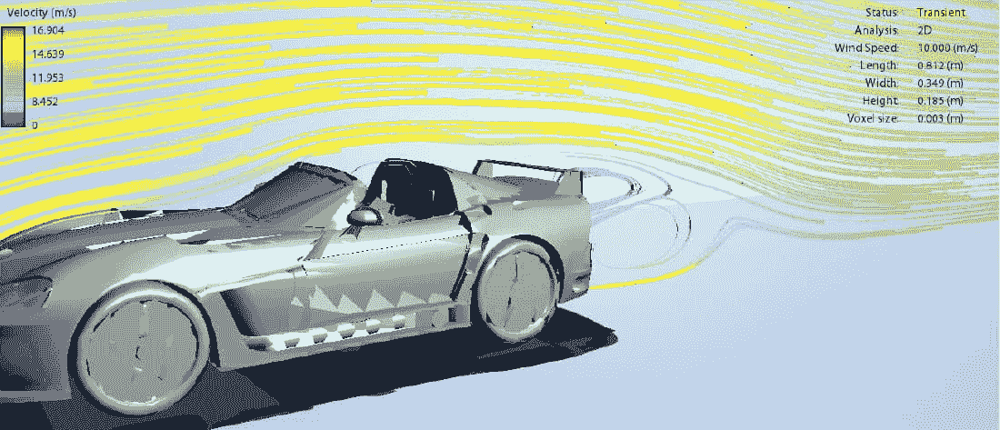

   **图 6：** *汽车和尾翼上方的风流模拟。*

### 3D 打印检查清单

#### 打印 CAD 模型前

- 请参阅此处所示的 3D 打印基础以获取打印技巧。
- 打印汽车尾翼。
- 打印完成后，用锉刀清除多余材料。

#### 质量控制与产品测试

- 按此处所示步骤 6 的指示测试打印件。

### 思考一下

思考这些问题并记录可能的答案。你可以通过修改并打印新版本的设计来测试它们。

**汽车尾部的尾翼/扰流板如何帮助汽车在高速行驶时保持贴地？**

**如果将尾翼移至后保险杠底部会发生什么？**

---
