# 60秒脑筋急转弯：无笔谜题——从简单到几乎不可能的短时烧脑题

本书精选了190道脑筋急转弯——从数学和逻辑问题到文字游戏。它们都非常简短——你应该能在一两分钟内靠心算解出其中大部分！你不需要高深的数学背景就能弄明白。你只需要活跃的智力和旺盛的好奇心。你会在书末尾找到答案——但别看！所以戴上思考帽，开始吧，尽情享受烧脑的乐趣吧！

# 谜题

## 01

彼得和比尔进行100米赛跑，彼得以领先5米的优势获胜。为了让比尔有机会赢，他们又赛了一次，但这次彼得在起跑线后5米处起跑。

两人都以与第一次比赛相同的速度奔跑。

第二次比赛结果如何？

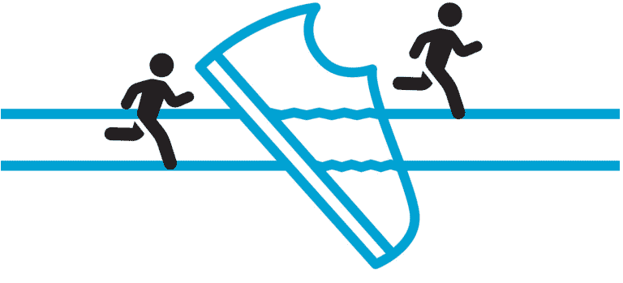

## 02

比利买了一包棒球卡，发现一张新秀卡价值10.00美元。他决定以10.00美元把它卖给朋友汤米。棒球赛季结束后，这张卡更值钱了，比利又用15.00美元从汤米那里买了回来。第二年，比利以8.00美元卖掉了这张卡。比利最终是赚了还是亏了？

## 03

老师对学生说：“我买了一袋棒棒糖，花了6.25美元。有谁能猜出袋子里有多少根，以及每根多少钱吗？”学生们一脸困惑，说没人能知道袋子里有多少根棒棒糖。

老师说：“这些棒棒糖价格都一样。我买的棒棒糖数量等于每根的价格（以美分计）。”你能算出每根棒棒糖多少钱吗？

## 04

特里西娅、凯莉、萨莎和梅雷迪思成立了一个读书会，每月聚会一次。每个月，由一人主持聚会，另一个人带零食。主持人负责选一本书，另外三人中的一人必须带零食。主持人和零食提供者的职责每月轮换。要经历所有可能的主持人与零食提供者组合，需要多少个月？

## 05

华盛顿地铁系统以每个200美元的价格购买轨道车辆的车轮。这些车轮可使用十年，之后每个有25美元的残值。如果对每个车轮进行成本为50美元的防锈处理，每个车轮可使用十五年，但将没有残值。从长远来看，对车轮进行防锈处理是否更划算？

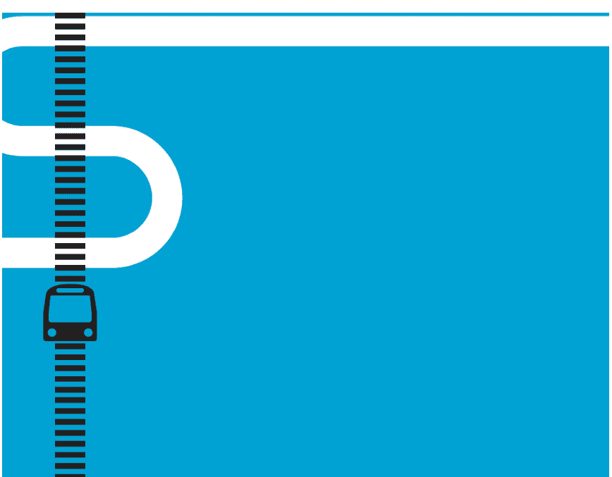

## 06

伊恩和亚当想去科尼岛，正在琢磨最快的方式。伊恩想坐地铁，但亚当指出地铁只能到科尼岛一半的路程，剩下的路得步行。亚当说最快的方式是骑自行车，但伊恩仍然觉得地铁更快。于是亚当骑上自行车，伊恩坐地铁。地铁速度是亚当骑自行车的四倍，而亚当骑自行车的速度是伊恩步行速度的两倍。谁先到达科尼岛？

## 07

大学毕业后，艾莉森去了一家金融公司工作，埃里克去了一家律师事务所工作，两人收入相同。去年，艾莉森加薪百分之十，埃里克降薪百分之十。今年，艾莉森降薪百分之十，埃里克加薪百分之十。现在谁赚得更多，还是他们薪水相同？

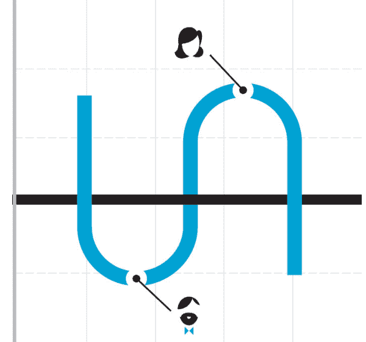

## 08

亚伦和亚历山大都是普通射手，只有百分之五十的时间能命中目标。他们决定进行一场决斗，轮流射击，直到一人被击中。先开枪的人击中另一个人的概率是多少？

## 09

如果当特丽施长到贝丝现在的年龄时，比尔那时的年龄等于贝丝现在的年龄，那么谁最大？

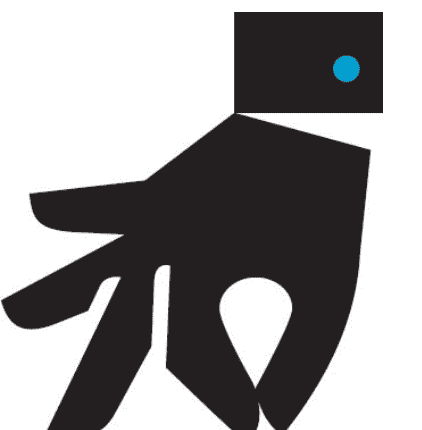

## 12

在数字时钟上，在第一个十二小时时段内，显示的数字按连续顺序排列（例如 1:23）的情况共有多少次？

## 13

在年度高中烘焙食品义卖会上，拉姆齐先生在为期六天的义卖中卖出了六十个馅饼。他每天卖出的馅饼都比前一天多四个。第一天卖出了多少个馅饼？

## 14

一所学校为了筹款组织班级旅行，让学生支付1.00美元来猜罐子里的软糖豆数量。亚当猜有四十三颗，比尔猜三十四颗，卡尔猜四十一颗。一个人差六颗，另一个人差三颗，还有一个人差一颗。罐子里有多少颗软糖豆？

## 15

一位银行家有一架天平，只有一边放三根金条，另一边放一根金条和一个十公斤重的砝码时，天平才会平衡。假设所有金条重量相同，一根金条重多少？

## 16

史蒂夫和丽莎各有一个袋子，里面装着相同数量的弹珠。史蒂夫必须给丽莎多少颗弹珠，丽莎才会比史蒂夫多十颗？

## 17

大厅里有四位女士在等候面试同一个职位。她们彼此只握一次手。一共握了多少次手？

## 18

圣诞树下有三份礼物——一份给萨曼莎，一份给玛丽亚，一份给路易莎。每份礼物都用不同颜色的包装纸包装，要么是红色、绿色，要么是银色。每份礼物上还系着不同颜色的蝴蝶结，要么是红色、绿色，要么是金色。仅使用以下两条信息，确定每份礼物所用的包装纸和蝴蝶结的颜色。

- 1. 萨曼莎的礼物系着绿色蝴蝶结。
- 2. 路易莎的礼物是唯一一份蝴蝶结和包装纸颜色不形成对比的礼物。

## 19

摩尔家邀请了十二位客人来吃焦糖苹果，但他们只做了七个苹果。他们如何把七个焦糖苹果分给每个人，使每人得到的份量相等？每个苹果不能被切成超过四块。

## 20

马克和布莱恩的前院都有大小相同的花园。布莱恩决定在马克的花园里种一棵杂草，让花园看起来没那么好看。杂草每天翻倍，三十天内马克的花园就完全被杂草覆盖了。如果我们假设杂草数量每天翻倍，那么当马克在自己的花园里种下两棵杂草时，布莱恩的花园需要多少天才能完全被杂草覆盖？

## 21

如果彼得的每个儿子拥有的姐妹数是兄弟数的两倍，而他的每个女儿拥有的姐妹数和兄弟数一样多，那么彼得有几个儿子和几个女儿？

## 22

如果分针刚刚超过时针，还要过多久才会再次发生这种情况？

## 23

一家麦片公司正在向寄来足够多盒盖的人赠送魔法解码戒指。杰丝和考特妮都想要一枚戒指，但杰丝还差七个盒盖，考特妮还差一个。她们想把盒盖凑在一起换一枚戒指，但还是不够。换一枚戒指需要多少个盒盖？

## 24

## 24

Trish 决定去大采购。在鞋店，她花掉了她身上的一半钱加上 $6.00 买了一双靴子。在服装店，她花掉了剩下的钱的一半加上 $4.00 买了一条围巾。在糖果店，她花掉了剩余的一半加上 $2.00 买了一个冰淇淋甜筒。她还剩下 $7.00。她原来有多少钱？

## 25

有九个罐子，每个装着不同种类的液体，但标签都掉了。什么都不知道的情况下，一个路人随机重新贴上标签。正确贴标签的罐子期望数量是多少？

## 26

一场单淘汰制台球锦标赛有 100 名选手参加。在产生冠军之前需要进行多少场比赛？

## 27

如果 1,000 颗棒棒糖花费 $20.00，那么十颗棒棒糖要花费多少？

## 28

一根无重且完全柔软的绳子挂在一根无重、无摩擦的滑轮上，滑轮固定在建筑物的屋顶上。一端系着一个重量，恰好与另一端的猩猩重量相抵。如果猩猩开始攀爬，重量会怎样？

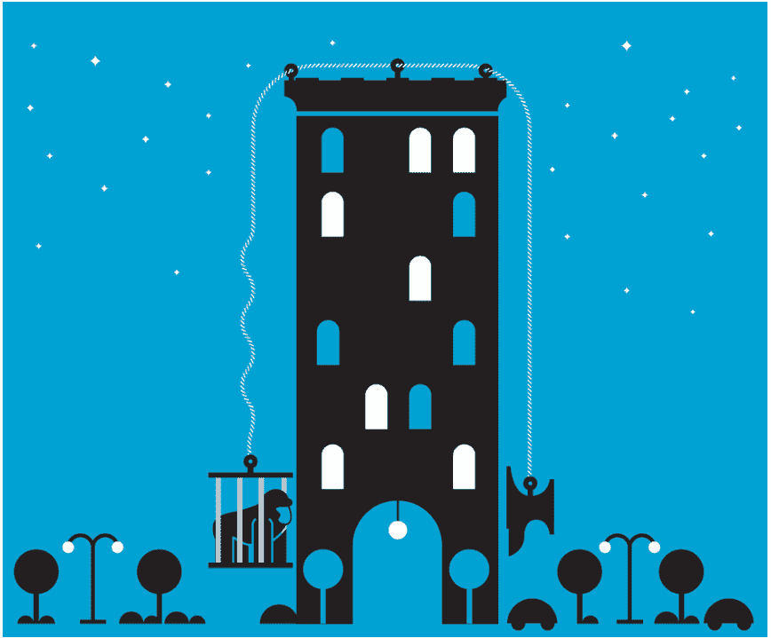

## 29

Olivia 从周一到周五每天练习钢琴一小时。她需要在周六练习多少小时，才能使六天期间的平均练习时间为每天两小时？

## 30

在市中心一个忙碌的夜晚，泊车员停了 320 辆车。21 人给了他 $1.00 小费，剩余的 79% 中的一半给了他 $2.00 小费，其余的人没有小费。泊车员赚了多少钱？

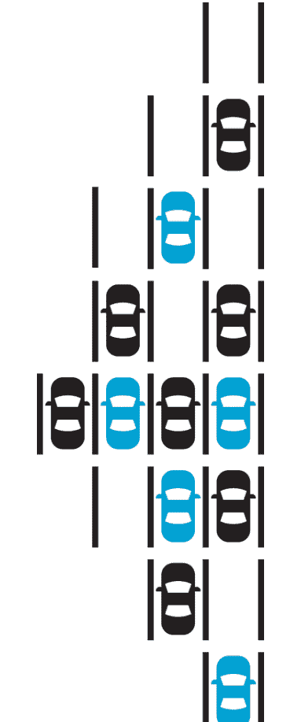

## 31

Amelia 在她的衣柜里翻找，试图弄清楚她有多少个手袋。除了两个之外，她所有的包都是金色的。除了两个之外，她所有的包都是棕色的。除了两个之外，她所有的包都是白色的。Amelia 有多少个手袋？

## 32

在办公室聚会上，George 和 Ava 打算分发果冻豆。然而他们很饿，George 已经吃掉了其中的一半，当 Ava 吃掉剩余果冻豆的一半再加三个时，就没有果冻豆剩下了。他们带到办公室的果冻豆有多少颗？

## 33

一位在伯明翰的汽车经销商花了 $20,000 买了一些二手车。他以 $27,500 的价格卖出，平均每辆车赚 $1,500。他卖出了多少辆车？

## 34

Dan 和 Craig 在新奥尔良的一家台球厅以每局 $1.00 打台球。到了白天结束时，Dan 赢了 $4.00 而 Craig 赢了三局。他们一共打了多少局？

## 35

如果 Bill 比 Mick 高但比 John 矮，那么这三个人中谁最高？

## 36

Emily 现在和八年前 Mia 的年龄一样大。谁年纪更大？

## 37

Mary Ellen 在华盛顿特区举办车库大甩卖，有人来买了割草机。那个人付了

## 40

Tobias 是一个古怪的人，他决定把自己的财产赠予一场比赛的获胜者。在规则中，获胜者是最后一名。Tobias 不想让比赛无限期地进行下去，于是他想出了一个办法来防止骑手故意骑得慢以便最后一名。Tobias 的办法是什么？

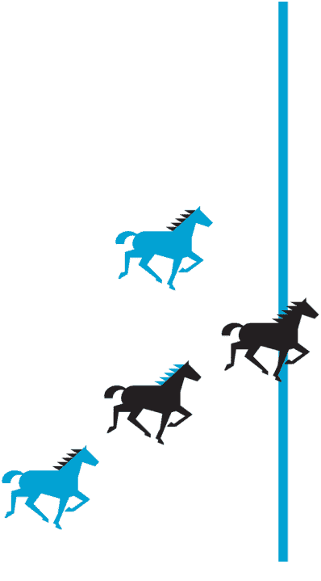

## 41

在正常时钟上，分针在中午 12:00 到午夜 24:00 之间会经过时针多少次？

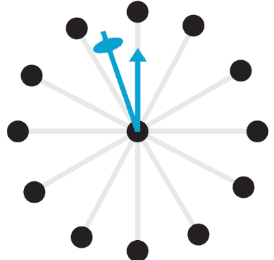

## 42

Ella 有七个孩子，其中一半是女孩，这可能吗？

## 43

在当地购物中心，Muhammad 进入了五家商店，最终花光了所有的钱。在每家商店，他花费了他进入时所带钱的一半再加 $1.00。Muhammad 进入第一家商店时有多少钱？

## 44

每小时整点时，一列火车从明尼阿波利斯开往芝加哥，同时一列火车从芝加哥开往明尼阿波利斯。所有火车以相同的速度行驶，从明尼阿波利斯到芝加哥的旅程需要五小时。在一次旅程中会有多少列火车相遇？

## 45

在室内跑道上进行 3,000 米比赛时，Oscar 注意到在他前面跑者的五分之一加上在他后面跑者的六分之五等于参赛跑者的总数。比赛中有多少人参加？

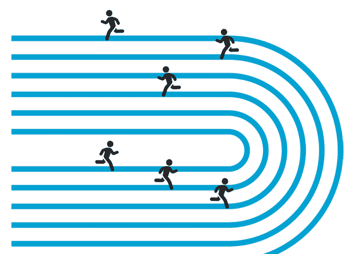

## 46

一所孤儿院的院长想为还没有所有玩具的孩子们买礼物。孤儿院有 100 个孩子：85 个有自行车，75 个有足球，70 个有棒球帽，80 个有陀螺。拥有自行车、足球、棒球帽和陀螺的孩子最少可能有多少人？

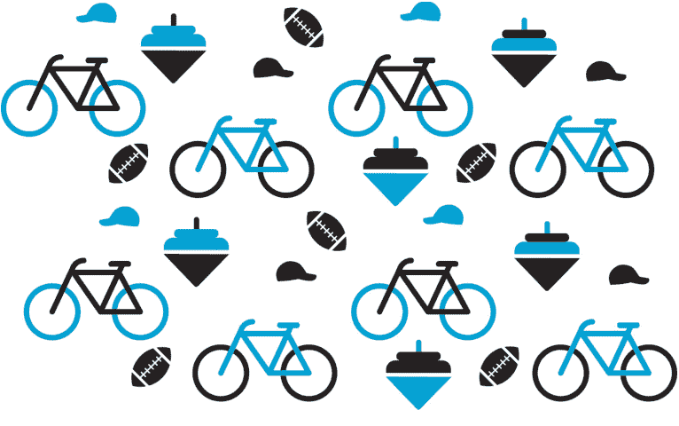

## 47

为一次国际峰会，来自美国、法国、英国和德国的十五名代表在瑞士会面。每个国家派出代表人数不同，每个国家至少有一人。英国和法国共派出六名代表。法国和德国共派出七名代表。哪个国家派出四名代表？

## 48

Bill 和 Lilly 准备在他们的汽车上进行一次 4,000 公里的英国之旅。汽车有四个轮胎，每个轮胎只能使用 1,500 公里。如果假设汽车上的轮胎都是全新的，Bill 和 Lilly 需要用掉多少个轮胎？

三个人在蒙特利尔举行晚宴。Blake 带来了五道菜，他朋友 Jackson 带来了三道菜。Abigail 过来时没有带菜但决定坐下来一起吃。Abigail 支付了 $20.00 作为她的份额。如果假设所有菜肴价值相同，这 $20.00 如何在 Blake 和 Jackson 之间分配？

## 51

在农场里有山羊和鸡。总共有 22 个头和 72 只脚。农场里有多少只鸡和山羊？

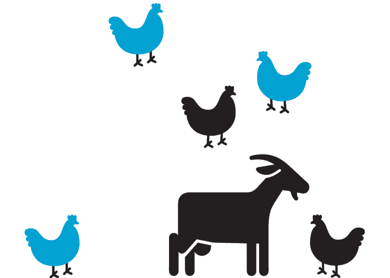

## 52

Christopher 在梯子上给墙面刷漆。他从中间的横档开始，向上爬六档，向下八档，向上三档，再向上十二档到达梯子的顶端。梯子上有多少个横档？

## 53

Angela 在悉尼面试新工作，已缩小到两家可能的公司。第一家公司提供每年 $27,000 的薪水，每年两次加薪，每次 $1,000。第二家公司也提供 $27,000 的薪水，但每年加薪一次 $2,000。Angela 应该选择哪份工作？

## 54

伦敦的一家寿司餐厅以每条 $10.00 的价格买了二十条鱼。老板知道其中 50% 的鱼会在被端上桌前变坏。每条鱼可制作十份。要实现初始投资 100% 的利润，他们每份必须收取什么价格？

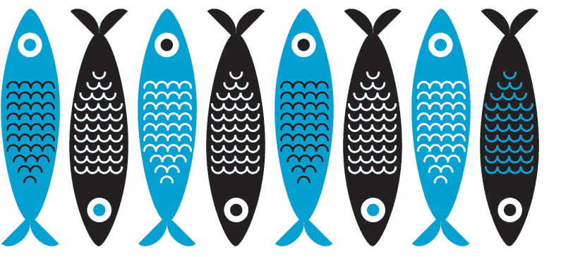

## 55

Erik 决定在当地夏尔巴人的帮助下攀登珠穆朗玛峰。他需要六天时间到达峰顶，但他的背包只能携带四天的食物。如果夏尔巴人也只能携带四天的食物，Erik 需要多少个夏尔巴人才能到达峰顶？

## 56

你身处一个使用从未见过的货币系统的奇怪国家。你口袋里只有七分硬币和十一分硬币。什么是最贵的物品，无法用这两种硬币的任何组合购买？

## 57

Noah 去迈阿密的银行兑现他的 $1,500.00 工资单，但银行没有某些面额的钞票。出纳员用一定数量的 $1.00 钞票和十倍数量的 $5.00 钞票，以及一定数量的 $10.00 钞票和两倍数量的 $50.00 钞票来兑现 Noah 的支票。出纳员支付了多少张每种钞票？

## 58

Elena 决定跑二十英里来为马拉松热身。她以每小时五英里的速度跑完前半段，以每小时十英里的速度跑完后半段。她的平均速度是多少？

## 59

你得到五个相同的袋子，每个装有十枚金币。所有金币都重一磅，除了第五个袋子里的硬币

sack. 第五个袋子里所有的金币都重九十分之一磅。

如果你只能使用一次天平，并且只能使用一次，你如何用单托盘天平找出哪个袋子里的金币较轻？

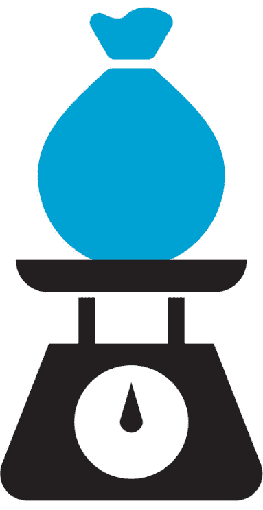

在棒球春季训练期间，德里克和伯尼练习击打棒球。德里克第一次击球时，击中了100次投球中的75次。然后伯尼击中了100次投球中的75次。在德里克第二次击球时，他击中了投出的50次投球中的35次。伯尼没有第二次击球机会。谁在当天的平均成绩更好——德里克还是伯尼？

## 61

艾拉在房间里玩积木。她决定把所有积木堆起来，使每一层比下面一层少一块。艾拉总共有五十五块积木，她希望最后顶部只有一块。底部一层应该放多少块？

## 62

一杯绿茶的咖啡因含量比一杯咖啡多百分之二十五。如果雅各布喝了五杯咖啡，本杰明喝了四杯绿茶，谁摄入的咖啡因更多？

## 63

艾莉森所有的宠物都是猫，除了一个。她的所有宠物都是金鱼，除了一个。艾莉森有多少只猫和金鱼？

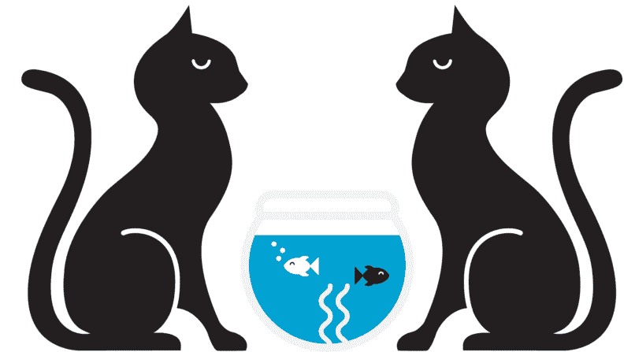

## 64

在多伦多皮尔逊国际机场航站楼里有三块钟。A钟显示为8:00，B钟显示为8:50，C钟显示为8:20。其中一块钟快了二十分钟，一块钟慢了，另一块钟慢了半小时。实际时间是多少？

## 65

十七个面包师烤十七块饼干需要十七分钟。要在五十一分钟内烤五十一块饼干，需要多少个面包师？

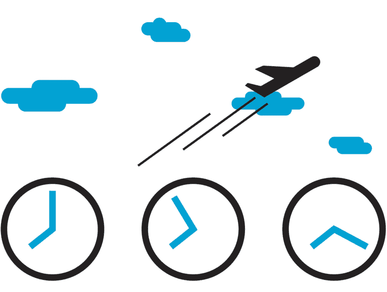

## 66

夏洛特有两个盒子。每个盒子装有四把勺子和四把叉子。
不看的情况下，你从每个盒子各抽出一件餐具。
你抽到的至少一件餐具是勺子的几率是多少？

## 67

在一组100名学生中，七十人丢了一本笔记本，七十五人丢了一支铅笔，八十五人丢了一台计算器，八十人丢了一把尺子。必须有多少名学生同时丢了全部四样东西？

## 68

猫可可比另一只猫露露重。温斯顿比弗拉菲重但比洛基轻。弗拉菲比露露重。洛基比可可轻。

按体重从重到轻列出这些猫。

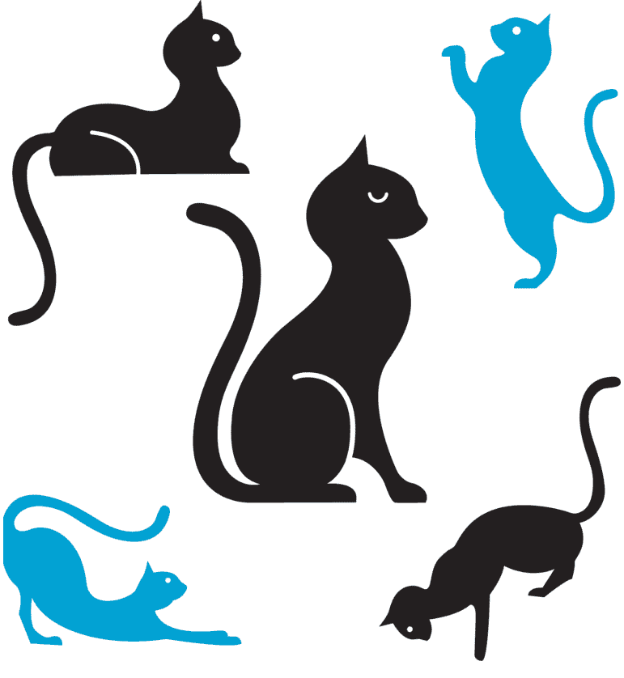

## 69

一种新型燕麦饼干的脂肪含量比普通品牌少百分之九十。我必须吃多少块这种低脂饼干才能摄入与一块普通燕麦饼干相同量的脂肪？

## 70

阿米莉亚在圣地亚哥街上行走时在人行道上找到了4.00美元。她把这4.00美元放进她找到它之前就有的钱的钱包里，现在她拥有的钱是如果她丢了4.00美元时她本应拥有的钱的五倍。阿米莉亚在找到4.00美元之前有多少钱？

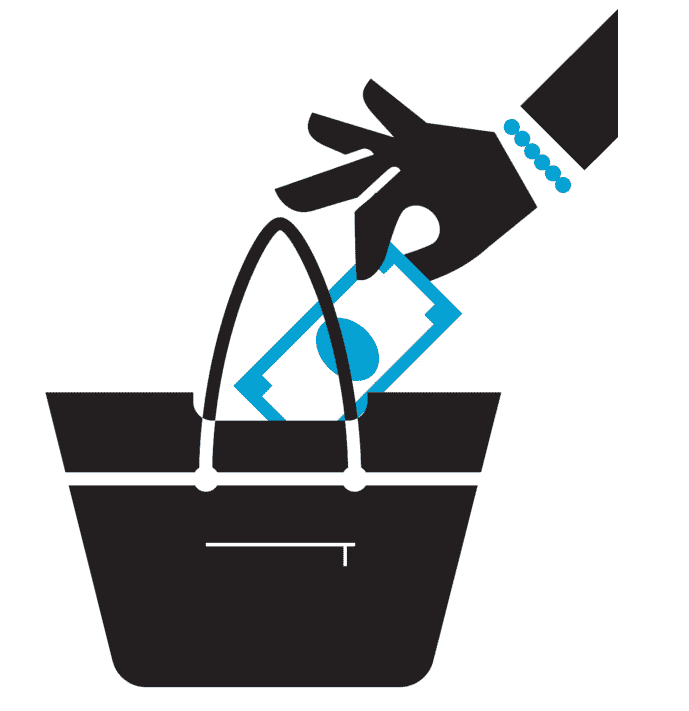

## 71

一只蜗牛在十英尺深的井底。她每天爬三英尺，但在夜间休息时又滑回两英尺。以这种速度，蜗牛需要多少天才能爬出井？

让-皮埃尔开始教授他的第一堂法语烹饪课，他有少于500名学生。学生的三分之一是一个整数。学生的四分之一、五分之一和七分之一也是整数。让-皮埃尔的烹饪课有多少名学生？

## 73

贝丝的年龄是她弟弟的两倍，是她父亲的一半。22年后，她的弟弟的年龄将是他父亲年龄的一半。贝丝现在多少岁？

## 74

如果你有一群六条腿的苍蝇和八条腿的蜘蛛，总共有四十八条腿，这群里有多少只苍蝇和多少只蜘蛛？

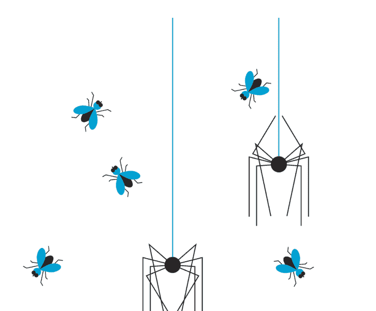

## 75

安迪、比尔、克里斯、德雷克和埃里克是正在学习穿过迷宫的老鼠。每只老鼠到达迷宫尽头时都会得到一颗食物颗粒。

到目前为止，安迪得到的颗粒比比尔多四颗。比尔得到的颗粒比克里斯少七颗。克里斯得到的颗粒比德雷克多五颗，德雷克得到的颗粒比埃里克多三颗。比尔和德雷克两人共得到十颗颗粒。到目前为止，每只老鼠各穿过迷宫多少次？

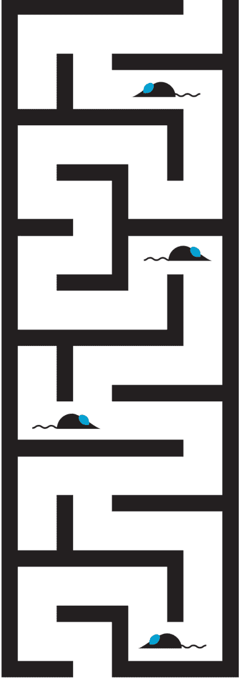

## 76

杰克有六个兄弟。每个兄弟比他下面一个弟弟大四岁。最大的兄弟年龄是他最小的兄弟的三倍。每个兄弟各多少岁？

## 77

两个人需要两小时做两顶帽子。需要多少人才能在六小时内做十二顶帽子？

## 78

斯卡莱特去了糖果店，花一美元恰好买了100块糖果。其中一些糖果每块十美分；一些糖果每块三美分；一些糖果两块一美分。斯卡莱特买了多少块每种糖果？

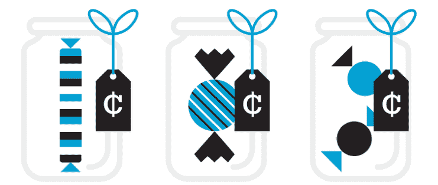

## 79

安东尼、比尔、卡尔和戴夫都决定开始上声乐课。卡尔上的课数是比尔的两倍。安东尼上的课比戴夫多四节，但比卡尔少三节。戴夫总共上了十五节课。比尔上了多少节声乐课？

## 80

帕特里克爱他的鞋子。他有十双鞋，五种不同颜色。帕特里克是个特别懒的人，脱下鞋子后就把鞋子扔进一个箱子里。他需要去外地出差一个周末，但他拖到很早早上才收拾行李。现在外面还很黑，他看不清箱子里鞋子的颜色。他必须从箱子里拿出多少只单独的鞋子才能确保他至少有两只相同颜色的鞋子？

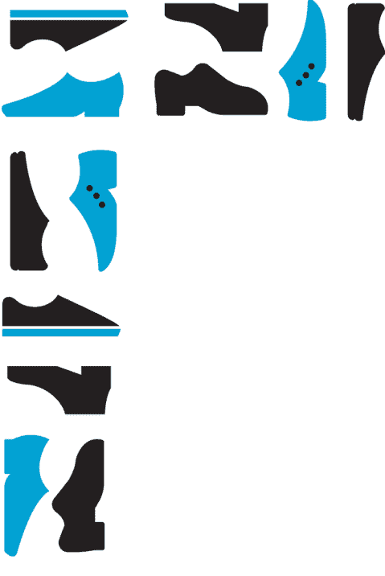

## 81

约翰去了墨尔本，花2,500买了一幅画。回家后，他的朋友卢卡斯看到这幅画，给了约翰3,500买下它。几天后，约翰以4,500的价格买回这幅画，认为它以后会更值钱。他把它带到一家当地的艺术品经销商那里，经销商给他开价5,500，于是约翰把它卖给了经销商。约翰最后是赚钱了还是亏钱了？

## 82

丹在多伦多的每周工资比利亚姆少70.00，而利亚姆的每周工资比索菲亚多50.00。如果索菲亚每周赚280.00，丹每周赚多少钱？

## 83

胡安妮塔喜欢拼拼图。她每天至少尝试一个拼图。对于她完成的每个拼图，她给自己两分；对于她无法完成的每个拼图，她扣三分。拼拼图三十天后，胡安妮塔的得分为零。她完成了多少个拼图？

## 84

帕蒂搬到西雅图，不习惯那里的雨。她决定做一个雨量计来测量一周的降雨量。那周从周一开始每天都下雨，而且每天雨量计中的雨量都翻倍。到下一个星期日，雨量计完全装满了。雨量计在什么时候半满？

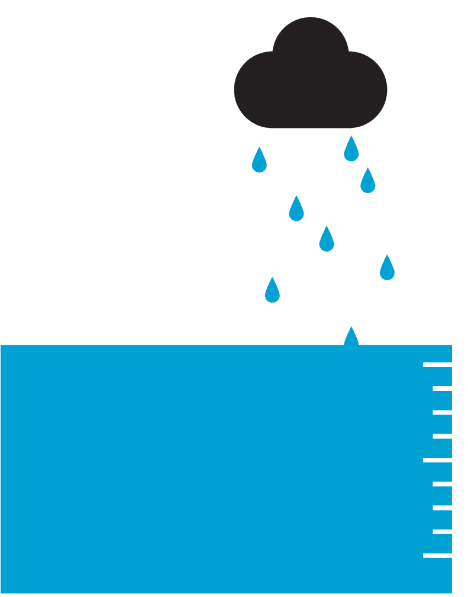

## 85

一家汽车经销商在年底大促销中将一款车型的价格降低了百分之二十五。要将汽车恢复到原价，销售价格必须提高百分之多少？

## 86

布莱恩决定向安德里亚求婚，去购物买戒指。在第一家珠宝店，他找到了一枚一克拉的戒指，价格为3,000美元。在第二家珠宝店，他找到了同一枚一克拉的戒指，价格为3,500美元。第一家珠宝店对退回的戒指收取百分之二十的费用，而第二家珠宝店退货不收取费用。如果安德里亚说不的几率为百分之五十，布莱恩应该在哪家珠宝店买戒指以最大化他的风险/回报？

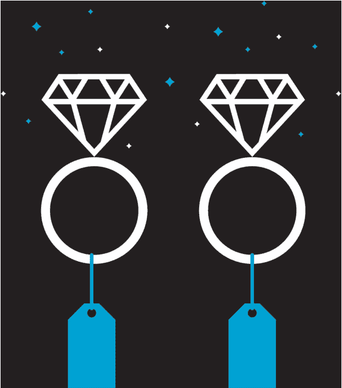

## 87

在一次峰会会议期间，约翰负责保护两位外交官，一位来自法国，一位来自西班牙。约翰挫败针对法国外交官的暗杀企图的几率为百分之二十五，挫败针对

针对西班牙外交官的暗杀企图。如果峰会现场有六个人企图暗杀法国外交官，而有十个人企图暗杀西班牙外交官，那么哪位外交官面临的暗杀危险更大？

## 88

迈克尔在一家杂货店的水果蔬菜区工作，负责堆橙子。老板让他把三十五个橙子堆起来，要求每一行的橙子数量比上面一行多一个。迈克尔完成时一共堆了多少行橙子？

## 89

太浩湖中央有一根旗杆。旗杆的二分之一埋在湖床里，另外三分之一被水覆盖，还有十英尺露出水面。这根旗杆的总长度是多少？

铺在客厅地板上的地毯，如果宽度和长度都是原来的两倍，那么面积是原来的几倍？

## 92

希尔瓦利高中每年都会在体育运动员之间举办一场拔河比赛。三名橄榄球运动员在一侧，两名棒球运动员在另一侧，比赛打成平局。同样，三名足球运动员在一侧，四名棒球运动员在另一侧，比赛也打成平局。如果一侧有五名橄榄球运动员，另一侧有两名足球运动员，哪一方会获胜，还是仍然打平？

## 93

文斯以每小时二十英里的速度从芝加哥开车到麦迪逊。到达麦迪逊后，他发现忘了带钱包，于是以每小时四十英里的速度赶回家。整个行程花了六个小时。从芝加哥到麦迪逊有多少英里？

## 94

汤米和拉尔夫都经营服装店，出售相同的商品。汤米卖的和拉尔夫卖的鞋子是同款，而且都卖100.00美元。汤米决定降价百分之二十五，拉尔夫则降价百分之三十作为回应。当汤米发现拉尔夫降低了鞋子的价格后，他又把自己的价格降低了百分之十五。拉尔夫接着又把价格降低了百分之十。现在谁卖的鞋子更便宜？

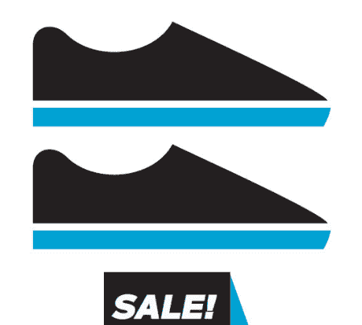

## 95

夏洛特正在拉斯维加斯玩轮盘赌。如果轮盘上有三十六个数字，请根据以下事实算出夏洛特下注的是哪个两位数：

这个数能被三整除。

这个数各位数字之和在四到八之间。

它是一个奇数。

将这个数的各位数字相乘，乘积在四到八之间。

## 96

当地的批发购物市场出售大容量的橙汁和苹果汁。

货架上有六个容器，分别装有以下容量：

- 容器A：三十夸脱
- 容器B：三十二夸脱
- 容器C：三十六夸脱
- 容器D：三十八夸脱
- 容器E：四十夸脱
- 容器F：六十二夸脱

其中五个容器装的是橙汁，一个容器装的是苹果汁。

两位顾客走进市场，第一位顾客买了两容器橙汁。第二位顾客买的橙汁是第一位顾客的两倍。哪个容器装的是苹果汁？

## 97

你有一卷100米的电线。你需要100段电线，每段长一米。如果测量并剪断每米电线需要一秒钟，那么你需要多长时间才能得到100段电线？

## 98

特伦特、玛丽和肖恩都在一家工厂工作。特伦特的收入是玛丽的一半。肖恩的收入是特伦特的三倍。如果他们三人一天一共赚144.00美元，那么他们每人每天各赚多少钱？

## 99

如果十只母鸡一周能产十五个鸡蛋，那么十五只母鸡两周能产多少个鸡蛋？

## 101

克里斯今天三十三岁。这是保罗在克里斯像保罗现在这么大的时候的年龄的三倍。保罗现在多大了？

## 102

某本书的精装本比平装本贵12.00美元。如果平装本价格是精装本价格的三分之二，那么精装本卖多少钱？

## 103

乔治娅每天坐地铁上班。她在第一站上车，通常都会打个盹。当地铁已经走过的路程还只有剩余路程的一半时，乔治娅睡着了。行程中途，乔治娅醒来看了看手表。当她再次开始打瞌睡时，地铁已经走过的路程是剩余路程的一半。乔治娅在地铁...

一位珠宝商正在生产金戒指。每制作十一枚戒指，她积累的黄金废料就足够再熔铸成一枚戒指。在制作了250枚金戒指之后，她还能用这些废料制作多少枚戒指？

## 108

一台巨大的口香糖球机里还剩七十一颗口香糖球。口味有柠檬、覆盆子、橙子和葡萄。柠檬味口香糖球的数量是覆盆子味的两倍。橙子味比覆盆子味少一颗，葡萄味比柠檬味少六颗。你至少要从中取出多少颗口香糖球，才能保证至少有两颗是同一口味的？

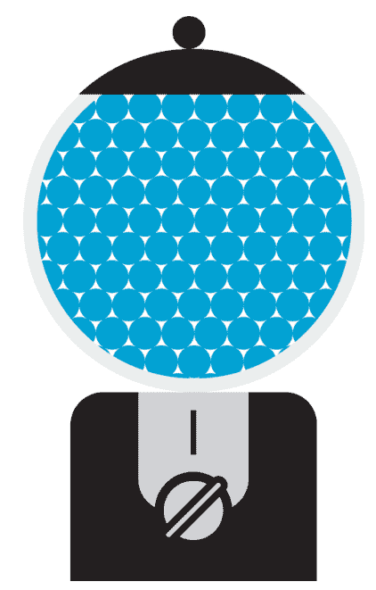

在东京鱼市，一条旗鱼重120磅，一条剑鱼重三十六磅。如果一条石斑鱼和一条剑鱼加起来与一条旗鱼和一条大比目鱼一样重，那么大比目鱼和石斑鱼各有多重？

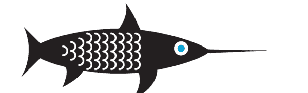

## 110

查理在帕丁顿车站问售票员下一班去牛津的火车什么时候开，当时正是中午。他被告知，下一班火车将在车站钟表的分钟和时针再次完全重合时出发。查理还有多长时间等下一班火车？

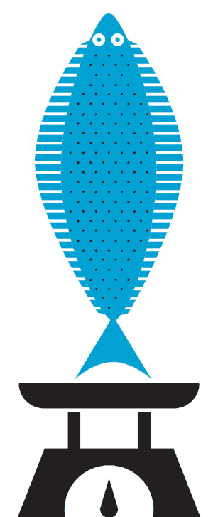

## 111

玛丽的生日聚会来了七个人，每个人都想要一块蛋糕。如果玛丽只能切三刀，而且切的时候不能移动蛋糕块，她怎样才能把蛋糕切成八块？

## 112

能否在井字棋棋盘上放置六个X，同时不使任意方向上出现三个连成一线的情况？

## 113

在一块当地的牧场上，十头奶牛需要二十天才能吃光所有的草。如果牧场里有十五头奶牛，草将在十天内被吃光。如果有二十五头奶牛在牧场里，草将在什么时候被吃光？

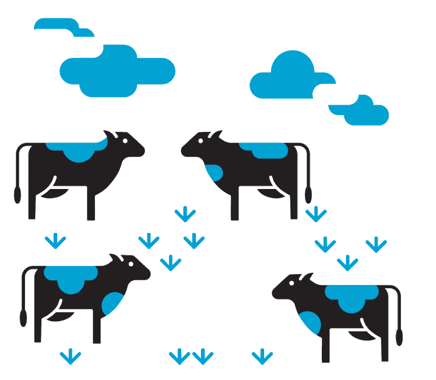

## 114

吉姆需要用100.00美元的预算为公司购买100台订书机。他必须恰好购买100台订书机，并且必须用完整个100.00美元。如果大型订书机每台6.00美元，普通订书机每台3.00美元，微型订书机每台0.10美元，吉姆各需要买多少台？

## 115

奥利维亚去进行返校购物，花了一半的钱买了一件新夹克。然后她又花了那笔钱的一半买了一双运动鞋。如果她还剩下25.00美元，她一共花了多少钱？

## 118

只用一个四分钟沙漏和一个七分钟沙漏，你怎样能测量出九分钟？

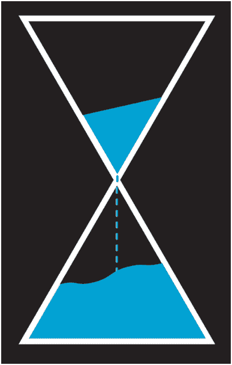

## 119

比尔和米克都是古董手表收藏家。如果比尔卖给米克七块手表，那么比尔的手表数量就和米克一样多。另一方面，如果米克卖给比尔七块手表，那么比尔的手表数量正好是米克的两倍。他们每人各有多少块手表？

## 120

理查德能在半分钟内吃掉100颗花生，而玛丽安能在两倍长的时间里吃掉一半的数量。玛丽安能吃多少颗花生？

## 理查德和玛丽昂十五秒吃完？

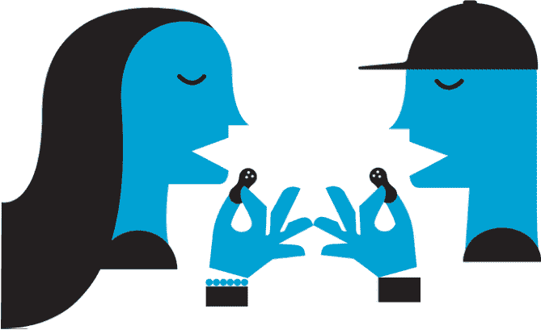

## 121

Maxime 和 Dan 正向他们的朋友讲述一场比赛的结果。比赛中共有三匹马，Quick Ted、Atomic Angie 和 Dragonlady。Maxime 告诉朋友 Quick Ted 赢得了比赛，Atomic Angie 排名第二。Dan 告诉朋友 Dragonlady 赢得了比赛，Quick Ted 排名第二。

实际上，Maxime 和 Dan 都没有告诉朋友比赛的真实结果。他们每人说了一句正确的话，也说了一句错误的话。这三匹马实际的排名顺序是什么？

## 122

酿酒厂老板 Mr. McFadden 最近去世了。在他的遗嘱中，他将二十一桶苏格兰威士忌（其中七桶装满，七桶半满，七桶空）留给了他的三个儿子。然而，威士忌和桶必须平分，使得每个儿子都有相同数量的满桶、半满桶和空桶。如果手边没有测量工具，如何才能将桶和威士忌平均分配？

## 123

Karen 去农贸市场买水果。她最终买了三箱水果：一箱装满樱桃，一箱装满草莓，还有一箱是混合的。卖水果的农民给箱子贴了标签，但她很匆忙，给每箱都贴错了标签。

如果你只允许从其中一箱里取出并查看一个水果，如何才能正确地给箱子贴上标签？

## 124

你在一个房间里，房间里有两扇门。一扇门后面有一只狮子，如果你打开它，狮子会吃掉你。第二扇门会让你离开房间。房间里还有两个男人，他们知道哪扇门是安全的。这两个男人中，一个总是说真话，一个总是说谎。如果你只能问其中一个男人一个问题，你可以问什么问题来获得你需要的信息以选择正确的门？

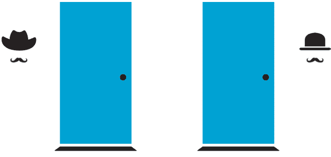

## 125

Zack 在第一场比赛结束后不久就出现在当地赛马场。他问他的朋友 Brad 那场比赛的结果如何，Brad 说：

> “Silver Wagon 在 Master David 之前完赛，在 Say It Fast 之后。
> 
> Say It Fast 与 Silver Wagon 并列当且仅当 Sir Oscar 没有与 Lion Heart 并列。
> 
> Silver Wagon 比 Lion Heart 晚的位次与 Lion Heart 比 Say It Fast 晚的位次相同，当且仅当 Say It Fast 在 Master David 之前完赛。”

这五匹马的比赛名次如何？

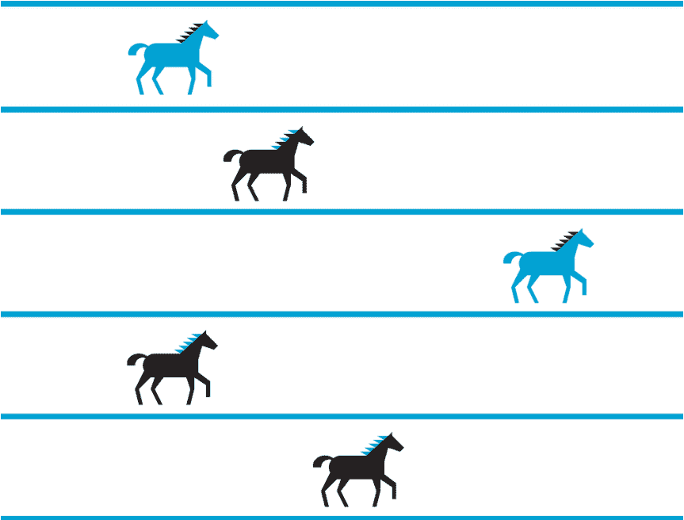

Yvette、Erin 和 Dan 加入了一个当地的观鸟俱乐部，去公园寻找鸟类。他们三人各自看到了一只其他两人都没有看到的鸟。每对人看到了一只第三人没有看到的鸟。有三人共同看到了一只鸟。Yvette 看到的鸟中有两只是黄色的。Erin 看到的鸟中有三只是黄色的。Dan 看到的鸟中有四只是黄色的。总共看到了多少只黄色鸟？

## 127

Darren、Tom、Rob 和 Matt 去参加了一场黑领结慈善晚会。他们到达时，在门口寄存了外套、帽子、手套和手杖（每位绅士各有一件）。取回时发生了混淆，每个人最终都得到了一件属于四人中每人的一件物品。Darren 和 Tom 拿到了自己的外套，Rob 拿到了自己的帽子，Matt 拿到了自己的手套。Darren 没有拿到 Rob 的手杖。每位绅士最终拿到了谁的外套、帽子、手套和手杖？

## 128

Troy 是一名爆炸专家，正在布线引爆一个山洞。他必须在山洞爆炸前四十五分钟内离开山洞，但他没有手表。他只有两根导火索，每根完全燃烧需要恰好一小时。它们的长度和宽度并不相同，因此他无法通过观察一根导火索烧到一半来测量半小时。使用这两根导火索，Troy 如何测量四十五分钟？

## 129

一只蜘蛛每天吃三只苍蝇。在蜘蛛填饱肚子之前，苍蝇尝试通过蛛网时有百分之五十的生存几率。假设已有五只苍蝇尝试通过，那么第六只苍蝇成功通过的概率是多少？

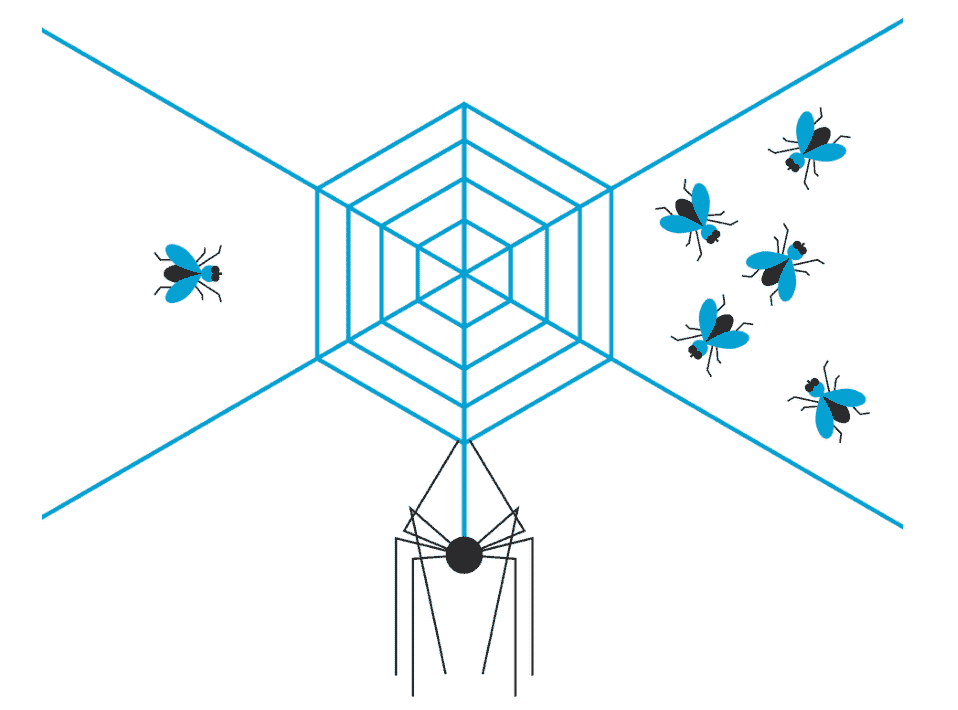

## 130

一家办公室有二十七名员工。如果办公室里女性比男性多七人，那么有多少名员工是女性？

## 131

Ingrid 去百货商店为她的电脑买屏幕保护膜、保护壳和耳机。逛了一圈后，她找到了每件商品的最佳价格。耳机的价格加上六倍屏幕保护膜的价格减去三倍保护壳的价格是十七美元。此外，四倍保护壳的价格减去两倍耳机的价格加上七倍屏幕保护膜的价格是十三美元。另外，十七倍保护壳的价格加上三十倍屏幕保护膜的价格减去八倍耳机的价格等于六十三美元。Ingrid 在商场花了多少钱？

## 132

Erik 比 Ron 多 100.00 美元。Erik 在杂货上花了 20.00 美元后，Erik 的钱是 Ron 的五倍。Ron 有多少钱？

## 133

Nico 以 53.00 美元购买了一台相机、一把尺子和一个冰淇淋。他为相机支付的价格比冰淇淋多 52.00 美元，尺子的价格是冰淇淋的两倍。他为每件商品支付了多少钱？

## 135

一辆纽约地铁列车平均每十分钟经过三个车站。以此速度，它一小时内会经过多少个车站？

## 136

假设你有三个盒子，一个装有两颗黑珠子，一个装有两颗白珠子，第三个装有一颗黑珠子和一颗白珠子。这些盒子被贴上了其内容的标签——BB、WW 和 BW——但有人调换了标签，使得每个盒子的标签现在都是错误的。你被允许一次从任意一个盒子里取出一个珠子，不看盒内，通过这种抽样过程来确定三个盒子的内容。确定所有三个盒子所需的最少抽取次数是多少？

## 137

一位牧场主得到 100.00 美元来买 100 只动物。她必须花掉全部 100.00 美元且没有零钱。牛的价格是 10.00 美元，猪的价格是 5.00 美元，鸡的价格是每只 0.50 美元。她必须买多少只每种动物才能花掉全部 100.00 美元且恰好有 100 只动物？

## 138

IBM 的股票在过去一年中在 70.00–80.00 美元之间交易。 一年前，IBM 的价格小于或等于其竞争对手微软的价格。微软现在的价格正好比去年低八分之一点，但 IBM 的价格已下跌，现在仅为微软价格的三分之二。它们现在分别卖多少钱？

## 139

在 Franklin 高中，百分之十的学生使用非法药物。药物测试在学生是否使用药物时，正确结果的准确率为百分之九十。随机抽取一名学生进行药物测试，结果为阳性。他使用药物的概率是多少？

## 140

一家赌场在标准轮盘赌中使用仅 5.00 美元和 8.00 美元的筹码。不能下注的最大金额是多少？

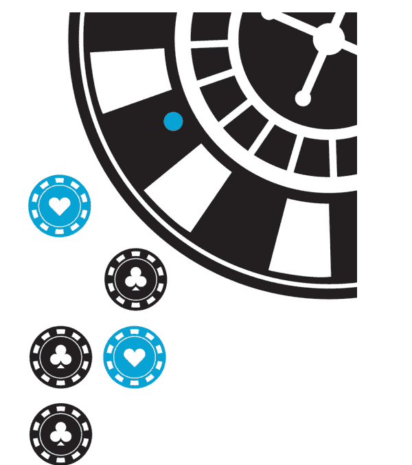

在五次击球中，一名台球选手打进了 100 个球。每次击球，他打进的球比上一次多六个。你能算出他每次击球打进了多少个球吗？

## 143

一个男人站在俯瞰平静湖泊的山丘上。他的眼睛在湖面以上 100 米处。他看到天空中有一个气球。他发现气球的仰角为三十度，气球在湖中倒影的俯角为六十度。气球在湖面以上的高度是多少？

## 144

一列半公里长的火车进入一条长十公里的隧道。如果火车以每小时三十五公里的速度行驶，整列火车完全通过隧道需要多长时间？

## 145

Chris、Leila、Nico 和 José 是大都会俱乐部的成员。每对成员恰好在一个委员会上一起工作，每个委员会有三名成员。委员会的数量是多少？

## 146

一家商店在节日期间将等离子电视的价格提高了百分之二十五。购物季结束后，他们又将价格降低了百分之二十五。那么电视的价格是比以前更低、相同，还是更高？

## 147

杰森开始自己创业，在网上销售台球桌，他想雇用联邦快递来运送台球桌。联邦快递有两辆能装下台球桌的卡车，一辆大一辆小。他们的卡车是小卡车的两倍高、两倍宽、两倍长。联邦快递决定，对于每辆满载的小卡车送货，收取500.00美元运费。

假设收费基于每辆卡车的体积，那么联邦快递对每辆满载的大卡车送货应收取多少费用？

## 148

一位老师带来一袋棒棒糖给她的学生们。约翰拿走了棒棒糖的五分之三，肯拿了安妮在剩余棒棒糖中所占份额的四分之三。安妮拥有棒棒糖总数的几分之几？

## 149

在当地市政厅会议上进行了一项民意调查，以了解市民们在阅读哪些报纸。百分之六十四的人阅读《太阳时报》，百分之二十二人阅读《邮报》，百分之七的人两种都读。接受调查的市民中有百分之多少没有阅读任何报纸？

## 150

伊斯拉在为期五天的热浪期间销售空调。她总共卖出了三十台空调，而且每天比前一天多卖三台。她第一天卖了多少台空调？

## 151

拼字比赛中有100名参赛者，每位参赛者要么是金发，要么是棕发。任意两名参赛者中，至少有一人是金发。有多少参赛者是金发，有多少是棕发？

## 152

艾娃正试图弄清楚一块轮状奶酪的重量。她知道五分之一磅的奶酪与同一块奶酪的五分之二个轮子完全平衡。整个轮状奶酪有多重？

## 153

一位农民正试图填满她土地上的一个小池塘，以便牲畜饮水。她雇了两家公司来填池塘。一家公司可以在两小时内填满池塘，另一家公司可以在五小时内填满。然而，地面会在六小时内渗掉整个池塘的水。如果两家公司同时填水，而地面同时渗水，填满池塘需要多长时间？

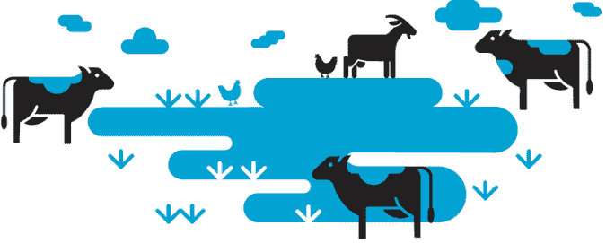

## 154

在公司假日聚会上，三分之一的员工提前离开。当晚稍后，剩余员工中的五分之二离开，几个小时后，剩余员工中的三分之二回家了。如果还有六名员工留在聚会上，那么最初有多少人参加？

## 155

一盒巧克力可以平均分给三个人、五个人或十三个人。这盒巧克力最少能有多少颗？

## 156

一位名叫杰夫的送货员每次准时送达货物可获得500.00美元报酬。唯一的问题是，为了准时送达，他必须超速。他有百分之二十五的几率因超速被拦下。这会让他迟到，意味着他拿不到报酬，而且还要支付200.00美元的超速罚单。杰夫平均每次送货能赚多少钱？

## 157

费尔南多正在研究一种每分钟繁殖一次的细菌。他将一个细菌菌株放入培养皿中，一分钟后细菌分裂。一分钟后，两个细菌再次分裂。再过一分钟，四个细菌分裂，如此继续。三个小时后，培养皿装满了一半。还需要多长时间才能完全装满培养皿？

## 158

四个朋友决定一起去看电影。他们到达时，剧院里有四个空座位。这四个朋友有多少种不同的方式可以坐满这些座位？

## 159

如果芝加哥南区每个人都拥有偶数数量的汽车，没有人拥有超过100辆汽车，并且没有两个人拥有相同数量的汽车，那么南区最多有多少辆汽车？

## 160

小丑弗莱克斯刚学会了抛接四个球。他必须抛多少次才能让球回到原来的位置？

弗莱克斯开始时每只手有两个球，他从一只手抛出一个球，然后从另一只手抛出另一个球，然后从第一只手抛出剩下的球，依此类推。除了每只手的第一次抛球外，每次抛球后，抛球的手都会有一瞬间不再持有任何东西。

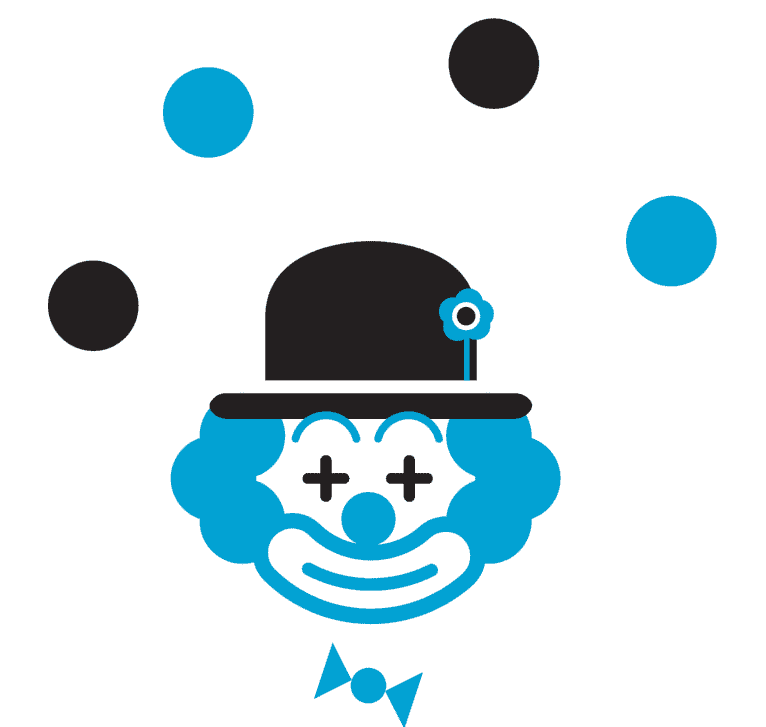

## 161

随着香烟价格飞涨，丹妮尔发现，如果她收集烟蒂，每五个烟蒂就能卷成一支香烟。她找到了二十五个烟蒂，那么她能抽多少支香烟？

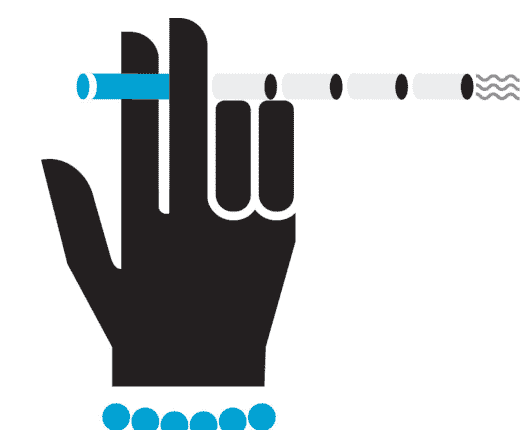

## 162

在弗吉尼亚大学，有4,215名大一学生，3,401名大二学生，1,903名大三学生和1,757名大四学生。将随机选择一名学生获得奖项。选中大三学生的百分比机会是多少？

## 163

阿尔伯特、鲍勃和卡尔正在一家自助餐厅吃饭。阿尔伯特去取餐的次数是鲍勃的2.4倍，而鲍勃比卡尔少去六次。假设每个人至少去一次，三人去取餐的总次数最小可能是多少？

## 164

米娅正在通过跑上跑下一座小山来训练跑步。她花了六十分钟跑上这座两英里的小山，又花了四十分钟跑下来。米娅在平坦路面上跑一英里需要多长时间？

## 165

一所高中的全体学生都在打篮球、踢足球，或者两者都参加。百分之七十三的学生是篮球运动员，百分之六十二是足球运动员。如果有200名学生，其中有多少人既打篮球又踢足球？

## 166

史密斯家的每个孩子至少有三个兄弟和四个姐妹。史密斯家最少可能有多少个孩子？

## 167

多米尼克和他妹妹能在一分钟内砌一堵五块砖长、五块砖高的墙。他们砌一堵十块砖长、十块砖高的墙需要多长时间？

## 168

扎克和丹尼斯各自收藏了一些火柴盒小汽车。扎克说，如果丹尼斯给他九辆车，他们就会拥有相等的数量；但如果扎克给丹尼斯九辆他的车，丹尼斯的车将是扎克的四倍。丹尼斯有多少辆火柴盒小汽车？

## 169

纽波特海滩和圣地亚哥相距八十八英里。如果艾丽卡骑自行车以每小时十英里的速度离开纽波特海滩，而艾莉森步行以每小时一英里的速度离开圣地亚哥，艾丽卡在途中遇到艾莉森之前需要骑行多少英里？

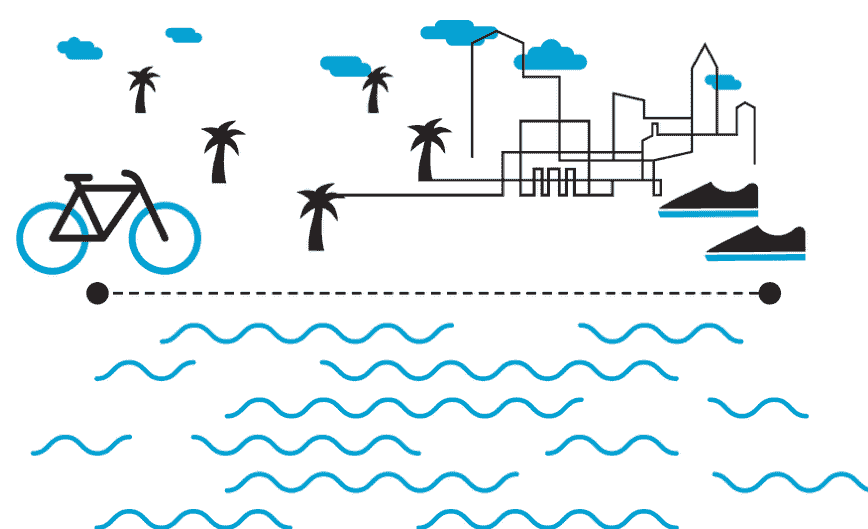

## 170

索菲亚一生中四分之一的时间是女孩，八分之一的时间是青年，二分之一的时间是成年人。如果她作为老妇人度过了十年，她现在多大？

## 171

在操场上，有十辆自行车和三轮车。如果轮子总数是二十四个，那么有多少辆三轮车？

## 172

如果五只海豚用五分钟吃掉五条鱼，那么四只海豚吃掉四条鱼需要多少分钟？

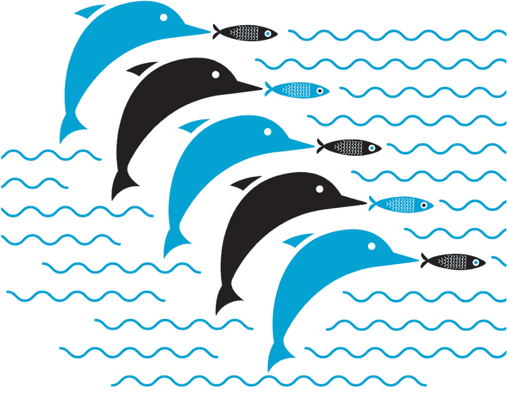

## 173

一位软包工正在给椅子背面换新布料。布料尺寸为27英寸×27英寸。软包工沿着正方形的边缘钉上图钉，使正方形的每条边上有二十八个图钉。每个图钉与相邻图钉的距离相等。软包工总共用了多少个图钉？

## 174

军事基地上有两根旗杆。一根旗杆高十六英尺，在地面上投下的影子长四英尺。第二根旗杆高六十四英尺。第二根旗杆的影子会有多长？

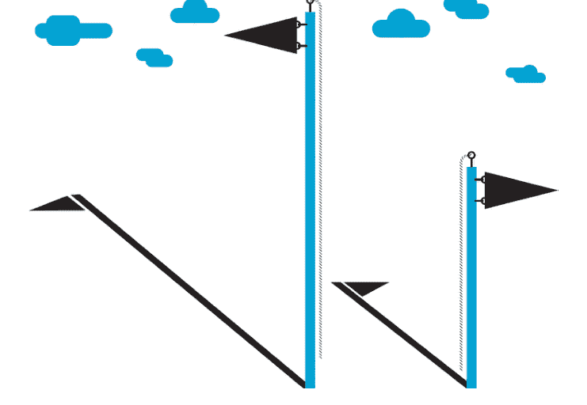

## 175
埃罗尔是当地小学的一名教师，他喜欢用粉笔。他刚买了一包十六根粉笔。当一根粉笔用掉四分之三时，它变得太小了他无法使用，于是他就停止使用它。当他积累的这些小块足够拼成一根原尺寸的粉笔时，他就把它们粘合在一起并放回盒子里作为一根新粉笔。如果埃罗尔每天使用一根粉笔，他的十六根粉笔盒能用多少天？

## 176
蒂姆拥有一家砌砖公司，并被雇佣来建造一栋砖房。五名砌砖工可以在三十一天内建成整栋房子。开工十天后，蒂姆又雇佣了十名砌砖工以加快房屋建造速度。还需要多少天才能完成房屋？

## 177
露西刚刚完成了本学期的全部四门期末考试。她发现自己的平均分为八十一。她还发现自己在物理和数学的平均分为七十八。她在英语和历史的平均分是多少？

## 178
国际后备棋世界锦标赛在蒙特卡洛举行。比赛采用循环赛制，每位参赛者都要与每一位其他选手进行一场比赛。如果总共进行了105场比赛，那么锦标赛中有多少名选手？

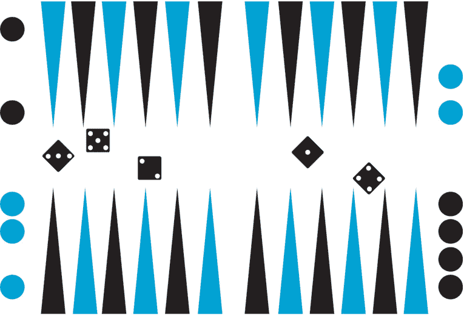

## 179
家犬巴斯特比猫奥斯卡重八十磅。如果它们的体重合计为120磅，巴斯特重多少？

## 185
一座雾号喇叭每分钟规律地鸣响五次。附近的一座雾号喇叭每分钟规律地鸣响四次。如果它们同时鸣响，多少秒后它们会再次同时鸣响？

## 186
库利南钻石是世界上最大的钻石。一群十二名窃贼从英国女王那里偷走了它。在逃跑途中，他们却弄掉了这颗钻石，它碎成了七块大小相等的碎片。他们把七块碎片带给了一位珠宝商，请他平均分配，以便十二名窃贼每人得到等量的钻石。珠宝商是如何分割这些碎片的？

## 187
一艘船停泊在港口，船员把一架绳梯挂在船侧，以便人们上下船。如果潮水每小时上涨一英寸，五小时后梯子会有多少部分仍在水面上，假设潮水开始上涨时有十英尺在水面上？

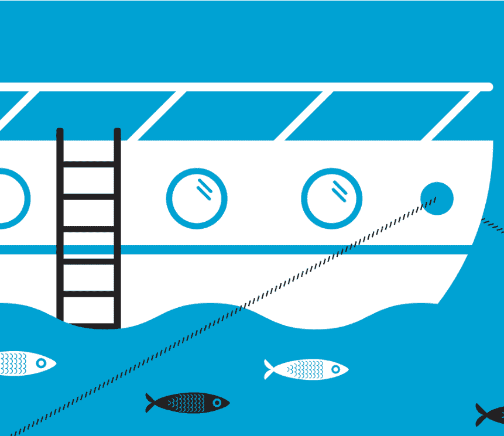

## 188
如果今天是星期四，那么在昨天的前一天之后的第二天之后的那一天是哪一天？

## 189
一个男人去拍卖会买了一只狼、一只山羊和一袋谷物。当他离开拍卖会开始步行回家时，他必须过河，但他每次只能带一件物品与他一起过桥。如果他把狼和山羊留在岸边，狼会吃掉山羊。如果山羊单独与谷物在一起，山羊会吃掉谷物。男人怎样才能过河而不让他的任何财产被吃掉？

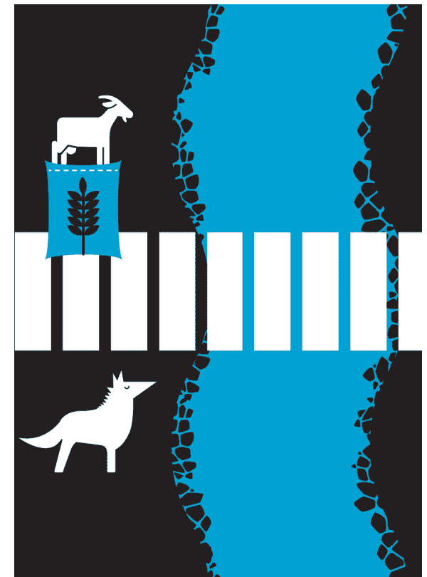

## 190
艾莉森欠罗伯特4.00美元，罗伯特欠克里斯汀3.00美元，卡罗尔欠艾莉森5.00美元。如果克里斯汀通过给艾莉森和罗伯特付款来结清所有债务，她会给艾莉森多少钱？

## 01
彼得再次获胜。彼得跑得更快，他可以比比尔多跑五米。

## 02
比利把卡片卖了两次，分别卖了10.00美元和8.00美元。他花了15.00美元买这张卡，所以他净赚了3.00美元。

## 03
二十五颗棒棒糖每颗0.25美元。6.25等于625美分。625除以25等于25。

## 04
十二个月。当一个人担任东道主时，另外三个人可以担任小吃提供者。每个人都有机会担任三个月的东道主，每个月的小吃提供者都不同。总共有十二种不同的东道主/小吃组合。

## 05
做防锈处理更划算。没有防锈处理，每年每轮的成本是17.50美元，有防锈处理时，每年每轮的成本是16.66美元。

## 06
亚当骑自行车第一个到达。

## 07
他们赚的钱一样多。假设他们第一年都赚10,000美元。第二年，艾莉森加薪到11,000美元，埃里克的工资降到9,000美元。第三年，艾莉森的工资下降十个百分点，降到9,900美元，而埃里克的工资上涨十个百分点，从9,000美元涨到9,900美元。他们现在每年都赚9,900美元。

## 08
第一名射手先击中对手的几率是三分之二。

## 09
贝丝。

## 10
把它扔进划艇里。因为弹珠比水更密，把它扔进划艇里会使水位升高得更高。试着用一个充气气球代替弹珠。如果你设法把气球压到水下，它会比把气球扔进划艇里时抬高水位高得多。

## 11
他们打了十一场比赛。约翰输了三场比赛。他必须再赢三场才能打平。然后他必须再赢五场才能赢50.00美元。3 + 3 + 5 = 11

## 12
九次。1:23，2:34，3:45，4:56，9:10，10:11，11:12，12:13，12:34。

## 13
没有。4 + 8 + 12 + 16 + 20 = 60。因为这个总数正好是售出的馅饼数量，所以第一天不可能有馅饼售出。

## 14
罐子里有四十颗果冻豆。

## 15
一根金条重五公斤。通过从天平两侧各取走一根金条，两根金条总共重十公斤。

## 16
史蒂夫必须给丽莎五颗弹珠。这样他就会少五颗，她就会多五颗，相差十颗。

## 17
六。

## 18
适合露易莎礼物的唯一匹配颜色是红色包装纸和红色丝带。萨曼莎礼物剩下的唯一对比纸张颜色是银色。玛丽亚的礼物剩下绿色包装纸和金色丝带。

## 19
把四个苹果各切成三块，然后把剩下的三个苹果各切成四块。

## 20
二十九天。翻倍每天仍然发生；我们只需排除第一天，因为它最初是翻倍的。

## 21

## 22
三个儿子和四个女儿。

## 23
一个小时五分钟。

## 24
七。杰斯一个也没有，考特尼有一个。

## 25
她最初有100.00美元。

## 26
一个。考虑罐子#1。总的可能排列数 N=9!，这个罐子被正确标记的几率是九分之一。关于罐子#2、3、4、...9 的情况也是同样的结果。总共，有 9 × N/9 = N 个罐子被正确标记；这意味着（正确标记的罐子数/可能的配置数）= 平均一个罐子被正确标记。

## 27
九十九。只有一名获胜者，必须有九十九名失败者，需要九十九场比赛。

## 28
二十美分。

## 29
重量会上升。

## 30
七。为了在六天内平均每天练习两小时，奥利维亚必须练习 2 × 6，或十二小时。从周一到周五，她练习五小时——每天一小时。为了达到十二小时，她必须在周六练习 12−5，或七小时。

## 31
160.00美元。解决这个问题的简单方法是把320除以二，因为百分之七十九中给小费两美元的那一半与百分之十七中全部给小费一美元的相同。

## 32
阿梅莉亚有三只手袋，一只金色，一只棕色，一只白色。

## 33
十二颗果冻豆。艾娃吃了剩下的一半果冻豆再加三颗，剩下没有，所以她必须吃了六颗果冻豆。乔治吃了一半的果冻豆，剩下六颗，意味着最初有十二颗。

## 34
五辆车。1,500 × 5 = 7,500 利润。

## 35
十场比赛。克雷格赢了前三场，丹必须赢下接下来的七场才能赢得4美元。

## 36
约翰最高，其次是比尔，然后是米克。

- **36.** 米娅比艾米丽大八岁。

- **37.** 她损失了100.00美元。

- **38.** 恩里克睡在里卡多和胡安之间。

- **39.** 116.00美元。

- **40.** 托比亚斯让每个人都骑别人的马。这样可以确保人人都想第一个冲过终点，这样他们就不会输。

- **41.** 它只经过十次。

- **42.** 是的。她有七个女儿。

- **43.** 穆罕默德一开始有62.00美元。

- **44.** 十一列。每半小时有一列火车经过，共九列，另外还有两列正驶入城市。

- **45.** 共三十一名选手。由于赛道是环形闭合的，我们只需将 1/5 + 5/6 = 31/30。三十名选手加上奥斯卡。

- **46.** 十个孩子。

- **47.** 法国。

- **48.** 总共十一个轮胎。4,000公里 × 4个轮胎 = 总里程16,000公里。1,500 × 11 = 总里程16,500公里。

- **49.** 六双。五双只能让她跑五十英里，而两场马拉松都是五十二英里。

- **50.** 这顿饭总花费是60.00美元。3人 × 20.00美元 = 60.00美元。吃了八道菜，因此每道菜花费7.50美元。布莱克带了5道菜 × 7.50美元 = 37.50美元，减去他应摊的20.00美元，即17.50美元。布莱恩带了3道菜 × 7.50美元，减去他应摊的部分，即2.50美元。

- **51.** 八只鸡和十四只山羊。

- **52.** 二十七级横档。

- **53.** 她应该选择第一份工作。两年后，第一份工作将支付56,000美元，而第二份工作只支付55,000美元。

- **54.** 他们每份必须收费4.00美元才能获得100%的利润。

- **55.** 埃里克只需两名夏尔巴人就能到达峰顶。三人同时离开大本营，每人携带四天的食物。第一天结束时，他们都还剩三天的食物。第一名夏尔巴人给埃里克和另一名夏尔巴人留下两天的食物，然后带着一天的食品返回大本营。第二天，最后一名夏尔巴人给埃里克留下一整天的食物后返回大本营。现在埃里克有四天份的食物，而距离到达峰顶只剩四天。不过，他会在下撤途中饿死。

- **56.** 五十九美分。十枚七分硬币减去那枚十一分硬币。

- **57.** 十张1.00美元纸币，一百张5.00美元纸币，九张10.00美元纸币，十八张50.00美元纸币。

- **58.** 她的平均速度是每小时6.7英里。埃琳娜跑前十英里用了两小时，跑最后十英里用了一小时，也就是说

- **65.** 你仍然只需要十七名面包师。

- **66.** 有四种可能：
  - 一把勺子和一把叉子。
  - 两把勺子。
  - 一把叉子和一把勺子。
  - 两把叉子。

  在四种可能中的三种情况下，你最终至少会得到一把勺子。因此，至少取到一把勺子的概率是四分之三，或者换种说法，是三比一。

- **67.** 如果把你所有损失加在一起，你会发现100名学生总共损失了310件物品。这个总数意味着，至少有100名学生各丢失了三件物品，还有十名学生（310除以100的余数）必定丢失了全部四件物品。

- **68.** 可可、洛基、温斯顿、弗拉菲和露露。

- **69.** 十块饼干。

- **70.** 阿梅莉亚在捡到4.00美元之前有6.00美元。

- **71.** 八天。蜗牛每二十四小时前进一英尺。所以七天后，她爬了七英尺。到了第八天，她每天能爬三英尺，于是爬出了井。

- **72.** 420名学生：这是500以下唯一能被3、4、5和7同时整除的数字。

- **73.** 贝丝二十二岁。

- **74.** 四只苍蝇（二十四条腿）和三只蜘蛛（二十四条腿）。没有其他组合符合条件。

- **75.** 安迪通过了八次，比尔四次，克里斯十一次，德雷克六次，埃里克三次。

- **76.** 六兄弟从最小到最大分别是十岁、十四岁、十八岁、二十二岁、二十六岁和三十岁。

- **77.** 四个人可以在六小时内制作十二顶帽子。

- **78.** 五块0.10美元的糖果，一块0.03美元的糖果，九十四块按两枚0.01美元购买的糖果，总共等于1.00美元。

- **79.** 比尔上了十一节课。

- **80.** 六只鞋。如果他拿出五只鞋，他可能每种颜色各一只，没有两只颜色相同。

- **81.** 约翰花了2,500美元和4,500美元，总共7,000美元。约翰以3,500美元和5,500美元卖出这幅画，总共9,000美元。约翰赚了2,000美元。

- **82.** 260美元。索菲亚赚280美元。如果利亚姆比她多赚50.00美元，那么利亚姆一定赚280 + 50.00美元，即330美元。丹比这个数目少赚70.00美元，即260美元。

- **83.** 胡安妮塔正确解决了十八道谜题，获得三十六分。她未能解决十二道，失去三十六分。

- **84.** 周六雨量计装了半满。它在周日翻倍，正好装满。

- **85.** 33.3%。如果汽车原价30,000美元，扣除百分之二十五后，价格为22,500美元。要将价格恢复到原来的30,000美元，你需要增加7,500美元，也就是22,500美元的三分之一，即33.3%。

- **86.** 他应该从第一家珠宝店买戒指。假设布莱恩求了两次婚，安德烈亚应该说一次“是”和一次“不”。这意味着如果他从第一家店买两次戒指，他会花费6,600美元；如果他从第二家店买两次，他会花费7,000美元。平均而言，他在第一家店的戒指花费是3,300美元，在第二家店是3,500美元。

- **87.** 西班牙外交官会被暗杀5次（50% × 10），而法国外交官会被暗杀1.5次（25% × 6）。因此，西班牙外交官面临的危险更大。

- **88.** 七行。最下面一行八个橙子，最上面一行两个。

- **89.** 六十英尺。

- **90.** 每队有四名队员。

- **91.** 四个小时。

- **92.** 五名足球运动员会赢。如果一边只有四名足球运动员，另一边只有两名橄榄球运动员，那就会打平。

- **93.** 八十英里。

- **94.** 拉尔夫。汤米以63.75美元出售这些鞋，而拉尔夫以63.00美元出售。

- **95.** 夏洛特摘了十五个。

- **96.** 容器E装的是苹果汁。如果第一位顾客购买容器A和C（共六十六夸脱），第二位顾客购买容器B、D和F（共132夸脱），那么第二位顾客买到的量正好是第一位顾客的两倍。剩下的容器E装的一定是苹果汁。

- **97.** 九十九秒。每剪一刀，包括第99刀，都会产生两段电线。

- **98.** 特伦特赚24.00美元，玛丽赚48.00美元，肖恩赚72.00美元。

- **99.** 四十五个鸡蛋。

- **100.** 装满三升壶，倒入五升壶。再次装满三升壶，将水倒入同一个五升壶，直到完全装满。三升壶中剩下的就是一升水。

- **101.** 二十二岁。

- **102.** 36.00美元。

- **103.** 乔治亚在旅途中睡了一半时间。

- **104.** 她最后一天开了200英里。如果第n天行驶的英里数为n，让后续每天为n + 20（每天增加的英里数）。这样你会发现，她第一天必须行驶四十英里，第二天六十英里，第四天100英里，第九天也是最后一天200英里。这是总和为1080的唯一方式。

- **105.** 他们已经玩了720周，即13.8年。可能的座位安排数是6 × 5 × 4 × 3 × 2，即720。

- **106.** 1,000除以175.00等于5.7，所以他们在屋顶上干了六天。

- **107.** 另外二十四枚金戒指。

- **108.** 二十七颗口香糖球。

- **109.** 石斑鱼重102磅。大比目鱼的重量是通过“两条大比目鱼等于一条旗鱼”的表述间接给出的。一条石斑鱼加两条大比目鱼等于一条鲟鱼加一条大比目鱼。那么一条石斑鱼加一条大比目鱼必须等于一条鲟鱼。所以，石斑鱼是120磅减去十八磅，即102磅。

- **110.** 查理有二十一分四十九秒。

- **111.** 用两刀切出一个X形，得到四块，然后水平切一刀，得到八块。

- **112.** 可以。 XXO XOX OXX

- **113.** 二十五头牛会在五天内吃光所有的草。

- **114.** 一台巨型订书机，二十九台普通订书机和七十台微型订书机。

## 115

75.00。

## 116

四十三颗钉子。

## 117

三分之二。

## 118

将两个沙漏都翻转。当四分钟沙漏漏完时，立即再翻转它。当七分钟沙漏漏完时，也立即再翻转它。一分钟后，四分钟沙漏会再次漏完。此时，将七分钟沙漏再翻过来。七分钟沙漏才运行了一分钟，因此再次翻转后，它只会再运行一分钟就漏完。当它漏完时，正好过去了九分钟。

## 119

比尔有四十九块手表，米克有三十五块。

## 120

62.5 颗花生。

## 121

龙女士获胜，原子安吉获得第二名，快手泰德获得第三名。

## 122

将两个半满的桶倒入一个空桶中。再将另外两个半满的桶倒入另一个空桶中。结果得到九个满桶、三个半满桶和九个空桶。每个儿子得到三个满桶、一个半满桶和三个空桶。

## 123

从标有“樱桃和草莓”的盒子中取出一颗水果。如果你取出的是樱桃，那么那个盒子一定只装着樱桃。因此，标有“草莓”的盒子不可能是只装樱桃的盒子，也不可能是只装草莓的盒子，所以它一定装的是樱桃和草莓。剩下的盒子便只装草莓。

## 124

问其中一个人，另一个人会如何回答“左边的门是正确的门吗？”这个问题。然后假设你得到的答案是假的，并据此行动。如果你问的是说谎者，他会错误地给你诚实者的答案。如果你问的是诚实者，他会正确地给出说谎者的错误答案。

## 125

快说获得第一名，狮心和奥斯卡爵士并列第二，银车获得第四名，大卫大师获得第五名。

## 126

看到了五只黄色的鸟。

## 127

- 达伦有自己的外套、汤姆的帽子、罗伯的手套和马特的手杖。
- 汤姆有自己的外套、马特的帽子、达伦的手套和罗伯的手杖。
- 罗伯有马特的外套、自己的帽子、汤姆的手套和达伦的手杖。
- 马特有罗伯的外套、达伦的帽子、自己的手套和汤姆的手杖。

## 128

将一根导火索的两端同时点燃，同时点燃第二根导火索的一端。当第一根导火索完全烧尽时，半小时已过去，第二根导火索还剩半小时。这时，从另一端点燃第二根导火索。这会使它在十五分钟后烧尽。到那时，正好过去了四十五分钟。

## 129

四分之三。

## 130

十七。你只需找到两个相差七、加起来等于27的数。通过试错，你应该很快就能找到它们——十和十七；所以办公室里一定有十七名女员工。

## 131

- 英格丽德花了 22.00。
- 耳机花了 14.00。
- 保护壳花了 5.00。
- 屏幕保护膜花了 3.00。

## 132

20.00。

## 133

你买一头牛、九头猪和九十只鸡。

## 138

IBM 为 70，微软为 105 3/8。

## 139

百分之五十。

## 140

27.00。

## 141

他在台球桌上的五个回合中，分别打进了八、十四、二十、二十六和三十二颗球。

## 142

俱乐部里有二十六名男性和二十名女性，总共四十六人。

## 143

气球在湖面上方 200 米处。

## 144

火车需要十八分钟。火车头首先需要行驶十千米才能驶出隧道，然后再行驶半千米直到火车尾部驶出隧道——总共十又二分之一千米，所需时间为 60 × (10.5 / 35) = 18 分钟。

## 145

七名成员和七个委员会。

## 146

电视机的价格低于它在涨价百分之二十五和降价百分之二十五之前的价格。如果电视机原价 1,000.00，那么 1,000 的百分之二十五是 250。所以，涨价百分之二十五后，价格为 1,250。现在计算 1,250 的百分之二十五。用 1,250 减去这个数额（312.50）即可得到降价后的价格，是 937.50——比原价 1,000 便宜 62.50。

## 147

联邦快递对一大卡车货应收取 4,000。由于大卡车的每个维度（高、宽、长）都是小卡车的两倍，所以大卡车的容积是小卡车的八倍。因此，对一大卡车货，联邦快递应收取一小卡车货价格的八倍，即 8 × 500.00，也就是 4,000。

## 148

安妮有 8/35，肯有 6/35。

## 149

百分之二十一。64 + 22 − 7 = 79。100 − 79 等于 21。

## 150

无。

## 151

只可能有一名棕发参赛者；因此，其余九十九名都是金发。

## 152

它重半磅。1/5 × 5/2 = 5/10，即半磅。

## 153

一又八分之七小时。

## 154

四十五。

## 155

195。

## 156

每次送货 325.00。

## 157

一分钟。记住，它们每分钟翻一番，所以当盘子半满时，只需再翻一番就会装满。

## 158

二十四。

## 159

五十。

## 160

八次投掷。

## 161

六支。丹妮尔用二十五个烟蒂做了五支香烟，抽完后，又用这五支香烟剩下的五个烟蒂做了一支额外的香烟。

## 162

百分之十七。将大三学生人数（1,903）除以学生总数（11,276）。

## 163

总共跑了二十八趟，其中阿尔伯特跑了十二趟，鲍勃跑了五趟，卡尔跑了十一趟。

## 164

米娅在平地上跑一英里需要二十四分钟。她下坡每小时能跑三英里，上坡每小时能跑两英里。如果你取这两个速度的平均值，你会发现米娅在平地上每小时能跑 2.5 英里。

## 165

百分之三十五两项都参加，总共七十名学生。

## 166

史密斯家可能拥有的孩子最少是九个。

## 175

二十一天。埃罗尔原来的盒子里有十六块。这些小碎片拼成了四块新的，而四块新拼图的小碎片又拼成一块，总共二十一块。

## 176

七天就能盖完这栋房子。

## 177

平均分是八十四。

- 四科总分为 4 × 81 = 324。
- 物理和数学总分为 2 × 78 = 156。
- 英语和历史总分为 324 − 156 = 168。
- 英语和历史平均分为 168/2 = 84。

## 178

比赛中有十五名选手。14 + 13 + ... + 2 + 1 = 105。

## 179

巴斯特重 100 磅。

## 180

安妮卡在营地待了十九天。

## 181

300。百分之二十的工人是兼职，所以百分之八十的工人是全职。百分之三十的人获得了奖金，共有七十二人。总工人数（n）的百分之八十的百分之三十等于七十二。3/10 × 8/10 × n = 72，即 24/100 × n = 72。因此，n = 72 × 100/24，即 300。

## 182

六米。先算出明尼苏达大学到目前为止移动了多远。他们把威斯康星大学向前拉了 3 米，因此明尼苏达大学向后移动了 3 米。然后他们被向前拉了 5 米，接着又被拉了 2 米。所以他们总共向前移动了 (−3) + 5 + 2 = 4 米。他们还需要再被拉 6 米，才能被向前拉 10 米。

## 183

六件。对于每条裤子，内特可以搭配五件不同的夹克，所以每条裤子有五种不同的搭配，即 3 × 5 = 15 种不同的裤子与夹克搭配。每一种搭配中，他都可以穿任意一件不同的衬衫。衬衫、夹克和裤子的搭配数量是（衬衫数量）× 15。题目告诉我们这个数量等于九十，所以九十除以十五等于六。

## 184

乔什有三分之二的概率先于布里安娜击中靶心。

## 185

六十。如果把所有时间换算成秒，第一只雾角每十二秒响一次，第二只雾角每十五秒响一次。然后求出最小公分母，也就是六十，就得到答案了。

## 186

珠宝匠将其中四块各切成三块，然后将剩下的三块各切成四块，然后分掉

them accordingly.

- 187. 十英尺。船会随潮水上升，梯子也会随之上升，因此不会影响露出水面的部分。

- 188. 星期三。

- 189. 先把山羊带过去留在另一边。然后回去取狼。把狼带到另一边并把山羊带回来。把谷物带到另一边留在那里，然后回去取山羊。

- 190. 1.00。克里斯汀被罗伯特欠 3.00，而她欠艾莉森 5.00。她需要现金损失 2.00 来结清所有债务。另一方面，艾莉森被克里斯汀欠 5.00，而她欠罗伯特 4.00。她必须获得 1.00 的收益。由于克里斯汀结清所有债务，这 1.00 必须来自克里斯汀，这就是答案。
