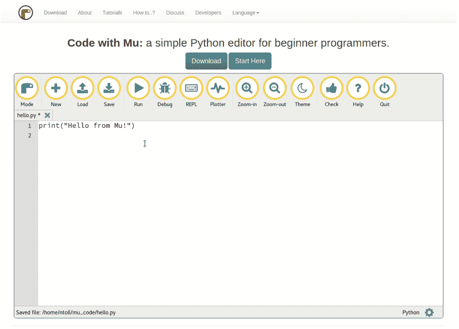
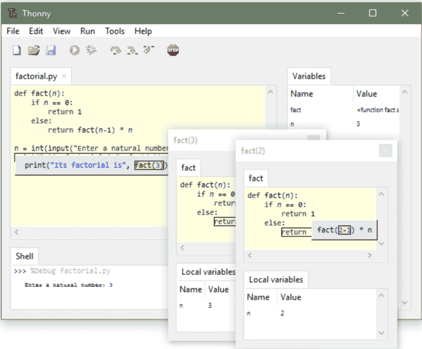
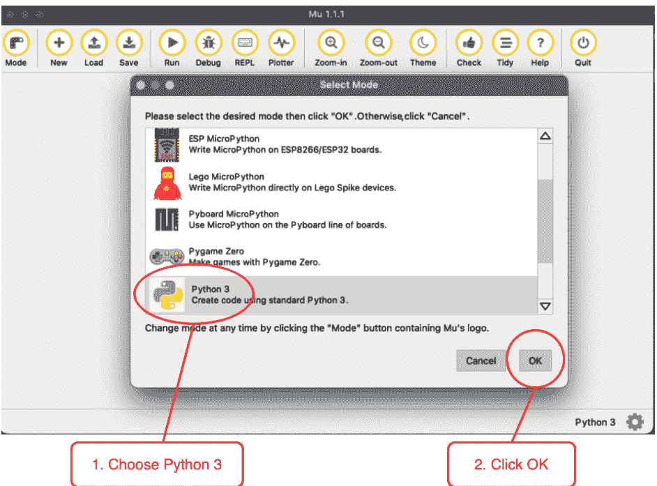
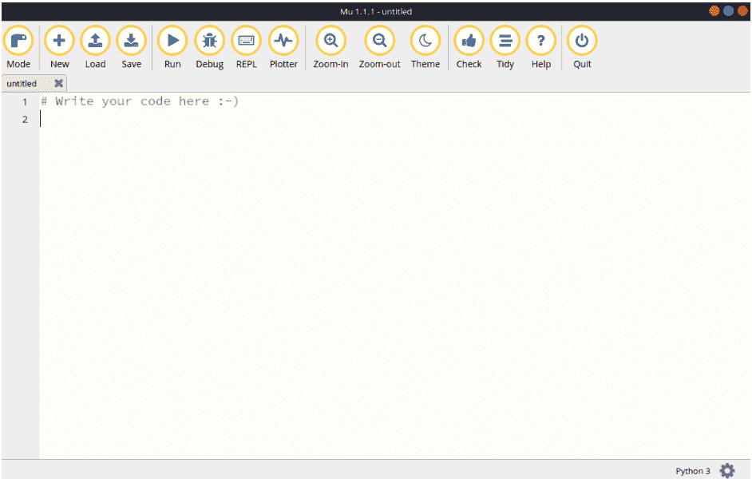
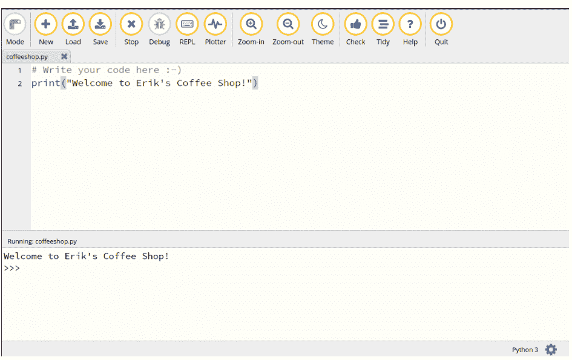
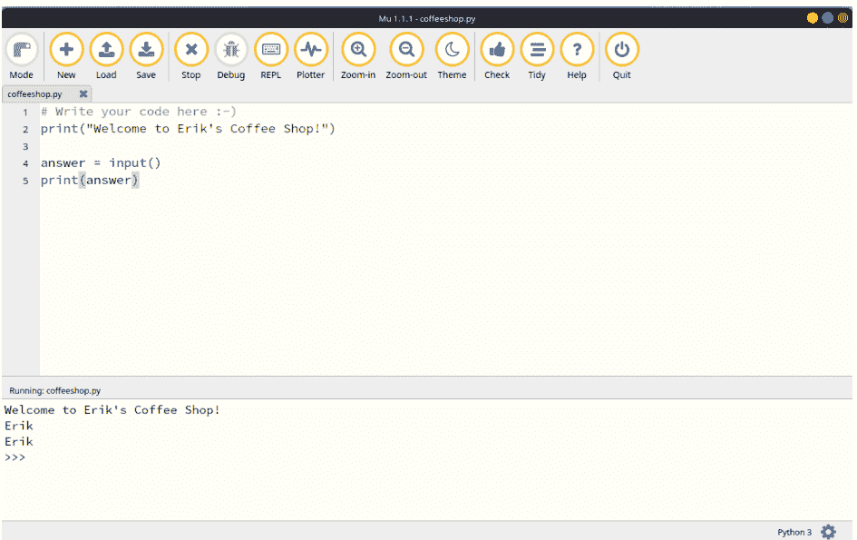
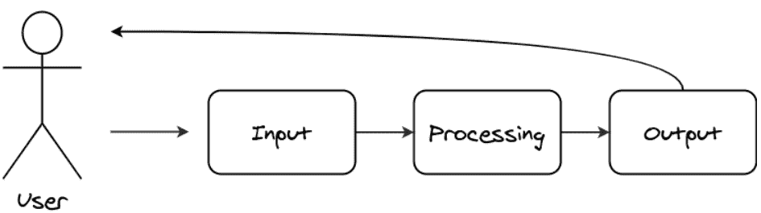

## Coffee for friends: first steps

## In this chapter

+   - Erik gets an idea
+   - Erik and Simon discuss the future application
+   - Erik installs a code editor and tries to run his first program in Python
+   - Simon explains how to use variables
+   - Erik writes his first dialogue in Python

### A Great Idea

It all started on a sunny summer day. Erik came home with an idea: he wanted to prepare coffee drinks for his friends. Who knew that he would create his own online application for that?

"I will make it just like at Starbucks, with many flavors and toppings," he thought. "I think I have everything I need: coffee, three or four flavors to add, and some chocolate cream for toppings. Great!"

"Where is my iPad?" he asked his older brother Simon.

"Where you left it. Why?"

"I need it to collect orders for my coffee shop!"

He came back several minutes later with notes on his iPad, prepared four drinks for his friends, and left again.

"Wasn’t it a good idea?" he asked Simon when he came home with four empty plastic cups.

"Yes, great idea," Simon said. "But…"

"What 'BUT'??" Erik asked. He felt that his older brother wanted to ruin his day. As he usually did.

"You used your iPad to take orders, but you used it just as a plain paper notepad. You could create a simple application for your coffee shop and use it to take orders."

"You mean—like in an online shop? With menus and all that?" Erik already imagined *his own* web store with a huge title at the top: "Erik’s Coffee Shop."

"Yes, of course. You know a bit of Python from that online course you’ve taken, don’t you?"

"Yes, but I don’t remember much. We did some exercises… I think it will be difficult—to make it look like a real online shop."

"Don’t worry," Simon said. "We’ll do it step by step. I did several projects like this for my robotics team at school."

NOTE
Don’t worry if you didn’t have any programming experience before. Erik didn’t remember much from his classes anyway so we’ll start from the very beginning.

Simon was in his last year in high school. He learned Python several years ago and used it in the school’s Computer Science club and, more recently, in his Robotics team.

"So you are saying we can build a real online application?" Erik was not convinced.

"Yes, sure. If you don’t drop out from my class," Simon smiled, "you will build it in a couple of weeks. Then, your customers will be able to choose whatever drink they want, add flavors…"

"And toppings!" Erik added.

"Yes, and toppings. And after they confirm the order, you’ll see it on the orders page. And you will know what to prepare and for whom. Something like this," and Simon took a piece of paper and started to draw a simple web page.

"This will be your order page."

## Erik's Coffee Shop

Enter your name:

Your name

## Choose your drink

## Choose your flavor

## Choose your topping

+   - Coffee
+   - Chocolate
+   - Decaf

+   - Caramel
+   - Marshmallow
+   - Strawberry

+   - Chocolate
+   - Caramel
+   - Cinnamon
+   - Vanilla

order

Cancel

"And this will be your list of orders."

## Erik's Coffee Shop

## orders

| Name | Product | Flavor | Topping |
|------|---------|--------|---------|
| Alex | Coffee | Caramel | Vanilla |
| Drew | Decaf | Strawberry | Chocolate |

"Cool! Do you think we can do it?" Erik still couldn’t believe his brother.

"Of course! As I said: just don’t drop out. You have plenty of time to finish it during your summer break."

NOTE We have several other project ideas that you can use if you don’t like the coffee shop idea. Some of them will be discussed when Erik’s friends join him in the following chapters. Look for more details in the Appendix A.

## First things first: installation

"Let’s start with some simple things. You will remember Python very quickly. Do you have it installed on your laptop?" Simon asked.

"No, I don’t think so."

"Here is a great Python editor, designed specifically for beginners like you. It’s called Mu Editor. Try to find it and install it. You can do it, I’m sure."

Erik found the website: https://codewith.mu/, where he could download it.



He downloaded the installation program from this page: https://codewith.mu/en/download.

## Download Mu

The simplest and easiest way to get Mu is via the official installer for Windows or Mac OSX (we no longer support 32bit Windows). We also have an experimental AppImage for Linux users running on Intel based hardware.

The current recommended version is Mu 1.2.0. We advise people to update to this version via the links for each supported operating system. All previous beta versions of Mu can be downloaded from here.

Windows Installer

Download

Instructions

Mac OSX Installer

Download

Instructions

Linux AppImage Package (Experimental)

Download

Instructions

He clicked Instructions and found an instructions page with all the steps for his computer (at that time he was using a Macbook, but the site contains instructions for all three operating systems: Windows, macOS, and Linux.)

You can find all necessary links and instructions in Appendix B.

> "Don’t worry, it’s not a toy. It’s a perfect editor," Simon said. "We use it in our robotics team to work with microcontrollers. As you see, there are versions for Windows, macOS, and Linux. I use the Linux version in my team."

> "Are there other editors for Python?" Erik didn’t want just to follow his brother’s directions.

> "Yes, of course, many of them. Another good option for beginners is Thonny. Look here: https://thonny.org/"


## Thonny

Python IDE for beginners

Download version 4.0.1 for Windows • Mac • Linux



"I like it!" said Erik. "And the name is funny."

"And, of course, there are other code editors that work on every platform:

- VS Code (https://code.visualstudio.com/),
- Sublime Text (http://www.sublimetext.com/) ."

"They all work perfectly with Python. Even the very old editors like Vim (https://www.vim.org/) and Emacs (https://www.gnu.org/software/emacs/) support Python, but you have to be a very serious programmer to use them," and Simon winked at his brother.

"Mu Editor and Thonny," Simon continued, "both include Python when you install them. To use Python with other editors, you have to install it first. On some systems, like Linux and macOS, Python is already installed from the beginning. On Windows, you should install it. I can show you later if you want."

## YOUR TURN   Install your Python environment
Now it’s your turn. Open your laptop or desktop, and install Mu Editor. You can find the complete instructions for different platforms in Appendix B (it is available on Windows, macOS, Linux).
If you prefer some other editor, feel free to install it instead of Mu. Don’t be afraid to experiment!

## How to talk to a computer

"Let’s start Mu Editor and begin writing your coffee shop program," Simon said.

Erik launched Mu and saw its first window:



"Select Python 3 from the menu and click OK," Simon suggested.

Erik did what Simon said. "From now on," Simon continued, "Mu Editor will remember that you prefer to use Python 3. Maybe you noticed that there are some other modes that can be used to work with microcontrollers, build web applications, and others. We will learn about them later."

Now Erik had the editor window in front of him.



"What should I write here?" Erik asked.

"What do you want your program to do first?"

"It should say 'Welcome to Erik’s Coffee Shop!'"

"Great! Let’s write it. Remember the function print() in Python?"

Erik started to write. This first step was easy.

```
## Write your code here :-)
print("Welcome to Erik's Coffee Shop!")
```

"Now what?"

"Now you run it. Click Run ▶."

Click Run

```
## Write your code here :-)
print("Welcome to Erik's Coffee Shop!")
```

Erik clicked the button, and suddenly another window appeared asking if he wanted to save the program. That was easy. Erik typed the name of the file: "coffeeshop" and was ready to press ENTER to save the file when Simon said:

"Wait, wait... Don’t forget to add .py to the file name. You have to let your text editor know that it’s a Python program. Mu Editor will add it automatically, but other editors won’t. So make sure all your Python files are named with .py at the end."

Erik added .py to the file name and saved the file. Immediately after, he noticed another window at the bottom of the editor’s window. There was the coffee shop greeting—precisely as he wanted it!



"It works!" Erik was delighted.

"Of course, it works. Why shouldn’t it?" Simon answered. "But you wanted to collect orders, didn’t you?"

"Yes, I would ask my client’s name and what they want…"

"And then?..." Simon obviously knew the answer, but he wanted Erik to find it himself.

"And then I would print 'Hello! Here is your order:' and show their name, flavor and topping. Like on a real receipt."

"Good idea," Simon said. "But look: when you are writing your program, you don’t know what your friend wants to order, right? So you can’t write in your program 'You ordered caramel.' Also, different clients order different things. It will be caramel for Alex and strawberry for Emily. So you see: your flavor *varies* from order to order, as well as the client’s name. Remember what this thing is called in programming?"

"It’s a *variable*!" Erik was glad he remembered it from the Python course he took several months ago.

"Right!" Simon was glad too. "Variable is like a box: you can put something into it, and then open and see what’s in the box. You can replace what’s in the box with something else."

"In our case," Simon continued, "let’s start with a box called 'answer' and store whatever you hear from your client in that box. You ask your client their name and they answer 'Alex,' for example. You put this answer in the box called 'answer' and keep it there. When you want to print it out, you tell Python: 'please print whatever is now in the box called 'answer'. The next client’s name is Emily, and now you put 'Emily' in the box. And next time, Python will print 'Emily' not 'Alex' because it is what is *now* in the box called 'answer.' Let’s write the code for this."

"Right here, in the same file?" Erik asked.

"Sure, go ahead and continue in the same file. To get something from the client, we use the *function* called `input()`. When you call it, it waits for the user to enter something. So the user types something on the keyboard and presses ENTER. And then the function *returns* whatever the user entered."

"Wait, wait," Erik stopped Simon. "What does it mean--'returns'? And also, you are talking about *functions*. Of course, I know what they are, but can you tell me what *you* mean by 'functions'?" Erik didn’t want to show that he *barely* remembered something about functions from his previous class.

"A function is a piece of code that *does* something. Almost *any* piece of code does something, but some pieces of code we use more often than the others. Later, you will create your own functions, but for now, we will use the functions written by somebody else. There are operations that people use very often, such as print something. You didn’t notice it, but you already used a function when you wrote `print()` in your previous program. In programming we say that you *call* a function."

"A-ha, I see," Erik said. "Something with parentheses is called a 'function'."

"Right. And you can put something inside those parentheses, and the function will *do* something with it. For example, it will print your message. What you pass into a function is called *arguments*. Sometimes it’s a string, sometimes it’s a number, sometimes there are several arguments."

"We call it 'to pass arguments' to a function," Simon continued. "The function will do something with the arguments and get something as a result. For example, it can calculate something, or do something with the string that you passed, like converting it to ALL CAPS or encrypting it. And then it returns that result to your main program."

"But how do I see the result?" Erik asked. "Will the function print it?"

"No, it won't. Here is where we need variables. We tell Python: 'please call this function with these arguments and please put whatever it returns into this box, sorry, this variable'. And all that is done using a simple 'equal' sign, like this =. For example, if you want to call the function input() and put what it returns to the variable answer, you simply write:"

```
answer = input()
```

"And after you save the client's answer, you can print it. You call the print() function and pass your variable as an argument."

"Great," Erik said, "now I see how to write it." He started writing in the editor. In a minute or two, he's got this:

```
print("Welcome to Erik's Coffee Shop!")

answer = input()
print(answer)
```

"Should I run it?" he asked Simon.

"Sure, go ahead, click [Run] ▶."

Erik clicked [Run] ▶.

"It says 'Welcome to Erik's coffee shop' and then nothing."

"What did you expect?" Simon asked.

"That it will ask me my name."

"But you didn't tell Python that it should ask something. Now it's waiting for your input. Type something."

Erik typed: "Erik" and pressed ENTER.

Python printed: "Erik".



"It works!" Erik said.

## YOUR TURN   Write your first dialogue
Write the dialogue program that Erik just wrote. It's a short program, we recommend to type it yourself instead of copying from the book. Create a name for your coffee shop and use it the first "Welcome" message. You can create some other shop if you want. What will it sell? Ice cream? Pizza? Flowers? Pet toys?
Try to run your program. Does it do what you expect it to do? If it doesn't, copy it from the book or from our web site: https://github.com/pavelanni/pythonicadventure-code and run it again. It should work.

"Yes, it works," Simon said, "but let's make it more user-friendly. Remember, you were confused when it said nothing except 'Welcome'? You should tell your user what you expect from them. And also, instead of printing just 'Erik', you could add something like 'Here is your order, Erik'.".

"You can pass this string to the input() function as an argument. We call it a prompt string. It explains what we expect from the user. And in the print() function, you can add the string you want to print before the answer variable. Let me help you."

Simon helped Erik to add those strings to the code, and this is what it looked like after that:


print("Welcome to Erik's Coffee Shop!")

answer = input("Please enter your name: ")
print("Here is your order, ", answer)
```

Simon noticed that Erik was looking for the [Run] button and explained: "Before clicking [Run] again, you have to stop your previous Python session. See these three angle brackets here? They mean that Python is running and waiting for your input. We will use it later, but for now, just click [Stop] and then click [Run] again."

Now the program asked for the order and answered exactly as Erik programmed it.

```
Welcome to Erik's Coffee Shop!
Please enter your name: Erik
Here is your order, Erik
>>>
```

YOUR TURN   Make your program more user-friendly
Add the prompt and the output string to your first program. Create a different prompt asking the client their name, like "Glad to see you! What's your name? "

"Looks much more user-friendly, doesn't it?" Simon said. "Always think about your users and ask yourself: Is it clear enough what I expect from the user? Can they possibly make a mistake here?"

"Now," Simon continued, "we have to ask your client about their order. You said you have coffee and chocolate. And also you said something about flavors and toppings?"

"Yes," Erik said, "I want to ask them which topping and flavor they want."

"Well, go ahead and ask them. You can just repeat the same code—but don't forget to change the prompts. And I think you should print the whole order at the end, not after each question. Try it."

Erik wrote this code and stopped at the last line.

```
print("Welcome to Erik's Coffee Shop!")

answer = input("Please enter your name: ")
answer = input("Please enter your drink: ")
answer = input("Please enter your flavor: ")
answer = input("Please enter your topping: ")
print("Here is your order: ", answer)
```

"You told me to put the answers in the answer variable. But how do I know now which is the flavor and the topping?" Erik was confused.

"Yes, I told you to put the answers in a variable, for example called 'answer'," Simon answered. Here we come to one of the most difficult problems in computer science: naming variables", he smiled. "Of course, you don’t store all the answers in the variable called answer. Let’s use different variables for different answers and give them meaningful names. For the client’s name we’ll use a variable called name--that’s easy. If you ask about a main drink, put the answer in the variable drink or product. For the flavor and topping answers use the variables flavor and topping."

"At the end," Simon continued, "print each variable on a separate line, using several print() functions. Go ahead. I will help you if necessary."

Erik worked on his code and finally produced this:

## Listing 1.1 coffeeshop.py

```
print("Welcome to Erik's Coffee Shop!")

name = input("Please enter your name: ")
drink = input("Please enter your drink: ")
flavor = input("Please enter your flavor: ")
topping = input("Please enter your topping: ")
print("Here is your order, ", name)
print("Main product: ", drink)
print("Flavor: ", flavor)
print("Topping: ", topping)
print("Thanks for your order!")
```

Erik clicked Run, and his program started a dialogue. Erik answered all the questions and got a nice output:

```
Welcome to Erik's Coffee Shop!
Please enter your name: Erik
Please enter your drink: coffee
Please enter your flavor: caramel
Please enter your topping: chocolate
Here is your order, Erik
Main product: coffee
Flavor: caramel
Topping: chocolate
Thanks for your order!
>>>
```

Simon noticed the last line and praised Erik for his initiative: "It’s always good to thank your customers."

"Yes, I saw that on several receipts in coffee shops," Erik said. He was glad he had done something on his own besides what his older brother told him.

YOUR TURN  Add more options to the dialogue. Use variables.
Edit your previous program and add the other lines to the dialogue. Again, feel free to change the prompts and strings you print to something more suitable to your project.
Change your printed output. Look at the receipts from the places you visit (coffee shops, restaurants, groceries, other shops). Try to make your printed output look similar. Use text symbols like |, _, =, +, and others to make your output look interesting.

Simon decided it was time to wrap up for today.

"I think it was a good start today," he said. "Let’s see what we have done today. First, we installed your programming environment."

"Yes," Erik said. "I like this Mu Editor. It uses colors to show me different parts of the program. And also it shows my string in red until I put the quotes at the end. And it has a dark mode! I know that *real programmers* always use the dark mode! I think I will continue using it."

"Second," Simon said, "we used a *function* for the first time. What was it?"

"It was the `print()` function," Erik said. "I told it what to print and it printed it."

"Right. You *called* the function and *passed and argument* to it."

"Third," Simon continued, "you used another function to get information from the user."

"It was `input()`," said Erik. "And I saved the answers in *variables*."

"Great!" Simon was really proud of his brother. "You are making good progress."

YOUR TURN  Explain it yourself
Try to explain it in your own words.

- What is a function? Give some examples.
- What are function arguments? Give some examples.
- How do you call a function?
- What is a variable? Why do we need them?
- How should we name our variables? Why?

## What is a program?

"Finally, let’s add a bit more theory," Simon said. "We just built a very simple program. But it has all the main components of any other program. We have asked the user for some *input*. After we received data from the user, we did something with that data. We usually call it *processing*. In our case, we just stored that data, but we could do something else with it, right?"

"For example?" Erik asked.

"For example, you’ve entered 'coffee' in lower case, but we may want to start all products and flavors from a capital letter. There is a special function in Python for that. So we can *process* the data after we received it."

"Great idea, I want to add it!" Erik said.

"Sure, we’ll do it. And finally, after we processed the data, we printed it out. In other words, we produced some *output*. Look here."



"Input doesn’t always come from a user," Simon continued. "Sometimes there is no interaction with a user, and the program takes data from somewhere else. For example, from the Internet, like recent sports results. Sometimes from sensors, like in robotics. Or from documents and images."

"Very often the output is not just a print output. In my robotics team we get inputs from sensors, we process them in the microcontroller, and our output is the signals to motors like: 'turn left, move forward.' But the structure is still the same: input → processing → output."

"Enough theory," Simon said. "Tomorrow we’ll work on improving your program."

"Improving?" Erik was surprised. "But it works fine already, doesn’t it?"

"What if your user enters something you don’t have in your shop?" Simon asked. "Like 'maple syrup'? What will you do? You should tell your user what you have in your coffee shop and what they can order. So, tomorrow we’ll work on *menus*. And also, we’ll see what we can do in case of errors."

## New terms we have learned today

+   - **Variable**
+     a place (a box) where we can store some values. For example, we can store numbers, letters, strings. A variable can hold only one thing at a time.
+   - **Function**
+     a piece of code that does something and that we want to be able to do it again.
+   - **Function arguments**
+     information that the function needs to do its job.
+   - **To call a function**
+     to write the name of the function with parenthesis and arguments between them.

## Code for this chapter

You can find the code for this chapter here:
https://github.com/pavelanni/pythonicadventure-code/tree/main/ch01

## More ideas for your projects

Find more ideas for your applications at the book companion site:
https://pythonicadventure.com/projects/. Don’t worry about Flask, SQLite, and web application (that are mentioned there) for now. We’ll get there later.


