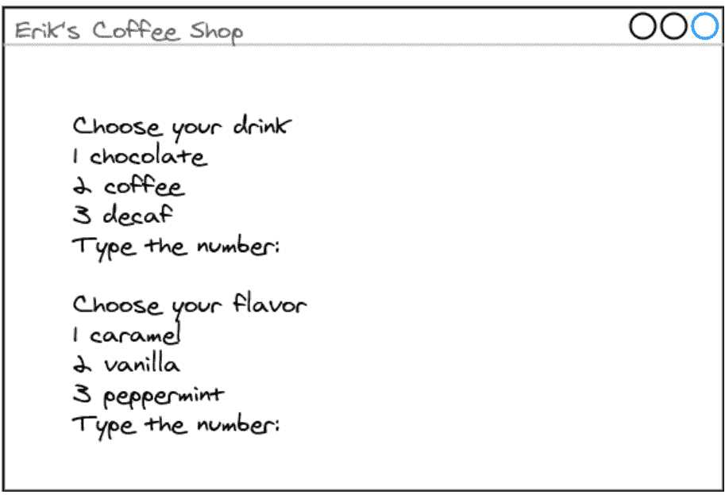
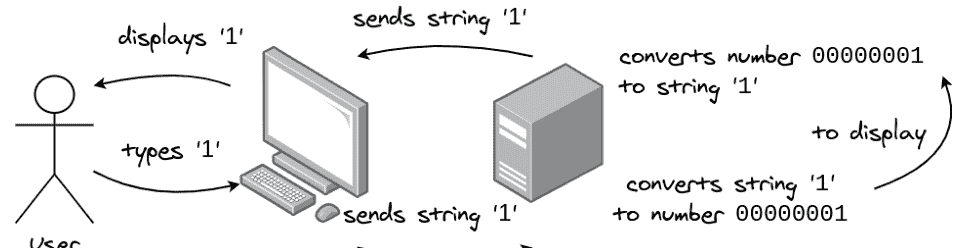
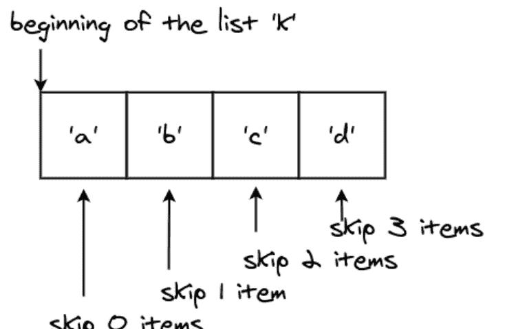
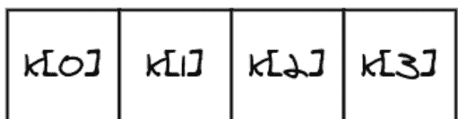

## 列表：菜单上有什么？

## 本章内容

- Erik 在他的咖啡店开始使用菜单
- Erik 使用 Python 列表来保存他的饮品、口味和配料
- Erik 使用 for 循环来打印他的列表
- Simon 解释计算机如何存储数字和字符串
- Erik 学到关于列表索引的一个重要事情

第二天 Erik 准备继续完善他的咖啡店应用程序。他记得 Simon 提到过顾客可能会在对话中输入商店里没有的产品。他找到哥哥问道：

“你昨天说顾客可能会输入我在店里没有的东西。我该怎么办？”

“还记得你上次去咖啡店或餐厅时是怎么知道可以点什么的吗？”

“他们有一份菜单，上面列出了这家店有的产品。”

“对！” Simon 说。“菜单！这就是我们今天要创建的东西。咖啡店里的菜单长什么样？”

“它是一个列表。主饮品的列表，比如咖啡、巧克力、去咖啡因。还有可以添加的口味列表。比如焦糖、薄荷等等。还有配料的列表。”

“对，列表！” Simon 很高兴 Erik 用了这个词。“就像这样，对吗？”他很快草拟了一些看起来像菜单的东西。

## 菜单

## 饮品

Coffee 1.00
Chocolate 1.50
Decaf 1.20

## 口味

Caramel 0.50
Vanilla 0.45
...

## 配料

Chocolate 0.30
Cinnamon 0.30
....

> “列表就是我们需要的！Python 中有列表——你可能还记得。列表在 Python 中非常有用。它们可以包含数字、字符串，甚至其他列表。例如，” Simon 拿出另一张纸并写下了几个例子。

```
fruits = ['apple', 'peach', 'banana']
```

```
numbers = [42, 256, 1000]
```

```
constants = [3.1416, 2.718, 1.4142]
```

让我们为你的菜单创建列表。你只需给列表起一个名字——比如 flavors，然后在方括号中列出你的口味。你的配料和主饮品也一样。不要忘记你的口味、配料、饮品都是字符串，所以它们应该用引号括起来。你可以在编辑器中新建一个文件，例如命名为 menu.py。

Erik 打开了编辑器并开始编写。几分钟后他得到了以下内容。

```
drinks = ["chocolate", "coffee", "decaf"]
flavors = ["caramel", "vanilla", "peppermint", "raspberry", "plain"]
toppings = ["chocolate", "cinnamon", "caramel"]
```

“非常好，” Simon 说。“现在让我们把它们打印成菜单。”

“直接 print(drinks) 吗？” Erik 提议。

“你可以这样做，但不会好看。试试看。”

Erik 在末尾添加了 print() 语句。

```
drinks = ["chocolate", "coffee", "decaf"]
flavors = ["caramel", "vanilla", "peppermint", "raspberry", "plain"]
toppings = ["chocolate", "cinnamon", "caramel"]
print(drinks)
```

“点击 Run ▶，” Simon 说。

Erik 点击后在编辑器窗口底部看到了输出。

```
['chocolate', 'coffee', 'decaf']
>>>
```

“如果你的菜单是一个列表，我们应该把它作为列表打印出来，” Simon 说。“而且你还应该给用户一个从列表中选择的方式。例如，你可以要求输入一个字母。但这里有 chocolate 和 coffee。所以你不能对两者都使用字母 'C'。我们改用数字吧。对每个菜单项我们打印一个数字。然后你的用户将为他们的选择输入一个数字。例如，1 代表 chocolate，2 代表 coffee。像这样。” Simon 拿起一张纸画了一个简单的菜单。



“是的，我在中餐厅见过——每道菜都有一个号码，” Erik 回忆道。“但我在 Python 中该怎么做呢？”

“你有一个包含多个项目的列表，” Simon 开始解释。“你必须打印每个项目，并在前面加上一个数字。当我们在 Python 中需要重复某事时，我们使用循环。在这种情况下它将是 for 循环。你告诉 Python 对列表中的每个项目都要做某事。比如打印它。”

“写一个简单的 for 循环，” Simon 继续说。“让我为你写第一个。” Simon 拿起 Erik 的键盘并在他的代码中添加了几行。

```
drinks = ["chocolate", "coffee", "decaf"]
flavors = ["caramel", "vanilla", "peppermint", "raspberry", "plain"]
toppings = ["chocolate", "cinnamon", "caramel"]

for d in drinks:
    print(d)
```

Simon 点击了 [Run]，他们看到了输出：

```
chocolate
coffee
decaf
>>>
```

“现在轮到你了，” Simon 说。“为另外两个列表写同样的代码。注意我使用了另一个变量来打印列表项。列表叫做 drinks。我对列表中的每种饮品只用了 d。 通常建议为变量使用有意义的名称，比如 drinks 代表饮品列表。但如果一个变量只在一次循环中用于遍历列表，可以使用短一点的名字，一个或两个字母。这不是规则，但输入起来更容易。”

“还有一件很重要的事情，” Simon 继续说，“在 Python 中空格 *非常重要*。你看到 `print()` 函数调用向右移动了四个空格吗？这就是我们告诉 Python *在循环中*应该重复什么的方式。向右移动的部分叫做 *块*。你在这个块中放入的所有内容都将对每个列表项重复。现在只有一个函数调用，但我们稍后会添加一些东西。

“你可能还注意到我没有在键盘上输入四个空格。我们的编辑器自动为我们做了这件事。你将用于 Python 的所有编程编辑器都有这个功能。当它们看到冒号 (:) 时会自动换行缩进。它叫做‘开始一个块’。现在继续写循环吧。”

Erik 创建了另外两个循环来打印另外两个列表。他喜欢使用更短的变量名（输入更少！）。他还注意到编辑器在冒号后自动缩进了下一行。非常有用！他得到的内容如下。

```
drinks = ["chocolate", "coffee", "decaf"]
flavors = ["caramel", "vanilla", "peppermint", "raspberry", "plain"]
toppings = ["chocolate", "cinnamon", "caramel"]

for d in drinks:
    print(d)

for f in flavors:
    print(f)

for t in toppings:
    print(t)
```

他保存了程序并运行它。

**轮到你了   创建你的产品列表并打印它**

打开你的代码编辑器并创建一个类似 Erik 刚刚创建的程序。它应包含三个或更多项目的列表。然后使用循环打印出这些列表的内容。

你可以使用 Erik 的菜单项，也可以创建自己的。冰淇淋口味、贝果、迷你人仔，任何你想要的！

```
chocolate
coffee
decaf
caramel
vanilla
peppermint
raspberry
plain
chocolate
cinnamon
caramel
>>>
```

“非常好，” Simon 说。“但我们没有数字。我们必须修复它。还记得我告诉过你我们可以向块中添加其他东西吗？这是我建议的。我们将创建一个变量来保存列表中项目的编号。每次进入下一个项目时我们就给该变量加一。这样 'chocolate' 将是 1，'coffee' 是 2，依此类推。”

“让我展示给你看，” Simon 又拿起了 Erik 的键盘。

```
drinks = ["chocolate", "coffee", "decaf"]
flavors = ["caramel", "vanilla", "peppermint", "raspberry", "plain"]
toppings = ["chocolate", "cinnamon", "caramel"]

i = 1
for d in drinks:
    print(i, d)
    i = i + 1

for f in flavors:
    print(f)

for t in toppings:
    print(t)
```

他运行了程序，他们看到了这个：

```
1 chocolate
2 coffee
3 decaf
caramel
vanilla
peppermint
raspberry
plain
chocolate
cinnamon
caramel
>>>
```

“你看：我添加了 i 变量。现在对每个列表项我不仅打印它的值，还打印它的编号。然后我给编号加一，从 1 变到 2，然后从 2 变到 3，依此类推。现在继续修改剩下的部分吧，” Simon 说。

Erik 做了修改：

```
drinks = ["chocolate", "coffee", "decaf"]
flavors = ["caramel", "vanilla", "peppermint", "raspberry", "plain"]
toppings = ["chocolate", "cinnamon", "caramel"]

i = 1
for d in drinks:
    print(i, d)
    i = i + 1

for f in flavors:
    print(i, f)
    i = i + 1

for t in toppings:
    print(i, t)
    i = i + 1
```

当他运行程序时看到了这个输出：

```
1 chocolate
2 coffee
3 decaf
4 caramel
5 vanilla
6 peppermint
7 raspberry
8 plain
9 chocolate
10 cinnamon
11 caramel
>>>
```

“但这不是我想要的！” Erik 说。“我认为应该是：饮品为一、二、三，然后口味为一、二、三，然后配料也为一、二、三。”

“对！” Simon 同意。“你会怎么做？”

“使用不同的变量？”

“是的，这也是可能的。但你也可以使用同一个 i 变量。重要的是在每个循环前将其设为一。我们称之为初始化变量。”

Erik 在每个循环前添加了 i = 1 并得到了这个：


```
drinks = ["chocolate", "coffee", "decaf"]
flavors = ["caramel", "vanilla", "peppermint", "raspberry", "plain"]
toppings = ["chocolate", "cinnamon", "caramel"]

i = 1
for d in drinks:
    print(i, d)
    i = i + 1

i = 1
for f in flavors:
    print(i, f)
    i = i + 1

i = 1
for t in toppings:
    print(i, t)
    i = i + 1
```

YOUR TURN    Print three (or more) menus with numbers
Modify your previous program to add numbers to your menu items. Use the loops. Don’t forget to reset the item counter with each new list.

He clicked Run and got the output:

```
1 chocolate
2 coffee
3 decaf
1 caramel
2 vanilla
3 peppermint
4 raspberry
5 plain
1 chocolate
2 cinnamon
3 caramel
>>>
```

"Now let’s make it a bit prettier," Simon said. "Add titles like 'Our drinks' before each list. Remember, we should let the user know what they see and what they should do."

Erik added the titles. He even added an extra line under each title. He was sure it will make it look like a real menu.

```
drinks = ["chocolate", "coffee", "decaf"]
flavors = ["caramel", "vanilla", "peppermint", "raspberry", "plain"]
toppings = ["chocolate", "cinnamon", "caramel"]

print("Erik's Coffee Shop drinks")
print("----------------------------")
i = 1
for d in drinks:
    print(i, d)
    i = i + 1

print("Erik's Coffee Shop flavors")
print("----------------------------")
i = 1
for f in flavors:
    print(i, f)
    i = i + 1

print("Erik's Coffee Shop toppings")
print("----------------------------")
i = 1
for t in toppings:
    print(i, t)
    i = i + 1
```

YOUR TURN   Add titles to your menus

Add titles to your menus to make the output beautiful. Use your shop’s name in the titles. Try to use other symbols instead of dashes.

And the output was beautiful, as he expected:

```
Erik's Coffee Shop drinks
----------------------------
1 chocolate
2 coffee
3 decaf
Erik's Coffee Shop flavors
----------------------------
1 caramel
2 vanilla
3 peppermint
4 raspberry
5 plain
Erik's Coffee Shop toppings
----------------------------
1 chocolate
2 cinnamon
3 caramel
>>>
```

> "Looks good," Simon said. "What is also good about this format is that now you have three lists in your menu and three lists in your program."

> "Let’s write this code," Simon continued. "For each list in the menu, you have to ask the user to choose an item and get that information from them. How do you get information from a user? You did it yesterday, remember?"

> "With input () ?" asked Erik.

"Of course!" Simon was glad Erik remembered the previous lesson. "You can write it yourself, can’t you?"

"Let me try," Erik said and started editing his code. He remembered that he should use the input() function. Then he put the prompt inside the parentheses and on the left side he used a variable. He remembered that he shouldn’t use the same variable for different questions.

Here is what he wrote:

```
drinks = ["chocolate", "coffee", "decaf"]
flavors = ["caramel", "vanilla", "peppermint", "raspberry", "plain"]
toppings = ["chocolate", "cinnamon", "caramel"]

print("Erik's Coffee Shop drinks")
print("----------------------------")
i = 1
for d in drinks:
    print(i, d)
    i = i + 1
drink = input("Choose your drink: ")

print("Erik's Coffee Shop flavors")
print("----------------------------")
i = 1
for f in flavors:
    print(i, f)
    i = i + 1
flavor = input("Choose your flavor: ")

print("Erik's Coffee Shop toppings")
print("----------------------------")
i = 1
for t in toppings:
    print(i, t)
    i = i + 1
topping = input("Choose your topping: ")
```

**YOUR TURN**  **Add user inputs to your menus**

Add the `input()` functions to your menus. Use appropriate variable names to store the user’s answers.

"Now what?" he asked Simon.

"Now your user types a number and you use that number to find the item. In Python we call this number a list index. If you put this number in square brackets next to the list name, you get that item. Like this," and he wrote an example:

drinks[drink]

"So after you know the number you can find the item in the list. And you can print 'Here is your order' like you did yesterday, but now you’ll take those items from the menu. Try it, I’ll help you if necessary."

That was a bit more difficult. Erik looked at his yesterday’s program and copied the lines from it to the bottom of this program. Then he replaced variables like drink with the list items like Simon suggested.

Here is his code:

```
drinks = ["chocolate", "coffee", "decaf"]
flavors = ["caramel", "vanilla", "peppermint", "raspberry", "plain"]
toppings = ["chocolate", "cinnamon", "caramel"]

print("Erik's Coffee Shop drinks")
print("----------------------------")
i = 1
for d in drinks:
    print(i, d)
    i = i + 1
drink = input("Choose your drink: ")

print("Erik's Coffee Shop flavors")
print("----------------------------")
i = 1
for f in flavors:
    print(i, f)
    i = i + 1
flavor = input("Choose your flavor: ")

print("Erik's Coffee Shop toppings")
print("----------------------------")
i = 1
for t in toppings:
    print(i, t)
    i = i + 1
topping = input("Choose your topping: ")

print("Here is your order: ")
print("Main product: ", drinks[drink])
print("Flavor: ", flavors[flavor])
print("Topping: ", toppings[topping])
print("Thanks for your order!")
```

"Now run it and let’s see what it gives us," Simon said.

Erik clicked [Run] and the program printed the drinks menu and asked for his choice. So far it worked. Erik quickly entered numbers for all three menus and saw this output:

```
Here is your order:
Traceback (most recent call last):
  File "/home/erik/mu_code/menu.py", line 30, in <module>
    print("Main product: ", drinks[drink])
TypeError: list indices must be integers or slices, not str
>>>
```

"What’s this?" he was puzzled.

"Congratulations!" Simon said.

"What are you so happy about? That my program doesn’t work?" Erik started getting angry at his brother.

"Not at all!" Simon said. "You got your first error message from Python and it’s a good sign! Making errors and fixing them is the only way to learn. You’ve got an error message—now let’s try to fix the problem. Usually Python gives you the reason why this happened. Start from reading the last message. What does it say?"

"Something about slices… Must be integers not str. What’s that?"

"I agree, it takes some practice to learn to read Python error messages. Here it tells you that when you use a variable as an index of a list, that variable should be an integer number, like one, two, three."

"But I entered numbers!" Erik was still confused.

"Yes, you typed numbers on your keyboard. But for Python everyting you enter from a keyboard is a string. Python makes a difference between a string containing the number '1' and the integer number 1."

"This comes from the way computers keep things in memory," Simon continued. "The computer keeps the number 1 in memory, but when it shows it to you, it converts it to a string '1'. The same way computers convert numbers they get from the keyboard. You type '123' on your keyboard and the computer gets this string and converts it to a number 123. Look here," and Simon draw a picture with a computer, keyboard, display, and a user.



"So we should tell Python to convert the strings you type on the keyboard to integer numbers. There is a special function for that called int(). Let me show how to use it."

Simon changed Erik’s program in one place and let him do the same in the other two places. Here is what Erik’s program looked like after that:

```
drinks = ["chocolate", "coffee", "decaf"]
flavors = ["caramel", "vanilla", "peppermint", "raspberry", "plain"]
toppings = ["chocolate", "cinnamon", "caramel"]

print("Erik's Coffee Shop drinks")
print("----------------------------")
i = 1
for d in drinks:
    print(i, d)
    i = i + 1
drink = input("Choose your drink: ")

print("Erik's Coffee Shop flavors")
print("----------------------------")
i = 1
for f in flavors:
    print(i, f)
    i = i + 1
flavor = input("Choose your flavor: ")

print("Erik's Coffee Shop toppings")
print("----------------------------")
i = 1
for t in toppings:
    print(i, t)
    i = i + 1
topping = input("Choose your topping: ")

print("Here is your order: ")
print("Main product: ", drinks[int(drink)])
print("Flavor: ", flavors[int(flavor)])
print("Topping: ", toppings[int(topping)])
print("Thanks for your order!")
```

Erik ran the program, entered his choices (coffee, caramel, chocolate) and got this output:

```
Here is your order:
Main product:  decaf
Flavor:  vanilla
Topping:  cinnamon
Thanks for your order!
>>>
```

"What?? It’s all wrong!" Erik exclaimed. "This is not what I chose!"

"I didn’t tell you one important thing about Python lists. Their indices start with zero, not one. So if you want to get the first item from the list, you should put zero in the square brackets. If you want the second item, you use one as the index."

"But why??" Erik was shocked by such a strange thing.

"It’s a long story," Simon answered. "It comes from the way computers store lists in memory. The index you use is the number of items you should skip from the beginning of the list to get the item you want. If you want the first item of the list you don’t have to skip any items. You just take it from the beginning of the list. So the number of items you should skip is zero, right? That’s why the first element’s index is zero. Look here," and Simon draw another picture.






"现在我该做什么？" Erik 问。他觉得自己理解了 Simon 的解释，但仍然被这个不便所困扰。

"我看你很恼火，" Simon 说。"别担心，你很快就会习惯的。而且你会像所有真正的程序员一样，从零开始计数，" Simon 微笑。"现在你只需在方括号中的每个索引减去一。但要小心：你必须在将输入转换为整数之后再加上那个 - 1，而不是之前。像这样：`drinks[int(drink) - 1]` 。"

Erik 修复了他的代码，现在它看起来像这样：

```
drinks = ["chocolate", "coffee", "decaf"]
flavors = ["caramel", "vanilla", "peppermint", "raspberry", "plain"]
toppings = ["chocolate", "cinnamon", "caramel"]

print("Erik's Coffee Shop drinks")
print("--------------------------")
i = 1
for d in drinks:
    print(i, d)
    i = i + 1
drink = input("Choose your drink: ")

print("Erik's Coffee Shop flavors")
print("--------------------------")
i = 1
for f in flavors:
    print(i, f)
    i = i + 1
flavor = input("Choose your flavor: ")

print("Erik's Coffee Shop toppings")
print("--------------------------")
i = 1
for t in toppings:
    print(i, t)
    i = i + 1
topping = input("Choose your topping: ")

print("Here is your order: ")
print("Main product: ", drinks[int(drink) - 1])
print("Flavor: ", flavors[int(flavor) - 1])
print("Topping: ", toppings[int(topping) - 1])
print("Thanks for your order!")
```

## YOUR TURN   Modify your program to print the order

修改你的程序，模仿 Erik 刚才的做法并打印订单。不要忘记将输入字符串转换为数字。不要忘记从每个数字中减去一（1）——列表索引从零开始，记住？

他运行了程序，输入了 2、1、1，最后得到了他想要的结果：

```
Here is your order:
Main product:  chocolate
Flavor:  caramel
Topping:  chocolate
Thanks for your order!
>>>
```

"酷！它工作了！" Erik 非常高兴。"我喜欢我的咖啡店程序！我们做完了吗？"

"快了，" Simon 回答。"看，你几乎完全重复写了三次同样的代码。"

"这有什么问题？"

"想象一下你想在代码中更改某些东西。例如，改变打印菜单项的方式。你必须在所有三个地方都更改它。或者如果你决定添加其他菜单列表，就会有更多地方需要改。想象一下你想在咖啡店中添加甜点。这意味着你必须再复制一次这段代码。如果你在代码中犯了错误呢？程序员称之为 *bug*（我稍后会告诉你为什么）。那么你就必须在四个地方修复那个 bug，反复重复自己。程序员喜欢 DRY 原则：不要重复自己。"

"但我不知道该怎么做，" Erik 很困惑。"如果我有 *三个* 菜单列表，我必须打印它们三次。而且我必须三次向用户请求输入。"

"我们可以在这里使用一个函数，" Simon 解释道。"还记得我们开始使用 `print()` 函数时，我告诉过你，对于我们想要反复执行的操作，我们使用函数。到目前为止我们使用的是别人编写的函数。现在我们将创建自己的函数并使用它。"

"这很酷，我喜欢，" Erik 说。

"太好了，我们明天再做吧。我想今天已经做得够多了。你做得很好，Erik，" Simon 确实很高兴看到他的弟弟在进步。"让我们回顾一下今天我们学到了什么。第一件事是什么？"

"首先，我们创建了 *列表*，" Erik 说。"我们把所有的饮料、口味和配料都放在列表中。"

"很好，接下来呢？"

"然后我们使用循环打印列表。然后我们在每个饮料或口味旁边打印数字。"

"是的，完全正确，" Simon 确认。"继续，接下来是什么？"

"然后我尝试从列表中打印饮料，但 Python 给了我一个错误。然后你向我解释了数字是如何存储在计算机内存中的。然后我们转换了数字，我再次尝试打印我的订单。而 *就因为你没有告诉我索引从零开始*，（Erik 没忘！）"我的订单打印出了所有错误的东西！"

"请原谅我，" Simon 微笑。"但现在你会记得更牢，我相信！"

"最后我修复了它，现在它工作得很好！" Erik 总结道。

"做得好！" Simon 给了 Erik 一个竖大拇指。"我们明天继续，写我们的第一个函数。

## New things you have learned today

- **List**
  Python 中的一组项目。你可以在列表中拥有字符串或数字，甚至是它们的混合。
- **List index**
  我们可以用它从列表中检索项目的数字。列表中的索引总是从零开始，并为每个下一个元素增加一：0、1、2、3 等。
- **Numbers and strings**
  这些是 Python 中不同 *类型* 的变量。当你在屏幕上打印某些内容，或从键盘获取输入时，你总是使用字符串。当你想对从用户那里接收到的数字执行任何数学运算时，你必须先将它们从字符串转换为数字。

## Code for this chapter

你可以在这里找到本章的代码：
https://github.com/pavelanni/pythonicadventure-code/tree/main/ch02
