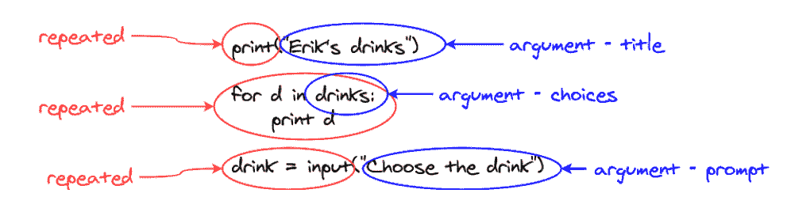
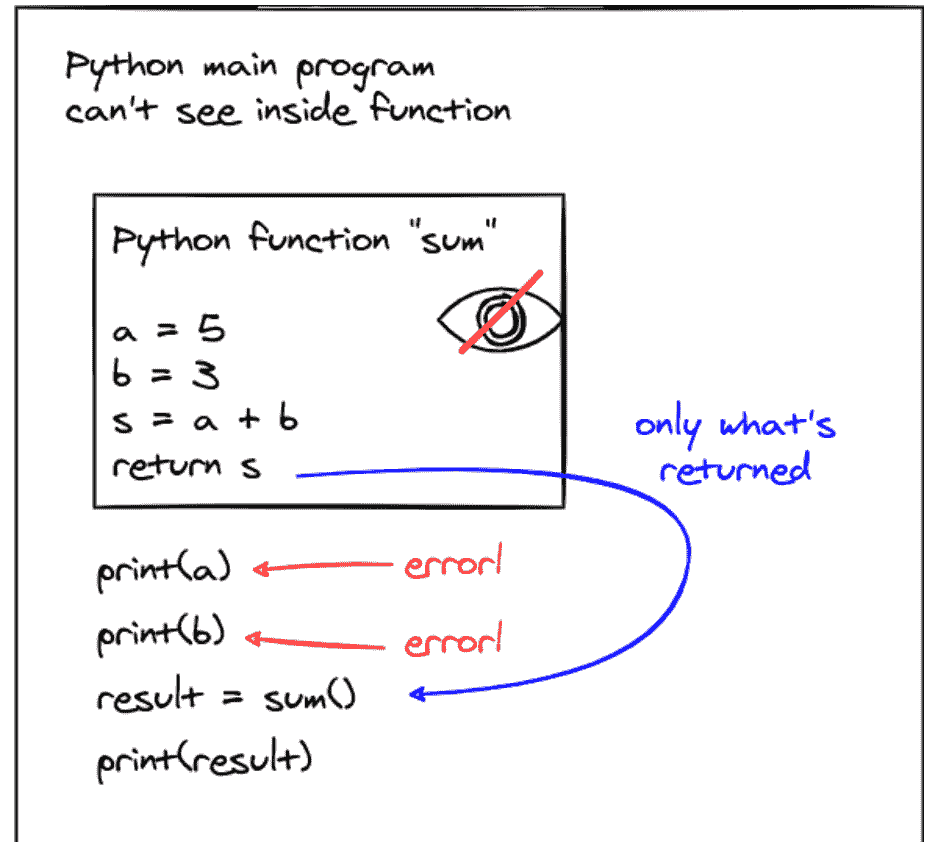
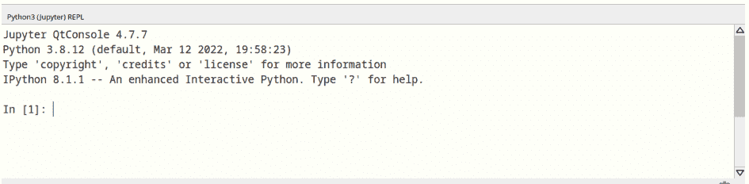

## Functions: Don’t repeat yourself!

## In this chapter

- Simon 解释如何避免重复自己（以及为什么）
- Erik 编写他的第一个 Python 函数
- Erik 开始使用 Python 的交互式工具
- Erik 改进他的函数，使收据看起来更专业

"我们昨天停在哪里？" Simon 第二天问 Erik。

"你说我不应该重复自己。而且你说我们今天要写自己的函数。"

"对！首先，告诉我你目前对函数了解多少。"

"我们已经使用了一些函数了，" Erik 开始回答。"我们使用了 print() 和 input()。你说有人为我们写了它们，所以我们可以直接使用。函数可以使用参数。我们只需把它们放在括号之间，函数就会对参数做一些事情，比如打印它们。"

"一切都对！你是个好学生！" Simon 微笑。"函数的重要之处在于它们可以用不同的参数做同样的事情。所以如果你发现自己在做同样的事情多次，你应该看看是否可以把它变成一个函数。为了决定，你应该查看重复的代码并问自己哪些部分相同，哪些不同。昨天的脚本在哪里？"

"在这里，" Erik 在编辑器中打开了 menu.py 文件。

```
drinks = ["chocolate", "coffee", "decaf"]
flavors = ["caramel", "vanilla", "peppermint", "raspberry", "plain"]
toppings = ["chocolate", "cinnamon", "caramel"]

print("Erik's Coffee Shop drinks")
print("----------------------------")
i = 1
for d in drinks:
    print(i, d)
    i = i + 1
drink = input("Choose your drink: ")

print("Erik's Coffee Shop flavors")
print("----------------------------")
i = 1
for f in flavors:
    print(i, f)
    i = i + 1
flavor = input("Choose your flavor: ")

print("Erik's Coffee Shop toppings")
print("----------------------------")
i = 1
for t in toppings:
    print(i, t)
    i = i + 1
topping = input("Choose your topping: ")

print("Here is your order: ")
print("Main product: ", drinks[int(drink) - 1])
print("Flavor: ", flavors[int(flavor) - 1])
print("Topping: ", toppings[int(topping) - 1])
print("Thanks for your order!")
```

"看：这里有什么在重复？" Simon 问并开始和 Erik 一起画出代码的图表。



"循环。开头的 print() 和末尾的 input()。"

"这三种情况下有什么不同？"

"input() 的提示不同，" Erik 回答。"标题也略有不同。"

"而且你还在对不同的列表进行 for 循环，比如 drinks、flavors 和 toppings，对吧？" Simon 决定帮助 Erik。"所以我们将把不同的东西作为参数传递。在我们的例子中，它们将是选项列表、菜单标题和输入提示。"

"让我们在编辑器中新建一个文件，命名为 menu_function.py，并在其中编写我们的函数。"


Erik 在编辑器中点击了 [New]，然后点击了 [Save]，输入了 menu_function.py，并准备编写代码。

“Python 中的函数以单词 def 开头，后跟函数名，”Simon 继续说道。“我们把我们的函数叫做 menu。然后你打开括号并列出你的参数。”

Erik 写下了 def menu( 并且不知道下一步该做什么。

Simon 帮忙说：“我们刚刚谈到了你的参数。我看到你在思考如何命名它们。记住，为变量和参数命名是计算机科学中最困难的问题之一？你并不孤单。我们来命名它们：choices、title 和 prompt。只要在括号之间输入它们，并在关闭括号后加上冒号。”

Erik 输入了以下内容：

```
def menu(choices, title, prompt):
```

他注意到在按下 ENTER 后，光标移动到了下一行，但向右移动了四个空格。“我应该在这里写吗？”他问 Simon。

“是的，当然！”Simon 回答道。“你看：编辑器正在帮助你编写函数！现在看看你昨天的代码并开始复制你想要放入函数中的内容。看：首先我们打印标题。我们在这里也这样做，但不是打印实际的字符串，我们只是打印参数名为 title。你甚至可以在它后面加上破折号行，就像你之前做的那样。”

Erik 写道：

```
def menu(choices, title, prompt):
    print(title)
    print("----------------------------")
```

“现在写循环，”Simon 继续说道。“但不要使用 drinks 或 flavors，你的列表现在叫做 choices。你可以在循环中使用变量 c 作为 'choice' 的第一个字母。”

Erik 从之前的脚本中复制了循环。他现在明白了想法，并在没有问哥哥的情况下添加了 input() 函数和 prompt。

```
def menu(choices, title, prompt):
    print(title)
    print("----------------------------")
    i = 1
    for c in choices:
        print(i, c)
        i = i + 1
    choice = input(prompt)
```

“太棒了！”Simon 看到 Erik 的代码后说道。“现在我们必须返回 choice。”

“我们不能只在主程序中打印 choice 变量吗？”Erik 问。

“不行！这关于函数的一个非常重要的问题，”Simon 很高兴 Erik 问了这个问题。“函数内部的变量只能在函数内部可见。看这里，我画个图。”



可见意味着当你不在函数内部时，你看不到这些变量内部的内容。所以如果我们希望主程序看到它们的值，我们必须返回这些变量。通常函数内部有很多变量，但我们只想返回一两个作为结果。在这种情况下，我们可以返回用户输入的数字，它存储在变量 choice 中。”

Simon 停顿了一下，思考了一会儿。

“但我们可以做得更好，”他说。“再看看你昨天的代码。还有什么在重复？”

Erik 看了看并说：“那些 int() 函数，还有我们必须三次加上 - 1。这很烦人，”他还没有习惯列表索引从零开始的事实。

“好吧，我们也把它们添加到函数中，”Simon 建议道。“我们将把用户的答案转换为整数，从列表中获取项目，并返回项目，而不是其索引。这将使我们的函数更有用。调用它的主程序将得到用户的选择，而不是仅仅一个数字。让我来展示给你看，”Simon 添加了转换操作和返回语句到函数中。

```
def menu(choices, title, prompt):
    print(title)
    print("-----------------------------")
    i = 1
    for c in choices:
        print(i, c)
        i = i + 1
    choice = input(prompt)
    answer = choices[int(choice) - 1]

    return answer
```

“现在让我们测试它，”Simon 说。“在函数正下方的我们主程序中，我们将调用它并打印我们得到的答案。但首先，我们需要带有饮料等的列表。从你昨天程序的顶部复制它们。”

Erik 在函数正下方添加了三个列表。这次所有行都没有偏移，并从第一个位置开始。

```
drinks = ["chocolate", "coffee", "decaf"]
flavors = ["caramel", "vanilla", "peppermint", "raspberry", "plain"]
toppings = ["chocolate", "cinnamon", "caramel"]
```

“很好，”Simon 说。“现在你准备好调用你的函数了。传递标题、饮料列表和输入提示。将函数的结果赋给一个变量。例如叫做 choice。然后打印它。”

Erik 按照 Simon 的指示，这里是他得到的结果：

```
def menu(choices, title, prompt):
    print(title)
    print("-----------------------------")
    i = 1
    for c in choices:
        print(i, c)
        i = i + 1
    choice = input(prompt)
    answer = choices[int(choice) - 1]

    return answer

drinks = ["chocolate", "coffee", "decaf"]
flavors = ["caramel", "vanilla", "peppermint", "raspberry", "plain"]
toppings = ["chocolate", "cinnamon", "caramel"]
choice = menu(drinks, "Erik's drinks", "Choose your drink: ")
print(choice)
```

## YOUR TURN 创建你自己的函数

创建你自己的函数，类似于 Erik 刚刚创建的。使用你的菜单列表、标题和提示。尝试运行它（在 Erik 之前！）。

“我应该运行它吗？”Erik 问。

“是的，现在它已经准备好了，继续吧！”

Erik 点击了 [Run]，程序询问他饮料，就像之前一样。Erik 回答并得到了他期望的结果。

```
Erik's drinks
-----------------------------
1 chocolate
2 coffee
3 decaf
Choose your drink: 2
coffee
>>>
```

“它工作了！”他说。“我会在这里添加其他菜单，”他开始编写。10 分钟或更少的时间内，他准备好测试整个程序。现在它看起来像这样：

```
def menu(choices, title, prompt):
    print(title)
    print("-----------------------------")
    i = 1
    for c in choices:
        print(i, c)
        i = i + 1
    choice = input(prompt)
    answer = choices[int(choice) - 1]
    
    return answer

drinks = ["chocolate", "coffee", "decaf"]
flavors = ["caramel", "vanilla", "peppermint", "raspberry", "plain"]
toppings = ["chocolate", "cinnamon", "caramel"]

drink = menu(drinks, "Erik's drinks", "Choose your drink: ")
flavor = menu(flavors, "Erik's flavors", "Choose your flavor: ")
topping = menu(toppings, "Erik's toppings", "Choose your topping: ")

print("Here is your order: ")
print("Main product: ", drink)
print("Flavor: ", flavor)
print("Topping: ", topping)
print("Thanks for your order!")
```

## YOUR TURN 添加其他菜单

向你的程序添加其他菜单。它们将使用相同的函数但使用不同的参数：选择列表、标题和提示。尝试运行它并用你的菜单选择进行测试。

它按预期工作了！Erik 运行了脚本，再次输入 2、2、1 并得到了他的订单：

```
Here is your order:
Main product:  coffee
Flavor:  vanilla
Topping:  chocolate
Thanks for your order!
>>>
```

Simon 说：“注意你的程序变短了。而且现在如果你必须更改某些东西，你只需要在一个地方更改。”

“为什么我要更改它？它已经工作得很好，”Erik 说。

“哦，总是有改进代码的方法！”Simon 回答道。“让我们让它的标题变得更好一些。你注意到你的破折号行现在比标题长了吗？”

“真的吗？哦，是的，你是对的，”Erik 说。“这是因为我把标题改成了 'Erik’s drinks'。我可以让它更短，这很容易。”

“当然，你可以让它更短，但看——在 'drinks' 菜单中标题更短，在 'toppings' 菜单中更长。你必须打印破折号行，使其与标题字符串长度相同。”

“但我该怎么做呢？也许，最好去掉那条破折号行？”Erik 很困惑。

“不，我喜欢这里的这条线；它让你的收据看起来更真实。我希望你保留它。但我们必须计算标题的长度并使其相同。我们将在这里学习一个新函数和一个新操作。我们将使用的函数叫做 len()。你只需在括号内放入一个字符串参数，它就会返回字符串的长度。让我展示给你看。我们将使用 Mu 编辑器的另一个功能，叫做 REPL。它代表 'Read-Eval-Print-Loop'，意思是你可以交互式地使用 Python。我通常在想快速测试某物时使用它。或者向某人展示某物，就像现在一样，”Simon 微笑着。

“点击 [REPL] [icon]，”Simon 继续说道。

Erik 点击后，Mu 编辑器窗口底部打开了另一个窗口。




"你看——你这里有交互式 Python，" Simon 说。"你可以在这里输入任何 Python 代码，它就会被执行。你甚至可以用它当计算器用，" Simon 微笑着说。"试着输入 print('hello world') 或 2 + 2 看看。"

Erik 输入了，Simon 说得果然没错！

```
In [1]: print('hello world')
hello world

In [2]: 2 + 2
Out[2]: 4
```

"现在让我们计算一个字符串的长度。输入：len('abcd')。"

Erik 输入后得到了这个：

```
In [3]: len('abcd')
Out[3]: 4
```

"你现在可以看到字符串 'abcd' 的长度是 4，" Simon 说。"你也可以对字符串变量做同样的事。用变量 s，把字符串 'hello' 放进去并计算它的长度。我相信你现在知道怎么做了。"

Erik 在 REPL 窗口中输入并得到了结果：

```
In [4]: s = 'hello'

In [5]: len(s)
Out[5]: 5
```

"很好，" Simon 说。"现在你知道，如果你有一个字符串，你总能得到它的长度。更进一步，你也可以用这种方式得到一个列表的长度。创建一个包含数字 1、2、3 的列表，并获取它的长度。比如叫它 n。"

Erik 输入了：

```
In [6]: n = [1, 2, 3]

In [7]: len(n)
Out[7]: 3
```

"我们稍后会用到它，但现在让我展示一个技巧，" Simon 继续说。"如果我让 Python 把数字 2 乘以 2，它会给我什么？"

"4？" Erik 不确定这是否已经是个技巧了。这个问题太简单了。

"对。Python 会给我什么，如果我把字母 'A' 乘以 2 呢？"

"我不知道？2A，可能？"

"用交互式 Python 去试试！" Simon 建议道。

Erik 输入并得到了结果：

```
In [8]: 2 * 'A'
Out[8]: 'AA'
```

"有趣！" Erik 感到惊讶。

"那如果用连字符代替 'A' 再乘以 10 呢？"

Erik 开始猜测 Simon 要带他去哪里，于是输入了：

```
In [9]: 10 * '-'
Out[9]: '----------'
```

"现在把数字 10 换成字符串 'hello' 的长度。"

Erik 现在明白了 Simon 的想法，于是输入了：

```
In [10]: len('hello') * '-'
Out[10]: '-----'
```

你的回合   使用 REPL 并尝试 len() 函数
点击编辑器中的图标启动 REPL。重复 Erik 的所有实验。
尝试把一个数字乘以由两个或三个字母组成的字符串。你能猜出输出会是什么吗？

"我明白了！"他说。"我们取 title 参数，计算它的长度，然后打印出同样大小的破折号行！"

"你现在能修改你的函数吗？" Simon 问。

"可以，当然，我知道该怎么做！" Erik 已经开始输入了。他只修改了第三行（查找标签 1），现在他的函数看起来像这样：

```
def menu(choices, title, prompt):
    print(title)
    print(len(title) * '-')     1
    i = 1
    for c in choices:
        print(i, c)
        i = i + 1

    choice = input(prompt)
    answer = choices[int(choice) - 1]

    return answer
```

1   重复破折号 – 多次

## 你的回合

修改你的函数以打印正确的破折号行
在你的程序中做一个修改，使其打印正确数量的破折号，类似于 Erik 刚才做的。尝试使用不同的符号（等号 = 或下划线 _ 或其他）。

他测试了主程序，现在所有破折号行都与它们的标题大小完全相同。

Simon 评论道："现在你可以看到，不仅你的函数返回的结果依赖于参数，甚至它打印的内容也可以依赖。"

"分析你在函数中接收到的参数总是很有好处的，" Simon 继续说。"在这种情况下我们检查了标题的长度。如果你的函数接收到长度为零的空字符串会怎样？"

"我不知道，" Erik 回答。"我想它会打印一个空字符串，什么都没有。"

"对，" Simon 说。"但也许即使标题为空，我们仍然可以打印一些合理的内容。也许只是一个单词 'Menu' 和一行破折号。对于这种情况，在 Python 中我们有函数参数的 *默认值*。在你的函数中我会把第一行改成这样，" Simon 编辑了 Erik 的文件：

```
def menu(choices, title="Erik's Menu", prompt="Choose your item: "):
```

"在这种情况下我们告诉 Python，'如果 *有* `title` 参数就接受它的值。如果你在调用函数时没有使用它，那么就使用它的默认值，即 'Menu'。通常建议设置默认值。你可以在调用函数时随时将其更改为其他内容。"

"让我们测试一下，" Simon 建议道。"在你对 `drinks` 的第一次调用中，去掉标题和提示。只留下 `drinks` 作为单个参数。"

Erik 按 Simon 建议做了，现在第一个函数调用看起来像这样：

```
drink = menu(drinks)
```

他再次运行程序，看到了第一个菜单：

```
Erik's Menu
-------------
1 chocolate
2 coffee
3 decaf
Choose your item:
```

这是 Erik 的完整程序。

## 列表 3.1 menu_function.py

```
def menu(choices, title="Erik's Menu", prompt="Choose your item: "):
    print(title)
    print(len(title) * "-")
    i = 1
    for c in choices:
        print(i, c)
        i = i + 1
    choice = input(prompt)
    answer = choices[int(choice) - 1]

    return answer

drinks = ["chocolate", "coffee", "decaf"]
flavors = ["caramel", "vanilla", "peppermint", "raspberry", "plain"]
toppings = ["chocolate", "cinnamon", "caramel"]

drink = menu(drinks)
flavor = menu(flavors, "Erik's flavors", "Choose your flavor: ")
topping = menu(toppings, "Erik's toppings", "Choose your topping: ")

print("Here is your order: ")
print("Main product: ", drink)
print("Flavor: ", flavor)
print("Topping: ", topping)
print("Thanks for your order!")
```

## 你的回合   在你的函数中使用默认参数

为 title 和 prompt 参数添加默认值。尝试在不使用这些参数的情况下调用你的函数，并确保它使用了默认值。

> "当然，它没有告诉用户这是一个饮料菜单，但仍然比只是一个空字符串好。在你想快速测试某些东西时很有帮助。你可以随时稍后添加更具描述性的标题和提示。"

> "我想今天就到这里吧，" Simon 说。"让我们回顾一下今天学到了什么。今天的第一件事是什么？"

> "我们看了我昨天写的程序，发现有三处重复的地方。你告诉我我们可以写自己的函数。你告诉我关于 def 这个词和参数的事。"

"很好，继续说，" Simon 鼓励 Erik。"那些参数呢？"

"我把选择列表、标题和提示作为参数用在了我的函数中。" Erik 喜欢谈论他的函数——这是他第一次自己写！

"然后你向我展示了编辑器里的那个 REPL 东西，" Erik 继续说。"我喜欢它！然后我们计算了字符串的长度。"

"我们把它用在了什么地方？" Simon 问。

"是的，我们用它来打印收据，现在它们看起来很漂亮。然后我们尝试为参数使用默认值。有点无聊但它有效。"

Simon 说："你刚才说的这点非常重要。非常好的编程解决方案看起来往往很无聊。但它们有效。编程并不总是关于花哨的技巧和黑客。大多数时候你必须做非常无聊的事情，比如检查用户输入、检查错误等等。但如果做这些无聊的事情能让你的程序工作——那就值得了。明天我们将看看为了确保你的程序即使用户输入错误的值也能工作，我们需要做什么。但现在——休息一下吧！你今天做得非常好！"

## 今天你学到的新东西

- **函数**
  一段可以被重复使用（调用）的编程代码。函数可以由你编写，也可以由别人编写。如果是由别人编写的，通常它是 Python 中的 *库* 或 *模块* 的一部分。
- **参数**
  我们在调用函数时传递给它的变量。函数接收参数并用它们来准备输出。输出可以被打印或 *返回* 给主程序。
- **REPL**
  Read-Eval-Print-Loop，交互式运行 Python 的一种方式。非常适合快速测试一些函数。

## 本章代码

你可以在这里找到本章的代码：
https://github.com/pavelanni/pythonicadventure-code/tree/main/ch03


