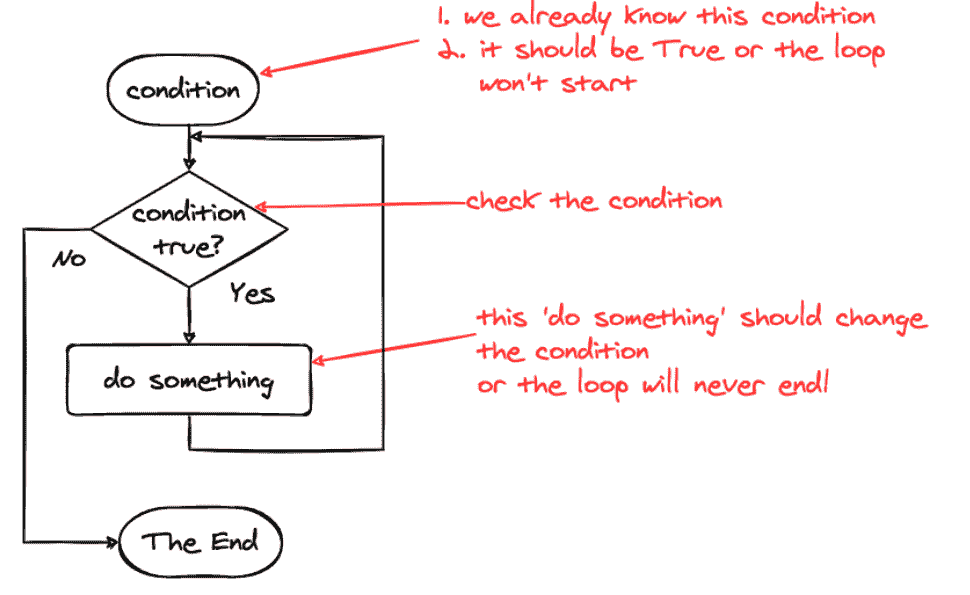
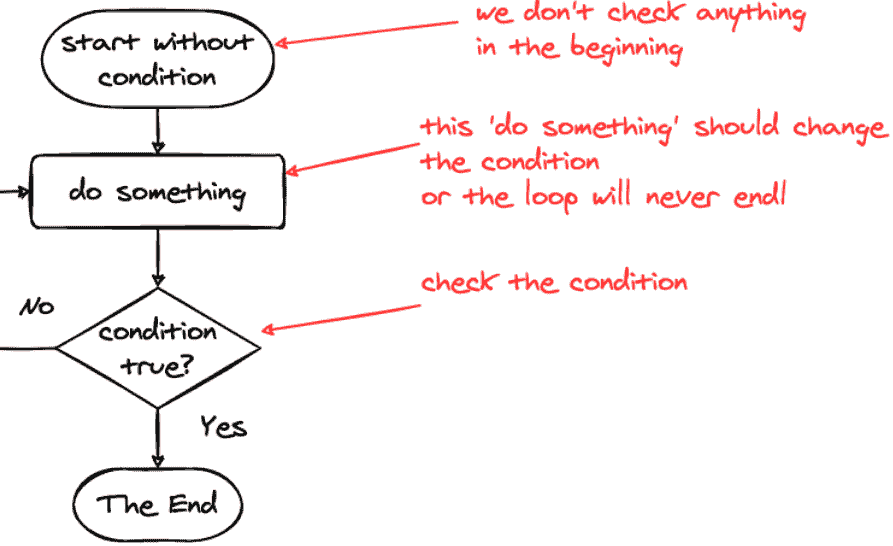

## 用户错误：人人都会犯错

## 本章内容

- Erik 发现用户并不总是按你告诉他们的那样做
- Erik 学习使用循环重复向用户提问
- Simon 帮助 Erik 使菜单更加健壮

“昨天你做得很好，Erik，”第二天 Simon 继续说道。“你写了一个很好的函数，你添加了默认参数，你测试了它。”

“是的，”Erik 回答道。“我觉得这是一个好程序。我想把它展示给我的朋友们！”

“等等，等等，”Simon 说。“我觉得它还不能使用。”

“为什么？我觉得它工作得完美！”

“哦，真的吗？让我试试，”Simon 看起来心里有数。他再次启动了 Erik 的程序，在第一个菜单中输入了：“coffee。”

```
Erik's drinks
-----------------------------
1 chocolate
2 coffee
3 decaf
Choose your drink: coffee
Traceback (most recent call last):
  File "/home/erik/mu_code/menu_function.py", line 18, in <module>
    drink = menu("Erik's drinks", drinks, "Choose your drink: ")
  File "/home/erik/mu_code/menu_function.py", line 9, in menu
    answer = choices[int(choice) - 1]
ValueError: invalid literal for int() with base 10: 'coffee'
>>>
```

“你在干什么？？？” Erik 怒了。“你应该只输入数字而不是单词！”

“但你给我一个列表并问我想要什么。我想要咖啡所以我输入了‘coffee’。有什么问题？” Simon 试图装无辜但他掩饰不住笑意。

“好吧，对于像你这样 *愚蠢* 的用户，我会用全大写打印告诉你应该输入一个数字！” Erik 嘟囔道。

“好吧，好吧，让我再试一次，”Simon 问。他再次启动脚本，在第一个菜单输入了：“**42**”。

```
Choose your drink: 42
Traceback (most recent call last):
  File "/home/erik/mu_code/menu_function.py", line 18, in <module>
    drink = menu("Erik's drinks", drinks, "Choose your drink: ")
  File "/home/erik/mu_code/menu_function.py", line 9, in menu
    answer = choices[int(choice) - 1]
IndexError: list index out of range
>>>
```

“又来了？你又把它弄坏了？？” Erik 准备要拍 Simon 的手离开键盘。“你没看到只有三个选择吗？为什么你要输入 42？？”

“第一，因为 42 是我最喜欢的数字。第二，是的，这是我的错误。用户会犯错，你知道的。说真的，我想让你看到你的程序应该为此做好准备。你可以打印任何你想要的内容，用全大写，但 *总会* 有用户不会阅读它。总会有用户犯错。”

“我该怎么办？” Erik 仍然对他哥哥生气，但他倾向于同意他。他自己在程序上也会犯错。

“你应该检查用户输入的内容，如果输入错误就告诉他们。让我们想想这里能做什么。”

## 如果你的用户没有按预期操作

“你觉得用户在第一个菜单应该输入什么？” Simon 继续问道。

“他们应该输入 1、2 或 3，”Erik 回答道。

“好的，所以我们可以检查他们的答案是否是‘1’，或‘2’，或‘3’，然后我们接受它并从选项列表中选择该项。但如果不是，我们应该告诉用户出了问题。”

“是的，我记得，我们可以在 Python 中使用 `if-else`，”Erik 建议道。

“好的，我们试试，”Simon 说。“你打算怎么做？试着向我解释，就像我不知道 `if-else` 一样。”

“我会在我的函数中添加：‘如果用户的选择是 1，或 2，或 3，那么就继续使用它。如果不是

（else），打印用户应该输入这些数字之一’。”

“很好，我们来编码吧，”Simon 说。

Erik 打开编辑器并更改了函数（return 之前的四行）：

```
def menu(choices, title="Erik's Menu", prompt="Choose your item: "):
    print(title)
    print(len(title) * "-_")
    i = 1
    for c in choices:
        print(i, c)
        i = i + 1
    choice = input(prompt)

    if choice == '1' or choice == '2' or choice == '3':
        answer = choices[int(choice) - 1]
    else:
        print("Enter number 1, 2, or 3!")

    return answer
```

“现在我们来试试，”Simon 说。

Erik 启动程序并在第一个菜单输入：“2”。

“你为什么输入‘2’？”Simon 问。

“因为我想要咖啡，”Erik 回答。

“但我们应该测试你的程序对错误答案的反应！”Simon 说。“是的，我知道，这是你的程序你不想把它弄坏，但作为开发者你必须尝试破坏你的程序。你必须想象用户会以所有可能错误的方式使用你的程序。这很难而且非常不舒服，我知道，但你必须克服它并尝试输入所有可能的错误值。”

“好吧，好吧，”Erik 说并重新启动程序。在第一个菜单他像上次 Simon 那样输入了“42”。

```
Erik's Menu
------------
1 chocolate
2 coffee
3 decaf
Choose your item: 42
Enter number 1, 2, or 3!
Traceback (most recent call last):
  File "/home/erik/mu_code/menu_function.py", line 21, in <module>
    drink = menu(drinks)
  File "/home/erik/mu_code/menu_function.py", line 14, in menu
    return answer
UnboundLocalError: local variable 'answer' referenced before assignment
>>>
```

NOTE Read more about Python error messages at the book companion site: https://pythonicadventure.com/troubleshooting/index.html

“让我们看看这里发生了什么，”Simon 说。“首先，当你输入‘42’时，你的程序打印了用户应该只输入 1、2、3 的消息。这很好。但随后出了问题。看，它说变量 answer 在赋值前被引用了：

```
UnboundLocalError: local variable 'answer' referenced before assignment
```

简单来说就是你没有创建 answer 却尝试使用它。而 Python 准确地告诉了你在哪里：你尝试返回 answer 但 Python 对变量 answer 一无所知。”

“但为什么？”Erik 说。“我的代码里有这个 answer = 行。”

“是的，你有它，但重要的是这行代码被使用的位置。在你的代码中，你只在用户输入正确选择时才创建 answer 变量。如果用户输入其他内容，answer 甚至没有被创建。”

“换句话说，”Simon 继续道，“即使用户用错误的数字，甚至一个单词回答，你仍然必须返回某个 answer。这是一个非常重要的规则：永远不要在使用变量之前创建它并为其分配某个值。这里在用户犯错的情况下我们可以为 answer 分配什么值？我认为一个空字符串像 '' 应该可以。把它添加到你的函数中并检查是否有效。”

Erik 将函数更改为如下：

```
def menu(choices, title="Erik's Menu", prompt="Choose your item: "):
    print(title)
    print(len(title) * "-")
    i = 1
    for c in choices:
        print(i, c)
        i = i + 1
    choice = input(prompt)

    if choice == '1' or choice == '2' or choice == '3':
        answer = choices[int(choice) - 1]
    else:
        print("Enter number 1, 2, or 3!")
        answer = ''

    return answer
```

YOUR TURN Add checking the user's answer
In your menu function, add the code that Erik just added. Test whether it really checks your answers.

他再次测试程序，这次它没有给他错误。它打印了消息 `Enter number 1, 2, or 3!` 并跳到下一个菜单。

“你觉得你的程序做对了吗？”Simon 问。

“它打印了你应该输入 1、2 或 3 的消息，”Erik 回答。“我觉得是对的。”

“但你没有得到用户对饮料的选择。如果他们输入了错误的数字，你应该给他们机会输入正确的数字。这不是像学校里的测试那样只有一次回答的机会。你应该一直询问用户，直到你得到正确的答案之一。”

“我该怎么做？”Erik 问。

“我们有另一种 *循环* 来做这件事，”Simon 开始向他哥哥解释。“它叫做 *while 循环*。它会一次又一次地重复某事，并且每次循环都会检查 *条件*。当条件为真时，它会继续。如果条件变为假，while 循环就会结束。

有时我们在循环开始时就检查条件，因为我们已经知道它。在这种情况下我们说‘当某事为真时，做这个’。但有时，就像在我们的例子中，我们在开始循环时还没有答案，因为我们还没有询问用户他们的选择。所以我们启动一个 *无限循环* 并在循环内部在收到用户答案后检查条件。我们在条件变为真时退出循环。我们称之为 *break* 出循环。让我在图表上展示给你看，”Simon 说并开始画图。




## EXAMPLE

```
n = 5

while n > 0:
    n = n - 1
```

Simon explained, "In this example we already know the condition before we start the loop. We check the condition and decide if we should start. It should be True, otherwise the loop won’t even start. I used a rhombus figure for this check; this is how programmers usually draw decision points.

"If it’s true then we do something. The important thing is that this 'do something' should change the condition, among other things. Otherwise the loop will continue forever and we don’t want that.

"After we have done that 'something,' we go to the beginning of the loop and check the condition again. If it’s still true, we repeat that 'do something.' If not, it’s the end of the loop and we go outside it to continue with our program.

"Look at this simple example: we want to count down from five to zero. First we set the variable n to five and in the beginning of the loop we check if it’s greater than zero. Yes, it’s greater, so we start the loop. Remember that we have to change the condition at some point, otherwise the

loop will never end. In our example, we subtract 1 from n each time we go through the loop. So, eventually, the variable n will become equal to zero and the loop will stop.

"The important thing is that in this case, before we start the loop, we already know what is in the variable n and we know that it’s greater than zero.

"What if we don’t know what’s in the variable or the variable doesn’t even exist? Like in our case: we can check the user’s answer only after we ask to choose one of the items from the menu. So we have to do this," and Simon drew another diagram.



## EXAMPLE

```
while True:
    answer = input()
    if answer == '1':
        break
```

Simon continued his explanation, "Here we start the loop without checking any condition. We do something first and only after that, we check the condition. Sometimes this loop is called 'do-until,' which means 'do something until the condition is true.' When the condition is true, exit the loop and continue with the rest of the program.

In the example here I used your situation with input (). You ask for input, then you check that input. This is your condition: if the input is valid, you should exit the loop. In Python we use the

operator break for that.

Erik was a bit overwhelmed by this long explanation, but he felt like he knew what to do. He asked his brother, "So you’re saying that I should just put a while in front of my input() line and add a break after I get a correct answer?"

"Yes," Simon answered, "exactly right! Just don’t forget to indent all the lines that are part of the loop by four spaces to the right. Your editor will help you, don’t worry."

Erik started working on his program. After several minutes his function looked like this:

```
def menu(choices, title="Erik's Menu", prompt="Choose your item: "):
    print(title)
    print(len(title) * "-")
    i = 1
    for c in choices:
        print(i, c)
        i = i + 1
    while True:
        choice = input(prompt)
        if choice == '1' or choice == '2' or choice == '3':
            answer = choices[int(choice) - 1]
            break
        else:
            print("Enter number 1, 2, or 3!")
            answer = ''

    return answer
```

"Right?" Erik asked his brother.

"I told you that your editor can help you. Click Check ."

Erik did as his brother suggested and saw this:

```
def menu(choices, title="Erik's Menu", prompt="Choose your item: "):
    print(title)
    print(len(title) * "-")
    i = 1
    for c in choices:
        print(i, c)
        i += 1
    while True:
        choice = input(prompt)
        ↑ Syntax error. Python cannot understand this line. Check for missing characters!
        ↑ Expected an indented block
    if choice == '1' or choice == '2' or choice == '3':
        answer = choices[int(choice) - 1]
        break
    else:
        print("Enter number 1, 2, or 3!")
        answer = ''

    return answer
```

"You see now?" Simon said. "You forgot to indent the lines to the right. That’s why it says that it expects an indented block here. Move all the lines that are part of the loop to the right."

Erik changed his function and checked the code again.

```
def menu(choices, title="Erik's Menu", prompt="Choose your item: "):
    print(title)
    print(len(title) * "-")
    i = 1
    for c in choices:
        print(i, c)
        i = i + 1
    while True:
        choice = input(prompt)
        if choice == '1' or choice == '2' or choice == '3':
            answer = choices[int(choice) - 1]
            break
        else:
            print("Enter number 1, 2, or 3!")
            answer = ''

    return answer
```

YOUR TURN   Add the while-loop to your function

Add the loop like Erik just did. Try to use the Check button to find if there are errors in your code. Try to make errors and see if the editor can find them.

Now the Check button showed a green thumbs-up for a moment so Erik knew it was okay. He clicked Run to test the program. At the first menu he entered '42' like Simon did last time. The program reported the he should choose a number 1, 2, or 3 and returned to the prompt again! It didn’t crash, it worked!

"What was the other wrong thing Simon did with my program?" Erik tried to remember. "Right, he tried to enter 'coffee'! Let’s try that too."

He entered 'coffee' and his program responded as he expected again! Finally Erik typed '2' and got the next menu. Here is what he saw in the editor window (we marked Erik’s input with bold):

```
Erik's Menu
------------
1 chocolate
2 coffee
3 decaf
Choose your item: 42
Enter number 1, 2, or 3!
Choose your item: coffee
Enter number 1, 2, or 3!
Choose your item: 2
Erik's flavors
------------
```

At the next menu he typed 4 for Raspberry and got the same message:

```
Erik's flavors
-------------
1 caramel
2 vanilla
3 peppermint
4 raspberry
5 plain
Choose your flavor: 4
Enter number 1, 2, or 3!
Choose your flavor:
```

"Why is that?" he asked Simon.

"Your program behaves exactly as you wrote it," Simon answered. Of course, he knew where the problem was.

"How did you write your condition?" he asked.

Erik said, "If the answer is 1, 2, or 3. A-ha, I understand now! I entered '4' so the program thinks it’s a wrong answer! But how can I fix this?"

"It looks like we need a list of valid answers for each menu list," Simon said. "You can pass it as another argument. But I think you know enough already to create a better solution."

"What is it?" Erik asked. "Something with loops again?"

"Not only," Simon answered. "We’ll learn something new about lists, too. Yes, I see that you are tired of my lectures, but let’s finish it today. It will make your program work right again—isn’t it worth it?" and he winked at his brother.

Erik was tired indeed, but that bug (yes, he has learned that word!) with the flavors menu was really annoying and he wanted to fix it. "Okay," he sighed, "let’s fix it. What did you want to tell me about lists?"

"Look at your condition," Simon said. "You used a simple 'if-else' check and you checked the input against three valid answers: 1, 2, and 3. But what if your list of items is long, like 20 items? Your 'if-else' block will be too long. There is another way in Python. We can check if a certain item is in the list. In our case, we can check if the answer we got from the user is in the list of 1, 2, 3. We can try that for the first menu. Let me show you."

Simon took Erik’s keyboard and changed the if choice == ... line in his function to the following:

```
. . .
    while True:
        choice = input(prompt)
        if choice not in ['1', '2', '3']:
            answer = choices[int(choice) - 1]
            break
        else:
            print("Enter number 1, 2, or 3!")
            answer = ''
. . .
```

"This needs some explanation," he said. "Look, the user enters a string that can be '1' or can be '42'. We test whether this string is in the list of allowed answers, which is 1, 2, 3. If it’s not in the list, then we print the error message and continue with the loop. If it is in the list of allowed answers, then we convert it and pick that item from the menu list."

"Yes, I understand," Erik said. "But what about the second menu where I got the error? It didn’t let me choose number 4 because it wasn’t in my if. With your list I will have the same problem. I have five flavors, so I need another list of answers here, right?"

"Excellent question!" Simon said. "I was just about to ask it myself. Yes, you are right. Each menu list should have its own list of allowed answers. Not a big problem; we can build one when we know what’s in our menu list. Let me write it first and then I’ll explain it step-by-step." And Simon added the following lines just before the if block he added previously:

```
. . .
    while True:
        choice = input(prompt)
        allowed_answers = [] ①
        for a in range(1, len(choices)+1): ②
            allowed_answers.append(str(a)) ③
        if choice not in allowed_answers:
            answer = choices[int(choice) - 1]
            break
        else:
            print("Enter number 1, 2, or 3!")
            answer = ''
. . .
```

- ① Empty list for allowed answers
- ② Calculate the length of the menu
- ③ Append the allowed answer

"First (look at the label 1) we create an empty list for allowed answers. Then (label 2) we measure the length of the menu list using the function len(). For your drinks, the result will be three, and for the flavors it will be five. Then we use the function range() to create a sequence of numbers from one to the length of the menu. For drinks the sequence will be 1, 2, 3. For flavors it will be 1, 2, 3, 4, 5. You get the idea. Just notice that in the range() function we shouldn’t use the last element of the sequence, but the one after the last which is not included in the sequence. That’s why we have to add one to the length of the menu like this:"


len(choices)+1

"然后在这个循环（标签 3）中，我们将序列中的每个数字转换为字符串并添加到允许答案列表的末尾。这个函数叫做 append()。" Simon 解释完毕后补充道："是的，第一次看起来有点复杂，但自己在这里阅读一下 Python 代码，你就会明白它就像是纯英语一样。"

"现在我们需要把包含 1、2、3 的列表改成我们刚刚构建的允许答案列表，" Simon 做了这个修改，看了看代码，拍了拍额头："哦，我刚刚才注意到！"

"什么？" Erik 以为他们已经完成了。但看起来还有别的事情。

"我们还需要更改我们的提示信息，" Simon 说。"因为我们的函数现在可以接受任意长度的菜单列表，我们应该告诉用户类似这样的话：'输入 1 到 6 之间的数字' 或 '从 1 到 12'，取决于我们菜单的长度。还记得我们如何获取列表的长度吗？"

"用 len() 函数？" Erik 问。

"当然！" Simon 说，并对函数做了最后一次修改。它现在看起来是这样：

```
def menu(choices, title="Erik's Menu", prompt="Choose your item: "):
    print(title)
    print(len(title) * "-")
    i = 1
    for c in choices:
        print(i, c)
        i = i + 1
    while True:
        choice = input(prompt)
        allowed_answers = []
        for a in range(1, len(choices)+1):
            allowed_answers.append(str(a))

        if choice in allowed_answers:
            answer = choices[int(choice) - 1]
            break
        else:
            print("Enter number from 1 to ", len(choices))
            answer = ''

    return answer
```

## YOUR TURN  Add the allowed_answers list

将允许答案列表添加到你的函数中。测试它是否允许你使用不同长度的菜单列表。

"现在我们已经防止了用户错误！" Simon 说。"试试看是否有效！"

Erik 再次运行程序，输入了 '42'、'coffee'、'weryiuryt587456'，但程序没有像以前那样崩溃。每次，它都会提醒他应该使用一个数字，并且该数字应该在 1 到 3 或 5 之间，取决于菜单。

"太酷了！它有效而且不会崩溃！" Erik 非常高兴自己创建了这样一个健壮的程序。

"还有一件事，" Simon 说。"我保证今天这是真的最后一次了！"

"好的，" Erik 说。他开始喜欢这编程的事情了。他喜欢自己的程序现在看起来像一个真正的程序，而且它能工作！即使它还不是在线或移动应用程序，它也像与一家商店聊天一样工作。Erik 想象自己正在用短信与他最喜欢的咖啡店交流，点他的饮料，然后去取货。

Simon 说："你的程序现在不让我输入 1 到 3 或 5 以外的数字。但如果我想跳过某些东西怎么办？比如我不想在饮料上加任何配料？"

"在我的口味菜单里有 'plain'，意思是 '无口味'。我可以把同样的东西加到配料里，" Erik 回答。

"这也行，" Simon 说。"但通常对于每个菜单，你都应该给用户一个退出菜单的选项。通常人们会使用类似 '点击 X 退出此菜单' 的提示。我认为我们也应该把这个添加到我们的菜单函数中。"

"我们怎么做？" Erik 问。他想了一会儿说："我知道！我们将把 'X' 添加到允许答案列表中！我对吗？"

"绝对正确！" Simon 很高兴看到弟弟取得了如此好的进步。"还记得我们使用过 append() 函数来向列表中添加项目吗？我们可以在这里使用它，就在我们完成向 allowed_answers 添加数字之后。"

"让我试试，" Erik 说并开始输入。

"当然，请继续，" Simon 鼓励他的弟弟。"只要确保你在那个 for 循环之后添加它。最好在它后面加一个空行；这样你就能看出它不属于循环。"

这是 Erik 的菜单函数的最新版本：

```
def menu(choices, title="Erik's Menu", prompt="Choose your item: "):
    print(title)
    print(len(title) * "_")
    i = 1
    for c in choices:
        print(i, c)
        i = i + 1
    while True:
        choice = input(prompt)
        allowed_answers = []
        for a in range(1, len(choices)+1):
            allowed_answers.append(str(a))

        allowed_answers.append('X')

        if choice in allowed_answers:
            answer = choices[int(choice) - 1]
            break
        else:
            print("Enter number from 1 to ", len(choices))
            answer = ''

    return answer
```

"不错，" Simon 说。"我还会加上小写的字母 'x'，因为大多数人会这样输入。现在如果用户输入 'x' 我们应该做什么？"

"退出菜单循环？" Erik 说。

"对！但我们要返回什么给主程序？通常我们返回用户从菜单中选择的项目：咖啡或巧克力或别的什么。如果用户输入 'x'，我们应该返回什么？"

"什么都没有？" Erik 建议。

"是的，我们只返回一个空字符串，" Simon 说。"如果用户输入 'x'，你就把 answer 赋值为一个空字符串，像这样：" 然后以与答案在菜单中的情况相同的方式返回答案。

Simon 继续说："重要的一点：你应该在尝试将其转换为数字之前进行这个检查，但在检查它是否在 allowed_answers 列表中之后。你看得到要把这个检查放在哪里吗？"

"是的，就在这行之后：if choice in allowed_answers。"

"太好了！继续添加吧！在这种情况下你将有一个嵌套的 if 语句：一个 if 语句嵌套在另一个 if 语句内部。这很常见，有时你会看到三层嵌套的 'if' 甚至更多。只要确保你的缩进是正确的。这就是 Python 告诉计算机在条件为真或为假时该做什么的方式。"

Erik 继续完善他的代码，最后得到了这个：

```
def menu(choices, title="Erik's Menu", prompt="Choose your item: "):
    print(title)
    print(len(title) * "-")
    i = 1
    for c in choices:
        print(i, c)
        i = i + 1
    while True:
        choice = input(prompt)
        allowed_answers = []
        for a in range(1, len(choices)+1):
            allowed_answers.append(str(a))

        allowed_answers.append('X')
        allowed_answers.append('x')

        if choice in allowed_answers:
            if choice == 'X' or choice == 'x':
                answer = ''
                break
            else:
                answer = choices[int(choice) - 1]
                break
        else:
            print("Enter number from 1 to ", len(choices))
            answer = ''

    return answer
```

## YOUR TURN   Add the exit option

将 'X' 选项添加到允许答案列表中。添加嵌套的 'if' 来检查它。测试它是否有效。如果你在所有菜单中都输入 'x' 会怎样？在这种情况下你会得到什么订单？

他测试了程序，在三个菜单中都输入了 'x'，他得到了预期的结果：

```
Erik's Menu
------------
1 chocolate
2 coffee
3 decaf
Choose your item: x
Erik's flavors
-------------
1 caramel
2 vanilla
3 peppermint
4 raspberry
5 plain
Choose your flavor: x
Erik's toppings
-------------
1 chocolate
2 cinnamon
3 caramel
Choose your topping: x
Here is your order:
Main product:
Flavor:
Topping:
Thanks for your order!
```

"一个空订单！"他说。

"对，正如它应该的那样，" Simon 确认道。"我喜欢你的程序，"他继续说。"它能工作——这是第一点，也是最重要的部分。它用户友好，并且给用户提供说明该做什么——这是第二点。它检查输入并且不允许用户输入错误的值——这是第三点。"

"让我们快速回顾一下你今天学到的内容，" Simon 说。"第一件事是什么？"

"第一，你又把我的程序弄坏了！" Erik 回答道。他这次并没有很生气，因为他知道在 Simon 的帮助下他们已经修复了程序。"你告诉我我应该始终思考用户如何以错误的方式使用程序。"

"对，处理那些不愿意遵循你指示的固执用户是程序员工作的一部分，" Simon 微笑。

"然后我们写了一个菜单循环，在其中检查用户输入的内容并且不允许他们使用不允许的答案。然后你告诉我关于那个 `append()` 函数来向列表中添加东西。"

Erik 继续说："然后我写了 *嵌套* 的 if 检查，现在我的代码看起来像电影里展示的真正的程序。"

Simon 微笑："相信我，电影里展示的很少是真正的程序。但你是对的，你的程序变得更复杂了，它使用了不同的 Python 运算符，所有这些循环、if 和列表。"

"然后我们添加了菜单中的 'x' 选项，现在任何用户都可以得到一个空订单！" Erik 咯咯笑。

"是的，为什么不呢，" Simon 说。"你不应该 *强迫* 用户总是点东西。你应该给他们取消订单或退出菜单的选项。"

Simon 继续说："程序现在真的很好。明天我会让你停止做程序员，成为咖啡店经理。"

"我不是已经是经理了吗？" Erik 问。

"是的，你是，" Simon 微笑。"现在想象一下你，这位咖啡店经理，刚刚收到了一种新的咖啡饮料口味配料。你想把这种口味添加到菜单中。哦，还有一些新的配料。你会怎么做？"

"我会把那些配料添加到配料列表中，没什么大不了的，" Erik 回答。

"是的，但如果你是 *只是* 一个经理而不是程序员呢？你对这件事一无所知


program, you don’t know Python, but you want to add those flavors and toppings to the menu. You, as a programmer, should give the manager an easy way to add something to the menu."

"How do you suggest to do that?" Erik asked. He knew already that Simon has something in mind.

"I think we should put menus in files and read your lists from those files."

"Like in Word documents?" Erik asked.

"Yes, almost," Simon said. "Your program will open those files and read from them. I think the easiest will be to have one file per menu. One file will have all drinks, another one—all flavors, and another—all toppings. Then your manager will just edit those files instead of editing your Python code. Sounds good?"

"Yes, interesting," Erik said. He wondered how his Python program would open files the same way Word does.

"Great," Simon said. "This is what we are going to do tomorrow. Take some rest now."

## New things you have learned today

- **Users make mistakes**
  You have learned that user not always follow the directions you give them in your program. You have to be ready for that and check their input for errors, wrong types, etc.
- **Indentation**
  When you create a *block* in Python (like `while`, for example) you have to make sure all code in the block is *indented*, i.e. shifted to the right.
- **How to exit from a menu**
  You have to give your users a way to exit from each menu. For example, if they don’t want to order any topping and they want to skip it.

## Code for this chapter

You can find the code for this chapter here:
https://github.com/pavelanni/pythonicadventure-code/tree/main/ch04
