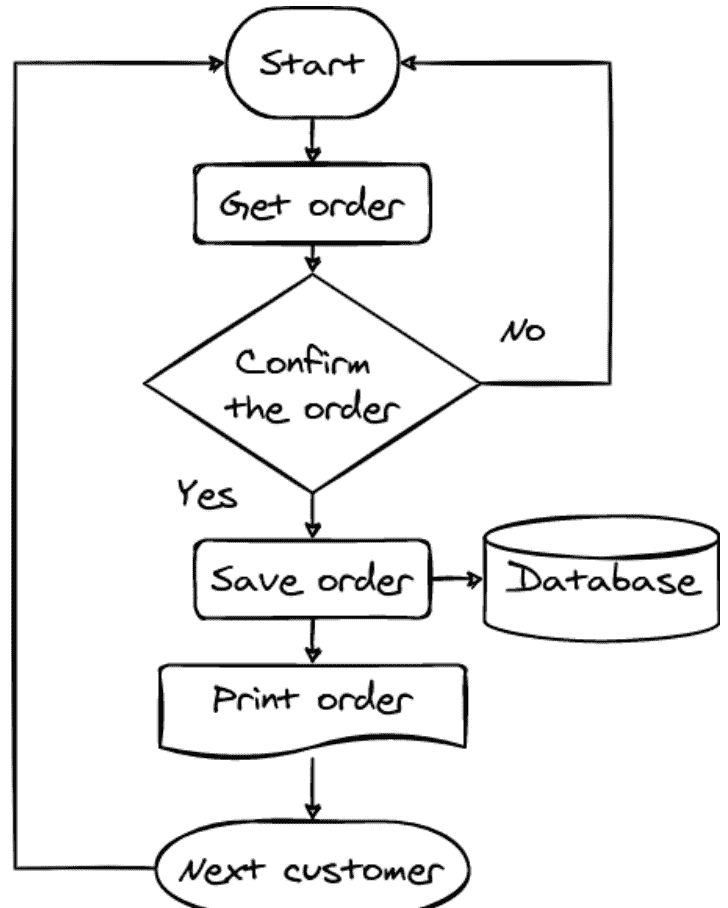
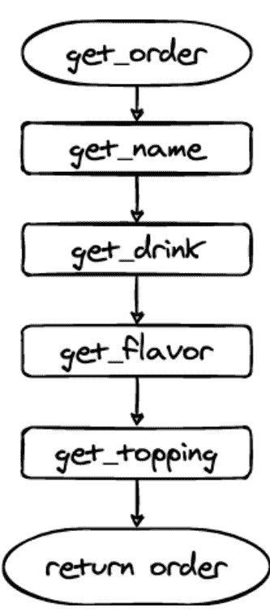
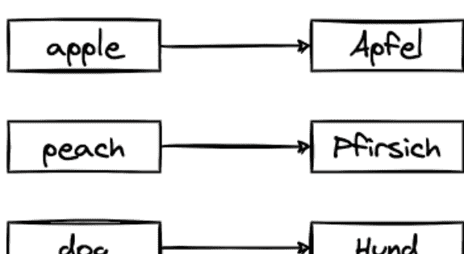
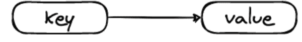
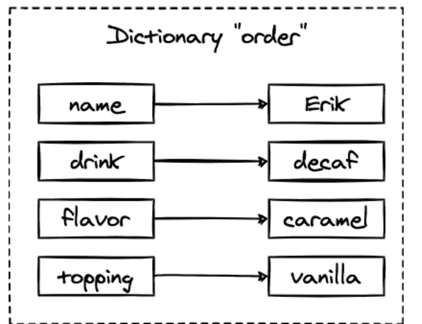
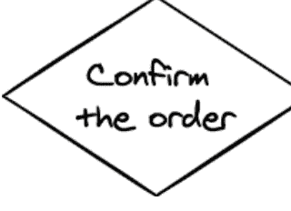
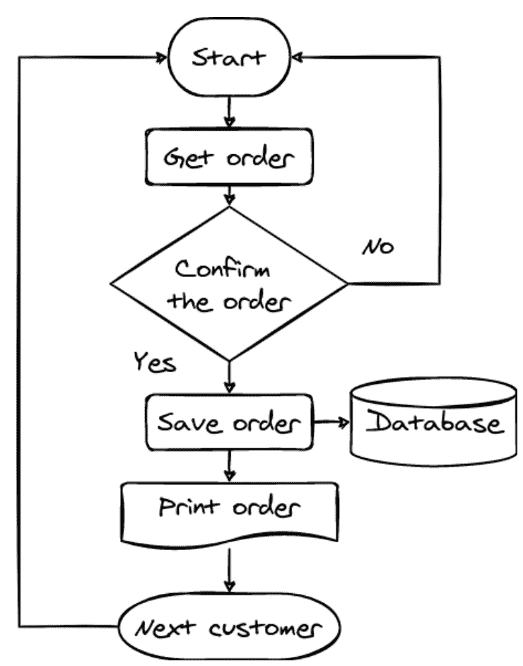
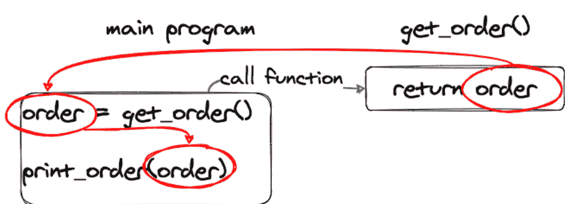
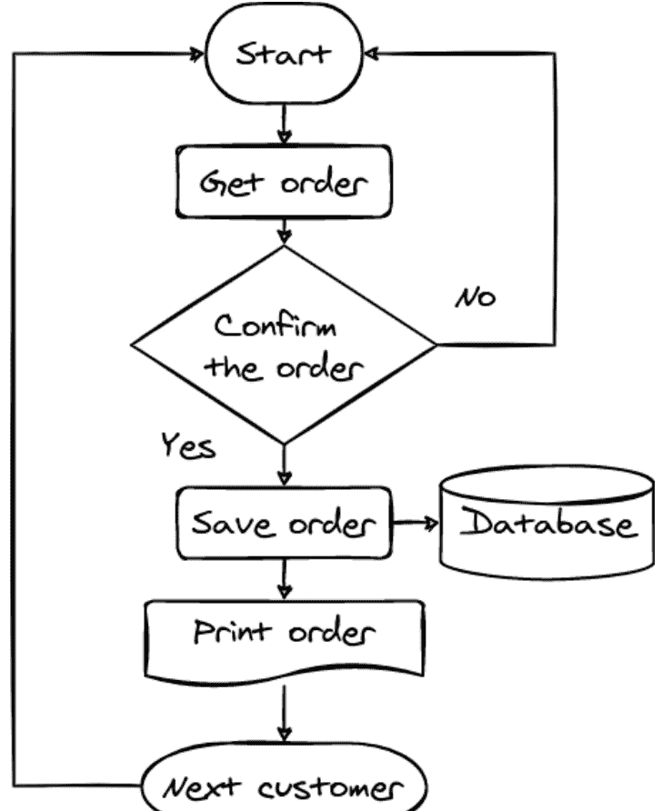

## Main menu: Next customer!

## In this chapter

- Erik creates the main menu to serve many customers
- Erik learns about Python dictionaries
- Simon explains the 'top-down' development approach

"Remember, we decided that we have to create the main menu?" Simon asked Erik.

"Yes, you said if I want to use this program to serve many customers, I have to repeat the menus for each customer. Ask their name and what they want to order."

"Exactly right!" Simon said. "And what are you going to use for that?"

"A loop, maybe? Like we did with menus. Repeat until the customer types the right numbers or types 'X'."

"You are absolutely right!" Simon was really glad that his brother caught this programming idea so quickly. "We will ask the customer their name, like in our first program, remember? Then we’ll get their order with all the flavors and toppings."

"Yes," Erik continued, "and then we’ll ask them: Order or Cancel? I saw that on some web sites."

"Right. When they click Order, we save the order and print it for the barista. If they cancel, we just forget about it. In both cases we go back to the beginning of the main menu and ask the next customer their name."

Simon took a piece of paper and started drawing. "We should first plan this algorithm visually.

When we both agree how it should behave you can start writing the code. It’s always a good practice to discuss your future program in plain words and diagrams before you start writing any code."

"The first thing we do here is getting an order," Simon started explaining. "You see, I put it here as 'Get order'."



"And where are all our menus with flavors and toppings? Why didn’t you put them here?" Erik asked.

"I decided to use a block called 'Get order' that contains all the menus. It’s a common way to think in big blocks first and then work on each block’s details separately. By the way, it’s

another reason why programmers use functions. They think about the program in big blocks first and then describe each block in a separate diagram. Imagine if we placed every minor detail of our program on a single diagram! It would be impossible to understand the main algorithm!"

"Let’s continue," Simon said. "So we get the order and we ask the customer to confirm it. They can cancel and then we return to the very first menu: 'Welcome to Erik’s Coffee Shop' and all that."

"If the customer confirms the order," Simon continued, "then we should save and print it."

"Okay, I understand that we should print it to prepare the drinks," Erik said. "But why should we save it? And what do you mean by saving the order?"

"First of all, it would be good at the end of the day check how many of your friends you served in your coffee shop, don’t you think?"

"But I know already," Erik said. "I prepared five drinks that day."

"But we’re talking about a real coffee shop, don’t forget. They work every day and they serve tens and hundreds of customers. A couple of my friends worked in different coffee shops and I can assure you—they know very well how many customers they serve each day."

"The other reason," Simon continued, "is that the coffee shop manager should know what they have in the shop what they should order for their inventory. Remember we talked about changing menus? For example, they didn’t order the caramel flavor in time and they had to remove it from the menu. Why didn’t they order it? Because they didn’t count how many portions of caramel flavor their customers have ordered. So we have to save all orders, analyze them, and order flavors and toppings if we don’t have enough."

"I didn’t think about it," Erik said. "Yes, it’s a good idea to save the orders; you are right. But how are we going to do that?"

"There are several ways," Simon said. "We can use files, or we can use databases. Of course, all serious applications use databases. I think we should start with files and then, if you are brave enough, we can use databases too."

"Yes, I want my program be like those serious applications!" Erik said. "I want to try databases too!"

"Good," Simon said, "but for now let’s finish with the main menu. We’ll get to saving orders very soon. Speaking of orders," Simon took another piece of paper, "here is what’s inside that 'Get order' block."



## YOUR TURN Create your own diagram
If you decided to work on a different kind of shop, create a diagram for your get_order() function.

> "We have written this function already. We just didn’t call it a function. You see: we have already created these dialogues to ask the customer’s name, the drink, flavor, and topping. Only one thing that we haven’t done yet. Do you see it?"

> "Return order?" Erik asked. "I see that we didn’t do it, but I don’t know what it means here."

> "Look at the right side of the diagram. Here’s what your order looks like, agreed?"

Order:
name: Erik
drink: decaf
flavor: vanilla
topping: chocolate


"We use the function get_order() to collect all this information, but instead of returning four separate values for name, drink, flavor, and topping, I want to return a single thing that I would call an order. And that single thing contains several values that go together as a whole."

"I know, you want to use a list here!" Erik shared his insight.

"That’s one of the options, but I have in mind something better. In Python we have dictionaries. What is a normal dictionary?"

"Oh, it’s a book with words and their meaning," Erik answered. "Or translations, if it’s an English-German dictionary."

"Right!" Simon said. "You have a word and a value that is related to this word. Like this," and he draw a diagram.

## What is a dictionary?



"It could be its meaning or translation. In Python we have a similar thing. A dictionary in Python uses words that we call keys to get the values that are related to them. Let’s look at your order. You have a key called 'name' and its value is 'Erik'. You have another key called 'drink' and its value is 'decaf'. And so on. The whole dictionary is called order and this is what we are going to return as a result from this function."

## Dictionaries in Python:





"Let's practice with REPL again," Simon suggested. "Click REPL to get to the interactive session."

Erik clicked the REPL icon and switched to the window with an interactive session. It looked like this (your version might be different from the example below—that's okay):

```
Jupyter QtConsole 4.7.7
Python 3.8.12 (default, Mar 12 2022, 19:58:23)
Type 'copyright', 'credits' or 'license' for more information
IPython 8.1.1 -- An enhanced Interactive Python. Type '?' for help.

In [1]:
```

"We start with creating an empty dictionary called order. To create a dictionary in Python we use curly braces {} to make them look different from lists, that use square brackets []. Type order = {} and then ENTER. This will be your order."

Erik typed:

```
In [1]: order = {}

In [2]:
```

"Now we can add items to your order. Let’s start with the name. Type order['name'] = 'Erik'. Then try to print the order with a simple print() function."

Erik typed:

```
In [2]: order['name'] = 'Erik'

In [3]: print(order)
{'name': 'Erik'}

In [4]:
```

"But you said that dictionaries should use curly braces. Why do we use square brackets here?" Erik asked.

"Good question," Simon was so used to this Python feature that he couldn’t find a good way to explain it right away. He started his answer, "Well, we use curly braces to create a dictionary. But we use square brackets to access the dictionary, when we want to get an item from it. In this sense it’s similar to lists—when you want to get an item from a list you use square brackets. The difference is that with lists you use indexes that are integer numbers. With dictionaries you use keys that are usually strings. If you had a normal dictionary to get a word’s meaning or translation, and you used its index—like 546—that would be very inconvenient, don’t you agree? Instead, you use the word itself, like 'dog' and find is fast."

"Yes, right," Erik said. "Should I add the drink, flavor, and topping now?"

"Great idea, go ahead!" Simon said.

And Erik continued in his interactive session:

```
In [4]: order['drink'] = 'decaf'

In [5]: order['flavor'] = 'vanilla'

In [6]: order['topping'] = 'chocolate'

In [7]: print(order)
{'name': 'Erik', 'drink': 'decaf', 'flavor': 'vanilla',
'topping': 'chocolate'}

In [8]:
```

"Notice here," Simon said, "that your keys and values always go in pairs with a colon : between them."

YOUR TURN   Learn dictionaries with REPL

Open REPL and work with dictionaries. You can repeat Erik’s commands or create your own dictionaries. Try using different keys. Try to store a number instead of a string. Does it work?

"This is cool, I like it!" Erik said. "But can I print it in a better way, like I printed it before?"

"Of course," Simon said. "I think you should write a new function for that. But we’d better switch back to the editor for that."

"That will be my third function," Erik said.

"Are you still counting?" Simon smiled. "I’m sure pretty soon you’ll lose count of the functions you’ve written!"

"Now let’s get back to your editor and start writing the main menu program," Simon continued. We will use a *top-down* design approach here."

"What is it?" Erik asked.

"It’s like what I just showed you: first we develop the algorithm for the whole program. We decide what are the big blocks and how we go from one to another. That usually includes decisions like confirm or cancel the order. We can develop the main program and use functions like `get_order()` or `print_order()`. It’s not a problem if we don’t have these functions yet. Before we write the real ones we can write very simple functions that would just print a message 'I am a function print_order()' and that’s it. Some people call them 'placeholders'. When we see that the main menu works well and calls the right functions—then we’ll add the real functions."

"Let me help you," and Simon took the keyboard. "First, I create a new file and save it as `main_menu.py`. Then I create a new *function* called `main_menu()` with the `def` keyword and parentheses."

"Another function?" Erik asked.

"Yes, in programming we usually create functions for everything. The main program is usually very short and it calls one of those functions. Then that function calls other functions and so on. So it’s a good practice to write even your main menu as a function."

Simon continued, "Now look at the diagram. Do you see these arrows that go back to the 'Start'? They usually mean that in your algorithm you are going to *repeat* something. As soon as we return to the 'Start', we continue going through the same algorithm again and again. And to repeat something in a program we use... what?"

"A loop!" Erik answered.

"Exactly right!" Simon confirmed. "We used two types of loops already: for-loop and while-loop. Which one are you going to use here?"

"I think it should be a while-loop," Erik said. "This main menu looks similar to what we did in the drinks menu: repeat questions and check what the user answered."

"I agree," Simon said. "Look at your code where you wrote menu as a function. Remember, we used while True: there and checked what the user entered. What do you think we should check here? Hint: on diagrams these moments when we have to make a decision are usually drawn as rhombus."



"I see it!" Erik said. "It’s where we ask the user if they want to confirm or cancel the order."

"Okay, let’s start writing it," Simon suggested.

Erik wrote:

```
def main_menu():
    while True:
```

"What’s next?" he asked.

"Look at the diagram," Simon said.



"Get order?" Erik said.

"Right! And remember, that function get_order() will return a dictionary with the order. The dictionary will contain the customer’s name, drink, flavor, and all that. We will put that dictionary into a variable called order in our main menu. Let’s write this piece," and Simon added a line to Erik’s code.

```
def main_menu():
    while True:
        order = get_order()
```

"What’s next?" he asked his brother.

"Now we have to ask the customer if they confirm the order," Erik said.

"Good. But we have to show them the order before asking, I think," and Simon added a couple of lines.

```
def main_menu():
    while True:
        order = get_order()
        print("Check your order:")
        print_order(order)
        confirm = input("Confirm? Press Y to confirm, N to cancel: ")
```

"Look here," Simon said to Erik, "I used the order variable that I received from get_order() as an argument for the next function, print_order(). This is very common in programming: we call one function to do something, it returns a result, and then we use that result as an input for another function."



"I see," Erik said. "Like in a movie theater: the cashier prints a ticket and gives it to you. Then you take the ticket, go to the entrance, you give the ticket to the guys at the entrance and they check it."

"Yes, good analogy, Erik! Let’s continue it: we just received an answer to the question if the customer wants to confirm the order. Now, as you just said, we have to check the answer and decide what to do next. Like in a movie theater: they check if your ticket is correct and decide whether to let you in or not. Let’s add these lines. Look at the diagram. If the user answers 'Yes', what shall we do?"


“保存订单并打印订单，”艾瑞克看着西蒙的画说。

“好的，如果用户想取消并回复‘No’怎么办？”

“我们什么都不做，直接返回开头。但我不知道怎么做。你这里只有一个箭头。”

“在 Python 中这个箭头有一个简单的词，词就是 `continue`。它表示‘不要执行循环的剩余部分并从开头继续循环’。很容易，对吧？”西蒙说着在函数中添加了这些行。

```
def main_menu():
    while True:
        order = get_order()
        print("Check your order:")
        print_order(order)
        confirm = input("Confirm? Press Y to confirm, N to cancel: ")
        if confirm == "Y" or confirm == "y":
            save_order(order)
            print("Thanks for your order:")
            print_order(order)
        else:
            continue
```

“我看到你又添加了两个函数：save_order() 和 print_order()，”艾瑞克说。“但我们这里还没有它们…”

“我们现在就写它们吧！”西蒙兴奋地说。“我们现在先写非常简单的函数。它们什么都不会做，只会打印类似 `saving order...` 的内容，这样我们就能看到它们被调用了。以后，我们会改进它们，让它们做更有用的事情。”

西蒙在 main_menu() 函数下方添加了这些函数：

```
def get_order():
    return {}

def print_order(order):
    print(order)
    return

def save_order(order):
    print("Saving order...")
    return
```

他向艾瑞克解释道：“get_order() 函数是你已经写过的。我们会把你的代码转移到这里，但现在它什么都不做。没有菜单，没有对话，但它必须返回订单。记住，订单是一个字典，键比如有 'name'、'drink' 等等。在这种情况下，函数只返回一个空字典，也就是一对花括号。到目前为止还好吗？”

“是的，”艾瑞克回答。“所以你的意思是我们会把我之前文件中的先前函数复制到这个文件中，对吗？”

“对，”西蒙说。“有时当程序变得更大时，将函数分组到单独的文件中是个好主意。但在我们的例子中，把所有东西放在一个文件中更容易。”

“print_order() 函数，”西蒙继续说，“只是打印它通过参数接收到的订单。在这种情况下我们使用标准的 Python print()，但以后我们会让它更漂亮。你已经做过这个了，记得吗？”

“当然！”艾瑞克说。“我想我们可以让它看起来像一家真正的咖啡店收据。”

“好主意，”西蒙说。“save_order() 函数除了打印 ‘Saving order...’ 什么都不做。现在这样就够了，我们以后再写它。现在我们准备好调用 main_menu() 函数并测试我们的算法了。继续，在末尾添加对 main_menu() 的调用并运行它。你的主程序将只包含这个函数调用。”

艾瑞克添加了函数调用，整个程序现在看起来像这样：

## Listing 6.1 main_menu.py

```
def main_menu():
    while True:
        order = get_order()
        print("Check your order:")
        print_order(order)
        confirm = input("Confirm? Press Y to confirm, N to cancel: ")
        if confirm == "Y" or confirm == "y":
            save_order(order)
            print("Thanks for your order:")
            print_order(order)
        else:
            continue

def get_order():
    return {}

def print_order(order):
    print(order)
    return

def save_order(order):
    print("Saving order...")
    return

main_menu()
```

YOUR TURN   Create main menu
编写一个与艾瑞克刚刚创建的类似的主菜单函数。随意更改对话信息。

他点击了运行并看到了输出：

```
Check your order:
{}
Confirm? Press Y to confirm, N to cancel:
```

他输入了 "y" 并得到了这个：

```
Saving order...
Thanks for your order:
{}
Check your order:
{}
Confirm? Press Y to confirm, N to cancel:
```

“为什么它又给我‘Check your order’？”艾瑞克问道。

“因为它是一个循环！”西蒙说。“当你对确认问题回答‘y’后，它会返回到循环的开头。而由于我们还没有添加你的菜单对话，它会打印空订单。一切按预期工作。现在试着对问题回答‘n’。”

艾瑞克输入了 'n' 并得到了输出。

```
Confirm? Press Y to confirm, N to cancel: n
Check your order:
{}
Confirm? Press Y to confirm, N to cancel:
```

“你看到了区别吗？”西蒙问道。

“我看到这次它没有打印‘Saving order...’。这意味着它走的是你图表右侧的短箭头。”



“太棒了！”西蒙很高兴看到艾瑞克真的理解了他的算法图。

“我认为我们今天取得了不错的进展：我们的主菜单正在工作。明天我们将编写实际执行我们想要的功能的函数。现在，让我们收尾并回顾今天我们学到的内容。”

“我们再次使用了 while 循环！”艾瑞克说。

“没错！而且你在处理菜单时使用了你学到的知识，”西蒙确认道。

“我们还学习了字典。它们就像普通的字典，但你可以存储任何东西，而不仅仅是词语描述。”

“是的，完全正确！在我们的简单订单字典中，我们保存名称、饮料和口味。但在更复杂的字典中，你可以保存数字——比如价格——甚至列表和其他字典。字典在 Python 中非常有用，你会经常使用它们。”

“我也很喜欢你创建简单函数只是为了测试主菜单的方式，”艾瑞克说。“你说这叫做‘自顶向下’，对吧？”

“没错，”西蒙说。“还有一种‘自底向上’的方法，正如你能猜到的。在这种情况下，人们先创建函数，正确地测试它们，然后再将它们组合成一个大型程序。从某种意义上说，当你创建并测试你的第一个 menu() 函数时，我们也使用了这种方法。现在我们将把你的函数用在我们的大型程序中。”

“现在是时候休息一下了，”西蒙继续说。“明天我们将在主菜单中使用的函数上工作。”

## New things you have learned today

- **Top-down approach**
  首先你开发应用程序的“大图景”，并使用只打印一些内容而不是真正工作的简单函数。当主算法工作正常时，你再开发实际的函数。
- **Dictionary**
  在 Python 中字典可以存储键值对。你可以将值分配给键，并可以通过键快速找到它们。
- **Flowchart diagram symbols**
  程序员通常在开始编写代码之前使用图表来讨论他们的算法。通常矩形表示某个过程，菱形表示带有是/否问题的决策点。还有输入、使用文档、使用数据库等的符号。我们稍后会介绍它们。

## Code for this chapter

你可以在这里找到本章的代码：
https://github.com/pavelanni/pythonicadventure-code/tree/main/ch06
