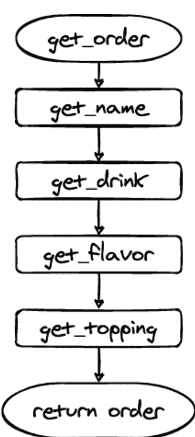

## Creating functions: Get the order and print it

## In this chapter

- Erik creates the actual functions to get orders and print them
- Erik uses a dictionary to store and print a customer's order
- Erik's program now works as planned!
- Erik and Simon plan to write the function to save orders

“昨天我们创建了主菜单，对吧？”西蒙开始与艾瑞克交谈。“我们甚至测试了主菜单功能。”

“是的，但它什么有用的事情都没做，”艾瑞克说。

“对！”西蒙说。“还记得我们谈论过‘自顶向下’的方法吗？我们创建了空函数只是为了测试主菜单。现在是时候让它们做真正的事情了。打开你创建菜单的文件的 Python 文件。它叫做 menu_files.py。”

艾瑞克打开了该文件，现在他的编辑器中有两个标签页：一个是 main_menu.py 文件，另一个是 menu_files.py 文件。

“切换到 main_menu.py 文件，让我们看看我们在这里需要编写哪些函数，”西蒙说。“你看，有三个函数：get_order()、print_order() 和 save_order()。我们先从 get_order() 开始。我们的图表在哪里？”




"我们先从 get_name 开始。这里我们做什么？" Simon 问。

"我们只要问‘你的名字是什么？’，" Erik 回答。

"对，然后呢？"

"然后我们把它保存在一个变量里，比如 name。"

"差不多了，" Simon 说。"记住，我们决定 order 是一个字典。我们会把与该订单相关的所有内容都保存在这个字典里。例如，要保存顾客的名字，而不是 name = 'Erik'，我们应该写 order['name'] = 'Erik'。只是用函数 input() 代替 'Erik'，就像你在第一个程序里做的那样。"

"让我试试，" Erik 说并写下了这个函数：

```
def get_order():
    order['name'] = input("What's your name: ")
    return {}
```

"现在试试，" Simon 说。

Erik 点击了 Run，程序询问他的名字，他输入了 'Erik'。但随后他得到了几行错误信息。

```
What's your name: Erik
Traceback (most recent call last):
  File "/home/erik/mu_code/main_menu.py", line 41, in <module>
    main_menu()
  File "/home/erik/mu_code/main_menu.py", line 3, in main_menu
    order = get_order()
  File "/home/erik/mu_code/main_menu.py", line 27, in get_order
    order['name'] = input("What's your name: ")
NameError: name 'order' is not defined
>>>
```

"这是什么？？？" 他问 Simon。

"看，Python 告诉你问题发生在哪里。读最后一行。"

"Name 'order' is not defined，" Erik 读到。

"很简单，" Simon 解释道。"你试图往字典里放东西，但你还没创建它。很容易修复。让我们创建一个空字典。还记得我们用大括号来做这个吗？就在 input () 那行之前写 order = {} 即可。"

Erik 把他的函数改成了这样：

```
def get_order():
    order = {}
    order['name'] = input("What's your name: ")
    return {}
```

然后再次运行。这次它没有给他任何错误。

```
What's your name: Erik
Check your order:
{}
Confirm? Press Y to confirm, N to cancel: y
Saving order...
Thanks for your order:
{}
What's your name:
```

"现在好点了，" 他说。

"是的，好点了，但看：它仍然打印一个空订单。你创建了一个订单，甚至输入了你的名字，但你的函数返回的是一个空字典。看这一行：return {}？"

"但这是你写的！" Erik 确信这不是他的错。

"是的，我就是这样写来测试主菜单函数的。但现在我们必须返回实际的订单字典。把它改成 return order 然后看看它是否会打印你的名字。"

Erik 把函数改成了这样：

```
def get_order():
    order = {}
    order['name'] = input("What's your name: ")
    return order
```

然后再次运行。这次他看到：

```
What's your name: Erik
Check your order:
{'name': 'Erik'}
Confirm? Press Y to confirm, N to cancel:
```

"是的，它现在打印我的名字了！"

"恭喜！" Simon 说。"现在你知道如何使用字典了！"

## YOUR TURN   Create your get_order() function
开始在 main_menu.py 文件中编写你自己的 get_order() 函数。添加第一个输入来获取顾客的名字。通过运行主菜单程序来测试它。

### What are your choices?

"我们继续吧，" Simon 继续说。"我们现在必须添加你的 menu() 函数来填写饮料和口味。但我们也需要 read_menu() 函数来从文件读取你的菜单。复制这两个函数（menu() 和 read_menu() 来自 menu_files.py 文件）并把它们粘贴到这里的 main_menu.py 中。把它们粘贴在 def get_order() : 行之前。"

"如果我把它粘贴在这行之后会怎样？" Erik 想知道为什么他哥哥给他下这样的严格命令。

"那样就不会工作，" Simon 给了他一个简单的答案并笑了。"好吧，如果你真的想知道：我们将要在 get_order() 函数中使用这两个函数。首先我们要从文件读取菜单内容：你的饮料、你的口味、你的配料。然后我们调用 menu() 函数三次来获取顾客的选择。在我们可以使用这些函数之前，我们应该先定义它们。换句话说，我们应该告诉 Python 存在这样的函数以及它们做什么。这就是为什么它们需要在 def get_order() : 行之前粘贴。" 顺便说一下，这就是我们使用 def 这个词来开始一个函数的原因——我们定义它。"

"好的，" Erik 说并开始复制函数。过了一会儿，他的 main_menu.py 文件看起来像这样：

## Listing 7.1 main_menu.py

```
def main_menu():
    while True:
        order = get_order()
        print("Check your order:")
        print_order(order)
        confirm = input("Confirm? Press Y to confirm, N to cancel: ")
        if confirm == "Y" or confirm == "y":
            save_order(order)
            print("Thanks for your order:")
            print_order(order)
        else:
            continue

def menu(choices, title="Erik's Menu", prompt="Choose your item: "):
    print(title)
    print(len(title) * "-_")
    i = 1
    for c in choices:
        print(i, c)
        i = i + 1
    while True:
        choice = input(prompt)
        allowed_answers = []
        for a in range(1, len(choices) + 1):
            allowed_answers.append(str(a))

        allowed_answers.append("X")
        allowed_answers.append("x")

        if choice in allowed_answers:
            if choice == "X" or choice == "x":
                answer = ""
                break
            else:
                answer = choices[int(choice) - 1]
                break
        else:
            print("Enter number from 1 to ", len(choices))
            answer = ""
    return answer

def read_menu(filename):
    f = open(filename)
    temp = f.readlines()
    result = []
    for item in temp:
        new_item = item.strip()
        result.append(new_item)
    return result
## . . .
## No changes in get_order() and save_order() functions
## . . .
main_menu()
```

"正确！" Simon 说。"现在你知道了规则：在使用之前先定义。你刚才在 order 字典上遇到错误时看到了这个问题，现在你在这里也看到了 menu() 和 read_menu() 函数。"

"现在我们准备在 get_order() 中使用这些函数了，" 他继续说。"看看你的 menu_files.py 程序。我们第一步做了什么？"

"我们从文件读取菜单，" Erik 回答。

"很好，让我们在这里做，但放在函数内部。"

Erik 在 get_order() 函数中添加了三行：

```
def get_order():
    order = {}
    order["name"] = input("What's your name: ")
    drinks = read_menu("drinks.txt")
    flavors = read_menu("flavors.txt")
    toppings = read_menu("toppings.txt")
    return order
```

他必须调整这些行，在每一行前面加上四个空格，使它们都在同一缩进级别。

"然后再用三个 menu() 函数？" 他问 Simon。

"当然，继续吧！"

Erik 把他的函数改成了这样：

```
def get_order():
    order = {}
    order["name"] = input("What's your name: ")
    drinks = read_menu("drinks.txt")
    flavors = read_menu("flavors.txt")
    toppings = read_menu("toppings.txt")
    drink = menu(drinks, "Erik's drinks", "Choose your drink: ")
    flavor = menu(flavors, "Erik's flavors", "Choose your flavor: ")
    topping = menu(toppings, "Erik's toppings", "Choose your topping: ")
    return order
```

他为自己的工作感到自豪，看着 Simon。

"几乎正确，" Simon 说。"你复制得对，但你必须稍微改动代码来把答案存储在 order 字典中。这应该是个简单的改动，你知道怎么做。"

"啊，我明白了，" Erik 说并修改了函数。现在函数看起来像这样：

## Listing 7.2 main_menu.py

```
def get_order():
    order = {}
    order["name"] = input("What's your name: ")
    drinks = read_menu("drinks.txt")
    flavors = read_menu("flavors.txt")
    toppings = read_menu("toppings.txt")
    order["drink"] = menu(drinks, "Erik's drinks",
        "Choose your drink: ")
    order["flavor"] = menu(flavors, "Erik's flavors",
        "Choose your flavor: ")
    order["topping"] = menu(toppings, "Erik's toppings",
        "Choose your topping: ")
    return order
```


Simon 鼓励他说：“去吧，运行它！”

Erik 运行了程序。

```
What's your name: Erik
Erik's drinks
-------------
1 coffee
2 chocolate
3 decaf
Choose your drink: 1
Erik's flavors
-------------
1 caramel
2 vanilla
3 peppermint
4 raspberry
5 plain
Choose your flavor: 2
Erik's toppings
-------------
1 chocolate
2 cinnamon
3 caramel
4 vanilla powder
Choose your topping: 3
Check your order:
{'name': 'Erik', 'drink': 'coffee', 'flavor': 'vanilla',
'topping': 'caramel'}
Confirm? Press Y to confirm, N to cancel: y
Saving order...
Thanks for your order:
{'name': 'Erik', 'drink': 'coffee', 'flavor': 'vanilla',
'topping': 'caramel'}
What's your name:
```

“哇！”他非常高兴。“我写了一个超过 70 行的程序，而且它能运行！”

“是的，你做到了！而且它真的能运行！” Simon 确认并微笑。

YOUR TURN   Add menu choices to your program
将你前面程序中看到的两个函数 menu() 和 read_menu() 添加到你的文件 main_menu.py 中。通过运行程序并输入你的选择来测试程序。尝试输入错误的选择，并确保 menu() 函数不允许你这样做。

## Print it!

“但还是缺少一些东西……订单看起来不够专业。不像真正的咖啡店……” Simon 继续说道。

“我明白了，应该在 `print_order(` 函数里，对吧？” Erik 建议道。

“是的，对。去你的 main_menu.py 文件中的 print_order() 函数。让我们开始打印订单。”

Erik 的 print_order() 函数看起来像这样：

```
def print_order(order):
    print(order)
    return
```

“这里我们使用 Python 提供的默认打印函数，” Simon 继续说道。“Python 可以打印你的字典，但它并不好看。对于调试来说是可以的，但对于真正的订单和收据，我们必须让它更漂亮。而你已经做到了，对吧？”

“你是说——当我打印破折号行的时候？是的，比这个好看多了。”

“好的，让我们做点类似你在 menu_files.py 文件末尾所做的事。你可以从那里复制那些以 print 开头的行。只要不要忘记保持正确的缩进，并确保你使用字典而不是简单的变量。啊，还有别忘了现在我们有顾客的名字。我认为你应该在你的函数中使用它。准备好了吗？”

“是的，” Erik 回答道并开始着手函数。他最终得到了这个：

```
def print_order(order):
    print("Here is your order, ", order["name"])
    print("Main product: ", order["drink"])
    print("Flavor: ", order["flavor"])
    print("Topping: ", order["topping"])
    print("Thanks for your order!")
    return
```

YOUR TURN   Add the print_order() function

将 print_order() 函数添加到文件 main_menu.py 中。随意使用装饰，如破折号 (-)、下划线 (_) 或等号 (=)，让你的打印订单看起来像你在别处看到的那样。尝试找找餐厅、咖啡店、冰淇淋店的收据，看看你能否让你的收据看起来相似。

他再次运行程序，得到了更漂亮的输出：

```
Here is your order,  Erik
Main product:  coffee
Flavor:  vanilla
Topping:  caramel
Thanks for your order!
Confirm? Press Y to confirm, N to cancel:
```

“是的，这样好多了！” Simon 说。“是的，你可以添加破折号和竖线的装饰，随你喜欢。但我可以告诉你，你作为程序员做得非常棒。你写了几个非常有用的函数，你正确地组织了它们，并且你测试了它们。干得好，Erik，我真的为你感到骄傲！”

“我们还学习了字典，我也使用了它们，” Erik 感觉到这是“收尾时间”，他应该提到今天学到的和使用的所有东西。

“是的，对，” Simon 确认。“字典在 Python 中非常重要。我们在程序中经常使用它们。以后我们会学到更多关于它们的内容。”

“你说我们应该以某种方式保存我们的订单。我们明天做吗？” Erik 问。

“是的，当然，” Simon 说。“你知道 JSON 吗？”他问。

“Jason？是的，我们一起去上数学课。他怎么了？”

“不是那个 Jason，” Simon 笑了。“JSON 是一种文件格式，我们可以用它来保存你的咖啡店订单。我们明天学习它，好吗？”

“好的，” Erik 说，然后他就离开了。

## New things you have learned today

- **Variable and function definitions**
  在 Python 中，我们必须在*定义*变量和函数后才能使用它们。对于变量来说，只需为其分配一个空值即可。对于字典来说是：`order = {}`，对于字符串来说是：`name = ""`。函数应使用关键字 `def` 定义。

## Code for this chapter

你可以在这里找到本章的代码：
https://github.com/pavelanni/pythonicadventure-code/tree/main/ch07
