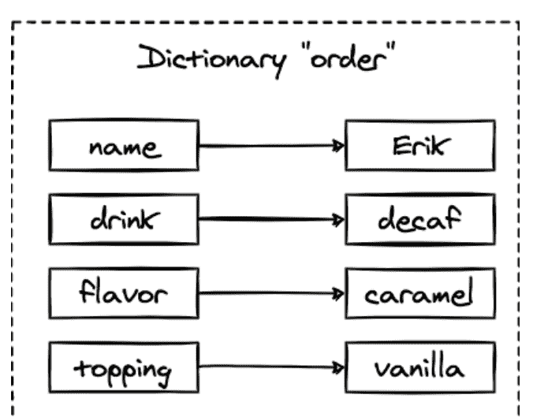
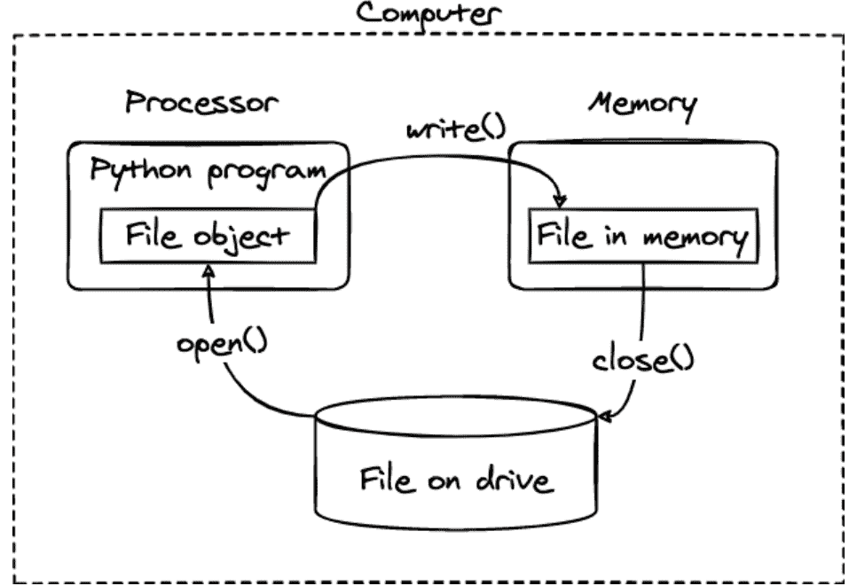
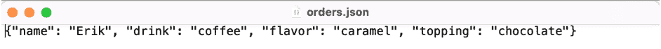
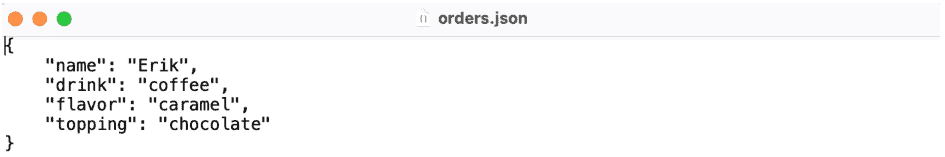
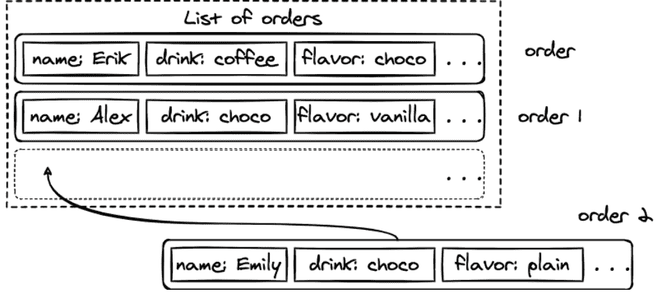
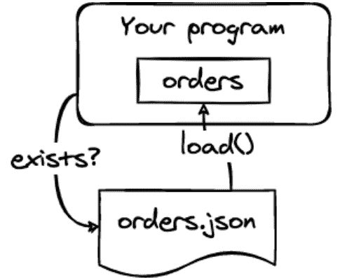
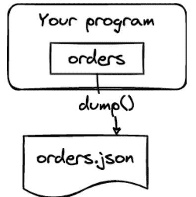
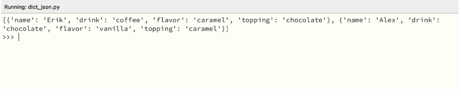

## Working with JSON: Save the order

**In this chapter**

- Erik learns about JSON format and files
- Erik learns about Python modules
- Erik creates a list of orders
- Simon and Erik write the function to save orders in a JSON file

“你昨天提到 Jason，” Erik 问 Simon。“但你说那是另一个 Jason，不是数学课上的那个。”

“是的，那是另一个 Jason，” Simon 微笑。“它是 JSON，J-S-O-N，我们用来存储数据的那种文件格式。”

“像我们用来存储菜单的文件一样？”

“是的，类似，” Simon 回答。“这种格式非常适合存储*结构化*数据。”

“那是什么？” Erik 问。

“有时候你只想存储一段文本，或一张图片。通常，它们没有固定的结构。文本就是文本。图片可以大可以小，可以是黑白的也可以有颜色。但它没有任何结构——它只是一堆像素。这就是所谓的*非结构化*数据。但在你的情况下，每个订单都有一个*结构*。每个订单都有顾客的名字和你要准备的饮料的所有组成部分。没有多余，也没有缺少。它总是包含主饮料、口味、配料。因为你写的菜单，顾客必须在你打印或保存订单之前回答所有这些问题。另一方面，顾客不能*添加*任何东西到订单中。”

“比如另一个配料？” Erik 问。

“是的，” Simon 说。“你的订单是*结构化*数据的例子。”

Erik 没有想到他刚刚创造了这么一个严肃的名字的东西。

“你的订单存储在一个字典中，” Simon 继续说，“你确信对于每个订单，都有字典*键*（还记得那是什么吗？）叫做 'name'、'drink'、flavor'、'topping'。” Simon 拿出他的一张图表。

### Dictionaries in Python:




“JSON 格式就是为了存储这种结构化数据而创建的。让我们练习一下。像以前一样，我们先创建一个简单的程序，尝试一些简单的操作。然后，像以前一样，我们将使用在这个简单程序中学到的知识，让我们的主程序将订单保存到文件中。这对一天来说太多了，所以也许我们明天再做。”

Simon 继续说：“现在打开你的编辑器并创建一个新文件。用 `dict_json.py` 这个名字保存，例如。”

Erik 打开他的编辑器窗口，点击 New，然后 Save，输入 `dict_json.py`，然后再次点击 Save。他已经熟悉这个流程了。

“现在，” Simon 说，“创建一个示例订单。”

“示例订单是什么？”

“你的订单是一个字典，对吧？” Simon 开始解释。“在你的主程序中你创建了一个空字典，然后开始用从顾客那里得到的值填充它。这里我们想跳过这一步并想象我们的订单字典已经用顾客的选择填满了。让我为你开始，” Simon 说并在 Erik 的编辑器中写道：

```
order = {
    "name": "Erik",
```

“你可以继续了，”他说。“别忘了关闭大括号。”

Erik 完成了订单字典并关闭了大括号。现在它看起来像这样：

```
order = {
    "name": "Erik",
    "drink": "coffee",
    "flavor": "caramel",
    "topping": "chocolate"
}
```

“我注意到你在字典中缩进了这些行，”他问他的哥哥。“这也是 Python 中字典的规则吗？”

“不是，” Simon 回答，“在这种情况下我只是为了让它看起来更好。更易读。我可以把所有项目放在一行，或从行首开始，但我认为这样看起来更好。”

“现在，”他继续说，“我们有一个字典。我们想把它保存到一个文件中。我想我应该提醒你关于使用字典的文件操作。”

“是的，” Erik 说，“那是太久以前的事了，我记不太清了。”

“当然，” Simon 说。“你还会学到关于文件的一两件新东西。首先，我们必须打开一个文件。要打开一个文件，我们应该调用一个名为 open() 的函数——当然了！——并将文件名作为参数传递。你知道一切关于函数和它们的 arguments，对吧？那个函数返回一个文件句柄。它是一个特殊的对象，我们的程序现在可以用它来处理这个文件。”

Simon 在 Erik 创建的字典下方写了另一行。

```
order = {
    "name": "Erik",
    "drink": "coffee",
    "flavor": "caramel",
    "topping": "chocolate"
}

f = open("orders.json", "w")
```


"这里是第一个新东西。你看这个 'w' 字母吗？它意味着我们要写入文件。"

```
f = open("orders.json", "w")
```

"但是当我们打开菜单文件时我们没有使用任何字母，" Erik 回忆道。

"你说得对！你能记住这一点真好，" Simon 说。"是的，我们没有使用任何字母——顺便说一下，它们被称为模式——因为默认情况下，当我不使用任何字母时，Python 会打开文件进行读取。这次我们想要写入这个文件，所以我们告诉 Python。"

"我看到你把文件命名为 'orders.json'。是因为你想使用你所说的那种 JSON 格式吗？"

"是的，完全正确，" Simon 回答道。"这不是强制性的，但这是一种约定，给 JSON 文件添加 '.json' 扩展名。另一个区别是，当我们使用 'write' 模式时，如果文件不存在，Python 会创建该名称的文件。"

"接下来呢？" Erik 问。"我们如何向这个 JSON 文件写入？上次我们使用了 'methods'；它们就是这么叫的吗？"

"是的，你记得正确，" Simon 说。"但这次我们会做得不一样。这全是因为我们要写入结构化数据，而不是纯文本。我们将使用一个名为 json 的 Python 模块。"

"模块是什么？" Erik 立刻问道。

"我马上就解释，" Simon 微笑道。"还记得你最近写了几个 Python 函数吗？例如，从文件中读取菜单项并返回一个列表。想象一下你的一个朋友想要为咖啡店或其他类似的地方写自己的程序。"

"是的，" Erik 说，"我最近和 Emily 说过话，她说她想为冰淇淋店创建一个程序。"

"太好了！" Simon 说。"现在你可能想帮助她并分享你写过的函数。这会为她节省一些时间，这样她的程序就能更早准备好。程序员之间互相分享工作以帮助彼此是很常见的。在 Python 中，你可以将想要分享的函数分组到一个文件中并交给 Emily。她可以将该文件复制到她的电脑上，然后将其导入到她的程序中。因为她导入了它，她就可以在她的应用程序中使用你的函数。现在你的函数文件被称为模块。"

"如果我不想分享我的函数怎么办？" Erik 说。"我花了好几天写它们！"

"是的，你确实花了，" Simon 说。"而且你做得很好。但记住，很多人花了很多天编写 Python 中的其他函数，甚至是 Python 本身。他们与程序员分享他们的工作，这样你就可以完全免费地使用 Python 和其他函数。这样我们就能互相帮助完成我们的项目。如果我们必须从头开始自己编写所有东西，就会慢得多。这就是为什么人们使用别人的代码，也与他人分享自己的代码。这通常被称为 *Open Source community.*

"回到 JSON，" Simon 继续说道。"我们将使用名为 `json` 的模块，由其他人编写。该模块可以读取 Python 字典并将其转换为 JSON 文件。转到文件开头并添加一行：`import json`。它应该是文件的第一行。"

Erik 这样做了。以下是他的更新后的文件。

```
import json

order = {
    "name": "Erik",
    "drink": "coffee",
    "flavor": "caramel",
    "topping": "chocolate"
}

f = open("orders.json", "w")
```

"现在我们必须将你的示例字典转换为 JSON 并写入我们刚刚打开的文件，" Simon 说。"在 `json` 模块中，这个函数叫做 `dump`。我们在你的程序中调用它，但我们必须告诉 Python 它应该在模块 `json` 中查找这个函数。所以我们这样调用它：`json.dump()`。你只需要传递两个参数：字典和文件对象。将此函数添加到文件的末尾。你的字典是 `order`，你的文件对象是 `f`。"

Erik 将这一行添加到程序末尾：

```
json.dump(order, f)
```

Simon 继续说道："现在这里还有另一件事，我们之前在处理文件时没有做过。我们应该 *关闭* 文件。这很重要，所以让我们画另一张图。"

"看，这里是计算机的三个主要组件：处理器、内存和驱动器。你的 Python 程序在处理器上运行。你的文件存储在驱动器上的文件系统中。文件系统就是你在 Mac 上看到的 Finder，在 Windows 上看到的 Explorer：文件夹和文件。当你想在 Python 中使用文件时，你 *打开* 它，就像你刚才做的那样。这会在你的程序中创建一个文件对象。当你写入文件时，你写入计算机内存。然后当你希望你的文件 *真正* 写入驱动器上的文件系统时，你 *关闭它*。"



"这太复杂了！" Erik 感到困惑。"为什么我们不直接写入驱动器呢？"

"计算机很复杂，你说得对！" Simon 同意道。"原因在于计算机工程师试图让计算机运行得更快。写入驱动器很慢——比写入内存慢得多。想象你在文本编辑器中编写程序。如果它在你输入的每个字母后立即保存到驱动器，就会非常慢。你不喜欢使用慢速计算机，对吧？"

"我讨厌慢速计算机！" Erik 情绪化地回答道。

"为了让计算机运行得更快，" Simon 继续说道，"工程师决定将数据存储在内存中，仅在必要时才保存到驱动器。他们使用很多技巧来让计算机运行得更快，当然，我并不了解所有这些。也许我在大学里会学到更多关于它们的信息。"

"让我们回到我们的程序。记住：文件对象使用方法。在这种情况下我们调用 f.close()。这将确保我们的订单写入文件。现在在你的程序的最后一行之后添加它。"

这很容易——在如此长的解释之后！Erik 很快添加了它，得到了这个。

```
import json

order = {
    "name": "Erik",
    "drink": "coffee",
    "flavor": "caramel",
    "topping": "chocolate"
}

f = open("orders.json", "w")
json.dump(order, f)
f.close()
```

"现在运行它，" Simon 说。

Erik 点击运行，并在窗口底部看到了熟悉的 >>>。"现在怎么办？" 他问 Simon。

"什么都没发生？" Simon 微笑着，感受着 Erik 的困惑。"当然，因为你没有告诉 Python 打印任何东西。但仍然，幕后发生了事情。Python 打开了一个名为 orders.json 的文件，将你的字典写入其中，然后关闭它。现在我们必须打开它来检查它是否做对了。使用纯文本编辑器打开文件。你在 Mac 上，所以它将是应用程序文件夹中的 TextEdit。在 Windows 上是 Notepad，在 Linux 上是 gedit 或 Kate。启动编辑器并打开文件。它在你的主文件夹中，在 mu_code 下，名为 orders.json。"

Erik 启动了 TextEdit，找到了文件并打开了它。确实，他看到了他的订单：



## YOUR TURN  Save your example order in a JSON file
编写 Erik 刚刚编写的程序。尝试使用稍微不同的订单。运行程序并使用你平台上的文本编辑器检查生成的 JSON 文件。尝试更改订单并再次运行程序。你的 JSON 文件有变化吗？（你可能需要在文本编辑器中重新加载文件。）

"你看，" Simon 说，"这就是你的示例订单，存储在文件中。让我添加一些东西，你就会看到为什么 JSON 文件非常适合存储 Python 字典。"

Simon 接过键盘并将 `json.dump()` 调用更改为此：

```
json.dump(order, f, indent=4)
```

他再次运行脚本并重新打开 `orders.json` 文件。现在它看起来像这样：



## YOUR TURN  Make it beautiful
将 `indent=4` 参数添加到你的上一个程序中并检查你的 JSON 文件是否发生了变化。

"它看起来完全像我的字典！" Erik 说。

"我就告诉你了！" Simon 兴奋地说道。"我们将使用 JSON 来存储你的订单。我说的是 'orders'，这意味着现在我们必须学习如何保存多个订单并将它们存储在文件中。我们已经知道 Python 如何存储按顺序排列的多个项目——你为菜单使用过它。

"一个列表！" Erik 说。

"正确！Python 中的列表可以包含不同的东西：字符串、数字，甚至字典。在这种情况下我们将有一个字典的列表。每个字典将包含一个订单，我们将一个一个地将它们添加到列表中。一个新客户，一个新订单，列表中的一个新字典。让我画一张图。"



"让我们创建一个订单列表，" Simon 继续说道。"复制代码中现有的订单并将其称为 order1，例如。

然后更改订单的内容：姓名、饮料和其他内容。"

Erik 在他的代码上工作了一段时间，最后得到了这个额外的订单，就在第一个订单下方。

```
order1 = {
    "name": "Alex",
    "drink": "choco",
    "flavor": "vanilla",
    "topping": "caramel"
}
```

"很好，" Simon 说，"现在创建一个名为 orders 的空列表。请注意它是复数——'orders'。它与创建空字典非常相似——你已经做过这个。只是用方括号代替大括号。"

Erik 在第二个订单下方添加了以下行：

```
orders = []
```

"现在我们将把两个订单都添加到列表中，" Simon 说。"信不信由你，但列表 orders


你刚刚创建的也是一个对象。在 Python 中，实际上，一切都是对象。每个对象都有你可以使用的方法。你只需要知道每个对象存在哪些方法。例如，对于所有列表，都存在一个名为 append() 的方法。它会将你作为参数传递的元素添加到列表末尾。看这里，我将用它把 order 和 order1 添加到列表 orders 中。" Simon 在创建列表 orders 的那一行下方添加了下面这两行。

```
orders.append(order)
orders.append(order1)
```

“但你怎么知道这里应该使用 append() 呢？” Erik 问。

“我是在学习 Python 时在 Python 文档中读到的，” Simon 微笑着回答。“你可以用 Google 搜索 ‘Python list methods’，你就会找到你需要知道的一切。”

“现在我们可以尝试将这个列表保存为 JSON，” Simon 继续说。“我们唯一需要改变的就是我们想‘dump’到文件中的内容。我们使用 order 作为 dump() 函数的参数来写入一个订单。现在让我们把它替换成 orders（复数！）看看会有什么变化。”

Erik 将 json.dump() 的那一行改成了这样：

```
json.dump(orders, f, indent=4)
```

他运行了程序并再次打开了 orders.json 文件。

```
[
  {
    "name": "Erik",
    "drink": "coffee",
    "flavor": "caramel",
    "topping": "chocolate"
  },
  {
    "name": "Alex",
    "drink": "chocolate",
    "flavor": "vanilla",
    "topping": "caramel"
  }
]
```

## YOUR TURN 保存一个列表

再添加一个示例订单。将其命名为 `order2`。创建一个订单列表。将列表保存在同一个 JSON 文件中。用文本编辑器检查结果。添加你能想到的尽可能多的订单并将它们写入文件。保存订单的数量有没有限制？

“那么，你怎么说？” Simon 问。“看起来像你的订单吗？”

“是的，它看起来完全像 Python！” Erik 说。“但我们为什么要把我的订单写到一个单独的文件里？如果它看起来像 Python，为什么我们不把我的订单直接写进我们的 Python 程序里呢？”

“好问题！” Simon 很高兴 Erik 想弄明白事情。“首先，我们总是希望将程序与数据分开。记住，当你运行 Word 应用程序时，你不会把文档写进 Word 程序里。你会把它们保存在单独的文件中。这就是我们在这里做的。你的程序可以把订单保存在不同的文件中，例如针对不同的日期。你唯一需要做的就是更改输出文件的名称，例如 `orders.Monday.json, orders.Tuesday.json, 等等。`

“第二个原因，” Simon 继续说，“是这种格式叫做 JSON是有原因的。它代表 JavaScript Object Notation。最初它是由使用 JavaScript 编程语言的人发明的，然后其他语言开始使用它。所以你可以用 Python 把你的订单写到一个 JSON 文件中，然后你的一些朋友可能想用 JavaScript 创建另一个程序来读取该文件并例如在网页上打印你的订单。”

“是的，我听说我班上有些人说他们会 JavaScript！” Erik 说。

“很好！你可能想组建一个编程团队并一起开发应用程序，” Simon 说。“但让我们继续我们的示例程序。现在我们将从 JSON 文件中读取订单并将它们保存到一个新列表中。让我们称它为 `saved_orders`。”

“我们为什么要读取它？我们刚刚把它写到文件里了？” Erik 感到困惑。

“也许我没有解释清楚，” Simon 回答道。“在这个示例程序中，我们正在练习对 JSON 文件的一些操作，这样我们就能很好地掌握它们并在主程序中使用。程序员经常这样做：他们创建简单的程序来测试一些概念和想法。让我向你展示我对我们主程序的计划，这样你就能更好地理解我们要去哪里。”

Simon 拿起另一张纸开始画图。

“首先，我们检查名为 'orders.json' 的文件是否存在。如果存在，我们就打开它并从中读取我们之前的订单。”

“我们为什么需要之前的订单？我们已经准备好了，” Erik 问。

“是的，但记住，我们可能想统计今天或昨天或上个月我们服务了多少客户。或者统计我们使用了多少份焦糖以及是否该买更多了。如果你想认真经营你的咖啡店业务，你需要所有的订单。这就是为什么所有企业都会长期保存这些记录。”

“如果我们没有这个文件怎么办？” Erik 问。

“这意味着我们刚刚开业开始营业，” Simon 微笑着说。“在这种情况下我们创建一个空列表并开始接收订单。文件会在我们打开它进行写入时自动创建。”



“看这张图：这里我们有我们的 'orders' 列表，要么填满了我们之前的订单，要么是空的。我们开始接收订单并将它们保存到这个列表中。等到一天结束时，我们关闭文件，这会把我们所有的订单保存到驱动器上。第二天我们再次打开文件并继续接收订单。所有新订单都将被添加到前一天的订单中。”



## YOUR TURN 画你自己的图表

尝试在不看书的情况下为你的程序画图表。
画图表有助于你理解程序的工作原理。

“这是真正的咖啡店的工作方式吗？像星巴克那样？” Erik 问。

“是的，差不多，” Simon 微笑着说。“当然，他们为了可靠性和安全性使用数据库。他们的订单记录比我们的更复杂。但整个过程非常相似。”

“现在你知道了总体计划，让我们继续我们的简单程序并从文件中读取。我们将把之前的订单读入一个名为 'saved_orders' 的新列表，然后我们只需打印它以查看我们是否正确读取了它。为此，在 json 模块中有一个名为 load() 的函数。它的工作方式与 dump() 相同：首先我们打开一个文件，但这次是用于读取而不是写入。然后我们调用 json.load() 并将文件对象作为参数传递。函数返回它从文件中读取的对象，我们将该对象赋给一个变量。在我们的例子中它将是一个订单列表——也就是字典，如你所记得的。听起来很复杂？让我帮你。它在 Python 中要短得多，” Simon 开始在 Erik 的代码中添加行。以下是他在程序末尾添加的内容：

```
f = open("orders.json", "r")
saved_orders = json.load(f)
print(saved_orders)
```

他点击了运行，Erik 看到了输出：



## YOUR TURN 从 JSON 文件中读取

将前面的行添加到你的程序中并尝试读取你创建的 JSON 文件。你得到的订单是否与你的示例订单相同？

“我们今天学了很多，” Simon 说。“让我们休息到明天吧。明天我们会把这些函数添加到我们的主程序中，然后它就会成为一个真正的咖啡店应用程序。你能快速回顾一下我们今天做了什么吗？”

“我们从我的 Python 字典创建了一个 JSON 文件，它看起来非常像 Python。然后你向我解释了关于文件、内存和驱动器的所有内容。而且我们还创建了一个字典列表并将其保存到文件中。”

“我们还学习了 Python 模块以及如何导入它们，” Simon 补充道。“到目前为止，一切都很好，”他说，“让我们明天继续。我们离完成应用程序的第一个版本已经很近了。”

## 你今天学到的新东西

- **JSON, JavaScript Object Notation**
  一种用于存储结构化数据并可在程序之间交换信息的格式。
- **Python modules**
  可供其他程序员使用的 Python 函数组。通常它们被分组在文件中。在使用它们之前你必须 `import` 模块。
- **List of dictionaries**
  列表可以包含不同类型：字符串、数字、字典、其他列表。
- **File operations**
  你可以打开文件进行读取和写入。你可以将数据写入文件，但它被写入计算机的内存中。你应该关闭文件以将数据保存到计算机驱动器上。
- **Open Source Community**
  共享他们编写的程序并互相帮助写出更好代码的人。

## 本章代码

你可以在这里找到本章的代码：
https://github.com/pavelanni/pythonicadventure-code/tree/main/ch08


