## Learning Flask: Your first web application

## In this chapter

- Erik creates his first simple web application
- Simon explains how Flask works (and what it is)
- Emily and Erik work on a web form
- The first coffee shop web-based menu is ready!

“你说你想创建一个 Web 应用程序？”那天 Simon 问 Erik。

“是的，当然！”Erik 说。“否则我怎么能在我的 iPad 上使用我的程序呢？”

“好吧，但要做好准备：这不是一个简单的任务。它需要你全神贯注。也许你不会完全理解我们在这里做的所有事情。但不用担心，我会在你需要时帮助你。”

“我知道，你是个好哥哥，”Erik 说，说这话时几乎没有讽刺的意味。

“我们将使用我们的好朋友 Mu Editor 来制作我们的 Web 应用程序。它有一个专门的模式。启动编辑器并点击左上角的 Mode。”

Erik 照做并看到了这个菜单：

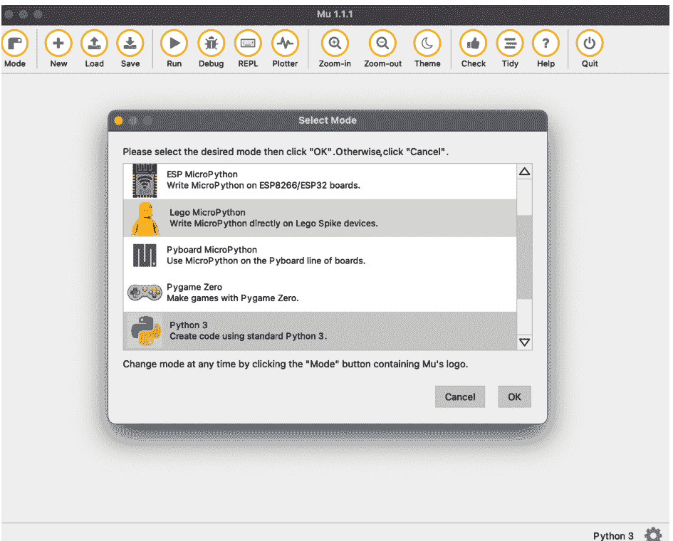

“向下滚动，”Simon 说。“找到 Web 模式并点击它。然后点击 Ok。”

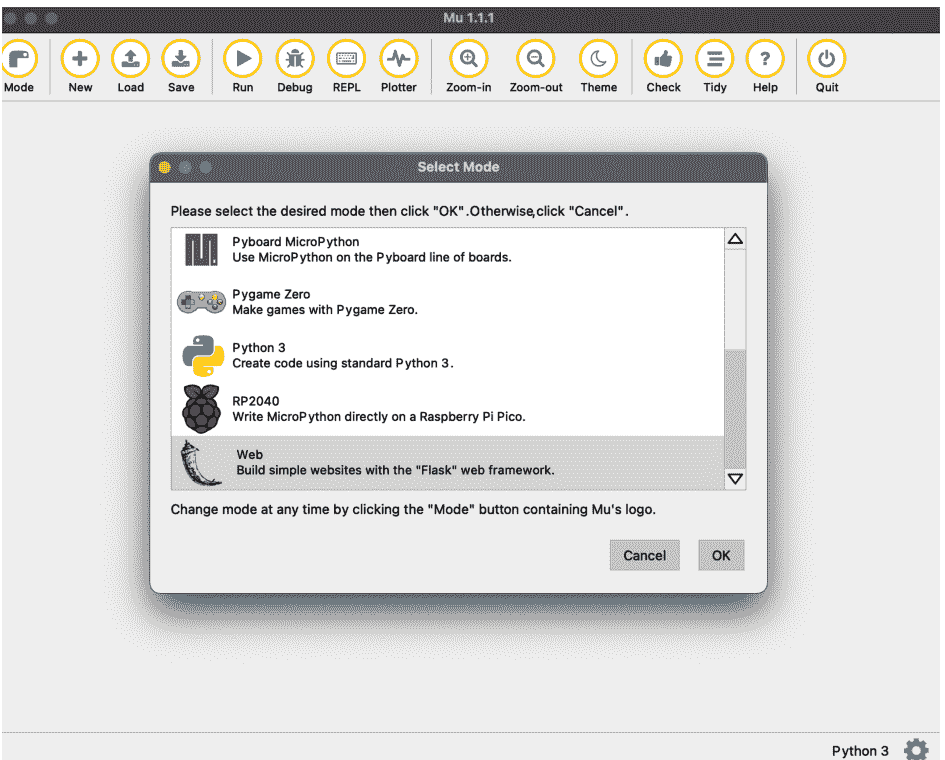

Erik 做完后，Simon 指着右下角说：“看到齿轮旁边的这个词 'Web' 吗？我们切换到了 Web 模式。现在让我们看看能用它做什么。点击 New。”

Erik 照做，编辑器窗口中立即出现了 Python 代码。

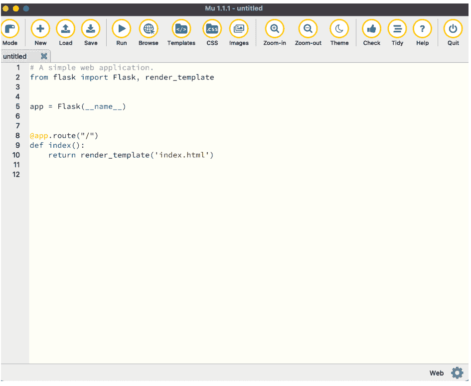

“有意思，”他说。“Mu 已经为我写了一些东西了。我可以运行它吗？”

“当然，可以。先保存它。命名为 ‘first_app.py’。”

Erik 点击 Run，在保存对话框中输入 ‘first_app.py’，并在窗口底部看到了以下输出。


## 一个简单的 Web 应用程序。
from flask import Flask, render_template

app = Flask(__name__)

@app.route("/")
def index():
    return render_template('index.html')

运行：
* Serving Flask app 'first_app.py' (lazy loading)
* Environment: development
* Debug mode: on
* Running on http://127.0.0.1:5000/ (Press CTRL+C to quit)
* Restarting with stat
* Debugger is active!
* Debugger PIN: 255-968-929

"What is it?" he asked.

"This tells you that you first web application is running. See this message: 'Running on http://127.0.0.1:5000/'. It means that you can go to your browser and enter this address: http://127.0.0.1:5000/. Sometimes this address is also called URL or Uniform Resource Locator—you will hear this word all the time when working with web. Or just click the Browse button in the editor. Try and see what you've got."

Erik opened a new tab in his browser and entered the address. Here is what he saw:

## Hello from Mu!

This is a very simple dynamic web application built using Python and the Flask web framework.

Why not try adding the following route to your Python code?

```
@app.route('/hello/<name>')
def greet(name='Stranger'):
    return render_template("greeting.html", name=name)
```

Now add the following template with the filename, "greeting.html".

```


<p>Hello {{name}}, how are you?</p>

```

Once you've done that, go visit /hello/yourname (but replace "yourname" in the address bar with, you know, your actual name). :-)

"Wait, is this all written by my editor?" he asked Simon.

"Yes, but look, Mu suggests that the rest you write yourself," Simon said and pointed to the code example on the page. "Mu recommends you to copy the code from the first gray window to your program. Go ahead and do it."

That was easy. Erik quickly copied the text and pasted it below the existing code.

"Now Mu tells you to create a new file," Simon continued, "copy the text from the second window, and save it as a new file 'greeting.html'"

Erik knew how to do it. He clicked New in the Mu Editor, removed the program Mu put into it, and copy-pasted the text from the second gray window. Then he clicked Save.

Simon helped him: "Use the drop-down menu to change from '*.py' to 'Other (*.*)', otherwise Mu will think you are trying to save a Python program. We should tell it that this time it’s a different type of file. In the 'Save As' field type greeting.html."

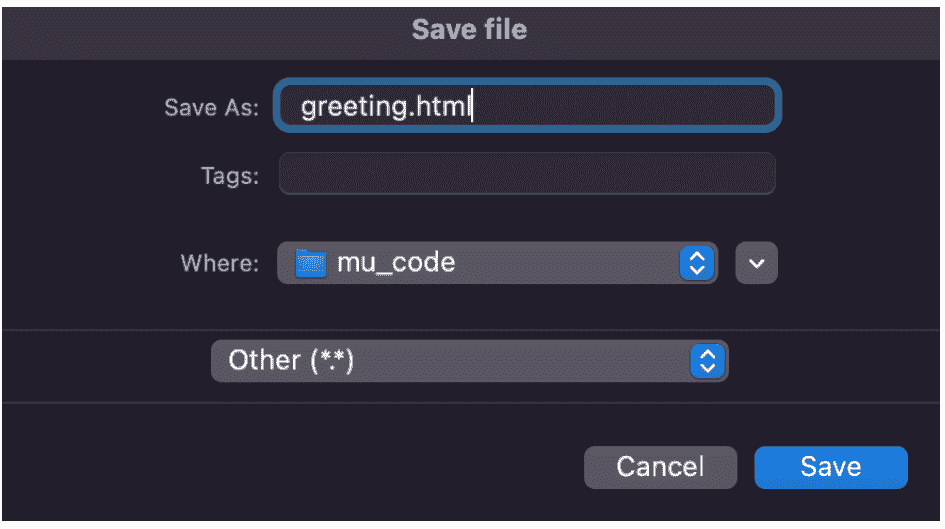

"Now stop the program and run it again," Simon said. "Don’t forget to switch to the 'first_app.py' tab."

Erik switched to the application tab, clicked Stop and Run again. He saw the same output at the bottom of the window.

"Now go back to your browser and do what it suggests. Look, it says 'go visit /hello/yourname' and tells you to use your own name. Go ahead, add /hello/Erik in the address bar, right after 5000."

Now it looked like real hacking. Erik entered what Simon suggested and pressed ENTER.

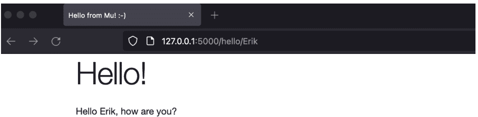

"Wow! It talks to me!" He was really impressed.

"It’s already your program that talks to you," Simon said. "That was easy, huh?"

"Wait," Erik said, "if we are going to work on this web stuff, I should call Emily. She told me she learned HTML and this is what we need for web, right?"

"Absolutely correct," Simon agreed. "Go ahead, call her. It’s always good to work together."

YOUR TURN Create your first web application
Switch to the web mode in Mu Editor and create your first web application by copying the example from the browser's page, just like Erik did. Try to run it with your name. Try other names. Show it to your friends and ask them to use their names.

Emily lived nearby and she arrived in about 15 minutes, very excited about the project. She asked immediately: "Erik, show me your HTML!"

Erik showed her the greeting.html file and said: "Well, it’s not my code, it’s from this Mu Editor."

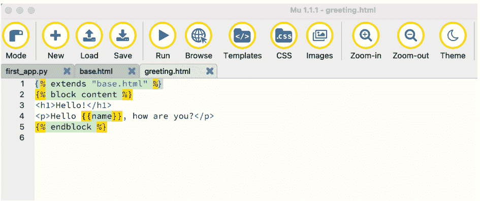

"Wow, interesting," Emily said. "I’ve never seen these curly braces in HTML."

"Right," Simon said, "because this is not pure HTML, it’s a *template*. We use the program called Flask here and it uses templates to generate HTML."

"I see," Emily said. "But I know these <h1> tags, and <p> tags."

"Tags? What are 'tags'?" Erik asked.

"Tags are these small pieces of code that you put in your text to change how it looks. Look here, you place <h1> before 'Hello!' and </h1> after it and it looks larger. This is what in HTML is called *headers*, like chapter headers."

"What about <p>?" Erik asked.

"It means 'paragraph'," Emily explained. "In HTML you can write your text how you want: in one long line, or in many short lines, or even one word per line. But if it has <p> at the beginning and </p> at the end, it will be one paragraph in the browser."

"There are a lot of other tags," she continued. "You can make your text bold or italic, change colors, and all that."

"Emily, do you know anything about HTML forms?" Simon asked.

"They told us in the class that we can create forms in HTML to enter text or use menus," Emily answered. "But I haven’t tried them myself."

"Menus is what we want!" Erik exclaimed.

"I’ll help you," Simon said. "First we should use the mandatory HTML tags. We should always have <html> at the beginning of the file and </html> at the end. Also we should use the <body> tags around our text. Again, we use <body> to *open* the text and </body> to close it. That’s why

the tags with slash / are called *closing tags.*"

## Listing 10.1 templates/forms.html

```
<html>
<body>

</body>
</html>
```

"They are like brackets in a list in Python," Erik said. He wanted to show Emily that he knew Python already.

"You are right," Simon confirmed. "These tags *enclose* some text and explain its meaning. Some pieces of text are headers, some are paragraphs. But now we want to create a menu. For that we’ll need a tag <form> first and then a tag <select> inside it. Let’s create a very simple menu," and he started writing.

## Listing 10.2 templates/forms.html

```
<html>
<body>
<form>
    <select>
        <option>Coffee</option>
        <option>Decaf</option>
    </select>
    <input type="submit" value="Submit">
</form>
</body>
</html>
```

**YOUR TURN**   **Create your first web form**

**Create the file `forms.html` and save it under `mu_code/templates`. Copy the preceding code and test it in your browser. Try to change the options; try to add more options.**

Simon finished writing, clicked Save, and saved the file as `forms.html` under the `mu_code/templates` directory. "Look, how many elements enclosed in tags do you see here? Emily, you should be more familiar with that."

Emily started counting. "First, the <html> tag, then the <body> tag. Inside the body we have a <form>, then inside the form we have <select>. It’s for the menu, correct? And then in the 'select' we have two <option> elements."

"Right. You did a great job, Emily," Simon said. "And also don’t forget the <input> element that is a part of the 'form.' It doesn’t have a closing tag. It exists just by itself. We use it to create the 'Submit' button."

"Let’s see how it looks like in the browser," Simon continued.

"Can you open files in the browser?" Erik asked. "I thought browsers are only for web sites."

"Of course, you can," Emily answered. "We did it all the time in our HTML class! You just use the menu File in your browser, then Open File…, then find your file, and that’s it."

Erik did what Emily just said and opened the file forms.html. He saw a menu, very similar to what he saw and used on many sites. He clicked the menu and it opened:

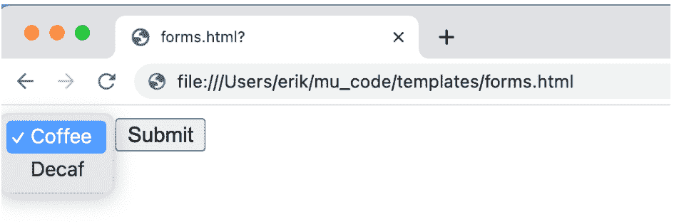

"I didn’t know that you can create forms so easily," Emily said.

"Yes, it’s pretty easy to create a simple form like this, but there are some missing parts," Simon said.

"It looks good to me," Erik said. "What’s missing?"

"Yes, it looks good, but it doesn’t do anything," Simon said. "We have to get data from the user and then pass that data to the program. How can we pass the data?" Simon asked, and answered his own question. "We should use variables and values, very similar to Python. Let me add something to this form."


## Listing 10.3 templates/forms.html

```
<html>
<body>
<form action="/order" method="post">
    <select name="drink">
        <option value="">Choose drink --</option>
        <option value="coffee">Coffee</option>
        <option value="decaf">Decaf</option>
    </select>
    <input type="submit" value="Submit">
</form>
</body>
</html>
```

Simon started his explanation.

- 1. "Look at the number (1)," Simon said. "Here we define the *variable* we want to return from this menu. In this menu the variable is called `drink`.
- 2. "Now, on the line with number (2) and the line after it we define the *value* this menu option will return. It’s very similar to what we did when we chose items from the text menu, remember?"
- 3. "And in the line with number (3) I just added an option that tells the user what to do. This option will show first in the menu and work as a prompt. As you can see, its value is empty. If the user haven’t chosen a drink, we should tell them about it. You can’t prepare their order without this information, can you?"

"Can I try it?" Erik asked.

"Of course, go ahead and open this file again. Or just reload it in the browser."

Erik reloaded the file, chose "Decaf" from the menu, clicked "Submit" and got this:


## Your file couldn’t be accessed

It may have been moved, edited, or deleted.

ERR_FILE_NOT_FOUND

"What’s that?" he asked, visibly puzzled.

"Oh, I forgot to tell you," Simon said. "Look, I changed the form tag a little bit."

## Listing 10.4 templates/forms.html

```
<form action="/order" method="post">
```

"Each form should have an action," he started to explain. "Action is something that our application will do when the user submits the form. When the user made their choice—coffee or decaf—they should pass this information to some function. That function should know what to do with this information: store it in the file or database, print the order, and such."

"Like what we did in our previous program?" Erik asked.

"You keep talking about your 'previous' program, can you show it to me?" Emily demanded.

"I’m sorry, Emily," Simon said. "I should have explained it earlier. We worked with Erik on a program that collects orders in a coffee shop. Similar to Starbucks, where you can order a drink, add flavors and toppings, and all that. Erik wrote a program that shows menus and asks the customer what they want to order. When they choose their drinks, flavors, and toppings, the program prints the order. But the program now works only in a terminal, in text mode. Erik needs your help to convert it to a web application."

"I see now," Emily said. "This sounds like a cool project! I hope Erik will teach me Python too."

"Of course," Simon said. "Teaching somebody is the best way to learn."

"Back to our form," he continued. "That `action` attribute tells the browser: 'After the user submits the form, open this address and pass the information from the form there. In our case the address is called `/order`. Don’t worry, it only sounds scary, I’ll show you what to do with it," Simon added because he noticed the confusion on Emily and Erik’s faces.

"I still don’t understand," Erik asked. "Where is this address that you are talking about?"

"Look at your first application," Simon said. "See this `greet` function?" "This function was written by the Mu Editor for us—or, rather, its authors," Simon said. "You see now the familiar function definition that’s starting with `def`, but also, right above it, you can see something new: `@app.route('/hello/<name>')`. In Python it’s called *decorator*, but we are not going to learn about decorators today.

## Listing 10.5 first_app.py

```
@app.route('/hello/<name>')
def greet(name='Stranger'):
    return render_template("greeting.html", name=name)
```

What’s important for us today is that you can use it to tell your program which function to use for which address."

"Ah-ha, the address is that `/hello/Erik` that I entered in the browser, I see now!" Erik said. "Let’s show Emily how it works," and he opened the tab with the `first_app.py` script in the editor, clicked Run and then Browse. His browser opened a page with greetings from Mu.

"Emily, look, I can type the address here, right after these numbers: `127.0.0.1:5000` and look what it shows us!" Erik typed: `/hello/Emily`, pressed ENTER and the browser showed:

## Hello!

Hello Emily, how are you?

"Wow, I like it!" Emily said. "Can I try?" and she changed "Emily" to "Erik". Of course, the browser showed the page with "Hello Erik, how are you?"

"Interesting!" she said. "In our HTML class we could change pages, but we had to edit HTML. This is much easier!"

"Right," Simon said, "this is what we call *dynamic* pages—pages that change depending on what you enter. You can enter your information in the address, like `/hello/Emily` or you can use forms. Then the page will be *generated* using the information you entered. I'm sure, you've seen this kind of pages many times—for example when you enter a comment, or chat with someone on the web. You click 'Submit' or just press ENTER and the page is updated, right? Now you will learn how to make such pages yourself."

"Let me show it on a diagram," he said and started drawing.

address or URL

browser

http://127.0.0.1:5000/order

- Choose drink -

Submit

Python

```
@app.route('/order')
def order():
    function code
```

HTML

```
<form action="/order" method="post">
  <select name="drink">
    <option value="">- Choose drink -</option>
```

> "This combination of letters and numbers at the top of your browser is called 'address' or 'URL'. I marked it blue. Usually you see the site’s name here, like google.com. In our case it uses numbers called the site’s IP address. We use your own computer and for every computer in the world the address 127.0.0.1 means 'this computer.' But don’t worry about that now."

Simon pointed to the first red circle around the word 'order' in the address and said: "This is what we should care about. Look, it’s part of the address. When we open this address we see the form with the drinks menu. When you click Submit," and he followed the arrow down his diagram, "the form knows that it should find the function responsible for the address /order. You see, it’s here, in the form action field.

And then," he followed the arrow up to the 'Python' block, "the form finds the Python function that can work with it, because we used this decorator, @app.route('/order'). You see, these three things are connected; you just have to use the same name in the address, in the form, and in the Python program."

"I see that the function is also called 'order'--is it the fourth place where we use it?" Erik asked.

"You have a very sharp eye!" Simon said and smiled. "No, in this case, the function can have a different name. I could call it 'new_order' or 'get_order'. But now we have to write the actual function. I’ll help you here. It will look a bit scary, but don’t worry. I’m learning this Flask system myself and usually I follow the online tutorial and take examples from there. Don’t think that I remember all these things myself."

And Simon wrote the function, looking at the example he kept opened in the browser. He added numbers at the end of the lines to help him in his explanation.

"At the line with (1) you see two words: 'GET' and 'POST'. These are the methods that we use with web servers. We use GET when we want to get something from a web server, like a web page. We use POST to send some information to the web server. Like in this case—we want to send or POST the drink chosen by the customer. Put it another way: when you load a page in the browser—you use GET; when you click Submit in your form—you use POST. You will understand it better when we start using it, don’t worry.

"And here, at the line with number (2), we start using one of the words. Look what it says: if the method is POST--which means somebody filled the form and clicked Submit—we read the information they entered in the form and print it.

"Now look at the number (3). Remember in the form we used <select name="drink">? This is the name we use here, in the square brackets. Later we’ll add other menus—for flavors and toppings. In the form they will have names like 'flavor' and 'topping'. Here in the code we’ll use them as request.form['flavor'] and request.form['topping']."

"Under number (4) we just print whatever we received from the form. You will see it in the editor.

"In the line with number (5) we tell our web server to print this page with the menu. It’s like a menu loop that we used in our program before—you get the information from the customer, print it out and return to the menu to get another order. And you repeat this loop until you are done entering orders."

## Listing 10.6 first_app.py

```
@app.route('/order', methods=('GET', 'POST'))
①
def order():
    if request.method == 'POST':
        ②
        drink = request.form['drink']
        ③
        print("Drink: ", drink)
        ④
    return render_template("forms.html")
    ⑤
```

- ① Methods that we are going to use with this form
- ② Method POST means we are submitting information
- ③ We get the customer choice from the form’s field called drink
- ④ Print the choice we’ve received
- ⑤ Display the template forms.html

"Let me add one more thing," Simon said and added request to the first line with import. "This


module called request is a part of Flask. If we use it we have to import it." Now the first line looked like this:

```
from flask import Flask, render_template, request
```

## YOUR TURN   Write your own order() function

Add the order() function from above to your first_app.py program. Don’t forget to change the import line. Try to run it. Open a new tab in the browser and use the http://127.0.0.1:5000/order address. If you are having problems, continue reading and follow what Emily and Erik are doing.

"Can I run it now?" Erik asked. He was a bit tired after such a long explanation. Emily, on the other hand, listened to Simon’s explanations as if he was a wizard. She liked all this programming magic and couldn’t wait to try the program.

"Can I run it?" Emily asked.

"Of course," Erik said. "Just click Save and then Run."

"Now click Browse," Simon said.

Emily did and the following page opened in a new browser tab.

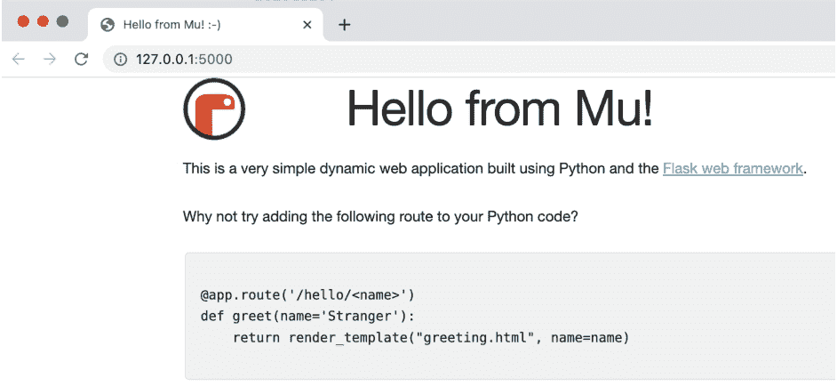

"Now we have to add /order to the address, remember?" Simon helped her.

Emily did and the address line in the browser became this: http://127.0.0.1:5000/order. The page showed the menu they just created together.

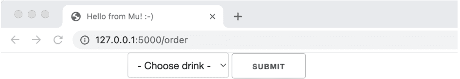

"Go ahead, choose your drink and click Submit," Simon said.

Emily chose Decaf and clicked Submit. She’s got the same page with the 'Choose drink' menu.

"Did it work?" she asked. She looked confused.

"Let’s check," Simon said. "Go back to the editor. Look at the bottom window."

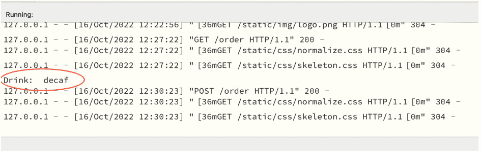

"Do you see this line: Drink: decaf? It’s what our program is printing," Simon said. "That means it works!"

"But I thought," Emily said, "that it would print the order on the page."

"It will, trust me," Simon said. "We haven’t written that part yet. We are getting there, right now."

He took the keyboard and changed the first_app.py file by adding one line after the print() line. Simone explained: "When we first open the address /order in the browser that means we use the GET method. We want to get the page first, right? We don’t have anything to POST yet. In that case we use the template forms.html that displays our drink menu. But after we have chosen a drink and clicked Submit we use the POST method. We want to send this information to

the program. And in that case we collect the data from the form—the drink choice—and use *another* template. I called it print.html because we want to print the order."

The order() function now looked like this:

```
@app.route('/order', methods=('GET', 'POST'))
def order():
    if request.method == 'POST':
        drink = request.form['drink']
        print("Drink: ", drink)
        return render_template("print.html", drink=drink)

    return render_template("forms.html")
```

"But we don’t have a file called print.html," Emily said.

"Right, I am going to create it right now," and Simon created another file in the editor and saved it as print.html under templates.

Emily looked at his code and said: "Oh, this I can understand! You print the header 'Thanks for your order' and then you open a new paragraph and print 'Your drink' and then in **bold** you print the drink itself. And this drink in double curly braces works the same way it worked with my name when it printed 'Hello Emily', right?"

"Exactly right!" exclaimed Simon. "You are absolutely correct, Emily!"

### Listing 10.7 templates/print.html

```


<h1>Thanks for your order!</h1>
<p>Your drink: <strong>{{drink}}</strong></p>

```

## YOUR TURN   Edit your web form to print the drink choice on the page

Copy the template above into your print.html file. Feel free to change the title and the text. Change the first_app.py by adding the line with return and save it too. Try to run your program.

"Can I try it?" Emily asked.

"Sure, go ahead and click Run," Simon said.

Emily clicked Run, chose "Coffee" from the menu and saw this page:

# Thanks for your order!

Your drink: **coffee**

"Yeah, it works!" she exclaimed.

"It’s like calling the `print_order()` function in our previous program," Erik said.

"Yes, exactly!" Simon said.

"But how do I get back to the order page?" Erik asked.

"You see, the address in the browser is still pointing to `/order`. That means if you click the address line with mouse and press ENTER you’ll reload the order page. Just don’t click the reload button or it will create another order."

Emily did what Simon said and saw the order page again.

"But there is a better way," Simon said. "You were looking for a button on the print page, like Back to the order page, weren’t you?"

"Yes, that would be easier," Emily agreed.

"We can use another form for that," Simon said. "It will be very simple," and he added several lines to the `templates/print.html` file.

"Look, we created another form that has only the Submit button. We just renamed it to 'New order'. Look, it points to `/order` in its `action` field. That means when we click the 'New order' button it will send us to the `/order` page. And it will show the drink menu again. Try it!"

### Listing 10.8 templates/print.html

```


<h1>Thanks for your order!</h1>
<p>Your drink: <strong>{{drink}}</strong></p>

<form action="/order">
<input type="submit" value="New order" />
</form>

```

Emily did and after she clicked Submit she saw a page with the new button.

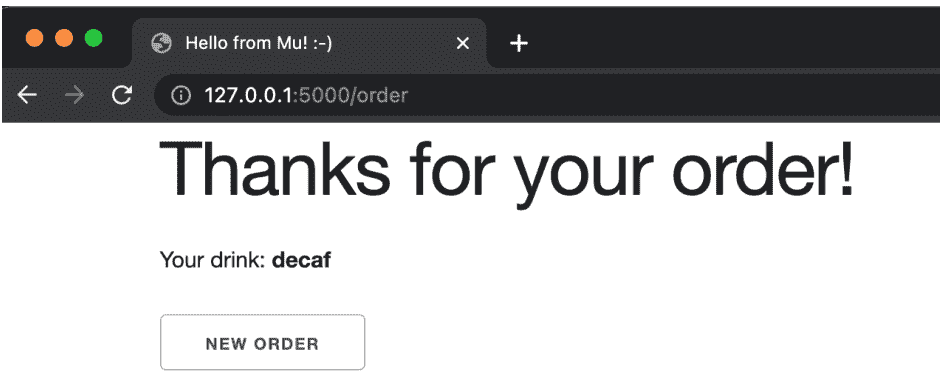

She clicked the button and got back to the order page.

Erik noted: "It’s like our main menu with a loop. Order, then confirm, then print, then back to the order menu."

"You are right!" Simon confirmed. "Let me show on a diagram."

"Look at the diagram. Step one: you choose Decaf from the menu. This assigns the value decaf to the variable drink in the form."

"Step two: that value decaf is passed to our Python program via request.form. Now the variable drink in the Python program has the value decaf."

"Step three: we pass the value of variable drink from Python—which is decaf--to the variable drink in the template print.html."

"Step four: we call render_template() with the variable drink which is replaced with its value, decaf. And now decaf is printed on the web page."

"Finally, step five: we click 'New order' and return to the order page."

## YOUR TURN   Change the print.html template

Add the 'New order' button to the templates/print.html template. Test it.
Can you return to the order page?

"Emily and Erik, you did a great job today," Simon said. "Most importantly, you didn’t fall asleep during all those long explanations."

"I almost did," Erik said.

"Yes, I noticed," Simon smiled. "But seriously, creating web applications is 10 times more difficult than working on text menus and dialogues. I admire your patience!"

"But it was worth it," Emily said. "The program works now!"

"We also need to add flavors and toppings," Erik said.

"Right!" Simon exclaimed. "We have to create all the menus but in the web form. I’m pretty sure Emily will help you with that."

"Sure," Emily said, "looks like we need to add more select forms to the template. Erik, will you show me your previous program? We can start working on the web application tomorrow."

"Of course," Erik said. "Let’s get together tomorrow and work on that."

"I’ll be happy to help," Simon said. "Please let me know when you start."

## New things you have learned today

- **Web mode in Mu Editor**
  In addition to the standard Python mode Mu editor also has a web mode. It has a simple web application example.
- **HTML Forms**
  This is a way to get information from users into a web application. We can have menus, text fields, buttons. When we click Submit, the form sends information to a special address configured in the `action` field. From that address the information can be processed by a program.
- **Flask**
  A program to help us create web applications. It is being developed by the Open Source community, it has good tutorials and examples. It is used by many online sites and web applications.

## Code for this chapter

You can find the code for this chapter here:
https://github.com/pavelanni/pythonicadventure-code/tree/main/ch10


