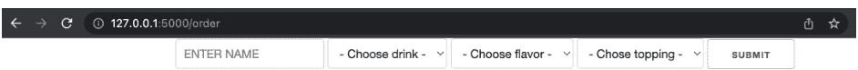
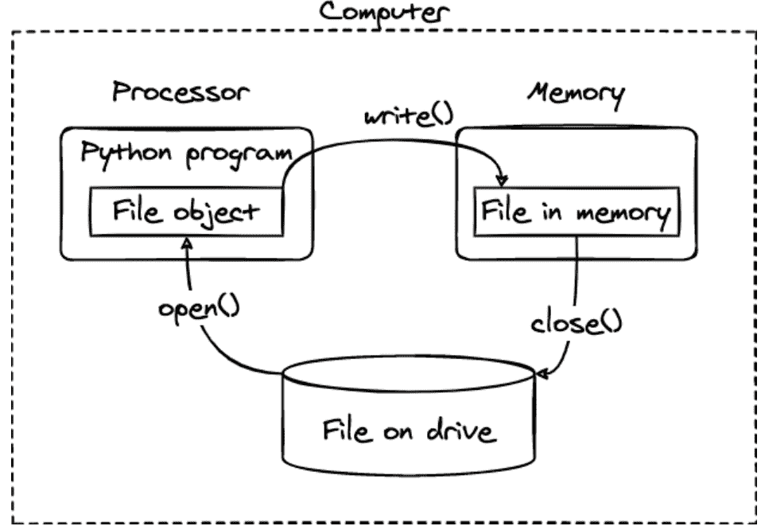
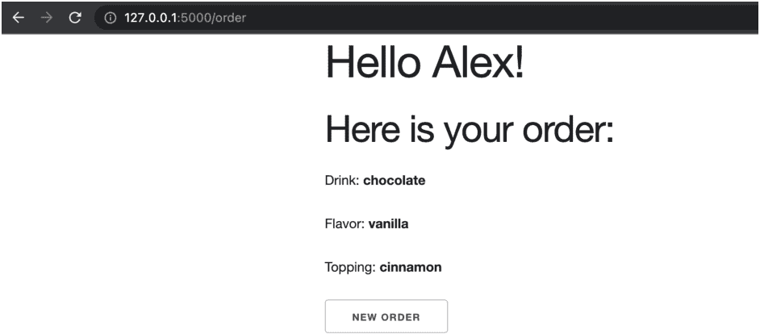

## 网上咖啡店的订单 Web 表单

第二天，Erik、Emily 和 Simon 聚在一起继续开发咖啡店应用。

“准备认真干了吗？” Simon 问。“今天我们要做真正的 Web 表单。昨天我们试了一个非常简单的菜单；现在我们要再添加两个菜单和一个输入顾客姓名的文本字段。让我们看看昨天的代码。我们已经在那里创建了一个菜单——<select> 和 </select> 标签之间的代码。而且这个菜单现在有两个选项：咖啡和低咖啡因。”

### Listing 11.1 First menu options in templates/forms.html

```



<form action="/order" method="post">
    <select name="drink">
        <option value="">-- Choose drink --</option>
        <option value="coffee">Coffee</option>
        <option value="decaf">Decaf</option>
    </select>
    <input type="submit" value="Submit">
</form>

```

- ① Menu option for coffee
- ② Menu option for decaf

“现在我们要在 drink 菜单中再添加一个选项——Erik，我记得你在那个菜单里有‘chocolate’，对吧？”

“是的，咖啡、巧克力、低咖啡因，” Erik 确认道。

“好。那口味和配料呢？”

“口味我们有焦糖、香草、薄荷、覆盆子，还有原味，” Erik 说。“配料我们有巧克力、肉桂和焦糖。”

“好吃，” Emily 说。

“这里有一个任务给你，” Simon 说。“首先，在‘drink’菜单中添加第三个选项。其次，为口味和配料再添加两个菜单。这需要一些复制、粘贴和打字。还要细心。谁在键盘前？”

“我，” Emily 说。“我可以做，我熟悉 HTML 和所有这些标签。”

“很好，开始吧！”

Emily 开始编辑文件。Erik 在旁边看着，时不时提问。

“你为什么把 <option> 行向右移动？HTML 关于缩进的规则和 Python 一样吗？”

“不，在 HTML 中你不需要缩进行，” Emily 回答。“我可以全部从第一位置写，但这样看起来更好。在我的课上老师说这对可读性有好处。”

“是的，Simon 也跟我说过，” Erik 说。“在 Python 中你必须使用缩进来表示代码块，但在某些情况下你可以自由选择将代码写在一行还是使用换行和缩进。Simon 说你应该写出可读的代码。至少，他说，是为了你自己。”

在 Erik 的帮助下，Emily 列出了口味和配料的所有选项，并创建了以下 HTML 模板。

### Listing 11.2 Additional menu options in templates/forms.html

```



<form action="/order" method="post">
    <select name="drink">
        <option value="">-- Choose drink --</option>
        <option value="coffee">Coffee</option>
        <option value="chocolate">Chocolate</option>
        <option value="decaf">Decaf</option>
    </select>
    <select name="flavor">
        <option value="">-- Choose flavor --</option>
        <option value="caramel">Caramel</option>
        <option value="vanilla">Vanilla</option>
        <option value="peppermint">Peppermint</option>
        <option value="raspberry">Raspberry</option>
        <option value="plain">Plain</option>
    </select>
    <select name="topping">
        <option value="">-- Choose topping --</option>
        <option value="chocolate">Chocolate</option>
        <option value="cinnamon">Cinnamon</option>
        <option value="caramel">Caramel</option>
    </select>

    <input type="submit" value="Submit">
</form>


```

### YOUR TURN Create your menus

Create the new menus in the file templates/forms.html. Feel free to use different options. Take some ideas from your local coffee shop or ice cream shop.

Simon 看了他们的代码，说：“看起来不错。但在我们从 HTML 切换到 Python 之前，让我们在表单中再添加一件东西。记得，我们还询问了顾客的姓名。”

“就像星巴克一样！” Emily 说。

“没错，” Simon 说。“让我在你的表单中再加一行。它叫做 input，类型是 text。我们将用它来输入姓名。你看，我把它加在了 form 行之后。”

### Listing 11.3 Text field to enter the name in templates/forms.html

```



<form action="/order" method="post">
    <input type="text" name="name" placeholder="ENTER NAME">
    <select name="drink">
        <option value="">-- Choose drink --</option>
        <option value="coffee">Coffee</option>
    ...
```

### YOUR TURN Add the input field

Add the input field for the customer's name. Don't forget to put a placeholder as a hint for the user.

“再看看 HTML 代码，” Simon 继续说。“Emily 添加的三个菜单和输入行都在开始标签 <form> 和结束标签 </form> 之间。Emily 为可读性很好地缩进了它们。

现在我们能清楚地看到它们都在表单内部。这意味着它们都是同一个表单的一部分。这意味着当你点击 Submit 时，它们会一起传递给程序。

在程序中，我们将能够使用 request.form 字典读取它们，就像我们在简单程序中所做的那样。”

“像 request.form['drink'] 这样吗？” Erik 问。

“是的，对，” Simon 回答。“看，Emily 给它们起了名字：‘flavor’ 和 ‘topping’，这样我们就可以在程序中使用它们作为字典的键。让我们再次打开 first_app.py 并看看我们需要在哪里做更改。还记得我们在这里做什么吗？我们获取表单字典并将键 drink 的值复制到变量 drink 中。例如，如果顾客选择‘chocolate’，那么它将被赋给变量 drink。而该变量将被传递给名为 print.html 的表单以在页面上显示——有时人们说渲染。”

### Listing 11.4 First version of order() in first_app.py

```
@app.route("/order", methods=("GET", "POST"))
def order():
    if request.method == "POST":
        drink = request.form["drink"]
        print("Drink: ", drink)
        return render_template("print.html", drink=drink)

    return render_template("forms.html")
```

Simon 继续说：“现在我们从表单获取更多值，我们应该收集它们全部并传递给模板。你能添加这些行吗，Erik？”

“我觉得可以，” Erik 说。当 Simon 说：“别忘了名字！”时，他添加了口味和配料的行，Erik 也添加了名字，他的代码现在看起来像这样。

### Listing 11.5 More menu options passed to the print template in first_app.py

```
. . . .
@app.route("/order", methods=("GET", "POST"))
def order():
    if request.method == "POST":
        name=request.form["name"]
        drink=request.form["drink"]
        flavor=request.form["flavor"]
        topping=request.form["topping"]
        return render_template("print.html",
            name=name,
            drink=drink,
            flavor=flavor,
            topping=topping)
    
    return render_template("forms.html")
```

### YOUR TURN Edit your Flask application

Edit your first_app.py script and add the variables like Erik did.

Don't run it yet because you don't have the print.html file.

“干得好，Erik！” Simon 说。“嗯，也许在测试之前说太早了…” 他笑了。

“现在只剩下一件小事，” Simon 继续说。“我们必须将这些变量添加到 print.html 模板中。让我们在编辑器中打开它。看：现在除了主要饮品之外，我们还要打印口味和配料。哦，别忘了我们现在知道顾客的名字了。礼貌地打印问候会更好。Emily，你能编辑这个 HTML 吗？”

“当然，” Emily 说并开始编辑，同时向 Erik 解释。

“首先，让我们把‘Thanks for your order’替换为‘Hello’和顾客的名字。我把它保留在这里作为 <h1>，以便使其加粗且大。”

“然后我们把‘Here is your order’放在 <h2> 中，”她继续说。“它会小一点。之后我们将打印订单：主要饮品、口味、配料，每个都在单独的段落中。我会继续使用 <strong> 标签将其加粗打印。当然，我会在底部保留表单，以便让我们返回订单页面。”


## Listing 11.6 Template to print the order in templates/print.html

```



<h1>Hello {{name}}!</h1>

<h2>Here is your order:</h2>

<p>Drink: <strong>{{drink}}</strong></p>
<p>Flavor: <strong>{{flavor}}</strong></p>
<p>Topping: <strong>{{topping}}</strong></p>

<form action="/order">
<input type="submit" value="New order" />
</form>

```

## YOUR TURN Create the templates/print.html template

Create the template for printing as Emily just did. Pay attention to the variables: you should use here the variables that you passed from the script. If you changed the preceding script and used different variables, change them here too. Try to run the application.

"Can we try it now?" Erik asked.

"Have you saved all your files?" Simon asked. "Look at your tabs in the editor. Mu shows them with a small red circle if you didn’t save them."

"Everything is fine," Erik said.

"Then switch to the Python tab and click Run."

Erik clicked and then clicked Browse. His browser opened a new tab with the familiar "Hello from Mu!" page. Erik added /order to the address line and saw the menu:



"Let me try it!" Emily said. She entered her name and chose Chocolate, Vanilla, Caramel. She clicked Submit and got her order printed:

## Hello Emily!

## Here is your order:

Drink: **chocolate**

Flavor: **vanilla**

Topping: **caramel**

"Wow, it works!" she was excited to see a real web application they just wrote together.

"This is great," Simon said. "Now we have to add the functions we wrote for the text version."

"What functions?" Emily was puzzled. She thought it’s done already. "Erik, can you explain?"

"What we have written here," he started, "is a user interface of our application. We did it before, but in a text mode. This web application looks so much better. But in addition to printing the order we also want to save it in a file. We may want to count how many orders we served with caramel, for example."

"I see, to know when to buy more caramel for the shop," Emily said.

"Exactly! You think like a shop manager, Emily!" Simon said.

He continued: "Just before you joined us we created a function to save the orders in a file. Our program saved the orders when you told it you want to finish. Next time you started the program it loaded all the previous orders into a list to add new orders to it."

Simon stopped for a while, thinking. "But with this new web application we have to do it slightly differently."

"Why?" Erik asked.

"Because our application is running all the time and we are not going to stop it. This kind of application is called a *web service*. It doesn’t stop, it runs all the time. Even more, if something happens to it and it crashes for some reason, another program restarts it to make sure it is always ready to respond to requests-- in our case, to accept orders."

"For us," he continued, "it means that we have to save each order right after we receive it. Let me quickly find the right way of doing it."

He opened a new tab in the browser and searched for a couple of minutes. "I know now," he said finally. "Erik let’s open our previous program and copy the functions `load_orders()` and `save_orders()` here in our web application."

"Where are we going to use them? In the `order()` function?" he asked Simon. "You told me last time that I should have them in the code *before* I use them, right?"

"Yes, absolutely right," Simon said. "Place them in the very beginning, even before the `Flask` line. That way we’ll separate our file functions from the web application functions. Also, don’t forget to add `import json` and `import os`, remember?"

Erik copied the functions from the `main_menu.py` script they worked on several days ago.

Simon checked his work and said: "Good. We just have to close the file after we load the orders. And, most importantly, after we save them."

"But we didn’t do it before. Why should we do it now? And what does 'close the file' mean exactly?" Erik asked.

Simon said: "We talked about that some time ago. Let me find the diagram. Emily, I think you want to know it too."

"Is it something like 'close the file' in Word?" Emily asked.

"Yes, but in this case we should do it from our Python program. It’s important to understand that until you close the file, Python keeps the orders in memory. If something happens to our computer and it shuts down, all orders will be lost. So we have to close the file to make sure the orders are all saved to the drive. Look at the diagram."



YOUR TURN Try to explain how files work
Use this diagram and try to explain to somebody how files work. Did you understand it better after you explained it?

> "We didn’t do it before because our program automatically closed all files when we finished it. In this web application we are going to close the file with orders every time we get a new order."

> "But you said it slows down the program," Erik said.

> "Yes, it does a little bit. But engineering is all about tradeoffs—this is what my robotics teacher keeps telling us. Our program is becoming more realistic so we should think about saving important data—even if it makes the program a bit slower."

Simon added the f.close() method in both functions so functions now looked like this:

## Listing 11.7 Functions to load and save orders in first_app.py

```
import os
import json

from flask import Flask, render_template, request

def save_orders(orders, filename):
    f = open(filename, "w")
    json.dump(orders, f, indent=4)
    f.close()
    return

def load_orders(filename):
    if os.path.exists(filename):
        f = open(filename, "r")
        orders = json.load(f)
        f.close()
        return orders
    else:
        orders = []
        return orders
. . . .
```

Simon added: "Of course, it would be better to use a database here. Maybe, we’ll add it later."

"Now we have to load the orders from the file," Simon said and added a line just before the Flask line.

## Listing 11.8 Create a list of orders using load_orders() in `first_app.py

```
. . . .
orders = load_orders("orders.json")

app = Flask(name)
. . . .
```

"Now we have a list of orders to which we’ll be adding new orders. That gives me one idea..." and Simon started typing explaining himself while doing it.

"We have a list where we keep orders. And it’s a list of Python dictionaries, right? So when we get the new order from the form, we’d better copy it to a dictionary, not to separate variables. And that dictionary we will append to the list and then save to the file. Even better: we can pass the dictionary to the HTML template to display it. It will simplify our program!"

He finished typing so the order() function now looked like this:

## Listing 11.9 Change to dictionary for a new order in first_app.py

```
@app.route("/order", methods=("GET", "POST"))
def order():
    if request.method == "POST":
        new_order = {"name": request.form["name"],
                     "drink": request.form["drink"],
                     "flavor": request.form["flavor"],
                     "topping": request.form["topping"]
                    }
        orders.append(new_order)
        save_orders(orders, "orders.json")
        return render_template(
            "print.html", new_order=new_order
        )

    return render_template("forms.html")
```

- 1. Create a new dictionary from the form.
- 2. Append the new order to the list.
- 3. Save the list in the JSON file.
- 4. Pass the dictionary to the template.

## YOUR TURN Edit the application

Use the three code fragments above and edit your first_app.py script. Make sure you understand what’s happening when you create a new order and pass it to the template.

"Finally we have to change the HTML template," Simon said. "Emily, would you help me?"

"Sure, but I don’t know what to do," she answered.

"Look, we used to pass variables to the template to display them on the page: name, flavor, and others. Now, instead of four variables we pass just one—the new_order dictionary—that contains all four of them. It’s called a dictionary in Python. You give it a key and it returns the value. For example, you give it 'flavor' and it return 'caramel'."

"Yes, Erik explained about dictionaries in Python already. But how can use them in HTML?"

"Exactly the same way as we do it in Python: with square brackets! Let me show us," Simon said and replaced name with new_order["name"] in the 'Hello' line.

"I see it now," Emily said and started changing the other variables. This is the print.html template after she finished.


## Listing 11.10 Using dictionary in templates/print.html

```



<h1>Hello {{new_order["name"] }}!</h1>

<h2>Here is your order:</h2>

<p>Drink: <strong>{{ new_order["drink"] }}</strong></p>
<p>Flavor: <strong>{{ new_order["flavor"] }}</strong></p>
<p>Topping: <strong>{{ new_order["topping"] }}</strong></p>

<form action="/order">
<input type="submit" value="New order" />
</form>

```

**YOUR TURN**  Edit the `templates/print.html` file

Edit the print template and change from using variables to using the dictionary. Pay attention to the dictionary keys—if you changed them in the script you should change them here. Try to run the application now.

"Great!" Simon said. "Ready to test it?"

"Yes!" Erik said and opened the usual address http://127.0.0.1/order.

He entered: 'Alex', chose 'chocolate', 'vanilla', 'cinnamon' and got the order:



"Now we have to check if it saved this order to the file," Simon said.

He found the orders.json file in the mu_code folder and opened it with a TextEdit application. "Yes!" he said. "Our program saved it in the file! Look—the first order is from the day when we tested the save_order() function the other day. But the second order is what you just added. Very good!"

```
[
  {
    "name": "Erik",
    "drink": "coffee",
    "flavor": "caramel",
    "topping": "chocolate"
  },
  {
    "name": "Alex",
    "drink": "chocolate",
    "flavor": "vanilla",
    "topping": "cinnamon"
  }
]
```

"But what about the menu files?" Erik asked.

"What menu files?"

"Remember," Erik explained, "you told me that the shop manager might not know Python. So we created our menus in plain text files. Now our menu is in HTML, but I think the shop manager might not know HTML either. Can we do the same with this web application and let the shop manager edit text files instead of HTML if they want to add something to the menu?"

"Great idea, Erik!" Simon answered. "I think it’s possible with HTML templates, but I have to check the Flask documentation. We have done a lot today, let’s take a rest and start working on that tomorrow."

## New things you have learned today

+   - **Web service**
+     Web service is a program that runs constantly and responds to requests like a new order in the coffee shop.
+   - **Why it is important to close files**
+     When you work with files, Python keeps the updates in memory. If you want to make sure your data is saved on a permanent drive you should call f.close().

## Code for this chapter

You can find the code for this chapter here:
https://github.com/pavelanni/pythonicadventure-code/tree/main/ch11
