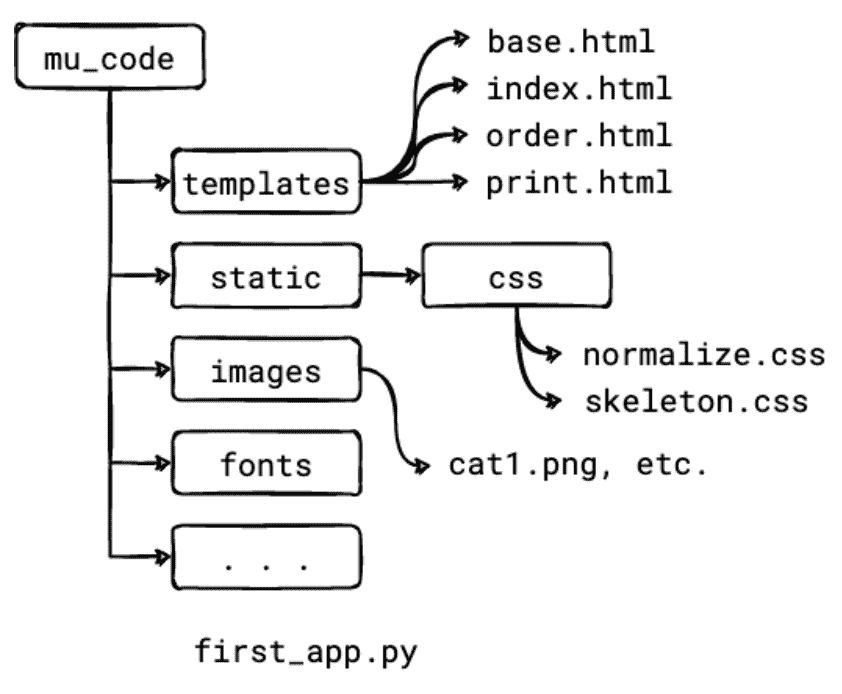
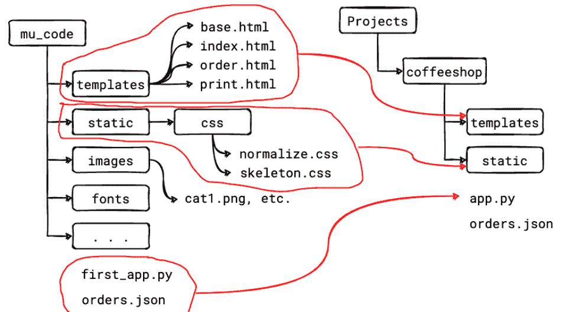
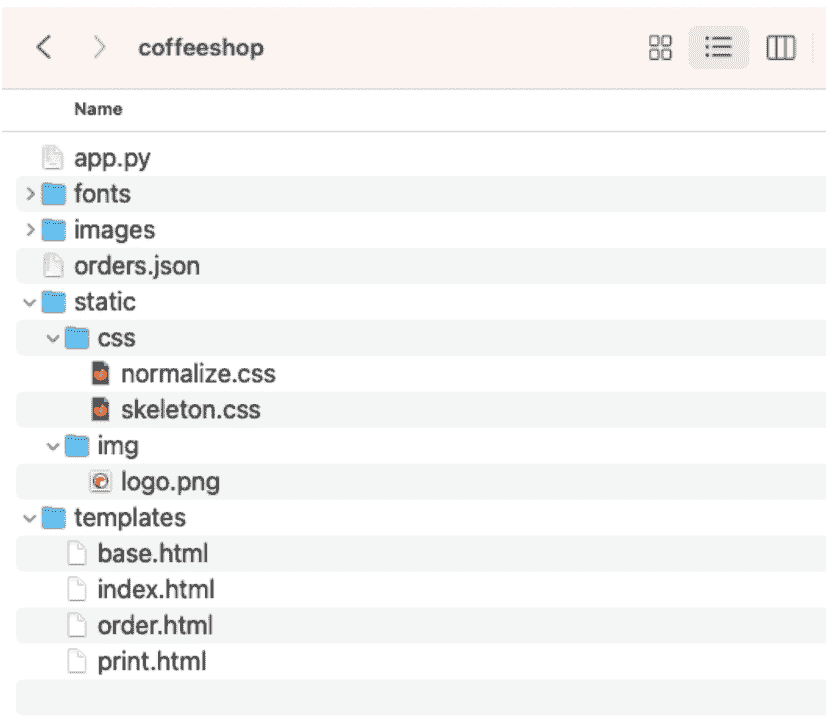
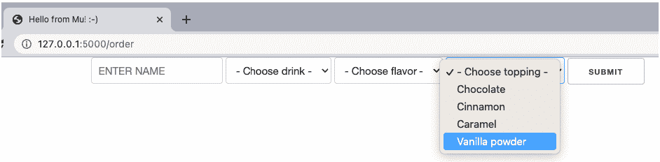
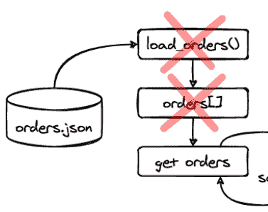
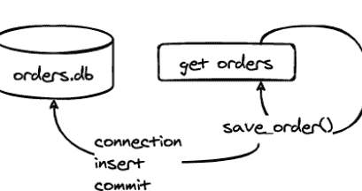
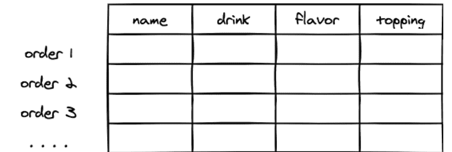
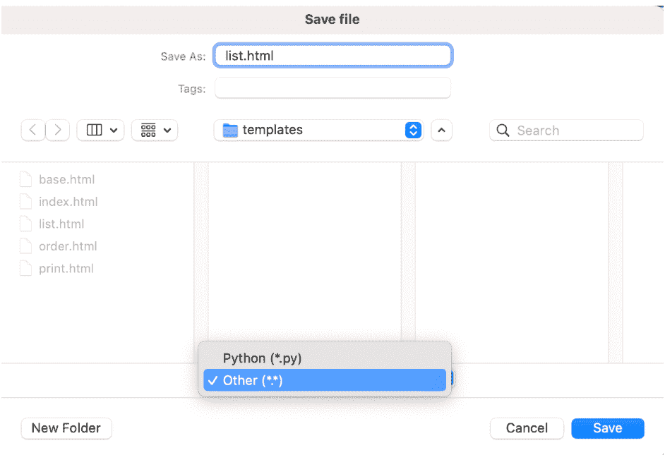
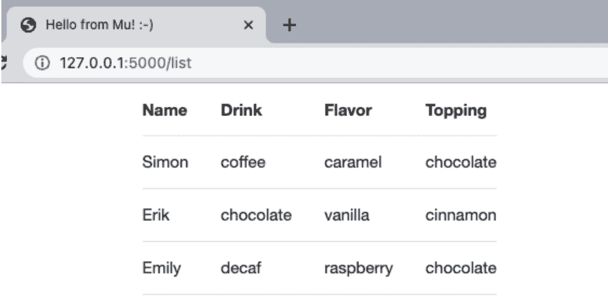

## Database: we need a good storage

## In this chapter

+   - Simon proposes a separate folder for the application
+   - Erik and Emily move the application files to the new folder structure
+   - Erik reuses the functions for reading menus from text files
+   - Erik and Emily learn about databases
+   - Simon helps Emily and Erik change the application to use a database

"Let's make our project a bit more serious," Simon said when the friends met next time.

"Yesterday you said something about a database," Erik asked. "Is that what you mean?"

"Yes, that too," Simon answered. "But first, I suggest we make changes in our folder structure. Let's organize our files. Look at our files and folders."

He took a piece of paper and started drawing and explaining.

"When we started with Mu Editor it placed all our programs in its default folder which is `mu_code`. Then we discovered that it also has all necessary templates for web applications under the `templates` folder inside `mu_code`. If you look at it in the file manager—Finder on macOS or Explorer on Windows—you'll see that it also has more folders, such as `static`, `images`, `fonts`, and others. Remember, we already created a couple of templates ourselves: `order.html` and `print.html` and placed them under `templates`. If you look into the `static` folder you'll find the `css` folder—I think you, Emily, know that it's for style sheets—and there are a couple of files there."



first_app.py
orders.json

> "You see, our application now has several files in different folders. I suggest we create our own folder for the coffee shop application and copy all files we need into that folder. That will also help us to separate our web-based coffee shop application from our previous version. It’s always a good practice to keep your different projects in separate folders."

Simon continued: "Let’s create a folder for all our projects—I mean, including future projects. Usually I name it Projects, similar to Downloads, Pictures, and Documents that we already have. Under Projects create another folder and call it coffeeshop. We will copy all files related to our web-based coffee shop project to it." "I also suggest renaming our first_app.py to just app.py. That’s how people usually call their Flask applications." Let me show you what I mean," and he added another diagram to the one he created before.



"Do you know how to do it?" Simon asked Emily and Erik.

"Yes," Emily said, and they started working on creating folders and moving files.

After a while they showed Simon their coffee shop project folder.

"Does this look good?" Erik asked.



## YOUR TURN Create your application folder

Create a folder for your projects (you can use the name Projects or some other name). Create another folder for your application. Call it according to your application—it could be icecream or pizzaplace. Move the files related to the web application from mu_code to this new folder.

"Let me see," Simon said, looking at their folder. "You copied your static directory with all its content, your templates directory, good. Even fonts and images--we don’t use them now, but that’s okay."

"I have a question," Erik said. "Why do you sometimes say 'directories' and sometimes 'folders'? I guess they mean the same, right?"

"I’m sorry, I don’t follow strict terminology," Simon smiled. "You are right, these two words mean the same: something that holds files. It is used to organize files that belong to a certain project, like 'coffeeshop'. Or for the files of a certain type, like 'templates'. Historically in Unix and Linux systems they are called directories. macOS is based on Unix; in my robotics club we use Linux so I’m used to call them directories. In Windows people call them folders—it’s exactly the same thing. Just get used to different terms, it’s not a big deal."

"Also yesterday you said that we can keep our menus in text files, like we did in our previous version," Erik said. "For the shop manager who doesn’t know HTML, remember?"

"Thanks for reminding me, Erik," Simon said. "I am going to show you how to work with a database today. But it’s a serious subject. Let’s warm up with these menu files first. Can you copy them to your new directory from mu_code?" "Yes, just a second," Erik said and copied the files drinks.txt, flavors.txt, toppings.txt to the coffeeshop project folder.

YOUR TURN   Copy the menu files

Copy the menu files to the new folder that you just created.

"Now take a look at our old program and see how we worked with these files," Simon said. "Open the file menu_files.py and refresh your memory. Try to explain it to Emily—that’s the best way to understand something better."

"Yes, I’d love to learn what you did with this program before," Emily said.

Erik looked at the code and started explaining, "We created a function called read_menu() that would read a text file with drinks, or flavors, or toppings, and create a list of menu choices. We passed that list to the menu() function. The menu() function printed the list and asked the customer to choose the drink, then the flavor, then the topping. After all that, we printed the order."

## Listing 12.1 menu_files.py: Read menu items from files

```
def read_menu(filename):
    f = open(filename)
    temp = f.readlines()
    result = []
    for item in temp:
        new_item = item.strip()
        result.append(new_item)

    return result

drinks = read_menu("drinks.txt")
flavors = read_menu("flavors.txt")
toppings = read_menu("toppings.txt")

drink = menu(drinks)
flavor = menu(flavors, "Erik's flavors", "Choose your flavor: ")
topping = menu(toppings, "Erik's toppings", "Choose your topping: ")

print("Here is your order: ")
print("Main product: ", drink)
print("Flavor: ", flavor)
print("Topping: ", topping)
print("Thanks for your order!")
```

"I see," Emily said. "What is a list? Is it like an array in JavaScript?"

"Yes, exactly," Simon confirmed. "It’s the same thing: a collection of items placed in order. It’s


called different names in different programming languages, but it’s the same thing. The most important thing it is that you can pick items by their position in the list: like item number three or item number five. These numbers are called *indexes* of the list."

"Can we use this function again?" Erik asked.

"Of course!" Simon said. "This is what functions are created for—to reuse them! Let’s copy this `read_menu()` function to our new `app.py` file. Place it right after the `load_orders()` function. Also copy the three function calls that go right after the function. We need to create these lists here too."

Erik copied the `read_menu()` function text and the three lines after it from `menu_files.py` to `app.py` in the `coffeeshop` directory.

"Now we have the lists of menu choices from these three files: `drinks.txt`, `flavors.txt`, and `toppings.txt`. We have to display the choices on our order page. The good thing is that our `order.html` file is not a plain HTML, but a *template*. We can use *variables* to the template and pass the *values* that we want to display. Remember, we did it in the `print.html` template when we passed the `new_order` dictionary. Let me remind you. Here is the Python code for that:"

## Listing 12.2 app.py: Pass the dictionary to the template

```
. . .
    return render_template(
        "print.html", new_order=new_order
    )
. . .
```

"And here is the template that uses the `new_order` dictionary:"

## Listing 12.3 order.html: Use the dictionary in the template

```
. . .
<h2>Here is your order:</h2>

<p>Drink: <strong>{{ new_order["drink"] }}</strong></p>
<p>Flavor: <strong>{{ new_order["flavor"] }}</strong></p>
<p>Topping: <strong>{{ new_order["topping"] }}</strong></p>
. . .
```

"Now we should use the `order.html` template and pass the lists with choices to it. In the template we will use them to build the menus. Find the function call `render_template()` that uses the `order.html` template and pass these three lists the same way you passed the `new_order` dictionary a couple lines above."

Erik found that line (it was the last line of the program) and changed it to this:

## Listing 12.4 app.py: Pass menu lists to the template

```
return render_template("order.html", drinks=drinks, flavors=flavors, toppings=toppings)
```

"Good," Simon said. "Now after we passed the lists to the template we have to change the template. Emily, you’ll be surprised. It won’t look like plain HTML. We will use *loops* in the template."

"Like in Python?" Erik said.

"Yes, they look and work very similar," Simon said. "Instead of printing the options in our `select` menu as strings, we will take them from the list. You will see that our loops will look like `for d in drinks`—very similar to what you did in your `menu()` function. I think it’s because the template language was created by the same person who created Flask: his name is Armin Ronacher. So it’s very close to Python, as you can imagine. The template language, by the way, is called *Jinja*—yes, like ninja."

"Let me help you with this `order.html` template," Simon continued. "I collected some examples, so I’ll use them here."

"So you don’t know *everything* yourself?" Erik winked at his brother.

"Of course, not," Simon answered very seriously. "I am learning myself. When I need something I search the Internet for examples and documentation and use them. Luckily, Flask and Jinja documentation is well written and very helpful. Also, there are plenty of examples and tutorials that people share."

Simon changed the `templates/order.html` file to the following.

## Listing 12.5 order.html: Use menu lists to display menu items in the template

```
<form action="/order" method="post">
    <input type="text" name="name" placeholder="ENTER NAME">
    <select name="drink">
        <option value="">-- Choose drink --</option>
        
        <option value="{{ d }}">{{ d | capitalize }}</option>
        
    </select>
    <select name="flavor">
        <option value="">-- Choose flavor --</option>
        
        <option value="{{ f }}">{{ f | capitalize }}</option>
        
    </select>
    <select name="topping">
        <option value="">-- Choose topping --</option>
        
        <option value="{{ t }}">{{ t | capitalize }}</option>
        
    </select>
    <input type="submit" value="Submit">
</form>
```

### YOUR TURN   Change order.html
Change your templates/order.html the same way. Be very careful when copying the text—note that we use double curly braces in templates. Don’t forget all the dashes and percent signs.

They tested the page and it worked the same way as before. Simon suggested, "Emily, try to add something to one of the menu text files and let’s see if the page is updated."

Emily opened the toppings.txt file and added vanilla powder at the end of the file. She saved the file and restarted the application. Indeed, they saw the new topping item in the menu.



### YOUR TURN   Test your page
Test your page with again. Does it look the same as before? Add a new item to one of the files with a text editor. Test the menus again and check if the new item is displayed.

"Simon, I see," she said, "that you added that `capitalize` word in the template and now it shows **Vanilla powder** with capital V. Pretty cool!"

"Yes," Simon said, "there are a lot of interesting things you can do with templates. It’s just one of them. We can use something else later, if you want. But now we are going to learn about databases!"

"Why do we need databases?" Simon started his explanation. "We used a JSON file to store our orders and it worked pretty well, right? But imagine we want to find in our list of orders all orders with vanilla flavor, for example. Or all orders from all customers whose name is Alex. Or answer a question if we used more peppermint flavor in this month than in the previous one. Of course, we can write such functions ourselves, right? But it turns out that questions like these are so common that many years ago people started creating special programs that not only store our data like orders and customers, but also can answer such questions. Usually these questions are called *queries* in the database world. Many years ago, smart people created a language called *Structured Query Language*, or *SQL* for short. People usually pronounce it *sequel*."

"We are not going to learn SQL today," Simon continued, "but the reason I’m telling you this is that we are going to use a database called SQLite—call it *sequelight* if you want."

"Are we going to use the database instead of a JSON file to load and store orders?" Erik asked.

"Yes," Simon answered, "but we don’t have to load orders anymore. Remember, we had to load orders into a list to be able to add a new order to that list and to save that list in a JSON file when we are done? Now the database will keep all our orders in its own file. The database knows how to add a new record to the list of orders, so we don’t have to worry about that."

"I like it," Erik said. "What should we do now?"

Simon started drawing a diagram.

"We will use a database file called `orders.db`. We don’t need the `load_orders()` function anymore," and he crossed it with a red marker.

"We don’t need the list of orders—the database will keep it for us. We will rewrite our `save_orders()` function. So we don’t have to save *all* orders in the file each time we have a new order. We will save just the new order in the database—all previous orders are already there. I suggest renaming it to `save_order()`. Look at the diagram and see the difference between our old way that used a JSON file and the new way with a database."

### With a file


### With a database


"Each time we want to save a new order we create a *connection* to the database. Then we issue a special command to *insert* our new order into the database. After that we call a special `commit()` function to make sure our order is saved in the database."

"It’s like what we did to the file," Erik said.

"Yes, pretty similar," Simon agreed. "The difference here is that now we talk to the database, not to the file. We work on a very simple program but what if we had more than one barista who accepts orders in our coffee shop? If several people start writing to the same file at the same time, it creates a lot of problems. When we work with a database, it takes care of that. Even better, if you learned how to work with SQLite using the SQL language, you can work with many other databases. They will understand SQL just fine."

"Enough theory, let’s write some code," Simon said. "First of all, we should create a *table* in our database. In our case the table is pretty simple: it contains the customer’s name and our usual options: drink, flavor, topping." He started editing the `app.py` file and explaining. "I added the `import sqlite3` line in the beginning. Then I removed the `orders = load_orders()` function call and the whole `load_orders()` function. Just before the `app = Flask()` line, I added three lines that make a connection to the database and create the table called `orders`."

## Listing 12.6 app.py: Connect to the database and create a table

```
. . . .
con = sqlite3.connect("orders.db")
cur = con.cursor()
cur.execute(
    "CREATE TABLE IF NOT EXISTS orders(name, drink, flavor, topping);"
)
app = Flask(name)
. . . .
```

### YOUR TURN
Add commands to connect to a database and create a table
Change your `app.py` and add the three lines like Simon did. Don’t forget to add `import sqlite3` at the very beginning of your `app.py` file.


“What is cur?” Emily asked.

“It’s called a cursor in the database world. Similar to your mouse cursor, it can point to a specific place in a database. We are not going to go too much into details. In this case I’m following the examples from the official Python documentation. The documentation says we need this cursor to execute SQL commands in the database. Look at the next line with cur.execute(). This is our first SQL instruction. It creates a table called orders with columns named name, drink, flavor, topping. In databases, tables are just normal tables with rows and columns. Each new order is a new row in the table. In each row we have four columns with names that I mentioned already. Easy, huh?” and he drew a simple table.



“Now let’s rewrite the save_orders() function. First, we rename it to save_order() because we are going to save just one order. Then we repeat the first two lines from those I just wrote: create a connection and create a cursor. After that we can execute the SQL command. In this case we use the INSERT command and pass the values from the order[] dictionary. Finally, we call the commit() function to save the new order in the database.”

## Listing 12.7 app.py: Add orders to the table

```
. . . .
from flask import Flask, render_template, request

def save_order(order):
    con = sqlite3.connect("orders.db")
    cur = con.cursor()
    cur.execute(
        "INSERT INTO orders(name,drink,flavor,topping) VALUES(?,?,?,?);",
        (order["name"], order["drink"], order["flavor"], order["topping"]),
    )
    con.commit()
    return
. . . .
```

YOUR TURN Create a save_order() function

Copy the save_order() function to your program. Pay attention to quotes, square brackets, commas, parentheses.

“I know, it looks complicated, but if you just read it it’s pretty easy to understand. You tell the database to INSERT some VALUES into the orders database. And then you list those values in parentheses. You are familiar already with dictionaries and you know how to pull a value for a certain key.”

“Why did you write some words in all caps?” Erik asked.

“It’s a convention in SQL. People use all caps for SQL commands and keywords, like INSERT and INTO. For variables, like the table name orders people use lower case letters. I tried using lower case for commands too and it worked. So it’s just a readability convention to separate SQL words from variables.”

“Let’s try it!” Emily said.

“Wait!” Simon said. “I almost forgot—we should remove the load_orders() call from the order() function. And we should rename the save function too.”

He edited the order() function so it looked like this:

## Listing 12.8 app.py: Remove load_orders()

```
@app.route("/order", methods=("GET", "POST"))
def order():
    if request.method == "POST":
        new_order = {"name": request.form["name"],
                      "drink": request.form["drink"],
                      "flavor": request.form["flavor"],
                      "topping": request.form["topping"]
                     }
        save_order(new_order)
        return render_template(
            "print.html", new_order=new_order
        )

    return render_template("order.html", drinks=drinks,
                            flavors=flavors, toppings=toppings)
```

YOUR TURN   Edit your order() function
Edit your order() function the same way Simon did. Don’t forget to change save_orders() (plural) to save_order() (singular).

He saved the file and said, "Ready now. Emily, run it! But let me fill the order, okay?"

Emily clicked Run, reloaded the order page, and Simon entered the menu choices.

## Hello Simon!

## Here is your order:

Drink: coffee

Flavor: caramel

Topping: chocolate

NEW ORDER

# YOUR TURN Test it

Test your program. Now it uses a database instead of a JSON file, but the interface should look the same.

“It works!” Simon said with a sigh of relief. He wasn’t sure himself that he did everything right and he didn’t want to show that.

“Can we check if the order is saved in the database, like we did with the JSON file?” Erik asked.

“Good question!” Simon said. “No, the database file is not a text file that you can read. But we can do better. We can create a new function that will show us all orders on the web page.”

“That would be great!” Erik said. “For example if a shop manager wants so see how many portions of caramel we have used today.”

“And also we can see what a particular customer likes to order,” Emily added.

“Great ideas,” Simon said. “Are you ready to work a little more? Then we’ll need three things. First, remember that to open the order page, we add /order to the site address. In Flask it’s called a route. We should create a function for a new route that we will use to list the orders. Let’s call this route /list. The function for this route will be also called list(). It’s very similar to the order() function. At the end of this list() function we will also call the render_template() function to display the list of orders.”

“Second,” he continued, “we’ll create a function that will talk to the database and return the list of orders to the list() function. Let’s call it get_orders().”

“And third, we should create a template to display the orders. Emily, did you learn how to create tables in HTML?”

“Tables? Yes, I can do it,” Emily said. “We should use the <table> tag to create a table, then the <tr> tag for each row, and the <td> tag for each cell in the row.”

“Great!” Simon said. “Then you create the template for our list() function. Erik, you write the functions, okay?”

“Sure,” Erik said. “Where should I start?”

“Right after the save_order() function. Create a function called get_orders(). Start with the same first line as in the save_order() function. Add one more line after it: con.row_factory = sqlite3.Row. It’s a special instruction that allows us to use column names when working with the result. Don’t worry about it now, you will see it later. Then create a cursor with the same line as before: cur = con.cursor(). Let me see your code.”

Erik showed what he wrote already:

## Listing 12.9 app.py: Start the get_orders() function

```
def get_orders():
    con = sqlite3.connect("orders.db")
    con.row_factory = sqlite3.Row
    cur = con.cursor()
```

“Good,” Simon said. “Now the important part: we have to get all orders from the table called orders. We use one of the most common SQL instructions, which tells the database: give me all rows and all columns from this table. It looks like this: SELECT * FROM orders;. The asterisk * means 'everything.' We should use this instruction with the same function cur.execute() that we used already in save_order(). After we execute the instruction, the results should be fetched from the database. You have to store the results in the list called rows using the function cur.fetchall(). And then you should return the list of rows from this function. Don’t worry, here is the documentation page where I’m getting it from. Use it as an example.”

Simon showed the tab he had open in the browser: https://docs.python.org/3.8/library/sqlite3.html

Erik started writing. After several minutes he showed his code to Simon.

## Listing 12.10 app.py: Complete the get_orders() function

```
def get_orders():
    con = sqlite3.connect("orders.db")
    con.row_factory = sqlite3.Row
    cur = con.cursor()
    cur.execute("SELECT * FROM orders;")
    rows = cur.fetchall()

    return rows
```

# YOUR TURN    Create the get_orders() function

Create the get_orders() function like Erik just did.

“Looks good to me,” Simon said. “We’ll see in the test. Now we have to add another function that handles the route /list. We should add it after the order() function that handles /order. Let me help you,” and he started writing the function at the end of the file. “First I specify the route we are going to handle using @app.route(). Then I define the function the usual way. The function itself is pretty simple: I just call get_orders() and pass the results to render_template(). As you remember, this function displays the data in the browser using the template we pass to it.”

## Listing 12.11 app.py: Create the list() function

```
@app.route("/list", methods=["GET"])
def list():
    orders = get_orders()

    return render_template("list.html", orders=orders)
```

# YOUR TURN    Create the list() function

Create the list() function like Erik just did.

“Why didn’t we get all the orders from the database right in this function?” Erik asked. “Why did you ask me to write a separate function?”

“Good question,” Simon said. “I am trying to separate functions that work with the user from functions that work with data. Sometimes people call it 'front-end' and 'back-end.' If we want to change how we work with data we will change the function get_orders(). For example, we want to be able to get not all the orders, but only the orders with caramel flavor. We will pass that request to the function and it will return the list of orders the same way as before. Our list() function will display whatever it gets from get_orders(). It doesn’t care if it’s the full list of orders, or a part of orders—it just displays them. On the other hand, the get_orders()


function 并不关心订单将如何显示。它只是返回订单列表。在计算机科学中，这通常被称为 *关注点分离*。我稍后会给你一篇关于此的维基百科文章阅读。"

> NOTE
> 这里是文章：https://en.wikipedia.org/wiki/Separation_of_concerns

“剩下的就是列表模板了，”Simon 说。“Emily，我们在编辑器里新建一个文件。删除 Mu 为我们创建的示例 Web 应用。保存到 `templates` 下，名字叫 `list.html`。别忘了把文件类型从 **Python (*.py)** 改为 **Other (*.*)**”。



“从我们在 `print.html` 模板中使用的相同模板行开始。第一行、第二行和最后一行应该相同，”Emily 复制了这三行：

## Listing 12.12 Empty HTML template file

```




```

“现在创建一个带有一行空行和空单元格的表格。我们每行有四个单元格。也有四个列标题。那将是第一行。你知道如何创建列标题吗？”Simon 问 Emily。

“是的，用 <th> 标签，”她回答并开始在 templates/list.html 文件中制作 HTML 表格。

“你可以先加上标题，”Simon 说。“会有 Name、Drink、Flavor 和 Topping。”

## Listing 12.13 Template templates/list.html with headers

```



<table>
    <tr>
        <th>Name</th>
        <th>Drink</th>
        <th>Flavor</th>
        <th>Topping</th>
    </tr>
    <tr>
        <td></td>
        <td></td>
        <td></td>
        <td></td>
    </tr>
</table>

```

“很好，”Simon 说。“现在让我加上循环。我们在这里使用与显示菜单时相同的 for 循环。记住，我们把名为 orders 的列表传递给这个模板。所以循环会遍历该列表，像这样：for o in orders。并且在每个 <td> 和 </td> 之间，我们会插入每个键的值：name、drink、flavor、topping，”Simon 将模板改为如下：

## Listing 12.14 Template templates/list.html with the for loop

```



<table>
    <tr>
        <th>Name</th>
        <th>Drink</th>
        <th>Flavor</th>
        <th>Topping</th>
    </tr>
    
    <tr>
        <td>{{ o['name'] }}</td>
        <td>{{ o['drink'] }}</td>
        <td>{{ o['flavor'] }}</td>
        <td>{{ o['topping'] }}</td>
    </tr>
    
</table>

```

### YOUR TURN   Create the list template
像 Emily 刚才那样创建 templates/list.html 文件。注意引号、方括号、双大括号。

“是时候试试 list 函数了！”Simon 在保存文件后说。“启动应用程序并输入两三个订单。”

Erik 启动了应用程序，打开了 127.0.0.1:5000/order 的标签页并输入了三个订单：为 Simon、为 Emily、为他自己。

“现在把地址中的 /order 路由改成 /list，”Simon 说。

Erik 这样做了，他们看到了这个：



“看起来很棒，”Emily 说。“对商店经理来说非常有用！”

“是的，我也喜欢，”Erik 说。“我觉得我们应该给行加上编号，这样可以看到我们服务了多少人。”

“好主意！”Simon 说。“你还可以加上日期和时间，看看每天服务了多少客户。这都是可能的，我们只需要更改数据库来保存这些信息。但我们稍后再做。明天我还有另一个想法。Emily，你懂 CSS 吗？”

“我们在课堂上学过一点，”Emily 回答。

“什么是 CSS？”Erik 问。

“它是一种改变浏览器中 HTML 页面外观的方式，”Emily 解释道。“我认为它代表 Cascading Style Sheets。”

“完全正确，”Simon 说。“让我们明天一起工作，用 CSS 让我们的网站看起来更好。”

## New things you have learned today

- **Folders and directories**
  在不同的操作系统中，人们对同一事物使用不同的术语：属于某个项目的文件集合，或某类或用途的文件集合。
- **Jinja templates**
  Jinja 模板由 Flask 用于创建 HTML 页面。你可以向模板传递变量、列表和字典，并在模板中使用它们，就像在 Python 中一样。你可以在模板中使用 `for` 循环，与 Python 类似。
- **Database**
  数据库是一个可以存储数据并对数据执行各种操作的程序。数据库可以使用特定标准搜索记录，汇总数据（如本月香草口味订单的数量）。
- **SQL**
  SQL 代表 Structured Query Language，用于与数据库协作。
- **Front-end and back-end**
  应用程序的前端部分与用户交互：显示页面，从键盘和菜单获取输入。后端部分与数据交互：从文件和数据库存储和检索数据。前端和后端部分用于在大型应用程序中实现关注点分离。

## Code for this chapter

你可以在这里找到本章的代码：
https://github.com/pavelanni/pythonicadventure-code/tree/main/ch12
