## Styles: Making it pretty

## In this chapter

- Erik and Emily 尝试样式、颜色和字体
- Erik and Emily 为商店创建一个新的主页
- Erik and Emily 为他们的页面添加图片

“让我们把它弄漂亮！”Simon 在朋友们下次见面时说。

“你是说——为我们的 HTML 文件使用样式？”Emily 问。“我们在 HTML 课上用过样式。你可以改变颜色、字体大小、背景。挺不错的！”

Simon 说：“是的，让我们谈谈样式！Emily，你能解释一下吗？”

“它叫 CSS。代表……”她停顿了一下，回想着。“代表 Cascading Style Sheets，对吧？”她看着 Simon。“但说实话，我不记得为什么……”

“你说得对！”Simon 说，“就是 Cascading Style Sheets！它们被称为样式表，因为它们只是描述样式的纯文本文件。样式指定 HTML 元素在页面上的外观方式。例如，你可以说你的 <H2> 标题应该有 36 像素的大小并且是红色的。或者它们应该使用特定字体。”

他继续说：“Web 设计的一个想法是分离内容和样式。当然，我可以在 HTML 文件中设置样式。但那样很不方便。如果你想更改字体大小或颜色，你必须浏览所有 HTML 文件并更改所有 <H2> 标题。相反，我们在单独的文件中定义样式，在那里我们说：所有 <H2> 标题都应使用这种颜色和大小。如果我们想更改它——我们只在一个地方更改。非常方便，对吧？”

“我明白了，”Erik 说。“就像 Python 中的函数。你写一次然后在其他地方使用它。”“是的，对！”Simon 说。“我喜欢你的类比！所以我们弄清楚了为什么它们被称为样式表，但为什么是 Cascading？对于你的网站或应用程序，你可以有多个样式表并将它们一个接一个地组合起来。人们经常使用别人创建的样式表，然后只添加或更改他们想要看起来不同的元素。这与函数又一个相似之处。”

他继续说：“在我们的项目中，我们将使用 Mu Editor 中包含的样式表，并稍作修改，使其更适合我们的咖啡店项目。看看你的订单页面，想想我们应该改变什么。”

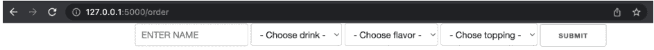

Erik 看着屏幕说：“我们需要一个标题。就像我们的终端应用程序一样：Welcome to Erik’s Coffee Shop！”

“等等！”Emily 说。“这不再只是你的咖啡店了。我认为它应该叫 Erik and Emily’s Coffee Shop。或者简称为 E&E Coffee Shop。同意吗？”

“我认为这现在是一个团队项目，E&E 是一个好名字，”Simon 说。

“是的，让我们把它做成 E&E Coffee Shop，”Erik 同意。

“让我加上它，”Emily 说并打开了 templates 文件夹中的 order.html 文件。她添加了标题，因此文件开头现在看起来像这样：

## Listing 13.1 templates/order.html: Add the shop title

```



<h1>Welcome to E&E Coffee Shop</h1>

<form action="/order" method="post">
    <input type="text" name="name" placeholder="ENTER NAME">
. . . .
```

Emily 保存了文件，切换到 Mu Editor 中的 app.py 标签并点击 Run。她打开浏览器标签页并再次输入 URL：http://127.0.0.1:5000/order。


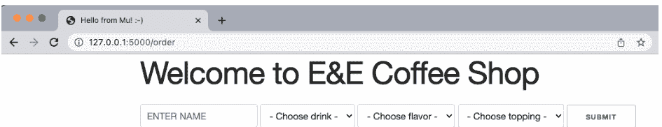

"Looks good!" Erik said.

"Simon, you said that we could change the font in the title," Emily said. "This one looks a bit... boring. I think we need something more fancy."

"I agree," Simon said. "Luckily, there are a lot of web fonts that we can use for free. Some fonts cost money, but for this project free fonts are just fine. For example, Google Fonts is a good resource."

He opened a new tab in the browser and typed the address: `fonts.google.com`. "As you can see, there are more than 1400 fonts to choose from. You can find fonts for different languages too. See this field that says 'Type something'? Enter your page title and you’ll see how it looks in different fonts."

"What about 'Categories'? What do they mean?" Emily asked.

"If you click this menu you’ll see Serif, Sans Serif, Display, Handwriting, Monospace. Monospace is used for program code usually. You can use Handwriting if you want to print a greeting card for a friend. Display means it is used only for computer displays and not for printing. Serif and Sans Serif sound strange, but they actually represent two classes of fonts you are very familiar with. Serif means that the font has small strokes at the ends of letters. Of course, you know *Times New Roman*, the default font for most programs and documents. Try to choose only Serif from the Categories menu and you’ll see what I mean."

"I like this Playfair Display!" Emily said.

"Good!" Simon said, "Take a note and we’ll get back to it. I just wanted to show you what Sans Serif fonts look like. Sans means 'without'; in this case it means the fonts don’t have those strokes I mentioned before. Most likely you’ve seen Arial from this category. Look here," and he changed the Category to Sans Serif.

"Fonts like these are used in menus, and other application interface details. Just look around and you’ll start noticing and recognizing these two font categories on the web, in applications, everywhere. If you want to learn more about fonts, open the Knowledge tab from this page: https://fonts.google.com/knowledge. It’s very interesting, believe me!"

## YOUR TURN   Learn more about Google Fonts
Open the fonts.google.com site and look around. Try to find interesting fonts, search for different categories. Note that you can sort the output in several different ways: Trending, Most popular, Newest, and so on. Open your favorite sites and try to figure out where they use Serif, Sans Serif, Monospace fonts.

"These fonts look nice, but I like that Playfair font. I think it will be good for our page title. Erik, what do you think?" Emily said.

"Yes, I like it too. It is not boring," Erik said. "And I like the way they made the & sign. Yes, it’s good for the title."

Simon switched back to the Serif category and clicked the Playfair Display font. The font page opened. Simon explained, "Here you can find information on how to use this font in your web page or app."

He scrolled the page until the title they used appeared just below the title 'Styles.' "Here you can select one of the font weights: as you can see, the same font, or I should better say typeface, can have different 'boldness.' I selected just one of them and that will give us the information we need. Notice a small red dot in the top-right corner. It means we have selected something for our collection and we should click it to open the instructions."

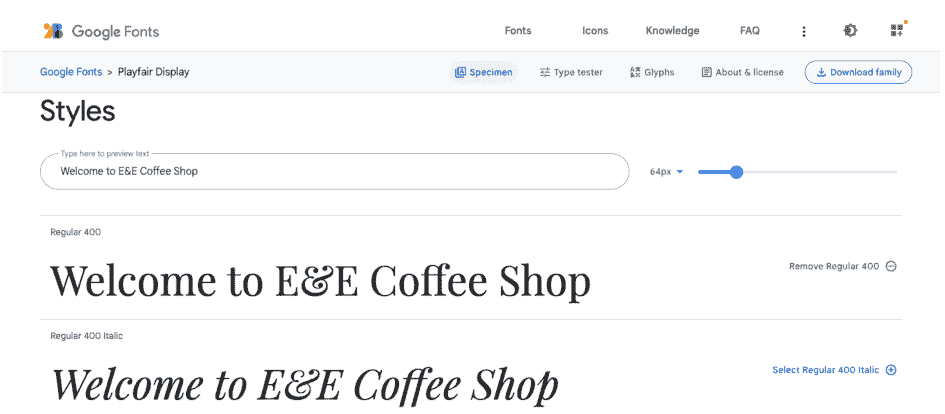

He clicked the icon with a red dot and it showed the instructions they needed.

him by the constitution or by law.

## Styles

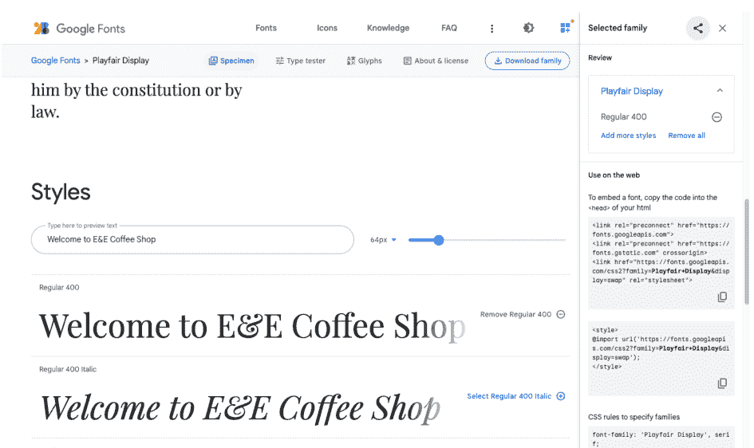

> "Looks at the block on the right, under Use on the web. Google gives us very good instructions on how to use this font. We just have to copy these lines into our files. Out of the first two pieces of code, it recommends using the first one, with <link>. The third piece of code called 'CSS rules to specify families' demonstrates how to use this font in our CSS files. It may look complicated, but don’t worry, I’ll help you."

> "A good thing in Flask is that we use templates," Simon continued. "Look at your order.html: you’ll see that it starts with . Your print.html also starts with this line. It means that reuse base.html in our templates. We don’t have to change every file in our project—we just change base.html. Yes, Erik, similar to functions again," and Simon smiled.

"Emily, would you please open the base.html file in the templates directory?"

When Emily opened the file, Simon told her: "Look at the page with instructions. Copy the three lines that start with <link> from the gray box. Then paste them in base.html just before the closing tag </head>."

Emily copied the line in the HTML file and now it looks like this (we show just a part of it):

### Listing 13.2 templates/base.html: Add the font
```
. . . .
<meta name="viewport" content="width=device-width, initial-scale=1">
<link rel="preconnect" href="https://fonts.googleapis.com">
<link rel="preconnect" href="https://fonts.gstatic.com" crossorigin>
<link href="https://fonts.googleapis.com/css2?family=Playfair+Display&display=swap" rel="stylesheet">
</head>
<body>
. . . .
```

## YOUR TURN    Add the font link to base.html
Open the templates/base.html file in the editor and make the changes Emily just did.

"Good. That was Step 1," Simon said. "Step 2 is to create our own style sheet. Click New in the editor. It creates an example web application, but we don’t need it now. Remove all the text in it and click Save. You should save it in the same directory where other CSS files are stored. It’s under static/css. Name the file coffeeshop.css. Don’t forget to change the file extension from Python (*.py) to Other (*.*)."

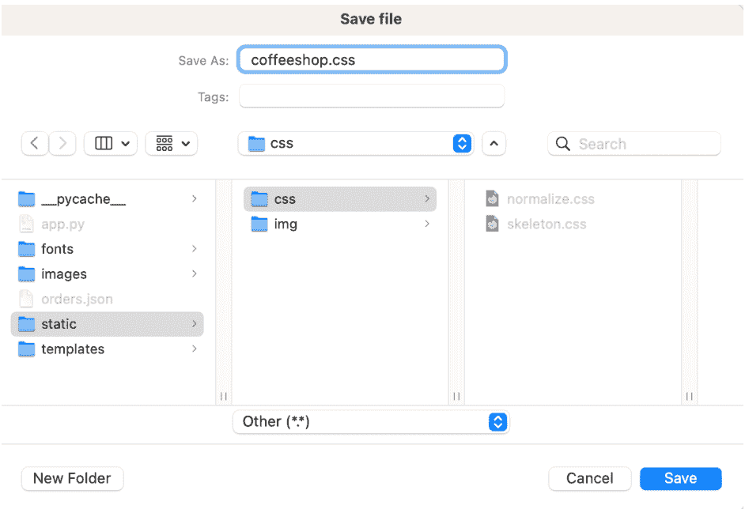

Simon checked that the coffeeshop.css appeared next to the other CSS files. "Good," he said. "Now we can add the font specification to the h1 header.

Look at the third gray box on the font page in the browser. Select and copy the text from there. Now type h1 { and paste what you copied after the opening curly brace. Then add the closing curly brace and save the file."

That was easy. Emily edited the coffeeshop.css file so it looked like this:

### Listing 13.3 static/css/coffeeshop.css: Add font to CSS
```
h1 {font-family: 'Playfair Display', serif;}
```

## YOUR TURN Create coffeeshop.css
Create the static/css/coffeeshop.css file in the editor and add the line for the h1 style.

"Great!" Simon said. "Now we have our own CSS file. We just have to tell Flask that we want to use it. This is Step 3. I guess you still have base.html open in the editor, Emily? Find the two lines with the word stylesheet. You will recognize the names."

"Yes, I see them!" Emily said. "They are called normalize.css and skeleton.css, the same names I saw when I saved our style sheet!"

"Good, now copy the line with skeleton.css and paste it right after itself. You should have two lines that are exactly the same. Now in the second of them change skeleton to coffeeshop."

Emily did and now the base.html file looked like this:

### Listing 13.4 templates/base.html: Add CSS file to base.html
```
. . . .
<!-- CSS
-------------------------------------------------- -->
<link rel="stylesheet" href="/static/css/normalize.css">
<link rel="stylesheet" href="/static/css/skeleton.css">
<link rel="stylesheet" href="/static/css/coffeeshop.css">
. . . .
```

## YOUR TURN Add coffeeshop.css style sheet to base.html
Open the templates/base.html file in the editor and make the changes Emily just did.

"And now you can see why these style sheets are called cascading. We have three style sheets now. The first one called normalize.css is needed to make sure our web site will look good on all kinds of browsers on different devices."

"Even on my iPad?" Erik asked.

"Yes, it should," Simon answered. "We’ll test it later."

He continued, "The other CSS file is called skeleton.css. It was included with Mu Editor and provides good-looking styles for all HTML elements. We don’t have to create styles for single element—they look good already. Only if we want to change something, like the font family for headers, we add this style to our own CSS file. The styles are applied one after another, in the order the CSS files are listed in the HTML file. That’s why they are called cascading."

> NOTE Read more about normalize.css here: https://nicolasgallagher.com/about-normalize-css/. The skeleton.css style sheet is described here: http://getskeleton.com/.

"Enough theory, let’s take a look at our we site!" Simon said.

Emily and Erik checked again if they saved all the files, switched to the app.py tab and clicked Run. They opened the browser tab with the familiar address http://127.0.0.1:5000/order and saw the updated page.

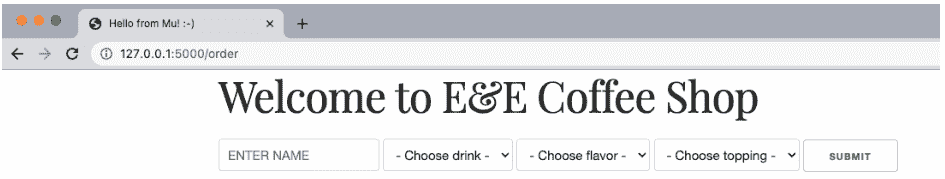

"Wow! I love it!" Erik exclaimed.

"Now you know how to change any font on your web page," Simon said.

"But why does it say 'Hello from Mu!'?" Erik noticed. "Shouldn’t it be 'Hello from E&E'?"

"Good point!" Simon said. "It’s pretty easy to change. Find this phrase in the base.html file and and change it. It should be very close to the beginning, enclosed in the <title> tags."

Erik quickly found the phrase and changed it. "Should I restart the Python application?" he asked Simon.

"No, you can just reload the page in your browser and you’ll see the change."

Indeed, the page now showed:


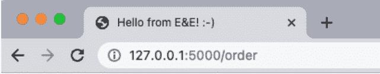

Emily 说：“我们也可以改变背景颜色。我觉得我们需要一种看起来像咖啡或卡布奇诺的颜色。”

“好主意！” Simon 说。“首先，你要找到一个你们都喜欢的好颜色。最简单的方法是打开一个 Google 搜索页面并输入 color picker。”

Simon 就这样做了来演示，他们看到了这个：

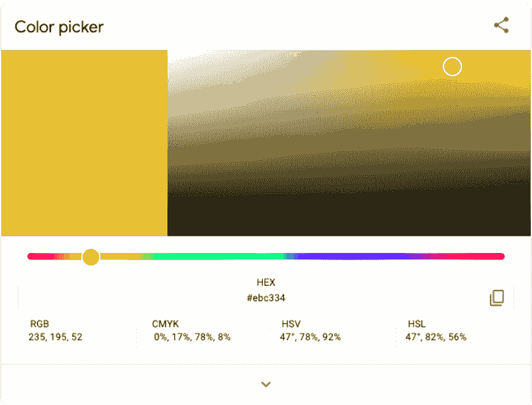

“你可以使用彩虹线来选择基础颜色，然后使用白色圆圈来挑选你喜欢的色调。”

“还有很多其他网站可以帮助你挑选颜色组合。它是一个完整的世界，就像字体一样。有很多东西可以学习。例如，”他选择了页面上的第一个搜索结果之一：https://htmlcolorcodes.com/color-picker/。 “你也试试，你会发现关于颜色以及如何在网页上使用它们的很多有用信息。”

Erik 和 Emily 花了几分钟在该页面的 Color Picker 上玩耍，最后得出了这个：

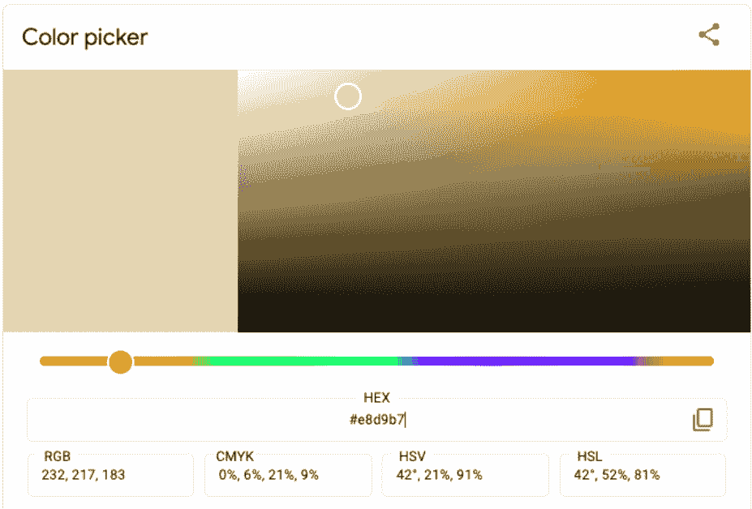

# YOUR TURN  Play with Color picker

在 Google 中找到 Color picker 并试用它。弄清楚如何更改基础颜色，然后如何更改其明暗程度。找到你喜欢的背景颜色。

“好，” Simon 说。“现在复制 HEX 下面的这六个字母和数字，让我们编辑 coffeeshop.css 文件。谁来输入这次？”

“我来，” Erik 说。

“输入这个：body {background-color: 然后粘贴你从颜色选择器中复制的内容。确保你包含了井号（#）。然后输入分号并关闭大括号。”

Erik 添加了该行，现在 CSS 文件看起来像这样：

# Listing 13.5 static/css/coffeeshop.css: Add background color to CSS

```
h1 {font-family: 'Playfair Display', serif;}

body {background-color: #e8d9b7;}
```

# YOUR TURN Change your page background

编辑 static/css/coffeeshop.css 文件并添加带有你选择的背景颜色的 body 行。

他重新加载了订单页面，现在它看起来大不相同：

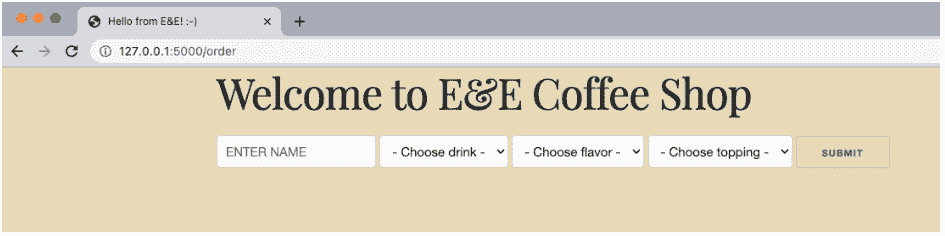

“我越来越喜欢了，” Emily 说。“我们可以让这些菜单也变成同样的咖啡颜色吗？”

“可以，当然，” Simon 回答道。“但我建议让它们的色调稍微浅一点，不要完全相同。继续找一个吧。”

这甚至更容易。Emily 和 Erik 最终为菜单选择了这种色调：

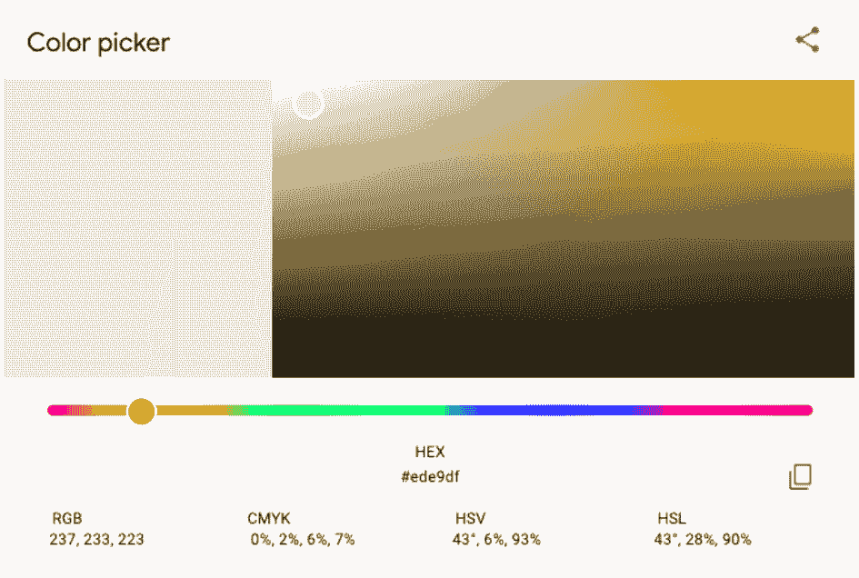

“非常好。现在让我帮你把它添加到样式表中，” Simon 说。“我们应该将这种颜色应用到我们表单的元素上。菜单元素称为 select。输入客户姓名的输入字段称为 input[type="text"]。让我们将它们添加到样式表中并使用你选择了的背景颜色。

# Listing 13.6 static/css/coffeeshop.css: Change the menu color

```
input[type="text"], select {background-color: #ede9df;}
```

“这些数字和字母是什么？它们是什么意思？” Erik 问。

“它们的意思是你可以用这六个数字和字母描述你想要的任何颜色，” Emily 解释道。“六由三对组成。三对分别对应三种颜色：红、绿、蓝。每对表示该颜色在我们选择的颜色中占多少。就像调漆一样：你可以混合红色和蓝色得到紫色。每对符号是一个数字，但它是十六进制的，可以是数字或从 'a' 到 'f' 的字母。我只是不记得为什么它叫 'hex'。”

“我可以帮你，Emily，” Simon 说。“Hex 是 hexadecimal 的缩写，意思是希腊语中的‘十六’。它是一种表示数字的方式，与我们通常的方式类似，但更短，更易于计算机理解。在我们通常称为‘十进制’的系统中，我们有 0 到 9 的数字，共 10 个数字。用一个数字我们可以描述 0 到 9 的数字。用两个数字我们可以描述 0 到 99 的数字。十六进制系统类似，但不是 10 个数字而是有 16 个数字。它们从 0 到 f：我们添加了从 'a' 到 'f' 的字母并将它们用作数字。所以，‘数字’‘a’表示 10，‘b’表示 11，以此类推。数字‘f’表示 15。所以用一个十六进制数字我们可以描述 0 到 15 的数字；用两个，从 0 到 255。而且更短：255 在十进制系统中需要三个数字，但在十六进制中它只是 'ff'。”

“回到颜色，” Simon 继续说，“正如 Emily 所说，每个 6 位十六进制数字告诉我们这种特定颜色中红、绿、蓝各有多少。例如，你菜单的颜色 #ede9df 意味着 ed 的红色、e9 的绿色和 df 的蓝色混合。在我们更习惯的十进制数字中，这意味着，” Simon 查看了 Color Picker 页面并从中读出了数字，“它意味着 237 的红色、233 的绿色和 223 的蓝色。数字可以达到 255。如果三个都变成 255 那就是纯白色。”

“如果三个都是零那就意味着黑色，” Emily 补充道。

“完全正确，” Simon 确认道。“如果你想了解更多关于网页颜色的信息，请阅读关于它们的维基百科文章，”他迅速找到了该页面并在新标签页中打开了它：https://en.wikipedia.org/wiki/Web_colors

“我想从我们的新设计中点点东西，” Emily 说并输入了她的订单。她点击了提交并看到了这个页面：

## Hello Emily!

## Here is your order:

Drink: coffee

Flavor: peppermint

Topping: caramel

NEW ORDER

“为什么第二行没有用我们的字体打印？”她不太满意。

“也许是因为我们只为 H1 设置了字体？” Erik 建议道。

“你是对的，Erik，” Simon 说。“这很容易修复。打开 skeleton.css 文件并查看样式是如何在那里定义的。我们可以通过查看其他人样式表中的做法学到很多东西。继续找到名为‘Typography’的部分。你会看到如何设置其他标题级别的样式。”

Erik 打开了 skeleton.css，滚动到‘Typography’，看到了这个：

# Listing 13.7 static/css/skeleton.css Find Typography in skeleton.css

```
/* Typography
------------------------------------------------------------ */
h1, h2, h3, h4, h5, h6 {
  margin-top: 0;
  margin-bottom: 2rem;
  font-weight: 300; }
h1 { font-size: 4.0rem;  line-height: 1.2;  letter-spacing: -.1rem; }
h2 { font-size: 3.6rem;  line-height: 1.25;  letter-spacing: -.1rem; }
h3 { font-size: 3.0rem;  line-height: 1.3;   letter-spacing: -.1rem; }
h4 { font-size: 2.4rem;  line-height: 1.35;  letter-spacing: -.08rem; }
h5 { font-size: 1.8rem;  line-height: 1.5;   letter-spacing: -.05rem; }
h6 { font-size: 1.5rem;  line-height: 1.6;   letter-spacing: 0; }
```

Simon 说：“我在这里不做详细说明，但你可以看到你只需列出不同的标题级别：h1、h2、h3 等，用逗号分隔并将样式应用到所有这些上。此外，对于每个标题级别你可以设置其自己的字体大小和其他参数。你可以将这部分复制到你的 coffeeshop.css 文件中并尝试更改各种参数。但现在，重要的是我们只需将 h2、h3 等添加到我们的 h1 样式中。”

“明白了，” Erik 说并迅速将 coffeeshop.css 的第一行更改为这个：

# Listing 13.8 static/css/coffeeshop.css Change font for all headers

```
h1, h2, h3, h4, h5, h6 {font-family: 'Playfair Display', serif;}
```

他点击了重新加载按钮，浏览器提示他：

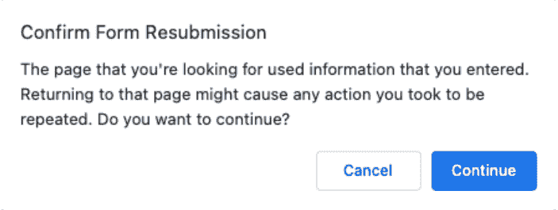

“点击继续，” Simon 说。“它只会再次提交 Emily 的订单。在测试时这样很好，但在真实应用中它会在我们的 JSON 文件中创建另一条记录，一个新的订单，所以当这个应用程序在真正的咖啡店运行时你应该小心。”

现在应用程序显示了正确的字体：

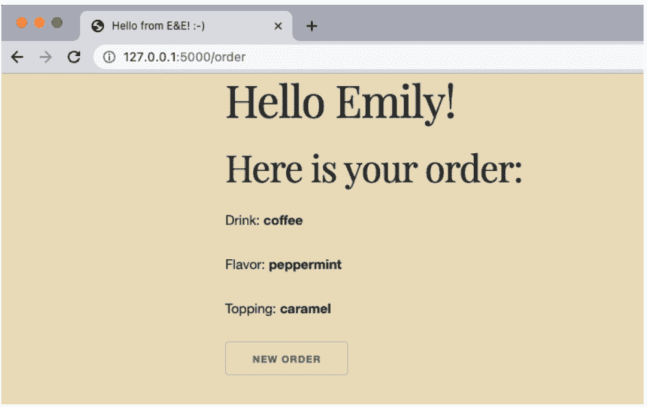

# YOUR TURN

更改其他标题的字体
编辑 static/css/coffeeshop.css 文件以更改从 h1 到 h6 的所有标题的字体。

> “我们也可以添加一张图片，” Emily 说。“我们在课堂上做过。我们只需要找到一张漂亮的图片并下载它。”

> “是的，好主意，” Simon 说。“不过要确保你不要下载任何图片。互联网上有许多很酷的图片，但大多数都有作者，而那些作者不喜欢别人把他们的图片取下来发布在自己的网站上甚至不提及作者。围绕它有很多规则，不同的作者有不同的要求，但对我们来说，搜索免费图片以确保我们不侵犯任何人的权利是安全的。搜索类似 coffee images free download 之类的内容，看看它会给出什么。”

Emily 和 Erik 搜索了几分钟，点击不同的图片并争论它们。最后 Erik 说：“这张不错。它有不同种类的咖啡饮料，在漂亮的杯子里，有配料。”并向 Simon 显示了该页面：https://www.freepik.com/free-vector/colorful-coffee-cup-set-flat-style_1544839.htm

> “好吧，让我们来看看，” Simon 说。“看看页面上的这个区块，”他向他们展示了：


+   - Free license More info
+   - Attribution is required How to attribute?
+   - File type: AI, EPS, JPG How to edit?

他点击了 'More info' 并查看了许可条款：

## License summary

我们的许可允许你使用内容

- 用于商业和个人项目
- 在数字或印刷媒体上
- 无限次数使用且没有时间限制
- 来自世界任何地方
- 进行修改并创建衍生作品

“听起来不错。我们被允许使用它，但我们必须使用署名——看这个 Attribution is required 短语？让我们看看我们应该怎么做，”他说并点击了 How to attribute? 链接。

## How to attribute?

创建内容需要花费大量时间和精力，这就是为什么我们要求你提供链接来署名来源。你将在哪里使用这张图片？

Web Printed items Video Apps and games

例如：网站、社交媒体、博客、电子书、通讯等。

复制此链接并粘贴在显眼的位置，靠近你使用图片的地方。如果不可能，请将其放在网站、博客或通讯的页脚，或在鸣谢部分。

Image by Freepik

Copy

“我们必须复制文本并将其添加到我们的页面上，放在图片旁边。没问题，”他说并点击了蓝色的 Copy 按钮。

“现在我们必须将其添加到我们的订单页面，”他说，打开了 order.html 文件，并在  行之前将文本粘贴到页面底部。“我们稍后会移动它，当我们放置图片时，”他解释道。

“现在下载图片，”他对 Erik 说。Erik 点击了绿色的 Download 按钮，然后点击 Free Download 下拉菜单并选择了 JPG。

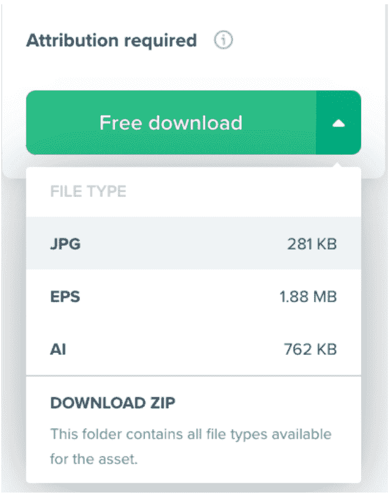

图片文件名 `1544839_222805-P1KRC2-559.jpg` 出现在他浏览器的底部。

**NOTE** 在你的情况下文件名可能不同。请在以下代码更改中使用你的文件名。

Simon 说：“现在将此下载的图片文件从 Downloads 文件夹复制到你的项目文件夹。你必须将其复制到 `coffeeshop/static/img/` 下。你能找到它吗？”

“我认为可以，”Erik 说并打开了文件管理器程序（他在 Macbook 上的 Finder）。经过几次鼠标移动和点击后他找到了正确的位置。他的项目目录现在看起来像这样：

“很好，”Simon 说。“现在我们必须将其放置在页面上。再次打开 order.html 文件。让我来帮你，”Simon 在他之前复制的署名之前添加了一行。

order.html 文件的底部现在看起来像这样：

## Listing 13.9 templates/order.html: Add a picture

```
...

Image by <a href="https://www.freepik.com/free-vector/
colorful-coffee-cup-set-flat-style_1544839.htm">Freepik</a>


```

他保存了文件并对 Emily 和 Erik 说：“现在重新加载页面，我们看看是否成功了。”

Emily 点击了 Reload，他们看到了更新后的页面：

## Welcome to E&E Coffee Shop

ENTER NAME - Choose drink - - Choose flavor - - Choose topping - SUBMIT


Image by Freepik

## YOUR TURN Add a picture to your page

找一张你喜欢的图片并将其添加到你的订单页面。不要忘记检查许可并遵循署名说明。

> “干得好！”Simon 说。“它看起来像一个真正的在线商店了。重要的是——它不仅看起来很棒，而且还能正常工作！”

Emily 和 Erik 很高兴看到他们辛苦工作的成果。把所有的小部分拼凑在一起并不容易，但结果令人震撼——这是一个他们自己编写的真正的 Web 应用程序。

> “我有一个想法，”Simon 说。“你知道什么是 AI，也就是人工智能，对吧？”

> “是的，那些愚蠢的聊天机器人和创建搞笑图片的程序，”Erik 回答道。“我们和朋友们试过一些。”

“是的，但我说的 AI 是可以帮助我们开发者的 AI，”Simon 说。“一些工具可以帮助我们编写函数、改进代码、解释错误信息。”

“是的，我看过一些演示，”Emily 说。“它们编写了完整的可用程序。看起来像魔法。Simon，这是否意味着 AI 可以编写像我们刚刚编写的那样的应用程序？”

“可能可以，”Simon 说。“但仍然，它不能在没有人类帮助的情况下做到这一点。首先，你必须想出一个应用程序的想法。就像 Erik 几周前做的那样。其次，你必须向 AI 解释你想要它做什么。你必须非常具体，否则 AI 会做一些你不期望的事情。第三，你必须审查代码并确保它按你想要的方式工作。当然，没有 AI 能选择你喜欢的网站颜色、字体和图片。就像你刚才和 Erik 一起做的那样。这是品味问题，据我所知没有 AI 能做到。”

“是的，AI 可以提供很大帮助，”他继续说，“但到目前为止它完全无法取代人类开发者和设计师。让我们明天试试，看看 AI 如何帮助我们。”

## New things you have learned today

- **Different kinds of fonts**
  Serif, Sans Serif, Monospace 是你可以在应用程序中使用的不同类型的字体。Serif 适用于标题、书籍和文档文本。Sans Serif 用于菜单，也用于标题和文本。Monospace 用于展示程序代码、文件名和命令示例。
- **Color codes**
  颜色可以用 *hexadecimal* 数字描述，如 #a1d4c5。它们由三种基本颜色组成：红色、绿色和蓝色。你可以使用这些颜色代码为你的网页指定颜色：用于背景、菜单、标题、文本等。
- **Pictures have authors and licenses**
  很重要的是要知道你在互联网上找到的并非所有图片都可以在你的网页上自由使用。图片和照片都有作者，他们决定你如何使用他们的作品。非常经常你可以免费使用他们的图片，但你应该在页面上放置 *attribution*。这是一种说“谢谢”他们工作的方式。

## Code for this chapter

你可以在这里找到本章的代码：
https://github.com/pavelanni/pythonicadventure-code/tree/main/ch13

## Help from AI: Improving our code

## In this chapter

- Erik and Emily ask AI for help
- AI gives code reviews
- AI writes comments
- AI explains error messages
- AI explains itself
- AI gives other ideas on how to use AI

“你们准备好从 AI 那里获得帮助了吗？”Simon 问 Erik 和 Emily。

“当然，”Erik 回答道。“开发者有专门的 AI 网站吗？”

“有几个 AI 工具供开发者使用，”Simon 说。“有些你登录网站并请求帮助。你可以请求代码审查，或代码解释，例如。其他工具可以安装在你的编辑器中并帮助你编写代码。你稍后会尝试，所以今天让我们从使用网站开始。我在 ChatGPT 有一个账户——让我们用它。”

Simon 打开了 https://chat.openai.com 的网页，输入了他的登录名和密码，他们看到一个简单的页面，底部有一个提示 “Send a message...”。

“还记得我昨天告诉你的吗，”他开始说，“你必须精确地向 AI 解释你想要它做什么？它不是一个聊天机器人，你可以只说‘你好吗？’我们想要对其中一个函数进行代码审查，所以我们必须这样解释。它建议我们告诉 AI 它必须扮演某个人。在这种情况下我们会要求它扮演代码审查员。然后我们会告诉它我们期望它做什么。”

Simon 开始在提示窗口中输入：

```
Act as a code reviewer. Your task is to receive a function from me and
give me feedback on the code structure, syntax, any potential errors, and
improvements that can be made.
Here is my first function to review:
```

他停下来并说：“让我们从一个简单的函数开始。例如，让我们取 read_menu() 函数。”他从编辑器中复制了该函数：

```
def read_menu(filename):
    f = open(filename)
    temp = f.readlines()
    result = []
    for item in temp:
        new_item = item.strip()
        result.append(new_item)

    return result
```

AI 几乎立即开始输入：


SIDEBAR
感谢你提供代码。以下是我的评审：
我已评审了你的 read_menu 函数，以下是我的反馈：
1. 代码结构：你代码的整体结构简单易懂。做得好！
2. 语法：语法正确，遵循 Python 惯例。
3. 潜在错误：代码缺乏适当的错误处理，特别是在文件 I/O 操作方面。如果给定的文件名不存在或存在权限问题，你的代码会引发异常。
4. 改进：
  - 你可以使用 with 语句打开文件，它会自动处理文件关闭，即使在出现异常的情况下也能确保文件在使用后被正确关闭。
  - 你可以使用列表推导式简化 for 循环，这会使你的代码更简短、更 Pythonic。
以下是根据建议改进后的函数版本：

AI 创建了一个包含 Python 代码的单独窗口：

```
def read_menu(filename):
    try:
        with open(filename) as f:
            result = [item.strip() for item in f.readlines()]
    except FileNotFoundError:
        print(
            f"Error: The file '{filename}' could not be found.")
        result = []
    except PermissionError:
        print(f"Error: You do not have permission to read \
            the file '{filename}'.")
        result = []
    except Exception as e:
        print(f"An unexpected error occurred: {e}")
        result = []
    return result
```

之后 AI 添加了其解释：

SIDEBAR
该版本的函数包含了文件操作的错误处理，使用 with 语句处理文件，并使用列表推导式生成结果列表。

“哇！” Emily 和 Erik 同时说道。

Simon 评论道：“所有观点都有效！是的，使用 with open 在处理文件时是一种常见做法。我之前不想使用它，因为它需要额外的解释，而我们当时还为此做好准备。try - except 组合也很常见。在这种情况下，如果菜单文件未找到，或你没有权限读取它，程序不会直接崩溃并报错，而是会礼貌地告诉你发生了什么。这是非常好的实践。”

“什么是列表推导式？” Erik 问。

“它是一种让 for 循环更简短的特殊 Python 方式。看 AI 写的代码：”

```
result = [item.strip() for item in f.readlines()]
```

它等同于这段循环：

```
temp = f.readlines()
result = []
for item in temp:
    new_item = item.strip()
    result.append(new_item)
```

“是的，它更简短，” Erik 同意道，“但循环更容易理解。”

“没错！” Simon 说。“这就是我们从循环开始的原因。它更容易理解。现在你知道它是如何工作的，所以你可以使用更紧凑的版本。我可以告诉你，我自己起初也不理解列表推导式。但我开始更频繁地使用它，现在它和普通循环一样容易阅读。而且，正如 AI 正确指出的那样，它更 Pythonic。哦，我们也可以请 AI 向我们解释它，对吧？”

他输入：“请解释 Python 中什么是列表推导式。”

AI 回答：

## SIDEBAR

列表推导式是 Python 中创建列表的简洁方式。它是一种语法结构，允许你通过指定要包含的元素，通常基于现有的可迭代对象（如列表、元组或 range）来创建一个新列表。列表推导式比使用传统的 for 循环和 append() 方法构建列表更简洁，通常也更快。

列表推导式的基本结构是：

```
[expression for item in iterable if condition]
```

+   - `expression`：一个表达式，用于确定新列表中每个项目的取值。它通常涉及 item 变量。
+   - `item`：表示可迭代对象中每个元素的临时变量。
+   - `iterable`：你要遍历的可迭代对象（例如列表、元组、range）。
+   - `if condition`：可选的条件，用于过滤可迭代对象中的元素。只有条件为真的元素才会被包含在新列表中。

下面是一个简单的示例，演示如何使用列表推导式：

```
## 使用 for 循环以传统方式创建平方数列表
squares = []
for i in range(1, 6):
    squares.append(i**2)
print(squares)  # Output: [1, 4, 9, 16, 25]

## 使用列表推导式创建相同的平方数列表
squares = [i**2 for i in range(1, 6)]
print(squares)  # Output: [1, 4, 9, 16, 25]
```

你也可以使用条件使用列表推导式。下面是一个示例，创建 1 到 10 之间的偶数列表：

```
even_numbers = [x for x in range(1, 11) if x % 2 == 0]
print(even_numbers)  # Output: [2, 4, 6, 8, 10]
```

列表推导式可以使你的代码更简洁、更易读，尤其是在简单操作时。然而，对于更复杂的操作或嵌套循环，它可能会变得难以阅读，因此在简洁性和可读性之间取得平衡至关重要。

> “让我们请 AI 帮我们做点别的。当我们写代码时，我们没有为它写注释。这不是一个好习惯。你应该在代码中添加注释来解释你做了什么。可能会有人阅读你的代码。或者，更常见的是，它会在 3 个月后由你自己阅读。我保证，如果你不注释你的代码，你会问自己‘这是什么？我为什么要这样写？我当时是什么意思？’相信我，我是根据经验说的，” Simon 微笑着说。

“所以，给代码加注释是一个好习惯。通常你自己做，但让我们看看 AI 能否帮我们，” 他在提示窗口中写下了以下内容。

```
Please add comments to the function you've just created.
```

AI 立即回答：

## SIDEBAR

当然！以下是添加了注释以解释每一步的函数更新版本：

```
def read_menu(filename):
    """
    Reads the menu from a file and returns a list of items.

    :param filename: The name of the file containing the menu.
    :return: A list of menu items, with leading and trailing whitespaces removed.
    """
    try:
        # Open the file using 'with' to ensure it's properly
        # closed after use
        with open(filename) as f:
            # Read all lines from the file and remove whitespaces
            # using list comprehension
            result = [item.strip() for item in f.readlines()]
    except FileNotFoundError:
        # Handle the case when the file does not exist
        print(f"Error: The file '{filename}' could not be found.")
        result = []
    except PermissionError:
        # Handle the case when there is no permission to read
        # the file
        print(f"Error: You do not have permission to read \
the file '{filename}'.")
        result = []
    except Exception as e:
        # Handle any other unexpected errors
        print(f"An unexpected error occurred: {e}")
        result = []

    return result
```

“这真的很好！” Simon 说。“看：在函数开头它添加了一个 docstring。它是一个可以包含在函数文档中的特殊字符串。然后对于每个异常它都添加了解释其含义的注释。我必须说，我自己写不出更好的注释！看这个例子，始终为你的代码添加注释和 docstring！”

“哦，我以为 AI 现在会为我们做这件事，” Erik 说并笑了。

“是的，AI 可以注释像异常处理这样简单的代码行，” Simon 回答道，“但我确信很快你就会开始编写不那么简单的函数，即使是最聪明的 AI 也无法解释它们。准备好自己去做，如果你要写真正原创的代码。”

“AI 能帮我们处理错误信息吗？” Emily 问。

“好主意！” Simon 说。“让我们试试——我确信它可以解释一些错误信息。Erik，记得一开始你收到的第一个错误信息吗？”

“是的，我记得你对它非常高兴，” Erik 嘟囔道。

“让我找找，我把它记在笔记里。这里就是，” Simon 说并在提示窗口中输入了错误信息和他的请求：

```
Please explain the following Python error message:

Traceback (most recent call last):
    File "/home/erik/mu_code/menu.py", line 30, in <module>
    print("Main product: ", drinks[drink])
TypeError: list indices must be integers or slices, not str
```

AI 回答：

SIDEBAR 这条错误信息意味着你正试图使用字符串作为索引来访问列表中的元素，这在 Python 中是不允许的。在这种特定错误信息的情况下，似乎你正试图使用包含字符串的变量 drink 来访问 drinks 列表中的元素。以下示例代码会产生此错误：

```
drinks = ["coffee", "tea", "soda"]
drink = "coffee"
print("Main product: ", drinks[drink])
```

在这段代码中，drink 是一个包含值 "coffee" 的字符串变量。当我们尝试访问 drinks[drink] 时，Python 引发 TypeError，因为索引必须是整数，而不是字符串。要修复此错误，你需要使用整数索引来访问列表中的元素。例如，如果你想访问列表的第一个元素，你会使用 drinks[0]：

```
drinks = ["coffee", "tea", "soda"]
drink = 0
print("Main product: ", drinks[drink])
```

这将输出 "Main product: coffee"，即 drinks 列表的第一个元素。

“它甚至知道我们的应用程序是关于什么的！” Erik 惊呼道。

“是的，” Simon 说，“我们只给了它一条错误信息，它就猜出了我们的程序做什么！”

“这是由于这种 AI 程序的工作方式，” 他补充道。

“它是如何工作的？能解释一下吗？” Emily 问。

“嗯……” Simon 开始说，“我不是 AI 专家，我只是读了一些文章……我会试着解释我理解的方式。”


"AI 公司里的人——比如创建了 ChatGPT 的 OpenAI——知道如何训练计算机理解人类语言和程序。为此，他们给计算机大量文本和代码。然后一个特殊的程序，也就是模型——顺便说一下，通常用 Python 编写——分析所有这些文本，并找出哪些词更常与哪些词一起使用。就像我们这个例子一样，AI 模型发现人们使用 'drinks' 这个词时，经常也会使用 'coffee'、'tea'、'soda'。这就是为什么它给出了与我们代码非常相似的例子。"

"另外，" Simon 继续说，"这些模型可以计算所谓的文本相似度并比较不同的词和短语。然后它们可以利用这些结果来回答像这样的问题：'什么与西班牙的关系和巴黎与法国的关系一样？' 模型会计算 'Paris' 和 'France' 之间的 '距离'，然后执行类似这样的数学运算："

```
? = Spain + (Paris - France)
```

"然后得到答案 'Madrid'。"

"我可以试试吗？" Emily 问。

"可以，我们试试吧！" Simon 说。"我读过几篇文章里的这个解释，但从没自己试过。"

Emily 接过键盘，在提示窗口中输入：

```
What is related to Spain the same way Paris is related to France?
```

AI 回答：

SIDEBAR Madrid is related to Spain the same way Paris is related to France. Both Madrid and Paris are the capital cities of their respective countries, Spain and France.

"确实有效！" Simon 说。"让我们问问它是如何得出这个答案的。"

Emily 输入：

```
Can you please explain how you came to this answer?
```

AI 说：

SIDEBAR Sure! I came to this answer by understanding the relationship between Paris and France. Paris is the capital city of France. So, the question is asking for something that has a similar relationship with Spain.

Knowing that Madrid is the capital city of Spain, I identified that it has the same relationship with Spain as Paris has with France. Thus, I provided Madrid as the answer to the question. This type of reasoning is called analogical reasoning, where I find similarities between different pairs of items based on their relationships.

Simon 追加了另一个问题：

```
Did you use text similarity to find this relationship?
```

AI 回答：

SIDEBAR As an AI language model, I didn’t explicitly use text similarity to find the relationship between Paris and France, and then Madrid and Spain. Instead, I relied on my pre-existing knowledge and understanding of relationships between countries and their capital cities, which I have learned during my training on a large dataset of text.

However, text similarity techniques, like word embeddings, can help in finding relationships between words based on their context and usage. In this case, I leveraged my knowledge and analogical reasoning to establish the relationship and provide the answer.

"太酷了！" Simon 说。"我们可以用 AI 来学习 AI！我知道人们用 AI 来帮助他们开发程序，还有很多其他任务。我们已经尝试过编写注释、做代码审查、解释错误信息了。我想知道 AI 还能帮我们做什么。让我们问问它吧！" 然后他输入：

```
We asked ChatGPT to help us with our Python project.
We tried writing comments, doing code reviews, explaining error messages already.
What else can ChatGPT help us with?
```

AI 回答：

## SIDEBAR

In addition to writing comments, doing code reviews, and explaining error messages, ChatGPT can also help you with various other aspects of your Python project, such as:

- 1. Generating code examples: ChatGPT can provide you with example code snippets to demonstrate how to use certain functions, libraries, or language features.
- 2. Debugging: You can describe the issue you’re facing, and ChatGPT can suggest potential solutions or ways to identify the root cause of the problem.
- 3. Recommending libraries and tools: ChatGPT can recommend appropriate libraries or tools to use for specific tasks, based on its knowledge of popular and widely-used resources in the Python ecosystem.
- 4. Best practices and coding conventions: ChatGPT can provide guidance on best practices, coding conventions, and style guidelines to help you write clean, maintainable, and efficient Python code.
- 5. Algorithm design: ChatGPT can help you understand or design algorithms, explaining their logic and providing examples of how they can be implemented in Python.
- 6. Project structure: ChatGPT can provide advice on organizing your Python project, such as how to structure your directories, files, and modules, as well as guidance on package management and dependency handling.

Remember that while ChatGPT can be helpful, it’s not a replacement for thorough research and understanding of the concepts. Additionally, it’s important to review the generated code or suggestions to ensure correctness and suitability for your specific project requirements.

"所有这些主意都很棒！我觉得我们应该一起尝试。明天让我们讨论所有改进应用的可能性并为未来做计划，" Simon 说。"在 AI 的回答中，我觉得最后一段非常重要。当人们第一次看到 AI 编写的代码时，他们开始认为 AI 可以为他们做一切。但我玩过它好几次，注意到并非所有生成的代码都能运行。你必须始终审查和测试它。"

"好吧，回到我们的咖啡店应用，" 他继续说，"我们还能对它做什么？"

"你说我可以在我的 iPad 上打开这个应用，" Erik 说。

"是的，可以，但我们需要做一些小的改动。你说得对，如果只能在电脑上使用，这个应用就没有多大意义。明天我会向你展示如何把它打开在你的 iPad 或手机上。"

"我们会把它放到云上吗？" Emily 问。

"差不多，" Simon 说。"目前它将是我们家庭网络内部的自己的 '云'。不过我告诉你：你需要把它放到真正的云上，这样才能从任何地方访问。明天我们再谈。"

## 今天你学到的新东西

- **AI 可以帮助你编写好的程序**
  AI 可以帮助你写出更好的代码，解释错误信息，修复 bug，为代码添加注释。AI 还可以为你提供关于程序结构、有用工具和库的想法。
- **AI 不能取代程序员**
  AI 可以做很多有趣的事情，但要制作出能用且有用的应用，仍然需要人类的帮助。并非所有 AI 生成的代码都能无错误运行。你应该始终审查和测试它。
- **AI 使用特殊的程序叫做模型**
  AI 使用语言模型来生成答案。模型是在海量文本上*训练*的，包括维基百科、在线文章、程序代码等。模型可以计算词与句子之间的关系，并基于这些计算构建答案。

## 下一步：未来的计划

## 本章内容

- Emily 和 Erik 为他们的应用创建主页
- Simon 展示如何从其他设备访问应用
- Erik 和 Emily 从 iPad 和 Android 手机测试应用
- Simon、Emily 和 Erik 制定计划

"还有一件小事要做，" Simon 说，"在我们说这个应用完成之前。还记得当我们打开应用时看到的是 'Hello from Mu!' 网页吗？我觉得是时候用我们自己的主页替换它了。"

"当然！" Emily 说。"我们已经选好了颜色，也找到了好图片！我觉得我们只要放上标题 'Welcome to E&E Coffee Shop!' 并加上我们在订单页面上使用的图片就行了。"

"是的，好主意，" Simon 说。"但别忘了主页的主要目的。"

"主要目的是什么？" Erik 问。

"在任何网站或 Web 应用中，你都用主页来进行导航，" Simon 回答。"当人们打开你的网站时，他们应该能快速弄清楚它做什么以及如何使用。看看你喜欢的咖啡店网站，告诉我你发现了什么。看看它们有什么共同点。"

Emily 和 Erik 搜索了熟悉的公司，并在多个标签页中打开了它们的网站。探索了一段时间后，Erik 说："它们都有一个叫做 'Menu' 的页面。它们有一个 'Locations' 或 'Find a store' 的页面，显示在哪里可以找到它们的商店。"


"你也必须创建它，当你开设几家咖啡店时，" Simon 评论道。

"是的，" Erik 说并继续道，"他们还有奖励卡和礼品卡。我认为我们也需要它们。而且在底部他们通常有很多较小的链接。他们有‘关于我们’、‘联系我们’和其他内容。"

"你做了很棒的研究，" Simon 说。"现在你可以看到我所说的导航是什么意思了。目前除了主页外我们只有一页，那就是我们的订单页。我认为我们可以在主页上放一个按钮来引导到订单页。"

"像我们在‘Here is your order’页面上做的那样吗？" Emily 问。

"完全正确！" Simon 说。"你可以直接从 print.html 页面复制那三行。打开 templates/index.html 文件，删除第二个包含 block content 的行与最后一个包含 endblock 的行之间的所有内容。然后插入我们刚才讨论的内容：标题、按钮和图片。"

"是的，现在我知道该怎么做了！" Emily 说，他们开始着手主页。几分钟后 Emily 和 Erik 向 Simon 展示了他们的主页。

## Listing 15.1 templates/index.html: Create your home page

```



<h1>Welcome to E&E Coffee Shop</h1>

<form action="/order">
<input type="submit" value="New order" />
</form>


Image by <a href="https://www.freepik.com/free-vector/take-away-coffee-coffee-mugs_8507631.htm">Freepik</a>


```

YOUR TURN   Edit your home page
Open your file templates/index.html and make the changes like Erik and Emily just did. Feel free to change the picture or the title.

"看起来不错，"他说。"让我们试试吧！"

## Welcome to E&E Coffee Shop

NEW ORDER

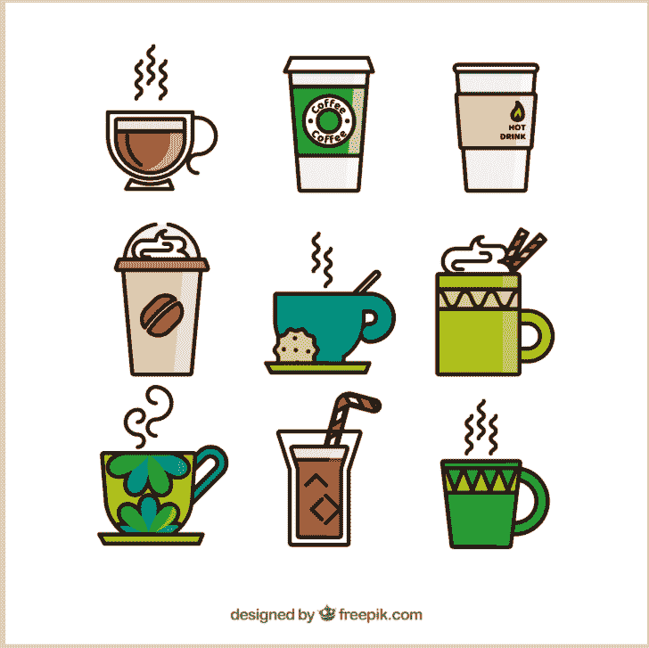

designed by freepik.com

Image by Freepik

"很好。现在试着点击‘New order’。它应该打开订单页，" Simon 对 Erik 说。

Erik 这样做了并看到了熟悉的订单页和菜单。

"一切都正常！"他说。"现在我们有一个完整的 Web 应用程序了！"

"Simon，" Emily 开始提问，"昨天你说我们可以从我们的设备上使用这个应用程序。你能展示给我们看吗？"

"是的，我想在我的 iPad 上试试，" Erik 说。

"是的，当然可以，" Simon 回答道。"Erik，你还记得整个项目始于你用 iPad 收集订单时吗？而且我告诉过你可以创建一个 Web 应用程序来使用 iPad 不仅仅作为笔记本？"

"是的，我记得，" Erik 说。"就几周前，"他微笑着说。

"好吧，那让我们让它在你的 iPad 上运行吧，" Simon 说。"让我解释一下我要做什么，"他开始画图并解释。

"当我们从 Mu Editor 运行应用程序时，默认情况下它只能从我们运行它的电脑上访问。这就是为什么我们在使用应用程序时使用 localhost 或地址 127.0.0.1 的原因。Flask 和 Mu Editor 这样做是为了确保在我们仍在工作时不会向其他电脑和用户展示我们的应用程序。"

"这说得通，" Erik 说。"在我们添加字体和图片之前它看起来并不漂亮。"

"对，" Simon 说。"但现在我们准备好在其他设备上使用它了，我们想要改变这一点。幸运的是，它只是在 Mu Editor 配置中的一行。做出这个更改后，我们家庭网络中的所有设备都可以使用它。当然，前提是它们有浏览器。"

"我能从我的手机上试试吗？" Emily 问。

"可以，但你应该连接到我们家庭的网络。为此让我输入 Emily 手机上的 WiFi 密码，" Simon 输入了密码。

"这是左侧的默认配置，"他继续解释。"我们可以仅从运行应用程序的电脑访问它。而在这里，右侧我们可以从其他设备访问。"

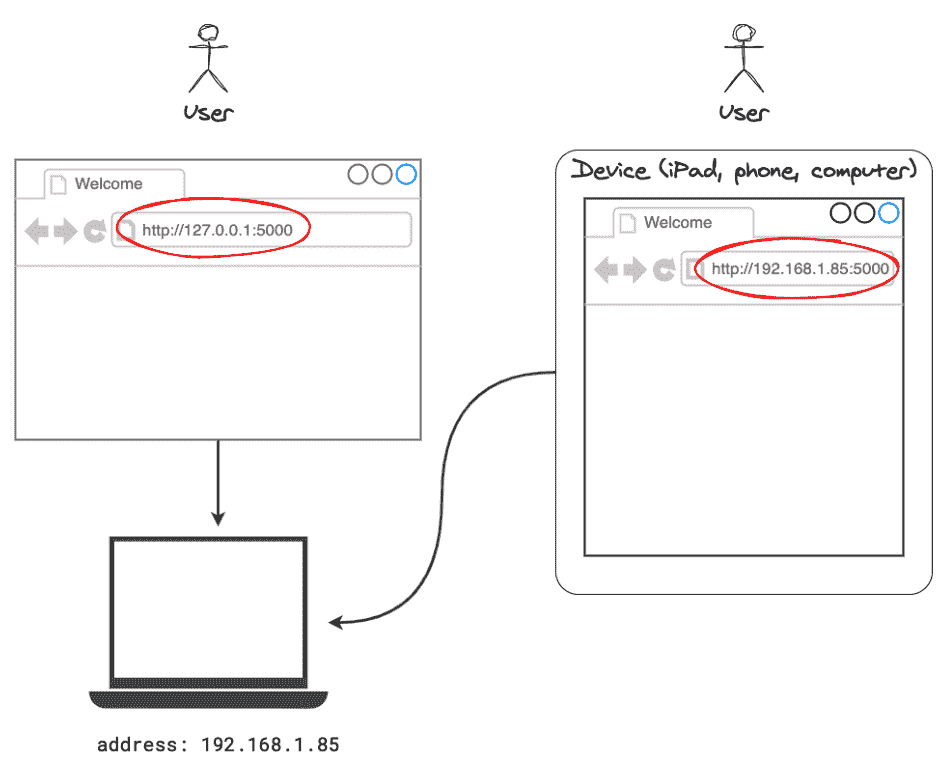

address: 192.168.1.85

"每台电脑都有一个网络地址。你的笔记本电脑，Erik，连接到我们的家庭网络。它有地址：192.168.1.85。网络中任何想要与它通信的设备都应使用此地址。如果你的电脑想与自己通信，则使用 127.0.0.1。"

"我现在可以试试吗？" Erik 问。

"等等，我需要在配置中做一个更改。记住，我们现在向家庭网络中的所有设备展示我们的应用程序。当然，连接的设备并不多，但我们仍然要确保我们的应用程序完全准备就绪。将来我们会将其上传到云端，在那种情况下全世界的电脑都会看到它。我们最好确保它能正常工作并且看起来不错。"

"Erik，你看到 Mu Editor 右下角那个小齿轮了吗？" Simon 继续道。"它通常表示‘设置’或‘配置’。请点击它。"

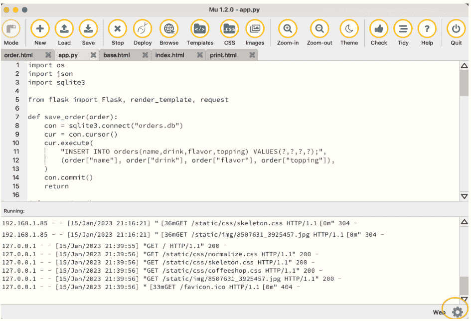

"现在选择‘Python 3 Environment’标签，并在其中的文本末尾添加以下行："

```
FLASK_RUN_HOST=0.0.0.0
```

Erik 这样做了，看起来是这样的：

## Mu Administration

+   Current Log
+   Python3 Environment
+   Third Party Packages
+   PythonAnywhere API
+   Select Language

The environment variables shown below will be set each time you run a Python 3 script.

Each separate environment variable should be on a new line and of the form:
NAME=VALUE

```
FLASK_APP=app.py
FLASK_ENV=development
LC_ALL=en_GB.UTF8
LANG=en_GB.UTF8
FLASK_RUN_HOST=0.0.0.0
```

"现在点击 OK 并重新启动应用程序。"

Erik 通过点击 OK 保存了配置。他在编辑器中点击 Stop 然后再次点击 Run。

Simon 说："现在看看底部窗口的输出。看到‘Running on all addresses’这一行吗？这正是我们需要的。它下面的两行中，你可以看到我们可以用它们访问应用的地址。第一个是 127.0.0.1，我们一直在使用。第二个是你在我们家庭网络中的笔记本电脑地址。你应该在 iPad 的浏览器中输入它。Emily，你在手机上输入。在这种情况下它是 http://192.168.1.85:5000。请记住这个地址可能会改变。例如，如果你带着笔记本电脑去 Emily 家并连接到她的家庭网络，你的笔记本电脑会获得不同的地址。你会在输出窗口中看到它，然后在 Emily 家你需要使用那个新地址。"

```
Running:
[31m[33mWARNING. THIS IS a development server. Do not use it in a
instead. [0m
  * Running on all addresses (0.0.0.0)
  * Running on http://127.0.0.1:5000
  * Running on http://192.168.1.85:5000
[33mPress CTRL+C to quit [0m
  * Restarting with stat
  * Debugger is active!
  * Debugger PIN: 675-232-744
```

"好吧，现在在你的设备上打开这个地址并向我展示你在订单页上看到的内容。"

Emily 和 Erik 打开了他们的设备并开始输入。

"找到了！" Emily 展示了她的手机：

## Welcome to E&E Coffee Shop

Emily

Chocolate

Vanilla

Caramel

SUBMIT

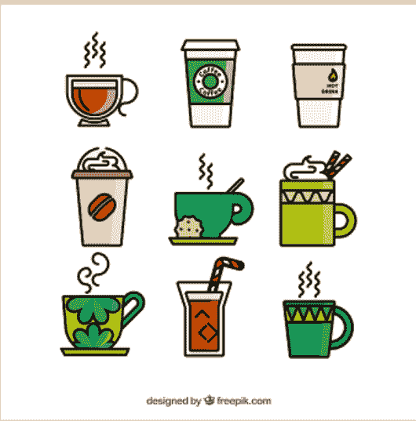

Image by Freepik

"看起来很棒！" Simon 说。"Erik，你的 iPad 上是什么？"

"看！" Erik 说。

## Welcome to E&E Coffee Shop

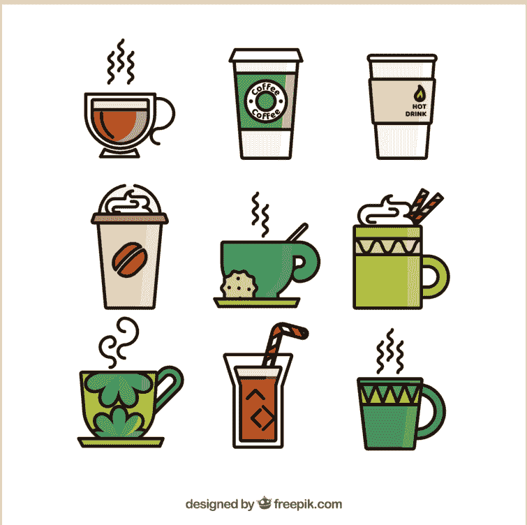

Image by Freepik

"它在你的两个设备上都能正常工作，看起来很棒，" Simon 说。"记住，我们使用的是随 Mu Editor 包含的样式表，这些表设计为在不同设备上工作。这里我们在 Macbook 上使用你的应用程序，在 iPad 上，在 Android 手机上，在所有设备上看起来都很棒。甚至更多：你注意到我们的菜单是如何重新排列以适应页面吗？这就是使用样式表 `normalize.css` 和 `skeleton.css` 的优势。我们只用我们的 `coffeeshop.css` 添加了一些小改动。"

"顾客在我们咖啡店可以用手机点饮料真是太好了，" Emily 说。"但为此，他们应该在店里并连接到我们的网络，对吧？Simon，我们能把我们的应用程序放在真正的云端，这样我们就可以从任何地方使用它吗？我很想在学校向我的朋友们展示它。"

"当然可以。这当然比我们刚才做的只添加一个字符串要复杂一些。通常，云服务需要一些费用，但对于我们这样简单的项目，找到免费服务是可能的。其中之一叫做 PythonAnywhere。我知道他们可以托管你的 Python 应用程序，但我自己还没试过。给我一些时间，我会测试一下并给你说明。"

NOTE 你可以在书籍配套网站 https://github.com/pavelanni/lets-talk-python-book/tree/main/ch15/ 上找到说明；

"但在我们向全世界开放应用程序之前，让我们谈谈可能的改进。Erik，你还记得我们在处理数据库时讨论过什么吗？"

"你说最好在数据库表中包含订单的时间，" Erik 说。

"是的，对！让我们开始一个 ToDo 列表来规划我们未来的改进，"他开始在文本编辑器中书写。

```
* Timestamps in orders
```

"我们可以记住每个顾客，" Emily 说，"并向他们展示他们上次点了什么。"

"好主意，" Simon 说。"但在这种情况下我们应该为每个顾客创建一个唯一的名字。我们不想混淆两个名字都是 Alex 的不同顾客。"

"我们的菜单呢？" Erik 问。"当我们在我的笔记本上运行时，我们可以编辑文本文件。但当我们在云上运行时，我们不能编辑文件，对吧？"

"是的，你说得对，Erik，" Simon 说。"如果我们去云端，一切都应该通过 Web 浏览器完成。我们需要另一个页面来编辑菜单。而且，不要忘了这个页面只能由商店经理使用。"

"我明白你的意思了！" Emily 说。"我们需要密码！"

"对，" Simon 确认道。"我们需要在我们的应用程序中拥有不同的 *账户*。我们将有顾客账户，然后是他们会收到订单的吧ista 账户。还有商店经理账户，他们会在那里列出订单、编辑菜单并执行其他经理的工作。"


"We need more pictures!" Emily said. "I mean pictures of our products: all our flavors and toppings."

"What about promotions?" Erik said. "Flavor of the week or something like that. Simon, you said that we should know how many portions of flavors and toppings we used during a day or month. Is it possible to display this on the web?"

"Whoa, whoa, slow down please, I can’t keep up with writing all your ideas down," Simon said and smiled. "Seriously, I like how we are brainstorming this. One of the main principles of brainstorming—and we use it often in our robotics club—is that criticizing ideas is not allowed. Everybody is welcome to bring the most crazy ideas. We don’t say, 'Oh, this will be impossible to implement'. We just collect everything and discuss it later."

"Then I’d like to add voice commands to our coffee shop," Erik said. "And a robotic arm to pour coffee and add flavors and toppings."

"Noted," Simon said.

"I think instead of passwords we should use face recognition," Emily said. "Passwords are boring. Imagine that a customer is entering the shop and we greet them and say, 'Hey, Max, are you going to have your usual vanilla with caramel?'"

"Great, noted too," Simon said. "Here is what I’ve collected so far," and he showed his list to Emily and Erik.

- Timestamps in orders
- Remember each customer and what they ordered (create user accounts)
- Edit menus from the browser
- Accounts for shop managers, baristas, cashiers
- List orders for a day, week, month; list all orders from a customer
- More pictures of our products
- Product promotions
- Reports: how many orders of each flavor and topping per day, week, month
- Voice commands
- Robotic arms for coffee, flavors, and toppings
- Face recognition for customers

"Also, don’t forget the suggestions we received from AI yesterday. Let me create another list," and he copied the answers from ChatGPT:

- Code examples: ask the AI to review all our functions and give use suggestions for improvement
- Debugging: ask the AI to analyze our functions for potential bugs
- Recommend libraries and tools: ask the AI to give us suggestions
- Algorithm design: ask the AI to analyze our algorithms (we didn’t use many yet)
- Project structure: ask the AI for suggestions on project structure
- Create tests for our functions (the AI didn’t tell it yesterday, but I know people use it for tests)

"That’s enough work for a whole year!" Simon said. "I am afraid there is not enough space in the book to cover all that."

"What book?" Erik asked.

"Erik, don’t you know?" Simon said. "Our dad is writing a book about us—you, Emily, and me. The book is all about this coffee shop project and about how we developed it. He said he couldn’t add more chapters to the book. So I’m afraid we have to continue our project online. I suggest we create a web site and update it with our progress and additional features that we develop. What do you think?"

"I like it!" Emily said. "It will be like a blog, right?"

"Yes, a blog! Maybe we should also add a GitHub repository to it where we keep all our scripts and examples."

"Great!" Erik said. "I heard about GitHub—most developers keep their scripts there."

"And when we do that," Simon continued, "other people will be able to use our code, learn from it, and maybe add their own features to our application. Maybe they’ll share their applications and we’ll help them too. This is how most of the projects are being developed these days."

"This is great! I’m in!" Emily said.

"Me too," Erik added.

"Great, let’s continue on our own site then. I’ll talk with Dad and we’ll set it up together. See you tomorrow!" Simon said. He liked working on this project with Emily and Erik. He learned a couple of new things himself because of the coffee shop project. "Time to learn more about accounts, robotic arms, and face recognition to explain it to the kids," he’s been thinking.

## Book companion site

And here is the site they created: https://pythonicadventure.com/. Come and find new ideas for your projects, troubleshooting hints, and more!

## Code for this chapter

You can find the code for this chapter here: https://github.com/pavelanni/pythonicadventure-code/tree/main/ch15

## Ideas for your first application

Creating a coffee shop application doesn’t look very attractive to you? Create something else! All programming ideas and methods we discuss in this book are applicable to a lot of other projects. Just look around and you’ll get ideas for other applications.

For example:

### Pizza place

This should be very similar to what we do with the coffee shop application. Look—we ask the customer:

- What is their main drink?
- What is the flavor they want?
- What is the topping?

We give the customer a list of options for each question and the customer chooses from the menu.

What should we ask the customer in a pizza place?

- What kind of crust do you want? Thin or thick?
- What size? Small, medium, or large?
- Which sauce do you want? Red or white?
- What kind of pizza do you want? Margherita, pepperoni, veggie,... Go to your favorite pizza place and see what they have.
- What additional topping do you want to add?

### Ice cream shop

Go to your favorite ice cream shop and watch how they prepare your order. What do they ask you? What are the options they give you? Those will be in your application’s menus.

Most likely they ask:

- What type of cone? Sugar, waffle, cake?
- How many scoops?
- Which flavors?
- Any topping?

Here it’s becoming slightly different from what we did for the coffee shop. After you asked "How many scoops?" you have to ask that many times about the flavor. Think about it: how would you do it in Python?

Hint: there is a function `range()` in Python that can be used in a `for` loop. We used it in our menus. Try to use it to ask about the ice cream flavor the exact number of times.

### LEGO® minifigures

You have a good collection of LEGO minifigures and their parts. You want to helm your friends to build something new. What questions are you going to ask them and what options will you give them?

- Choose the head: smiley face, sunglasses face, face with a beard,…
- Choose the headwear: dark hair, blond hair, hard hat, police hat,…
- Choose the torso: mechanic, police officer, shirt with tie, t-shirt,…
- Choose the legs: blue jeans, green shorts, brown cargo pants,…
- Choose the accessory: a sword, a radio, a hammer, a magnifying glass,…

You can add special conditions to your application. For example if your friend have chosen a police hat then they can’t choose a baseball bat as an accessory. Think about adding this condition to your menus.

What about choosing parts at random? That might create some funny minifigures. How would you add a random option to your menu? How would you implement it?

Hint: there is a module called `random` in Python. You should import it with the `import` statement in the beginning of your script and use the function `choice()`. That function works like this: you give it a list of choices and it chooses randomly one of them. Next time you call it the function randomly chooses something else (or, maybe, the same item—it’s random!). For example, create this short script and run it. In this script we ask Python 5 times to choose randomly an item from the list of three types of hair.

### Listing A.1 choice.py

```
import random

for _ in range(5):
    print(random.choice(["dark hair", "blond hair", "red hair"]))
```

Run this script and you’ll see something like this:

```
blond hair
red hair
blond hair
blond hair
dark hair
```

Of course, in your case the list will be different and will have 5 *other* random choices in different order.

## Other project ideas

Do you have other project ideas? Please share them in the liveBook forum: https://livebook.manning.com/book/lets-talk-python/discussion.


## 如何安装 Mu 编辑器和 Python 环境

在本附录中，我们将解释如何在你的电脑上安装 Python。最简单的方法是安装一个内置 Python 的编程编辑器。我们推荐安装 Mu 编辑器。我们在本书中使用它，这样更容易跟随书中的对话和说明。

我们还会为你提供其他安装 Python 的方式链接——欢迎你也尝试一下。

## Mu 编辑器

### Code with Mu: 适合初学者的简单 Python 编辑器。

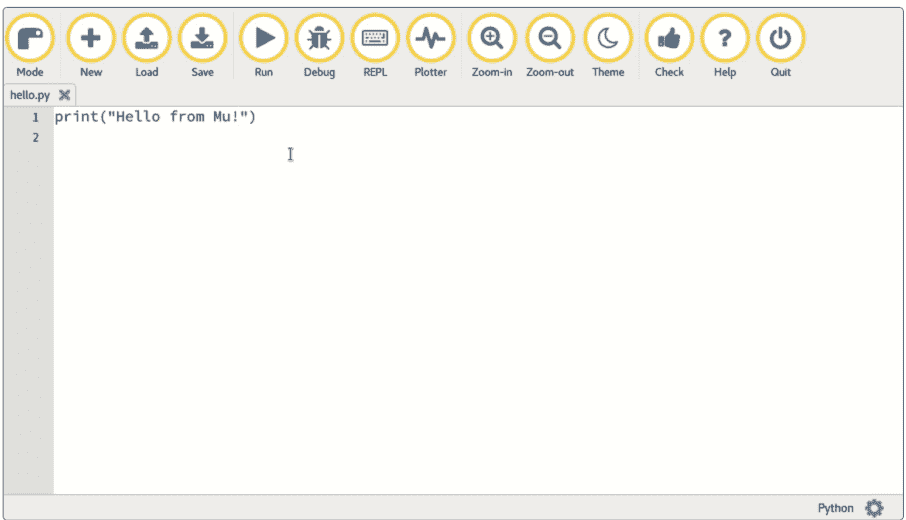

- 1. 在你的网络浏览器中打开 Mu 编辑器的网页： https://codewith.mu/。
- 2. 点击 Download（绿色按钮），你将看到以下页面：

## Download Mu

获取 Mu 最简单、最容易的方式是通过 Windows 或 Mac OSX 的官方安装程序（我们不再支持 32 位 Windows）。我们还为运行在基于 Intel 的硬件上的 Linux 用户提供了一个实验性的 AppImage。

当前推荐的版本是 Mu 1.2.0。我们建议用户通过每个受支持操作系统的链接更新到此版本。所有之前的 Mu Beta 版本都可以在这里下载。

Windows Installer

Download

Instructions

Mac OSX Installer

Download

Instructions

Linux AppImage Package (Experimental)

Download

Instructions

- 3. 点击你操作系统的 Download。你的浏览器将下载适用于你操作系统的安装文件。
  - 对于 Windows，它将是一个 .msi 文件。
  - 对于 macOS，它将是一个 .dmg 文件。
  - 对于 Linux，它将是一个 .AppImage 文件。
- 4. 点击你操作系统的 Instructions 并按照说明操作。
- 5. 像在你的操作系统中正常打开应用程序一样打开 Mu 编辑器。你就可以开始你的项目了！

你也可以使用 Mu 编辑器来编程微控制器和构建机器人，但那是另一本书的主题。

## Thonny

Thonny 是另一款专为初学者打造的优秀 Python 编辑器。你可以在这里找到它： https://thonny.org/

在首页上你就能找到 Windows、macOS 和 Linux 的安装程序。对于 Windows 下载 .exe 文件并运行它。对于 macOS 下载 .pkg 文件并安装它。对于 Linux 运行说明中提供的脚本。

## Thonny

Python IDE for beginners

Download version 4.0.1 for Windows • Mac • Linux

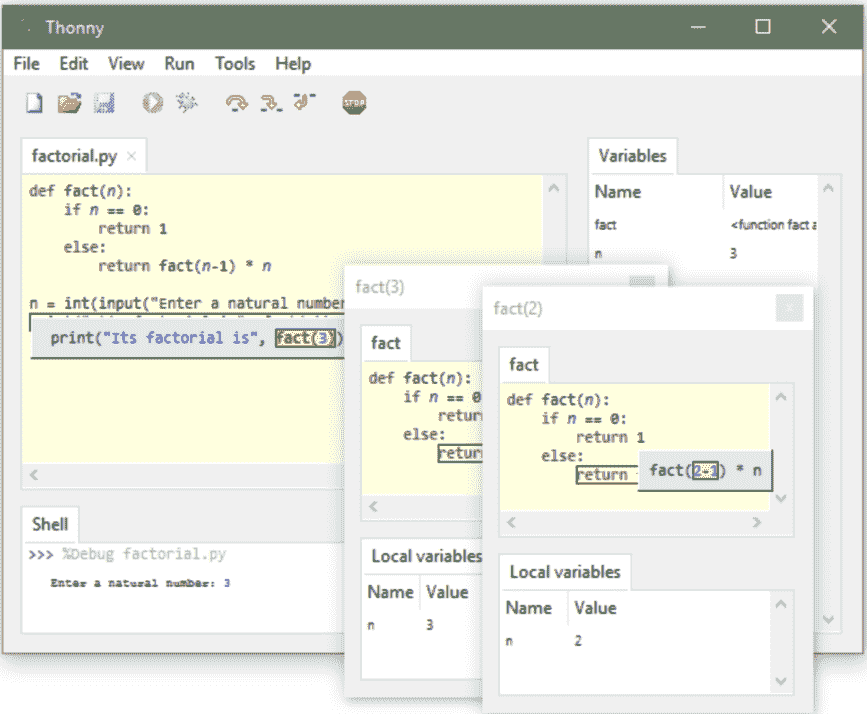

安装应用程序后启动它并探索其设置。你可以从十几种选项中选择颜色主题、编辑器和终端字体，以及许多其他内容。

Thonny 有一个非常有用的功能叫做 Assistant。在 Options 菜单中你可以配置它在代码中出现警告时每次启动。也当你的程序出现错误时它会启动。Assistant 会给出你的代码可能出现问题的几个建议。尝试在你的代码中制造一个小错误（例如变量名中的拼写错误），然后运行程序，你就会看到 Assistant 的实际效果。

## Python

上面描述的两个编辑器都包含了 Python 在其安装包中。但出于某种原因，你可能想单独安装 Python。

如果你使用的是 macOS 或 Linux，你的操作系统已经安装了 Python。很可能它不是 Python 的最新版本，但这完全不是问题：我们在这本书中开发的所有程序都适用于从 3.5 开始的 Python 版本。在这些操作系统上无需安装任何东西——至少对于本书来说不需要。

如果你使用的是 Windows，你需要前往官方 Python 网站： https://www.python.org/downloads/windows/ 并从那里下载安装程序。

请仔细阅读说明（见下图）并为你的 Windows 版本选择正确的 Python 版本。

## Python Releases for Windows

- Latest Python 3 Release - Python 3.11.0

## Stable Releases

- Python 3.11.0 - Oct. 24, 2022
  Note that Python 3.11.0 cannot be used on Windows 7 or earlier.
  - Download Windows embeddable package (32-bit)
  - Download Windows embeddable package (64-bit)
  - Download Windows embeddable package (ARM64)
  - Download Windows installer (32-bit)
  - Download Windows installer (64-bit)
  - Download Windows installer (ARM64)

- Python 3.9.15 - Oct. 11, 2022
  Note that Python 3.9.15 cannot be used on Windows 7 or earlier.
  - No files for this release.

- Python 3.8.15 - Oct. 11, 2022
  Note that Python 3.8.15 cannot be used on Windows XP or earlier.
  - No files for this release.

- Python 3.10.8 - Oct. 11, 2022
  Note that Python 3.10.8 cannot be used on Windows 7 or earlier.

在 Windows 上安装 Python 的另一种方法是打开 PowerShell 窗口并输入 python。Windows 会建议安装正确的 Python 版本。你只需要接受它即可。

