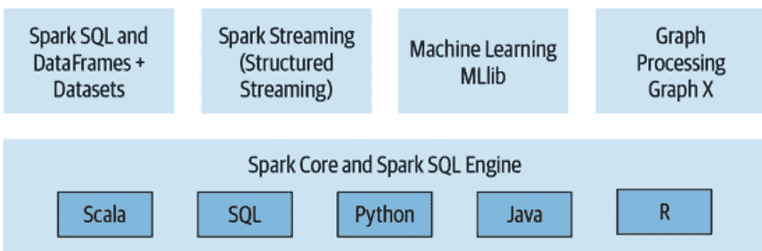

# 第 1 章 分析大数据

## 面向早期发行版读者的注意事项

借助早期发行版电子书，你可以在书籍尚处于最早形态（即作者撰写时的未经编辑的原始内容）时即获得这些书籍，从而在书籍正式发布之前很久就能利用这些技术。

这将是最终图书的第 1 章。

当人们说我们生活在大数据时代时，他们指的是我们拥有以前闻所未闻的规模来收集、存储和处理信息的工具。以下任务在 10 或 15 年前根本无法完成：

- 使用数千个特征和数十亿笔交易构建信用卡欺诈检测模型
- 向数百万用户智能推荐数百万种产品
- 通过模拟包含数百万种工具的投资组合来估算财务风险
- 轻松处理数千个人类基因组的数据，以检测与疾病相关的基因关联
- 通过定期处理数百万张卫星图像来评估农业用地利用情况和作物产量，以改进政策制定

支撑这些功能的是一个开源软件生态系统，可以利用服务器集群处理海量数据。20 世纪末 Apache Hadoop 的推出促使分布式计算得到广泛采用。自那时起，大数据生态系统和工具飞速发展。过去 5 年还引入并采用了许多开源机器学习和深度学习库。这些工具旨在利用我们现在收集和存储的海量数据。

但正如凿子和一块石头不能造就雕像一样，能够使用这些工具和数据，与将这些工具和数据用于有价值的事情之间存在差距。通常，“做有价值的事情”意味着在表格数据上覆盖模式，并使用 SQL 来回答诸如“在我们的注册流程中进入第三页面的数以亿计的用户中，有多少人超过 25 岁？”之类的问题。如何构建数据存储架构并组织信息（数据仓库、数据湖等）以便轻松回答这类问题，这是一个丰富的领域，但本书大多将避免其复杂性。

有时，“做有价值的事情”需要额外的工作。SQL 可能仍然是方法的核心，但为了绕过数据中的特殊性或执行复杂分析，我们需要一种更灵活的编程范式，并在机器学习和统计学等领域拥有更丰富的功能。数据科学正是用武之地，这也是本书要讨论的内容。

在本章中，我们将首先介绍大数据作为一个概念，以及处理大型数据集时面临的挑战。然后，我们将介绍 Apache Spark，这是一个用于分布式计算的开源框架，以及其关键组件。我们将重点介绍 PySpark（Spark 的 Python API）及其在更广泛生态系统中的位置。随后，我们将讨论 Spark 3.0 带来的变化，这是该框架时隔 4 年的首个主要版本。最后，我们将简要说明 PySpark 如何应对数据科学挑战，并成为你技能集中的绝佳补充。

本书的早期版本使用 Spark 的 Scala API 作为代码示例。我们决定改用 PySpark，原因是 Python 在数据科学社区中的受欢迎程度，以及核心 Spark 团队更好地支持该语言的关注度有所提高。希望在本章结束时，你能理解并认可这一决定。

## 处理大数据

许多我们钟爱的小数据工具在处理大数据时会遇到瓶颈。Pandas 等库无法处理无法装入内存的数据。那么，能够利用计算机集群在大型数据集上实现相同结果的等效过程应该是什么样子呢？分布式计算的挑战要求我们重新思考许多在单节点系统中依赖的基本假设。例如，由于数据必须分区到集群上的多个节点，具有广泛数据依赖关系的算法会受到网络传输速率比内存访问慢几个数量级的影响。随着参与问题求解的机器数量增加，故障概率也会增加。这些事实要求一种对底层系统特性敏感的编程范式：即一种不鼓励错误选择，并使编写高度并行执行的代码变得容易的范式。


## 大数据有多大？

Without a reference point, the term big data is ambiguous. Moreover, the age-old two-tier definition of small and big data can be confusing. When it comes to data size, a three-tiered definition is more helpful.

Table 1-1. A tiered definition of data size

| Dataset type | Fits in RAM? | Fits on local disk? |
|---|---|---|
| Small dataset | Yes | Yes |
| Medium dataset | No | Yes |
| Big dataset | No | No |

As per the above, if the dataset can fit in memory or disk on a single system, it can not be termed big data. This definition is not perfect but it does act as a good rule of thumb in context of an average machine.

Focus of this book is to enable you to work efficiently with big data. If your dataset is small and can fit in-memory, stay away from distributed systems. To analyze medium-sized datasets, a database or parallelism may be good enough at times. At other times, you may have to set up a cluster and use big data tools. Hopefully, the experience that you will gain in the following chapters will help you take such judgment calls.

Single-machine tools that have come to recent prominence in the software community are not the only tools used for data analysis. Scientific fields like genomics that deal with large data sets have been leveraging parallel-computing frameworks for decades. Most people processing data in these fields today are familiar with a cluster-computing environment called HPC (high-performance computing). Where the difficulties with Python and R lie in their inability to scale, the difficulties with HPC lie in its relatively low level of abstraction and difficulty of use. For example, to process a large file full of DNA-sequencing reads in parallel, we must manually split it up into smaller files and submit a job for each of those files to the cluster scheduler. If some of these fail, the user must detect the failure and take care of manually resubmitting them. If the analysis requires all-to-all operations like sorting the entire data set, the large data set must be streamed through a single node, or the scientist must resort to lower-level distributed frameworks like MPI, which are difficult to program without extensive knowledge of C and distributed/networked systems.

Tools written for HPC environments often fail to decouple the in-memory data models from the lower-level storage models. For example, many tools only know how to read data from a POSIX filesystem in a single stream, making it difficult to make tools naturally parallelize, or to use other storage backends, like databases. Modern distributed computing frameworks provide abstractions that allow users to treat a cluster of computers more like a single computer—to automatically split up files and distribute storage over many machines, divide work into smaller tasks and execute them in a distributed manner, and recover from failures. They can automate a lot of the hassle of working with large data sets, and are far cheaper than HPC.

> A simple way to think about *distributed systems* is that they are a group of independent computers that appear to the end-user as a single computer. They allow for horizontal scaling. That means adding more computers rather than upgrading a single system (vertical scaling). The latter is relatively expensive and often insufficient for large workloads. Distributed systems are great for scaling and reliability but also introduce complexity when it comes to design, construction, and debugging. One should understand this trade-off before opting for such a tool.

## Introducing Apache Spark and PySpark

Enter Apache Spark, an open source framework that combines an engine for distributing programs across clusters of machines with an elegant model for writing programs atop it. Spark originated at the UC Berkeley AMPLab and has since been contributed to the Apache Software Foundation. When released, it was arguably the first open source software that made distributed programming truly accessible to data scientists.

### Components

Apart from the core computation engine (Spark Core), Spark is comprised of four main components. Spark code written by a user, using either of its APIs, is executed in the workers’ JVMs (Java Virtual Machines) across the cluster. (see Chapter 2). These components are available as distinct libraries:

*Spark SQL and DataFrames + Datasets*: module for working with structured data.

*MLlib*: scalable machine learning library.

*Structured Streaming* makes it easy to build scalable fault-tolerant streaming applications.

*GraphX (legacy)*: GraphX is Apache Spark’s library for graphs and graph-parallel computation. However, for graph analytics, GraphFrames is recommended instead of GraphX which isn’t being actively developed as much and lacks Python bindings. GraphFrames is an open-source general graph processing library that is similar to Apache Spark’s GraphX but uses DataFrame-based APIs.



Figure 1-1. Apache Spark components (placeholder)

## COMPARISON WITH MAPREDUCE

One illuminating way to understand Spark is in terms of its advances over its predecessor, Apache Hadoop’s MapReduce. MapReduce revolutionized computation over huge data sets by offering a simple and resilient model for writing programs that could execute in parallel across hundreds to thousands of machines. It breaks up work into small *tasks* and can gracefully accommodate task failures without compromising the job to which they belong.

Spark maintains MapReduce’s linear scalability and fault tolerance, but extends it in three important ways.

- First, rather than relying on a rigid map-then-reduce format, its engine can execute a more general directed acyclic graph (DAG) of operators. This means that in situations where MapReduce must write out intermediate results to the distributed filesystem, Spark can pass them directly to the next step in the pipeline.

- Second, it complements its computational capability with a rich set of transformations that enable users to express computation more naturally. Out-of-the-box functions are provided for various tasks including numerical computation, datetime processing and string manipulation.

- Third, Spark extends its predecessors with in-memory processing. This means that future steps that want to deal with the same data set need not recompute it or reload it from disk. Spark is well suited for highly iterative algorithms as well as ad hoc queries.

## PySpark

PySpark is Spark’s Python API. In simpler words, PySpark is a Python-based wrapper over the core Spark framework which is written primarily in Scala. PySpark provides an intuitive programming environment for data science practitioners, and offers flexibility of Python with the distributed processing capabilities of Spark.

PySpark allows us to work across programming models. For example, a common pattern is to perform large-scale ETL work with Spark and then collect the results to a local machine followed by manipulation using Pandas. We will explore such programming models as we write PySpark code in the upcoming chapters. Here is a code example from the official documentation to give you a glimpse of what's to come:

```
from pyspark.ml.classification import LogisticRegression

### Load training data
training = spark.read.format("libsvm").load("data/mllib/sample_libsvm_data.txt")

lr = LogisticRegression(maxIter=10, regParam=0.3,
elasticNetParam=0.8)

### Fit the model
lrModel = lr.fit(training)

### Print the coefficients and intercept for logistic regression
print("Coefficients: " + str(lrModel.coefficients))
print("Intercept: " + str(lrModel.intercept))

### We can also use the multinomial family for binary
classification
mlr = LogisticRegression(maxIter=10, regParam=0.3,
elasticNetParam=0.8, family="multinomial")

### Fit the model
mlrModel = mlr.fit(training)

### Print the coefficients and intercepts for logistic regression
with multinomial family
print("Multinomial coefficients: " +
str(mlrModel.coefficientMatrix))
print("Multinomial intercepts: " + str(mlrModel.interceptVector))
```


## SPARK VS PYSPARK VS SPARKSQL

Spark、PySpark 和 SparkSQL 之间的区别可能会让初学者感到困惑。我们已分别介绍了这三个术语。让我们总结一下区别，以免今后产生任何混淆。

- Spark：一种主要使用 Scala 编程语言编写的分布式处理框架。该框架在基于 Scala 的核心框架之上提供不同的语言 API。
- PySpark：Spark 的 Python API。你可以将其视为核心 Spark 之上的 Python 封装器。
- SparkSQL：一个用于结构化数据处理的 Spark 模块。它是核心 Spark 框架的一部分，可通过其所有语言 API 访问，包括 PySpark。

## Ecosystem

Spark 是大数据生态系统中最接近“瑞士军刀”的东西。不仅如此，它还能与生态系统的其他部分良好集成，并且具有扩展性。与之前描述的 Apache Hadoop 和 HPC 系统不同，Spark 解耦了存储和计算。这意味着我们可以使用 Spark 从许多来源读取数据——Apache Hadoop、Apache Cassandra、Apache HBase、MongoDB、Apache Hive、RDBMS 等等——并全部在内存中处理。Spark 的 DataFrameReaders 和 DataFrameWriters 也可以扩展以从其他来源读取数据，例如 Apache Kafka、Kinesis、Azure Storage 和 Amazon S3，并对其进行操作。它还支持多种部署模式，从本地环境到 YARN 和 Kubernetes 集群。

围绕它还存在一个庞大的社区。这促成了许多第三方包的创建。社区创建的此类包列表可以在此处找到：https://github.com/awesome-spark/awesome-spark。主要云提供商（AWS EMR、Azure Databricks、GCP Dataproc）也为运行托管 Spark 工作负载提供第三方供应商选项。此外，还有专门的会议和本地聚会小组，可用于了解有趣的应用和最佳实践。

## Spark 3.0

2020 年，Apache Spark 发布了自 2016 年 Spark 2.0 发布以来的第一个主要版本——Spark 3.0。该系列上一个版本于 2017 年发布，涵盖了 Spark 2.0 带来的变化。Spark 3.0 没有像上一次主要版本那样引入那么多重大 API 更改。此版本侧重于性能和可用性改进，而不会引入重大的向后不兼容性。

Spark SQL 模块通过自适应查询执行和动态分区裁剪等形式实现了重大性能增强。简单来说，它们分别允许 Spark 在运行时调整物理执行计划，并跳过查询结果中不需要的数据。这些优化解决了用户以前必须投入大量手动调优和优化工作的问题。在 TPC-DS（一个行业标准的分析处理基准）上，Spark 3.0 的速度几乎是 Spark 2.4 的两倍。由于大多数 Spark 应用程序都由 SQL 引擎支持，所有更高级别的库（包括 MLLib 和结构化流）以及更高级别的 API（包括 SQL 和 DataFrames）都受益了。符合 ANSI SQL 标准使 SQL API 更易于使用。

Python 在数据科学生态系统的采用方面已脱颖而出，成为领先语言。因此，Python 现在是 Spark 上最广泛使用的语言。PySpark 在 PyPI（Python 包索引）上的月下载量超过 500 万。Spark 3.0 改进了其功能和可用性。Pandas 用户定义函数（UDF）已重新设计，以支持 Python 类型提示和迭代器作为参数。新增了 pandas UDF 类型，错误处理现在也更加 pythonic。低于 3.6 的 Python 版本已弃用。从 Spark 3.2 开始，Python 3.6 支持也已弃用。

在过去 4 年里，数据科学生态系统也在快速变化。目前更加注重将机器学习模型投入生产。深度学习取得了显著成果，Spark 团队目前正在尝试允许项目的调度程序利用 GPU 等加速器。

## PySpark 解决数据科学面临的挑战

对于一个旨在实现大数据复杂分析的系统要取得成功，它需要了解——或至少不与——数据科学家面临的一些基本挑战相冲突。

- 首先，进行成功分析所需的大部分工作都在于数据预处理。数据很混乱，清洗、整理、融合、混淆以及许多其他动词都是对其进行任何有用操作的前提。
- 其次，*迭代*是数据科学的基本组成部分。建模和分析通常需要多次遍历相同的数据。像随机梯度下降这样的常用优化过程涉及对其输入进行重复扫描以达到收敛。迭代在数据科学家自身的工作流中也很重要。选择正确的特征、选择正确的算法、运行正确的显著性测试以及找到正确的超参数都需要实验。
- 第三，即使构建了性能良好的模型，任务也并未结束。数据科学的目的是让数据对非数据科学家有用。数据引擎推荐系统和实时欺诈检测系统等数据应用最终形成数据应用。在这样的系统中，模型成为生产服务的一部分，可能需要定期甚至实时重建。

PySpark 能够很好地应对上述数据科学面临的挑战，认识到构建数据应用的最大瓶颈不是 CPU、磁盘或网络，而是分析师的生产力。将从预处理到模型评估的完整流程整合到单个编程环境中可以加速开发。通过将一套表达性编程模型与分析库封装在 REPL 环境中，PySpark 避免了往返 IDE 的操作。分析师能够越快地对数据进行实验，就越有可能对数据做出有用的操作。

PySpark 的核心 API 为数据转换提供了坚实基础，不依赖于统计学、机器学习或矩阵代数中的任何功能。在探索和熟悉数据集时，数据科学家可以在运行查询时将数据保留在内存中，并轻松缓存转换后的数据版本，而无需往返磁盘。作为一种既能让建模变得容易，又非常适合生产系统的框架，它对数据科学生态系统是一大利好。

## 后续路径

Spark 跨越了为探索性分析设计的系统与为运营分析设计的系统之间的差距。常有人这样说，数据科学家是一个比大多数统计学家更擅长工程、比大多数工程师更擅长统计学的人。至少可以说，Spark 比大多数探索性系统更适合作为运营系统，也比运营系统中常用的技术更适合数据探索。

我们希望本章有所帮助，并且你现在已准备好开始动手实践 PySpark。我们将从下一章开始这样做！
