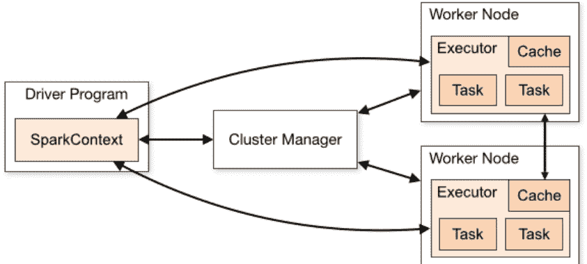

# 第 2 章 使用 PySpark 进行数据分析简介

## 给早期发行版读者的说明

使用早期发行版电子书，您可以获取书籍最早期的形式——作者在编写过程中的原始、未经编辑的内容——因此您可以在这些书籍正式发布之前很长一段时间就利用这些技术。

这将是最终图书的第 2 章。

Python 是数据科学任务中最广泛使用的语言。能够使用同一语言进行统计计算和 Web 编程的前景，促使其在 2010 年代初期迅速流行起来。这催生了用于数据分析的工具生态系统和有帮助的社区，通常被称为 PyData 生态系统。这是 PySpark 流行的重要原因之一。能够通过 Spark 在 Python 中利用分布式计算，有助于数据科学从业者因熟悉编程语言和拥有广泛社区而提高生产力。出于同样的原因，我们选择用 PySpark 编写示例。

很难表达将所有数据整理和分析都在单一环境中完成（无论数据本身存储和处理在何处）有多么颠覆性。这是一种必须亲身体验才能理解的事情，我们希望确保我们的示例捕捉到了我们第一次使用 PySpark 时体验到的那种奇妙感觉。例如，PySpark 与 Pandas 提供互操作性，Pandas 是最受欢迎的 PyData 工具之一。我们将在本章进一步探讨此功能。

在本章中，我们将通过一个数据清洗练习来探索 PySpark 强大的 DataFrame API。在 PySpark 中，`DataFrame` 是对具有规则结构的数据集的抽象，其中每条记录都是一行，由一组列组成，每列都有明确定义的数据类型。你可以将数据框视为关系数据库中表格的 Spark 类比。尽管命名约定可能会让你想起一个 `data.frame` 对象，在


pandas.DataFrame 对象不同，Spark 的 DataFrames 是另一回事。这是因为它们代表集群上的分布式数据集，而不是本地数据（数据中的每一行都存储在同一台机器上）。虽然在使用 DataFrames 以及它们在 Spark 生态系统中扮演的角色方面存在相似之处，但在 Pandas 或 R 中使用数据帧时你习惯的一些操作并不适用于 Spark，因此最好将它们视为一个独立的实体，并尝试以开放的心态来对待它们。

至于数据清洗，它是任何数据科学项目的第一步，也是通常最重要的一步。许多精巧的分析都付诸东流，因为所分析的数据存在根本性质量问题或潜在的伪迹，这些问题偏颇了分析，或导致数据科学家看到实际上并不存在的事物。因此，还有什么比通过一个数据清洗练习来向你介绍使用 PySpark 和 DataFrames 处理数据更好的方式呢？

首先，我们将介绍 PySpark 的基础知识，并使用 UC Irvine 机器学习存储库中的示例数据集进行练习。我们将重申为什么 PySpark 是数据科学的良好选择，并介绍其编程模型。然后，我们将在系统或集群上设置 PySpark，并使用 PySpark 的 DataFrame API 分析我们的数据集。使用 PySpark 进行数据分析时，大部分时间都将围绕 DataFrame API 展开，所以请做好充分熟悉它的准备。这将为我们接下来的章节打下基础，我们将在其中深入探讨各种机器学习算法。

你不需要深入了解 Spark 的内部工作原理来执行数据科学任务。但是，了解 Spark 架构的基本概念将使使用 PySpark 更加容易，并在编写代码时做出更好的决策。我们将在下一节中介绍这些内容。

## DATAFRAME 和 RDDs

RDD（弹性分布式数据集）是 Spark 中最基本的抽象。它是你的数据元素的不可变分布式集合，分区在 Spark 集群的各台机器上。这些分区可以通过提供转换和操作的低级 API 并行操作。这是 Spark 诞生之初的主要面向用户的抽象。但是，该模型存在一些问题。最重要的是，你在 RDD 上执行的任何计算对于 Spark Core 都是不透明的。因此，无法进行任何内置优化。在 PySpark 的情况下，问题更加严重。我们不会深入架构级细节，因为这超出了本讨论范围。

进入 DataFrames。DataFrames 在 Spark 1.3 中引入，它们类似于带有命名列和架构的分布式内存表，其中每个列都有特定的数据类型：integer、string、array、map、real、date、timestamp 等。从我们的角度来看，它就像一张表。还存在一组常见的操作，允许我们执行典型计算（连接、聚合）。因此，Spark 能够构建高效的执行计划，从而实现比 RDD 更好的性能。

在整本书中，我们将重点关注 DataFrames。如果你想深入了解 DataFrames 和 RDD 之间的差异，O’Reilly 出版的 Learning Spark 是一本极好的资源。

使用 DataFrame API 时，你的 PySpark 代码应能提供与 Scala 相当的性能。如果你使用 UDF（用户定义函数）或 RDD，则会有性能影响。

## Spark 架构



图 2-1. Spark 架构图（占位符 - 将 SparkContext 替换为 SparkSession）

图 2-1 通过高层组件描绘了 Spark 架构。Spark 应用程序在集群上或本地作为独立进程集运行。从高层次来看，Spark 应用程序由驱动程序、集群管理器和一组执行器进程组成。驱动程序是中心组件，负责将任务分发到执行器进程中。始终只有一个驱动程序进程。当我们谈论扩展时，是指增加执行器的数量。集群管理器仅管理资源。

Spark 是一个分布式、数据并行计算引擎。在数据并行模型中，更多数据分区意味着更高的并行度。分区允许高效的并行处理。将数据分解为块或分区的分布式方案允许 Spark 执行器仅处理靠近它们的数据，从而最大限度地减少网络带宽。也就是说，每个执行器的核心都会分配到自己的数据分区进行处理。每当涉及分区相关的选择时，请记住这一点。

Spark 编程始于一个数据集，通常位于某种分布式持久化存储（如 HDFS 或 AWS S3 等基于云的解决方案）中，格式如 Parquet。编写 Spark 程序通常包括以下几个步骤：

- 1. 在输入数据集上定义一组转换。
- 2. 调用操作，将转换后的数据集输出到持久化存储，或将结果返回到驱动程序的本地内存。这些操作理想情况下将由工作节点执行，如图 2-1 右侧所示。
- 3. 运行对以分布式方式计算出的结果进行操作的本地计算。这些计算可以帮助你决定接下来要执行哪些转换和操作。

重要的是要记住，PySpark 的所有高级抽象仍然依赖于 Spark 从一开始就存在的相同哲学：存储与执行之间的相互作用。理解这些原则将帮助你更好地使用 Spark 进行数据分析。

接下来，我们将在机器上安装并设置 PySpark，以便开始进行数据分析。这是一次性练习，将帮助我们运行本章及后续章节中的代码示例。

## 安装 PySpark

本书中的示例和代码假设你已安装 Spark 3.1.1。为了运行代码示例，请从 PyPI 仓库安装 PySpark。

```
$ pip3 install pyspark
```

如果你想将 SQL、ML 和/或 MLlib 作为额外依赖项，这也是一个选项。我们稍后会用到这些。

```
$ pip3 install pyspark[sql,ml,mllib]
```

> 从 PyPi 安装会跳过运行 Scala、Java 或 R 所需的库。完整版本可从 Spark 项目网站获取。有关设置 Spark 环境的说明（无论是集群还是本地机器），请参阅 Spark 文档。

现在我们准备启动 pyspark-shell，它是 Python 语言的 REPL，还带有一些 Spark 特定的扩展。这类似于你可能使用过的 Python 或 IPython shell。如果你只是在个人电脑上运行这些示例，可以通过指定 local[N] 启动本地 Spark 集群，其中 N 是要运行的线程数，或 * 以匹配机器上可用的核心数。例如，要在八核机器上启动使用八个线程的本地集群：

```
$ pyspark
```

> Spark 应用程序本身通常被称为 Spark *集群*。这是一个逻辑抽象，不同于物理集群（多台机器）。

如果你有运行支持 YARN 的 Hadoop 版本的 Hadoop 集群，可以通过将 Spark master 的值设为 `yarn` 来在集群上启动 Spark 作业：

```
$ pyspark --master yarn --deploy-mode client
```

本书其余示例不会向 `spark-shell` 显示 `--master` 参数，但你通常需要根据环境指定此参数。

你可能需要指定其他参数，以使 Spark shell 充分利用你的资源。执行 `pyspark --help` 可以查看参数列表。例如，使用本地 master 运行 Spark 时，可以使用 `--driver-memory 2g` 让单个本地进程使用 2 GB 内存。YARN 内存配置更为复杂，`--executor-memory` 等相关选项在 **Spark on YARN 文档**中有说明。

> Spark 框架正式支持 4 种集群部署模式 - standalone、YARN、Kubernetes 和 Mesos。更多详情请参阅 **Deploying Spark 文档**。

运行上述命令之一后，你会在 Spark 初始化时看到大量日志消息，但也应该会看到一些 ASCII 艺术，随后是一些额外的日志消息和一个提示符：

```
Python 3.6.12 |Anaconda, Inc.| (default, Sep  8 2020, 23:10:56)
[GCC 7.3.0] on linux
Type "help", "copyright", "credits" or "license" for more information.
```


欢迎使用
版本 3.0.1
使用 Python 版本 3.6.12 (默认，2020 年 9 月 8 日 23:10:56)
SparkSession 可用为 'spark'。

您可以在 shell 中运行 :help 命令。这将提示您启动交互式帮助模式，或询问有关特定 Python 对象的帮助。除了关于 :help 的说明外，Spark 日志消息还指示“SparkSession 可用为 spark。”这是对 SparkSession 的引用，它充当所有 Spark 操作和数据的入口点。请在命令行中输入 spark：

```
spark
...
<pyspark.sql.session.SparkSession object at DEADBEEF>
```

REPL 将打印对象的字符串形式。对于 SparkSession 对象，这只是其名称加上对象在内存中的十六进制地址。（DEADBEEF 是占位符；您在此处看到的精确值每次运行都会有所不同。）在交互式 Spark shell 中，Spark 驱动程序会为您实例化一个 SparkSession，而在 Spark 应用程序中，您需要自己创建一个 SparkSession 对象。

> 在 Spark 2.0 中，SparkSession 成为所有 Spark 操作和数据的统一入口点。以前使用的入口点，如 SparkContext、SQLContext、HiveContext、SparkConf 和 StreamingContext，也可以通过它访问。

我们究竟如何使用 spark 变量？SparkSession 是一个对象，因此它带有关联的方法。我们可以在 PySpark shell 中通过输入变量名，接着是一个句号，再按 Tab 键来查看这些方法：

```
spark.[Tab]
...
```

```
spark.Builder(
	spark.conf
spark.newSession(
	spark.readStream
spark.stop(
	spark.udf
spark.builder
	spark.createDataFrame (
spark.range (
	spark.sparkContext
spark.streams
	spark.version
spark.catalog
	spark.getActiveSession (
spark.read
	spark.sql (
spark.table(

```

在 SparkSession 提供的所有方法中，我们最常用的那些方法允许我们创建 DataFrame。现在我们已经设置好了 PySpark，可以设置感兴趣的数据集，并开始使用 PySpark 的 DataFrame API 与其交互。我们将在下一部分中完成此操作。

### 设置我们的数据

加州大学欧文分校机器学习库是研究和教育中获取有趣（且免费）数据集的绝佳来源。我们将分析的数据集源自 2010 年在一家德国医院进行的记录链接研究，其中包含数百万对患者记录，这些记录根据多种不同的标准进行匹配，例如患者的姓名（名和姓）、地址和生日。每个匹配字段都根据字符串的相似程度被分配了 0.0 到 1.0 之间的数值评分，随后数据被手动标记，以识别哪些对代表同一个人，哪些不代表。用于创建该数据集的字段底层值已被删除，以保护患者隐私。数值标识符、字段的匹配评分以及每对记录的标签（匹配与非匹配）已发布，供记录链接研究使用。

## 记录链接

记录链接问题的一般结构大致如下：我们有一个或多个源系统中的大量记录，并且很可能有多条记录指向同一底层实体，例如客户、患者，或企业或活动的位置。每个实体都有若干属性，例如姓名、地址或生日，我们需要使用这些属性来查找指向同一实体的记录。不幸的是，这些属性的值并不完美：值可能具有不同的格式、拼写错误或缺失信息，这意味着对属性值进行简单的相等性测试会导致我们遗漏大量重复记录。例如，让我们比较表 2-1 中显示的商家列表。

表 2-1. 记录链接的挑战

| 姓名 | 地址 | 城市 | 州 | 电话 |
|---|---|---|---|---|
| Josh's Coffee Shop | 1234 Sunset Boulevard | West Hollywood | CA | (213)-555-1212 |
| Josh Coffee | 1234 Sunset Blvd West | Hollywood | CA | 555-1212 |
| Coffee Chain #1234 | 1400 Sunset Blvd #2 | Hollywood | CA | 206-555-1212 |
| Coffee Chain Regional Office | 1400 Sunset Blvd Suite 2 | Hollywood | California | 206-555-1212 |

表中的前两条记录指向同一家小咖啡店，尽管数据录入错误使其看起来位于两个不同的城市（West Hollywood 和 Hollywood）。另一方面，后两条记录实际上指向同一家连锁咖啡店的不同营业地点，它们碰巧共享一个共同地址：其中一条记录指向实际的咖啡店，另一条记录指向当地的企业办公地点。这两条记录都提供了西雅图企业总部的官方电话号码。

这个例子说明了记录链接如此困难的一切：尽管两组记录看起来彼此相似，但我们用来做出重复/非重复决定的标准对于每组记录都不同。这种区分对于人类来说很容易一眼理解和识别，但对于计算机来说却很难学习。

在文献和实践中，记录链接有很多不同的名称：实体解析、记录去重、合并-清除和列表清洗。就我们的目的而言，我们将此问题称为记录链接。

从 shell 中，让我们从存储库拉取数据：

```
$ mkdir linkage
$ cd linkage/
$ curl -L -o donation.zip https://bit.ly/1Aoywaq
$ unzip donation.zip
$ unzip 'block_*.zip'
```

如果您手头有 Hadoop 集群，可以在 HDFS 中为块数据创建一个目录，并将数据集中的文件复制到那里：

```
$ hadoop dfs -mkdir linkage
$ hadoop dfs -put block_*.csv linkage
```

为我们的记录链接数据集创建数据帧时，我们将使用 SparkSession 对象。具体来说，我们将使用其 Reader API 上的 csv 方法：

```
prev = spark.read.csv("linkage")
...
prev
...
DataFrame[_c0: string, _c1: string, _c2: string, _c3: string,...
```

默认情况下，CSV 文件中的每个列都被视为字符串类型，列名默认为 _c0、_c1、_c2 等。我们可以在 shell 中通过调用其 show 方法来查看数据帧的开头部分：

```
prev.show()
```

我们可以看到，DataFrame 的第一行是列标题的名称，正如我们所料，且 CSV 文件已被整齐地拆分为各个列。我们还可以看到某些列中存在 ? 字符串；我们需要将这些视为缺失值。除了正确命名每个列外，如果 Spark 能为我们正确推断每个列的数据类型，那将是理想的。

幸运的是，Spark 的 CSV 读取器通过读取器 API 上我们可以设置的选项，为我们提供了所有这些功能。您可以在 PySpark 文档中查看 API 接受的完整选项列表。目前，我们将像这样读取和解析链接数据：

```
parsed = spark.read.option("header", "true").option("nullValue", "?").option("inferSchema", "true").csv("linkage")
```

当我们对解析后的数据调用 show 时，我们看到列名已正确设置，并且 ? 字符串已被替换为 null 值。要查看每个列的推断类型，我们可以像这样打印解析后的 DataFrame 的架构：

```
parsed.printSchema()
...
root
 |-- id_1: integer (nullable = true)
 |-- id_2: integer (nullable = true)
 |-- cmp_fname_c1: double (nullable = true)
 |-- cmp_fname_c2: double (nullable = true)
...
```

每个 Column 实例包含列名、能够处理每条记录中包含的数据类型的最具体数据类型，以及一个布尔字段，指示列是否可能包含 null 值（默认情况下为 true）。为了执行架构推断，Spark 必须对数据集进行两次遍历：一次遍历以确定每个列的类型，第二次遍历以执行实际解析。如果需要，第一遍可以在样本上运行。

如果您事先知道要为文件使用的架构，可以创建 pyspark.sql.types.StructType 类的实例，并通过 schema 函数将其传递给 Reader API。当数据集非常大时，这可以带来显著的性能优势，因为 Spark 不需要对数据进行额外遍历来确定每个列的数据类型。

以下是使用 StructType 和 StructField 定义架构的示例：

```
from pyspark.sql.types import *
schema = StructType([StructField("id_1", IntegerType(), False),
                     StructField("id_2", StringType(), False),
                     StructField("cmp_fname_c1", DoubleType(), False)])
spark.read.schema(schema).csv("...")
```


定义架构的另一种方法是使用 DDL（数据定义语言语句）。

```
schema = "id_1 INT, id_2 INT, cmp_fname_c1 DOUBLE"
```

## 数据格式和数据源

Spark 通过 DataFrameReader 和 DataFrameWriter API 内置支持以多种格式读取和写入数据帧。除本文讨论的 CSV 格式外，您还可以从以下来源读取和写入结构化数据：

- `parquet`
  面向列的领先数据存储格式（Spark 中的默认选项）

- `orc`
  另一种面向列的数据存储格式

- `json`
  支持与 CSV 格式相同的许多模式推断功能

- `jdbc`
  通过 JDBC 数据连接标准连接到关系数据库

- `avro`
  在使用 Apache Kafka 等流式来源时，提供高效的消息序列化和反序列化

- `text`
  将文件的每一行映射为包含单个字符串类型列的数据帧

- `image`
  从目录加载图像文件作为包含一列的数据帧，该列包含按图像架构存储的图像数据

- `libsvm`
  用于表示带有稀疏特征的带标签观测值的流行文本文件格式

- `binary`
  读取二进制文件并将每个文件转换为单个数据帧行（Spark 3.0 中的新功能）

- `xml`
  用于表示结构化信息（如文档、数据、配置或书籍）的简单基于文本的格式（通过 `spark-xml` 包可用）

您可以通过在 SparkSession 实例上调用 `read` 方法来访问 DataFrameReader API 的方法，并可以使用 `format` 和 `load` 方法，或内置格式的快捷方法之一从文件加载数据：

```
d1 = spark.read.format("json").load("file.json")
d2 = spark.read.json("file.json")
```

在这个示例中，d1 和 d2 引用相同的底层 JSON 数据，并且将具有相同的内容。每种不同的文件格式都有自己的一组选项，可以通过我们用于 CSV 文件的相同 `option` 方法来设置。

要再次写出数据，您可以通过任何 DataFrame 实例上的 `write` 方法访问 DataFrameWriter API。DataFrameWriter API 支持与 DataFrameReader API 相同的内置格式，因此以下两种方法是将 `d1` DataFrame 的内容写入 Parquet 文件的等效方式：

```
d1.write.format("parquet").save("file.parquet")
d1.write.parquet("file.parquet")
```

默认情况下，如果您尝试将数据帧保存到已存在的文件，Spark 会抛出错误。您可以通过 DataFrameWriter API 上的 `mode` 方法控制 Spark 在这种情况下的行为，即 `Overwrite` 现有文件、`Append` 将 DataFrame 中的数据追加到文件（如果存在），或者如果文件已存在则 `Ignore` 写入操作并保持原样：

```
d2.write.format("parquet").mode("overwrite").save("file.parquet")
```

您可以将模式指定为字符串字面量（“overwrite”、“append”、“ignore”）。

DataFrame 拥有多种方法，允许我们将数据从集群读取到客户端机器上的 PySpark REPL 中。其中最简单的是 `first`，它将 DataFrame 的第一个元素返回到客户端：

```
parsed.first()
...
Row(id_1='3148', id_2='8326', cmp_fname_c1='1', cmp_fname_c2=None,...
```

`first` 方法可用于对数据集进行合理性检查，但我们通常有兴趣将 DataFrame 的更大样本带回客户端进行分析。当我们知道 DataFrame 只包含少量记录时，可以使用 `toPandas` 或 `collect` 方法将 DataFrame 的所有内容作为数组返回到客户端。对于非常大的 DataFrame，使用这些方法可能很危险，并会导致内存不足（OOM）异常。因为我们目前还不知道关联数据集的大小，所以现在先不这么做。

在接下来的几个部分中，我们将结合本地开发和测试以及集群计算来对记录关联数据进行更多整理和分析，但如果您需要花一点时间来消化刚刚进入的这个精彩新世界，我们当然理解。

## 转换和操作

创建 DataFrame 的行为不会在集群上触发任何分布式计算。相反，DataFrame 定义了计算中的中间步骤的逻辑数据集。Spark 对分布式数据的操作可以分为两种类型：转换和操作。

所有转换都是惰性求值的。也就是说，它们的结果不会立即计算，而是被记录为血统。这使得 Spark 能够优化查询计划。分布式计算发生在对 DataFrame 调用 _操作_ 时。例如，`count` 操作返回 DataFrame 中对象的数量：

```
df.count()
...
15
```

`collect` 操作返回包含 DataFrame 中所有 `Row` 对象的 `Array`。这个 `Array` 位于本地内存中，而不是集群上：

```
df.collect()
[Row(id='12', department='sales'), ...
```

操作不仅仅将结果返回到本地进程。`save` 操作将 DataFrame 的内容保存到持久化存储中：

```
df.write.format("parquet").save("user/ds/mynumbers")
```

请记住，`DataFrameReader` 可以接受文本文件目录作为输入，这意味着未来的 Spark 作业可以将 `mynumbers` 引用为输入目录。

## 使用 DataFrame API 分析数据

DataFrame API 自带一组强大的工具，这些工具对于习惯使用 Python 和 SQL 的数据科学家来说可能很熟悉。在本节中，我们将开始探索这些工具以及如何将它们应用于记录关联数据。

如果我们查看 `parsed` DataFrame 的架构和前几行数据，会看到如下内容。

```
parsed.printSchema()
...
root
 |-- id_1: integer (nullable = true)
 |-- id_2: integer (nullable = true)
 |-- cmp_fname_c1: double (nullable = true)
 |-- cmp_fname_c2: double (nullable = true)
 |-- cmp_lname_c1: double (nullable = true)
 |-- cmp_lname_c2: double (nullable = true)
 |-- cmp_sex: integer (nullable = true)
 |-- cmp_bd: integer (nullable = true)
 |-- cmp_bm: integer (nullable = true)
 |-- cmp_by: integer (nullable = true)
 |-- cmp_plz: integer (nullable = true)
 |-- is_match: boolean (nullable = true)
...
```

```
parsed.show(5)
...
+--------------------+-----+---------+
| id_1|id_2|cmp_fname_c1|cmp_fname_c2|cmp_lname_c1|cmp_lname_c2|cmp_sex|cmp_bd|cmp_bm|cmp_by|cmp_plz|is_match|
+--------------------+-----+---------+
| 3148| 8326| 1.0| null| 1.0| null|
|1| 1| 1| 1| 1| true| null|
|14055|94934| 1.0| null| 1.0| null|
|1| 1| 1| 1| 1| true| null|
|33948|34740| 1.0| null| 1.0| null|
|1| 1| 1| 1| 1| true| null|
| 946|71870| 1.0| null| 1.0| null|
|1| 1| 1| 1| 1| true| null|
|64880|71676| 1.0| null| 1.0| null|
|1| 1| 1| 1| 1| true| null|
...
```

- 前两个字段是整数 ID，表示记录中匹配的患者。
- 接下来的九个值是（可能缺失的）数值（可以是 double 或 int），表示患者记录不同字段上的匹配分数，例如姓名、生日和位置。当可能的值仅为匹配（1）或不匹配（0）时，字段存储为整数；当可能存在部分匹配时，则存储为 double。
- 最后一个字段是布尔值（`true` 或 `false`），表示该行所代表的患者记录对是否匹配。

我们的目标是提出一个简单的分类器，使我们能够根据患者记录的匹配分数值来预测记录是否匹配。让我们先通过 `count` 方法了解一下我们要处理的记录数量：

```
parsed.count()
...
5749132
```

这是一个相对较小的数据集——当然足够小，可以放入集群中某个节点的内存，甚至如果您没有集群，也可以放在本地机器上。到目前为止，每次我们处理数据时，Spark 都会重新打开文件、重新解析行，然后执行请求的操作，例如显示数据的前几行或计算记录数量。当我们提出另一个问题时，Spark 会一遍又一遍地执行这些相同的操作，即使我们已经将数据筛选到少量记录，或者正在使用原始数据集的聚合版本。

这不是我们计算资源的最优用法。数据解析一次后，我们希望将数据以解析后的形式保存在集群上，这样每次想向数据提出新问题时就不必重新解析了。Spark 通过允许我们在实例上调用 `cache` 方法来指示给定的 DataFrame 生成后应在内存中缓存，从而支持此用例。现在让我们为 `parsed` DataFrame 做这个操作：

```
parsed.cache()
```

数据缓存后，我们接下来想知道的是匹配记录与非匹配记录的相对比例。


```python
from pyspark.sql.functions import col
parsed.groupBy("is_match").count().orderBy(col("count").desc()).show()
...
```

| is_match | count |
| --- | --- |
| false | 5728201 |
| true | 20931 |

与其编写一个函数来提取 `is_match` 列，不如直接将其名称传递给 DataFrame 上的 `groupBy` 方法，调用 `count` 方法来，嗯，计算每个分组内的记录数量，根据 `count` 列将结果数据按降序排序，然后使用 `show` 在 REPL 中整洁地呈现计算结果。底层，Spark 引擎会确定执行聚合并返回结果的最高效方式。这代表了 Spark 提供的干净、快速且富有表现力的数据分析方式。

请注意，引用 DataFrame 中列名称有两种方式：要么作为字符串常量，如 `groupBy("is_match")` 中所示，要么通过使用我们在 `count` 列上使用过的 `col()` 函数来创建 `Column` 对象。在大多数情况下，这两种方法都有效，但我们需要使用 `col` 函数来在生成的 `count` 列对象上调用 `desc` 方法。

## DataFrame 聚合函数

除了 `count`，我们还可以使用 DataFrame API 的 `agg` 方法，结合 `pyspark.sql.functions` 集合中定义的聚合函数，来计算求和、最小值、最大值、平均值和标准差等更复杂的聚合。例如，要查找整体 `parsed` DataFrame 中 `cmp_sex` 字段的平均值和标准差，可以输入：

```
from pyspark.sql.functions import avg, stddev

parsed.agg(avg("cmp_sex"), stddev("cmp_sex")).show()
```

| avg(cmp_sex) | stddev_samp(cmp_sex) |
| --- | --- |
| 0.955001381078048 | 0.207301111689795 |

请注意，默认情况下，Spark 计算的是样本标准差；还有一个 `stddev_pop` 函数用于计算总体标准差。

你可能已经注意到，DataFrame API 上的函数与 SQL 查询的组成部分相似。这并非巧合，事实上，我们可以将创建的任何 DataFrame 视为数据库表，并使用熟悉且强大的 SQL 语法来表达我们的问题。首先，我们需要告诉 Spark SQL 执行引擎，它应该将哪个名称与 `parsed` DataFrame 关联，因为变量本身的名称（“parsed”）对 Spark 不可用：

```
parsed.createOrReplaceTempView("linkage")
```

由于 `parsed` DataFrame 仅在此 PySpark REPL 会话期间可用，因此它是一个 *临时* 表。如果我们配置 Spark 连接到跟踪结构化数据集架构和位置的 Apache Hive 元存储，Spark SQL 还可用于查询 HDFS 中的持久表。

将我们的临时表注册到 Spark SQL 引擎后，我们可以像这样查询它：

```
spark.sql("""
SELECT is_match, COUNT(*) cnt
FROM linkage
GROUP BY is_match
ORDER BY cnt DESC
""").show()
```

| is_match | cnt |
| --- | --- |
| false | 5728201 |
| true | 20931 |

你可以在创建 `SparkSession` 实例时通过其 Builder API 调用 `enableHiveSupport` 方法，选择使用 ANSI 2003 兼容版本的 Spark SQL（默认）或 HiveQL 模式运行 Spark。

## 将 Spark SQL 连接到 Hive

你可以通过 `hive-site.xml` 文件连接到 Hive 元存储，也可以通过在 SparkSession Builder API 上调用 `enableHiveSupport` 方法在查询中使用 HiveQL：

```
spark_session =
SparkSession.builder.master("local[4]").enableHiveSupport().getOrCreate()
```

你可以将 Hive 元存储中的任何表视为 DataFrame，针对元存储中定义的表执行 Spark SQL 查询，并将这些查询的输出持久化到元存储中，以便其他工具（包括 Hive 本身、Apache Impala 或 Presto）可以查询它们。

在 PySpark 中进行分析时，是应该使用 Spark SQL 还是 DataFrame API？两者各有优劣：SQL 的优点是广泛熟悉且对于简单查询很有表现力。它还允许你使用 JDBC/ODBC 连接器从 PostgreSQL 等数据库或 Tableau 等工具查询数据。SQL 的缺点是，以动态、可读且可测试的方式表达复杂的多阶段分析可能会很困难——所有这些都是 DataFrame API 擅长的领域。在本书的其余部分，我们同时使用 Spark SQL 和 DataFrame API，并留给读者作为练习，去检查我们所做的选择，并将我们的计算从一个接口翻译到另一个接口。

我们可以逐个向 DataFrame 应用函数来获取计数和平均值等统计信息。不过，PySpark 提供了一种更好的方式来获取 DataFrame 的摘要统计信息，这将是下一节要介绍的内容。

## DataFrame 快速摘要统计

虽然有多种分析可以用 SQL 或 DataFrame API 同样好地表达，但有一些我们希望对数据框执行的常见操作，用 SQL 表达起来可能会很繁琐。其中一种尤其有用的分析就是计算数据框中数值列所有非空值的最小值、最大值、平均值和标准差。在 PySpark 中，这个函数的名称与 Pandas 中相同，称为 `describe`：

```
summary = parsed.describe()
...
summary.show()
```

`summary` DataFrame 为 `parsed` DataFrame 中的每个变量都有一个列，以及另一个名为 `summary` 的列，用于指示行中其余列所包含的指标——是 count、mean、stddev、min 还是 max。我们可以使用 `select` 方法选择列的子集，以便更轻松地读取和比较摘要统计信息：

```
summary.select("summary", "cmp_fname_c1", "cmp_fname_c2").show()
```

| summary | cmp_fname_c1 | cmp_fname_c2 |
| --- | --- | --- |
| count | 5748125 | 103698 |
| mean | 0.7129024704436274 | 0.9000176718903216 |
| stddev | 0.3887583596162788 | 0.2713176105782331 |
| min | 0.0 | 0.0 |
| max | 1.0 | 1.0 |

请注意 `cmp_fname_c1` 和 `cmp_fname_c2` 之间 `count` 变量值的差异。虽然几乎每条记录都有 cmp_fname_c1 的非空值，但不到 2% 的记录有 cmp_fname_c2 的非空值。要创建一个有用的分类器，我们需要依赖于数据中几乎总是存在的变量——除非它们的缺失表明记录是否匹配有某种意义。

当我们对数据中变量的分布有了整体了解后，我们希望了解这些变量的值与 `is_match` 列的值是如何相关的。因此，下一步是仅针对与匹配和非匹配记录对应的 `parsed` DataFrame 子集计算相同的摘要统计信息。我们可以使用类似 SQL 的 `where` 语法或使用 DataFrame API 的 Column 对象来过滤 DataFrame，然后在生成的 DataFrame 上使用 `describe`：

```
matches = parsed.where("is_match = true")
match_summary = matches.describe()

misses = parsed.filter(col("is_match") == False)
miss_summary = misses.describe()
```

传递给 `where` 函数的字符串内的逻辑可以包含在 Spark SQL 的 `WHERE` 子句中有效的语句。对于使用 DataFrame API 的过滤条件，我们在 "`is_match`" 列对象上使用 `==` 运算符来检查是否与布尔对象 `False` 相等，因为那只是 Python，而不是 SQL。请注意，`where` 函数是 `filter` 函数的别名；我们可以将上面代码片段中的 `where` 和 `filter` 调用互换，一切都会以同样的方式工作。

现在我们可以开始比较 `match_summary` 和 `miss_summary` DataFrames，以查看变量的分布如何取决于记录是匹配还是未匹配。尽管这是一个相对较小的数据集，但进行这种比较仍然有些繁琐——我们真正想要的是转置 `match_summary` 和 `miss_summary` DataFrames，使行和列互换，这样我们就可以按变量将转置后的 DataFrame 连接在一起并分析摘要统计信息，这是大多数数据科学家称为对数据集进行“透视”或“重塑”的做法。在下一节，我们将向你展示如何执行这些转换。

## 透视和重塑 DataFrames


我们可以使用 PySpark 提供的函数完全转置 DataFrame。不过，执行此任务还有另一种方法。PySpark 允许在 Spark DataFrame 和 Pandas DataFrame 之间进行转换。我们将要处理的 DataFrame 转换为 Pandas DataFrame，重塑它们，然后再将其转换回 Spark DataFrame。由于 `summary`、`match_summary` 和 `miss_summary` DataFrame 的大小较小，而 Pandas DataFrame 驻留在内存中，因此我们可以安全地执行此操作。在即将到来的章节中，我们将依赖 Spark 操作对较大的数据集进行此类转换。

> 由于 Apache Arrow 项目，转换到/从 Pandas DataFrame 是可行的，该项目允许 JVM 和 Python 进程之间高效传输数据。当我们使用 pip 安装 `pyspark[sql]` 时，PyArrow 库已作为 Spark SQL 模块的依赖项安装。

让我们将 summary 转换为 Pandas DataFrame：

```
summary_p = summary.toPandas()
```

现在我们可以在 `summary_p` DataFrame 上使用 Pandas 函数。

```
summary_p.head()
...
summary_p.shape
...
(5, 12)
```

现在我们可以对 DataFrame 使用熟悉的 Pandas 方法执行转置操作，以交换行和列。

```
summary_p = summary_p.set_index('summary').transpose().reset_index()
...
summary_p = summary_p.rename(columns={'index':'field'})
...
summary_p = summary_p.rename_axis(None, axis=1)
...
summary_p.shape
...
(11, 6)
```

我们已成功转置 `summary_p` Pandas DataFrame。使用 SparkSession 的 `createDataFrame` 方法将其转换为 Spark DataFrame：

```
summaryT = spark.createDataFrame(summary_p)
...
summaryT.show()
...
```

| 字段 | 计数 | 平均值 | 标准差 | 最小值 | 最大值 |
|---|---|---|---|---|---|
| id_1 | 5749132 | 33324.48559643438 | 23659.859374488064 | 1 | 99980 |
| id_2 | 5749132 | 66587.43558331935 | 23620.487613269695 | 6 | 100000 |
| cmp_fname_c1 | 5748125 | 0.7129024704437266 | 0.38875835961628014 | 0.0 | 1.0 |
| cmp_fname_c2 | 103698 | 0.9000176718903189 | 0.2713176105782334 | 0.0 | 1.0 |
| cmp_lname_c1 | 5749132 | 0.3156278193080383 | 0.3342336339615828 | 0.0 | 1.0 |
| cmp_lname_c2 | 2464 | 0.3184128315317443 | 0.36856706620066537 | 0.0 | 1.0 |
| cmp_sex | 5749132 | 0.955001381078048 | 0.20730111116897781 | 0 | 1 |
| cmp_bd | 5748337 | 0.22446526708507172 | 0.41722972238462636 | 0 | 1 |
| cmp_bm | 5748337 | 0.48885529849763504 | 0.4998758236779031 | 0 | 1 |
| cmp_by | 5748337 | 0.2227485966810923 | 0.4160909629831756 | 0 | 1 |
| cmp_plz | 5736289 | 0.00552866147434343 | 0.07414914925420046 | 0 | 1 |

我们还没有完成。打印 `summaryT` DataFrame 的架构。

```
summaryT.printSchema()
...
root
|-- field: string (nullable = true)
|-- count: string (nullable = true)
|-- mean: string (nullable = true)
|-- stddev: string (nullable = true)
|-- min: string (nullable = true)
|-- max: string (nullable = true)
```

在从 describe() 方法获得的 summary 架构中，每个字段都被视为字符串。由于我们希望将汇总统计信息作为数字进行分析，因此需要将值从字符串转换为双精度浮点数。

```
for c in summaryT.columns:
    if c == 'field':
        continue
    summaryT = summaryT.withColumn(c, summaryT[c].cast(DoubleType()))
...
summaryT.printSchema()
...
```

```
root
|-- field: string (nullable = true)
|-- count: double (nullable = true)
|-- mean: double (nullable = true)
|-- stddev: double (nullable = true)
|-- min: double (nullable = true)
|-- max: double (nullable = true)
```

现在我们已经了解如何转置 summary DataFrame，让我们将逻辑实现为一个函数，以便可以在 match_summary 和 miss_summary DataFrame 上重复使用。

```
from pyspark.sql import DataFrame
from pyspark.sql.types import DoubleType

def pivot_summary(desc):
    # convert to Pandas dataframe
    desc_p = desc.toPandas()
    # transpose
    desc_p = desc_p.set_index('summary').transpose().reset_index()
    desc_p = desc_p.rename(columns={'index':'field'})
    desc_p = desc_p.rename_axis(None, axis=1)
    # convert to Spark dataframe
    descT = spark.createDataFrame(desc_p)
    # convert metric columns to double from string
    for c in descT.columns:
        if c == 'field':
            continue
        else:
            descT = descT.withColumn(c, descT[c].cast(DoubleType()))
    return descT
```

现在在 Spark shell 中，对 match_summary 和 miss_summary DataFrame 使用 pivot_summary 函数：

```
match_summaryT = pivot_summary(match_summary)
miss_summaryT = pivot_summary(miss_summary)
```

现在我们已成功转置 summary DataFrame，可以连接并比较它们。我们将在下一部分执行此操作。此外，我们还将为构建模型选择所需的特征。

## 连接 DataFrame 和选择特征

到目前为止，我们仅使用了 Spark SQL 和 DataFrame API 来过滤和聚合数据集中的记录，但也可以使用这些工具在 DataFrame 上执行连接（内连接、左外连接、右外连接或全外连接）。虽然 DataFrame API 包含 join 函数，但使用 Spark SQL 表达这些连接通常更容易，尤其是当我们连接的表有大量共同列名，并且我们希望在 select 表达式中明确指明所引用的列时。让我们为 match_summaryT 和 miss_summaryT DataFrame 创建临时视图，在 field 列上连接它们，并对生成的行计算一些简单的汇总统计信息：

```
match_summaryT.createOrReplaceTempView("match_desc")
miss_summaryT.createOrReplaceTempView("miss_desc")
spark.sql("""
SELECT a.field, a.count + b.count total, a.mean - b.mean delta
FROM match_desc a INNER JOIN miss_desc b ON a.field = b.field
WHERE a.field NOT IN ("id_1", "id_2")
ORDER BY delta DESC, total DESC
""").show()
```

| 字段 | 总计 | 差值 |
|---|---|---|
| cmp_plz | 5736289.0 | 0.9563812499852176 |
| cmp_lname_c2 | 2464.0 | 0.8064147192926264 |
| cmp_by | 5748337.0 | 0.7762059675300512 |
| cmp_bd | 5748337.0 | 0.7754423111783404 |
| cmp_lname_c1 | 5749132.0 | 0.6838772482590526 |
| cmp_bm | 5748337.0 | 0.5109496938298685 |
| cmp_fname_c1 | 5748125.0 | 0.2854529057460786 |
| cmp_fname_c2 | 103698.0 | 0.09104268062280008 |
| cmp_sex | 5749132.0 | 0.032408185250332844 |

一个好的特征具有两个特性：对于匹配和非匹配，其值往往有显著差异（因此均值之差会很大），并且在数据中出现的频率足够高，以便我们可以依赖它对任何记录对都定期可用。按此衡量，`cmp_fname_c2` 并不非常有用，因为它很多时候缺失，且匹配和非匹配的均值差异相对较小——对于 0 到 1 之间的得分，差异仅为 0.09。`cmp_sex` 特征也并不特别有帮助，因为尽管它对任何记录对都可用，但均值差异仅为 0.03。

另一方面，`cmp_plz` 和 `cmp_by` 特征非常出色。它们几乎对任何记录对都会出现，且均值有非常大的差异（两个特征均超过 0.77）。`cmp_bd`、`cmp_lname_c1` 和 `cmp_bm` 特征似乎也有益：它们通常在数据集中可用，且匹配和非匹配的均值差异显著。

`cmp_fname_c1` 和 `cmp_lname_c2` 特征则参差不齐：`cmp_fname_c1` 区分度不高（均值差异仅为 0.28），尽管它通常对一对记录可用；而 `cmp_lname_c2` 均值差异很大，但几乎总是缺失。基于这些数据，在什么情况下应将这些特征纳入模型尚不十分明显。

目前，我们将使用一个简单的评分模型，根据明显良好的特征（`cmp_plz`、`cmp_by`、`cmp_bd`、`cmp_lname_c1` 和 `cmp_bm`）的值之和对记录对的相似性进行排名。对于这些特征值缺失的少数记录，我们将在求和中用 0 代替 `null` 值。我们可以通过创建一个包含计算得分和 `is_match` 列值的 DataFrame，并评估得分在不同阈值下区分匹配和非匹配的效果，来大致了解我们简单模型的性能。

## 评分和模型评估


对于我们的评分函数，我们将求和五个字段的值（cmp_lname_c1, cmp_plz, cmp_by, cmp_bd, 和 cmp_bm）。我们将使用 pyspark.sql.functions 中的 expr 来完成此操作。expr 函数将输入表达式字符串解析为它所代表的列。该字符串甚至可以涉及多个列。

```
good_features = ["cmp_lname_c1", "cmp_plz", "cmp_by", "cmp_bd",
"cmp_bm"]
...
sum_expression = " + ".join(good_features)
...
sum_expression
...
'cmp_lname_c1 + cmp_plz + cmp_by + cmp_bd + cmp_bm'
```

现在我们可以使用 sum_expression 字符串来计算分数。在求和值时，我们将使用 DataFrame 的 fillna 方法来处理并用 0 替换 null 值。

```
scored = parsed.fillna(0, subset=good_features).withColumn('score',
expr(sum_expression)).select('score', 'is_match')
...
scored.show()
...
```

| 分数 | 是否匹配 |
|-------|----------|
| 5.0 | true |
| 5.0 | true |
| 5.0 | true |
| 5.0 | true |
| 5.0 | true |
| 5.0 | true |
| 4.0 | true |
| ... | ... |

创建评分函数的最后一步是确定分数必须超过的阈值，以便我们能预测两条记录代表匹配。如果阈值设得过高，我们会错误地将匹配记录标记为未匹配（称为假阴性率）；反之，如果阈值设得过低，我们会错误地将未匹配记录标记为匹配（假阳性率）。对于任何非平凡问题，我们总是需要用一些假阳性来换取一些假阴性，而阈值应该是多少通常取决于模型应用情境下两种错误的相对成本。

为了帮助我们选择阈值，创建一个列联表（有时称为交叉表，或 crosstab）会很有帮助，它统计分数高于/低于阈值的记录数，并与这些类别中匹配/不匹配的记录数进行交叉。由于我们还不知道将使用什么阈值，让我们编写一个函数，该函数以 scored DataFrame 和阈值选择作为参数，并使用 DataFrame API 计算列联表：

```
def crossTabs(scored: DataFrame, t: DoubleType) -> DataFrame:
    return scored.selectExpr(f"score >= {t} as above",
    "is_match").groupBy("above").pivot("is_match", ("true",
    "false")).count()
```

请注意，我们使用了 DataFrame API 的 selectExpr 方法，以根据 t 参数的值使用 Python 的 f-string 格式化语法动态确定名为 above 的字段的值，这允许我们在字符串前加上字母 f 来按名称替换变量（又一个方便的 Scala 隐式魔法）。一旦定义了 above 字段，我们就使用之前用过的 groupBy、pivot 和 count 方法的标准组合来创建列联表。

应用较高的阈值 4.0（意味着五个特征的平均值为 0.8），我们可以过滤掉几乎所有非匹配记录，同时保留超过 90% 的匹配记录：

```
crossTabs(scored, 4.0).show()
...
```

| 高于阈值 | true | false |
|-------|------|-------|
| true | 20871 | 637 |
| false | 60 | 5727564 |

应用较低的阈值 2.0，我们可以确保捕获所有已知匹配记录，但代价是大量的假阳性（右上角单元格）：

```
crossTabs(scored, 2.0).show()
...
```

| 高于阈值 | true | false |
|-------|------|-------|
| true | 20931 | 596414 |
| false | null | 5131787 |

虽然假阳性的数量高于我们想要的，但这种更宽松的过滤器仍然从我们的考虑中移除了 90% 的非匹配记录，同时包含了每个正匹配。虽然这已经相当不错，但仍有可能做得更好；看看你能否找到一种方法，使用 MatchData 中的一些其他值（无论是缺失的还是非缺失的）来创建一个评分函数，该函数能以少于 100 个假阳性的代价成功识别每个真正的匹配。

## 此后何去何从

如果这是你第一次使用 PySpark 进行数据准备和分析，我们希望你能体会到这些工具提供的强大基础。如果你已经使用 Python 和 Spark 一段时间了，我们希望你能将本章推荐给你的朋友和同事，以此向他们介绍这种强大的功能。

本章的目标是为你提供足够的知识，使你能够理解并完成本书中其余示例。如果你是那种通过实际示例学习效果最好的人，那么你的下一步是继续学习下一组章节，我们将在其中向你介绍 MLlib，即专为 Spark 设计的机器学习库。
