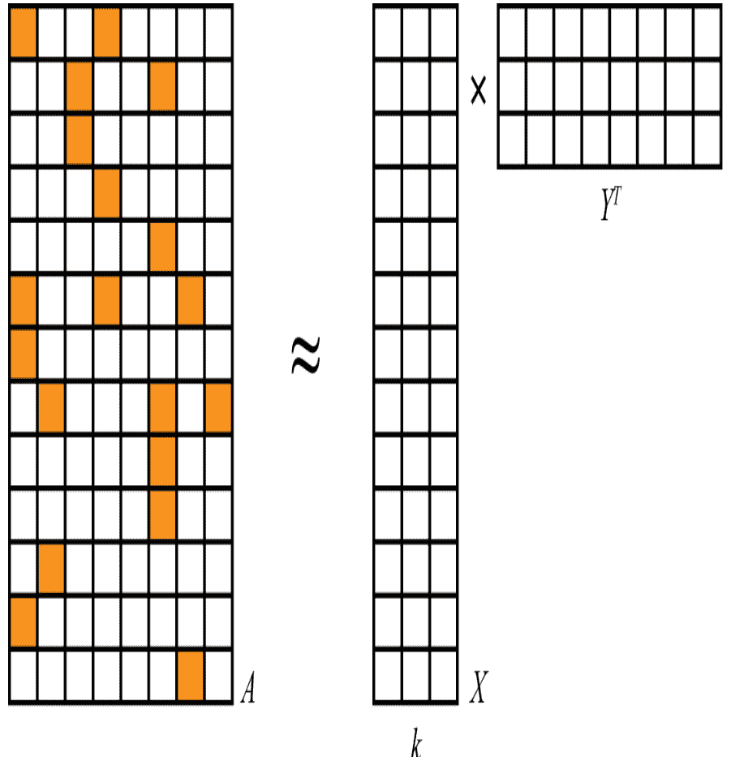

# 第 3 章。推荐音乐和 Audioscrobbler 数据集

## 面向早期发布读者的说明

通过早期发布电子书，你可以获得书籍的最早形式——作者在编写时的原始、未编辑内容——因此你可以在这些书籍正式发布很久以前就利用这些技术。

这将是最终书籍的第 3 章。

推荐引擎是大规模机器学习中最流行的示例之一，大多数人都见过亚马逊的推荐引擎。这是一个共同点，因为推荐引擎无处不在，从社交网络到视频网站再到在线零售商。我们也可以直接观察它们的运作。我们意识到计算机正在选择在 Spotify 上播放的曲目，这很大程度上就像我们不一定会注意到 Gmail 正在决定收件邮件是否是垃圾邮件一样。

推荐系统的输出比其他机器学习算法更直观易懂。甚至可以说很令人兴奋。尽管我们认为音乐品味是个人且难以解释的，但推荐系统却能出色地识别出我们不知道自己会喜欢的曲目。对于通常部署推荐系统的领域（如音乐或电影），推测为什么一首推荐的音乐符合某人的听歌历史相对容易。并非所有聚类或分类算法都符合这一描述。例如，支持向量机分类器是一组系数，即使是从业者也很难阐明这些数字在进行预测时的含义。

用一章关于推荐引擎（尤其是音乐推荐）的内容来开启接下来三章（这些章节将探讨 PySpark 上的关键机器学习算法）似乎很合适。这是一种引入 PySpark 和 MLlib 实际应用以及一些将在后续章节中深入的基本机器学习理念的易懂方式。

在本章中，我们将在 PySpark 中实现一个推荐系统。具体来说，我们将使用音乐流媒体服务提供的开放数据集上的交替最小二乘（ALS）算法。我们将首先了解数据集并在 PySpark 中导入它。然后我们将讨论选择 ALS 算法及其在 PySpark 中的实现的动机。随后将进行数据准备并使用 PySpark 构建我们的模型。最后，我们将做一些用户推荐，并讨论通过超参数选择来改进模型的方法。

## 设置数据

我们将使用由 Audioscrobbler 发布的数据集。Audioscrobbler 是 last.fm（最早的互联网流媒体电台网站之一，成立于 2002 年）的第一个音乐推荐系统。Audioscrobbler 提供了一个开放 API 用于“scrobbling”，即记录听众的歌曲播放。last.fm 利用这些信息构建了一个强大的音乐推荐引擎。由于第三方应用和网站可以将听歌数据提供回推荐引擎，该系统覆盖了数百万用户。

当时，推荐引擎的研究主要局限于从类似评分的数据中学习。也就是说，推荐系统通常被视为处理诸如“Bob 给 Prince 打 3.5 星”这样的输入的工具。Audioscrobbler 数据集有趣之处在于它仅记录播放：“Bob 播放了一首 Prince 曲目。”播放所携带的信息不如评分多。仅仅因为 Bob 播放了该曲目并不意味着他实际上喜欢它。你或我


可能会偶尔播放我们不喜欢的艺术家的歌曲，甚至播放一张专辑后离开房间。

然而，听众对音乐的评分频率远低于播放频率。因此，这样的数据集比评分数据集更大，覆盖了更多用户和艺术家，包含的总信息量也更多，即使每个单独的数据点携带的信息较少。这种类型的数据通常被称为*隐式反馈*数据，因为用户-艺术家连接是作为其他行为的副作用被暗示出来的，而不是作为明确的评分或点赞给出的。

last.fm 在 2005 年分发的一个数据集快照可以作为*压缩存档*在线找到。下载存档，并在其中找到几个文件。首先，需要使数据集的文件可用。如果您使用的是远程集群，请将所有三个数据文件复制到存储中。本章将假设文件可用于 *data/*。

启动 `pyspark-shell`。请注意，本章中的计算将比简单应用程序占用更多内存。例如，如果您在本地运行而非在集群上运行，则可能需要指定类似 `--driver-memory 4g` 的内容，以有足够内存完成这些计算。主要数据集位于 `user_artist_data.txt` 文件中。它包含约 141,000 个唯一用户和 160 万个唯一艺术家。约 2420 万次用户对艺术家的播放记录及其计数已被记录。让我们将此数据集读入 DataFrame 并查看它。

```
raw_user_artist_data =
spark.read.text("data/audioscrobbler_data/user_artist_data.txt")

raw_user_artist_data.show(5)
```

| value |
| --- |
| 1000002 1 55 |
| 1000002 1000006 33 |
| 1000002 1000007 8 |
| 1000002 1000009 144 |
| 1000002 1000010 314 |

像 ALS 这样的机器学习任务可能比简单的文本处理更加计算密集。将数据分解为更小的片段（即更多分区）进行处理可能更好。读取文本文件后，可以链式调用 `.repartition(n)` 来指定不同且更大的分区数量。例如，您可以将此设置得更高，以匹配集群中的核心数量。

数据集还在 *artist_data.txt* 文件中按 ID 给出了每个艺术家的名称。请注意，在 scrobble 时，客户端应用程序会提交正在播放的艺术家名称。该名称可能拼写错误或不规范，并且可能只有在稍后才能被发现。例如，“The Smiths”、“Smiths, The”和“the smiths”可能在数据集中显示为不同的艺术家 ID，尽管它们显然是相同的。因此，数据集还包含 *artist_alias.txt*，它将已知拼写错误或变体的艺术家 ID 映射到该艺术家的规范 ID。让我们也将这两个数据集读入 PySpark。

```
raw_artist_data =
spark.read.text("data/audioscrobbler_data/artist_data.txt")

raw_artist_data.show(5)
```

| value |
| --- |
| 1134999\t06Crazy ... |
| 6821360\tPang Nak... |
| 10113088\tTerfel,... |
| 10151459\tThe Fla... |
| 6826647\tBodensta... |

```
raw_artist_alias =
spark.read.text("data/audioscrobbler_data/artist_alias.txt")

raw_artist_alias.show(5)
```

| value |
| --- |
| 1092764\t1000311 |
| 1095122\t1000557 |
| 6708070\t1007267 |
| 10088054\t1042317 |
| 1195917\t1042317 |

我们现在对数据集有了基本了解。我们将讨论推荐算法的要求，随后了解为什么交替最小二乘算法是一个不错的选择。

## 我们对推荐系统的要求

我们需要选择适合我们数据的推荐算法。以下是我们的考虑因素：

- 隐式反馈。

它完全由用户与艺术家歌曲之间的交互组成。它不包含关于用户的信息，也不包含关于艺术家的信息，除了他们的姓名。我们需要一种无需访问用户或艺术家属性即可学习的算法。这些通常被称为协作过滤算法。例如，因为两个用户年龄相同就认为他们可能有相似的品味，这不是协作过滤的示例。因为两个用户播放了许多其他相同的歌曲就认为他们可能都喜欢同一首歌曲，这是协作过滤的示例。

- 稀疏性

我们的数据集看起来很大，因为它包含数千万次播放计数。但在另一种意义上，它很小且单薄，因为它是稀疏的。平均而言，每个用户播放了大约 171 位艺术家的歌曲——而总共有 160 万位艺术家。有些用户只听过一个艺术家。我们需要一种即使对这些用户也能提供不错推荐的算法。毕竟，每个听众一开始都只有一次播放！

- 可扩展性和实时预测

最后，我们需要一种可扩展的算法，既能构建大型模型，又能快速生成推荐。推荐通常需要近乎实时地完成——在一秒钟内，而不是明天。

可能适合的一大类算法是隐因模型。它们试图通过相对较少的未观察到的根本原因，来解释大量用户与项目之间的观察到的交互。例如，考虑一位购买了金属乐队 Megadeth 和 Pantera 专辑，但也购买了古典作曲家 Mozart 专辑的客户。可能很难解释为什么正好购买了这些专辑而没有购买其他专辑。然而，这可能只是对更广泛品味集的一个小窗口。也许该客户喜欢从金属到前卫摇滚再到古典的连贯音乐谱系。这个解释更简单，并且作为额外好处，还能暗示许多其他可能感兴趣的专辑。在这个例子中，“喜欢金属、前卫摇滚和古典”是三个隐因，可以解释成千上万个单独的专辑偏好。

在我们的情况中，我们将具体使用一种矩阵分解模型。在数学上，这些算法将用户和产品数据视为一个大矩阵 A，其中行 i 列 j 处的条目如果用户 i 播放了艺术家 j 则存在。A 是稀疏的：A 中的大多数条目都是 0，因为所有可能的用户-艺术家组合中只有少数实际上出现在数据中。它们将 A 分解为两个较小矩阵 X 和 Y 的矩阵乘积。它们非常“瘦长”——两者都有很多行，因为 A 有很多行和列，但两者都只有少数几列 (k)。k 列对应于用于解释交互数据的隐因。

由于 k 很小，分解只能是近似的，如图 3-1 所示。



图 3-1. 矩阵分解

这些算法有时被称为矩阵补全算法，因为原始矩阵 A 可能非常稀疏，但乘积 XY^T 是稠密的。极少有，甚至没有条目是 0，因此该模型只是对 A 的近似。从这个意义上说，它是一个模型，因为它为原始 A 中缺失（即为 0）的许多条目生成（“补全”）一个值。

幸运的是，在这种情况下，线性代数直接且优雅地映射到直觉。这两个矩阵分别为每个用户和每个艺术家包含一行。行中只有少数几个值——k。每个值对应模型中的一个隐特征。因此，行表达了用户和艺术家与这些 k 个隐特征的关联程度，这些特征可能对应品味或流派。而且，用户-特征矩阵与特征-艺术家矩阵的乘积仅仅是整个稠密用户-艺术家交互矩阵的完整估计。这个乘积可以被视为将项目映射到其属性，然后用用户属性对这些属性进行加权。

坏消息是，A = XY^T 通常根本没有精确解，因为 X 和 Y 不够大（从技术上讲，秩太低），无法完美表示 A。这其实是一件好事。A 只是可能发生的所有交互中的微小样本。从某种意义上说，我们认为 A 是对更简单潜在现实的一个极其零碎且因此难以解释的视图，而这种现实可以由少量因素 k 很好地解释。想象一幅描绘猫的拼图。最终的拼图很容易描述：一只猫。然而，当你手里只拿着几块拼图时，你看到的图像就很难描述了。

XY^T 仍应尽可能接近 A。毕竟，这是我们所能依据的全部。它不会也不应该完全复制 A。坏消息又来了，这无法同时直接求解出最佳 X 和最佳 Y。好消息是，如果已知 Y，求解最佳 X 是微不足道的，反之亦然。但事先两者都未知！

幸运的是，有算法可以摆脱这个两难困境并找到一个不错的解决方案。PySpark 中可用的此类算法之一就是 ALS 算法。

## 交替最小二乘算法

我们将使用交替最小二乘 (ALS) 算法从我们的数据集中计算隐因。这种方法曾被推广


在 Netflix Prize 竞赛期间，类似于“隐式反馈数据集的协同过滤”和“Netflix Prize 大规模并行协同过滤”的论文相继发表。PySpark MLlib 的 ALS 实现借鉴了这两篇论文的思想，也是 Spark MLlib 中目前唯一实现的推荐算法。

这里有一个代码片段（非功能性），让你一睹本章后续内容的风貌。

```python
from pyspark.ml.recommendation import ALS

als = ALS(maxIter=5, regParam=0.01, userCol="user",
itemCol="artist", ratingCol="count")
model = als.fit(train)

predictions = model.transform(test)
```

使用 ALS 时，我们将输入数据视为一个大型稀疏矩阵 A，并如上一节所讨论的，求解 X 和 Y。起初，Y 是未知的，但可以将其初始化为一个包含随机选取行向量的矩阵。然后，给定 A 和 Y，简单的线性代数即可得出 X 的最优解。事实上，将 X 的每一行 i 分别作为 Y 和 A 中某一行的函数来计算微不足道。由于可以分别完成，因此可以并行执行，这对于大规模计算是一个极佳的特性：

A_i Y(Y^T Y)^{-1} = X_i

等式无法精确实现，因此实际目标是最小化 |A_i Y(Y^T Y)^{-1} - X_i|，即两个矩阵元素之间平方差的和。这便是名称中“最小二乘”法的由来。在实际操作中，这从不通过实际计算逆矩阵来求解，而是通过更快速、更直接的方法（如 QR 分解）来完成。这个公式只是对行向量如何计算的理论进行了阐述。

同样的方法可以用于从 X 计算每个 Y_j。同样，可以从 Y 计算 X，以此类推。这就是名称中“交替”部分的由来。只有一个小问题：Y 是编造的，而且是随机的！X 确实是最优计算出来的，但它是基于一个错误的 Y 解得出的。幸运的是，如果重复这个过程，X 和 Y 最终会收敛到不错的解。

当用于分解表示隐式数据的矩阵时，ALS 分解会稍微复杂一些。它并非直接对输入矩阵 A 进行分解，而是对由 0 和 1 组成的矩阵 P 进行分解，其中 A 包含正值的位置为 1，其他位置为 0。A 中的数值稍后将作为权重纳入。这个细节超出了本书的范围，但理解如何使用该算法并非必须。

最后，ALS 算法也可以利用输入数据的稀疏性。这一特点，加上其对简单、优化过的线性代数的依赖以及其数据并行特性，使其在大规模场景下非常快速。

接下来，我们将预处理数据集，使其适合与 ALS 算法一起使用。

## 准备数据

构建模型的第一步是了解可用的数据，并将其解析或转换为适合在 Spark 中进行分析的形式。

Spark MLlib 的 ALS 实现并不严格要求用户和项目的 ID 为数字，但当 ID 确实可以表示为 32 位整数时效率更高。这是因为在底层，数据是使用 Java 虚拟机（JVM）的数据类型来表示的。这个数据集是否已经符合此要求？

```python
raw_user_artist_data.show(10)
```

| value |
|---|
| 1000002 1 55 |
| 1000002 1000006 33 |
| 1000002 1000007 8 |
| 1000002 1000009 144 |
| 1000002 1000010 314 |
| 1000002 1000013 8 |
| 1000002 1000014 42 |
| 1000002 1000017 69 |
| 1000002 1000024 329 |
| 1000002 1000025 1 |

文件的每一行包含一个用户 ID、一个艺术家 ID 和一个播放次数，它们之间用空格分隔。要计算用户 ID 的统计信息，我们按空格字符分割每一行，并将值解析为整数。从概念上讲，结果是三个“列”：用户 ID、艺术家 ID 和整数形式的计数。将其转换为名为“user”、“artist”和“count”的列的数据框是有意义的，因为这样就可以轻松计算最大值和最小值等简单统计量：

```python
from pyspark.sql.functions import split, min, max
from pyspark.sql.types import IntegerType, StringType
user_artist_df = raw_user_artist_data.withColumn('user',
    split(raw_user_artist_data['value'], ' ').getItem(0).cast(IntegerType())) \
    .withColumn('artist', split(raw_user_artist_data['value'], ' ').getItem(1).cast(IntegerType())) \
    .withColumn('count', split(raw_user_artist_data['value'], ' ').getItem(2).cast(IntegerType())).drop('value')
user_artist_df.select([min("user"), max("user"), min("artist"), max("artist")]).show()
```

| min(user) | max(user) | min(artist) | max(artist) |
|---|---|---|---|
| 90 | 2443548 | 1 | 10794401 |

用户 ID 和艺术家 ID 的最大值分别为 2443548 和 10794401（最小值分别为 90 和 1；没有负值）。它们都远小于 2147483647。使用这些 ID 不需要任何额外的转换。

在本示例中稍后，了解与不透明数字 ID 对应的艺术家名称将很有用。raw_artist_data 包含由制表符分隔的艺术家 ID 和名称。PySpark 的 split 函数接受 `pattern` 参数的正则表达式值。我们可以使用空白字符 `\s` 进行分割：

```python
from pyspark.sql.functions import col

artist_by_id = raw_artist_data.withColumn('id',
    split(col('value'), '\\s+', 2).getItem(0).cast(IntegerType())) \
    .withColumn('name',
    split(col('value'), '\\s+', 2).getItem(1).cast(StringType())) \
    .drop('value')
```

| id | name |
|---|---|
| 1134999 | 06Crazy Life |
| 6821360 | Pang Nakarin |
| 10113088 | Terfel, Bartoli- ... |
| 10151459 | The Flaming Sidebur |
| 6826647 | Bodenstandig 3000 |

这将生成一个数据框，其中艺术家 ID 和名称作为列“id”和“name”。

raw_artist_alias 将可能拼写错误或不标准的艺术家 ID 映射到艺术家标准名称的 ID。该数据集相对较小，包含约 200,000 条记录。每行包含两个 ID，由制表符分隔。我们将以类似于处理 raw_artist_data 的方式来解析它。

```python
artist_alias = raw_artist_alias.withColumn('artist',
    split(col('value'), '\\s+').getItem(0).cast(IntegerType())) \
    .withColumn('alias',
    split(col('value'), '\\s+').getItem(1).cast(StringType())) \
    .drop('value')
```

| artist | alias |
|---|---|
| 1092764 | 1000311 |
| 1095122 | 1000557 |
| 6708070 | 1007267 |
| 10088054 | 1042317 |
| 1195917 | 1042317 |

第一条记录将 ID 1092764 映射到 1000311。我们可以从 artist_by_id 数据框中查找这些 ID：

```python
artist_by_id.filter(artist_by_id.id.isin(1092764, 1000311)).show()
...
```

| id | name |
|---|---|
| 1000311 | Steve Winwood |
| 1092764 | Winwood, Steve |

这条记录显然将“Winwood, Steve”映射到了“Steve Winwood”，而这正是该艺术家的正确名称。

## 构建第一个模型

虽然该数据集已几乎适合与 Spark MLlib 的 ALS 实现一起使用，但仍需要进行一小步额外的转换。应该应用别名数据集，将所有艺术家 ID 转换为标准 ID（如果存在不同的标准 ID）。

```python
from pyspark.sql.functions import broadcast, when
train_data = user_artist_df.join(broadcast(artist_alias), 'artist', how='left') \
    .withColumn('artist', when(col('alias').isNull(), col('artist')).otherwise(col('alias'))) \
    .withColumn('artist', col('artist').cast(IntegerType())).drop('alias')
```

```python
train_data.cache()
train_data.count()
...
24296858
```

如果存在，则获取艺术家的别名；否则获取原始艺术家。

我们对先前创建的 `artist_alias` 数据框使用了 `broadcast`。这会让 Spark 在集群中*每个执行器*上仅发送并保留一份副本。当有成千上万个任务，且许多任务在每个执行器上并行执行时，这可以节省大量的网络流量和内存。经验法则是，在与非常大的数据集进行连接时，广播一个显著较小的数据集是有帮助的。


## 广播变量

当Spark运行一个阶段时，它会创建运行该阶段中任务所需所有信息的二进制表示；这被称为需要执行的函数的 _闭包_。这个闭包包括函数中引用的驱动程序上的所有数据结构。Spark将其与发送到集群上执行器的每个任务一起分发。

当许多任务需要访问相同（不可变）的数据结构时，广播变量很有用。它们扩展了任务闭包的正常处理，以实现：

- 将数据作为每个执行器上的原始Java对象缓存，因此无需为每个任务反序列化
- 在多个作业、阶段和任务之间缓存数据

例如，考虑一个自然语言处理应用程序，它需要一个大型英文单词词典，并且有一个`score`函数，该函数接受一行输入和单词词典。广播词典意味着它只被传输到每个执行器一次：

`DataFrame`操作有时在大表和小表之间执行连接时也可以自动利用广播。有时仅广播小表是有利的。这称为 _广播哈希连接_。

对`cache()`的调用向Spark建议，此DataFrame在计算后应暂时存储，并且此外，保持在集群内存中。这很有帮助，因为ALS算法是迭代的，通常需要访问此数据10次或更多。没有这个，DataFrame每次被访问时都可能从原始数据重复重新计算！Spark UI中的Storage选项卡将显示缓存了多少DataFrame以及它使用了多少内存，如图 3-2所示。这个在整个集群中大约消耗120 MB。

| 存储级别 | 缓存分区 | 缓存比例 | 内存大小 | 磁盘大小 |
|---|---|---|---|---|
| 内存反序列化 1x 副本 | 8 | 100% | 120.3 MB | 0.0 B |

图 3-2. Spark UI中的Storage选项卡，显示缓存的DataFrame内存使用情况

当你使用cache()或persist()时，DataFrame在你触发遍历每条记录的操作（例如count()）之前不会被完全缓存。如果你使用类似show(1)的操作，只会缓存一个分区。这是因为PySpark优化器会发现你不需要仅为了检索一条记录就计算所有分区。

请注意，上述UI中的“Deserialized”标签实际上仅对RDD相关，其中“Serialized”意味着数据在内存中不是作为对象存储，而是作为序列化字节。但是，像这样的`DataFrame`实例会在内存中单独执行常见数据类型的自身“编码”。

实际上，120 MB出人意料地小。考虑到这里存储了大约2400万次播放，一个快速的背面信封估算表明，这意味着每个用户-艺术家-计数条目平均只消耗5个字节。然而，仅三个32位整数就应该消耗12个字节。这是DataFrame的一个优势。因为存储的数据类型是原始32位整数，因此它们在内存中的表示可以在内部优化。

## Spark UI

Spark UI是正在运行的Spark应用程序的Web界面，用于监控Spark集群的状态和资源消耗。默认情况下，它可在 http://[driver]:4040 上使用。

## Spark 作业 (1)

用户: analysismark
总运行时间: 5 s
调度模式: FIFO

- 事件时间线
- 启用缩放

| | 200 | 400 | 600 | 800 | ... |
|---|---|---|---|---|---|
| 执行器 | | | | | |
| 作业 | | | | | |
| | 20:11:55 | | 20:11:56 | | ... |

图 3-3. Spark UI

它带有以下选项卡：

- 作业
- 阶段
- 带有DataFrame大小和内存使用情况的存储
- 环境
- 执行器
- SQL

某些选项卡，例如与流相关的选项卡，是懒加载的，即在需要时创建。

最后，我们可以构建一个模型：

```
from pyspark.ml.recommendation import ALS
model = ALS(rank=10, seed=0, maxIter=5, regParam=0.1,
implicitPrefs=True, alpha=1.0, userCol='user', itemCol='artist',
ratingCol='count') \
.fit(train_data)
```

此操作使用一些默认配置构建`model`作为`ALSModel`。该操作可能需要几分钟或更长时间，具体取决于您的集群。与一些机器学习模型相比，其最终形式可能仅由少数参数或系数组成，这种类型的模型非常大。它为模型中的每个用户和产品包含10个值的特征向量，在本例中，它们超过170万个。该模型将这些大型用户特征和产品特征矩阵作为它们各自的DataFrame包含。

您结果中的值可能有些不同。最终模型取决于随机选择的初始特征向量集。然而，MLlib中此组件和其他组件的默认行为是通过默认固定种子，每次使用相同的随机选择集。这与其他库不同，在其他库中，随机元素的行为通常默认不固定。因此，在这里和其他地方，都会设置一个随机种子，如(... seed=0, ...)。

要查看一些特征向量，请尝试以下操作，它只显示一行且不截断特征向量的宽显示：

```
model.userFactors.show(1, truncate = False)
```

```
...
+-+-+---------------------------------...
|id |features                            ...
+-+-+---------------------------------...
|90 |[0.16020626, 0.20717518, -0.1719469, 0.06038466 ...
+-+-+---------------------------------...
```

在ALS上调用的其他方法，例如setAlpha，设置超参数，其值可能会影响模型做出的推荐质量。这些将在以后解释。更重要的第一个问题是，模型好不好？它能产生好的推荐吗？这就是我们将在下一节中尝试回答的问题。

## 抽查推荐

我们首先应该看看艺术家推荐是否符合直觉，通过查看某个用户、其播放记录以及针对该用户的推荐。以用户2093760为例。首先，让我们查看他或她的播放记录，以了解此人的品味。提取此用户收听过的艺术家ID并打印他们的姓名。这意味着在输入中搜索此用户播放的艺术家ID，然后按这些ID过滤艺术家集合，以便按顺序打印姓名：

```
user_id = 2093760
```

```
existing_artist_ids = train_data.filter(train_data.user == user_id) \
.select("artist").collect()
```

```
existing_artist_ids = [i[0] for i in existing_artist_ids]
artist_by_id.filter(col('id').isin(existing_artist_ids)).show() ③
...
```

| id | name |
|----|------|
| 1180 | David Gray |
| 378 | Blackalicious |
| 813 | Jurassic 5 |
| 12555340 | The Saw Doctors |
| 942 | Xzibit |

- 查找用户为2093760的行。
- 收集艺术家ID数据集。
- 过滤这些艺术家。

这些艺术家看起来是主流流行音乐和嘻哈的混合。Jurassic 5的粉丝？记住，那是2005年。如果你在想的话，The Saw Doctors是一支非常爱尔兰的摇滚乐队，在爱尔兰很受欢迎。

现在，为用户生成推荐很简单，尽管以这种方式计算需要花费几分钟。它适用于批量评分，但不适用于实时用例：

```
user_subset = train_data.select('user').where(col('user') == user_id).distinct()
top_predictions = model.recommendForUserSubset(user_subset, 5)
top_predictions.show()
...
```

| user | recommendations |
|------|-----------------|
| 2093760 | [{2814, 0.0294106...|

生成的推荐包含由艺术家ID组成的列表，当然还有“预测”。对于这种类型的ALS算法，预测通常是0到1之间的不透明值，值越高意味着推荐越好。它不是概率，但可以被视为一个估计


0/1 值，分别指示用户不会或会与艺术家互动。

提取用于推荐的艺术家 ID 后，我们可以以类似的方式查找艺术家名称：

```
top_predictions_pandas = top_predictions.toPandas()
print(top_predictions_pandas)
...
             user                    recommendations
0    2093760   [(2814, 0.029410675168037415), (1300642, 0.028...
...
recommended_artist_ids = [i[0] for i in
top_predictions_pandas.recommendations[0]]

artist_by_id.filter(col('id').isin(recommended_artist_ids)).show()
...
```

| id | 名称 |
|---|---|
| 2814 | 50 Cent |
| 4605 | Snoop Dogg |
| 1007614 | Jay-Z |
| 1001819 | 2Pac |
| 1300642 | The Game |

结果全是嘻哈音乐。乍一看，这似乎不是一组很好的推荐。虽然这些通常都是受欢迎的艺术家，但它们似乎并未根据该用户的听歌习惯进行个性化推荐。

## 评估推荐质量

当然，这仅仅是对单个用户结果的一种主观判断。除了该用户本人，任何人都很难量化推荐效果有多好。此外，让任何人工对甚至一小部分输出结果进行打分以进行评估，也是不可行的。

假设用户倾向于播放有吸引力的艺术家的歌曲，而不播放没有吸引力的艺术家的歌曲，这是合理的。因此，用户的播放行为对“好”和“坏”的艺术家推荐提供了一部分画面。这是一个有问题的假设，但在没有其他数据的情况下，这也是能做到的最好方案。例如，推测用户 2093760 喜欢的艺术家远多于之前列出的 5 个，而在未播放的其他 170 万名艺术家中，有几个是感兴趣的，并非全都是“坏”的推荐。

假设根据推荐系统将好艺术家排在推荐列表前面的能力来评估推荐系统，会怎样呢？这是可应用于排名系统（例如推荐系统）的几种通用指标之一。问题是，“好”被定义为“用户已听过的艺术家”，而推荐系统作为输入已经收到了所有这些信息。它可以轻而易举地将用户之前听过的艺术家作为首选推荐返回并获得满分。但这并不有用，尤其是因为推荐系统的职责是推荐用户从未听过的艺术家。

为使其变得有意义，可以将部分艺术家播放数据搁置，并在 ALS 模型构建过程中将其隐藏。然后，这些留出的数据可以被解读为每个用户的一系列好推荐，但推荐系统尚未获得这些数据。推荐系统需要对模型中的所有项目进行排名，并检查留出艺术家的排名。理想情况下，推荐系统会将它们全部放在列表顶部或附近。

然后，可以通过将所有留出艺术家的排名与其余艺术家进行比较来计算推荐系统的得分。（在实践中，我们只检查所有此类配对中的一个样本来计算此值，因为此类配对的数量可能非常庞大。）留出艺术家排名更高的配对所占的比例即为其得分。得分 1.0 表示完美，0.0 是最差的可能得分，0.5 是随机排名艺术家的期望值。

该指标与信息检索概念“接收者操作特征（ROC）曲线”直接相关。前一段中的指标等于该 ROC 曲线下的面积，确实称为 AUC（Area Under the Curve，曲线下面积）。AUC 可以看作是随机选出的好推荐排名高于随机选出的坏推荐的概率。

AUC 指标也用于分类器的评估。它连同相关方法，在 MLlib 类 `BinaryClassificationMetrics` 中实现。对于推荐系统，我们将对 _每个用户_ 计算 AUC 并对结果求平均。得到的指标略有不同，可能被称为“平均 AUC”。我们将实现此指标，因为 PySpark 中尚未（完全）实现它。

与排名系统相关的其他评估指标在 `RankingMetrics` 中实现。这些指标包括精确率、召回率和平均平均精度（MAP）。MAP 也经常使用，并且更狭隘地关注顶部推荐的质量。然而，此处将使用 AUC 作为对整个模型输出质量的常见和广泛的度量。

事实上，留出部分数据以选择模型并评估其准确性的过程是机器学习中所有领域的常见做法。通常，数据分为三个子集：训练集、交叉验证（CV）集和测试集。为了在本初始示例中保持简单，只会使用两个集合：训练集和 CV 集。这足以选择一个模型。在 `Chapter 4` 中，此想法将扩展以包含测试集。

## 计算 AUC

本书随附源代码中提供了平均 AUC 的实现。此处未予重现，但在源代码的注释中做了一些详细说明。它将 CV 集作为每个用户的“正”或“好”艺术家，并接受一个预测函数。该函数将包含每个用户-艺术家对的数据帧转换为另一个数据帧，其中还包含其作为“预测”的预估交互强度，这是一个数值，值越高表示在推荐中的排名越高。

为使用它，必须将输入数据分为训练集和 CV 集。ALS 模型将仅在训练数据集上进行训练，CV 集将用于评估模型。在此，90% 的数据用于训练，其余 10% 用于交叉验证：

```python
def area_under_curve(
    positive_data,
    b_all_artist_ids,
    predict_function):
...

all_data = user_artist_df.join(broadcast(artist_alias), 'artist',
how='left') \
.withColumn('artist', when(col('alias').isNull(),
col('artist')).otherwise(col('alias'))) \
.withColumn('artist',
col('artist').cast(IntegerType())).drop('alias')

train_data, cv_data = all_data.randomSplit([0.9, 0.1],
seed=54321)
train_data.cache()
cv_data.cache()

all_artist_ids = all_data.select("artist").distinct().count()
b_all_artist_ids = broadcast(all_artist_ids)

model = ALS(rank=10, seed=0, maxIter=5, regParam=0.1,
implicitPrefs=True, alpha=1.0, userCol='user', itemCol='artist',
ratingCol='count') \
.fit(train_data)
area_under_curve(cv_data, b_all_artist_ids, model.transform)
```

请注意，areaUnderCurve() 将函数作为其第三个参数。在此，传入了 ALSModel 的 transform 方法，但它很快将被替换为另一个方案。

结果约为 0.879。这是好成绩吗？它肯定高于随机推荐的预期值 0.5，并且接近 1.0（即可能的最高得分）。通常，AUC 超过 0.9 会被认为是很高的。

但这是准确的评估吗？可以使用不同的 90% 作为训练集重复此评估。得到的 AUC 值的平均值可能是算法在数据集上性能的更好估计。事实上，一种常见的做法是将数据分为大小相近的 *k* 个子集，使用 *k*–1 个子集合一起进行训练，并在其余子集上进行评估。我们可以重复此过程 *k* 次，每次使用不同的子集组合。这称为 *k* 折 *交叉验证*。出于简洁考虑，此处示例中不会实现它，但 MLlib 的 *CrossValidator* API 中支持此技术。验证 API 将在“随机森林”中再次讨论。

将其与更简单的方法进行基准测试很有帮助。例如，考虑向每个用户推荐全球播放量最高的艺术家。这不是个性化的，但它很简单且可能有效。定义这个简单的预测函数并评估其 AUC 分数：

```python
from pyspark.sql.functions import sum as _sum

def predict_most_listened(train):
    listen_counts = train.groupBy("artist").agg(_sum("count").alias("prediction")).select("artist", "prediction")
    return all_data.join(listen_counts, "artist", "left_outer").select("user", "artist", "prediction")

area_under_curve(cv_data, b_all_artist_ids,
predict_most_listened(train_data))
```

结果也约为 0.880。这表明根据此指标，非个性化推荐已经相当有效。然而，我们预计“个性化”推荐在对比中得分会更好。显然，模型需要一些调整。它可以改进吗？


## 超参数选择

目前为止，构建 `ALSModel` 所使用的超参数值只是被直接给出，没有任何说明。它们不会被算法学习，而必须由调用者选择。配置的超参数如下：

```
`setRank(10)`
```

模型中隐藏因子的数量，或者等价地说，用户特征矩阵和产品特征矩阵中的列数 _k_。在非平凡情况下，这也是它们的秩。

```
`setMaxIter(5)`
```

分解运行的迭代次数。更多的迭代会花费更多时间，但可能产生更好的分解。

```
`setRegParam(0.01)`
```

一个标准的过拟合参数，也通常称为 _lambda_。较高的值能抵抗过拟合，但过高的值会损害分解的准确性。

```
`setAlpha(1.0)`
```

控制分解中观察到的与未观察到的用户-产品交互的相对权重。

`rank`、`regParam` 和 `alpha` 可以被视为模型的 _超参数_。（`maxIter` 更多的是对分解所用资源的约束。）这些不是最终出现在 `ALSModel` 内部矩阵中的值——那些仅仅是它的 _参数_，由算法选择。这些超参数反而是构建过程本身的参数。

前面列表中使用的值不一定最优。选择合适的超参数值是机器学习中的常见问题。最基本的选择方法是尝试不同值的组合，为每个组合评估一个指标，并选择产生最佳指标值的组合。

在以下示例中，尝试了八种可能的组合：rank = 5 或 30，regParam = 4.0 或 0.0001，以及 alpha = 1.0 或 40.0。这些值仍然是某种猜测，但被选择来覆盖广泛的参数值范围。结果按最高 AUC 分数排序打印：

```
from pprint import pprint
from itertools import product

ranks = [5, 30]
reg_params = [4.0, 0.0001]
alphas = [1.0, 40.0]
hyperparam_combinations = list(product(*[ranks, reg_params,
alphas]))

evaluations = []

for c in hyperparam_combinations:
    rank = c[0]
    reg_param = c[1]
    alpha = c[2]
    model = ALS().setSeed(0).setImplicitPrefs(true).setRank(rank).setRegParam(reg_param).setAlpha(alpha).setMaxIter(20).setUserCol("user").setItemCol("artist").setRatingCol("count").setPredictionCol("predict").\
    fit(trainData)

    auc = area_under_curve(cv_data, all_artist_ids, model.transform)

    model.userFactors.unpersist()  # ①
    model.itemFactors.unpersist()

    evaluations.append((auc, (rank, regParam, alpha)))

evaluations.sort(key=lambda x:x[0], reverse=True)  # ②
pprint(evaluations)
```

```
(0.8928367485129145, (30, 4.0, 40.0))
(0.891835487024326, (30, 1.0E-4, 40.0))
(0.8912376926662007, (30, 4.0, 1.0))
(0.889240668173946, (5, 4.0, 40.0))
(0.8886268430389741, (5, 4.0, 1.0))
(0.8883278461068959, (5, 1.0E-4, 40.0))
(0.8825350012228627, (5, 1.0E-4, 1.0))
(0.8770527940660278, (30, 1.0E-4, 1.0))
```

- 立即释放模型资源。
- 按第一个值（AUC）降序排序并打印。

绝对差异很小，但对于 AUC 值来说仍然有些显著。有趣的是，参数 `alpha` 在 40 时似乎始终优于 1。（好奇心驱使的话，40 是前面提到的某篇原始 ALS 论文中提出的默认值。）这可以被解释为：模型更关注用户实际听过的内容，而非未听过的内容，效果会更好。

较高的 `regParam` 看起来也更好。这表明模型有些容易过拟合，因此需要较高的 `regParam` 来抵制过度拟合每个用户提供的稀疏输入。过拟合将在“随机森林”中更详细地讨论。

预料之中，5 个特征对于这种规模的模型来说相当低，且表现不如使用 30 个特征解释口味的模型。最佳特征数可能实际上高于 30，而这些值都太小了。

当然，这个过程可以针对不同范围的值或更多值重复执行。这是一种选择超参数的暴力方法。然而，在拥有 TB 级内存和数百个核心的集群并不罕见的世界里，借助像 Spark 这样的可以利用并行性和内存提升速度的框架，这变得相当可行。

并非严格要求理解超参数的含义，尽管了解正常值范围有助于在既不太大也不太小的参数空间上开始搜索。

这是一种相当手动的循环超参数、构建模型和评估的方法。在第 4 章，学习更多关于 Spark ML API 之后，我们会发现有一种更自动化的方法，可以使用 Pipelines 和 TrainValidationSplit 来计算这个。

## 生成推荐

暂且使用最佳超参数组合，新模型为用户 2093760 推荐什么？

| 名称 |
|------|
| [未知] |
| The Beatles |
| Eminem |
| U2 |
| Green Day |

从轶事角度看，这对该用户来说更合理一些，以流行摇滚为主，而不是全是嘻哈。[未知] 显然不是一位艺人。查询原始数据集发现，它出现了 429,447 次，几乎进入前 100！这可能是没有艺人的播放次数的某个默认值，或许由某个 scrobbling 客户端提供。这不是有用信息，我们应在重新开始前从输入中丢弃它。这是数据科学实践通常是迭代的一个示例，关于数据的发现会在每个阶段出现。

此模型可用于为所有用户生成推荐。在批处理过程中，这可能很有用，该过程每小时甚至更短时间重新计算模型和用户推荐，具体取决于数据大小和集群速度。

但是，目前 Spark MLlib 的 ALS 实现不支持向所有用户推荐的方法。可以一次为一位用户推荐，如上所示，尽管每次都会启动一个短暂的分布式作业，耗时几秒钟。这可能适用于快速为小群用户重新计算推荐。在此，针对从数据中取出的 100 位用户生成推荐并打印：

```
some_users = all_data.select("user").distinct().limit(100)
val someRecommendations =
  someUsers.map(userID => (userID, makeRecommendations(model, userID, 5)))
someRecommendations.foreach { case (userID, recsDF) =>
  val recommendedArtists =
    recsDF.select("artist").as[Int].collect()
    println(s"$userID -> ${recommendedArtists.mkString("", "")}")
}
```

```
...
1000190 -> 6694932, 435, 1005820, 58, 1244362
1001043 -> 1854, 4267, 1006016, 4468, 1274
1001129 -> 234, 1411, 1307, 189, 121
...
```

100 位不同用户的子集。

在此，推荐结果只是被打印。同样容易将它们写入像 HBase 这样的外部存储，后者在运行时提供快速查找。

## 接下来去哪里

自然，可以花更多时间调优模型参数，并查找和修复输入中的异常，比如 [未知] 艺人。例如，对播放次数进行快速分析显示，用户 2064012 播放了艺人 4468 惊人的 439,771 次！艺人 4468 是不可思议的成功的另类金属乐队 System of a Down，此前曾出现在推荐中。假设平均歌曲长度为 4 分钟，这超过 33 年来播放诸如“Chop Suey！”和“B.Y.O.B.”之类的热门歌曲。由于该乐队于 1998 年开始制作唱片，这将需要在七年内同时播放四五首曲目。这必然是垃圾邮件或数据错误，也是生产系统必须解决的现实世界数据问题类型的又一个示例。


ALS 并非唯一可能的推荐算法，但目前它是 Spark MLlib 支持的唯一算法。不过，MLlib 还支持一种适用于非隐式反馈数据的 ALS 变体。其用法相同，只不过 `ALS` 通过 `setImplicitPrefs(false)` 进行配置。当数据是评分类而非计数类时，这种做法比较合适。例如，当数据集是用户对艺术家按 1–5 分制打分时，就非常合适。在这种情况下，`ALSModel.transform` 推荐方法返回的 `prediction` 列实际上就是一个估计评分。此时，简单的 RMSE（均方根误差）指标适用于评估推荐器。

后来，Spark MLlib 或其他库中可能会提供其他推荐算法。

在生产环境中，推荐引擎通常需要实时生成推荐，因为它们用于电子商务网站等场景，客户在浏览商品页面时会频繁请求推荐。如前所述，预先计算并将推荐结果存储在 NoSQL 存储中，是大规模提供推荐的合理方式。这种方法的一个缺点是，需要为所有可能很快需要推荐的用户预先计算推荐结果，而这些用户可能是任意一位。例如，如果一天内有 100 万用户中只有 10,000 人访问网站，那么每天为所有 100 万用户预先计算推荐结果，将有 99% 的努力白费。

更好的做法是按需实时计算推荐。虽然我们可以使用 `ALSModel` 为单个用户计算推荐，但这必然是一个需要数秒时间的分布式操作，因为 `ALSModel` 独特地庞大，实际上是一个分布式数据集。其他模型并非如此，它们可以实现更快速的打分。
