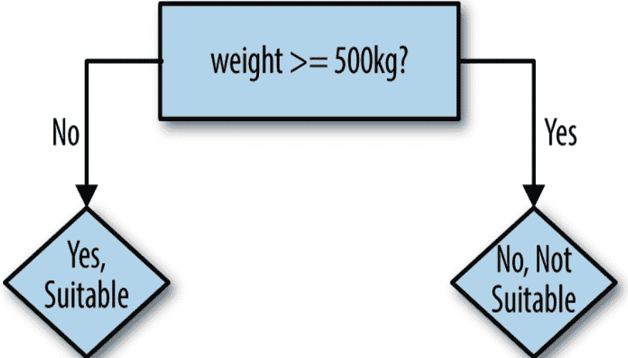
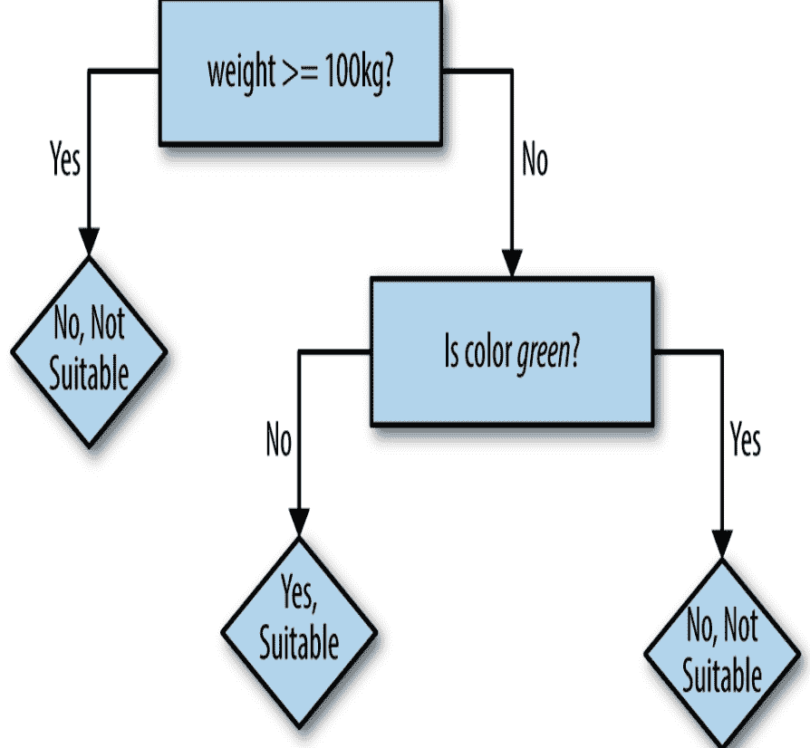
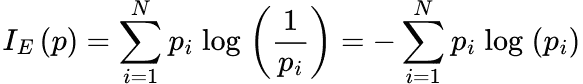

# 第 4 章。使用决策树和决策森林进行预测

## 给提前发布读者的说明

使用提前发布电子书，您可以获取书籍的最早形态——作者在编写过程中的原始、未经编辑的内容——因此您可以在这些书籍正式发布之前很久就利用这些技术。

这将是最终书籍的第 4 章。

分类和回归是历史最悠久、研究最透彻的预测分析类型。您在分析软件包和库中可能会遇到的大多数算法都是分类或回归技术，例如支持向量机、逻辑回归、神经网络和深度学习。连接回归和分类的共同点在于，两者都涉及根据一个或多个其他值来预测一个（或多个）值。为此，两者都需要一组输入和输出来学习。它们需要同时获得问题和已知答案。正因如此，它们被称为监督学习的一种类型。

PySpark MLlib 提供了多种分类和回归算法的实现。这些算法包括决策树、朴素贝叶斯、逻辑回归和线性回归。这些算法令人兴奋的地方在于，它们可以帮助预测未来——或者至少，预测我们尚不确定的事情，例如根据您的在线行为预测您购买汽车的可能性，根据电子邮件中的词语判断其是否为垃圾邮件，或根据位置和土壤化学特性预测哪些英亩土地可能种植最多的作物。

在本章中，我们将重点介绍一种既适用于分类也适用于回归的流行且灵活的算法类型：决策树及其扩展算法随机决策森林。首先，我们将了解决策树和森林的基础知识，并介绍其在 PySpark 中的实现。PySpark 的决策树实现支持二分类和多分类以及回归。该实现按行对数据进行分区，从而支持对数百万甚至数十亿个实例进行分布式训练。接着，我们将准备数据集并创建第一棵决策树。然后，我们将对决策树模型进行调优。最后，我们将在处理后的数据集上训练随机森林模型并进行预测。

尽管 PySpark 的决策树实现上手容易，但了解决策树和随机森林算法的基础知识会很有帮助。我们将在下一节中介绍这些内容。

## 决策树和森林

决策树是一类可以自然处理分类特征和数值特征的算法。构建单棵树可以使用并行计算，并且可以一次并行构建多棵树。它们对数据中的离群值具有鲁棒性，这意味着少数极端且可能存在错误的数据点可能根本不会影响预测。它们可以处理不同类型、不同量级的数据，而无需预处理或归一化。

基于决策树的算法的优势在于相对直观，易于理解和推理。事实上，我们日常生活中可能都在隐式地使用决策树所体现的相同推理方式。例如，我坐下来喝加牛奶的早间咖啡。在决定加入那份牛奶之前，我想预测：牛奶变质了吗？我不确定。我可能会查看保质期是否已过。如果没有过期，我预测没有，没有变质。如果日期已过，但那是三天或更早之前发生的，我就冒险预测没有，没有变质。否则，我闻一闻牛奶。如果闻起来有异味，我预测是的，变质了；否则预测没有。

这一系列导致预测的是/否决策，正是决策树所体现的内容。每个决策导致两个结果之一，要么是预测，要么是另一个决策，如图 4-1 所示。从这个意义上说，将该过程视为决策树很自然，树中的每个内部节点都是一个决策，每个叶子节点都是最终答案。

保质期已过？
未变质
保质期是否超过 3 天？
未变质
有异味吗？
未变质
变质

### 图 4-1. 决策树：牛奶变质了吗？

这是一棵简单的决策树，且未经过严格构建。为了详细说明，请考虑另一个例子。一台机器人在一家异国宠物店找到了工作。它想在店铺开门之前了解，店里哪些动物适合作为孩子的宠物。店主匆忙离开前，列出了九只适合和不适合的宠物。机器人通过检查动物整理出表 4-1 中的信息。

| 名称 | 重量 (kg) | 腿数 | 颜色 | 适合当宠物吗？ |
| :--- | :--- | :--- | :--- | :--- |
| Fido | 20.5 | 4 | 棕色 | 是 |
| Mr. Slither | 3.1 | 0 | 绿色 | 否 |
| Nemo | 0.2 | 0 | 浅棕色 | 是 |
| Dumbo | 1390.8 | 4 | 灰色 | 否 |
| Kitty | 12.1 | 4 | 灰色 | 是 |
| Jim | 150.9 | 2 | 浅棕色 | 否 |
| Millie | 0.1 | 100 | 棕色 | 否 |
| McPigeon | 1.0 | 2 | 灰色 | 否 |
| Spot | 10.0 | 4 | 棕色 | 是 |

机器人可以针对列出的九只宠物做出决策。商店里还有更多宠物。它仍需要一种方法来判断其余动物中哪些适合作为孩子的宠物。我们可以假设所有动物的特征都可用。利用店主提供的决策数据和决策树，我们可以帮助机器人了解适合孩子的宠物是什么样子。

虽然给出了名称，但它不会作为决策树模型中的特征包含在内。几乎没有理由相信仅凭名称就具有预测性；就机器人所知，“Felix”可能是一只猫，也可能是一只有毒的鸟蛛。因此，有两个数值特征（重量、腿数）和一个分类特征（颜色）来预测一个分类目标（是否适合作为孩子的宠物）。

决策树的工作方式是基于提供的特征依次做出一个或多个决策。首先，机器人可能尝试为这个训练数据构建一棵简单的决策树，它仅包含一个基于重量的决策，如图 4-2 所示。



### 图 4-2. 机器人的第一棵决策树

决策树的逻辑易于阅读和理解：500kg 的动物听起来肯定不适合当宠物。这条规则在九种情况中有五种预测正确。乍一看，我们可以通过将重量阈值降低到 100kg 来改进规则。这样在九个示例中有六个正确。重型动物现在被正确预测；轻型动物只部分正确。

因此，可以构建第二个决策来进一步细化重量小于 100kg 的示例的预测。最好选择一个能将某些错误的“是”预测改为“否”的特征。例如，有一只小绿色动物，听起来可疑地像蛇，当前模型会将其分类为合适的宠物候选者。机器人可以通过基于颜色添加一个决策来正确预测，如图 4-3 所示。




*图 4-3. 机器人的下一步决策树*

现在，九个示例中有七个是正确的。当然，可以不断添加决策规则，直到所有九个示例都被正确预测。生成的决策树所体现的逻辑，如果转换成日常用语，听起来可能会令人难以置信：“如果动物的重量小于 100kg，且颜色是棕色而非绿色，并且腿少于 10 条，那么是的，它是一只合适的宠物。” 虽然能完美拟合给定示例，但这样的决策树会无法预测一只棕色、四条腿的小型鼬獾并非合适宠物。需要某种平衡来避免这种现象，即过拟合。

决策树推广为一种更强大的算法，称为随机森林。随机森林结合许多决策树，以降低过拟合的风险，并分别训练这些决策树。该算法将随机性注入训练过程，使每棵决策树略有不同。结合预测结果可降低预测的方差，使生成的模型更具泛化能力，并提升测试数据上的性能。

以上关于决策树和随机森林的介绍已经足够，我们可以开始在 PySpark 中使用它们了。在下一节中，我们将介绍将要使用的数据集，并为其在 PySpark 中的使用做好准备。

## 准备数据

本章使用的数据集是著名的 Covtype 数据集，可在线获取，为压缩的 CSV 格式数据文件 *covtype.data.gz*，以及伴随的信息文件 *covtype.info*。

该数据集记录了美国科罗拉多州森林覆盖土地块的类型。数据集涉及真实世界森林仅仅是个巧合！每条数据记录包含描述每个土地块的若干特征——例如其海拔、坡度、距水体距离、遮荫情况和土壤类型——以及覆盖该土地的已知森林类型。森林覆盖类型需要从其余特征中预测得出，这些特征总共有 54 个。

该数据集已用于研究，甚至用于 Kaggle 竞赛。在这个章节中探索它是一个有趣的数据集，因为它同时包含类别特征和数值特征。数据集中包含 581,012 个示例，虽然不完全符合大数据的定义，但作为示例已经足够大，便于管理，同时仍能凸显一些规模问题。

幸运的是，数据已经是简单的 CSV 格式，不需要太多清洗或其他准备即可与 PySpark MLlib 一起使用。*covtype.data* 文件应被解压并复制到您的本地或云存储中（例如 AWS S3）。

启动 `pyspark-shell`。您可能会发现，为 shell 分配充足的内存非常有帮助，因为构建决策森林可能资源密集。如果内存充足，请指定 `--driver-memory 8g` 或类似选项。

CSV 文件本质上包含表格数据，按列组织成行。有时这些列会在标题行中被赋予名称，但本例并非如此。列名称在配套文件 covtype.info 中给出。从概念上讲，CSV 文件的每一列也有一种类型——数字、字符串——但 CSV 文件并未指定此信息。

将此数据解析为数据帧很自然，因为这是 PySpark 对表格数据的抽象，带有定义好的列架构，包括列名和类型。PySpark 内置了读取 CSV 数据的支持。让我们使用内置的 CSV 读取器将数据集读取为 DataFrame：

```
data_without_header = spark.read.option("inferSchema",
True).option("header", False).csv("data/covtype.data")
data_without_header.printSchema()
...
root
|-- _c0: integer (nullable = true)
|-- _c1: integer (nullable = true)
|-- _c2: integer (nullable = true)
|-- _c3: integer (nullable = true)
|-- _c4: integer (nullable = true)
|-- _c5: integer (nullable = true)
...
```

此代码将输入读取为 CSV，并不尝试将第一行解析为列名标题。它还要求通过检查数据来推断每一列的类型。它正确推断出所有列都是数字，更具体地说，是整数。不幸的是，它只能将列命名为“_c0”等等。

我们可以查看 covtype.info 文件以获取列名。

```
$ cat data/covtype.info
```

...
[...]
7. 属性信息：
给出了属性名称、属性类型、度量单位
以及
简要描述。森林覆盖类型是分类问题。此列表的顺序与数据库行中数字的顺序对应。

| 名称 | 描述 | 数据类型 | 度量单位 |
| :--- | :--- | :--- | :--- |
| Elevation | 米为单位的海拔 | 定量 | 米 |
| Aspect | 方位角（度） | 定量 | 方位角 |
| Slope | 坡度（度） | 定量 | 度 |
| Horizontal_Distance_To_Hydrology | 到最近地表水体特征的水平距离 | 定量 | 米 |
| Vertical_Distance_To_Hydrology | 到最近地表水体特征的垂直距离 | 定量 | 米 |
| Horizontal_Distance_To_Roadways | 到最近公路的水平距离 | 定量 | 米 |
| Hillshade_9am | 夏至日上午 9 点的山体阴影索引 | 定量 | 0 到 255 |
| Hillshade_Noon | 夏至日正午的山体阴影索引 | 定量 | 0 到 255 |
| Hillshade_3pm | 夏至日下午 3 点的山体阴影索引 | 定量 | 0 到 255 |
| Horizontal_Distance_To_Fire_Points | 到最近野火点火点的水平距离 | 定量 | 米 |
| Wilderness_Area (4 binary columns) | 荒野地区指定（存在为 1） | 定性 | 0（缺失） |
| Soil_Type (40 binary columns) | 土壤类型指定（存在为 1） | 定性 | 0（缺失） |
| Cover_Type (7 types) | 森林覆盖类型指定 | 整数 | 1 到 7 |

查看列信息后，很明显有些特征确实是数值型的。“Elevation”是以米为单位的海拔；“Slope”以度为单位进行测量。但是，“Wilderness_Area”有所不同，因为据说它跨越四列，每列的值为 0 或 1。实际上，“Wilderness_Area”是一个类别值，而非数值。

这四列实际上是独热编码或 1-of-n 编码。当这种编码形式应用于类别特征时，一个取 N 个不同值的类别特征将变为 N 个数值特征，每个特征的值为 0 或 1。N 个值中恰好有一个值为 1，其余均为 0。例如，一个可以是多云、雨天或晴天的天气类别特征将变为三个数值特征，其中多云表示为 1, 0, 0；雨天表示为 0, 1, 0；以此类推。这三个数值特征可以被视为 `is_cloudy`、`is_rainy` 和 `is_clear` 特征。同样，40 列实际上只是一个 `Soil_Type` 类别特征。

这不是将类别特征编码为数字的唯一可能方式。另一种可能的编码只是为类别特征的每个可能值分配一个不同的数值。例如，`cloudy` 可能变为 1.0，`rainy` 变为 2.0，以此类推。目标本身，“Cover_Type”，是编码为 1 到 7 值的类别值。

> 在将类别特征编码为单个数值特征时要小心。原始类别值没有顺序，但编码为数字后，它们似乎有了顺序。将编码后的特征视为数值会导致无意义的结果，因为算法实际上假装 `rainy` 以某种方式大于 `cloudy` 并且是其两倍大。只要编码的数值不作为数字使用，这样做就没问题。

我们已经见过这两种类别特征编码类型。也许，直接不编码此类特征（而且是两种方式），而仅仅像“Rawah 荒野地区”这样直接包含它们的值，会更简单、更直接。这可能是历史遗留产物；该数据集发布于 1998 年。出于性能原因或为了匹配当时库所期望的格式（这些库更多是为回归问题构建的），数据集通常包含以这种方式编码的数据。

无论如何，在继续之前，为该 DataFrame 添加列名很有用，以便更轻松地使用它：

```
from pyspark.sql.types import DoubleType
from pyspark.sql.functions import col

colnames = ["Elevation", "Aspect", "Slope",
"Horizontal_Distance_To_Hydrology",
"Vertical_Distance_To_Hydrology", "Horizontal_Distance_To_Roadways",
"Hillshade_9am", "Hillshade_Noon", "Hillshade_3pm",
"Horizontal_Distance_To_Fire_Points"] + \
[f"Wilderness_Area_{i}" for i in range(4)] + \
[f"Soil_Type_{i}" for i in range(40)] + \
["Cover_Type"]

data = data_without_header.toDF(*colnames).withColumn("Cover_Type",
col("Cover_Type").cast(DoubleType()))
```


data.head()
...
Row(Elevation=2596, Aspect=51, Slope=3,
Horizontal_Distance_To_Hydrology=258,
Vertical_Distance_To_Hydrology=0,
Horizontal_Distance_To_Roadways=510, Hillshade_9am=221,
Hillshade_Noon=232, Hillshade_3pm=148, ...)

++ 用于连接集合

与荒野和土壤相关的列命名为“Wilderness_Area_0”、“Soil_Type_0”，一小段 Python 代码即可生成这 44 个名称，无需逐个输入。最后，目标“Cover_Type”列会预先转换为 double 值，因为在所有 PySpark MLlib API 中，实际上需要将其作为 double 而非 int 来消耗。这一点在后面会变得清晰。

你可以调用 data.show() 查看数据集的若干行，但显示过于宽阔，几乎无法阅读。data.head() 将其显示为原始 Row 对象，在这种情况下可读性更高。

现在我们已熟悉数据集并对其进行了处理，可以训练决策树模型了。

## 我们的第一棵决策树

在第 3 章中，我们立即在所有可用数据上构建了一个推荐模型。这创建了一个推荐器，任何具有音乐知识的人都可以对其进行合理性检查：查看用户的收听习惯和推荐，我们就能感觉到它产生了良好的结果。在这里，这不可能。我们完全不知道如何为科罗拉多州的一块新土地编造一个新的 54 特征描述，或者期望从这样一块土地上获得什么样的森林覆盖类型。

相反，我们必须直接留出部分数据用于评估所得模型。之前，AUC 指标用于评估留出的收听数据与推荐预测之间的一致性。AUC 可以被视为随机选取的好推荐排在随机选取的坏推荐之前的概率。这里的原理相同，尽管评估指标不同：准确率。再次，绝大多数——90%——的数据将用于训练，后来我们将看到，这个训练集的一个子集将被留出用于交叉验证（CV 集）。这里留出的另外 10% 实际上是第三个子集，一个正式的测试集。

```
(train_data, test_data) = data.randomSplit([0.9, 0.1])
train_data.cache()
test_data.cache()
```

数据需要做一些额外的准备才能在 MLlib 中与分类器一起使用。输入 DataFrame 包含许多列，每列存储一个可用于预测目标列的特征。MLlib 要求将所有输入收集到一列中，其值为一个向量。这个类是线性代数意义上向量的抽象，仅包含数字。出于大多数目的，它们的工作方式类似于 double 值（浮点数）的简单数组。当然，一些输入特征在概念上是分类的，即使它们在输入中都用数字表示。

幸运的是，VectorAssembler 类可以完成这项工作：

```
from pyspark.ml.feature import VectorAssembler

input_cols = colnames[:-1]
vector_assembler = VectorAssembler(inputCols=input_cols, outputCol="featureVector")

assembled_train_data = vector_assembler.transform(train_data)

assembled_train_data.select("featureVector").show(truncate = False)
...
+------------------------------+
...
| featureVector                 |
...
+------------------------------+
...
| (54, [0, 1, 2, 5, 6, 7, 8, 9, 13, 18], [1874.0, 18.0, 14.0, 90.0, 208.0, 209.0, ...|
| (54, [0, 1, 2, 3, 4, 5, 6, 7, 8, 9, 13, 18], [1879.0, 28.0, 19.0, 30.0, 12.0, 95.0, |
...
...
```

### ❶ 排除标签，Cover_Type

其关键参数是要合并为特征向量的列，以及包含特征向量的新列的名称。这里，除目标列外，所有列都作为输入特征包含在内。生成的 DataFrame 有一个新的“featureVector”列，如所示。

输出看起来并不完全像一串数字，但这是因为这里显示的是向量的原始表示形式，它以 `SparseVector` 实例的形式表示以节省存储。由于 54 个值中大部分都是 0，它只存储非零值及其索引。在分类中，这个细节无关紧要。

## 特征向量

考虑根据今天的天气预测明天的最高气温。这个想法本身没有问题，但“今天的天气”是一个随意的概念，在输入到学习算法之前需要进行结构化。实际上，今天天气中的某些 _features_ 可能预测明天的气温，例如最高气温、最低气温、平均湿度、今天是否多云、下雨或晴朗，以及预测明天将出现寒潮的气象预报员人数。

这些特征有时也称为 _dimensions_、_predictors_，或者只是 _variables_。这些特征中的每一个都可以量化。例如，最高和最低气温以摄氏度为单位，湿度可以表示为 0 到 1 之间的分数，天气类型可以标记为 `cloudy`、`rainy` 或 `clear`。预报员人数当然是一个整数计数。因此，今天的天气可以归结为类似 `13.1, 19.0, 0.73, cloudy, 1` 的值列表。

这五个特征按顺序组合在一起，称为 _feature vector_，可以描述任何一天的天气。这种用法在某种程度上与线性代数中 _vector_ 术语的使用相似，只是从这个意义上说，向量可以概念上包含非数值，甚至可能缺少某些值。这些特征并非全都属于同一类型。前两个特征以摄氏度为单位，但第三个是无单位的，是一个分数。第四个根本不是数字，第五个是一个始终为非负整数的数字。

学习算法需要在数据上进行训练才能进行预测。特征向量提供了一种组织化的方式来描述输入给学习算法（例如：`12.5, 15.5, 0.10, clear, 0`）。预测的输出，即 _target_，也可以被视为一个特征。在这里，它是一个数值特征：`17.2`。

将目标仅仅作为特征向量中的另一个特征来包含，这并不罕见。整个训练示例可以被视为 `12.5, 15.5, 0.10, clear, 0, 17.2`。所有这些示例的集合称为 _training set_。

VectorAssembler 是当前 MLlib "Pipelines" API 中 Transformer 的一个示例。它根据某些逻辑将输入 DataFrame 转换为另一个 DataFrame，并可与其他转换组合成一个管道。本章稍后，这些转换将连接成一个实际的 Pipeline。在这里，转换只是被直接调用，这足以构建第一个决策树分类器模型。

```
from pyspark.ml.classification import DecisionTreeClassifier

classifier = DecisionTreeClassifier(seed = 1234,
labelCol="Cover_Type", featuresCol="featureVector",
predictionCol="prediction")

model = classifier.fit(assembled_train_data)
print(model.toDebugString)
...
DecisionTreeClassificationModel:
uid=DecisionTreeClassifier_da03f8ab5e28, depth=5, numNodes=41,
numClasses=8, numFeatures=54
If (feature 0 <= 3036.5)
If (feature 0 <= 2546.5)
If (feature 10 <= 0.5)
If (feature 0 <= 2412.5)
If (feature 3 <= 15.0)
Predict: 4.0
Else (feature 3 > 15.0)
Predict: 3.0
Else (feature 0 > 2412.5)
...
```

同样，分类器的基本配置由列名组成：包含输入特征向量的列和包含要预测的目标值的列。因为模型稍后将用于预测目标的新值，所以给它指定了一个用于存储预测结果的列名。

打印模型的表示形式会显示其部分树结构。它由一系列关于特征的嵌套决策组成，将特征值与阈值进行比较。（出于历史原因，不幸的是，这里的特征仅按编号引用，而不按名称。）

决策树能够在构建过程中评估输入特征的重要性。也就是说，它们可以估计每个输入特征


有助于做出正确预测。此信息可从模型中轻松获取。

```python
import pandas as pd

pd.DataFrame(model.featureImportances.toArray(), index=input_cols,
    columns=['importance']).sort_values(by="importance",
    ascending=False)
...
```

| | 重要性 |
|---|---|
| 海拔 | 0.826854 |
| 正午遮荫 | 0.029087 |
| 土壤类型_1 | 0.028647 |
| 土壤类型_3 | 0.026447 |
| 荒野区域_0 | 0.024917 |
| 到水体的水平距离 | 0.024862 |
| 土壤类型_31 | 0.018573 |
| 荒野区域_2 | 0.012458 |
| 到道路的水平距离 | 0.003608 |
| 上午 9 点遮荫 | 0.002840 |
| ... | ... |

这将重要性值（值越高越好）与列名称配对，并按从最重要到最不重要的顺序打印它们。海拔似乎是最重要的特征，占据主导地位；在预测覆盖类型时，大多数特征被估计几乎没有重要性！

生成的 DecisionTreeClassificationModel 本身就是一个转换器，因为它可以将包含特征向量的数据帧转换为同时包含预测的数据帧。

例如，查看模型在训练数据上的预测结果，并将其预测与已知的正确覆盖类型进行比较，可能很有趣。

```python
predictions = model.transform(assembled_train_data)
predictions.select("Cover_Type", "prediction",
    "probability").show(10, truncate = False)
...
```

| | | |
|---|---|---|
| 覆盖类型 | 预测 | 概率 |
| ... | ... | ... |
| ... | ... | ... |

```
| 6.0   | 4.0   |
[0.0,0.0,0.0,0.028372324539571926,0.2936784469885515, ...
| 6.0   | 3.0   |
[0.0,0.0,0.0,0.024558587479935796,0.6454654895666132, ...
| 6.0   | 3.0   |
[0.0,0.0,0.0,0.024558587479935796,0.6454654895666132, ...
| 6.0   | 3.0   |
[0.0,0.0,0.0,0.024558587479935796,0.6454654895666132, ...
...
```

有趣的是，输出还包含一个“概率”列，该列给出了模型对每个可能结果正确性的可能性估计。这表明在这些实例中，在几种情况下它非常确定答案是 3，并且非常确定答案不是 1。

锐目读者可能会注意到，概率向量实际上有八个值，尽管只有七个可能的结果。向量中索引 1 到 7 的值确实包含了结果 1 到 7 的概率。然而，索引 0 处也有一个值，其始终显示为概率 0.0。可以忽略它，因为 0 甚至不是有效的结果，正如文中所述。将此信息表示为向量有一个值得注意的特性。

基于上述代码片段，模型似乎还有改进空间。其预测结果看起来经常出错。与第 3 章中 `ALS` 实现类似，`DecisionTreeClassifier` 实现也有若干必须选择值的超参数，而这里全都保留了默认值。在此，可以使用测试集对使用这些默认超参数构建的模型的预期准确性进行无偏评估。

我们现在将使用 `MulticlassClassificationEvaluator` 来计算准确性以及其他评估模型预测质量的指标。它是 MLlib 中评估器的一个示例，以某种方式负责评估输出 DataFrame 的质量。

```python
from pyspark.ml.evaluation import MulticlassClassificationEvaluator

evaluator = MulticlassClassificationEvaluator(labelCol="Cover_Type",
predictionCol="prediction")

evaluator.setMetricName ("accuracy").evaluate(predictions)
evaluator.setMetricName ("f1").evaluate(predictions)
```

0.6989423087953562
0.6821216079701136

在获得包含“标签”（目标，或已知正确输出值）的列以及包含预测的列的名称后，它发现两者大约有 70% 的时间匹配。这就是此分类器的准确率。它还可以计算其他相关指标，例如 F1 分数。在此，将使用准确率来评估分类器。

这个单一数字很好地总结了分类器输出的质量。然而，有时查看 _混淆矩阵_ 很有用。这是一个表格，针对目标的每个可能值都有一行和一列。由于有七个目标类别值，这是一个 7×7 矩阵，其中每一行对应一个实际正确值，每一列按顺序对应一个预测值。第 _i_ 行和第 _j_ 列的条目计算了真实类别为 _i_ 的示例被预测为类别 _j_ 的次数。因此，沿对角线的计数是正确预测，其余则是错误预测。

可以直接使用 DataFrame API 及其更通用的运算符来计算混淆矩阵。

```python
confusion_matrix =
predictions.groupBy("Cover_Type").pivot("prediction",
range(1,8)).count().\
na.fill(0.0).\
orderBy("Cover_Type")

confusion_matrix.show()
```

...

| 覆盖类型 | 1 | 2 | 3 | 4 | 5 | 6 | 7 |
|---|---|---|---|---|---|---|---|
| 1.0 | 133792 | 51547 | 109 | 0 | 0 | 0 | 5223 |
| 2.0 | 57026 | 192260 | 4888 | 57 | 0 | 0 | 750 |
| 3.0 | 0 | 3368 | 28238 | 590 | 0 | 0 | 0 |
| 4.0 | 0 | 0 | 1493 | 956 | 0 | 0 | 0 |
| 5.0 | 0 | 8282 | 283 | 0 | 0 | 0 | 0 |
| 6.0 | 0 | 3371 | 11872 | 406 | 0 | 0 | 0 |
| 7.0 | 8122 | 74 | 0 | 0 | 0 | 0 | 10319 |

## 将 null 替换为 0

电子表格用户可能已经意识到，这个问题就像计算透视表一样。透视表按两个维度对值进行分组，这些维度的值变成输出的行和列，并在这些分组内计算一些聚合（例如此处的计数）。在多个数据库中，这也作为 PIVOT 函数提供，并且 Spark SQL 也支持它。以这种方式计算可以说更优雅且更强大。

虽然 70% 的准确率听起来不错，但尚不清楚它是出色还是糟糕。一种简单的方法来建立基准线效果如何？正如坏钟每天也对两次一样，为每个示例随机猜测一个分类也会偶尔产生正确答案。

我们可以通过按其在训练集中的普遍性比例随机选择一个类来构建这样的随机“分类器”。例如，如果训练集中有 30% 是覆盖类型 1，那么随机分类器就会有 30% 的时间猜测“1”。每个分类的正确性与其在测试集中的普遍性成正比。如果测试集中有 40% 是覆盖类型 1，那么猜测“1”就会有 40% 的时间正确。覆盖类型 1 将有 30% × 40% = 12% 的时间被正确猜测，并贡献 12% 的总体准确率。因此，我们可以通过求和这些概率乘积来评估准确率：

```python
from pyspark.sql import DataFrame
def class_probabilities(data):
    total = data.count()
    return data.groupBy("Cover_Type").count().\
    orderBy("Cover_Type").\
    select(col("count").cast(DoubleType())).\
    withColumn("count_proportion", col("count")/total).\
    select("count_proportion").collect()
```

```python
train_prior_probabilities = class_probabilities(train_data)
test_prior_probabilities = class_probabilities(test_data)
train_prior_probabilities
...
[Row(count_proportion=0.36455357859838705),
Row(count_proportion=0.4875111371136425),
Row(count_proportion=0.06155716924206445),
Row(count_proportion=0.00468236760696409),
Row(count_proportion=0.016375858943914835),
Row(count_proportion=0.029920118693908142),
Row(count_proportion=0.03539976980111887)]
```

```python
train_prior_probabilities = [p[0] for p in train_prior_probabilities]
test_prior_probabilities = [p[0] for p in test_prior_probabilities]
sum([train_p * cv_p for train_p, cv_p in zip(train_prior_probabilities, test_prior_probabilities)])
```

0.37735294664034547

- 1. 按类别计数
- 2. 按类别对计数进行排序
- 3. 对训练集和测试集中的配对求积并求和

那么，随机猜测能达到 37% 的准确率，这使得 70% 看起来确实是一个不错的结果。但后者是使用默认超参数获得的。我们可以通过探索超参数对树构建过程的实际意义来做得更好。这就是我们在下一节中要做的事情。

## 决策树超参数

在第 3 章中，ALS 算法暴露了若干超参数，我们需要通过构建各种值组合的模型，并使用某些指标评估每个结果的质量来选择它们的值。这里的过程相同，只是指标现在是多分类准确率而不是 AUC。控制树如何做出决策的超参数也大不相同：最大深度、最大分箱数、不纯度衡量和最小信息增益。

最大深度只是限制决策树中的层数。它是分类器对示例进行分类时将做出的链式决策的最大数量。限制这一点很有用，可以避免过度拟合训练数据，如之前在宠物店示例中所示。


决策树算法负责在每一层尝试潜在的决策规则，如宠物店示例中的 `weight >= 100` 或 `weight >= 500` 决策。决策始终采用相同的形式：对于数值特征，决策的形式为 `feature >= value`；对于分类特征，则采用 `feature in (value1, value2, ...)` 形式。因此，要尝试的决策规则集实际上是一组要代入决策规则的值。这些在 PySpark MLlib 实现中被称为“bins”。更大的 bins 数量需要更多处理时间，但可能会找到更优的决策规则。

什么是好的决策规则？直觉上，好的规则能够按目标类别值有意义地区分示例。例如，将 Covtype 数据集分为一侧仅包含类别 1–3、另一侧仅包含类别 4–7 的规则将非常出色，因为它清楚地将某些类别与其他类别分开。如果一条规则导致所有类别的混合情况与整个数据集中发现的大致相同，那似乎没什么帮助。遵循此类决策的任何分支都会得到大致相同的可能目标值分布，因此不会真正向自信分类取得进展。

换句话说，好的规则将训练数据的目标值划分为相对均匀或“纯净”的子集。选择最佳规则意味着最小化其诱导的两个子集的不纯度。常用的不纯度度量有两种：Gini 不纯度和熵。

Gini 不纯度与随机猜测分类器的准确度直接相关。在子集内，它是随机选择一个示例并随机对其进行分类（两者均按子集中类别的分布进行），该分类 *错误* 的概率。这是类别比例乘积之和，但需减去它们自身，并从 1 中减去。如果子集包含 N 个类，p_i 为类 i 示例的比例，则其 Gini 不纯度由 Gini 不纯度公式给出：

```
\( I_G (p) = 1 - \sum_{i=1}^N p_i^2 \)
```

如果子集只包含一个类，该值为 0，因为它是完全“纯净”的。当子集中有 \(N\) 个类时，该值大于 0，并且当各类出现次数相同（即最不纯）时达到最大。

熵是另一种不纯度度量，借用自信息论。其本质更难解释，但它捕捉了子集中目标值集合对落在该子集中的数据的预测所暗示的不确定性程度。仅包含一个类的子集表明该子集的结果完全确定且熵为 0——没有不确定性。另一方面，包含每个可能类各一个的子集表明该子集的预测存在大量不确定性，因为已观察到各种目标值。这具有高熵。因此，低熵（如同低 Gini 不纯度）是好事。熵由熵方程定义：



> 有趣的是，不确定性有单位。因为对数是自然对数（base \(e\)），单位是 *纳特*，即更熟悉的 *比特* 的 base-\(e\) 对应物（我们可以使用 log base 2 得到比特）。它确实在衡量信息，因此在将熵与决策树一起使用时，也常讨论决策规则的 *信息增益*。

在给定数据集中，两种不纯度度量中一种可能是选择决策规则的更好指标。从某种程度上说，它们相似。两者都涉及加权平均：按 \(p_i\) 加权的求和。PySpark 实现中的默认值是 Gini 不纯度。

最后，最小信息增益是一个超参数，它对候选决策规则施加最小信息增益（或不纯度下降）。改进子集不纯度不足的规则会被拒绝。与较低的最大深度类似，这有助于模型抵御过拟合，因为几乎无法帮助划分训练输入的决策，实际上可能根本无法有效划分未来数据。

既然我们了解了决策树算法的相关超参数，将在下一节中调优模型以提高其性能。

## 调优决策树

从数据中看出哪种不纯度度量能带来更好的准确度，或者哪个最大深度或 bins 数量足够而不过度，并非显而易见。幸运的是，如第 3 章一样，让 PySpark 尝试这些值的多种组合并报告结果非常简单。

首先，有必要设置一个封装前面部分执行的两个步骤的管道——创建特征向量并使用它来创建决策树模型。创建 VectorAssembler 和 DecisionTreeClassifier，并将这两个 Transformer 链接在一起，将产生一个 Pipeline 对象，将这两项操作表示为一项操作：

```
from pyspark.ml import Pipeline

assembler = VectorAssembler(inputCols=input_cols,
outputCol="featureVector")
classifier = DecisionTreeClassifier(seed=1234,
labelCol="Cover_Type", featuresCol="featureVector",
predictionCol="prediction")

pipeline = Pipeline(stages=[assembler, classifier])
```

当然，管道可以更长、更复杂。这就已经足够简单了。现在，我们还可以使用 PySpark ML API 的内置支持 ParamGridBuilder 来定义应测试的超参数组合。也是时候定义用于选择“最佳”超参数的评估指标了，这里同样是 MulticlassClassificationEvaluator。

```
from pyspark.ml.tuning import ParamGridBuilder

paramGrid = ParamGridBuilder(). \
addGrid(classifier.impurity, ["gini", "entropy"]). \
addGrid(classifier.maxDepth, [1, 20]). \
addGrid(classifier.maxBins, [40, 300]). \
addGrid(classifier.minInfoGain, [0.0, 0.05]). \
build()
multiclassEval = MulticlassClassificationEvaluator() \
    .setLabelCol("Cover_Type") \
    .setPredictionCol("prediction") \
    .setMetricName("accuracy")
```

这意味着将对四个超参数各取两个值来构建和评估模型，共 16 个模型。它们将按多类准确度进行评估。最后，TrainValidationSplit 将这些组件结合在一起——创建模型的管道、模型评估指标以及要尝试的超参数——并可以在训练数据上运行评估。值得注意的是，也可以在此处使用 CrossValidator 来执行完整的 k 折交叉验证，但它的开销是 k 倍，在大数据环境下增加的价值不大。因此，这里使用 TrainValidationSplit。

```
from pyspark.ml.tuning import TrainValidationSplit

validator = TrainValidationSplit(seed=1234,
estimator=pipeline,
evaluator=multiclassEval,
estimatorParamMaps=paramGrid,
trainRatio=0.9)

validator_model = validator.fit(train_data)
```

这将需要几分钟或更长时间，具体取决于您的硬件，因为它正在构建和评估许多模型。请注意，train ratio 参数设置为 0.9。这意味着训练数据实际上由 TrainValidationSplit 进一步细分为 90%/10% 子集。前者用于训练每个模型。剩余的 10% 输入被留作交叉验证集以评估模型。如果已经留出一些数据用于评估，那么为什么还要将原始数据的 10% 留作测试集？

如果 CV 集的目的是评估与训练集拟合的参数，那么测试集的目的是评估与 CV 集“拟合”的超参数。也就是说，测试集确保对最终选定模型及其超参数的准确度进行无偏估计。

假设此过程选定的最佳模型在 CV 集上表现出 90% 的准确度。合理地预期它在未来数据上也会表现出 90% 的准确度。然而，构建这些模型中存在随机性。偶然，此模型及其评估结果可能异常出色。最佳模型和评估结果可能受益于一点运气，因此其准确度估计可能略显乐观。换句话说，超参数也可能过拟合。

为了真正评估此最佳模型在未来示例上的表现可能如何，我们需要在未用于训练的示例上对其进行评估。但我们还需要避免使用 CV 集中用于评估的示例。这就是为什么要留出第三个子集（即测试集）的原因。

验证器的结果包含其找到的最佳模型。这本身也是其找到的最佳整体 _管道_ 的表示，因为我们提供了一个管道实例来运行。为了查询 DecisionTreeClassifier 选择的参数，需要从结果的 PipelineModel 中手动提取 DecisionTreeClassificationModel，它是管道中的最后一个阶段。

```
from pprint import pprint

best_model = validator_model.bestModel
pprint(best_model.stages[1].extractParamMap())

...
{Param(...name='predictionCol', doc='prediction column name.'):
'prediction',
 Param(...name='probabilityCol', doc='...'): 'probability',
 [...]
 Param(...name='impurity', doc='...'): 'entropy',
 Param(...name='maxDepth', doc='...'): 20,
 Param(...name='minInfoGain', doc='...'): 0.0,
 [...]
 Param(...name='featuresCol', doc='features column name.'):
 'featureVector',
 Param(...name='maxBins', doc='...'): 40,
 [...]
 Param(...name='labelCol', doc='label column name.'): 'Cover_Type'}
...
```


上述输出包含关于拟合模型的大量信息，但它也告诉我们，“entropy”显然作为不纯度量度效果最好，最大深度为20出人意料地优于1。最佳模型仅用40个分箱拟合可能令人惊讶，但这可能表明40是“足够多的”，而不是“优于”300。最后，无最小信息增益优于一个小的最小值，这可能意味着模型更容易欠拟合而非过拟合。

你可能会想知道是否可以查看每个模型对每组超参数所达到的准确率。超参数以及评估结果分别由getEstimatorParamMaps和validationMetrics公开。可以将它们组合起来，按度量值排序显示所有参数组合：

```
validator_model = validator.fit(train_data)

metrics = validator_model.validationMetrics
params = validator_model.getEstimatorParamMaps()
metrics_and_params = list(zip(metrics, params))

metrics_and_params.sort(key=lambda x: x[0], reverse=True)
metrics_and_params
```

```
...
[(0.9130409881445563,
 {Param(...name='minInfoGain' ...)): 0.0,
 Param(...name='maxDepth' ...)): 20,
 Param(...name='maxBins' ...)): 40,
 Param(...name='impurity' ...)): 'entropy'}),
(0.9112655352131498,
 {Param(...name='minInfoGain',...)): 0.0,
 Param(...name='maxDepth' ...)): 20,
 Param(...name='maxBins' ...)): 300,
 Param(...name='impurity' ...)): 'entropy'}),
...
```

该模型在CV集上达到的准确率是多少？最后，该模型在测试集上达到的准确率是多少？

```
metrics.sort(reverse=True)
print(metrics[0])
...
```

```
0.9130409881445563
...
multiclassEval.evaluate (best_model.transform(test_data))
...
0.9138921373048084
```

bestModel是一个完整的流水线。

两者的结果都约为91%。碰巧的是，CV集的估计值一开始就相当准确。事实上，测试集显示出非常不同的结果并不寻常。

这是一个重新审视过拟合问题的有趣切入点。如前所述，可以构建一棵非常深且复杂的决策树，使其对给定的训练示例拟合得非常好或完美，但因为过于贴合训练数据的特性和噪声，而无法将其推广到其他示例。这是大多数机器学习算法共有的问题，而不仅仅是决策树。

当决策树过拟合时，它在用于拟合模型的同一训练数据上运行时会表现出高准确率，但在其他示例上的准确率较低。在这里，最终模型在其他新示例上的准确率约为91%。准确率同样可以在模型训练所用的相同数据trainData上进行评估，这大约能得到95%的准确率。差异不大，但表明决策树在某种程度上过拟合了训练数据。较低的最大深度可能是更好的选择。

迄今为止，我们隐含地将所有输入特征（包括类别特征）视为数值。通过将类别特征视为类别本身，我们能否进一步提高模型性能？我们将在下一部分探讨此问题。

## 重新审视类别特征

我们数据集中的类别特征被一热编码为多个二进制0/1值。将这些单独的特征视为数值结果是可行的，因为对“数值”特征的任何决策规则都将在0和1之间选择阈值，由于所有值都是0或1，它们都等效。

当然，这种编码迫使决策树算法单独考虑底层类别特征的值。由于像土壤类型这样的特征被分解为许多特征，且决策树单独处理特征，因此更难以关联相关土壤类型的信息。

例如，九种不同的土壤类型实际上属于Leighcan家族，它们可能以决策树可以利用的方式相互关联。如果土壤类型被编码为具有40个土壤值的单个类别特征，则树可以直接表示诸如“如果土壤类型是九个Leighton家族类型之一”这样的规则。但是，当编码为40个特征时，树将不得不学习关于土壤类型的九个决策序列才能做到同样的事情，这种表达能力可能会导致更好的决策和更高效的树。

然而，用40个数值特征来表示一个具有40个值的类别特征会增加内存使用并降低速度。

撤销一热编码怎么样？例如，这将用一列取代四个编码荒野类型的列，该列将荒野类型编码为0到3之间的数字，如“Cover_Type”。

```
def unencode_one_hot(data):
    wilderness_cols = ['Wilderness_Area_' + str(i) for i in range(4)]
    wilderness_assembler = VectorAssembler().setInputCols(wilderness_cols).setOutputCol("wilderness")
    unhot_udf = udf(lambda v: v.toArray().tolist().index(1))
    with_wilderness = wilderness_assembler.transform(data).\
        drop(*wilderness_cols).\
        withColumn("wilderness", unhot_udf(col("wilderness")))
    soil_cols = ['Soil_Type_' + str(i) for i in range(40)]
    soil_assembler = VectorAssembler().setInputCols(soil_cols).setOutputCol("soil")
    with_soil = soil_assembler.transform(with_wilderness).drop(*soil_cols).withColumn("soil", unhot_udf(col("soil")))
    return with_soil
```

注意：UDF定义，删除一热编码列；不再需要

这里使用VectorAssembler将4个和40个荒野及土壤类型列合并为两个Vector列。这些Vector中的值全为0，只有一个位置为1。没有简单的DataFrame函数可以做到这一点，因此我们必须定义自己的UDF来对列进行操作。这将这两个新列转换为我们需要的数字类型。

现在可以通过使用上面定义的函数来转换我们的数据集，从而删除一热编码。

```
unenc_train_data = unencode_one_hot(train_data)
unenc_train_data.printSchema()
...
root
|-- Elevation: integer (nullable = true)
|-- Aspect: integer (nullable = true)
|-- Slope: integer (nullable = true)
|-- Horizontal_Distance_To_Hydrology: integer (nullable = true)
|-- Vertical_Distance_To_Hydrology: integer (nullable = true)
|-- Horizontal_Distance_To_Roadways: integer (nullable = true)
|-- Hillshade_9am: integer (nullable = true)
|-- Hillshade_Noon: integer (nullable = true)
|-- Hillshade_3pm: integer (nullable = true)
|-- Horizontal_Distance_To_Fire_Points: integer (nullable = true)
|-- Cover_Type: double (nullable = true)
|-- wilderness: string (nullable = true)
|-- soil: string (nullable = true)
...
```

```
unenc_train_data.groupBy('wilderness').count().show()
...
```

| wilderness | count |
|---|---|
| 3 | 33271 |
| 0 | 234532 |
| 1 | 26917 |
| 2 | 228144 |

从这里开始，几乎可以使用与上面相同的过程来调优基于此数据构建的决策树模型的超参数，并选择和评估最佳模型。但是，有一个重要的区别。这两个新的数值列没有任何指示表明它们实际上是类别值的编码。将它们视为数字是不正确的，因为它们的顺序是没有意义的。模型仍然会被构建，但由于这些特征中的某些信息不可用，准确率可能会受到影响。

在内部，MLlib可以存储每个列的其他元数据。这些数据的详细信息通常对调用方隐藏，但包括诸如列是否编码了类别值以及它采用多少个不同值等信息。为了添加此元数据，有必要将数据通过`VectorIndexer`处理。它的作用是将输入转换为正确标记的类别特征列。尽管我们已经完成了大部分工作，将类别特征转换为0索引的值，但`VectorIndexer`将处理元数据。

我们需要将此阶段添加到`Pipeline`中：

```
from pyspark.ml.feature import VectorIndexer
cols = unenc_train_data.columns
inputCols = [c for c in cols if c!='Cover_Type']

assembler = VectorAssembler().setInputCols(inputCols).setOutputCol("featureVector")

indexer = VectorIndexer().\
setMaxCategories(40).\
setInputCol("featureVector").setOutputCol("indexedVector")

classifier = DecisionTreeClassifier().setLabelCol("Cover_Type").setFeaturesCol("indexedVector").setPredictionCol("prediction")

pipeline = Pipeline().setStages([assembler, indexer, classifier])
```

>= 40，因为土壤具有40个值

这种方法假设训练集至少包含每个类别特征的所有可能值一次。也就是说，只有当所有4个土壤值和所有40个荒野值都出现在训练集中时，它才能正确工作，以便所有可能值都获得映射。在这里，情况碰巧是如此，但对于某些标签出现频率非常低的小型训练数据集，可能并非如此。In


那些情况下，可能需要手动创建并添加一个 `VectorIndexerModel`，并手动提供完整的值映射。

除此之外，流程与之前相同。你应该会发现它选择了相似的最佳模型，但在测试集上的准确率约为 93%。通过在前面的部分将分类特征视为实际的分类特征，分类器的准确率提高了近 2%。

我们已经训练并调整了一棵决策树。现在，我们将进入随机森林，这是一种更强大的算法。正如我们将在下一节中看到的，此时使用 PySpark 实现它们将出奇地简单。

## 随机森林

如果你一直在跟随代码示例，可能已经注意到你的结果与书中代码清单中展示的结果略有不同。这是因为构建决策树时存在一定的随机性，而随机性在决定使用什么数据以及探索哪些决策规则时发挥作用。

算法不会在每个层级都考虑每一种可能的决策规则。这样做将花费不可思议的时间。对于具有 $N$ 个值的分类特征，存在 $2^N-2$ 种可能的决策规则（除了空集和全集之外的每个子集）。即使是中等规模的 $N$，这也会创造数以十亿计的候选决策规则。

相反，决策树使用几种启发式方法来确定实际考虑哪些规则。选择规则的过程也涉及一些随机性；每次只查看随机选取的少数特征，并且只使用训练数据随机子集中的值。这以少量的准确性换取大量的速度，但也意味着决策树算法每次构建的树都不会相同。这是一件好事。

之所以好，与“群众的智慧”通常优于个人预测的原因相同。为了说明，快速测验一下：伦敦有多少辆黑色出租车运营？不要偷看答案；先猜一下。

我猜了 10,000，距离约 19,000 的正确答案相差甚远。因为我猜低了，你比我更有可能猜得更高，因此我们答案的平均值往往会更准确。回归均值现象又出现了。办公室里非正式调查的 13 人的平均猜测确实更接近：11,170。

这种效果的关键在于猜测是独立的，彼此之间没有影响。（你没有偷看，对吧？）如果我们大家都同意并使用相同的方法来进行猜测，这个练习就会变得毫无用处，因为猜测结果会是同一个答案——同一个可能相当错误的答案。如果我仅仅是预先说出我的猜测来影响你，情况甚至会更糟、也不同。

与其只有一棵树，不如拥有许多棵树，每棵树都能对正确的目标值产生合理但不同且独立的估计。它们的集体平均预测应该接近真实答案，比任何单棵树的预测都更接近。构建过程中的随机性有助于创造这种独立性。这就是随机森林的关键。

随机性是通过构建许多树注入的，每棵树都会看到不同的数据随机子集——甚至是特征子集。这使得整个森林不太容易过拟合。如果某个特征包含噪声数据，或者仅在训练集中具有欺骗性的预测能力，那么大多数树大多数时间都不会考虑这个有问题的特征。大多数树不会拟合噪声，并倾向于在森林中“否决”那些拟合了噪声的树。

随机森林的预测只是树预测的加权平均。对于分类目标，这可以是多数投票，也可以是基于树生成的概率平均值得出的最可能值。随机森林（如同决策树一样）也支持回归，在这种情况下，森林的预测是每棵树预测数字的平均值。

虽然随机森林是一种更强大、更复杂的分类技术，但好消息是，在本章开发的流程中使用它几乎没有区别。只需用 RandomForestClassifier 替换 DecisionTreeClassifier，然后像以前一样继续。要使用它，实际上没有更多代码或 API 需要理解。

```python
from pyspark.ml.classification import RandomForestClassifier
classifier = RandomForestClassifier(seed=1234,
labelCol="Cover_Type", featuresCol="indexedVector",
predictionCol="prediction")
```

请注意，此分类器还有另一个超参数：要构建的树的数量。像 max bins 超参数一样，较高的值应该在一定程度上提供更好的结果。然而，代价是构建许多树当然比构建一棵树要长得多的时间。

通过类似的调优过程产生的最佳随机森林模型的准确率一上来就是 95%——已经好了大约 2%，不过换个角度看，与之前构建的最佳决策树相比，错误率降低了 28%，从 7% 降至 5%。通过进一步调优，你可能会做得更好。

顺便提一下，此时我们对特征重要性有了更可靠的了解：

```python
forest_model = best_model.stages[1]
feature_importance_list = list(zip(input_cols,
forest_model.featureImportances.toArray()))
feature_importance_list.sort(key=lambda x: x[1], reverse=True)
pprint(feature_importance_list)
```

| 重要性 | 特征 |
|------------|---------|
| 0.28877055118903183 | Elevation |
| 0.17288279582959612 | soil |
| 0.12105056811661499 | Horizontal_Distance_To_Roadways |
| 0.1121550648692802 | Horizontal_Distance_To_Fire_Points |
| 0.08805270405239551 | wilderness |
| 0.04467393191338021 | Vertical_Distance_To_Hydrology |
| 0.04293099150373547 | Horizontal_Distance_To_Hydrology |
| 0.03149644050848614 | Hillshade_Noon |
| 0.028408483578137605 | Hillshade_9am |
| 0.027185325937200706 | Aspect |
| 0.027075578474331806 | Hillshade_3pm |
| 0.015317564027809389 | Slope |

在大数据环境下，随机森林很有吸引力，因为树应该是独立构建的，而 Spark 和 MapReduce 等大数据技术本质上需要 *数据并行* 问题，其中整体解决方案的部分可以在数据的部分上独立计算。树可以且应该仅在特征或输入数据的子集上进行训练这一事实，使得并行化构建树变得微不足道。

## 进行预测

构建分类器虽然是一个有趣且微妙的过程，但不是最终目标。目标是进行预测。这是回报，而且相对来说相当容易。

得到的“最佳模型”实际上是一整套操作流程。它封装了输入如何转换以供模型使用，并包含模型本身，该模型可以进行预测。它可以在新的输入数据框上运行。与我们开始时的 `data` DataFrame 唯一的区别是它缺少 "Cover_Type" 列。在进行预测时——尤其是关于未来的预测，博尔先生说——输出自然是未知的。

为了证明这一点，尝试从测试数据输入中删除 "Cover_Type" 并获取预测：

```python
unenc_test_data = unencode_one_hot(test_data)
bestModel.transform(unenc_test_data.drop("Cover_Type")).select("prediction").show()
```

| 预测 |
|------------|
| 6.0 |

结果应为 6.0，对应原始 Covtype 数据集中的类别 7（原始特征是从 1 开始索引的）。本示例中描述的土地的预测覆盖类型是 Krummholz。

## 后续方向

本章介绍了两种相关且重要的机器学习类型：分类和回归，以及构建和调优模型的一些基础概念：特征、向量、训练和交叉验证。它演示了如何使用 Covtype 数据集，根据位置和土壤类型等因素预测一种森林覆盖类型，使用在 PySpark 中实现的决策树和随机森林。

与第 3 章中的推荐系统一样，继续探索超参数对准确率的影响可能很有用。大多数决策树超参数以时间换取准确率：更多的分箱和树通常能产生更好的准确率，但会遇到边际效益递减的点。

这里的分类器结果非常准确。要实现超过 95% 的准确率是不寻常的。一般来说，通过包含更多特征或将现有特征转换为更具预测性的形式，你将获得准确率的进一步提升。这是迭代改进分类器模型中常见的重复步骤。例如，对于这个数据集，编码水平和垂直距离到地表水特征的两个特征可以产生第三个特征：直线距离到地表水特征。这可能比任何原始特征都更有用。或者，如果有可能收集更多数据，我们可以尝试添加土壤湿度等新信息以改进分类。

当然，现实世界中并非所有预测问题都与 Covtype 数据集完全相同。例如，有些问题需要预测连续数值，而非分类值。大部分相同的分析和代码适用于这种回归问题；在这种情况下，RandomForestRegressor 类将很有用。

此外，决策树和森林不是唯一的分类或回归算法，也不是在 PySpark 中实现的唯一算法。每种算法的运作方式与决策树和森林有很大不同。然而，许多元素是相同的：它们插入到 Pipeline 中，在数据框的列上操作，并且具有必须使用输入数据的训练、交叉验证和测试子集来选择的超参数。与这些其他算法一起，相同的一般原则也可以部署来建模分类和回归问题。


这些一直是受监督学习的示例。当部分或全部目标值未知时会发生什么？下一章将探讨在这种情况下可以采取的措施。
