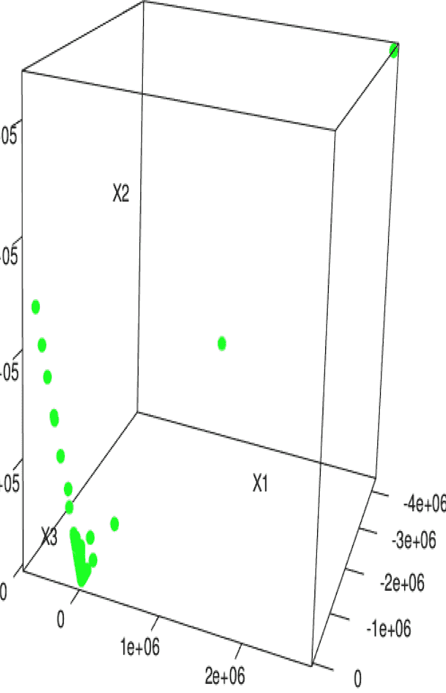

# 第 5 章. 使用 K-means 聚类进行异常检测

## 面向提前发布读者的说明

通过提前发布的电子书，您可以获取图书的最早形式——作者在编写过程中的原始、未经编辑的内容——因此您可以在这些书籍正式发布很久以前就利用这些技术。

这将是最终图书的第 5 章。

分类和回归是机器学习中强大且研究深入的技术。第 4 章演示了使用分类器作为未知值预测器。但有个问题：为了对新数据预测未知值，我们必须知道许多先前见过的示例的目标值。分类器只有在我们（数据科学家）知道自己在寻找什么，并且能提供大量输入产生已知输出的示例时才能提供帮助。这些技术统称为 *受监督学习* 技术，因为它们的学习过程会为输入中的每个示例接收正确的输出值。

但是，有时部分或全部示例的正确输出都是未知的。考虑按购物习惯和偏好划分电商网站客户的问题。输入特征包括他们的购买记录、点击记录、人口统计信息等。输出应为客户分组：也许一组代表时尚敏感的购买者，另一组则对应价格敏感的寻便宜者，等等。

如果要求你为每个新客户确定这个目标标签，你会很快在应用像分类器这样的受监督学习技术时遇到问题：例如，你*事先*不知道谁应该被认为是时尚敏感的。事实上，你甚至不确定“时尚敏感”本身是否是网站客户的有意义分组！

幸运的是，*无监督学习* 技术可以提供帮助。这些技术不会学习预测目标值，因为根本没有目标值可用。然而，它们可以学习数据中的结构并找到相似输入的分组，或者学习哪些类型的输入可能发生，哪些不太可能发生。本章将介绍使用 MLlib 中的聚类实现进行无监督学习。具体来说，我们将使用 K-means 聚类算法来识别网络流量数据中的异常。异常检测常用于发现欺诈、检测网络攻击，或发现服务器或其他传感器设备中的问题。在这些情况下，能够发现前所未见的新类型异常至关重要——例如新的欺诈形式、入侵和服务器故障模式。在这些情况下，无监督学习技术很有用，因为它们可以学习输入数据的正常外观，从而检测新数据与过去数据不同时的情况。这样的新数据不一定是攻击或欺诈；它只是异常，因此值得进一步调查。

我们将从 K-means 聚类算法的基础知识入手。接着将介绍 KDD Cup 1999 数据集。然后我们将使用 PySpark 创建第一个 K-means 模型。然后我们将讨论在实现 K-means 算法时确定良好 k 值（即聚类数量）的方法。然后我们将通过归一化输入特征并实施独热编码方法来使用先前被丢弃的分类特征，从而改进模型。最后，我们将介绍熵度量并探索模型的一些结果。

## K-means 聚类

正如其名称所暗示的，异常检测固有的问题是寻找不寻常的事物。如果我们已经知道数据集中“异常”的含义，就可以轻松地使用受监督学习检测数据中的异常。算法将接收标记为“正常”和“异常”的输入，并学习区分两者。然而，异常的性质在于它们是未知的未知。换句话说，已被观察和理解的异常就不再是异常。

聚类是最知名的无监督学习类型。聚类算法试图在数据中找到自然分组。彼此相似但与其他点不同的数据点很可能代表有意义的分组，因此聚类算法试图将此类数据放入同一个聚类。

K-means 聚类可能是最广泛使用的聚类算法。它试图在数据集中检测 k 个聚类，其中 k 由数据科学家给出。k 是模型的超参数，合适的值将取决于数据集。事实上，为 k 选择一个好的值将是本章的核心主题。

当数据集包含客户活动或交易等信息时，“相似”是什么意思？K-means 要求数据点之间有距离概念。使用 K-means 时，通常使用简单的欧几里得距离来测量数据点之间的距离，而碰巧的是，截至撰写本文时，这是 Spark MLlib 支持的唯一距离函数。欧几里得距离定义用于所有特征均为数值的数据点。“相似”的点是指彼此之间距离较小的点。

对于 K-means，一个聚类仅仅是一个点：组成该聚类的所有点的中心。事实上，这些只是包含所有数值特征的特征向量，可以称为向量。然而，在这里将它们视为点可能更直观，因为它们在欧几里得空间中被视为点。

这个中心称为聚类质心，是点的算术平均值——因此得名 K-means。首先，算法会选取一些数据点作为初始聚类质心。然后每个数据点被分配到最近的质心。然后对每个聚类，计算新的聚类质心，即刚刚分配到该聚类的数据点的平均值。此过程重复进行。

现在我们将看一个用例，展示 K-means 聚类如何帮助我们识别网络中潜在的异常活动。

## 识别异常网络流量

网络攻击在新闻中越来越常见。一些攻击试图用网络流量淹没计算机，以挤占合法流量。但在其他情况下，攻击试图利用网络软件中的缺陷来未经授权地访问计算机。当计算机被流量轰炸时，这很明显，但检测漏洞利用就像在极大的网络请求堆中大海捞针一样。

一些漏洞利用行为遵循已知模式。例如，在极短时间内访问机器上的每个端口，是任何正常软件程序都不应该需要做的事情。然而，这是攻击者寻找计算机上可能可被利用的运行服务的典型第一步。

如果你统计远程主机在短时间内访问的不同端口数量，你将获得一个特征，它可能非常好地预测端口扫描攻击。几个端口可能是正常的；数百个则表明存在攻击。检测其他类型的攻击也是如此，可从网络连接的其他特征入手——例如发送和接收的字节数、TCP 错误等等。

但那些未知的未知又如何呢？最大的威胁可能是从未被检测和分类过的那个。检测潜在网络入侵的一部分是检测异常。这些是已知不是攻击，但与过去观察到的连接不相似的连接。

在这里，可以使用像 K-means 这样的无监督学习技术来检测异常的网络连接。K-means 可以根据每个连接的统计信息对连接进行聚类。生成的聚类本身可能并不有趣，但它们共同定义了与过去连接相似的连接类型。任何不靠近聚类的东西都可能是异常的。


聚类之所以有趣，在于它们定义了正常连接的区域；除此之外的一切都是不寻常的，且可能是异常的。

## KDD Cup 1999 数据集

KDD Cup 是由计算机协会（ACM）的一个特别兴趣小组组织的年度数据挖掘竞赛。每年，都会提出一个机器学习问题，并附带一个数据集，邀请研究人员提交详细阐述其对该问题的最佳解决方案的论文。1999 年，主题是网络入侵，该数据集仍可在 KDD 网站上获得。我们需要从网站下载 kddcupdata.data.gz 和 kddcup.names 文件。本章余下部分将介绍如何通过从中学习，使用 Spark 构建一个检测异常网络流量的系统。

> 不要使用此数据集构建真实的网络入侵系统！该数据未必反映当时的真实网络流量——即使反映了，也反映了 22 年前的流量模式。

幸运的是，组织者已经将原始网络数据包数据处理为关于单个网络连接的汇总信息。该数据集大小约为 708 MB，包含约 490 万个连接。这算是大规模，如果不算海量的话，当然足够我们在此处使用。对于每个连接，数据集包含诸如发送的字节数、登录尝试次数、TCP 错误等信息。每个连接都是 CSV 格式数据集的一行，包含 38 个特征。特征信息和顺序可在 kddcup.names 文件中找到。

解压缩 kddcup.data.gz 数据文件并将其复制到您的存储中。与其他示例一样，本示例将假设文件位于 data/kddcup.data。让我们看看数据的原始形式：

```
head -n 1 data/kddcup.data
```

```
...
```

```
0,tcp,http,SF,215,45076,0,0,0,0,0,1,0,0,0,0,0,0,0,0,0,1,1,0.00,0.00,0.00,0.00,1.000,0.00,0.00,0.00,0.00,0.00,0.00,0.00,0.00,0.00,0.00,0.00,0.00,0.00,0.00,0.00,normal.
```

例如，这个连接是一个到 HTTP 服务的 TCP 连接——发送了 215 字节，接收了 45,706 字节。用户已登录，等等。

许多特征是计数值，例如第 17 列的 *num_file_creations*，如 *kddcup.names* 文件中所列。许多特征的值为 0 或 1，表示某个行为的存在或不存在，例如第 15 列的 *su_attempted*。它们看起来像 *第 4 章* 中的独热编码分类特征，但并未以相同方式分组和关联。每个特征都像是一个是/否特征，因此可以说是一个分类特征。将分类特征转换为数字并假设它们具有顺序并不总是有效。然而，在二元分类特征的特殊情况下，大多数机器学习算法中将这些特征映射为取值为 0 和 1 的数值特征效果良好。

其余的是比率，例如倒数第二列的 *dst_host_srv_error_rate*，值范围为 0.0 到 1.0（包含两端）。

有趣的是，最后一字段给出了一个标签。大多数连接被标记为 *normal*，但有些已被识别为各种网络攻击的示例。这些在学习如何将已知攻击与正常连接区分开时会很有用，但这里的任务是异常检测和发现潜在的新型未知攻击。此标签在我们的用途中大多会被搁置。

## 聚类初探

打开 *spark-shell*，并将 CSV 数据加载为数据帧。这又是一个 CSV 文件，但没有头信息。有必要提供与随附的 *kddcup.names* 文件中给出的列名。

```
data_without_header = spark.read.option("inferSchema",
True).option("header", False).csv("data/kddcup.data")
```

```
column_names = [ "duration", "protocol_type", "service", "flag",
"src_bytes", "dst_bytes", "land", "wrong_fragment", "urgent",
"hot", "num_failed_logins", "logged_in", "num_compromised",
"root_shell", "su_attempted", "num_root", "num_file_creations",
"num_shells", "num_access_files", "num_outbound_cmds",
"is_host_login", "is_guest_login", "count", "srv_count",
"serror_rate", "srv_serror_rate", "rerror_rate",
"srv_rerror_rate",
"same_srv_rate",
"diff_srv_rate", "srv_diff_host_rate",
"dst_host_count", "dst_host_srv_count",
"dst_host_same_srv_rate", "dst_host_diff_srv_rate",
"dst_host_same_src_port_rate", "dst_host_srv_diff_host_rate",
"dst_host_serror_rate", "dst_host_srv_serror_rate",
"dst_host_rerror_rate", "dst_host_srv_rerror_rate",
"label"]
```

```
data = data_without_header.toDF(*column_names)
```

首先探索数据集。数据中存在哪些标签，每个标签各有多少个？以下代码仅按标签计数，并按计数降序打印结果。

```
data.select("label").groupBy("label").count().orderBy(col("count"
).desc()).show(25)
```

| 标签 | 计数 |
|------|------|
| smurf. | 2807886 |
| neptune. | 1072017 |
| normal. | 972781 |
| satan. | 15892 |
| ... | ... |
| phf. | 4 |
| perl. | 3 |
| spy. | 2 |

共有 23 个不同的标签，最频繁的是 smurf. 和 neptune. 攻击。

请注意，数据包含非数值特征。例如，第二列可能是 `tcp`、`udp` 或 `icmp`，但 K-means 聚类需要数值特征。最后的标签列也是非数值的。起初，这些将被简单忽略。

除此之外，为数据创建 K-means 聚类遵循第 4 章中看到的相同模式。`VectorAssembler` 创建特征向量，`KMeans` 实现从特征向量创建模型，`Pipeline` 将所有内容串联在一起。从生成的模型中，可以提取并检查聚类中心。

```
from pyspark.ml.feature import VectorAssembler
from pyspark.ml.clustering import KMeans, KMeansModel
from pyspark.ml import Pipeline

numeric_only = data.drop("protocol_type", "service",
"flag").cache()

assembler =
VectorAssembler().setInputCols(numeric_only.columns[:-1]).setOutputCol("featureVector")

kmeans =
KMeans().setPredictionCol("cluster").setFeaturesCol("featureVector")

pipeline = Pipeline().setStages([assembler, kmeans])
pipeline_model = pipeline.fit(numeric_only)
kmeans_model = pipeline_model.stages[1]

from pprint import pprint
pprint (kmeans_model.clusterCenters ())

...
[array([4.83401949e+01, 1.83462155e+03, 8.26203190e+02,
5.71611720e-06,
6.48779303e-04, 7.96173468e-06...])),
array([1.09990000e+04, 0.00000000e+00, 1.3099374e+09,
0.0000000e+00,
0.0000000e+00, 0.0000000e+00, ...])]
```

这些数字不易直观解释，但每个都代表模型生成的一个聚类的中心（也称为质心）。这些值是质心相对于每个数值输入特征的坐标。

打印了两个向量，这意味着 K-means 正在将 k=2 个聚类拟合到数据上。对于已知至少具有 23 种不同连接类型的复杂数据集，这几乎肯定不足以准确建模数据中的不同分组。

这是一个利用给定标签来直观了解这两个聚类中包含什么的好机制，方法是统计每个聚类内的标签。

```
with_cluster = pipeline_model.transform(numeric_only)
with_cluster.select("cluster", "label").groupBy("cluster",
"label").count() .orderBy(col("cluster"),
col("count").desc() ).show(25)
```

| 聚类 | 标签 | 计数 |
|------|------|------|
| 0 | smurf. | 2807886 |
| 0 | neptune. | 1072017 |
| 0 | normal. | 972781 |
| 0 | satan. | 15892 |
| 0 | ipsweep. | 12481 |
| ... | ... | ... |
| 0 | phf. | 4 |
| 0 | perl. | 3 |
| 0 | spy. | 2 |
| 1 | portsweep. | 1 |

结果表明聚类完全没有帮助。只有一个数据点最终进入了聚类 1！

## 选择 k

两个聚类显然不够。这个数据集适合多少个聚类？很明显数据中有 23 种不同的模式，所以它

似乎 $k$ 至少可以是 23，或者可能更多。通常，会尝试许多 $k$ 的值来找到最佳的一个。但什么是“最佳”？

如果每个数据点都靠近其最近的质心，则聚类可被认为良好，其中“靠近”是由欧几里得距离定义的。这是评估聚类质量的一种简单、常见的方法，即通过所有点的这些距离的平均值，或者有时是距离平方的平均值来计算。事实上，KMeansModel 提供了 computeCost 方法，用于计算平方距离之和，并可轻易用于计算平均平方距离。

手动评估几个 $k$ 值的聚类成本是相当简单的。请注意，这段代码可能需要 10 分钟或更长时间才能运行。

```
from pyspark.sql import DataFrame
from pyspark.ml.evaluation import ClusteringEvaluator

from random import randint

def clustering_score(input_data, k):
    input_numeric_only = input_data.drop("protocol_type",
    "service", "flag")
    assembler =
    VectorAssembler().setInputCols(input_numeric_only.columns[:-1]).setOutputCol("featureVector")
    kmeans =
    KMeans().setSeed(randint(100,10000)).setK(k).setPredictionCol("cluster").setFeaturesCol("featureVector")
    pipeline = Pipeline().setStages([assembler, kmeans])
    pipeline_model = pipeline.fit(input_numeric_only)

    evaluator = ClusteringEvaluator(predictionCol='cluster',
    featuresCol="featureVector")
    predictions = pipeline_model.transform(numeric_only)
    score = evaluator.evaluate(predictions)
    return score

for k in list(range(20,100, 20)):
    print(clustering_score(numeric_only, k))
```

```
(20, 6.649218115128446E7)
(40, 2.5031424366033625E7)
(60, 1.027261913057096E7)
(80, 1.251413171109027E7)
(100, 7235531.565096531)
```

分数将以科学计数法显示。

- 1. 打印结果表明，随着 $k$ 的增加，分数会降低。请注意，分数以科学计数法显示；第一个数值超过 $10^7$，而不仅仅是略大于 6。

> 同样，您的数值会有一定差异。聚类取决于随机选择的初始质心集合。

然而，这显而易见。随着添加更多簇，总是可以将数据点放置得更靠近最近的质心。事实上，如果选择 $k$ 等于数据点的数量，平均距离将为 0，因为每个点都将成为包含自身的单点簇！

更糟的是，在前面的结果中，$k=80$ 的距离高于 $k=60$。这种情况本不应发生，因为较高的 $k$ 始终至少可以实现与较低 $k$ 同样好的聚类。问题是，K-means 不一定能为给定的 $k$ 找到最优聚类。其迭代过程可能会从随机起始点收敛到局部最小值，这可能不错，但并非最优。

即使在使用更智能的方法来选择初始质心时，这仍然成立。K-means++ 和 K-means|| 是选择算法的变体，更有可能选择多样且分离的质心，并更可靠地导致良好的聚类。事实上，Spark MLlib 实现了 K-means||。然而，所有这些方法在选择中仍包含一定的随机性，无法保证最优聚类。

为 $k=80$ 选择的随机起始簇集合可能导致了特别次优的聚类，或者它可能在达到局部最优之前过早停止。

我们可以通过运行更长的迭代来改进它。该算法通过 `setTol()` 设置一个阈值，用于控制被认为有意义的最小质心移动量；较低的值意味着 K-means 算法将允许质心移动更长时间。通过 `setMaxIter()` 增加最大迭代次数也可以防止其可能过早停止，代价是可能增加计算量。

```
def clustering_score_1(input_data, k):
    input_numeric_only = input_data.drop("protocol_type",
    "service", "flag")
    assembler =
    VectorAssembler().setInputCols(input_numeric_only.columns[:-1]).setOutputCol("featureVector")
    kmeans =
    KMeans().setSeed(randint(100,100000)).setK(k).setMaxIter(40).\
    setTol(1.0e-5).\
    setPredictionCol("cluster").setFeaturesCol("featureVector")
    pipeline = Pipeline().setStages([assembler, kmeans])
    pipeline_model = pipeline.fit(input_numeric_only)
    #
    evaluator = ClusteringEvaluator(predictionCol='cluster',
    featuresCol="featureVector")
    predictions = pipeline_model.transform(numeric_only)
    score = evaluator.evaluate(predictions)
    #
    return score
```

```
for k in list(range(20, 101, 20)):
    print(k, clustering_score_1(numeric_only, k))
```

从默认值 20 增加

从默认值 1.0e-4 减少

这次，至少分数是持续下降的：

```
(20, 1.8041795813813403E8)
(40, 6.33056876207124E7)
(60, 9474961.544965891)
(80, 9388117.93747141)
(100, 8783628.926311461)
```

我们想要找到一个点，超过该点后增加 k 不再显著降低分数——即 k 与分数图表中的“肘点”，该图表通常呈下降趋势但最终会变平。在这里，似乎在 100 之后仍在显著下降。合适的 k 值可能超过 100。

## 使用 SparkR 进行可视化

此时，在再次聚类之前，退一步更多地了解数据可能会很有用。特别是，查看数据点的图表可能会有所帮助。

Spark 本身没有可视化工具，但流行的开源统计环境 R 拥有用于数据探索和数据可视化的库。此外，Spark 还通过 SparkR 与 R 提供了一些基本集成。本简短章节将演示如何使用 R 和 SparkR 对数据进行聚类并探索聚类结果。

SparkR 是本书中使用的 spark-shell 的一个变体，使用 sparkR 命令调用。它运行一个本地 R 解释器，就像 spark-shell 作为本地进程运行 Scala shell 的变体一样。运行 sparkR 的机器需要本地安装 R，而 R 不包含在 Spark 中。例如，可以在类似 Ubuntu 的 Linux 发行版上使用 sudo apt-get install r-base 进行安装，或在 macOS 上使用 Homebrew 的 brew install R 进行安装。

SparkR 是一个命令行 shell 环境，类似于 R。要查看可视化结果，有必要在类似 IDE 且能够显示图像的环境中运行这些命令。RStudio 是 R 的 IDE（也支持 SparkR）；它运行在桌面操作系统上，因此只有在您在本地而非集群上尝试 Spark 时才可在此使用。

如果您在本地运行 Spark，请下载并安装 RStudio 的免费版本。如果不是，那么此示例的其余部分大多数仍可在命令行中使用 sparkR 运行；例如，在集群上。但是，这种方式将无法显示可视化结果。

如果通过 RStudio 运行，请启动 IDE 并配置 SPARK_HOME 和 JAVA_HOME（如果本地环境尚未设置它们），分别指向 Spark 和 JDK 的安装目录。

```
Sys.setenv(SPARK_HOME = "/path/to/spark") ①
Sys.setenv(JAVA_HOME = "/path/to/java")
library(SparkR, lib.loc = c(file.path(Sys.getenv("SPARK_HOME"),
"R", "lib")))
sparkR.session(master = "local[*]",
sparkConfig = list(spark.driver.memory = "4g"))
```

当然，请替换为实际路径。

请注意，如果在命令行中运行 sparkR，则不需要这些步骤。相反，它接受类似 --driver-memory 的命令行配置参数，就像 spark-shell 一样。

SparkR 是围绕本章已演示的相同 DataFrame 和 MLlib API 的 R 语言封装器。因此，可以重新创建对数据的简单 K-means 聚类：

```
clusters_data <- read.df("/path/to/kddcup.data", "csv", ①
inferSchema = "true", header = "false")
```

```
colnames(clusters_data) <- c( ②
"duration", "protocol_type", "service", "flag",
"src_bytes", "dst_bytes", "land", "wrong_fragment", "urgent",
"hot", "num_failed_logins", "logged_in", "num_compromised",
"root_shell", "su_attempted", "num_root", "num_file_creations",
"num_shells", "num_access_files", "num_outbound_cmds",
"is_host_login", "is_guest_login", "count", "srv_count",
"serror_rate", "srv_serror_rate", "error_rate",
"srv_error_rate",
"same_srv_rate", "diff_srv_rate", "srv_diff_host_rate",
"dst_host_count", "dst_host_srv_count",
"dst_host_same_srv_rate", "dst_host_diff_srv_rate",
"dst_host_same_src_port_rate", "dst_host_srv_diff_host_rate",
"dst_host_serror_rate", "dst_host_srv_serror_rate",
"dst_host_error_rate", "dst_host_srv_error_rate",
"label")
```

```
numeric_only <- cache(drop(clusters_data, ③
c("protocol_type", "service", "flag",
"label")))
```


kmeans_model <- spark.kmeans(numeric_only, ~ .,
  k = 100, maxIter = 40, initMode =
  "k-means||")

- 1. 将路径替换为 kddcup.data 的路径。
- 命名列。
- 再次删除非数值列。
- ~ . 表示所有列。

从这里开始，为每个数据点分配聚类非常简单。上面的操作展示了 SparkR API 的用法，它们自然对应于核心 Spark API，但以 R 风格的语法表现为 R 库。实际的聚类是使用 MLlib 中相同的基于 JVM、Scala 语言的实现执行的。这些操作实际上是对分布式操作的句柄或远程控制，这些分布式操作并未在 R 中执行。

R 拥有自己丰富的分析库集合，以及自己类似的数据帧概念。因此，有时将一些数据拉取到 R 解释器中很有用，以便能够使用这些与 Spark 无关的本机 R 库。

当然，R 及其库不是分布式的，因此将整个 4,898,431 个数据点的数据集拉取到 R 中是不可行的。但是，只拉取一个样本很容易：

```
clustering <- predict(kmeans_model, numeric_only)
clustering_sample <- collect(sample(clustering, FALSE, 0.01))
str(clustering_sample)
```

```
...
'data.frame': 48984 obs. of 39 variables:
$ duration : int 0 0 0 0 0 0 0 0 0 0 ...
$ src_bytes : int 181 185 162 254 282 310 212
214 181 ...
$ dst_bytes : int 5450 9020 4528 849 424 1981
2917 3404 ...
$ land : int 0 0 0 0 0 0 0 0 0 0 ...
...
$ prediction : int 33 33 33 0 0 0 0 0 33 33 ...
```

## 1% 无放回抽样

clustering_sample 实际上是一个本地 R 数据帧，而不是 Spark DataFrame，因此可以像处理 R 中的任何其他数据一样对其进行操作。以上，str() 显示了数据帧的结构。

例如，可以提取聚类分配，然后显示分配分布的统计信息：

```
clusters <- clustering_sample["prediction"]
data <- data.matrix(within(clustering_sample, rm("prediction")))
table(clusters)
...
clusters
0   11   14   18   23   25   28   30   31   33   36
...
47294   3   1   2   2  308  105   1   27 1219   15
...
```

- 仅聚类分配列
- 除聚类分配列外的所有内容

例如，这表明大多数点落入了聚类 0。虽然在 R 中可以对这些数据做更多的工作，但进一步介绍超出了本书的范围。

要可视化数据，需要一个名为 rgl 的库。仅在 RStudio 中运行此示例时才会生效。首先，安装（一次）并加载库：

```
install.packages("rgl")
library(rgl)
```

请注意，R 可能会提示您下载其他包或编译器工具以完成安装，因为安装包意味着编译其源代码。

此数据集为 38 维。为了使用*随机投影*进行可视化，必须将其投影到最多三个维度：

```
random_projection <- matrix(data = rnorm(3*ncol(data)), ncol = 3)
random_projection_norm <-
random_projection /
sqrt(rowSums(random_projection*random_projection))
projected_data <- data.frame(data %% random_projection_norm)
```

- 1. 创建随机 3D 投影并进行归一化
- 2. 投影并创建新数据帧

通过选择三个随机单位向量并将数据投影到它们上，从 38D 数据集创建了一个 3D 数据集。这是一种简单、粗糙但实用的降维形式。当然，还有更复杂的降维算法，例如主成分分析 (PCA) 或奇异值分解 (SVD)。这些在 R 中可用，但运行时间要长得多。为本示例的可视化目的，随机投影可以更快地实现几乎相同的结果。

最后，聚类点可以在交互式 3D 可视化中绘制：

```
num_clusters <- max(clusters)
palette <- rainbow(num_clusters)
colors = sapply(clusters, function(c) palette[c])
plot3d(projected_data, col = colors, size = 10)
```

请注意，这需要在支持 `rgl` 库和图形的环境中运行 RStudio。例如，在 macOS 上，它需要安装 Apple 开发者工具中的 X11。

图 5-1 中生成的可视化显示了 3D 空间中的数据点。许多点重叠在一起，结果稀疏且难以解释。然而，可视化的主导特征是其 L 形。点似乎沿着两个不同的维度变化，而在其他维度上变化不大。

这很合理，因为数据集中有两个特征的规模远大于其他特征。虽然大多数特征的值介于 0 和 1 之间，但发送字节和接收字节特征的值范围从 0 到几万。因此，点之间的欧氏距离几乎完全由这两个特征决定。这几乎就好像其他特征不存在一样！因此，消除这些规模差异以使特征处于近乎平等的地位非常重要。

## 特征归一化

可以通过将每个特征转换为标准分数来对其进行归一化。这意味着从每个值中减去特征值的均值，并除以标准差，如标准分数方程所示：

```
normalized_i = \frac{feature_i - \mu_i}{\sigma_i}
```



## 图 5-1. 随机 3D 投影

事实上，减去均值对聚类没有影响，因为减法实际上会将所有数据点向同一方向移动相同的量。这不影响点间欧氏距离。

MLlib 提供了 StandardScaler，这是一个可以执行此类标准化并易于添加到聚类管道的组件。

可以在更高范围的 k 上对归一化数据运行相同的测试：

```python
from pyspark.ml.feature import StandardScaler

def clustering_score_2(input_data, k):
    input_numeric_only = input_data.drop("protocol_type",
    "service", "flag")
    assembler =
VectorAssembler().setInputCols(input_numeric_only.columns[:-1]).setOutputCol("featureVector")
scaler =
StandardScaler().setInputCol("featureVector").setOutputCol("scaledFeatureVector").setWithStd(True).setWithMean(False)
kmeans =
KMeans().setSeed(randint(100,10000)).setK(k).setMaxIter(40).setTol(1.0e-5).setPredictionCol("cluster").setFeaturesCol("scaledFeatureVector")
pipeline = Pipeline().setStages([assembler, scaler, kmeans])
pipeline_model = pipeline.fit(input_numeric_only)
#
evaluator = ClusteringEvaluator(predictionCol='cluster',
featuresCol="scaledFeatureVector")
predictions = pipeline_model.transform(numeric_only)
score = evaluator.evaluate(predictions)
#
return score

for k in list(range(60, 271, 30)):
    print(k, clustering_score_2(numeric_only, k))
...
(60,1.2454250178069293)
(90,0.7767730051608682)
(120,0.5070473497003614)
(150,0.4077081720067704)
(180,0.3344486714980788)
(210, 0.276237617334138)
(240, 0.24571877339169032)
(270, 0.21818167354866858)
```

这有助于使维度处于更平等的地位，点之间的绝对距离（因此成本）在绝对值上要小得多。但是，上述输出尚未提供一个明显的 k 值，超过该值增加 k 对改善成本帮助不大。

如预期，对归一化数据点的另一个 3D 可视化揭示了更丰富的结构。某些点在一个方向上以规则的离散间隔间距排列；这些可能是数据中离散维度（如计数）的投影。在有 100 个聚类时，很难分辨哪些点来自哪些聚类。一个大聚类似乎占主导地位，许多聚类对应于小的紧凑子区域（其中一些被省略在此整个 3D 可视化的缩放细节中）。如图 5-2 所示的结果，不一定能推进分析，但却是一个有趣的合理性检查。


图 5-2. 随机 3D 投影，已归一化

## 分类变量

归一化是向前迈出的宝贵一步，但还可以做更多工作来改进聚类。特别是，几个特征被完全遗漏了，因为它们不是数值型的。这相当于丢弃了宝贵的信息。以某种形式将它们加回来，应该能产生更明智的聚类。

此前，三个分类特征被排除了，因为非数值特征无法与 MLlib 中 K-means 使用的欧氏距离函数一起使用。这与“随机森林”中指出的问题相反，在那里，数值特征被用来表示分类值，但需要的是一个分类特征。

分类特征可以使用独热编码转换为若干个二进制指示特征，这些特征可以被视为数值维度。例如，第二列包含协议类型：`tcp`、`udp` 或 `icmp`。可以将此特征视为 _三个_ 特征，仿佛数据集中存在“is TCP”、“is UDP”和“is ICMP”特征一样。单个特征值 `tcp` 可能变成 `1, 0, 0`；`udp` 可能是 `0, 1, 0`；以此类推。

同样地，MLlib 提供了实现此转换的组件。事实上，像 `protocol_type` 这样的字符串值特征的独热编码实际上是一个两步过程。首先，使用 `StringIndexer` 将字符串值转换为 0、1、2 等整数索引。然后，使用 `OneHotEncoder` 将这些整数索引编码为向量。这两个步骤本身可以看作是一个小型 `Pipeline`。

```python
from pyspark.ml.feature import OneHotEncoder, StringIndexer

def one_hot_pipeline(input_col):
    indexer = StringIndexer().setInputCol(input_col).setOutputCol(input_col + "-indexed")
    encoder = OneHotEncoder().setInputCol(input_col + "-indexed").setOutputCol(input_col + "_vec")
    pipeline = Pipeline().setStages([indexer, encoder])
    return pipeline, input_col + "_vec"
```

返回 Pipeline 和输出向量列的名称

此方法生成一个 `Pipeline`，可以将其作为组件添加到整体聚类管道中；管道可以组合。剩下要做的就是确保将新的向量输出列添加到 `VectorAssembler` 的输出中，然后像之前一样继续进行缩放、聚类和评估。为简洁起见，此处省略了源代码，但可以在本章附带的存储库中找到。

(60, 39.739250062068685)
(90, 15.814341529964691)
(120, 3.5008631362395413)
(150, 2.2151974068685547)
(180, 1.587330730808905)
(210, 1.3626704802348888)
(240, 1.1202477806210747)
(270, 0.9263659836264369)

这些示例结果表明，可能 k=180 是得分开始有点平坦的值。至少聚类现在使用了所有输入特征。

## 使用标签和熵

此前，我们使用每个数据点给定的标签来快速检查聚类质量。这一概念可以进一步形式化，并用作评估聚类质量（因此也是选择 k）的另一种手段。

标签告诉我们关于每个数据点真实本质的一些信息。看来，良好的聚类应该与这些人工应用的标签一致。它应该将共享标签的点聚集在一起，而不应将许多不同标签的点归为一类。它应该产生标签相对均匀的簇。

你可能还记得从“随机森林”中我们知道有用于同质性的度量：基尼不纯度和熵。这些是每个簇中标签比例的函数，当比例偏向少数或单一标签时，它们会产生一个较小的数字。这里将使用熵来演示。

```python
from math import log

def entropy(counts):
    values = [v for v in counts if (v > 0)]
    n = sum(values)
    p = [v/n for v in values]
    return sum([-1*(p_v) * log(p_v) for p_v in p])
```

良好的聚类将具有标签集合均匀且因此熵较低的簇。因此，可以使用加权平均熵作为簇得分：

```python
from pyspark.sql.functions import collect_list

cluster_label = pipeline_model.transform(data).select("cluster", "label")

weighted_cluster_entropy = cluster_label.groupBy(col("cluster")).agg(collect_list("label"))

sum(weighted_cluster_entropy) / data.count()
```

- 1 按簇提取标签集合
- 2 计算集合中的标签数
- 3 按簇大小加权平均熵
- 4

像以前一样，可以使用此分析来大致了解 k 的合适值。熵不一定会随 k 的增加而减小，因此可以寻找局部最小值。同样，结果表明 k=180 是一个合理的选择，因为它的得分实际上低于 150 和 210：

(60, 0.03475331900669869)
(90, 0.051512668026335535)
(120, 0.02020028911919293)
(150, 0.019962563512905682)
(180, 0.01110240886325257)
(210, 0.01259738444250231)
(240, 0.01357435960663116)
(270, 0.010119881917660544)

## 聚类实战

最后，充满信心地，我们可以使用 k=180 对完整的归一化数据集进行聚类。再次，我们可以打印每个簇的标签以大致了解生成的聚类结果。簇似乎确实各由一种攻击类型主导，并且只包含少数几种类型。

```python
pipeline_model = fit_pipeline_4(data, 180)
count_by_cluster_label = pipeline_model.transform(data).select("cluster", "label").groupBy("cluster", "label").count().orderBy("cluster", "label")
count_by_cluster_label.show()
```

| 簇 | 标签 | 计数 |
|---|---|---|
| 0 | back. | 324 |
| 0 | normal. | 42921 |
| 1 | neptune. | 1039 |
| 1 | portsweep. | 9 |
| 1 | satan. | 2 |
| 2 | neptune. | 365375 |
| 2 | portsweep. | 141 |
| 3 | portsweep. | 2 |
| 3 | satan. | 10627 |
| 4 | neptune. | 1033 |
| 4 | portsweep. | 6 |
| 4 | satan. | 1 |

有关 fit_pipeline_4() 定义，请参见附带源代码

现在我们可以制作一个实际的异常检测器。异常检测相当于测量新数据点到其最近质心的距离。如果该距离超过某个阈值，则它是异常的。此阈值可以选择为已知数据中，比如说，第100远的数据点的距离：

```python
from pyspark.ml.linalg import Vector, Vectors

k_means_model = pipeline_model.stages[-1]
centroids = k_means_model.clusterCenters

clustered = pipeline_model.transform(data)
threshold = clustered.select("cluster", "scaledFeatureVector").withColumn("dist_values", Vectors.squared_distance(centroids(col("cluster")), col("scaledFeatureVector"))).orderBy(col("value").desc()).last
```

最后一步可以是将此阈值应用到所有到达的新数据点上。例如，可以使用 Spark Streaming 将此函数应用于从 Kafka 等源或云存储中的文件到达的小批量输入数据。超过阈值的数据点可能会触发发送电子邮件或更新数据库的警报。

## 后续方向

`KMeansModel` 本身就是异常检测系统的精髓。前面的代码演示了如何将其应用于数据以检测异常。同样的代码可以在 Spark Streaming 中使用，对到达的新数据进行近乎实时评分，并可能触发警报或审查。

MLlib 还包含一种名为 `StreamingKMeans` 的变体，它可以在新数据到达时在 `StreamingKMeansModel` 中逐步更新聚类。我们可以使用它来继续大致了解新数据如何影响聚类，而不仅仅是根据现有簇评估新数据。它也可以与 Spark Streaming 集成。但是，它尚未针对新的 `DataFrame-based` API 进行更新。

这个模型只是一个简化的模型。例如，此示例中使用欧氏距离，因为这是 Spark MLlib 目前支持的唯一距离函数。将来，可能可以使用能够更好地考虑特征之间分布和相关性的距离函数，例如马氏距离。

还有一些更复杂的聚类质量评估度量可供应用（即使没有标签）来选择 k，例如轮廓系数。这些度量倾向于不仅评估一个簇内点的接近程度，还评估点到其他簇的接近程度。最后，可以应用不同于简单 K-means 聚类的模型：例如，高斯混合模型或 DBSCAN 可以捕捉数据点与簇中心之间更微妙的关系。Spark MLlib 已经实现了高斯混合模型；其他模型的实现未来可能会在 Spark MLlib 或其他基于 Spark 的库中提供。

当然，聚类不仅仅用于异常检测。事实上，它更多与实际簇重要的用例相关联！例如，聚类还可以用于根据客户的行为、偏好和属性对客户进行分组。每个簇本身可能代表一种有用可区分的客户类型。与依赖“年龄 20–34”和“女性”等任意通用分区相比，这是一种更具数据驱动的客户细分方式。


