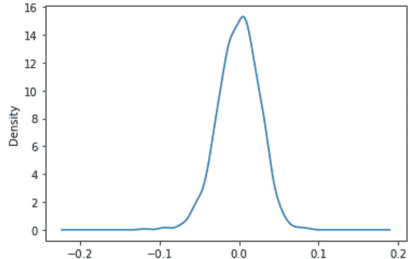
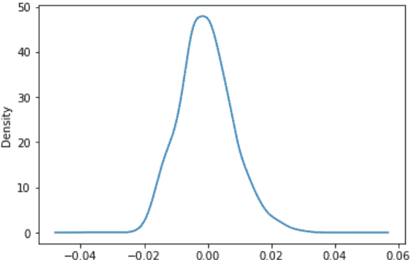
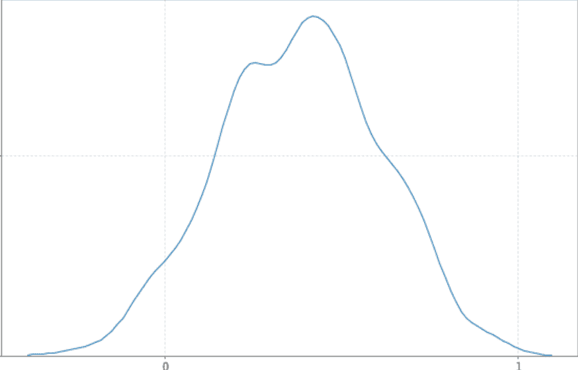

# 第 8 章. 估算金融风险

## 早期发行读者须知

通过早期发行电子书，您可以获取书籍的最早形态——作者在撰写时的原始、未经编辑的内容——因此您可以在这些书籍正式发布之前很久就利用这些技术。

这将是最终图书的第 8 章。

投资于金融市场时，有没有办法估算可能会损失多少？金融统计学中的风险价值（Value at Risk, VaR）正是试图衡量这一量。VaR 是一种简单的投资风险度量方法，旨在合理估计投资组合在特定时间段内价值可能出现的最大损失。VaR 统计量取决于三个参数：投资组合、时间段和概率。例如，概率为 5%、时间为两周且 VaR 值为 100 万美元，意味着该投资组合在两周内损失超过 100 万美元的概率只有 5%。

VaR 于 1987 年股市崩盘后不久开发出来，此后在金融服务机构中得到广泛应用。这一统计量通过帮助确定其策略的风险特征，在这些机构的管理中发挥着至关重要的作用。

估算该统计量的许多最复杂方法都依赖于在随机条件下对市场进行计算密集型模拟。这些方法背后的技术（称为蒙特卡洛模拟）涉及提出成千上万甚至数百万个随机市场情景，并观察它们倾向于如何影响投资组合。这些情景被称为试验。PySpark 是蒙特卡洛模拟的理想工具。PySpark 可以利用成千上万个核心来运行随机试验并汇总其结果。作为一种通用数据转换引擎，它也擅长执行围绕模拟的前处理和后处理步骤。它可以将原始财务数据转换为执行模拟所需的模型参数，并支持对结果的临时分析。与使用 HPC 环境的更传统方法相比，其简单的编程模型可以大幅缩短开发时间。

我们还将讨论如何计算一种名为条件风险价值（Conditional Value at Risk, CVaR）的相关统计量，有时也称为期望短缺，巴塞尔银行监管委员会数年前曾提出它作为比 VaR 更好的风险度量方法。CVaR 统计量与 VaR 统计量具有相同的三个参数，但考虑的是预期平均损失，而不是提供可能的损失值。5% q 值、两周的 CVaR 为 500 万美元，意味着最坏的 5% 结果中的平均损失为 500 万美元。

为了构建 VaR 模型，我们将介绍几种不同的概念、方法和软件包。我们将首先回顾本章中将使用的基本金融术语。然后，我们将了解计算 VaR 的方法，包括蒙特卡洛模拟技术。之后，我们将使用 PySpark 和 Pandas 下载并准备数据集。我们将使用 20 世纪末至 21 世纪初的股票市场数据。这将包括国债价格等市场指标，以及各种公司的股票价值。完成预处理后，我们将创建一个线性回归模型来计算股票在一段时间内的价值变化。我们还将想出一种方法，在进行蒙特卡洛模拟时生成用于试验的样本市场指标值。然后，我们将使用 PySpark 进行模拟并回顾我们的结果。

让我们先定义我们将使用的基本金融术语。

## 术语

本章使用了一组特定于金融领域的术语。我们将在此简要定义它们：

### 金融工具

一种可交易资产，例如债券、贷款、期权或股票投资。在任何特定时间，一种金融工具被认为具有 *价值*，即其可被出售的价格。

### 投资组合

金融机构拥有的一组金融工具。

### 收益

一种金融工具或投资组合在一段时间内的价值变化。

### 损失

负收益。

### 指数

一组虚拟的金融工具。例如，纳斯达克综合指数包括约 3,000 只股票以及主要美国和国际公司的类似工具。

### 市场因子

一种可以用作特定时间金融气候宏观方面指标的数值——例如，指数的价值、美国国内生产总值，或美元与欧元之间的汇率。我们通常将市场因子简称为 *因子*。

## 计算 VaR 的方法

迄今为止，我们对 VaR 的定义比较开放。估算该统计量需要提出投资组合运作模型，并选择其收益可能遵循的概率分布。机构采用多种方法计算 VaR，所有这些方法大多属于几种通用方法。

### 方差-协方差

方差-协方差法是迄今为止最简单且计算密集度最低的方法。其模型假设每种金融工具的收益服从正态分布，从而允许解析推导估计值。

### 历史模拟

历史模拟通过直接使用历史数据的分布（而非依赖汇总统计）来外推风险。例如，为确定投资组合的 95% VaR，我们可能会查看该投资组合过去 100 天的表现，并将其在第五糟糕天的数值作为估计值。该方法的一个缺点是历史数据可能有限，且未包含“假设”情景。例如，如果我们投资组合中金融工具的历史数据缺乏市场崩盘情况，而我们又想模拟在这些情况下投资组合会发生什么。存在使历史模拟对这些问题具有鲁棒性的技术，例如在数据中引入“冲击”，但我们不会在此介绍。

### 蒙特卡洛模拟

蒙特卡洛模拟（本章余下部分将重点介绍）通过在随机条件下模拟投资组合，试图削弱前几种方法中的假设。当我们无法解析推导概率分布的闭式解时，通常可以通过反复抽取其依赖的更简单随机变量，并观察其整体表现来估计其概率密度函数（PDF）。这种方法的最一般形式如下：

- 定义市场状况与每种金融工具收益之间的关系。这种关系采用拟合历史数据的模型形式。
- 定义易于采样的市场状况分布。这些分布拟合自历史数据。
- 提出由随机市场状况组成的试验。
- 计算每次试验的投资组合总损失，并使用这些损失定义损失的经验分布。这意味着，如果运行 100 次试验并希望估计 5% VaR，我们将选择损失第五大的那次试验的损失作为估计值。要计算 5% CVaR，我们将计算五次最糟糕试验的平均损失。

当然，蒙特卡洛方法也并非完美。它依赖于生成试验条件和推断金融工具表现的模型，这些模型必须做出简化假设。如果这些假设不符合现实，那么得出的最终概率分布也不会符合现实。

### 我们的模型

蒙特卡洛风险模型通常将每种金融工具的收益表述为一组市场因子的函数。常见的市场因子可能包括标普 500 指数、美国 GDP 或货币汇率等指数的值。然后我们需要一种基于这些市场条件来预测每种金融工具收益的模型。在我们的模拟中，将使用一个简单的线性模型。根据先前对收益的定义，因子收益是市场因子在特定时间段内的价值变化。例如，如果标普 500 指数的值在一个时间区间内从 2,000 变动到 2,100，则其收益为 100。我们将从因子收益的简单变换中推导出一组特征。也就是说，试验 t 的市场因子向量 m_t 通过某个函数 φ 进行变换，以生成可能长度不同的特征向量 f_t：

```
f_t = φ(m_t)
```


对于每个工具，我们将训练一个模型，为每个特征分配权重。要计算 \( r_{it} \)，即工具 \( i \) 在试验 \( t \) 中的回报，我们使用 \( c_i \)，即工具的截距项；\( w_{ij} \)，即特征 \( j \) 在工具 \( i \) 上的回归权重；以及 \( f_{tj} \)，即试验 \( t \) 中特征 \( j \) 的随机生成值：

```
\( r_{it} = c_i + \sum_{j=1}^{|w_i|} w_{ij} * f_{tj} \)
```

这意味着每个工具的回报计算为该工具市场因子特征回报乘以其权重之和。我们可以使用历史数据（也称为进行线性回归）为每个工具拟合线性模型。如果 VaR 计算的时间跨度为两周，则回归将历史中每个（重叠的）两周间隔视为一个标记点。

值得注意的是，我们本可以选择一个更复杂的模型。例如，模型不必是线性的：它可以是回归树，或者明确包含领域特定知识。

既然我们已有用于从市场因素计算工具损失的模型，就需要一个模拟市场因素行为的过程。一个简单的假设是，每个市场因素回报遵循正态分布。为了捕捉市场因素通常相关的事实——当纳斯达克下跌时，道琼斯也可能遭遇损失——我们可以使用带有非对角协方差矩阵的多元正态分布：

```
\( m_t \sim \mathcal{N} (\mu, \Sigma) \)
```

其中 \( \mu \) 是因素回报的经验均值向量，\( \Sigma \) 是因素回报的经验协方差矩阵。

与之前一样，我们本可以选择更复杂的市场模拟方法，或为每个市场因素假设不同类型的分布，或许使用尾部更肥的分布。

## 获取数据

下载历史股票价格数据集，并将其放置在 `data/stocks/` 目录中。

```
$ mkdir stocks && cd stocks
$ wget https://raw.githubusercontent.com/sryza/aas/master/ch09-risk/data/stocks.zip
$ unzip stocks.zip
```

很难找到大量格式良好的历史价格数据。本章使用的数据集是从 Yahoo! 下载的。

我们还需要风险因素的历史数据。对于我们的因素，我们将使用以下项目的值：

- iShares 20年以上国债债券 ETF (NASDAQ: TLT)
- iShares 美国信用债债券 ETF (NYSEARCA: CRED)
- SPDR 黄金信托 (NYSEARCA: GLD)

下载并放置因素数据。

```
$ cd .. && mkdir factors && cd factors
$ wget https://raw.githubusercontent.com/sryza/aas/master/ch09-risk/data/factors.zip
$ unzip factors.zip
$ ls factors
...
NASDAQ%3ATLT.csv  NYSEARCA%3ACRED.csv  NYSEARCA%3AGLD.csv
```

让我们来看一下我们的一个因素。

```
$ !head -n 5 data/factors/NASDAQ%3ATLT.csv
...
Date,Open,High,Low,Close,Volume
31-Dec-13,102.29,102.55,101.17,101.86,7219195
30-Dec-13,102.15,102.58,102.08,102.51,4491711
27-Dec-13,102.07,102.31,101.69,101.81,4755262
26-Dec-13,102.35,102.36,102.01,102.10,4645323
24-Dec-13,103.23,103.35,102.80,102.83,4897009
```

数据集下载完成后，我们将开始准备数据集。

## 准备数据

GOOGL 的 Yahoo! 格式数据的前几行如下：

```
$ !head -n 5 data/stocks/GOOGL.csv
...
Date,Open,High,Low,Close,Volume
31-Dec-13,556.68,561.06,553.68,560.92,1358300
30-Dec-13,560.73,560.81,555.06,555.28,1236709
27-Dec-13,560.56,560.70,557.03,559.76,1570140
26-Dec-13,557.56,560.06,554.90,559.29,1338507
24-Dec-13,558.04,558.18,554.60,556.48,734170
```

让我们启动 PySpark shell。

```
$ pyspark --driver-memory 4g
```

将工具数据集读入为 DataFrame。

```
stocks = spark.read.csv("data/stocks/", header='true',
inferSchema='true')
```

```
stocks.show(2)
...
```

| 日期 | 开盘价 | 最高价 | 最低价 | 收盘价 | 成交量 |
|------|--------|--------|--------|--------|--------|
| 2013-12-31 | 4.40 | 4.48 | 3.92 | 4.07 | 561247 |
| 2013-12-30 | 3.93 | 4.42 | 3.90 | 4.38 | 550358 |

DataFrame 中缺少工具符号。让我们使用每行对应的输入文件名来添加它。

```
from pyspark.sql import functions as fun
stocks = stocks.withColumn("Symbol", fun.input_file_name()).\
withColumn("Symbol",
fun.element_at(fun.split("Symbol", "/"), -1)).\
withColumn("Symbol",
fun.element_at(fun.split("Symbol", "\."), 1))
stocks.show(2)
...
```

| 日期 | 开盘价 | 最高价 | 最低价 | 收盘价 | 成交量 | 符号 |
|------|--------|--------|--------|--------|--------|--------|
| 31-Dec-13 | 1884.00 | 1900.00 | 1880.00 | 1900.0 | 546 | CLDN |
| 30-Dec-13 | 1889.00 | 1900.00 | 1880.00 | 1900.0 | 1656 | CLDN |

我们将以类似的方式读取和处理因素数据集。

```
factors = spark.read.csv("data/factors", header='true',
inferSchema='true')
factors = factors.withColumn("Symbol", fun.input_file_name()).\
withColumn("Symbol",
fun.element_at(fun.split("Symbol", "/"), -1)).\
withColumn("Symbol",
fun.element_at(fun.split("Symbol", "\."), 1))
```

我们筛选掉历史不足五年的工具：

```
from pyspark.sql import Window
stocks = stocks.withColumn('count', fun.count('Symbol').\
over(Window.partitionBy('Symbol'))).\
filter(fun.col('count') > 260*5 + 10)
```

不同类型的工具可能在不同日期交易，或者数据可能因其他原因存在缺失值，因此确保我们的不同时间序列对齐非常重要。首先，我们需要将所有时间序列修剪到同一时间段。为此，我们将首先将 Date 列的类型从字符串转换为日期。

```
stocks = stocks.withColumn('Date',
fun.to_date(fun.to_timestamp(fun.col('Date'), 'dd-MMM-yy')))
```

```
stocks.printSchema()
...
root
 |-- Date: date (nullable = true)
 |-- Open: string (nullable = true)
 |-- High: string (nullable = true)
 |-- Low: string (nullable = true)
 |-- Close: double (nullable = true)
 |-- Volume: string (nullable = true)
 |-- Symbol: string (nullable = true)
 |-- count: long (nullable = false)
```

让我们修剪工具的时间段以进行对齐。

```
from datetime import datetime

stocks = stocks.filter(fun.col('Date') >= datetime(2009, 10,
23)).\
    filter(fun.col('Date') <= datetime(2014, 10, 23))
```

我们也将在因素 DataFrame 中转换 Date 列的类型并修剪时间段。

```
factors = factors.withColumn('Date',
fun.to_date(fun.to_timestamp(fun.col('Date'), 'dd-MM-yy')))

factors = factors.filter(fun.col('Date') >= datetime(2009, 10,
23)).\
    filter(fun.col('Date') <= datetime(2014, 10,
23))
```

几千个工具和 3 个因素的历史记录足够小，可以在本地读取和处理。即使对于拥有数十万个工具和数千个因素的更大规模模拟，情况也是如此。尽管我们迄今为止一直使用 PySpark 进行数据预处理，但在实际运行模拟时，分布式系统（如 PySpark）的需求应运而生，因为模拟可能需要对每个工具进行大量计算。我们可以将 PySpark DataFrame 转换为 Pandas 数据框，并通过执行内存操作继续轻松地处理它。

```
stocks_pd_df = stocks.toPandas()
factors_pd_df = factors.toPandas()

factors_pd_df.head(5)
```

| | 日期 | 开盘价 | 最高价 | 最低价 | 收盘价 | 成交量 | 符号 |
|---|---|---|---|---|---|---|---|
| 0 | 2013-12-31 | 102.29 | 102.55 | 101.17 | 101.86 | 7219195 | NASDAQ%3ATLT |
| 1 | 2013-12-30 | 102.15 | 102.58 | 102.08 | 102.51 | 4491711 | NASDAQ%3ATLT |
| 2 | 2013-12-27 | 102.07 | 102.31 | 101.69 | 101.81 | 4755262 | NASDAQ%3ATLT |
| 3 | 2013-12-26 | 102.35 | 102.36 | 102.01 | 102.10 | 4645323 | NASDAQ%3ATLT |
| 4 | 2013-12-24 | 103.23 | 103.35 | 102.80 | 102.83 | 4897009 | NASDAQ%3ATLT |

在下一节中，我们将使用这些 Pandas 数据框，尝试拟合一个线性回归模型，以根据因素回报预测工具回报。

## 确定因子权重

请记住，VaR 处理的是 _特定时间跨度内_ 的损失。我们关心的不是工具的绝对价格，而是这些价格在给定时间段内的波动。在我们的计算中，我们将该长度设置为两周。以下函数使用 pandas 的 `rolling` 方法，将价格时间序列转换为两周间隔内的重叠价格变动序列。请注意，我们使用 10 而不是 14 来定义窗口，因为金融数据不包括周末：

```
n_steps = 10
def my_fun(x):
    return ((x.iloc[-1] - x.iloc[0]) / x.iloc[0])

stock_returns =
stocks_pd_df.groupby('Symbol').Close.rolling(window=n_steps).apply(my_fun)
factors_returns =
factors_pd_df.groupby('Symbol').Close.rolling(window=n_steps).apply(my_fun)
```


stock_returns = stock_returns.reset_index()
factors_returns = factors_returns.reset_index()

有了这些收益率历史数据后，我们可以着手实现训练工具收益率预测模型的目标。对于每个工具，我们希望有一个模型，它根据同一时间段内因子的收益率来预测其两周收益率。为简单起见，我们将使用线性回归模型。

为了建模工具收益率可能是因子收益率非线性函数的事实，我们可以在模型中加入一些从因子收益率的非线性变换中导出的附加特征。例如，我们将为每个因子收益率添加一个附加特征：平方。我们的模型在响应变量是特征的线性函数这一意义上仍然是线性模型。有些特征碰巧是由因子收益率的非线性函数决定的。请记住，此特定特征变换旨在演示可用选项中的一些——它不应被视为预测金融建模的最先进实践。

```
### Create combined factors DF
factors_pd_df_with_returns = factors_pd_df.assign(factors_returns = factors_returns['Close'],
    factors_returns_squared = factors_returns['Close']**2)

### Create combined stocks DF
stocks_pd_df_with_returns = stocks_pd_df.assign(stock_returns = stock_returns['Close'])
```

尽管我们将进行许多回归——每个工具一个——但每次回归中的特征和数据点数量较少，这意味着我们不需要使用 PySpark 的分布式线性建模功能。相反，我们将使用 scikit-learn 包提供的普通最小二乘回归：

我们现在有一个数据框，其中每一行都是一个工具的模型参数集（系数、权重、协变量、回归器，或者你想怎么称呼它们）。

在任何实际流程的这一点上，了解这些模型对数据的拟合程度会很有用。因为数据点来自时间序列，尤其是由于时间间隔重叠，样本很可能是自相关的。这意味着像 $R^2$ 这样的常用指标可能会高估模型对数据的拟合程度。Breusch-Godfrey 检验是评估这些效应的标准检验。快速评估模型的一种方法是将时间序列分为两组，中间留出足够多的数据点，以便较早集合中的最后几个点与较晚集合中的第一个点不自相关。然后在一组上训练模型，并查看其在另一组上的误差。

有了将因子收益率映射到工具收益率的模型后，我们现在需要一种通过生成随机因子收益率来模拟市场条件的过程。这就是我们接下来要做的。

## 采样

要想出一种生成随机因子收益率的方法，我们需要决定因子收益率向量上的概率分布并从中采样。数据实际上遵循什么分布？以可视化方式开始回答这类问题通常很有帮助。

可视化连续数据概率分布的一种好方法是绘制密度图，该图将分布的定义域与其 PDF 相对比。由于我们不知道支配数据的分布，我们没有能给出任意点处密度的方程，但可以通过一种称为核密度估计的技术来近似它。从宽泛意义上说，核密度估计是平滑直方图的一种方式。它在每个数据点处中心化一个概率分布（通常是正态分布）。因此，一组两周收益率样本会产生多个正态分布，每个分布的均值不同。为了估计给定点处的概率密度，它在该点处评估所有正态分布的 PDF 并取其平均值。核密度图的平滑程度取决于其 *bandwidth*，即每个正态分布的标准差。

我们将使用 Pandas DataFrame 的内置方法之一来计算和绘制 kde 图。以下代码片段为我们的某个因子创建密度图：

```
samples = factors_returns.loc[factors_returns.Symbol ==
factors_returns.Symbol.unique()[0]]['Close']
samples.plot.kde()
```

图 8-1 显示了我们历史中 20 年期以上国债 ETF 两周收益率的分布（概率密度函数）。



图 8-1. 两周 20 年期以上国债 ETF 分布

图 8-2 显示了美国信用债券两周收益率的相同分布。



图 8-2. 两周美国信用债券 ETF 债券收益率分布

我们将为每个因子的收益率拟合正态分布。寻找更奇特的分布（也许尾部更厚）以更贴合数据通常很有价值。但是，为了简单起见，我们将避免以这种方式调整模拟。

采样因子收益率的最简单方法是为每个因子拟合正态分布，并从这些分布中独立采样。然而，这忽略了市场因子通常是相关的这一事实。如果国债 ETF 下跌，信用债券 ETF 很可能也会下跌。未能考虑这些相关性可能会让我们对风险概况的描绘比现实要乐观得多。我们的因子收益率是否相关？Pandas 中的 Pearson 相关性实现可以帮助我们找出答案：

```
f_1 = factors_returns.loc[factors_returns.Symbol ==
factors_returns.Symbol.unique()[0]]['Close']
f_2 = factors_returns.loc[factors_returns.Symbol ==
factors_returns.Symbol.unique()[1]]['Close']
f_3 = factors_returns.loc[factors_returns.Symbol ==
factors_returns.Symbol.unique()[2]]['Close']
pd.DataFrame({'f1': list(f_1), 'f2': list(f_2), 'f3':
list(f_3)}).corr()
...
```

| | f1 | f2 | f3 |
|---|---|---|---|
| f1 | 1.000000 | 0.530550 | 0.074578 |
| f2 | 0.530550 | 1.000000 | 0.206538 |
| f3 | 0.074578 | 0.206538 | 1.000000 |

由于对角线之外有非零元素，看起来并非如此。

### 多元正态分布

多元正态分布可以在此处提供帮助，因为它会考虑因子之间的相关性信息。多元正态分布的每个样本都是一个向量。给定除一个维度外所有维度的值后，该维度沿线的值分布是正态的。但是，在它们的联合分布中，变量不是独立的。

多元正态分布的参数化是沿每个维度的均值和描述每对维度之间协方差的矩阵。对于 N 个维度，协方差矩阵是 N 乘以 N，因为我们想要捕捉每对维度之间的协方差。当协方差矩阵是对角矩阵时，多元正态分布归结为沿每个维度独立采样，但在非对角线上放置非零值有助于捕捉变量之间的关系。

VaR 文献通常描述这样一个步骤：对因子权重进行变换（去相关）以便进行采样。这通常通过 Cholesky 分解或特征值分解来完成。Numpy 包的 MultivariateNormalDistribution 在底层使用特征值分解为我们处理了这一步骤。

要将多元正态分布拟合到我们的数据上，首先需要找到其样本均值和协方差：

```python
factors_returns_cov = pd.DataFrame({'f1': list(f_1), 'f2':
list(f_2[:-1]), 'f3': list(f_3[:-2])}).cov().to_numpy()
factors_returns_mean = pd.DataFrame({'f1': list(f_1), 'f2':
list(f_2[:-1]), 'f3': list(f_3[:-2])}).mean()
```

然后我们可以简单地用它们创建一个参数化的分布，并从中采样一组市场条件：


```python
from numpy.random import multivariate_normal
multivariate_normal(factors_returns_mean, factors_returns_cov)
...
array([[ 0.02234821, 0.01838763, -0.01107748]])
```

有了逐工具模型和采样因子收益率的程序，我们现在拥有了运行实际试验所需的所有组件。让我们开始处理我们的模拟并运行试验。

## 运行试验

因为运行试验非常密集计算，我们最终将转向 PySpark 来帮助我们并行化它们。在每个试验中，我们希望采样一组风险因子，使用它们来预测每个工具的收益率，并将所有这些收益率相加以找到完整的试验损失。为了获得具有代表性的分布，我们希望运行成千上万或数百万次这样的试验。

我们有几种并行化模拟的选择。我们可以沿试验、工具或两者同时进行并行化。要同时沿两者并行化，我们将创建一组工具的数据集和一组试验参数的数据集，然后使用 crossJoin 转换来生成所有配对的数据集。这是最通用的方法，但它有一些缺点。首先，它需要显式创建试验参数的 DataFrame，我们可以通过使用随机种子的一些技巧来避免这一点。其次，它需要一个洗牌操作。

沿工具分区大致如下所示：

```
random_seed = 1496
instruments_df = ...
def trialLossesForInstrument(seed, instrument):
...
instruments_DF.flatMap(trialLossesForInstrument(random_seed, _)).
reduceByKey(_ + _)
```

使用这种方法，数据分布在一个工具 DataFrame 中，并且对于每个工具，一个 `flatMap` 转换计算并产生针对每个试验的损失。在所有任务中使用相同的随机种子意味着我们将生成相同的试验序列。一个 `reduceByKey` 将所有对应于相同试验的损失相加。这种方法的一个缺点是它仍然需要洗牌 $O(|instruments| * |trials|)$ 数据。

我们几千个工具的模型数据足够小，可以放在每个执行器的内存中，一些粗略计算表明，即使是大约一百万个工具和数百个因子，情况可能仍然如此。一百万个工具乘以 500 个因子，再乘以存储每个因子权重所需的 8 字节 double 类型，大约等于 4 GB，足够小，可以放在大多数现代集群机器上的每个执行器中。这意味着一个好选择是使用广播变量分发工具数据。每个执行器拥有工具数据的完整副本的好处是，每个试验的总损失可以在单台机器上计算。不需要聚合。

使用按试验分区的方法（我们将使用该方法），我们从一个种子 RDD 开始。我们希望在每个分区中都有一个不同的种子，这样每个分区就会生成不同的试验：

```
parallelism = 1000
base_seed = 1496

seeds = [b for b in range(base_seed, base_seed + parallelism)]
seedDF = seeds.toDF().repartition(parallelism)
```

随机数生成是一个耗时且密集计算的过程。虽然我们在这里没有使用这个技巧，但提前生成一组随机数并在多个作业中使用它通常很有用。相同的随机数 _不应_ 在单个作业中使用，因为这将违反蒙特卡洛假设，即随机值是独立分布的。

对于每个种子，我们希望生成一组试验参数，并观察这些参数对所有工具的影响。让我们从基础开始，编写一个函数来计算单个试验下单个工具的收益率。我们只需应用先前为该工具训练的线性模型。回归参数的 `instrument` 数组长度比 `trial` 数组长度大 1，因为 `instrument` 数组的第一个元素包含截距项：

```
def instrumentTrialReturn(instrument: Array[Double],
        trial: Array[Double]): Double = {
  instrumentTrialReturn = instrument(0)
  i = 0
  while (i < trial.length) {
    instrumentTrialReturn += trial(i) * instrument(i+1)
    i += 1
  }
  instrumentTrialReturn
}
```

我们在这里使用 while 循环而不是更具函数式的 Python 构造，因为这是一个性能关键区域。

然后，为了计算单个试验的完整收益率，我们只需对所有工具的收益率求平均。这假设我们在投资组合中持有每个工具的等值。如果我们持有不同数量的每只股票，将使用加权平均。

```
def trialReturn(trial: Array[Double],
        instruments: Seq[Array[Double]]): Double = {
  var totalReturn = 0.0
  for (instrument <- instruments) {
    totalReturn += instrumentTrialReturn(instrument, trial)
  }
  totalReturn / instruments.size
}
```

最后，我们需要在每个任务中生成大量试验。因为选择随机数是该过程的重要组成部分，因此使用一个重复周期非常长的强随机数生成器非常重要。

Commons Math 包含一个适合此目的的梅森 Twister 实现。我们使用它来从前面描述的多元正态分布中采样。请注意，我们正在应用先前定义的 `featurize` 方法到生成的因子收益率上，以将其转换为模型中使用的特征表示：

```
import org.apache.commons.math3.random.MersenneTwister
def trialReturns(seed: Long, numTrials: Int,
instruments: Seq[Array[Double]], factorMeans: Array[Double],
    factorCovariances: Array[Array[Double]]): Seq[Double] = {
  val rand = new MersenneTwister(seed)
  val multivariateNormal = new MultivariateNormalDistribution(
    rand, factorMeans, factorCovariances)

  val trialReturns = new Array[Double](numTrials)
  for (i <- 0 until numTrials) {
    val trialFactorReturns = multivariateNormal.sample()
    val trialFeatures = featurize(trialFactorReturns)
    trialReturns(i) = trialReturn(trialFeatures, instruments)
  }
  trialReturns
}
```

有了完整的脚手架，我们可以使用它来计算一个 RDD，其中每个元素是单个试验的总收益率。因为工具数据（包括每个工具每个因子特征权重的矩阵）很大，我们为它使用广播变量。这确保它每个执行器只需要反序列化一次：

```
val numTrials = 1000000

val trials = seedDS.flatMap(
  trialReturns(_, numTrials / parallelism,
    factorWeights, factorMeans, factorCov))

trials.cache()
```

如果你还记得，我们之所以一直折腾所有这些数字，完全是为了计算 VaR。trials 现在构建了投资组合收益率的经验分布。要计算 5% VaR，我们需要找到一个我们预期有 5% 的时间会跑输的收益率，以及一个我们预期有 5% 的时间会跑赢的收益率。使用我们的经验分布，这就像找到 5% 的试验表现更差、95% 的试验表现更好的值一样简单。我们可以使用 `takeOrdered` 操作将最差的 5% 试验拉取到驱动程序来实现这一点。我们的 VaR 是这个子集中最好试验的收益率：

```
def fivePercentVaR(trials: Dataset[Double]): Double = {
    val quantiles = trials.stat.approxQuantile("value",
    Array(0.05), 0.0)
    quantiles.head
}

val valueAtRisk = fivePercentVaR(trials)
valueAtRisk: Double = -0.010831826593164014
```

我们可以用几乎相同的方法找到 CVaR。不是从最差 5% 的试验中取最佳试验收益率，而是从该试验集中取平均收益率：

```
def fivePercentCVaR(trials: Dataset[Double]): Double = {
    val topLosses = trials.orderBy("value").
    limit(math.max(trials.count().toInt / 20, 1))
    topLosses.agg("value" -> "avg").first()(0).asInstanceOf[Double]
}

val conditionalValueAtRisk = fivePercentCVaR(trials)
conditionalValueAtRisk: Double = -0.09002629251426077
```

## 可视化收益率分布

除了在特定置信水平下计算 VaR 之外，查看收益率分布的更完整图景也很有用。它们是正态分布的吗？它们在极值处会出现尖峰吗？就像我们对单个因子所做的那样，我们可以使用核密度估计来绘制联合概率分布的概率密度函数估计值（参见图 8-3）：


```
trials.plot.kde()
```



图 8-3. 两周收益率分布

## 接下来去哪里

本练习中阐述的模型，只是实际金融机构所用模型的一个非常粗糙的初步版本。在构建准确的 VaR 模型时，我们略过了几个非常重要的步骤。市场因子集的筛选可以决定模型的成败，金融机构在其模拟中纳入数百个因子的情况并不罕见。选取这些因子既需要对历史数据进行大量实验，也需要大量的创造力。选择将市场因子映射到工具收益的预测模型同样重要。虽然我们使用了简单的线性模型，但许多计算使用非线性函数，或利用布朗运动模拟随时间的路径。

最后，值得在用于模拟因子收益的分布上下功夫。Kolmogorov-Smirnov 检验和卡方检验可用于检验经验分布的正态性。Q-Q 图可用于直观比较分布。通常，金融风险更适合用比我们所用正态分布具有更肥尾部的分布来反映。正态分布混合是实现这些更肥尾部的一种好方法。Markus Haas 和 Christian Pigorsch 撰写的文章“金融经济学，肥尾分布”（"Financial Economics, Fat-tailed Distributions"）为其他一些肥尾分布提供了良好的参考。

银行也使用 PySpark 和大规模数据处理框架来基于历史方法计算 VaR。Darryll Hendricks 撰写的文章“基于历史数据的价值风险模型评估”（"Evaluation of Value-at-Risk Models Using Historical Data"）对历史 VaR 方法进行了很好的概述和性能比较。

蒙特卡洛风险模拟不仅可用于计算单一统计量。其结果还可用于通过塑造投资决策来主动降低投资组合的风险。例如，如果在回报最差的试验中，某一组特定的工具往往反复亏损，我们可以考虑将这些工具从投资组合中剔除，或添加那些与它们走势相反的工具。
