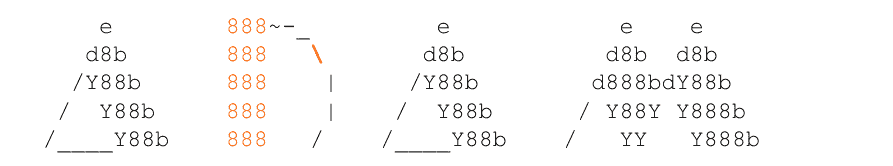
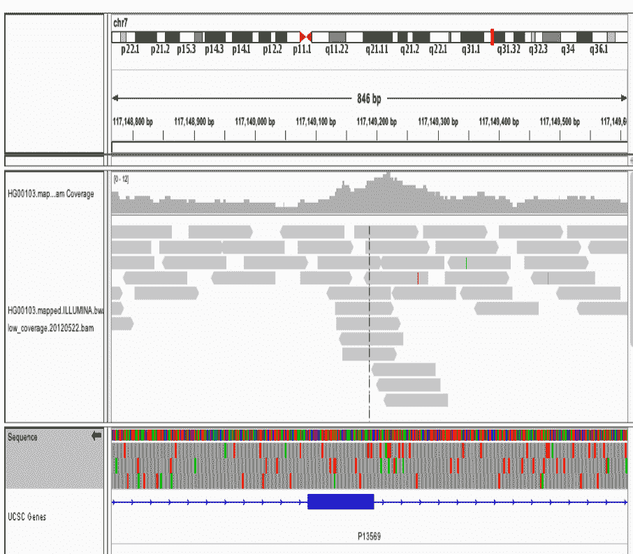

# 第 9 章。分析基因组数据与 BDG 项目

## 致早期发布读者的说明

通过早期发布电子书，您可以获取书籍的最早形态——作者在撰写过程中的原始、未经编辑的内容——因此您可以在这些书籍正式发布之前很久就利用这些技术。

这将是最终图书的第 9 章。

下一代 DNA 测序（NGS）技术的出现已迅速将生命科学转变为数据驱动的领域。然而，充分利用这些数据正受制于传统的计算生态系统，后者依赖于难以使用的底层分布式计算原语，以及大量半结构化文本文件格式。

本章将服务于两个主要目的。首先，我们将介绍一组流行的序列化和文件格式（Avro 和 Parquet），它们简化了数据管理中的许多问题。这些序列化技术允许我们将数据转换为紧凑的机器友好型二进制表示。这有助于跨网络移动数据，并有助于跨编程语言的互操作性。尽管我们将把数据序列化技术与基因组数据一起使用，但这些概念在处理大量数据时都会很有用。

其次，我们将展示如何在 PySpark 生态系统中执行典型的基因组任务。具体来说，我们将使用 PySpark 和开源 ADAM 库来处理大量基因组数据，并处理来自多个来源的数据，以创建用于预测转录因子（TF）结合位点的数据集。为此，我们将把 ENCODE 基因组注释与 1000 基因组计划的变异进行关联。本章将作为 ADAM 项目的教程，该项目包括一组特定于基因组的 Avro 架构、基于 PySpark 的 API 以及用于大规模基因组分析的命令行工具。在其他应用中，ADAM 使用 PySpark 提供了基因组分析工具包（GATK）的原生分布式实现。

我们将首先讨论生物信息学领域中使用的各种数据格式、相关挑战以及序列化格式如何提供帮助。之后，我们将安装 ADAM 项目并使用示例数据集探索其 API。然后，我们将处理多个基因组数据集，以准备一个可用于预测 DNA 序列中特定类型蛋白质（CTCF 转录因子）结合位点的数据集。这些数据集将从公开可用的 ENCODE 数据集中获取。由于基因组暗示了一个 1D 坐标系统，许多基因组操作本质上是空间的。ADAM 项目提供了一种针对基因组的 API，用于执行分布式空间连接，我们将使用该 API。

> 对有兴趣的读者，Eric Lander 的 EdX 课程是生物学的一个极佳入门。有关生物信息学入门，请参阅 Arthur Lesk 的 *生物信息学导论*（牛津大学出版社）。

## 将存储与建模解耦

生物信息学家花费了不成比例的大量时间来担心文件格式—.fasta、.fastq、.sam、.bam、.vcf、.gvcf、.bcf、.bed、.gff、.gtf、.narrowPeak、.wig、.bigWig、.bigBed、.ped 和 .tped，仅举几例。一些科学家还觉得有必要为其自定义工具指定自己的自定义格式。除此之外，许多格式规范不完整或含糊不清（这使得难以确保实现一致或合规）并指定 ASCII 编码的数据。ASCII 数据在生物信息学中非常常见，但它效率低下且压缩效果相对较差。此外，数据必须始终被解析，这需要额外的计算周期。

这尤其令人担忧，因为所有这些文件格式本质上仅存储几种常见的对象类型：已比对的序列读段、被调用的基因型、序列特征和表型。（术语 *序列特征* 在基因组学中略有歧义，但在本章中，我们是指 UCSC 基因组浏览器轨道中的一个元素。）*biopython* 等库很受欢迎，因为它们包含大量解析器（例如 `Bio.SeqIO`），试图将所有文件格式读取为少量常见的内存模型（例如 `Bio.Seq`、`Bio.SeqRecord`、`Bio.SeqFeature`）。

我们可以使用类似 Apache Avro 的序列化框架一劳永逸地解决所有这些问题。关键在于 Avro 将数据模型（即显式架构）与底层存储文件格式以及语言的内存表示分离开来。Avro 指定了某种类型的数据应如何在进程之间进行通信，无论是因特网上运行中的进程之间，还是试图将数据写入特定文件格式的进程。例如，使用 Avro 的 Java 程序可以将数据写入多个与 Avro 数据模型兼容的底层文件格式。这使得每个进程无需再担心与多种文件格式的兼容性：该进程只需要知道如何读取 Avro，而文件系统需要知道如何提供 Avro。

让我们以序列特征为例。我们首先使用 Avro 接口定义语言（IDL）为对象指定所需的架构：

```
enum Strand {
    Forward,
    Reverse,
    Independent
}
```

```
record SequenceFeature {
    string featureId;
    string featureType; ①
    string chromosome;
    long startCoord;
    long endCoord;
    Strand strand;
    double value;
    map<string> attributes;
}
```

例如，“conservation”、“centipede”、“gene”

这种数据类型可用于编码例如在基因组特定位置的保守水平、启动子或核糖体结合位点的存在、TF 结合位点等等。一种思考方式是将其视为 JSON 的二进制版本，但更受限且性能更高。给定特定的数据架构后，Avro 规范将确定对象的精确二进制编码，以便其可以轻松地在进程之间（即使使用不同编程语言编写）、通过网络或写入磁盘进行存储。Avro 项目包括用于处理多种语言（包括 Java、C/C++、Python 和 Perl）中 Avro 编码数据的模块；之后，语言可以自由地以任何被认为最有利的方式在内存中存储对象。将数据建模与存储格式分离提供了另一层灵活性/抽象；Avro 数据可以存储为 Avro 序列化的二进制对象（Avro 容器文件）、用于快速查询的列式文件格式（Parquet 文件），或作为文本 JSON 数据以实现最大灵活性（效率最低）。最后，Avro 支持架构演进，允许用户在必要时添加新字段，而软件会优雅地处理新/旧版本的架构。

总体而言，Avro 是一种高效的二进制编码，可让您轻松指定可演进的数据架构，使用多种编程语言处理相同的数据，并使用多种格式存储数据。决定使用 Avro 架构存储数据，可以让您摆脱不断处理越来越多自定义数据格式的困境，同时提高计算性能。


## 序列化/RPC框架

在野外存在大量的序列化框架。大数据社区中最常用的框架是Apache Avro、Apache Thrift和Google的Protocol Buffers（protobuf）。从核心来看，它们都提供了一种接口定义语言（IDL）用于指定对象/消息类型的架构，并且都能编译成多种编程语言。在IDL基础上，Thrift还添加了一种指定RPC的方式。（Google为protobuf开源的RPC框架即gRPC。）最后，在IDL和RPC基础上，Avro添加了一种用于将数据存储到磁盘的文件格式规范。

很难一概而论哪种框架适合什么场景，因为它们都支持不同的语言，并且在各种语言上具有不同的性能特征。

前面示例中使用的特定`SequenceFeature`模型对于实际数据来说有点过于简单，但**大数据基因组（BDG）项目**已经定义了Avro架构来表示以下对象，以及许多其他对象：

- `AlignmentRecord` 用于读段（reads）
- `Variant` 用于已知基因组变异和元数据
- `Genotype` 用于特定位点的已调用基因型
- `Feature` 用于序列特征（基因组片段上的注释）

实际架构可以在**bdg-formats GitHub仓库**中找到。BDG格式可以作为无处不在的“旧版”格式（如BAM和VCF）的替代品，但更常用作高性能的“中间”格式。（这些BDG格式的最初目标是替换BAM和VCF的使用，但它们顽固的普遍性已证明这一目标难以实现。）与自定义ASCII现状相比，Avro提供了许多性能和数据建模优势。在本章的其余部分，我们将使用一些BDG架构来完成一些典型的基因组学任务。在此之前，我们需要安装ADAM项目。我们将在下一节中进行此操作。

## 设置ADAM

BDG的核心基因组工具集称为ADAM。从一组已比对的reads开始，这个核心包括可以执行标记重复、碱基质量分数重新校准、插入缺失重新比对和变异调用等任务的工具。ADAM还包装了一个命令行接口，用于方便地调用核心。与传统HPC工具不同，ADAM可以自动在集群上并行化，而无需手动拆分文件或调度作业。

我们可以先使用pip安装ADAM：

```
pip3 install bdgenomics.adam
```

其他安装方法可以在GitHub页面上找到。

ADAM还附带一个提交脚本，用于方便地与Spark的spark-submit脚本进行交互：

```
adam-submit
```

```
...
```

```
Using ADAM_MAIN=org.bdgenomics.adam.cli.ADAMMain
Using spark-submit=/home/analytical-monk/miniconda3/envs/pyspark/bin/spark-submit
```



```
/ Y88b 888_~ / Y88b / Y888b
Usage: adam-submit [<spark-args> --] <adam-args>
Choose one of the following commands:
```

## ADAM操作

- countKmers : 从读段数据集中计算k-mers/q-mers。
- countSliceKmers : 从切片数据集中计算k-mers/q-mers。
- transformAlignments : 将SAM/BAM转换为ADAM格式，并可选地执行读段预处理转换
- transformFeatures : 将包含序列特征的文件转换为相应的ADAM格式，反之亦然
- transformGenotypes : 将包含基因型的文件转换为相应的ADAM格式，反之亦然
- transformSequences : 将作为序列的FASTA文件转换为相应的ADAM格式，反之亦然
- transformSlices : 将作为切片的FASTA文件转换为相应的ADAM格式，反之亦然
- transformVariants : 将包含变异的文件转换为相应的ADAM格式，反之亦然
- mergeShards : 合并文件的碎片
- coverage : 计算给定ADAM文件的覆盖度

## 转换操作

- adam2fastq : 将BAM转换为FASTQ文件
- transformFragments : 将比对转换为片段记录。

## 打印

- print : 打印ADAM格式的文件
- flagstat : 打印ADAM文件中读段的统计信息（类似于samtools flagstat）
- view : 查看比对记录文件中的某些读段。

到此，你应该能够从命令行运行ADAM并获取使用信息。如下面的使用信息所示，Spark参数在ADAM特定参数之前给出。

设置好ADAM后，我们就可以开始处理基因组数据。接下来，我们将通过处理示例数据集来探索ADAM的API。

## 使用ADAM处理基因组数据简介

我们将从一个包含一些已比对NGS（下一代测序）reads的.bam文件开始，将它们转换为相应的BDG格式（在此例中为AlignedRecord），并将其保存到HDFS。首先，我们获取一个合适的.bam文件：

```
### Note: this file is 16 GB
curl -O ftp://ftp.ncbi.nlm.nih.gov/1000genomes/ftp/phase3/data\
/HG00103/alignment/HG00103.mapped.ILLUMINA.bwa.GBR\
.low_coverage.20120522.bam
```

```
### or using Aspera instead (which is much faster)
ascp -i path/to/asperaweb_id_dsa.openssh -QTr -l 10G \
anonftp@ftp.ncbi.nlm.nih.gov:/1000genomes/ftp/phase3/data\
/HG00103/alignment/HG00103.mapped.ILLUMINA.bwa.GBR\
.low_coverage.20120522.bam .
```

将下载的文件移动到我们将存储本章所有数据的目录中。

```
mv HG00103.mapped.ILLUMINA.bwa.GBR\
.low_coverage.20120522.bam data/genomics
```

接下来，我们将使用ADAM CLI。

### 使用ADAM CLI进行文件格式转换

然后，我们可以使用ADAM transform命令将.bam文件转换为Parquet格式（在“Parquet格式和列式存储”中描述）。这既可以在集群上也可以在本地模式下运行：

```
adam-submit \
--master yarn \
--deploy-mode client \
--driver-memory 8G \
--num-executors 6 \
--executor-cores 4 \
--executor-memory 12G \
-- \
transform \
data/genomics/HG00103.mapped.ILLUMINA.bwa.GBR\
.low_coverage.20120522.bam \
data/genomics/HG00103
```

在YARN上运行的示例Spark参数
ADAM子命令本身

这将在控制台上输出相当大的内容，
包括用于跟踪作业进度的URL。

生成的数据集是_data/genomics/reads/HG00103/_目录中所有文件的连接，其中每个_part-*.parquet_文件都是其中一个PySpark任务的输出。你还会注意到，由于列式存储（参见“Parquet格式和列式存储”），数据的压缩效率比初始的_.bam_文件（底层是gzip压缩的）更高。

```
$ du -sh data/genomics/HG00103*bam
16G data/genomics/HG00103. [...] .bam

$ du -sh data/genomics/HG00103/
13G data/genomics/HG00103
```

让我们看看这些对象在交互会话中的样子。

## 使用PySpark和ADAM摄取基因组数据

首先，使用ADAM助手命令启动PySpark shell。它
加载所有必要的JAR包。

```
pyadam

...

[...]
Welcome to

version 3.2.1
Using Python version 3.6.12 (default, Sep 8 2020 23:10:56)
Spark context Web UI available at http://192.168.29.60:4040
Spark context available as 'sc'.
SparkSession available as 'spark'.

>>>
```

现在我们将已比对的读取数据作为AlignmentDataset加载：

```
from bdgenomics.adam.adamContext import ADAMContext
ac = ADAMContext(spark)
readsData = ac.loadAlignments("data/HG00103")
readsDataDF = readsData.toDF()
readsDataDF.show(1, vertical=True)
```

...

| 属性 | 值 |
| :--- | :--- |
| referenceName | hs37d5 |
| start | 21810734 |
| originalStart | null |
| end | 21810826 |
| mappingQuality | 0 |
| readName | SRR062640.14600566 |
| sequence | TCCATCCACTCAGTTT... |
| qualityScores | /MOONNCROPQIKIKRGL... |
| cigar | 92M8S |
| originalCigar | null |
| basesTrimmedFromStart | 0 |
| basesTrimmedFromEnd | 0 |
| readPaired | true |
| properPair | false |
| readMapped | false |
| mateMapped | true |
| failedVendorQualityChecks | false |
| duplicateRead | false |
| readNegativeStrand | false |
| mateNegativeStrand | false |
| primaryAlignment | true |
| secondaryAlignment | false |
| supplementaryAlignment | false |


| 字段 | 值 |
|---|---|
| mismatchingPositions | null |
| originalQualityScores | null |
| readGroupId | SRR062640 |
| readGroupSampleId | HG00103 |
| mateAlignmentStart | 21810734 |
| mateReferenceName | hs37d5 |
| insertSize | null |
| readInFragment | 1 |
| attributes | RG:Z:SRR062640\tX... |

仅显示前 1 行

您可能会读取到不同的读段，因为您系统上的数据分区可能不同，因此无法保证首先返回哪个读段。

现在我们可以在后台跨集群执行计算的同时，交互式地询关于我们数据集的问题。在这个数据集中，我们有多少个 reads？

```
readsData.toDF().count()
...
160397565
```

这个数据集中的 reads 是否都来自人类所有染色体？

```
unique_chr =
readsDataDF.select('referenceName').distinct().collect()
unique_chr = [u.referenceName for u in unique_chr].sort()
unique_chr
...
1
10
11
12
[...]
GL000249.1
MT
NC_007605
X
Y
hs37d5
```

没错，我们观察到来自 1 至 22 号染色体以及 X 和 Y 的 reads，还有部分不属于“主”染色体或位置未知的其他染色体片段。让我们更仔细地分析一下代码：

```
readsData = ac.loadAlignments("data/HG00103") ①
readsDataDF = readsData.toDF() ②
unique_chr = readsDataDF.select('referenceName').distinct(). \
collect() ④
```

- 1. AlignmentDataset：ADAM 类型，包含我们所有的数据。
- 2. DataFrame：底层的 Spark DataFrame。
- 3. 这将汇总所有不同的 contig 名称；数据量会很小。
- 4. 这将触发计算，并将 DataFrame 中的数据带回到客户端应用程序（shell）。

举个更具临床意义的例子，假设我们正在检测某个个体的基因组，以查看其是否携带会增加其子女患囊性纤维化（CF）风险的任何基因变异。我们的基因检测使用下一代 DNA 测序技术，从多个相关基因（例如 CFTR 基因，其突变可导致 CF）中生成 reads。在将我们的数据运行通过基因分型流水线后，我们确定 CFTR 基因似乎存在一个提前终止密码子，该密码子会破坏其功能。然而，此突变在 HGMD 中从未被报道过，也不在汇总 CF 基因变异的 Sickkids CFTR 数据库中。我们希望返回到原始测序数据，以查看潜在有害的基因型调用是否为假阳性。为此，我们需要手动分析所有映射到该变异位点的 reads，例如，7 号染色体上的 117149189 位置（参见图 9-1）：

```
cftr_reads = readsDataDF.where("referenceName" == "7").\
where(fun.col("start") <=
117149189).where(fun.col("end") > 117149189)
cftr_reads.count()
...
```



图 9-1. IGV 对 HG00103 在 CFTR 基因中 chr7:117149189 位置的可视化

现在可以手动检查这九个 reads，例如，或通过自定义比对器对其进行处理，并检查报告的致病性变异是否为假阳性。

假设我们正在运行一家临床实验室，为临床医生提供此类携带者筛查服务。使用 AWS S3 等云存储系统归档原始数据，可确保数据保持相对温暖（与，例如，磁带归档相比）。除了拥有可靠的系统来实际执行数据处理之外，我们还可以轻松访问所有过去的数据，用于质量控制（QC）或需要手动干预的情况，例如前面介绍的 CFTR 案例。除了快速访问全部数据之外，这种集中化还使开展大规模分析研究（如种群遗传学、大规模 QC 分析等）变得容易。

现在我们已经熟悉 ADAM API，让我们开始创建转录因子预测数据集。

## Parquet 格式与列式存储

在上一节中，我们了解了如何在无需担心底层存储的具体细节或执行并行化的情况下，操作潜在的大量测序数据。不过，值得注意的是，ADAM 项目使用了 Parquet 文件格式，它带来了一些可观的性能优势，我们将在此介绍。

Parquet 是一种开源文件格式规范，以及一组读写器实现，我们推荐其用于一般用途，适用于将在分析查询中使用的数据（一次写入，多次读取）。它在很大程度上基于 Google Dremel 系统使用的底层数据存储格式（参见“Dremel: Interactive Analysis of Web-scale Datasets” Proc. VLDB, 2010，由 Melnik 等人编写），并具有与 Avro、Thrift 和 Protocol Buffers 兼容的数据模型。具体来说，它支持大多数常见数据库类型（`int`、`double`、`string` 等），以及数组和记录，包括嵌套类型。重要的是，它是一种列式文件格式，意味着许多记录中特定列的值在磁盘上连续存储（参见图 9-2）。这种物理数据布局允许更高效的数据编码/压缩，并通过最大限度减少必须读取/反序列化的数据量，显著减少查询时间。Parquet 支持为每个列指定不同的压缩方案，以及针对特定列的编码方案，例如行程长度编码、字典编码和增量编码。

Parquet 用于提高性能的另一个有用功能是 _谓词下推_。_谓词_ 是一种基于数据记录（或等效地，SQL `WHERE` 子句中的表达式）计算结果为 `true` 或 `false` 的表达式或函数。在我们之前的 CFTR 查询中，Spark 必须在决定 `AlignmentRecord` 是否通过谓词之前对每个记录进行反序列化/物料化。这会导致大量浪费的 I/O 和 CPU 时间。Parquet 读取器实现允许我们提供一个谓词类，该类仅在物料化完整记录之前，仅对做出决策所需的列进行反序列化。

### 逻辑表表示

| a | b | c |
|---|---|---|
| a1 | b1 | c1 |
| a2 | b2 | c2 |
| a3 | b3 | c3 |
| a4 | b4 | c4 |
| a5 | b5 | c5 |

### 行布局

| a1 | b1 | c1 | a2 | b2 | c2 | a3 | b3 | c3 | a4 | b4 | c4 | a5 | b5 | c5 |
|---|---|---|---|---|---|---|---|---|---|---|---|---|---|

### 列布局

| a1 | a2 | a3 | a4 | a5 | b1 | b2 | b3 | b4 | b5 | c1 | c2 | c3 | c4 | c5 |
|---|---|---|---|---|---|---|---|---|---|---|---|---|---|---|

编码 已编码块 已编码块 已编码块

## 从 ENCODE 数据预测转录因子结合位点

在本示例中，我们将使用公开可用的序列特征数据来构建转录因子结合的简单模型。TF 是结合到基因组中特定 DNA 序列并帮助控制不同基因表达的蛋白质。因此，它们在决定特定细胞的表型方面至关重要，并参与许多生理和疾病过程。ChIP-seq 是一种基于 NGS 的检测方法，可用于表征特定细胞/组织类型中特定 TF 的全基因组结合位点。然而，除了 ChIP-seq 的成本和技术难度之外，它还需要为每个组织/TF 对进行单独的实验。相比之下，DNase-seq 是一种检测全基因组开放染色体区域的检测方法，只需针对每种组织类型执行一次。我们不希望为每个组织/TF 组合进行 ChIP-seq 实验来检测 TF 结合位点，而是希望在仅有 DNase-seq 数据的情况下，预测新组织类型中的 TF 结合位点。

具体来说，我们将使用 DNase-seq 数据，结合已知的序列基序数据（来自 HT-SELEX）以及公开可用的 ENCODE 数据集中的其他数据，来预测 CTCF 转录因子的结合位点。我们已选择六种不同的细胞类型，这些类型拥有可用于训练的 DNase-seq 和 CTCF ChIP-seq 数据。训练示例将是一个 DNase 高敏感位点（HS）峰（基因组的一个片段），TF 是否结合/未结合的二进制标签将由 ChIP-seq 数据得出。

为了总结整体数据流：主要的训练/测试示例将源自 DNase-seq 数据。每个开放染色体区域（基因组上的一个间隔）都将用于生成预测，判断特定组织类型中特定的 TF 是否会在那里结合。为此，我们

将 ChIP-seq 数据与 DNase-seq 数据进行空间连接；每个重叠都是 DNase-seq 对象的正标签。最后，为提高预测准确性，我们在 DNase-seq 数据中的每个间隔生成一个额外特征 - 距转录起始位点的距离（使用 Gencode 数据集）。通过执行空间连接（可能带聚合），将该特征添加到训练示例中。

我们将使用以下细胞系的数据：

### GM12878
常用的淋巴母细胞样细胞系

### K562
女性慢性髓系白血病

### BJ
皮肤成纤维细胞

### HEK293
胚胎肾细胞

### H54
胶质母细胞瘤

### HepG2
肝细胞癌

首先，我们以下载每个细胞系的 .narrowPeak 格式 DNase 数据：

```
mkdir data/genomics/dnase
```

```
curl -O -L
"https://www.encodeproject.org/files/ENCFF001UVC/@download/ENCFF001UVC.bed.gz" | \
gunzip > data/genomics/dnase/GM12878.DNase.narrowPeak
curl -O -L
"https://www.encodeproject.org/files/ENCFF001UWQ/@download/ENCFF001UWQ.bed.gz" | gunzip >
data/genomics/dnase/K562.DNase.narrowPeak
curl -O -L
"https://www.encodeproject.org/files/ENCFF001WEI/@download/ENCFF001WEI.bed.gz" | gunzip > data/genomics/dnase/BJ.DNase.narrowPeak
curl -O -L
"https://www.encodeproject.org/files/ENCFF001UVQ/@download/ENCFF001UVQ.bed.gz" | gunzip >
data/genomics/dnase/HEK293.DNase.narrowPeak
curl -O -L
"https://www.encodeproject.org/files/ENCFF001SOM/@download/ENCFF001SOM.bed.gz" | gunzip >
data/genomics/dnase/H54.DNase.narrowPeak
curl -O -L
"https://www.encodeproject.org/files/ENCFF001UVU/@download/ENCFF001UVU.bed.gz" | gunzip >
data/genomics/dnase/HepG2.DNase.narrowPeak
```

[...]

### 流式解压缩。

接下来，我们下载 CTCF 转录因子的 ChIP-seq 数据，同样为 .narrowPeak 格式，以及 GTF 格式的 GENCODE 数据：

```
mkdir data/genomics/chip-seq

curl -O -L
"https://www.encodeproject.org/files/ENCFF001VED/@download/ENCFF001VED.bed.gz" | gunzip > data/genomics/chip-seq/GM12878.ChIP-seq.CTCF.narrowPeak
curl -O -L
"https://www.encodeproject.org/files/ENCFF001VMZ/@download/ENCFF001VMZ.bed.gz" | gunzip > data/genomics/chip-seq/K562.ChIP-seq.CTCF.narrowPeak
curl -O -L
"https://www.encodeproject.org/files/ENCFF001XMU/@download/ENCFF001XMU.bed.gz" | gunzip > data/genomics/chip-seq/BJ.ChIP-seq.CTCF.narrowPeak
curl -O -L
"https://www.encodeproject.org/files/ENCFF001XQU/@download/ENCFF001XQU.bed.gz" | gunzip > data/genomics/chip-seq/HEK293.ChIP-seq.CTCF.narrowPeak
curl -O -L
"https://www.encodeproject.org/files/ENCFF001USC/@download/ENCFF001USC.bed.gz" | gunzip > data/genomics/chip-seq/H54.ChIP-seq.CTCF.narrowPeak
curl -O -L
"https://www.encodeproject.org/files/ENCFF001XRC/@download/ENCFF001XRC.bed.gz" | gunzip > data/genomics/chip-seq/HepG2.ChIP-seq.CTCF.narrowPeak
curl -s -L
"http://ftp.ebi.ac.uk/pub/databases/gencode/Gencode_human/release_18/gencode.v18.annotation.gtf.gz" | gunzip >
data/genomics/gencode.v18.annotation.gtf
```

请注意，我们在将数据写入文件系统的同时，使用 `gunzip` 对数据流进行解压缩。

从所有这些原始数据中，我们希望生成一个具有如下架构的训练集：

| # | 字段 |
|---|-------|
| 1 | 染色体 |
| 2 | 起始位置 |
| 3 | 结束位置 |
| 4 | 距离最近转录起始位点（TSS）的距离 |
| 5 | 转录因子身份（本例中始终为“CTCF”） |
| 6 | 细胞系 |
| 7 | 转录因子结合状态（布尔值；目标变量） |

该数据集可轻松转换为 `DataFrame` 以传入机器学习库。由于我们需要为多个细胞系生成数据，我们将分别为每个细胞系定义一个 DataFrame，并在最后将它们连接起来：

```
cell_lines = ["GM12878", "K562", "BJ", "HEK293", "H54", "HepG2"]
for cell in cell_lines:
## For each cell line...
## ...generate a suitable DataFrame
## Concatenate the DataFrames and carry through into MLlib, for
## example
```

在开始之前，我们加载一些在整个计算过程中都会用到的数据，包括转录起始位点和从 HT-SELEX 推导出的 CTCF PWM。我们还定义了一个实用函数和一个广播变量，用于生成特征：

```
local_prefix = "data/genomics"
import pyspark.sql.functions as fun

## UDF for finding closest transcription start site
## naive; exercise for reader: make this faster
def distance_to_closest(loci, query):
    return min([abs(x - query) for x in loci])
distance_to_closest_udf = fun.udf(distance_to_closest)
```

```
## build in-memory structure for computing distance to TSS
## we are essentially implementing a broadcast join here
tss_data =
ac.loadFeatures("data/genomics/gencode.v18.annotation.gtf")
tss_df = tss_data.toDF().filter(fun.col("featureType") ==
    'transcript')
b_tss_df =
fun.broadcast(tss_df.groupBy('referenceName').agg(fun.collect_list(
    fun.col("start").alias("start_sites"))))
```

现在我们已加载定义训练示例所需的数据，接下来定义针对每个细胞系计算数据的“循环”主体。请注意，我们读取了 ChIP-seq 和 DNase 数据的文本表示，因为数据集不大到会影响性能。

为此，我们加载 DNase 和 ChIP-seq 数据：

```
current_cell_line = cell_lines[0]

dnase_path =
f'data/genomics/dnase/{current_cell_line}.DNase.narrowPeak'
dnase_data = ac.loadFeatures(dnase_path)
dnase_data.toDF().columns
```

```
['featureId', 'sampleId', 'name', 'source', 'featureType',
'referenceName', 'start', 'end', 'strand', 'phase', 'frame',
'score', 'geneId', 'transcriptId', 'exonId', 'proteinId',
'aliases', 'parentIds', 'target', 'gap', 'derivesFrom', 'notes',
'dbxrefs', 'ontologyTerms', 'circular', 'attributes']
```

...

```
chip_seq_path = f'data/genomics/chip-seq/{current_cell_line}.ChIP-seq.CTCF.narrowPeak'
chipseq_data = ac.loadFeatures(chipseq_path)
```

### 特征数据集

DNase DataFrame 中的列

与 chipseq_data 中由 ReferenceRegion 定义的 ChIP-seq 峰重叠的位点具有转录因子结合位点，因此被标记为 true，其余位点标记为 false。这是使用 ADAM API 提供的一维空间连接原语完成的。连接功能要求以 ReferenceRegion 为键的 RDD，并将产生具有重叠区域的元组，遵循常规连接语义（例如，内连接与外连接）。

```
dnase_with_label =
dnase_data.leftOuterShuffleRegionJoin(chipseq_data)
dnase_with_label_df = dnase_with_label.toDF()
...
```

```
-RECORD 0------------------------------------------------------------
------------------------------------------------------------
------------------------------------------------------------
------------------------------------------------------------
_1 | {null, null, chr1.1, null, null, chr1, 713841, 714424,
INDEPENDENT, null, null, 1000.0, null, null, null, null, [], [],
null, null, null, [], [], [], null, {pValue -> 11, peak -> 259,
qValue -> -1, signalValue -> 0.1783})
_2 | {null, null, null, null, null, chr1, 713945, 714492,
INDEPENDENT, null, null, 1000.0, null, null, null, null, [], [],
null, null, null, [], [], [], null, {pValue -> 86.25062, peak ->
244, qValue -> 85.49662, signalValue -> 188.69595})
-RECORD 1------------------------------------------------------------
------------------------------------------------------------
------------------------------------------------------------
_1 | {null, null, chr1.2, null, null, chr1, 740179, 740374,
INDEPENDENT, null, null, 565.0, null, null, null, null, [], [],
null, null, null, [], [], [], null, {pValue -> 1.82, peak -> 93,
qValue -> -1, signalValue -> 0.0336}}
_2 | {null, null, null, null, null, chr1, 740127, 740310,
INDEPENDENT, null, null, 460.0, null, null, null, null, [], [],
null, null, null, [], [], [], null, {pValue -> 4.77014, peak ->
171, qValue -> 4.59555, signalValue -> 8.49131}}
-RECORD 2----------------------------
----------------------------------------
----------------------------------------
_1 | {null, null, chr1.3, null, null, chr1, 762054, 763213,
INDEPENDENT, null, null, 1000.0, null, null, null, null, [], [],
null, null, null, [], [], [], null, {pValue -> 9.01, peak -> 826,
qValue -> -1, signalValue -> 0.1478}}
_2 | null
only showing top 3 rows
...
```

```
dnase_with_label_df = dnase_with_label_df.withColumn("label",
~fun.col("_2").isNull())
dnase_with_label_df.show(5)
```

### 现在我们在每个 DNase 峰上计算最终特征集：

```
## build final training DF
training_df = dnase_with_label_df.withColumn(
"contig", fun.col("_1").referenceName).withColumn (
"start", fun.col("_1").start).withColumn (
"end", fun.col("_1").end).withColumn (
"tf", fun.lit("CTCF")).withColumn (
"cell_line", fun.lit(current_cell_line)).drop ("_1", "_2")
training_df = training_df.join(b_tss_df,
training_df.contig ==
b_tss_df.referenceName, "inner")
training_df.withColumn("closest_tss",
fun.least(distance_to_closest_udf(fun.col("start_sites"),
fun.col("start")),
distance_to_closest_udf(fun.col("start_sites"), fun.col("end"))))
```


- 1. Left join with tss_df created earlier
- 2. Get the closest TSS distance

This final DF is computed in each pass of the loop over the cell lines. Finally, we union each DF from each cell line, and cache this data in memory in preparation for training models off of it:

```
preTrainingData = data_by_cellLine.union(...)
preTrainingData.cache()

preTrainingData.count()
preTrainingData.filter(fun.col("label") == true).count()
```

At this point, the data in preTrainingData can be normalized and converted into a DataFrame for training a classifier, as described in “Random Forests”. Note that you should perform cross-validation, where in each fold, you hold out the data from one of the cell lines.

## Where to Go from Here

Many computations in genomics fit nicely into the PySpark computational paradigm. When you’re performing ad hoc analysis, the most valuable contribution that projects like ADAM provide is the set of Avro schemas that represents the underlying analytical objects (along with the conversion tools). We saw how once data is converted into the corresponding Avro schemas, many large-scale computations become relatively easy to express and distribute.

While there may still be a relative dearth of tools for performing scientific research on PySpark, there do exist a few projects that could help avoid reinventing the wheel. We explored the core functionality implemented in ADAM, but the project already has implementations for the entire GATK best-practices pipeline, including BQSR, indel realignment, and deduplication. In addition to ADAM, the Broad Institute is now developing major software projects using Spark, including the newest version of the GATK4 and a project called Hail for large-scale population genetics computations. All of these tools are open source, so if you start using them in your own work, please consider contributing improvements!
