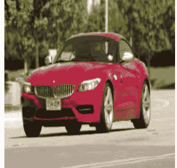
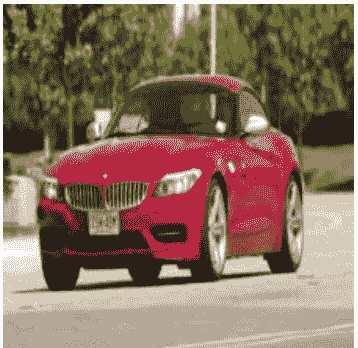
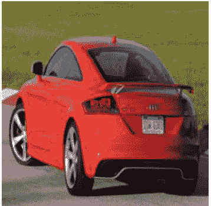
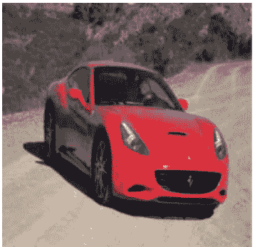
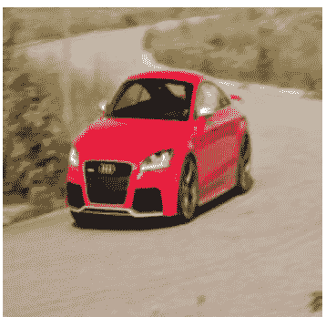
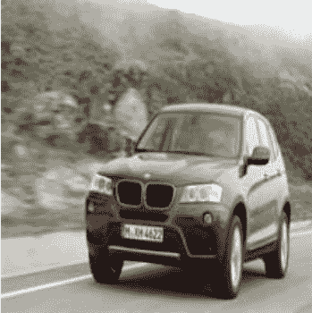

# Chapter 10. Image similarity detection with Deep Learning and PySpark LSH

## A NOTE FOR EARLY RELEASE READERS

With Early Release ebooks, you get books in their earliest form—the authors’ raw and unedited content as they write—so you can take advantage of these technologies long before the official release of these titles.

This will be the 10th chapter of the final book.

Whether you encounter them on social media or e-commerce stores, images are integral to our digital lives. In fact, it was an image dataset - ImageNet - which was a key component for sparking the current deep learning (DL) revolution. A remarkable performance by a classification model in the ImageNet 2012 challenge was an important milestone and led to widespread attention. It is no wonder then that you are likely to encounter image data at some point as a data science practitioner.

In this chapter, you will gain experience scaling a deep learning workflow for a visual task, namely image similarity detection, with PySpark. The task of identifying images that are similar to each other comes intuitively to humans but it is a complex computational task. At scale, it becomes even more difficult. In this chapter, we will introduce an approximate method for finding similar items called Locality Sensitive Hashing or LSH and apply it to images. We will use deep learning to convert image data into a numerical vector representation. PySpark’s LSH algorithm will be applied to the resulting vectors which will allow us to find similar images given a new input image.

On a high-level, this example mirrors one of the approaches used by photo-sharing apps such as Instagram and Pinterest for image similarity detection. This helps their users make sense of the deluge of visual data that exists on their platforms. This also depicts how a deep learning workflow can benefit from PySpark’s scalability.

We will start by briefly introducing PyTorch, a deep learning framework. It has gained prominence in recent years for its relatively easier learning curve compared to other major low-level DL libraries. We will then download and prepare our dataset. The dataset being used for our task is the Cars dataset released in 2013 by Stanford AI Lab. PyTorch will be used for image preprocessing. This will be followed by conversion of our input image data into a vector representation (image embeddings). We will then import the resulting embeddings into PySpark and transform them using the LSH algorithm. We will finish off by taking a new image and performing a nearest neighbors search using our LSH-transformed dataset to find similar images.

Let’s start by introducing and setting up PyTorch.

## PyTorch

PyTorch is a library for building deep learning projects. It emphasizes flexibility and allows deep learning models to be expressed in idiomatic Python. It found early adopters in the research community. Recently, it has grown into one of the most prominent deep learning tools across a broad range of applications due its ease of use. Along with Tensorflow, it is the most popular library for deep learning as of now.

PyTorch’s simple and flexible interface enables fast experimentation. You can load data, apply transforms, and build models with a few lines of code. Then, you have the flexibility to write customized training, validation, and test loops and deploy trained models with ease. It is consistently being used in professional contexts for real-world, mission-critical work. Being able to use GPUs (graphical processing units) for training resource-intensive models has been a big factor for making deep learning popular. PyTorch provides great GPU support although we won’t need that for our task.

### Installation

On the PyTorch website, you can easily obtain the installation instructions based on your system configuration, as shown in the Figure 10-1. We will use . Execute the provided command and follow the instructions for your configuration.

| PyTorch Build | Stable (1.10) | Preview (Nightly) | LTS (1.8.2) |
|---|---|---|---|
| Your OS | Linux | Mac | Windows |
| Package | Conda | Pip | LibTorch | Source |
| Language | Python | C++ / Java | | |
| Compute Platform | CUDA 10.2 | CUDA 11.3 | ROCm 4.2 (beta) | CPU |
| Run this Command: | pip3 install torch torchvision torchaudio | | |

Figure 10-1. PyTorch installation - CPU support

```
$ pip3 install torch torchvision
```

We will not be relying on a GPU and hence, will choose CPU as a compute platform. In case you have a GPU setup that you want to utilise, choose options accordingly to obtain required instructions. We will not be needing torchaudio for this chapter either so we skip its installation.

### Preparing the data

We will be using the Stanford Cars dataset. It was released as part of the ICCV 2013 paper “3D Object Representations for Fine-Grained Categorization” by Jonathan Krause, Michael Stark, Jia Deng and Li Fei-Fei.

You can download the images from Kaggle or using the source link provided by Stanford AI Lab.

```
wget http://ai.stanford.edu/~jkrause/car196/car_ims.tgz
```

Once downloaded, unzip the train and test image directories. Place them in a directory called cars_data.

```
data_directory = "cars_data"
train_images = "cars_data/cars_train/cars_train"
```

You can get CSV file containing labels for the training dataset here. Download it, rename it to cars_train_data.csv and place it in the data directory. Let us have a look at it.

```
import pandas as pd
train_df = pd.read_csv(data_directory+"/cars_train_data.csv")
train_df.head()
...
```

| Unnamed: 0 | x1 | y1 | x2 | y2 | Class |
|---|---|---|---|---|---|
| image | | | | | |
| 0 | 00001.jpg | 0 | 39 | 116 | 569 | 375 | 14 |
| 1 | 00002.jpg | 1 | 36 | 116 | 868 | 587 | 3 |
| 2 | 00003.jpg | 2 | 85 | 109 | 601 | 381 | 91 |
| 3 | 00004.jpg | 3 | 621 | 393 | 1484 | 1096 | 134 |
| 4 | 106 | 00005.jpg | 4 | 14 | 36 | 133 | 99 |

Ignore all columns other than Class and image. They are related to the original research project that this dataset was derived from and will not be used for our task.

### Resizing images using PyTorch

Before we head further, we'll need to preprocess our images. Preprocessing data is very common in machine learning since deep learning models (neural networks) expect the input to meet certain requirements.

We need to apply a series of preprocessing steps, called transforms, to convert input images into the proper format for the models. In our case, we need them to be 224 x 224-pixel JPEG-formatted images since that is a requirement for the Resnet-18 model that we will use in the next section. We perform this transformation using PyTorch’s Torchvision package in the following code:

```
import os
from PIL import Image
from torchvision import transforms

#### needed input dimensions for the CNN
input_dim = (224,224)
input_dir_cnn = data_directory + "/images/input_images_cnn"

os.makedirs(input_dir_cnn, exist_ok = True)

transformation_for_cnn_input = transforms.Compose([transforms.Resize(input_dim) ])

for image_name in os.listdir(train_images):
    I = Image.open(os.path.join(train_images, image_name))
    newI = transformation_for_cnn_input(I)
    newI.save(os.path.join(input_dir_cnn, image_name))

    newI.close()
    I.close()
```

Here, we use a single transformation that resizes the image to fit within the neural networks. However, we can use the Compose() transform to define a


用于预处理图像的一系列变换。

数据集已准备就绪。在下一节中，我们将把图像数据转换为适合与 PySpark 的 LSH 算法一起使用的向量表示。

## 用于图像向量表示的深度学习模型

卷积神经网络（CNN）是当输入观测值为图像时用于预测的标准神经网络架构。我们不会将其用于任何预测任务，而是用于生成图像的向量表示。具体来说，我们将使用 ResNet-18 架构。

残差网络（ResNet）由 Shaoqing Ren、Kaiming He、Jian Sun 和 Xiangyu Zhang 在其 2015 年的论文《深度残差学习实现图像识别》中提出。ResNet-18 中的 18 代表神经网络架构中存在的层数。ResNet 的其他流行变体包括 34 层和 50 层。层数越多，性能越好，但计算成本也随之增加。

### 图像嵌入

图像嵌入是图像在向量空间中的一种表示。基本思想是，如果给定图像与另一张图像接近，则它们的嵌入在空间维度上也会相似且接近。

### 图 10-2. ILSVRC 2012 图像在二维空间中的嵌入

上图由 Andrej Karpathy 发布，展示了图像如何在较低维度的空间中表示。例如，你可以注意到顶部附近有车辆，左下角有鸟类。

我们可以通过获取 ResNet-18 的倒数第二个全连接层的输出（其维度为 512）来获得图像嵌入。下面，我们创建一个类，给定一张图片，它可以返回其数值向量形式的表示。

```
import torch
from torchvision import models

class Img2VecResnet18():
    def __init__(self):
        self.device = torch.device("cpu")
        self.numberFeatures = 512
        self.modelName = "resnet-18"
        self.model, self.featureLayer = self.getFeatureLayer()
        self.model = self.model.to(self.device)
        self.model.eval()
        self.toTensor = transforms.ToTensor()
        self.normalize = transforms.Normalize(mean=[0.485, 0.456,
        0.406], std=[0.229, 0.224, 0.225])

    def getFeatureLayer(self):
        cnnModel = models.resnet18(pretrained=True)
        layer = cnnModel._modules.get('avgpool')
        self.layer_output_size = 512

        return cnnModel, layer

    def getVec(self, img):
        image =
        self.normalize(self.toTensor(img)).unsqueeze(0).to(self.device)
        embedding = torch.zeros(1, self.numberFeatures, 1, 1)
        def copyData(m, i, o): embedding.copy_(o.data)
        h = self.featureLayer.register_forward_hook(copyData)
        self.model(image)
        h.remove()
        return embedding.numpy()[0, :, 0, 0]
```

将图像转换为 PyTorch 张量格式

- 2. 将像素值范围重新缩放到 0 到 1 之间。均值和标准差（std）的值是基于用于训练模型的数据预先计算的。归一化图像可以提高分类器的准确性。

我们现在初始化上述类，并将 getVec 方法应用于所有图像，以获取它们各自的图像嵌入。

```
import tqdm

img2vec = Img2VecResnet18()
allVectors = {}
for image in tq(os.listdir(input_dir_cnn)):
    I = Image.open(os.path.join(input_dir_cnn, image))
    vec = img2vec.getVec(I)
    allVectors[image] = vec
    I.close()
```

对于较大的数据集，您可能希望将向量输出顺序写入文件，而不是将其保存在内存中，以避免内存溢出错误。此处的数据量可控，因此我们创建一个字典，并在下一步将其保存为 CSV 文件。

```
import pandas as pd

pd.DataFrame(allVectors).transpose().to_csv(data_folder +
'/input_data_vectors.csv')
```

> 由于我们在本地工作，因此选择 CSV 格式来保存向量输出。但是，Parquet 格式更适合这种类型的数据。您可以通过将上述代码中的 to_csv 替换为 to_parquet 来轻松将数据保存为 parquet 格式。

现在我们已拥有所需的图像嵌入，可以将它们导入 PySpark。

## 将图像嵌入导入 PySpark

启动 PySpark shell。

```
$ pyspark --driver-memory 4g
```

### 导入图像嵌入。

```
input_df = spark.read.option('inferSchema',
True).csv(data_directory + '/input_data_vectors.csv')
input_df.columns
...

['_c0',
 'c1',
 'c2',
 'c3',
 'c4',
 [...]
 '_c509',
 '_c510',
 '_c511',
 '_c512']
```

PySpark 的 LSH 实现要求输入一个向量列。我们可以使用 VectorAssembler 转换将 DataFrame 中的相关列组合起来来创建一个。

```
from pyspark.ml.feature import VectorAssembler

vector_columns = input_df.columns[1:]
assembler = VectorAssembler(inputCols=vector_columns,
outputCol="features")

output = assembler.transform(input_df)
output = output.select('_c0', 'features')

output.show(1, vertical=True)
...
```

```
--RECORD 0-----------------------------
__c0     | 01994.jpg
features | [0.05640895,2.709...
```

```
...
output.printSchema()
...
root
|-- _c0: string (nullable = true)
|-- features: vector (nullable = true)
```

在下一节中，我们将使用 LSH 算法从我们的数据集中查找相似图像。

## 使用 PySpark LSH 进行图像相似性搜索

局部敏感哈希（LSH）是一类重要的哈希技术，常用于大数据集的聚类、近似最近邻搜索和异常值检测。局部敏感函数接收两个数据点，并决定它们是否应作为候选对。

LSH 的一般思路是使用一组函数（“LSH 家族”）将数据点哈希到桶中，使得彼此接近的数据点大概率落在同一个桶中，而彼此远离的数据点很可能落在不同的桶中。映射到同一个桶的数据点被视为候选对。

在 PySpark 中，不同的 LSH 家族分别在独立的类中实现（例如 MinHash 和 BucketedRandomProjection），每个类中都提供了特征转换、近似相似性连接和近似最近邻的 API。

我们将使用 PySpark 中的 BucketedRandomProjection LSH 实现。

首先，让我们创建模型对象。

```
from pyspark.ml.feature import BucketedRandomProjectionLSH
brp = BucketedRandomProjectionLSH(inputCol="features",
outputCol="hashes", numHashTables=200, bucketLength=2.0)
model = brp.fit(output)
```

在 BucketedRandomProjection LSH 实现中，桶长度可用于控制哈希桶的平均大小（从而控制桶的数量）。较大的桶长度（即更少的桶）会增加特征被哈希到同一桶的概率（从而增加真正例和假正例的数量）。

我们现在使用新创建的 LSH 模型对象转换输入 DataFrame。生成的 DataFrame 将包含一个 *哈希* 列，其中包含图像嵌入的哈希表示。

```
lsh_df = model.transform(output)
lsh_df.show(5)
```

| __c0 | features | hashes |
|------|----------|--------|
| 01994.jpg | [0.05640895, 2.709... | [[0.0], [-2.0], [...] |
| 07758.jpg | [2.1690884, 3.4647... | [[0.0], [-1.0], [...] |
| 05257.jpg | [0.7666548, 3.7960... | [[-1.0], [-1.0], ... |
| 07642.jpg | [0.86353475, 2.993... | [[-1.0], [-1.0], ... |
| 00850.jpg | [0.49161428, 2.172... | [[-1.0], [-2.0], ... |

仅显示前 5 行

在 LSH 转换的数据集准备就绪后，我们将在下一节中测试我们的工作。

## 最近邻搜索

让我们尝试使用一张新图片来查找相似图片。目前，我们将从输入数据集本身中选取一张。

```
from IPython.display import display
from PIL import Image
```

```
input_dir_cnn = data_folder + "/images/input_images_cnn"


```
test_image = os.listdir(input_dir_cnn)[0]
test_image = os.path.join(input_dir_cnn, test_image)
print(test_image)
display(Image.open(test_image))
...
cars_data/images/input_images_cnn/01994.jpg
```



图 10-3. 从我们的数据集中随机选取的汽车图片

首先，我们需要将输入图像转换为向量格式。我们使用 Img2VecResnet18 类来完成此操作。

```
img2vec = Img2VecResnet18()
I = Image.open(test_image)
test_vec = img2vec.getVec(I)
I.close()
```

```
print(len(test_vec))
print(test_vec)
```

...

```
512
[5.64089492e-02 2.70972490e+00 2.15519500e+00 1.43926993e-01
 2.47581363e+00 1.36641121e+00 1.08204508e+00 7.62105465e-01
 [...]
 5.62133253e-01 4.33687061e-01 3.95899676e-02 1.47889364e+00
 2.89110214e-01 6.61322474e-01 1.84713617e-01 9.42268595e-02]
...
```

```
test_vector = Vectors.dense(test_vec)
```

现在我们执行近似最近邻搜索。

```
print("Approximately searching lsh_df for 5 nearest neighbors of the input vector:")
result = model.approxNearestNeighbors(lsh_df, test_vector, 5)

result.show()
...
```

| c0 | features | hashes |
|---|---|---|
| 01994.jpg | [0.05640895, 2.709... | [[0.0], [-2.0], ... |
| [...]3.691941786298668... | | |
| 00046.jpg | [0.89430475, 1.992... | [[0.0], [-2.0], [...] |
| 10.16105522433224 | | |
| 04232.jpg | [0.71477133, 2.582... | [[-1.0], [-2.0], ... |
| 10.255391011678762 | | |
| 05146.jpg | [0.36903867, 3.410... | [[-1.0], [-2.0], ... |
| 10.264572173322843 | | |
| 00985.jpg | [0.530428, 2.87453... | [[-1.0], [-2.0], ... |
| 10.474841359816633 | | |

您可以查看图片，发现模型已经基本做对了。

```
for i in list(result.select('_c0').toPandas()['_c0']):
    display(Image.open(os.path.join(input_dir_cnn, i)))
```



图 10-4. 结果图片 1



图 10-5. 结果图片 2



图 10-6. 结果图片 3



图 10-7. 结果图片 4



图 10-8. 结果图片 5

输入图像位于列表顶部，正如人们所期望的那样。

## 接下来

在本章中，我们学习了如何将 PySpark 与现代深度学习框架相结合，以扩展图像相似性检测工作流。

改进此实现有多种方法。您可以尝试使用更好的模型或改进预处理以获得更好的嵌入质量。此外，可以调整 LSH 模型。在实际环境中，您可能需要持续更新参考数据集，以应对进入系统的新图像。做到这一点的最简单方法是定期运行批处理作业以创建新的 LSH 模型。您可以根据需要和兴趣探索所有这些方法。
