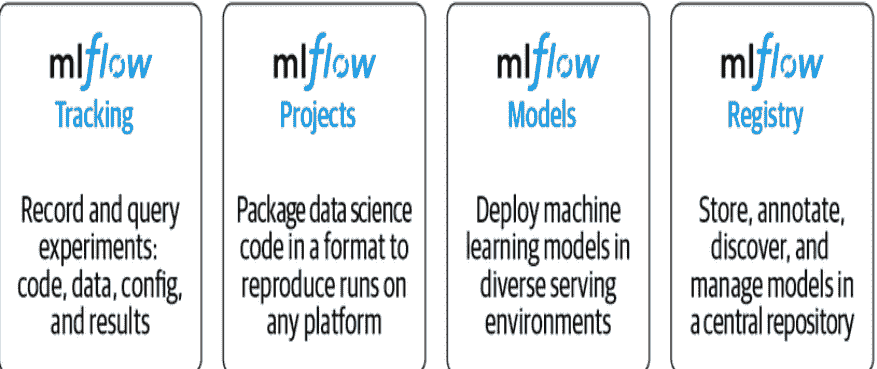

# 第 11 章。使用 MLflow 管理机器学习生命周期

## 面向提前出版读者的说明

通过提前出版的电子书，您可以获取书籍的最早形态——作者在编写过程中的原始、未经编辑的内容——因此您可以在这些书籍正式发布很久以前就利用这些技术。

这将是最终书籍的第 11 章。

随着机器学习在各行各业日益受到重视并在生产环境中部署，围绕它的协作程度和复杂性也随之增加。幸运的是，各种平台和工具应运而生，以帮助以结构化的方式管理机器学习生命周期。MLflow 就是这样一个与 PySpark 配合良好的平台。在本章中，我们将展示如何将 MLflow 与 PySpark 结合使用。在此过程中，我们将介绍可以融入数据科学工作流的关键实践。

我们不是从零开始，而是将在第 4 章中完成的工作基础上进行构建。我们将使用 Covtype 数据集重新审视我们的决策树实现。只是这一次，我们将使用 MLflow 来管理机器学习生命周期。

我们将首先解释涵盖机器学习生命周期的挑战和流程。然后，我们将介绍 MLflow 及其组件。我们还将介绍 MLflow 对 PySpark 的支持。接下来，将介绍如何使用 MLflow 跟踪机器学习训练运行。然后，我们将学习如何使用 MLflow Models 管理机器学习模型。随后，我们将讨论我们 PySpark 模型的部署并进行相应实现。最后，我们将通过创建 MLflow Project 来结束本章。这将展示如何使我们迄今的工作对协作者可重现。让我们先从讨论机器学习生命周期开始。

## 机器学习生命周期

描述机器学习生命周期有多种方法。一种简单的方法是将其分解为各种组件或步骤，如图 11-1 所示。这些步骤在每个项目中不一定按顺序进行，生命周期通常是循环的。

- 业务项目定义和利益相关者对齐
- 数据获取和探索
- 数据建模
- 结果解读与沟通
- 模型实现与部署


图 11-1. ML 生命周期（需要修改 - 将 AI 替换为 ML）

您迭代 ML 生命周期的速度影响您将工作投入实际应用的速度。例如，已实现的模型可能由于基础数据的变化而过时。在这种情况下，您需要重新审视过去的工作并在此基础上再次构建。

机器学习项目生命周期中可能出现的挑战示例如下：

- 缺乏可重现性 即使代码和参数已被跟踪，同一团队的数据科学家也可能无法重现彼此的结果。这可能是由于执行环境（系统配置或库依赖）不同所致。

- 缺乏模型标准化 不同团队可能使用不同的库，并采用不同的存储机器学习模型的约定。在跨团队共享工作时，这可能会成为问题。

在经历 ML 生命周期时试图构建您的工作，很快就会变得令人不知所措。鉴于此类挑战，有多种开源和专有平台可供提供帮助。其中一个领先的开源平台是 MLflow，我们将在即将到来的章节中介绍它。

## MLflow

MLflow 是一个用于管理端到端机器学习生命周期的开源平台。它帮助我们重现和共享实验、管理模型，并为最终用户部署模型。除了 REST API 和 CLI（命令行界面），它还为 Python、R 和 Java/Scala 提供 API。

它有 4 个主要组件，如图 11-2 所示：

MLflow Tracking 记录参数、指标、代码版本、模型以及绘图和文本等工件。

MLflow Projects 为您提供一种可重复使用、可重现的格式，以便与其他数据科学家共享或转移到生产环境。它可帮助您管理模型训练过程。

MLflow Models 允许您将模型打包以部署到各种模型服务和推理平台。它提供一致的 API 来加载和应用模型，无论用于构建模型的底层库是什么。

MLflow Registry 使您能够在中央存储中协作跟踪模型血缘、模型版本、阶段转换和注释。



图 11-2. MLflow 组件

让我们安装 MLflow。使用 pip 进行安装非常简单。

```
$ pip3 install mlflow
```

就这些！

MLflow 与 Spark、TensorFlow、PyTorch 等许多流行的机器学习框架集成。在接下来的几个部分中，我们将使用其对 Spark 的原生支持。导入特定于 Spark 的 MLflow 组件，就像运行 `import mlflow.spark` 一样简单。

在下一节中，我们将介绍 MLflow 跟踪，并将其添加到我们来自 *第 4 章* 的决策树代码中。

### 实验跟踪

典型的机器学习项目涉及尝试多种算法和模型来解决问题。需要跟踪相关的数据集、超参数和指标。通常，实验跟踪是使用电子表格等临时工具完成的，效率低下，甚至更糟，不可靠。


MLflow Tracking 是一个 API 和 UI，用于在运行机器学习代码时记录参数、代码版本、指标和工件，并稍后可视化结果。您可以在任何环境中使用 MLflow Tracking（例如，独立脚本或笔记本）将结果记录到本地文件或服务器，然后比较多次运行。它与库无关，并可与多个框架集成。

MLflow Tracking 围绕“运行”概念组织，运行是某段数据科学代码的执行。MLflow Tracking 提供一个 UI，让您可视化、搜索和比较运行，以及下载运行工件或元数据以在其他工具中进行分析。它包含以下主要功能：

- 基于实验的运行列表和比较
- 按参数或指标值搜索运行
- 可视化运行指标
- 下载运行结果

让我们在 PySpark Shell 中将 MLflow 追踪添加到我们的决策树代码中。假设您已下载 Covtype 数据集并对其熟悉。Covtype 数据集可作为压缩的 CSV 格式数据文件 covtype.data.gz 和随附信息文件 covtype.info 在线获取。

启动 pyspark-shell。如前所述，构建决策树可能资源密集。如果您有足够内存，请指定 --driver-memory 8g 或类似参数。

我们首先准备数据和机器学习流水线。

```
from pyspark.ml import Pipeline
from pyspark.sql.functions import col
from pyspark.sql.types import DoubleType
from pyspark.ml.feature import VectorAssembler
from pyspark.ml.classification import DecisionTreeClassifier
data_without_header = spark.read.option("inferSchema", True).option("header", False).csv("data/covtype.data")

colnames = ["Elevation", "Aspect", "Slope",
"Horizontal_Distance_To_Hydrology",
"Vertical_Distance_To_Hydrology",
"Horizontal_Distance_To_Roadways", "Hillshade_9am",
"Hillshade_Noon", "Hillshade_3pm",
"Horizontal_Distance_To_Fire_Points"] + \
[f"Wilderness_Area({i})" for i in range(4)] + \
[f"Soil_Type_{i}" for i in range(40)] + \
["Cover_Type"]

data = data_without_header.toDF(*colnames).withColumn("Cover_Type",
col("Cover_Type").cast(DoubleType()))

(train_data, test_data) = data.randomSplit([0.9, 0.1])

input_cols = colnames[:-1]
vector_assembler = VectorAssembler(inputCols=input_cols, outputCol="featureVector")

classifier = DecisionTreeClassifier(seed = 1234,
labelCol="Cover_Type", featuresCol="featureVector",
predictionCol="prediction")

pipeline = Pipeline(stages=[vector_assembler, classifier])
```

要开始使用 MLflow 记录，我们使用 mlflow.start_run() 启动一个运行。我们将使用 with 子句在块结束时自动结束运行。

```
import mlflow
import mlflow.spark
import pandas as pd
from pyspark.ml.evaluation import MulticlassClassificationEvaluator

with mlflow.start_run(run_name="decision-tree"):
    # Log param: max_depth
    mlflow.log_param("max_depth", classifier.getMaxDepth())
    # Log model
    pipeline_model = pipeline.fit(train_data)
    mlflow.spark.log_model(pipeline_model, "model")
    # Log metrics: Accuracy and F1
    pred_df = pipeline_model.transform(test_data)
    evaluator = MulticlassClassificationEvaluator(labelCol="Cover_Type",
                  predictionCol="prediction")
    accuracy = evaluator.setMetricName("accuracy").evaluate(pred_df)
    f1 = evaluator.setMetricName("f1").evaluate(pred_df)
    mlflow.log_metrics({"accuracy": accuracy, "f1": f1})
    # Log artifact: feature importance scores
    tree_model = pipeline_model.stages[-1]
    feature_importance_df = (
    pd.DataFrame(list(zip(vector_assembler.getInputCols(),
                      tree_model.featureImportances)),
             columns=["feature", "importance"])
     .sort_values(by="importance", ascending=False))
    feature_importance_df.to_csv("feature-importance.csv",
               index=False)
    mlflow.log_artifact("feature-importance.csv")
```

现在，您可以通过追踪 UI 访问实验数据。运行 `mlflow ui` 命令启动它。它默认在端口 5000 上启动。您可以使用 `-p <port_name>` 选项更改默认端口。成功启动 UI 后，访问 http://localhost:5000/。您将看到如图 11-3 所示的 UI。您可以搜索所有运行、筛选符合特定条件的运行、并排比较运行等。如果需要，还可以将内容导出为 CSV 文件以在本地分析。在 UI 中点击名为 "decision-tree" 的运行。

## Apache Spark

在实验中追踪机器学习训练运行。了解更多

实验 ID：0

### 注记

显示 2 个匹配的运行

| | 开始时间 | 持续时间 | 运行名称 | 用户 | 来源 | 版本 | 模型 | accuracy | f1 | r2 | max_depth |
|---|---|---|---|---|---|---|---|---|---|---|---|
| | 1 分钟前 | 30.1s | decision-tree | analytical-m... | - | - | spark | 0.701 | 0.664 | - | 5 |
| | 5 个月前 | 41.3s | random-forest | analytical-m... | pyspark_li... | - | spark | - | - | 0.228 | 5 |

图 11-3. MLflow UI

查看单个运行时（如图 11-4 所示），您会发现 MLflow 存储所有相应的参数、指标等。您可以以自由文本形式添加关于此运行的注记，以及标签。

## 决策树

日期：2021-11-06 18:04:18
来源：d:\py\kernel_Launcher.py
用户：analytical-monk
持续时间：31.3s
状态：FINISHED
生命周期阶段：active

- 注记 [2]
- 参数 (2)
- 指标 (2)
- 标签
- 工件

- model
  - sparkml
  - MLmodel
  - conda.yaml
  - requirements.txt
  - feature-importance.csv

完整路径：/home/analytical-monk/pyspark_book/mlruns/0/443abb047751a426e733b09bab767222/artifacts/m...

## MLflow 模型

以下代码片段演示如何使用已记录的模型进行预测。您还可以将其注册到模型注册表以进行版本控制

### 模型架构

您的模型的输入和输出架构。了解更多

| 名称 | 类型 |
|---|---|
| 无架构。请参阅 MLflow 文档，了解如何将输入和输出架构包含在您的模型中。 | |

### 进行预测

在 Spark DataFrame 上进行预测：

```
import mlflow
logged_model = 'runs:/0/443abb047751a426e733b09bab767222/model'
#### Load model as a Spark UDF.
loaded_model = mlflow.pyfunc.spark_udf(spark, model_uri=logged_model)
#### Predict on a Spark DataFrame.
columns = list(df.columns)
df.withColumn('predictions', loaded_model(*columns)).collect()
```

现在我们能够追踪和复现实验。让我们现在讨论使用 MLflow 管理模型。

## 管理和服务 ML 模型

MLflow 模型是一种用于打包机器学习模型的标准格式，可在各种下游工具中使用——例如，通过 REST API 进行实时服务或在 Apache Spark 上进行批量推理。该格式定义了一种约定，让您可以以不同的“风格”保存模型，这些风格可被不同的库理解。

“风格”是使 MLflow 模型强大的关键概念。它们使得可以编写适用于任何 ML 库模型的工具，而无需将每个工具与每个库集成。MLflow 定义了几种其所有内置部署工具都支持的“标准”风格，例如描述如何以 Python 函数运行模型的“Python 函数”风格。但是，库也可以定义和使用其他风格。例如，MLflow 的 mlflow.sklearn 库允许将模型加载回作为 scikit-learn Pipeline 对象，用于感知 scikit-learn 的代码，或作为通用 Python 函数，用于只需应用模型的工具（例如，用于将模型部署到 Amazon SageMaker 的 mlflow sagemaker 工具）。

MLflow 模型是包含一组文件的目录。我们之前已使用 log_model API 记录了模型。这创建了一个名为 MLmodel 的文件。打开 decision-tree 运行，向下滚动到工件部分。查看 MLmodel 文件。其内容应与下图 11-5 所示类似。


```yaml
artifact_path: model
flavors:
python_function:
data: sparkml
env: conda.yaml
loader_module: mlflow.spark
python_version: 3.6.12
spark:
model_data: sparkml
pyspark_version: 3.0.1
run_id: 0433bb047f514e28a73109bbab767222
utc_time_created: '2021-11-06 12:34:27.758915'
```

图 11-5. MLflow 模型

该文件捕获了我们模型的元数据、签名和风味。模型签名定义了模型输入和输出的架构。

我们的模型文件包含两种风味：python_function 和 spark。python_function 风味使 MLflow 的模型部署和服务工具能够与任何 Python 模型协同工作，无论该模型是由哪个 ML 库训练的。因此，任何 Python 模型都可以轻松地在各种运行时环境中生产化。

spark 模型风味支持将 Spark MLlib 模型导出为 MLflow 模型。例如，要使用已记录的模型对 Spark DataFrame 进行预测：

```python
import mlflow

run_id = "0433bb047f514e28a73109bbab767222" 1
logged_model = f'runs:/{run_id}/model' 2

### Load model as a Spark UDF.
loaded_model = mlflow.spark.load_model(model_uri=logged_model)

### Predict on a Spark DataFrame.
preds = loaded_model.transform(test_data)
preds.select('Cover_Type', 'rawPrediction', 'probability',
'prediction').show(1, vertical=True)
...
```

-RECORD 0----------------------------------------

| 字段 | 值 |
| --- | --- |
| Cover_Type | 6.0 |
| rawPrediction | [0.0,0.0,0.0,605.0,15... |
| probability | [0.0,0.0,0.0,0.024462... |
| prediction | 3.0 |

仅显示前 1 行

该 ID 可以从相关 MLmodel 文件的跟踪 UI 中获取。

我们使用 Python f-strings 来添加相关的运行 ID。

我们还可以使用 mlflow serve 命令行工具来提供特定运行 ID 对应的模型。

```bash
$ mlflow models serve --model-uri
runs:/0433bb047f514e28a73109bbab767222/model -p 7000
...
2021/11/13 12:13:49 INFO mlflow.models.cli: Selected backend for
flavor 'python_function'
2021/11/13 12:13:52 INFO mlflow.utils.conda: === Creating conda
environment mlflow-e1f5fb4628b910d81e4b782239f55193c084d7ce ===
Collecting package metadata (repodata.json): done
Solving environment: done ...
```

您已成功将模型部署为 REST API！

我们现在可以使用此端点进行推理。让我们准备并向端点发送请求，看看实际效果。我们将使用 requests 库来完成此操作。如果尚未安装，请先使用 pip 安装。

```bash
pip3 install requests
```

我们将向模型服务器发送一个包含 pandas-split 方向 JSON 对象的请求。

```python
import requests
host = '0.0.0.0'
port = '7001'
url = f'http://{host}:{port}/invocations'
```

```python
headers = {
    'Content-Type': 'application/json',
    'format': 'pandas-split'
}
```

```python
http_data = '{"columns": ["Elevation","Aspect","Slope","Horizontal_Distance_To_Hydrology","Vertical_Distance_To_Hydrology","Horizontal_Distance_To_Roadways","Hillshade_9am","Hillshade_Noon","Hillshade_3pm","Horizontal_Distance_To_Fire_Points","Wilderness_Area_0","Wilderness_Area_1","Wilderness_Area_2","Wilderness_Area_3","Soil_Type_0","Soil_Type_1","Soil_Type_2","Soil_Type_3","Soil_Type_4","Soil_Type_5","Soil_Type_6","Soil_Type_7","Soil_Type_8","Soil_Type_9","Soil_Type_10","Soil_Type_11","Soil_Type_12","Soil_Type_13","Soil_Type_14","Soil_Type_15","Soil_Type_16","Soil_Type_17","Soil_Type_18","Soil_Type_19","Soil_Type_20","Soil_Type_21","Soil_Type_22","Soil_Type_23","Soil_Type_24","Soil_Type_25","Soil_Type_26","Soil_Type_27","Soil_Type_28","Soil_Type_29","Soil_Type_30","Soil_Type_31","Soil_Type_32","Soil_Type_33","Soil_Type_34","Soil_Type_35","Soil_Type_36","Soil_Type_37","Soil_Type_38","Soil_Type_39","Cover_Type"],"index": [0],"data": [[2596,51,3,258,0,510,221,232,148,6279,1,0,0,0,0,0,0,0,0,0,0,0,0,0,0,0,0,0,0,0,0,0,0,0,0,0,0,0,0,0,0,0,0,0,0,0,0,0,0,0,0,0,0,0,0,0,1,0,0,0,0,0,0,0,0,0,0,0,5.0]]}'
```

```python
r = requests.post(url=url, headers=headers, data=http_data)
```

```python
print(f'Predictions: {r.text}')
```

预测：[2.0]

我们不仅加载了已保存的模型，还将其作为 REST API 部署并实时执行了推理！

让我们现在学习如何为迄今为止完成的工作创建一个 MLflow 项目。

## 创建和使用 MLflow 项目

MLflow 项目是一种可重用且可复现的打包标准格式。它们是一个自包含的单元，捆绑了执行机器学习工作流所需的所有代码和依赖项。它们使您能够在任何系统或环境中重现特定的模型运行。其中包括用于运行项目的 API 和命令行工具。还可以将项目链接在一起以构建工作流。

每个项目只是一个包含您代码的文件目录，或者是 Git 仓库。MLflow 可以根据将文件放置在此目录中的约定来运行某些项目（例如，conda.yaml 文件被视为 Conda 环境），但您可以通过添加 MLproject 文件来更详细地描述您的项目，该文件是 YAML 格式的文本文件。

MLflow 目前支持以下项目环境：Conda 环境、Docker 容器环境和系统环境。默认情况下，MLflow 使用系统路径查找并运行 conda 二进制文件。

创建基本 MLflow 项目非常简单。所需步骤如图 11-6 所示。

### 1

- 创建 MLproject 文件
- 填充入口点以及默认类型和参数

### 2

- 创建 conda.yaml 文件
- 填充依赖项
- 从您的 mlflow ui artifacts -> Model -> conda.yaml 复制

### 3

- 创建 GitHub 仓库
- 填充或上传 MLproject、conda.yaml、data、src 文件……等等

### 4

- 测试
- mlflow run git://URI -P arg=.. -P args
- mlflow.run(URI, params={})
- 共享……

图 11-6. 构建 MLflow 项目的方法

我们将从创建名为 `decision_tree_project` 的项目目录开始。

```bash
mkdir decision_tree_project
cd decision_tree_project
```

我们将首先创建 MLproject 文件。

```yaml
name: decision_tree_project

conda_env: conda.yml

entry_points:
  main:
    command: "python train.py"
```

我们现在需要 conda.yml 文件。可以从前一节介绍的 MLflow UI 中获取此文件。进入我们之前见过的决策树运行。向下滚动到工件，点击 conda YAML 文件并将其内容复制到项目目录中的 conda.yml 文件。

```yaml
channels:
- conda-forge
dependencies:
- python=3.6.12
- pip
- pip:
  - mlflow
  - pyspark==3.2.1
  - scipy==1.5.3
name: mlflow-env
```

我们现在将创建 Python 脚本，该脚本将在 MLflow 项目执行时用于训练决策树模型。为此，我们将使用前一节的代码。

```python
from pyspark.sql import SparkSession
from pyspark.ml import Pipeline
from pyspark.sql.functions import col
from pyspark.sql.types import DoubleType
from pyspark.ml.feature import VectorAssembler
from pyspark.ml.classification import DecisionTreeClassifier
from pyspark.ml.evaluation import MulticlassClassificationEvaluator

spark = SparkSession.builder.appName("App").getOrCreate()

def main() :
    data_without_header = spark.read.option("inferSchema",
    True).option("header", False).csv("../data/covtype.data") 1
    colnames = ["Elevation", "Aspect", "Slope",
    "Horizontal_Distance_To_Hydrology",
    "Vertical_Distance_To_Hydrology",
    "Horizontal_Distance_To_Roadways", "Hillshade_9am",
    "Hillshade_Noon", "Hillshade_3pm",
    "Horizontal_Distance_To_Fire_Points"] + \
    [f"Wilderness_Area_{i}" for i in range(4)] + \
    [f"Soil_Type_{i}" for i in range(40)] + \
    ["Cover_Type"]
    data =
    data_without_header.toDF(*colnames).withColumn("Cover_Type",
    col("Cover_Type").cast(DoubleType()))
    (train_data, test_data) = data.randomSplit([0.9, 0.1])
    input_cols = colnames[:-1]
    vector_assembler =
    VectorAssembler(inputCols=input_cols,outputCol="featureVector")
    classifier = DecisionTreeClassifier(seed = 1234,
    labelCol="Cover_Type", featuresCol="featureVector",
    predictionCol="prediction")
    pipeline = Pipeline(stages=[vector_assembler, classifier])
    pipeline_model = pipeline.fit(train_data)
    # Log metrics: Accuracy and F1
    pred_df = pipeline_model.transform(test_data)
    evaluator =
    MulticlassClassificationEvaluator(labelCol="Cover_Type",
    predictionCol="prediction")
    accuracy =
    evaluator.setMetricName("accuracy").evaluate(pred_df)
    f1 = evaluator.setMetricName("f1").evaluate(pred_df)
    print({"accuracy": accuracy, "f1": f1})
if __name__ == "__main__":
    main()
```

假设数据位于正在执行的 MLflow 项目目录上一级目录中。


数据也可以包含在 MLflow 项目中。在这种情况下，由于文件体积较大，我们不这样做。在这种情况下，数据可以通过 AWS S3 或 GCS 等云存储进行共享。

在共享之前，你还可以在本地模拟协作者的使用情况。我们使用 mlflow run 命令来实现这一点。

```
mlflow run decision_tree_project
...
[...]
{'accuracy': 0.6988990605087336, 'f1': 0.6805617730220171}
```

我们现在有了一个可复现的 MLflow 项目。可以将其上传到 Github 仓库，并与协作者共享，协作者将能够复现我们的工作。

## 后续方向

本章介绍了 MLflow 项目，并指导你为一个简单的项目实现了它。在 MLflow 项目本身中还有很多可以探索的内容。可以在官方文档中找到更多信息。还有其他工具可以作为替代方案。这些包括开源项目 - Metaflow、Kubeflow - 以及主要云提供商提供的专有产品，包括 AWS Sagemaker 和 Databricks 平台。

当然，工具只是解决现实世界机器学习项目所面临挑战的一部分。任何项目的流程都需要由参与项目的人员来定义。希望你能在此章提供的基础上继续构建，并为现实世界中的成功机器学习项目做出贡献。
