# 1. 可移植 C++ 软件的剖析

## 学习目标

在本章结束时，您将能够：

*   建立代码-构建-测试流程
*   描述编译的各个阶段
*   解读复杂的 C++ 类型系统
*   配置带有单元测试的项目
*   将源代码转换为目标代码
*   编写可读的代码并对其进行调试

在本章中，我们将学习建立贯穿全书的代码-构建-测试模型，编写优雅的代码，并执行单元测试。

## 简介

C++ 是您可以用来编写高效代码的最古老、最流行的语言之一。它既像 C 语言一样“贴近硬件”，又像 Java 一样拥有先进的面向对象特性。作为一种高效的低级语言，C++ 成为效率至关重要的领域（如游戏、模拟和嵌入式系统）的首选语言。同时，作为一种拥有泛型、引用以及其他无数先进特性的面向对象语言，它适合由多人开发和维护的大型项目。

几乎任何编程经验都涉及组织代码库和使用他人编写的库。C++ 也不例外。除非您的程序很简单，否则您需要将代码分发到多个需要组织的文件中，并使用各种库来完成任务，这些库通常比您自己的代码以更高效、更健壮的方式完成任务。不使用任何第三方库的 C++ 项目是边缘情况，并不代表大多数使用许多库的项目。这些项目及其库预期要在不同的硬件架构和操作系统上工作。因此，如果您打算用 C++ 开发任何有意义的东西，花时间进行项目设置并了解用于管理依赖关系的工具非常重要。

大多数现代流行的高级语言都有用于维护项目、构建项目和处理库依赖关系的标准工具。其中许多拥有托管库的存储库，以及可自动从这些存储库下载并使用库的工具。例如，Python 有 `pip`，它负责下载和使用程序员想要使用的库的适当版本。同样，JavaScript 有 `npm`，Java 有 `maven`，Dart 有 `pub`，C# 有 `NuGet`。在大多数这些语言中，您列出想要使用的库的名称和版本，工具会自动下载并使用兼容版本的库。这些语言受益于程序在受控环境中构建和运行的事实，该环境满足一定的硬件和软件要求。另一方面，C++ 预期要在各种上下文中工作，包括非常原始的硬件在内的不同架构。因此，在构建程序和执行依赖管理方面，C++ 程序员享受的“照顾”较少。

## 管理 C++ 项目

在 C++ 的世界里，我们有几个工具可以帮助管理项目源代码及其依赖关系。例如，`pkg-config`、`Autotools`、`make` 和 `CMake` 是社区中最著名的工具。与其他高级语言的工具相比，这些工具的使用要复杂得多。在这些工具中，`CMake` 已成为管理 C++ 项目及其依赖关系的事实标准。与 `make` 相比，它更具主见性，并被大多数 IDE（集成开发环境）接受为直接的项目格式。


虽然 **CMake** 有助于管理项目及其依赖项，但开发体验仍远未达到高级编程语言的水平——在高级语言中，只需声明所需库及其版本，其余事宜将自动处理。使用 CMake 时，仍需自行确保库在开发环境中正确安装，并为每个库选用兼容版本。在拥有庞大包管理器的主流 Linux 发行版中，可轻松安装大多数流行库的二进制版本。不过，有时你可能不得不自行编译并安装库。这正是 C++ 开发体验的一部分，你将通过深入了解所选开发平台来积累经验。在此，我们将重点介绍如何正确配置 CMake 项目，包括理解并解决与库相关的问题。

## 编码-构建-测试-运行循环

为奠定坚实的讨论基础，我们将直接通过一个实际示例切入。我们将以一个 C++ 代码库模板开始，可作为你项目的起点。我们将学习如何在命令行中使用 CMake 进行配置与构建。我们还将配置适用于 C/C++ 开发的 Eclipse IDE 并导入 CMake 项目。IDE 的使用将带来便利，简化源代码编写，并支持逐行调试，以洞察程序运行时的内部状态，从而基于理性分析而非盲目试错来修复错误。

## 构建 CMake 项目

C++ 项目的行业标准是使用 CMake 组织与构建项目。此处我们将以一个基础模板项目为起点。示例模板的目录结构如下：


**图 1.1：示例模板的目录结构**

图中 `.gitignore` 文件列出了应排除在 Git 版本控制之外的文件模式。这些被忽略的文件包括构建产物，它们为本地生成，不应跨机器共享。

`include` 与 `src` 目录下的文件为实际 C++ 源文件，`CMakeLists.txt` 为 CMake 脚本，它通过定义**源代码编译规则**、**库依赖项**及其他项目设置，将项目整合在一起。CMake 规则属于高层、平台无关的规范。CMake 据此为不同平台生成各类 `make` 文件。

使用 CMake 构建项目分为两步。首先，CMake 为原生构建系统生成平台相关的配置文件，由该系统负责编译与构建。随后，使用生成的文件构建项目。CMake 支持生成多种平台相关构建系统的配置文件，包括 `UNIX Makefiles`、`Ninja build files`、`NMake Makefiles` 和 `MinGW Makefiles`。选择取决于目标平台、工具可用性及个人偏好。`UNIX Makefiles` 是 Unix/Linux 的行业标准，`NMake` 则是 Windows 和 Visual Studio 下的对应工具。`MinGW` 则提供了 Windows 上的类 Unix 环境，同样使用 Makefiles。`Ninja` 是一款现代构建系统，凭借卓越的构建速度与跨平台支持，成为我们的首选。此外，CMake 还能为 Visual Studio、Xcode、Eclipse CDT 等 IDE 生成项目文件，支持在 IDE 内部构建。因此，CMake 属于元构建工具，它为实际执行构建的底层系统生成配置文件。下一节我们将通过练习，使用 CMake 生成 Ninja 构建文件。

## 练习 1：使用 CMake 生成 Ninja 构建文件

本练习将使用 CMake 生成 Ninja 构建文件，以构建 C++ 项目。我们将首先从 Git 仓库获取源代码，再结合 CMake 与 Ninja 完成构建。练习目标是生成 Ninja 构建文件、构建项目并运行可执行文件。

### 注意

GitHub 仓库地址：[`github.com/TrainingByPackt/Advanced-CPlusPlus/tree/master/Lesson1/Exercise01/project`](https://github.com/TrainingByPackt/Advanced-CPlusPlus/tree/master/Lesson1/Exercise01/project)。

按以下步骤操作：

1. 在终端中执行以下命令，从 GitHub 克隆 `CxxTemplate` 仓库至本地：

```
git clone https://github.com/TrainingByPackt/Advanced-CPlusPlus/tree/master/Lesson1/Exercise01/project
```

命令输出类似如下：

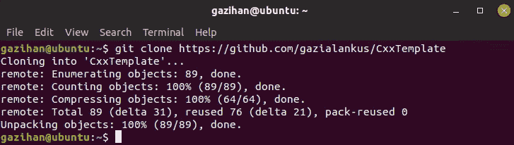

**图 1.2：从 GitHub 检出示例项目**

源代码现位于 `CxxTemplate` 文件夹中。

2. 执行以下命令进入 `CxxTemplate` 目录：

```
cd CxxTemplate
```

3. 执行以下命令列出项目所有文件：

```
find .
```

4. 在 `CxxTemplate` 目录下运行以下 `cmake` 命令生成 Ninja 构建文件：

```
cmake -Bbuild -H. -GNinja
```

输出如下：


**图 1.3：生成 Ninja 构建文件**

下面解释该命令的各参数：  
`-Bbuild` 指定 `build` 目录存放构建产物。若目录不存在，CMake 会自动创建。  
`-H.` 指定当前目录为源码目录。  
采用独立的 `build` 目录可保持源码整洁，所有构建产物均置于其中，并通过 `.gitignore` 排除在 Git 版本控制之外。  
`-GNinja` 指定使用 Ninja 构建系统。

5. 运行以下命令查看项目文件及 `build` 目录下的生成文件：

```
ls
ls build
```

终端将显示如下输出：

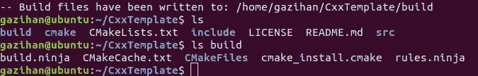

**图 1.4：build 目录中的文件**

上述文件将出现在 `build` 目录中。输出中的 `build.ninja` 与 `rules.ninja` 即为用于构建项目的 Ninja 构建文件。

#### 注意

借助 CMake，我们无需手写 Ninja 构建文件，从而避免了锁定 Unix 平台。CMake 作为元构建系统，可为 UNIX/Linux、MinGW、NMake 等平台生成底层构建文件。

6. 进入 `build` 目录并执行以下命令构建项目：

```
cd build
ninja
```

构建成功时将显示如下输出：


**图 1.5：使用 ninja 构建**

7. 在 `build` 目录执行 `ls` 检查是否生成了 `CxxTemplate` 可执行文件：

```
ls
```

终端输出如下：


**图 1.6：运行 ninja 后 build 目录中的文件**


在前面的图中，你可以看到 `\`CxxTemplate\`` 可执行文件已生成。

8. 在终端中，输入以下命令以运行 `\`CxxTemplate\`` 可执行文件：

`\`./CxxTemplate\``

上一条终端命令将提供以下输出：


###### 图 1.7：运行可执行文件

`\`src/CxxTemplate.cpp\`` 文件中的以下行负责写入前面的输出：

```
std::cout << "Hello CMake." << std::endl;
```

现在，你已成功在 Linux 中构建了一个 `\`CMake\`` 项目。`\`Ninja\`` 和 `\`CMake\`` 配合得非常好。你只需运行一次 `\`CMake\``，`\`Ninja\`` 就会检测是否应再次调用 `\`CMake\`` 并为你调用它。例如，即使你向 `\`CMakeLists.txt\`` 文件添加新的源文件，你只需在终端中输入 `\`ninja\`` 命令，它就会自动为你运行 `\`CMake\`` 以更新 `\`Ninja\`` 构建文件。既然你已经了解了在 Linux 中构建 `\`CMake\`` 项目，在下一节中，我们将探讨如何将 `\`CMake\`` 项目导入到 `\`Eclipse CDT\`` 中。

## 将 CMake 项目导入 Eclipse CDT

`\`Ninja\`` 构建文件可用于在 Linux 中构建我们的项目。然而，`\`CMake\`` 项目具有可移植性，也可用于其他构建系统和 IDE。许多 IDE 接受 `\`CMake\`` 作为其配置文件，并在你修改和构建项目时提供无缝体验。在本节中，我们将讨论如何将 `\`CMake\`` 项目导入到 `\`Eclipse CDT\`` 中，后者是一款流行的跨平台 C/C++ IDE。

将 `\`Eclipse CDT\`` 与 `\`CMake\`` 结合使用有多种方式。`\`CMake\`` 提供的默认方式是单向生成 IDE 项目。在这里，你只创建一次 IDE 项目，对 IDE 项目所做的任何修改都不会反映回原始的 `\`CMake\`` 项目。如果你将项目作为 `\`CMake\`` 项目进行管理，并使用 `\`Eclipse CDT\`` 进行一次性构建，这很有用。但是，如果你想在 `\`Eclipse CDT\`` 中进行开发，这并不理想。

另一种将 `\`CMake\`` 与 `\`Eclipse CDT\`` 结合使用的方式是使用自定义的 `\`cmake4eclipse\`` 插件。使用此插件时，你不会放弃 `\`CMakeLists.txt\`` 文件并单向切换到 `\`Eclipse CDT\`` 自身的项目管理器。相反，你将继续通过 `\`CMakeLists.txt\`` 文件管理项目，该文件仍是项目的主要配置文件。`\`Eclipse CDT\`` 会主动配合你的 `\`CMakeLists.txt\`` 文件来构建项目。你可以在 `\`CMakeLists.txt\`` 中添加或删除源文件并进行其他更改，`\`cmake4eclipse\`` 插件会在每次构建时将这些更改应用到 `\`Eclipse CDT\`` 项目中。你将在保持 `\`CMake\`` 项目最新状态的同时获得良好的 IDE 体验。这种方法的好处是，你随时可以停止使用 `\`Eclipse CDT\``，并使用 `\`CMakeLists.txt\`` 文件稍后切换到另一个构建系统（如 `\`Ninja\``）。我们将在以下练习中使用这第二种方法。

### 练习 2：将 CMake 文件导入 Eclipse CDT

在上一个练习中，你开发了一个 `\`CMake\`` 项目，并希望开始使用 `\`Eclipse CDT\`` IDE 来编辑和构建该项目。在本练习中，我们将使用 `\`cmake4eclipse\`` 插件将我们的 `\`CMake\`` 项目导入到 `\`Eclipse CDT\`` IDE 中。执行以下步骤以完成练习：

1. 打开 `\`Eclipse CDT\``。

2. 在当前项目的位置（包含 `\`CMakeLists.txt\`` 文件和 `\`src\`` 文件夹的文件夹）创建一个新的 C++ 项目。转到 `\`File | New | Project\``。将出现一个 `\`New Project\`` 对话框，如下面的屏幕截图所示：

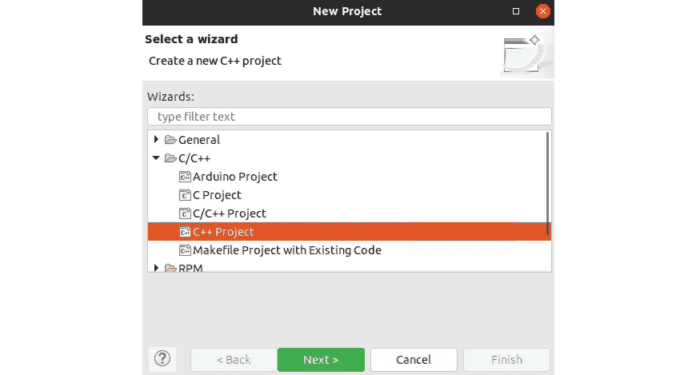

###### 图 1.8：新建项目对话框

3. 选择 `\`C++ Project\`` 选项并点击 **Next**（下一步）按钮。将出现一个 `\`C++ Project\`` 对话框，如下面的屏幕截图所示：

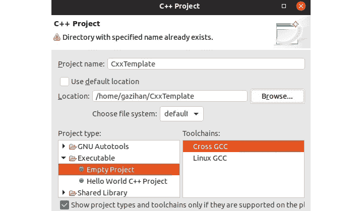

###### 图 1.9：C++ 项目对话框

4. 接受所有设置，包括切换到 C/C++ 透视图，然后点击 **Finish**（完成）。

5. 点击左上角的 **Restore**（还原）按钮以查看新创建的项目：


###### 图 1.10：还原按钮

6. 点击 `\`CxxTemplate\`` 项目。转到 `\`Project | Properties\``（项目 | 属性），然后从左侧面板中 `\`C/C++ Build\``（C/C++ 构建）下选择 `\`Tool Chain Editor\``（工具链编辑器），并将 `\`Current builder\``（当前构建器）设置为 `\`CMake Builder (portable)\``。然后，点击 **Apply and Close**（应用并关闭）按钮：

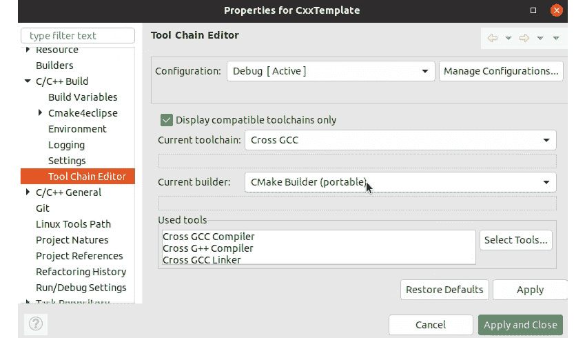

###### 图 1.11：项目属性

7. 然后，选择 `\`Project | Build All\``（项目 | 全部构建）菜单项来构建项目：

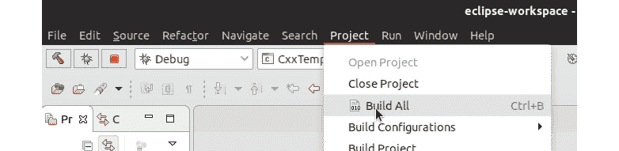

###### 图 1.12：构建项目

8. 在下面的 `\`Console\``（控制台）面板中，你将看到 `\`CMake\`` 的输出，就如同你从命令行调用它一样，随后是对 `\`make all\`` 的调用，这实际上构建了我们的项目：

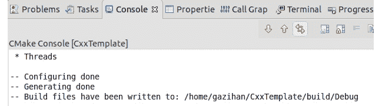

###### 图 1.13：构建输出

9. 如果在前面的步骤中没有出现任何错误，你可以使用菜单项 `\`Run | Run\``（运行 | 运行）来运行项目。如果给出了一些选项，请选择 `\`Local C/C++ Application\`` 和 `\`CxxTemplate\`` 作为可执行文件：

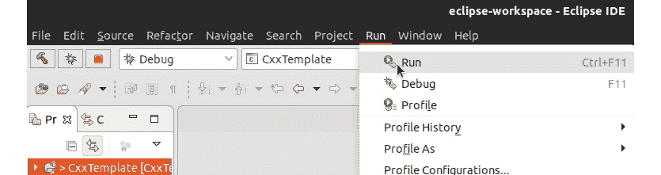

###### 图 1.14：运行项目

10. 运行时，你将在 `\`Console\``（控制台）面板中看到程序的输出，如下所示：

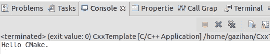

###### 图 1.15：项目输出

你已成功使用 `\`Eclipse CDT\`` 构建并运行了一个 `\`CMake\`` 项目。在下一个练习中，我们将通过添加带有新类的新源文件，引入项目中常见的变更。

### 练习 3：向 CMake 和 Eclipse CDT 添加新源文件

随着你开发规模大得多的 C++ 项目，随着项目增长以满足既定期望，你将倾向于向其中添加新的源文件。在本练习中，我们将向项目添加一对新的 `\`.cpp\`` 和 `\`.h\`` 文件，并查看 `\`CMake\`` 和 `\`Eclipse CDT\`` 如何配合处理这些更改。我们将使用新建类向导在项目内部添加这些文件，但你也可以使用任何其他文本编辑器创建它们。执行以下步骤以向 CMake 和 Eclipse CDT 添加新源文件：

1. 首先，打开我们一直在使用的项目。在左侧的 `\`Project Explorer\``（项目资源管理器）面板中，展开根条目 `\`CxxTemplate\``，你将看到项目的文件和文件夹。右键点击 `\`src\`` 文件夹，从弹出菜单中选择 `\`New | Class\``（新建 | 类）：

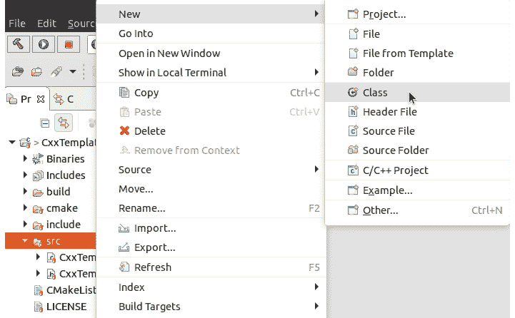

###### 图 1.16：创建新类

2. 在打开的对话框中，为类名输入 `\`ANewClass\``。当你点击 **Finish**（完成）按钮时，你将看到 `\`ANewClass.cpp\`` 和 `\`ANewClass.h\`` 文件在 `\`src\`` 文件夹下生成。

3. 现在，让我们在 `\`ANewClass\`` 类中编写一些代码，并从我们已有的 `\`CxxTemplate\`` 类中访问它。打开 `\`ANewClass.cpp\`` 并将文件开头更改为以下内容，然后保存文件：

```
#include "ANewClass.h"

#include <iostream>

void ANewClass::run() {

     std::cout << "Hello from ANewClass." << std::endl;

}
```

你将看到 Eclipse 提示 `\`Member declaration not found\``（未找到成员声明）警告消息：

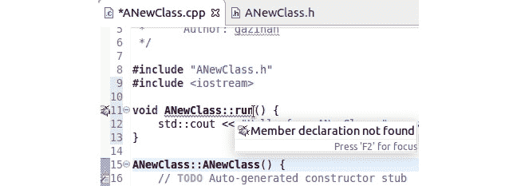

###### 图 1.17：分析器警告

之所以生成此错误，是因为我们也需要将其添加到 `\`ANewClass.h\`` 文件中。IDE 中的分析器使此类警告成为可能，它们非常有用，因为它们可以帮助你在输入代码时修复代码，而无需运行编译器。

4. 打开 `\`ANewClass.h\`` 文件，添加以下代码，并保存文件：

`\`public:\``


## CMake 项目修改与单元测试

## 步骤 5：使用来自 `CxxTemplate.cpp` 的类

```cpp
void run(); // 我们添加了这一行

ANewClass();
```

你应该会看到 `.cpp` 文件中的错误消失了。如果没有消失，可能是因为你忘记保存其中一个文件了。你应该养成按 `Ctrl + S` 保存当前文件，或按 `Shift + Ctrl + S` 保存所有已编辑文件的习惯。

现在，让我们在另一个类 `CxxTemplate.cpp` 中使用这个类。打开该文件，执行以下修改并保存。在这里，我们首先导入头文件，并在 `CxxApplication` 的构造函数中向控制台打印文本。然后，我们创建 `ANewClass` 的一个新实例并调用其 `run` 方法：

```cpp
#include "CxxTemplate.h"
#include "ANewClass.h"
#include <string>

...

CxxApplication::CxxApplication(int argc, char *argv[]) {
    std::cout << "Hello CMake." << std::endl;
    ::ANewClass anew;
    anew.run();
}
```

#### 注意

该文件的完整代码可在此处找到：[`github.com/TrainingByPackt/Advanced-CPlusPlus/blob/master/Lesson1/Exercise03/src/CxxTemplate.cpp`](https://github.com/TrainingByPackt/Advanced-CPlusPlus/blob/master/Lesson1/Exercise03/src/CxxTemplate.cpp)。

## 步骤 6：构建项目

尝试通过点击 `Project | Build All` 菜单选项来构建项目。你将在两行代码中得到一些未定义引用错误。这是因为我们的项目是按照 CMake 的规则构建的，而我们没有让 CMake 知晓这个新文件。打开 `CMakeLists.txt` 文件，进行以下修改并保存：

```cmake
add_executable(CxxTemplate
    src/CxxTemplate.cpp
    src/ANewClass.cpp
)
```

再次尝试构建项目。这次你应该不会看到任何错误。

## 步骤 7：运行项目

使用 `Run | Run` 菜单选项运行项目。你应该会在终端中看到以下输出：


**图 1.18：程序输出**

你修改了一个 CMake 项目，向其中添加了新文件，并成功运行了它。请注意，我们在 `src` 文件夹中创建了文件，并让 `CMakeLists.txt` 文件知晓了该 CPP 文件。如果你不使用 Eclipse，只需继续使用常规的 CMake 构建命令，你的程序也将成功运行。到目前为止，我们已经从 GitHub 检出了示例代码，并分别使用纯 CMake 和 Eclipse IDE 构建了它。我们还向 CMake 项目添加了一个新类，并在 Eclipse IDE 中重新构建了它。现在你知道如何构建和修改 CMake 项目了。在下一节中，我们将进行一个向项目添加新源-头文件对的活动。

## 活动 1：向项目添加新的源-头文件对

当你开发 C++ 项目时，随着项目的增长，你会向其中添加新的源文件。你可能出于各种原因想要添加新的源文件。例如，假设你正在开发一个会计应用程序，在项目的许多地方计算利率，你想要在一个单独的文件中创建一个函数，以便在整个项目中重用它。为了保持简单，这里我们将创建一个简单的求和函数。在本活动中，我们将向项目添加一个新的源-头文件对。执行以下步骤以完成该活动：

1. 在 Eclipse IDE 中打开我们在前面练习中创建的项目。
2. 向项目添加 `SumFunc.cpp` 和 `SumFunc.h` 文件对。
3. 创建一个名为 `sum` 的简单函数，返回两个整数的和。
4. 从 `CxxTemplate` 类的构造函数中调用该函数。
5. 在 Eclipse 中构建并运行项目。

预期输出应类似于以下内容：

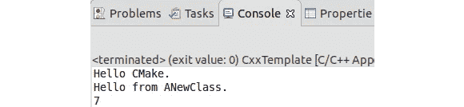

**图 1.19：最终输出**

#### 注意

该活动的解决方案可在第 620 页找到。

## 单元测试

单元测试是编程中普遍重要的一部分。基本上，单元测试是一些小程序，它们在各种场景下使用我们的类并预期特定结果，位于项目中平行的文件层级结构中，不会最终进入实际的可执行文件，而是由我们在开发期间单独执行，以确保代码按预期方式运行。我们应该为 C++ 程序编写单元测试，以确保每次更改后它们都能按预期运行。

### 为单元测试做准备

有几种 C++ 测试框架可供我们与 CMake 一起使用。我们将使用 `Google Test`，它比其他选项具有多项优势。在下一个练习中，我们将准备我们的项目以使用 Google Test 进行单元测试。

### 练习 4：为单元测试准备我们的项目

我们已经安装了 Google Test，但我们的项目尚未设置为使用 Google Test 进行单元测试。除了安装之外，还需要在我们的 CMake 项目中进行一些设置才能拥有 Google Test 单元测试。请遵循以下步骤实现此练习：

1. 打开 Eclipse CDT 并选择我们一直在使用的 `CxxTemplate` 项目。
2. 创建一个名为 `tests` 的新文件夹，因为我们将在那里执行所有测试。
3. 编辑我们的基础 `CMakeLists.txt` 文件以允许在 `tests` 文件夹中进行测试。请注意，我们已经有了查找 `GTest` 包的代码，这为 CMake 带来了 `GoogleTest` 功能。我们将在这之后添加新行：

```cmake
find_package(GTest)

if(GTEST_FOUND)
    set(Gtest_FOUND TRUE)
endif()

if(GTest_FOUND)
    include(GoogleTest)
endif()

#### 代码片段：在下面添加这两行
enable_testing()
add_subdirectory(tests)
```

这就是我们需要添加到主 `CMakeLists.txt` 文件中的全部内容。

4. 在我们的 `tests` 文件夹内创建另一个 `CMakeLists.txt` 文件。由于主 `CMakeLists.txt` 文件中有 `add_subdirectory(tests)` 行，因此将使用此文件。这个 `tests/CMakeLists.txt` 文件将管理测试源文件。

5. 在 `tests/CMakeLists.txt` 文件中添加以下代码：

```cmake
include(GoogleTest)
add_executable(tests CanTest.cpp)
target_link_libraries(tests GTest::GTest)
gtest_discover_tests(tests)
```

让我们逐行分析这段代码。第一行引入 Google Test 功能。第二行创建 `tests` 可执行文件，它将包含我们所有的测试源文件。在这种情况下，我们只有一个 `CanTest.cpp` 文件，它将仅验证测试是否工作。之后，我们将 `GTest` 库链接到 `tests` 可执行文件。最后一行识别 `tests` 可执行文件中的所有单个测试，并将它们作为测试添加到 `CMake` 中。这样，各种测试工具将能够告诉我们哪些单个测试失败了，哪些通过了。

6. 创建一个 `tests/CanTest.cpp` 文件。添加此代码以简单验证测试正在运行，而不实际测试我们实际项目中的任何内容：

```cpp
#include "gtest/gtest.h"

namespace {

class CanTest : public ::testing::Test {};

TEST_F(CanTest, CanReallyTest) {
    EXPECT_EQ(0, 0);
}

}

int main(int argc, char **argv) {
    ::testing::InitGoogleTest(&argc, argv);
    return RUN_ALL_TESTS();
}
```

`TEST_F` 行是一个单独的测试。现在，`EXPECT_EQ(0, 0)` 测试零是否等于零，如果我们能实际运行测试，这将总是成功。稍后我们将添加我们自己类的结果在这里，以针对各种值进行测试。现在我们的项目中已经具备了 Google Test 所需的设置。接下来，我们将构建并运行这些测试。

### 构建、运行和编写单元测试


### 构建、运行和编写单元测试 (continued)

现在，我们将讨论如何构建、运行和编写单元测试。到目前为止，我们的示例是一个简单的虚拟测试，已准备好构建和运行。稍后，我们将添加更有意义的测试，并查看通过和失败测试的输出。在下面的练习中，我们将为上一个练习中创建的项目构建、运行和编写单元测试。

## 练习 5：构建和运行测试

到目前为止，你已经创建了一个配置好 `GoogleTest` 的项目，但尚未构建或运行我们创建的测试。在本练习中，我们将构建并运行我们创建的测试。由于我们使用 `add_subdirectory` 添加了 `tests` 文件夹，构建项目将自动构建测试。运行测试需要一些额外的步骤。执行以下步骤以完成练习：

1. 在 `Eclipse CDT` 中打开我们的 `CMake` 项目。

2. 要构建测试，只需像以前一样构建项目。以下是使用 `Project | Build All` 进行完整构建后，从 Eclipse 再次构建项目的输出：

   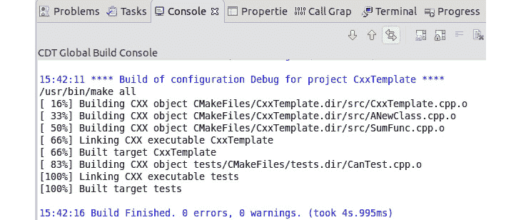

   **图 1.20：构建操作及其输出**

3. 如果你看不到此输出，你的控制台可能处于错误的视图中。你可以按照下图所示进行修正：

   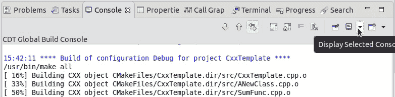

   **图 1.21：查看正确的控制台输出**

   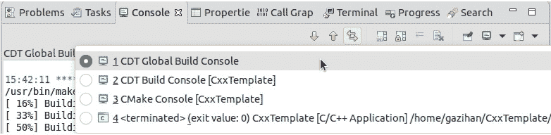

   **图 1.22：查看正确的控制台输出**

   如你所见，我们的项目现在有两个可执行目标。它们都位于 `build` 文件夹中，就像其他构建产物一样。它们的位置分别是 `build/Debug/CxxTemplate` 和 `build/Debug/tests/tests`。既然它们是可执行文件，我们只需运行它们即可。

4. 我们之前运行过 `CxxTemplate`，现在不会看到任何额外输出。在我们位于项目文件夹时，在终端中输入以下命令来运行另一个可执行文件：

   `./build/Debug/tests/tests`

   上述命令在终端中生成以下输出：

   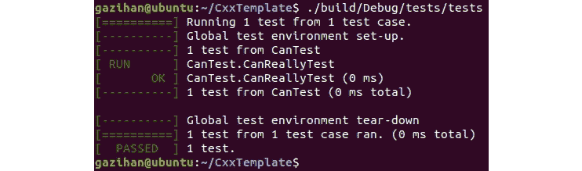

   **图 1.23：运行测试可执行文件**

   这是我们 `tests` 可执行文件的简单输出。如果你想查看测试是否通过，只需运行它即可。然而，测试远不止于此。

5. 运行测试的方法之一是使用 `ctest` 命令。在你位于项目文件夹时，在终端中输入以下命令。我们进入 `tests` 可执行文件所在的文件夹，在那里运行 `ctest`，然后返回：

   ```
   cd build/Debug/tests
   ctest
   cd ../../..
   ```

   你将看到以下输出：

   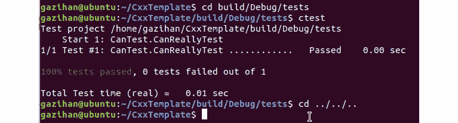

   **图 1.24：运行 ctest**

### 注

`ctest` 命令可以使用多种选项运行你的 `tests` 可执行文件，包括自动将测试结果提交到在线仪表板的功能。在这里，我们将仅运行 `ctest` 命令；其更多功能留待感兴趣的读者自行探索。你可以输入 `ctest --help` 或访问在线文档，在 [`cmake.org/cmake/help/latest/manual/ctest.1.html#`](https://cmake.org/cmake/help/latest/manual/ctest.1.html#) 进一步了解 `ctest`。

6. 运行测试的另一种方法是在 Eclipse 内部运行它们，以获得漂亮的图形报告格式。为此，我们将创建一个测试感知的运行配置。在 Eclipse 中，点击 `Run | Run Configurations…`，在左侧右键点击 `C/C++ Unit`，然后选择 `New Configuration`。

7. 将名称从 `CxxTemplate Debug` 更改为 `CxxTemplate Tests`，如下所示：

   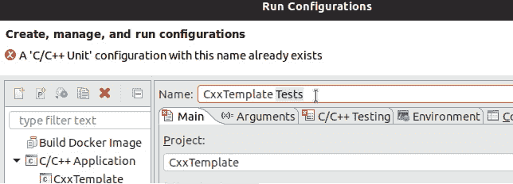

   **图 1.25：更改运行配置的名称**

8. 在 `C/C++ Application` 下，选择 `Search Project` 选项：

   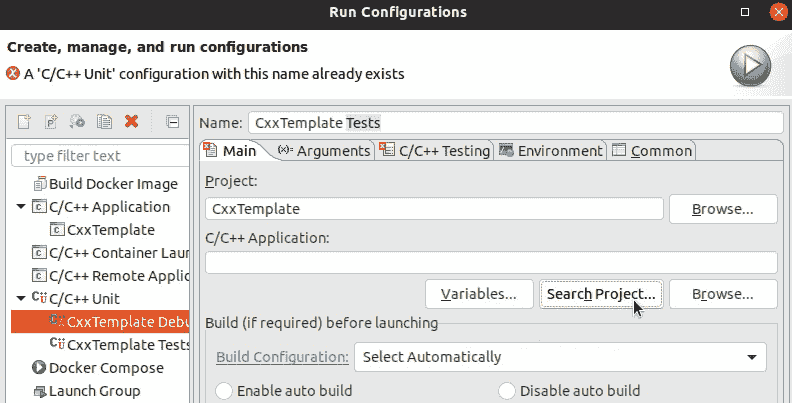

   **图 1.26：运行配置**

9. 在新对话框中选择 `tests`：

   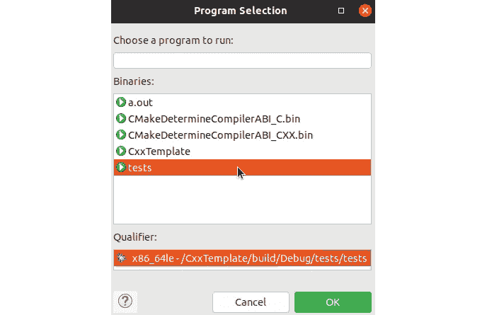

   **图 1.27：创建测试运行配置并选择测试可执行文件**

10. 接下来，转到 `C/C++ Testing` 选项卡，在下拉菜单中选择 `Google Tests Runner`。点击对话框底部的 `Apply`，然后点击 `Run` 选项以首次运行测试：

    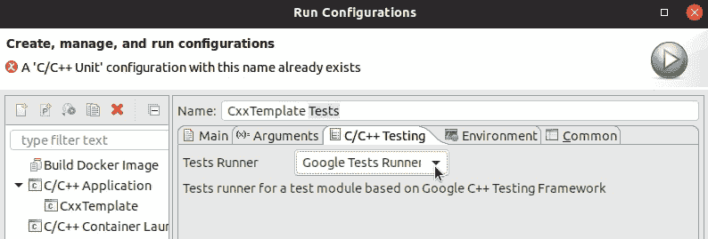

    **图 1.28：运行配置**

11. 在后续的运行中，你可以点击工具栏中播放按钮旁边的下拉菜单，或选择 `Run | Run History` 来选择 `CxxTemplate Tests`：

    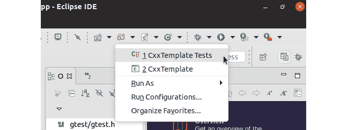

    **图 1.29：完成运行配置设置并选择要运行的配置**

    结果将类似于以下截图：

    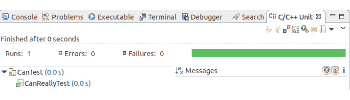

    **图 1.30：单元测试的运行结果**

    这是一份漂亮的报告，包含所有测试的条目——目前只有一个。如果你不想离开 IDE，可能会更喜欢这种方式。此外，当你有很多测试时，此界面可以帮助你有效地筛选它们。现在你已经构建并运行了使用 `Google Test` 编写的测试。你用几种不同的方式运行了它们，包括直接执行测试、使用 `ctest` 和使用 `Eclipse CDT`。在下一节中，我们将完成一个练习，实际测试我们代码的功能。

## 练习 6：测试代码功能

你已经运行了简单的测试，但现在想要编写测试功能的有意义的测试。在最初的活动中，我们创建了包含 `sum` 函数的 `SumFunc.cpp`。现在，在本练习中，我们将为该文件编写测试。在此测试中，我们将使用 `sum` 函数添加两个数字并验证结果是否正确。让我们回顾一下之前包含 `sum` 函数的以下文件内容：

### `src/SumFunc.h`

```cpp
#ifndef SRC_SUMFUNC_H_
#define SRC_SUMFUNC_H_

int sum(int a, int b);

#endif /* SRC_SUMFUNC_H_ */
```

### `src/SumFunc.cpp`

```cpp
#include "SumFunc.h"
#include <iostream>

int sum(int a, int b) {
  return a + b;
}
```

### `CMakeLists.txt` (relevant lines)

```cmake
add_executable(CxxTemplate
  src/CxxTemplate.cpp
  src/ANewClass.cpp
  src/SumFunc.cpp
)
```

### `CantTest.cpp`

```cpp
#include "gtest/gtest.h"

namespace {

class CanTest: public ::testing::Test {};

TEST_F(CanTest, CanReallyTest) {
  EXPECT_EQ(0, 0);
}

}

int main(int argc, char **argv) {
  ::testing::InitGoogleTest(&argc, argv);
  return RUN_ALL_TESTS();
}
```

执行以下步骤以完成练习：

1. 在 `Eclipse CDT` 中打开我们的 `CMake` 项目。

2. 添加一个新的测试源文件 `tests/SumFuncTest.cpp`，内容如下：

   ```cpp
   #include "gtest/gtest.h"
   #include "../src/SumFunc.h"

   namespace {

   class SumFuncTest: public ::testing::Test {};

   TEST_F(SumFuncTest, CanSumCorrectly) {
     EXPECT_EQ(7, sum(3, 4));
   }

   }
   ```

   注意，此文件没有 `main()` 函数，因为 `CanTest.cpp` 已经有一个，它们将被链接在一起。其次，注意它包含了位于项目 `src` 文件夹中的 `SumFunc.h`，并在测试中将其用作 `sum(3, 4)`。这就是我们在测试中使用项目代码的方式。

3. 在 `tests/CMakeLists.txt` 文件中进行以下更改以构建测试：

   ```cmake
   include(GoogleTest)
   ```


## CMake 配置与测试执行

```cmake
add_executable(tests CanTest.cpp SumFuncTest.cpp ../src/SumFunc.cpp) # added files here

target_link_libraries(tests GTest::GTest)

gtest_discover_tests(tests)
```

注意，我们将测试文件（`SumFuncTest.cpp`）和被测试的代码（`../src/SumFunc.cpp`）都添加到了可执行文件中，因为我们的测试代码使用了实际项目中的代码。

4. 构建项目并像之前一样运行测试。你应该会看到以下报告：

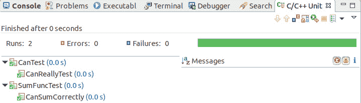

**Figure 1.31: Output after running the test**

我们可以向项目添加此类测试，所有测试都将如上图所示显示在屏幕上。

5. 现在，让我们添加一个实际会失败的测试。在 **tests/SumFuncTest.cpp** 文件中，进行以下更改：

```cpp
TEST_F(SumFuncTest, CanSumCorrectly) {
    EXPECT_EQ(7, sum(3, 4));
}

// add this test
TEST_F(SumFuncTest, CanSumAbsoluteValues) {
    EXPECT_EQ(6, sum(3, -3));
}
```

注意，此测试假设输入的绝对值被相加，这是不正确的。该调用的结果是 **0**，但在此示例中预期为 **6**。这是我们在项目中添加此测试所需的唯一更改。

6. 现在，构建项目并运行测试。你应该会看到此报告：

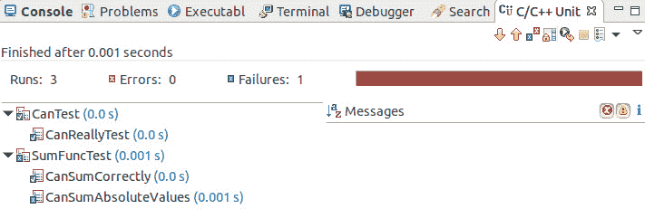

**Figure 1.32: The build report**

正如你在前图中所见，前两个测试通过了，最后一个测试失败了。当我们看到此输出时，有两种可能：要么我们的项目代码有误，要么测试有误。在这种情况下，我们的测试有误。这是因为我们的 `CanSumAbsoluteValues` 测试用例预期 **6** 等于 `sum(3, -3)`。这是因为我们假设我们的函数会对提供的整数的绝对值求和。然而，事实并非如此。我们的函数只是简单地相加给定的数字，无论它们是正数还是负数。因此，此测试基于错误的假设而失败。

7. 让我们更改测试并修复它。更改测试，使我们预期 **-3** 和 **3** 的和为 **0**。重命名测试以反映此测试实际的功能：

```cpp
TEST_F(SumFuncTest, CanSumCorrectly) {
    EXPECT_EQ(7, sum(3, 4));
}

// change this part
TEST_F(SumFuncTest, CanUseNegativeValues) {
    EXPECT_EQ(0, sum(3, -3));
}
```

8. 现在运行它，并在报告中观察所有测试均通过：

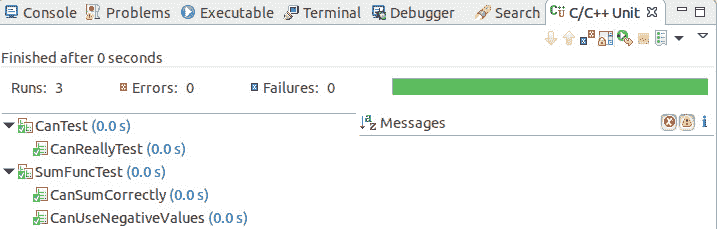

**Figure 1.33: Test execution is successful**

最后，我们已在系统和项目中使用 CMake 设置了 Google Test。我们还编写、构建并运行了使用 Google Test 的单元测试，既在终端中也在 Eclipse 中。理想情况下，你应该为每个类编写单元测试并覆盖每种可能的用法。你还应该在每次重大更改后运行测试，并确保不破坏现有代码。在下一节中，我们将执行添加新类及其测试的活动。

### Activity 2: Adding a New Class and Its Test

随着 C++ 项目的开发，你会随着项目增长向其中添加新的源文件。你也会为它们编写测试以确保其正常工作。在此活动中，我们将添加一个模拟 **1D** 线性运动的新类。该类将包含用于 **position** 和 **velocity** 的 double 字段。它还将有一个 `advanceTimeBy()` 方法，该方法接收一个 double `dt` 参数，根据 `velocity` 的值修改 `position`。对 double 值使用 `EXPECT_DOUBLE_EQ` 而不是 `EXPECT_EQ`。在此活动中，我们将向项目添加一个新类及其测试。执行以下步骤以完成此活动：

1. 在 Eclipse IDE 中打开我们创建的项目。
2. 向包含 `LinearMotion1D` 类的项目添加 **LinearMotion1D.cpp** 和 **LinearMotion1D.h** 文件对。在此类中，创建两个 double 字段：**position** 和 **velocity**。此外，创建一个 `advanceTimeBy(double dt)` 函数来修改 **position**。
3. 在 **tests/LinearMotion1DTest.cpp** 文件中为此编写测试。编写两个表示两个不同方向运动的测试。
4. 在 Eclipse IDE 中构建并运行它。
5. 验证测试已通过。

最终测试结果应类似于以下内容：

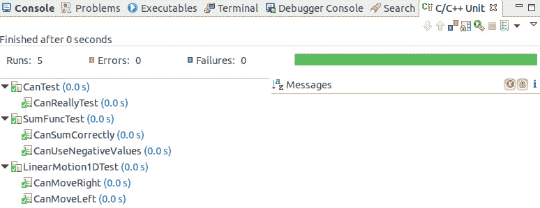

**Figure 1.34: Final test results**

#### Note

此活动的解决方案可在 622 页找到。

添加新类及其测试是 C++ 开发中非常常见的任务。我们出于各种原因创建类。有时，我们有一个良好的软件设计计划，并创建它所要求的类。其他时候，当一个类变得过大且单一时，我们会以有意义的方式将其部分职责分离到另一个类中。使此任务变得实用对于防止拖延并最终得到巨大的单一类非常重要。在下一节中，我们将讨论编译和链接阶段发生的情况。这将使我们更好地了解 C++ 程序的内部机制。

## Understanding Compilation, Linking, and Object File Contents

理解编译、链接和目标文件内容

使用 C++ 的主要原因之一是效率。C++ 赋予我们对内存管理的控制权，这就是为什么理解对象在内存中的布局很重要。此外，C++ 源文件和库被编译为目标硬件的目标文件并链接在一起。C++ 程序员经常需要处理链接器问题，这就是为什么理解编译步骤并能够检查目标文件很重要。另一方面，大型项目由团队在长时间内开发和维护，这就是为什么创建整洁且可理解的代码很重要。与任何其他软件一样，Bug 会在 C++ 项目中出现，需要通过观察程序行为仔细识别、分析和解决。因此，学习如何调试 C++ 代码也很重要。在下一节中，我们将学习如何创建高效、能与其他代码良好配合且可维护的代码。

### Compilation and Linking Steps

编译和链接步骤

C++ 项目作为一组源代码文件和组织源文件和库依赖的项目配置文件创建。在编译步骤中，这些源文件首先被转换为目标文件。在链接步骤中，这些目标文件被链接在一起形成可执行文件，这是项目的最终输出。项目使用的库也在此步骤中链接。

在即将进行的练习中，我们将使用现有项目来观察编译和链接阶段。然后，我们将手动重现它们以更详细地查看该过程。

### Exercise 7: Identifying Build Steps

练习 7：识别构建步骤

你一直在构建项目而未调查构建操作的细节。在此练习中，我们将调查项目构建步骤的细节。执行以下操作以完成练习：

1. 打开终端。
2. 通过输入以下命令导航到我们的 `Makefile` 文件所在的 **build** 文件夹：

```bash
cd build/Debug
```

3. 使用以下命令清理项目并以 **VERBOSE** 模式运行构建：

```bash
make clean
make VERBOSE=1 all
```

你将在终端中获得构建过程的详细输出，这可能看起来有点拥挤：

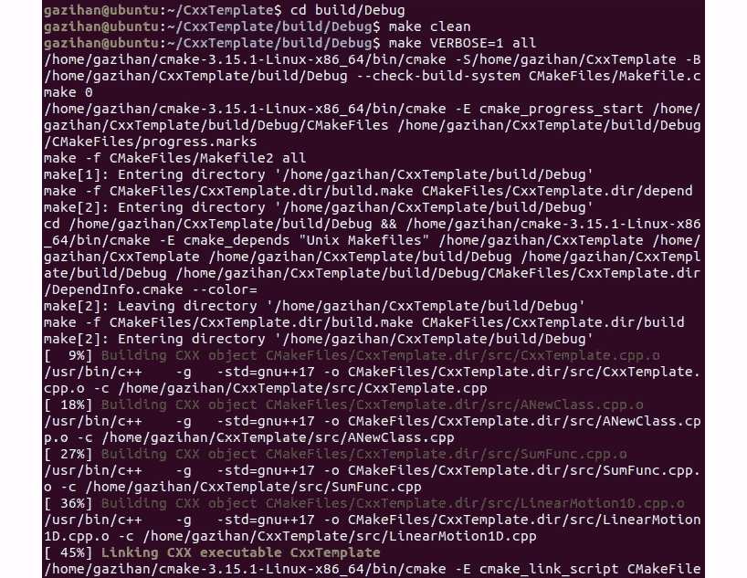

**Figure 1.35: The build process part 1**

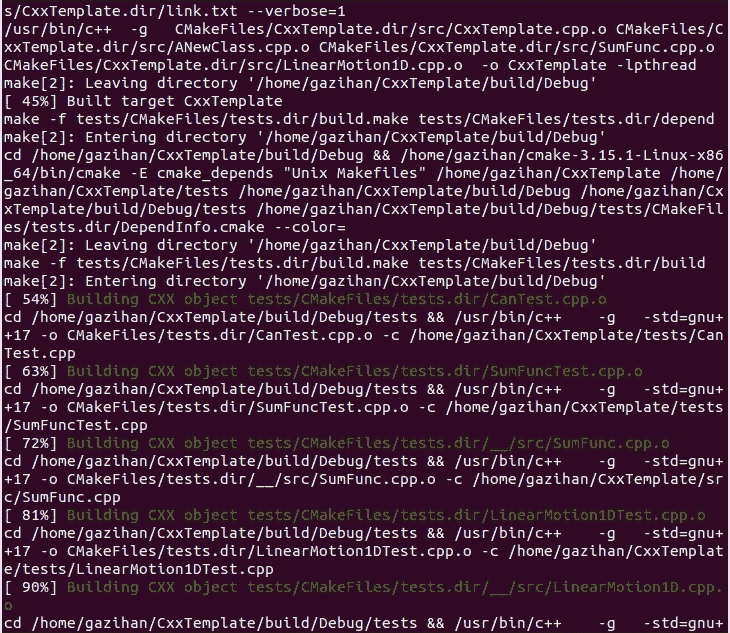

**Figure 1.36: The build process part 2**

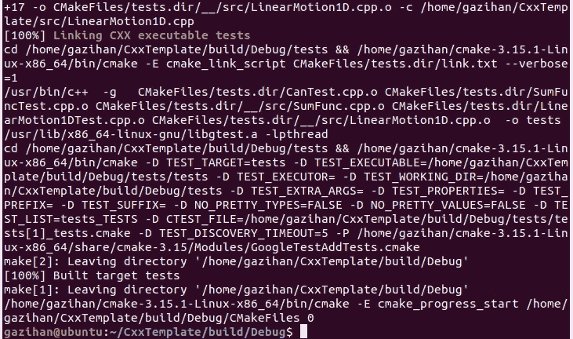

**Figure 1.37: The full build output**


## 构建过程步骤

以下是该输出中的部分行。以下行是与主可执行文件的编译和链接相关的重要行：

```
/usr/bin/c++  -g  -pthread -std=gnu++1z -o CMakeFiles/CxxTemplate.dir/src/CxxTemplate.cpp.o -c /home/username/Packt/Cpp2019/CxxTemplate/src/CxxTemplate.cpp
/usr/bin/c++  -g  -pthread -std=gnu++1z -o CMakeFiles/CxxTemplate.dir/src/ANewClass.cpp.o -c /home/username/Packt/Cpp2019/CxxTemplate/src/ANewClass.cpp
/usr/bin/c++  -g  -pthread -std=gnu++1z -o CMakeFiles/CxxTemplate.dir/src/SumFunc.cpp.o -c /home/username/Packt/Cpp2019/CxxTemplate/src/SumFunc.cpp
/usr/bin/c++  -g  -pthread -std=gnu++1z -o CMakeFiles/CxxTemplate.dir/src/LinearMotion1D.cpp.o -c /home/username/Packt/Cpp2019/CxxTemplate/src/LinearMotion1D.cpp
/usr/bin/c++  -g  CMakeFiles/CxxTemplate.dir/src/CxxTemplate.cpp.o CMakeFiles/CxxTemplate.dir/src/ANewClass.cpp.o CMakeFiles/CxxTemplate.dir/src/SumFunc.cpp.o CMakeFiles/CxxTemplate.dir/src/LinearMotion1D.cpp.o  -o CxxTemplate -pthread
```

4. 此处的 `c++` 命令只是指向 `g++` 编译器的符号链接。要查看它实际上是一个符号链接链，请输入以下命令：

```
namei /usr/bin/c++
```

您将看到以下输出：

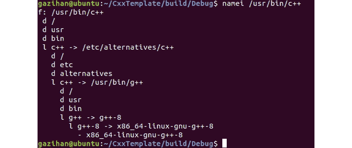

**图 1.38：/usr/bin/c++ 的符号链接链**

因此，在我们的讨论中，我们将交替使用 `c++` 和 `g++`。在我们之前引用的构建输出中，前四行正在编译每个 `.cpp` 源文件并创建相应的 `.o` 目标文件。最后一行将这些目标文件链接在一起以创建 `CxxTemplate` 可执行文件。下图直观地展示了这一过程：

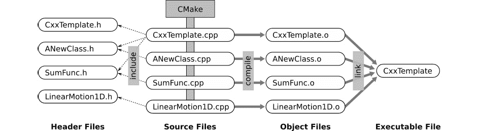

**图 1.39：C++ 项目的执行阶段**

正如上图所示，作为目标一部分添加到 CMake 中的 CPP 文件，连同它们所包含的头文件，被编译成目标文件，随后被链接在一起以创建目标可执行文件。

5. 为了更深入地理解这一过程，让我们亲自执行编译步骤。在终端中，进入项目文件夹并使用以下命令创建一个名为 `mybuild` 的新文件夹：

```
cd ~/CxxTemplate
mkdir mybuild
```

6. 然后，运行以下命令将 CPP 源文件编译为目标文件：

```
/usr/bin/c++ src/CxxTemplate.cpp -o mybuild/CxxTemplate.o -c
/usr/bin/c++ src/ANewClass.cpp -o mybuild/ANewClass.o -c
/usr/bin/c++ src/SumFunc.cpp -o mybuild/SumFunc.o -c
/usr/bin/c++ src/LinearMotion1D.cpp -o mybuild/LinearMotion1D.o -c
```

7. 进入 `mybuild` 目录并使用以下命令查看其中的内容：

```
cd mybuild
ls
```

我们将看到如预期的输出。这些是我们的目标文件：

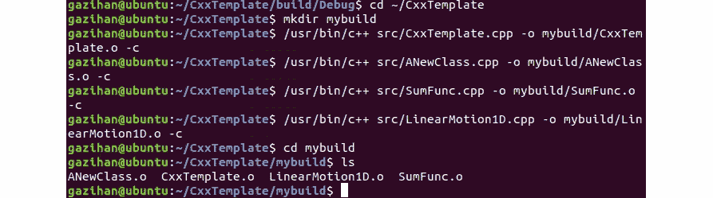

**图 1.40：编译后的目标文件**

8. 在下一步中，将目标文件链接在一起以形成我们的可执行文件。输入以下命令：

```
/usr/bin/c++  CxxTemplate.o ANewClass.o SumFunc.o LinearMotion1D.o  -o CxxTemplate
```

9. 现在，让我们通过输入以下命令查看此处文件列表中的可执行文件：

```
ls
```

这将显示新的 `CxxTemplate` 文件，如下图所示：

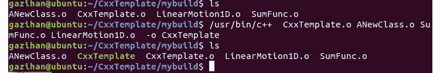

**图 1.41：链接后的可执行文件**

10. 现在，通过输入以下命令运行我们的可执行文件：

```
./CxxTemplate
```

并查看我们之前的输出：

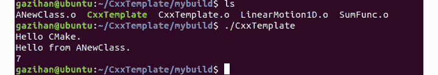

**图 1.42：可执行文件输出**

既然您已经检查了构建过程的细节并亲自重现了它们，在下一节中，让我们探讨链接过程。

### 链接步骤

在本节中，让我们看看两个源文件之间的联系，以及它们如何最终位于同一个可执行文件中。请看下图中的 `sum` 函数：

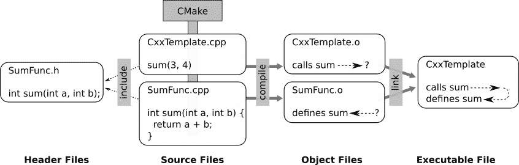

**图 1.43：链接过程**

`sum` 函数的主体定义在 `SumFunc.cpp` 中。它在 `SumFunc.h` 中有前向声明。这样，想要使用 `sum` 函数的源文件就可以知道它的签名。一旦知道了它的签名，它们就可以调用它，并相信实际的函数定义将在运行时存在，而无需实际与定义该函数的 `SumFunc.cpp` 进行任何交互。

编译后，调用 `sum` 函数的 `CxxTemplate.cpp` 将该调用带入其目标文件中。尽管如此，它仍然不知道函数定义在哪里。`SumFunc.cpp` 的目标文件包含该定义，但它目前与 `CxxTemplate.o` 毫无关系。

在链接步骤期间，链接器将 `CxxTemplate.o` 中的调用与 `SumFunc.o` 中的定义进行匹配。结果，调用在可执行文件中正常工作。如果链接器未找到 `sum` 函数的定义，它会给出链接器错误。

链接器通过其名称和参数找到 `sum` 函数。这称为**解析符号**。目标文件中定义的类、函数和变量被放置在符号表中，并且对符号的每次引用都通过在此表中的查找来解析。当符号不存在时，您会收到**无法解析符号**错误。

这带我们了解了构建过程的两个阶段：**编译**和**链接**。请注意，与 CMake 相比，当我们手动编译源代码时，使用的命令相当简单。请随意输入 `man g++` 查看所有选项。随后，我们讨论了链接以及符号如何被解析。我们还讨论了链接步骤可能出现的问题。在下一节中，我们将了解目标文件。

### 深入探究：查看目标文件

为了使链接步骤无错误地工作，我们需要所有符号引用都与符号定义匹配。大多数时候，我们可以通过查看源文件来分析事物将如何被解析。有时，在复杂的情况下，我们可能很难理解为什么一个符号无法被解析。在这种情况下，查看目标文件的内容以调查引用和定义有助于解决问题。除了链接器错误之外，理解目标文件内容以及链接的一般工作原理对 C++ 程序员很有用。了解引擎盖下发生的事情可能有助于程序员更好地理解整个过程。

当我们的源代码被编译为目标文件时，我们的语句和表达式被转换为汇编代码，这是 CPU 能够理解的低级语言。汇编中的每条指令包含一个操作，后跟操作数，即 CPU 的寄存器。有加载数据到寄存器和从寄存器加载数据的指令，以及对寄存器中的值进行操作的指令。Linux 中的 `objdump` 命令帮助我们查看这些目标文件的内容。

#### 注意

我们将使用 Compiler Explorer，这是一个很好用的在线工具，您可以在左侧窗口编写代码，在右侧查看编译后的汇编代码。这是 Compiler Explorer 的链接：[`godbolt.org`](https://godbolt.org)。

### 练习 8：探索编译后的代码

在本练习中，我们将使用 Compiler Explorer 编译一些简单的 C++ 代码，其中我们定义并调用一个函数。我们将调查编译后的汇编代码，以准确了解名称是如何被解析以及调用是如何被进行的。这将使我们更好地了解引擎盖下发生了什么以及我们的代码如何在可执行格式中工作。执行以下步骤以完成练习：


## 编译与链接示例

## 1. 在 Compiler Explorer 中添加代码

在 `Compiler Explorer` 中添加以下代码：

```cpp
int sum(int a, int b) {
    return a + b;
}

int callSum() {
    return sum(4, 5);
}
```

我们有两个函数，一个调用另一个。以下是编译输出：

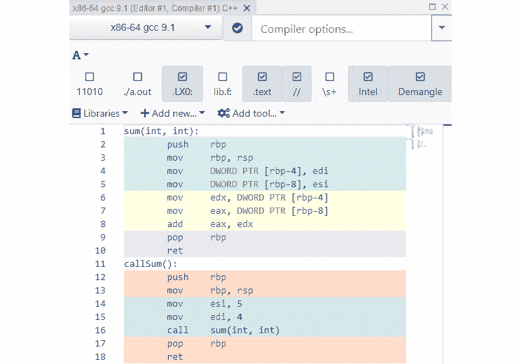

**Figure 1.44: The compiled code**

虽然不太清晰，但你大致能看出来它在做什么。我们不深入汇编代码细节，而是关注链接阶段符号如何解析。暂时关注以下行：

```text
sum(int, int):
...
callSum():
...
    call  sum(int, int)
...
```

`call sum(int, int)` 行执行预期操作：调用前面的 `sum` 函数并将参数放入某些寄存器。重要的是函数按其名称和参数类型顺序标识。链接器查找具有此签名的适当函数。注意返回值不是签名的一部分。

## 2. 禁用 Demangle 复选框

禁用 `Demangle` 复选框，查看这些函数名实际如何存储：

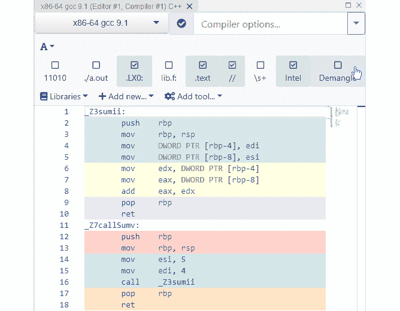

**Figure 1.45: Compiled code without demangling**

此时我们的行变为：

```text
_Z3sumii:
...
_Z7callSumv:
...
    call    _Z3sumii
...
```

以上是这些函数的修饰名。`_Z` 后的数字告诉我们函数名长度，以便正确解释后续字母。函数名后，`v` 表示无参数，`i` 表示 `int` 参数。你可以更改这些函数签名以查看其他可能类型。

## 3. 类的编译方式

现在看看类如何编译。在现有代码下在 `Compiler Explorer` 中添加以下代码：

```cpp
class MyClass {
private:
    int a = 5;
    int myPrivateFunc(int i) {
        a = 4;
        return i + a;
    }
public:
    int b = 6;
    int myFunc() {
        return sum(1, myPrivateFunc(b));
    }
};

MyClass myObject;

int main() {
    myObject.myFunc();
}
```

以下是新增行的编译版本：

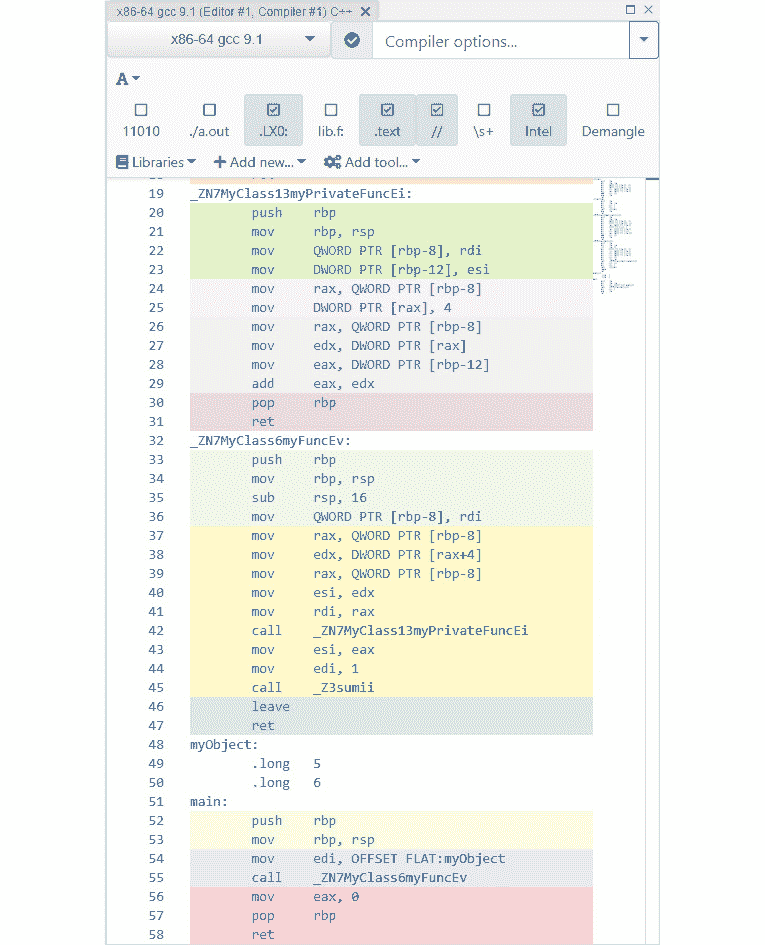

**Figure 1.46: The compiled version**

你可能会惊讶编译代码中没有类定义。方法类似于全局函数，但有个区别：它们的修饰名包含类名，并接收对象实例作为参数。创建实例只是为类的字段分配空间。

在链接阶段，这些修饰函数名用于匹配调用者与被调用者。对于找不到被调用者的调用者，会得到链接错误。大多数链接错误可通过仔细检查源码解决。但在某些情况下，使用 `objdump` 查看目标文件内容有助于定位问题。

## 调试 C++ 代码

开发 C++ 项目时可能遇到不同层级的问题：

*   **编译器错误**：可能因语法错误、类型选择错误等。编译器是你必须跨越的第一道关卡，它能捕获一些错误。
*   **链接器错误**：典型错误是使用已声明但未定义的内容。常发生在为库使用错误的头文件时——头文件宣称某签名，但源文件或库中不存在。跨过链接器关卡后，程序即可执行。
*   **运行时错误**：代码可能编译链接正常，但执行无效操作，如解引用空指针或除零。

要查找修复运行时错误，必须以某种方式与运行中的应用交互并监控。常用技术是向代码添加 `print` 语句并监控生成的日志，希望将应用行为与日志关联以定位问题代码区域。虽对某些情况有效，但有时需更近距离地观察执行。

调试器是对抗运行时错误的更好工具。调试器可让你逐行运行代码、继续运行并在想要的行暂停、检查内存值、在错误处暂停等。这让你能在程序运行时准确观察内存状况，识别导致异常行为的代码行。

`gdb` 是可调试 C++ 程序的标准命令行调试器。但可能难用，因为调试本质上是可视任务——你想同时查看代码行、变量值和程序输出。幸运的是，`Eclipse CDT` 包含易用的可视化调试器。

## 练习 9：使用 Eclipse CDT 调试

你一直只是运行项目并查看输出。现在想学习如何详细调试代码。本练习探索 `Eclipse CDT` 的调试能力。执行以下步骤完成练习：

1.  在 `Eclipse CDT` 中打开 CMake 项目。
2.  为确保有现有运行配置，点击 `Run` | `Run Configurations`。那里应在 `C/C++ Application` 下看到 `CxxTemplate` 条目。

> **Note**
> 既然之前运行过项目，它应该在那里。如果没有，请返回重新创建。

3.  关闭对话框继续。
4.  启动调试器：找到工具栏中类似昆虫（bug）的图标，点击其旁边的下拉箭头。选择 `CxxTemplate` 调试主应用程序。如果提示切换到调试视角，接受。现在 `Eclipse` 将如下所示：

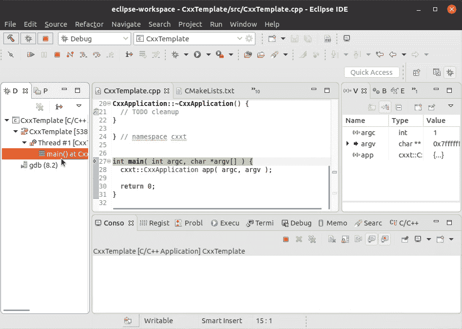

**Figure 1.47: Eclipse debug screen**

此时代码冻结在 `main()` 函数的第一行，在中间代码视图中以绿色高亮和箭头显示。左侧显示运行线程（仅一个）。右侧显示此上下文中可访问的变量。底部显示 `Eclipse` 后台实际用于调试可执行文件的 `gdb` 输出。目前用我们的 main 函数没什么可调试的。

5.  在 `Run` 菜单或工具栏中点击 `Step Over` 几次，应用程序很快终止。最后你会看到 `libc-start.c` 库，它是 `main` 函数的调用者。完成后可关闭它并切换回源文件。当不再看到红色停止按钮时，表明程序执行结束。

6.  编辑 `main` 函数，添加以下代码：

```cpp
int i = 1, t = 0;

do {
    t += i++;
} while (i <= 3);

std::cout << t << std::endl;
```

后置增量运算符混合偶尔的 `do-while` 循环可能让人费解。因为我们试图在脑中执行算法。然而调试器完全能逐步运行并展示执行期间确切发生的事。

7.  添加上述代码后开始调试。点击工具栏中 `Debug` 按钮旁的下拉箭头选择 `CxxTemplate`。按 `F6` 几次单步执行代码。它将展示变量如何变化以及下一行将执行的代码：

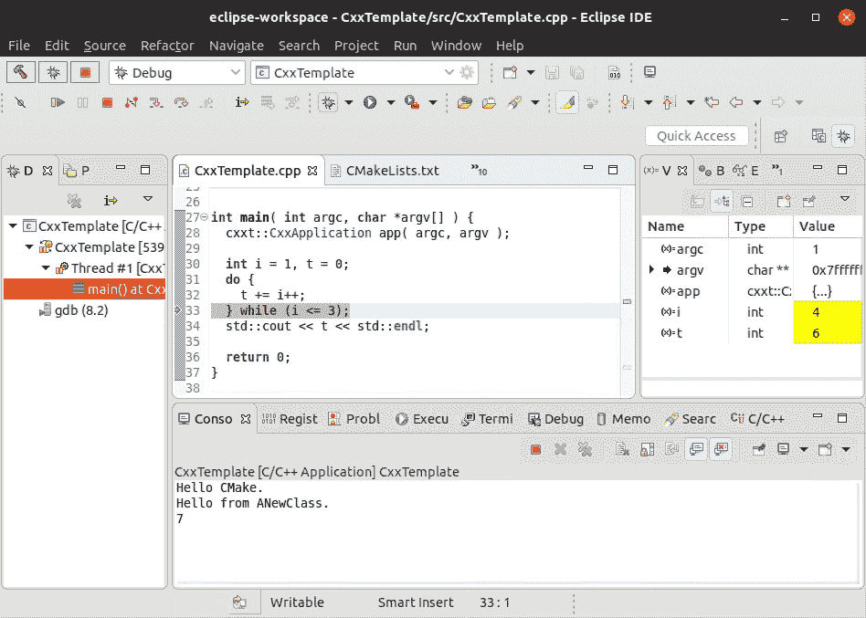


###### 图 1.48：单步跳过代码

8. 看到变量在每行代码执行后发生的变化，会让算法更容易理解。当你按下 `F6` 时，请注意以下是在每次执行 `t += i++;` 这行代码后的值：

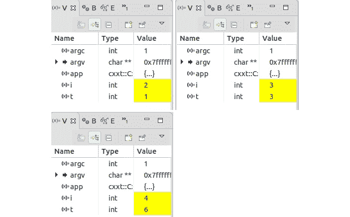

###### 图 1.49：随时间变化的变量状态

前面的输出清楚地解释了值是如何变化的，以及为什么最后会打印出 `6`。

9. 探索调试器的其他功能。虽然变量视图很有用，但你也可以将鼠标悬停在任意变量上以查看其值：

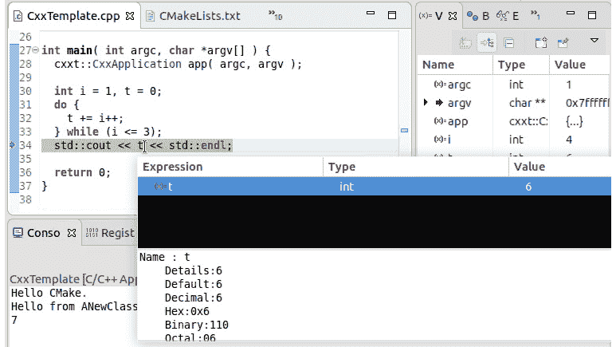

###### 图 1.50：调试器的查看选项

此外，**Expression**（表达式）视图可以帮助你计算那些仅从浏览的值中无法看清的内容。

10. 点击右侧的 **Expression**（表达式），然后点击 **Add**（添加）按钮：


###### 图 1.51：添加表达式

11. 输入 `t+i` 并按下 `Enter`。现在你可以在表达式列表中看到总计值：

###### 


###### 图 1.52：包含新表达式的表达式视图

你可以随时点击工具栏中的红色方块，或选择 `Run` | `Terminate` 来停止调试。另一个功能是断点，它会告诉调试器在到达标记了断点的行时暂停。到目前为止，我们一直在逐行单步执行代码，这在大型项目中可能非常耗时。通常，你希望继续执行直到到达你感兴趣的代码处。

12. 现在，不再逐行执行，而是在执行打印操作的那一行添加一个断点。为此，双击该行行号左侧的区域。在下图中，圆点代表一个断点：

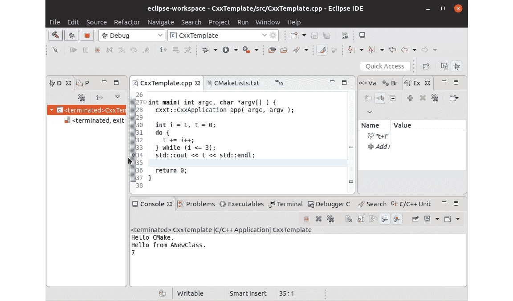

###### 图 1.53：使用断点

13. 现在启动调试器。像往常一样，它将从暂停状态开始。现在选择 `Run` | `Resume` 或点击工具栏按钮。它将运行循环的三次迭代，并在我们的断点处暂停。这样，我们通过跳过不关心的代码节省了时间：

###### 

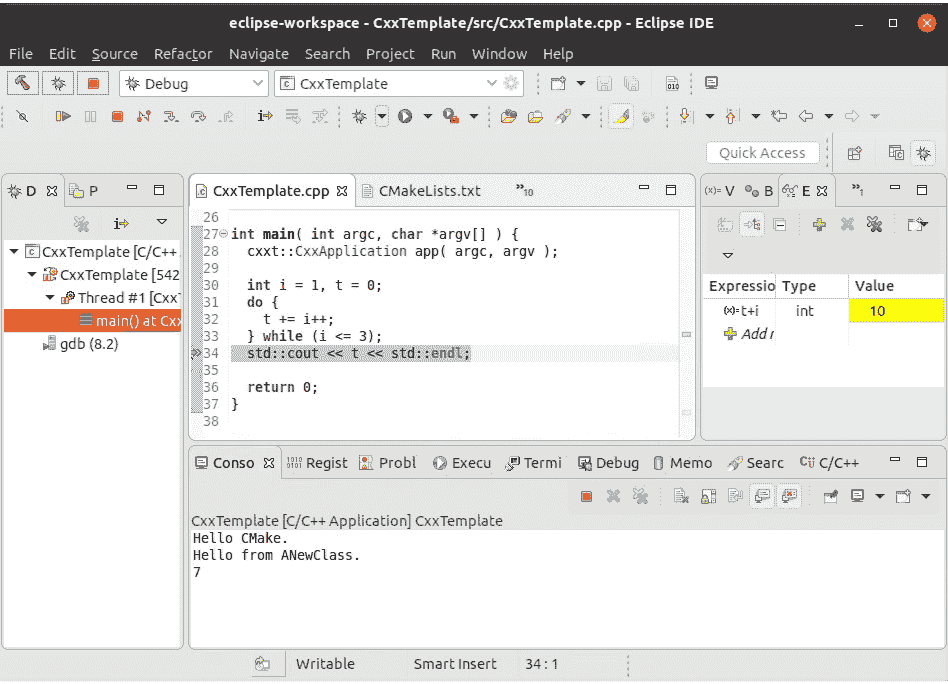

###### 图 1.54：使用调试器

14. 虽然我们一直在处理添加的循环，但忽略了创建 `app` 对象的那一行。**Step Over**（单步跳过）命令跳过了这一行。然而，我们也可以选择进入该行中的构造函数调用。为此，我们将使用 `Run` | `Step Into` 或对应的工具栏按钮。

15. 停止调试器并重新启动。点击 **Step Over**（单步跳过）以移动到创建应用程序的那一行：

###### 

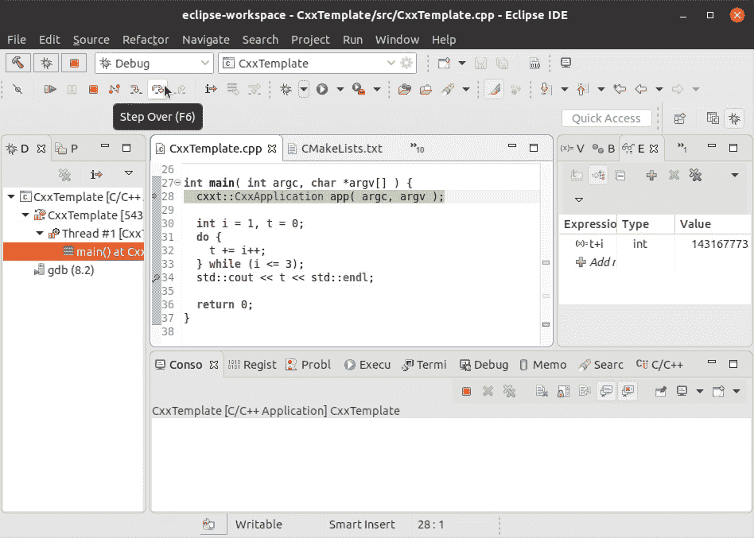

###### 图 1.55：使用调试器 – Step Over 选项

16. 高亮显示的是如果我们再次单步跳过将要执行的下一行。相反，按下 Step Into（单步进入）按钮。这将带我们进入构造函数调用内部：

###### 

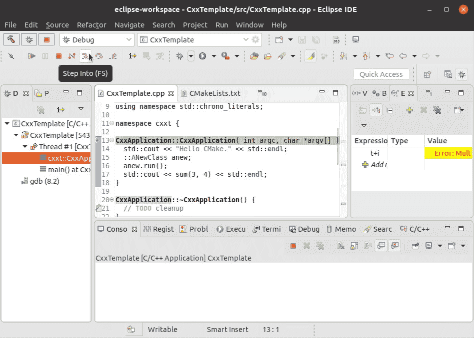

###### 图 1.56：使用调试器 – Step Into 选项

这是一个深入函数内部而非仅单步跳过的实用功能。另外，请注意左侧调试视图中的调用栈。你随时可以点击较低的条目以返回查看调用者的上下文。

以上是对 Eclipse CDT 调试器的简要介绍，它在底层使用 `GDB` 为你提供可视化的调试体验。当你试图更好地理解运行时错误并纠正导致错误的失误时，可能会发现调试很有用。

## 编写可读代码

虽然可视化调试器对于识别和消除运行时错误或非预期的程序行为非常有用，但最好从一开始就编写不太可能出现问题的代码。实现这一点的一种方法是努力编写更易读、更易理解的代码。那样，在代码中发现问题就更像是在识别英语句子之间的矛盾，而不是在解密谜题。当你以一种可理解的方式编写代码时，你的错误往往在编写时就显而易见，并且当你回来解决漏网之鱼时，也更容易被发现。

在经历了一些不愉快的维护经历后，你会意识到你编写程序的主要目的不是让计算机做你想做的事，而是告诉读者程序运行时计算机将做什么。这通常意味着你需要敲击更多的键盘，IDE 可以在这方面提供帮助。这有时也意味着你编写的代码在执行时间或内存使用方面可能不是最优的。如果这与你所学相悖，请考虑一下：你可能正在用极微小的效率换取出错的风险。凭借我们拥有的巨大处理能力和内存，你可能正在为了追求效率而使代码变得不必要地晦涩且可能充满 Bug。在接下来的章节中，我们将列出一些经验法则，帮助你编写更可读的代码。

## 缩进与格式化

C++ 代码与许多其他编程语言一样，由程序块组成。函数有一组语句形成其作为块的主体。循环的块语句将在迭代中执行。`if` 语句的块在给定条件为真时执行，相应的 `else` 语句的块在条件为假时执行。

花括号（或单语句块缺少花括号）告知计算机，而以空白字符形式存在的缩进则告知人类读者关于块结构的信息。缺少缩进或误导性的缩进会使读者非常难以理解代码结构。因此，我们应该努力保持代码缩进良好。请看下面两个代码块：

```
// 代码块 1
if (result == 2)
    firstFunction();
secondFunction();

// 代码块 2
if (result == 2)
    firstFunction();
secondFunction();
```

虽然它们在执行方面完全相同，但在第二个代码块中，`firstFunction()` 仅在 `result` 为 `2` 时执行，这点要清晰得多。现在看看下面的代码：

```
if (result == 2)
    firstFunction();
    secondFunction();
```

这纯粹是误导。如果读者不小心，他们很容易认为 `secondFunction()` 仅在 `result` 为 `2` 时执行。然而，从执行角度来看，这段代码与前两个示例完全相同。

如果你觉得修正缩进拖慢了你的速度，可以使用编辑器的格式化工具来帮助你。在 Eclipse 中，你可以选择一块代码并使用 `Source` | `Correct Indentation` 来修复该选择区域的缩进，或使用 `Source` | `Format` 来同时修复代码的其他格式问题。

除了缩进之外，其他格式化规则也非常重要，例如将花括号放在正确的行、在二元运算符周围插入空格、在每个逗号后插入空格。你应该遵守这些规则，以保持代码格式良好且易于阅读。


## Eclipse 格式化设置

在 Eclipse 中，你可以在 `Window` | `Preferences` | `C/C++` | `Code Style` | `Formatter` 中设置每个工作区的格式化规则，或者在 `Project` | `Properties` | `C/C++ General` | `Formatter` 中设置每个项目的规则。你可以选择一种行业标准风格（如 K&R 或 GNU），也可以修改它们并创建自己的风格。当你使用 `Source` | `Format` 来格式化代码时，这变得尤为重要。例如，如果你选择使用空格进行缩进，但 Eclipse 的格式化规则设置为制表符，你的代码就会变成制表符和空格的混合体。

### 使用有意义的名称作为标识符

在我们的代码中，我们使用标识符来命名许多项——变量、函数、类名、类型等。对于计算机来说，这些标识符仅仅是一串用于相互区分的字符。然而，对于阅读者来说，它们的意义远不止于此。标识符应当完整且明确地描述它所代表的项。同时，它不应过长。此外，它应遵守正在使用的风格标准。

请看下面的代码：

```cpp
studentsFile File = runFileCheck("students.dat");

bool flag = File.check();

if (flag) {

    int Count_Names = 0;

    while (File.CheckNextElement() == true) {

        Count_Names += 1;

    }

    std::cout << Count_Names << std::endl;

}
```

虽然这是一段完全有效的 C++ 代码，但它非常难以阅读。让我们列出其中的问题。首先，让我们看看标识符的风格问题。`studentsFile` 类名以小写字母开头，本应是大写。`File` 变量本应以小写字母开头。`Count_Names` 变量本应以小写字母开头，且不应包含下划线。`CheckNextElement` 方法本应以小写字母开头。虽然这些规则看似随意，但命名的一致性承载了关于名称的额外信息——当你看到一个以大写字母开头的单词时，你会立即明白它一定是一个类名。此外，使用不符合当前标准的名称只会干扰阅读。

现在，让我们超越风格，审视名称本身。第一个有问题的名称是 `runFileCheck()` 函数。方法是一个返回值的动作：其名称应当既清楚地说明它做什么，也说明它返回什么。"Check" 是一个被过度使用的词，在大多数情况下过于模糊。是的，我们检查了，它在那里——那我们该拿它怎么办呢？在这种情况下，我们似乎实际上是读取文件并创建一个 `File` 对象。那么，`runFileCheck()` 本应是 `readFile()`。这清楚地说明了执行的动作，返回值也是你所期望的。如果你想对返回值更具体一点，`readAsFile()` 也是另一种选择。同样，`check()` 方法也很模糊，应改为 `exists()`。`CheckNextElement()` 方法也很模糊，应改为 `nextElementExists()`。

另一个被过度使用的模糊词是 `flag`，它常用于布尔变量。这个名字暗示了一种开/关的情况，却没有给出其值含义的任何线索。在这种情况下，其 `true` 值意味着文件存在，`false` 值意味着文件不存在。命名布尔变量的技巧是设计一个问题或陈述，当变量值为 `true` 时该陈述为真。在这个例子中，`fileExists` 和 `doesFileExist` 是两个很好的选择。

我们接下来命名不当的变量是 `Count_Names`，或者按正确的大小写写作 `countNames`。这对于一个整数来说是个坏名字，因为该名称并不暗示一个数字——它暗示一个产生数字的动作。相反，像 `numNames` 或 `nameCount` 这样的标识符能清楚地传达该数字的含义。

### 保持算法清晰简洁

当我们阅读代码时，采取的步骤和流程应该讲得通。间接完成的事情——函数的副产品、以效率之名将多个动作合在一起做，等等——都是让阅读者难以理解你代码的东西。例如，让我们看看下面的代码：

```cpp
int *input = getInputArray();

int length = getInputArrayLength();

int sum = 0;

int minVal = 0;

for (int i = 0; i < length; ++i) {

    sum += input[i];

    if (i == 0 || minVal > input[i]) {

        minVal = input[i];

    }

    if (input[i] < 0) {

        input[i] *= -1;

    }

}
```

这里，我们有一个在循环中处理的数组。乍一看，循环到底在做什么并不十分清楚。变量名帮助我们理解正在发生什么，但我们必须在脑海中运行算法，以确定这些名称所宣称的功能确实在这里发生。这个循环中发生了三种不同的操作。首先，我们在计算所有元素的总和。其次，我们在查找数组中的最小元素。第三，我们在执行这些操作后获取每个元素的绝对值。

现在考虑这个替代版本：

```cpp
int *input = getInputArray();

int length = getInputArrayLength();

int sum = 0;

for (int i = 0; i < length; ++i) {

    sum += input[i];

}

int minVal = 0;

for (int i = 0; i < length; ++i) {

    if (i == 0 || minVal > input[i]) {

        minVal = input[i];

    }

}

for (int i = 0; i < length; ++i) {

    if (input[i] < 0) {

        input[i] *= -1;

    }

}
```

现在一切都清晰多了。第一个循环计算输入的总和，第二个循环查找最小元素，第三个循环获取每个元素的绝对值。虽然它清晰且易懂得多，但你可能会觉得做了三次循环，从而浪费 CPU 资源。编写更高效代码的冲动可能会迫使你合并这些循环。请注意，这里获得的效率提升微乎其微；你程序的时间复杂度仍然是 O(n)。

在编写代码时，可读性和效率是两个经常相互竞争的约束。如果你想开发可读、可维护的代码，应始终优先考虑可读性。然后，你应努力开发同样高效的代码。否则，可读性低的代码可能难以维护，甚至更糟，可能存在难以识别和修复的 bug。当程序产生错误结果，或添加新功能的成本变得太高时，程序的高效率就变得无关紧要了。

### 练习 10：使代码可读

下面的代码存在风格和缩进问题。空格使用不一致，缩进也不正确。此外，单语句 `if` 块是否使用大括号的决定也不一致。下面这段代码在缩进、格式、命名和清晰度方面都存在问题：

```cpp
//a is the input array and Len is its length

void arrayPlay(int *a, int Len) {

    int S = 0;

    int M = 0;

    int Lim_value = 100;

    bool flag = true;

    for (int i = 0; i < Len; ++i) {

    S += a[i];

        if (i == 0 || M > a[i]) {

        M = a[i];

        }

        if (a[i] >= Lim_value) {            flag = true;

        }

            if (a[i] < 0) {

            a[i] *= 2;

        }

    }

}
```

让我们修复这些问题，使其符合通用的 C++ 代码风格。执行以下步骤完成此练习：

1.  打开 Eclipse CDT。

2.  在 `src` 文件夹中创建一个新的 `ArrayPlay.cpp` 文件并粘贴前面的代码。确保没有选中任何文本。然后，从顶部菜单转到 `Source` | `Format` 并接受对话框以格式化整个文件。这会使我们的代码看起来如下所示：

    ```cpp
    //a is the input array and Len is its length
    ```


## 代码重构示例

## 初始代码

```cpp
void arrayPlay(int *a, int Len) {
    
    int S = 0;
    
    int M = 0;
    
    int Lim_value = 100;
    
    bool flag = true;
    
    for (int i = 0; i < Len; ++i) {
        
        S += a[i];
        
        if (i == 0 || M > a[i]) {
            
            M = a[i];
            
        }
        
        if (a[i] >= Lim_value) {
            
            flag = true;
            
        }
        
        if (a[i] < 0) {
            
            a[i] *= 2;
            
        }
        
    }
    
}
```

代码变得更易于理解后，让我们尝试分析它的功能。根据注释可知，我们有一个输入数组 `a`，其长度为 `Len`。更好的命名应为 `input` 和 `inputLength`。

### 重命名参数

首先将 `a` 重命名为 `input`。如果你使用 `Eclipse`，可以选择 `Refactor` | `Rename` 来重命名一个实例，其他所有实例也会随之重命名。对 `Len` 做同样的操作，将其重命名为 `inputLength`。

更新后的代码如下。注意由于参数名已具有自解释性，我们不再需要注释：

```cpp
void arrayPlay(int *input, int inputLength) {
    
    int S = 0;
    
    int M = 0;
    
    int Lim_value = 100;
    
    bool flag = true;
    
    for (int i = 0; i < inputLength; ++i) {
        
        S += input[i];
        
        if (i == 0 || M > input[i]) {
            
            M = input[i];
            
        }
        
        if (input[i] >= Lim_value) {
            
            flag = true;
            
        }
        
        if (input[i] < 0) {
            
            input[i] *= 2;
            
        }
        
    }
    
}
```

### 重命名局部变量

循环前定义了几个其他变量。让我们分析它们：`S` 只是将每个元素累加，因此 `S` 应为 `sum`。而 `M` 似乎是最小元素，将其命名为 `smallest`。

`Lim_value` 似乎是一个阈值，我们只想知道是否已跨越。将其重命名为 `topThreshold`。`flag` 变量在跨越此阈值时设为 `true`，重命名为 `isTopThresholdCrossed`。使用 `Refactor` | `Rename` 后的代码状态如下：

```cpp
void arrayPlay(int *input, int inputLength) {
    
    int sum = 0;
    
    int smallest = 0;
    
    int topThreshold = 100;
    
    bool isTopThresholdCrossed = true;
    
    for (int i = 0; i < inputLength; ++i) {
        
        sum += input[i];
        
        if (i == 0 || smallest > input[i]) {
            
            smallest = input[i];
            
        }
        
        if (input[i] >= topThreshold) {
            
            isTopThresholdCrossed = true;
            
        }
        
        if (input[i] < 0) {
            
            input[i] *= 2;
            
        }
        
    }
    
}
```

现在，让我们看看如何使代码更简洁易懂。前面的代码执行以下操作：计算输入元素的和、查找最小元素、判断是否跨越顶部阈值、将每个元素乘以二。

由于所有操作都在同一个循环中完成，算法不够清晰。将其拆分为四个独立的循环：

```cpp
void arrayPlay(int *input, int inputLength) {
    
    // find the sum of the input
    int sum = 0;
    for (int i = 0; i < inputLength; ++i) {
        sum += input[i];
    }
    
    // find the smallest element
    int smallest = 0;
    for (int i = 0; i < inputLength; ++i) {
        if (i == 0 || smallest > input[i]) {
            smallest = input[i];
        }
    }
    
    // determine whether top threshold is crossed
    int topThreshold = 100;
    bool isTopThresholdCrossed = true;
    for (int i = 0; i < inputLength; ++i) {
        if (input[i] >= topThreshold) {
            isTopThresholdCrossed = true;
        }
    }
    
    // multiply each element by 2
    for (int i = 0; i < inputLength; ++i) {
        if (input[i] < 0) {
            input[i] *= 2;
        }
    }
    
}
```

现在代码清晰多了。虽然每个代码块的功能一目了然，但我们还添加了注释使其更加明确。在本节中，我们更好地理解了代码如何转换为可执行文件，讨论了识别和解决代码中潜在错误的方法，最后探讨了如何编写不易出问题的可读代码。下一节我们将完成一个活动，使代码更具可读性。

## 活动 3：使代码更具可读性

你可能拥有难以阅读且包含 Bug 的代码，可能是因为你匆忙编写，或是从他人处接手。你希望修改代码以消除 Bug 并提高可读性。我们有一段需要改进的代码。请逐步改进并使用调试器解决问题。执行以下步骤实现此活动：

1.  下方提供了 `SpeedCalculator.cpp` 和 `SpeedCalculator.h` 的源代码，它们包含 `SpeedCalculator` 类。将这两个文件添加到你的项目中。
2.  在 `main()` 函数中创建该类的实例并调用其 `run()` 方法。
3.  修复代码中的风格和命名问题。
4.  简化代码使其更易理解。
5.  运行代码并观察运行时问题。
6.  使用调试器修复问题。

以下是你将添加到项目中的 `SpeedCalculator.cpp` 和 `SpeedCalculator.h` 代码，你将在活动中对其进行修改：

## SpeedCalculator.h

```cpp
// SpeedCalculator.h

#ifndef SRC_SPEEDCALCULATOR_H_
#define SRC_SPEEDCALCULATOR_H_

class SpeedCalculator {

private:
    int numEntries;
    double *positions;
    double *timesInSeconds;
    double *speeds;

public:
    void initializeData(int numEntries);
    void calculateAndPrintSpeedData();

};

#endif /* SRC_SPEEDCALCULATOR_H_ */
```

## SpeedCalculator.cpp

```cpp
// SpeedCalculator.cpp

#include "SpeedCalculator.h"
#include <cstdlib>
#include <ctime>
#include <iostream>
#include <cassert>

void SpeedCalculator::initializeData(int numEntries) {
    this->numEntries = numEntries;
    positions = new double[numEntries];
    timesInSeconds = new double[numEntries];
    srand(time(NULL));
    timesInSeconds[0] = 0.0;
    positions[0] = 0.0;
    for (int i = 0; i < numEntries; ++i) {
        positions[i] = positions[i-1] + (rand()%500);
        timesInSeconds[i] = timesInSeconds[i-1] + ((rand()%10) + 1);
    }
}

void SpeedCalculator::calculateAndPrintSpeedData() {
    double maxSpeed = 0;
    double minSpeed = 0;
    double speedLimit = 100;
    double limitCrossDuration = 0;
    for (int i = 0; i < numEntries; ++i) {
        double dt = timesInSeconds[i+1] - timesInSeconds[i];
        assert (dt > 0);
        double speed = (positions[i+1] - positions[i]) / dt;
        if (maxSpeed < speed) {
            maxSpeed = speed;
        }
        if (minSpeed > speed) {
            minSpeed = speed;
        }
        if (speed > speedLimit) {
            limitCrossDuration += dt;
        }
        speeds[i] = speed;
    }
    std::cout << "Max speed: " << maxSpeed << std::endl;
    std::cout << "Min speed: " << minSpeed << std::endl;
    std::cout << "Total duration: " <<
timesInSeconds[numEntries - 1] - timesInSeconds[0] << " seconds" << std::endl;
    std::cout << "Crossed the speed limit for " << limitCrossDuration << " seconds"<< std::endl;
    delete[] speeds;
}
```

#### 注意

此活动的解决方案见第 626 页。

## 总结


在本章中，我们学习了如何创建可移植且可维护的 C++ 项目。我们首先学习了如何创建 CMake 项目以及如何将它们导入 Eclipse CDT，这使我们可以选择使用命令行或 IDE。本章其余部分重点介绍了消除项目中的各种问题。首先，我们学习了如何向项目添加单元测试，以及如何利用它们确保代码按预期工作。随后，我们讨论了代码经历的编译和链接步骤，并观察了目标文件的内容，以更好地理解可执行文件。然后，我们学习了如何在 IDE 中可视化调试代码以消除运行时错误。我们以一些经验法则结束了本章讨论，这些法则有助于创建可读、可理解且可维护的代码。这些方法将在你的 C++ 之旅中派上用场。在下一章中，我们将了解更多关于 C++ 类型系统和模板的内容。
