# 2A. 禁止鸭子类型 —— 类型与推导

## 学习目标

读完本章后，你将能够：

*   实现表现得像内置类型一样的自定义类
*   实现控制编译器生成哪些函数的类（零法则/五法则）
*   使用 `auto` 变量开发函数，就像你一直做的那样
*   通过利用强类型实现类和函数，以编写更安全的代码

本章将让你对 C++ 类型系统有良好的掌握，并允许你编写在该系统中工作的自定义类型。

## 简介

C++ 是一种强类型、静态类型的语言。编译器利用与所用变量相关的类型信息及其使用上下文来检测和防止某些类别的编程错误。这意味着每个对象都有一个类型，且该类型永远不会改变。相比之下，Python 和 PHP 等动态类型语言将这种类型检查推迟到运行时（也称为后期绑定），并且变量的类型可能在应用程序执行期间发生变化。这些语言使用鸭子测试而不是变量的类型——即，“如果它走起路来像鸭子，叫起来也像鸭子，那么它一定是鸭子。” C++ 等静态类型语言依赖类型来确定变量是否可用于特定目的，而动态类型语言则依赖特定方法和属性的存在来确定其适用性。

C++ 最初被描述为“带类的 C”。这是什么意思？基本上，C 提供了一组内置基本类型——`int`、`float`、`char` 等——以及这些项目的指针和数组。你可以使用 `struct` 将这些聚合为相关项目的数据结构。C++ 将其扩展为 `class`，以便你可以定义自己的类型，并完全定义用于操作它们的运算符，从而使它们成为语言中的一等公民。自诞生以来，C++ 已演变为远不止“带类的 C”，因为它现在可以表达面向对象范式（封装、多态、抽象和继承）、函数式范式和泛型编程（模板）。

在本书中，我们将重点关注 C++ 支持面向对象范式的含义。随着你作为开发人员的经验增长，并接触 Clojure、Haskell、Lisp 和其他函数式语言，它们将帮助你编写健壮的 C++ 代码。Python、PHP 和 Ruby 等动态类型语言已经影响了我们编写 C++ 代码的方式。随着 C++17 的到来，引入了 `std::variant` 类——一个保存我们选择的任何类型（在编译时）并表现得很像动态语言中的变量的类。

在上一章中，我们学习了如何使用 CMake 创建可移植且可维护的 C++ 项目。我们学习了如何在项目中加入单元测试以帮助编写正确的代码，以及在问题出现时如何调试。我们了解了工具链如何获取我们的代码并通过一系列程序管道生成可执行文件。我们最后总结了一些经验法则，帮助我们创建可读、可理解且可维护的代码。

在本章中，我们将快速浏览 C++ 类型系统，并在过程中声明和使用我们自己的类型。

## C++ 类型

作为一种强类型和静态类型语言，C++ 提供了若干基本类型，并允许根据解决手头问题所需的功能多寡来定义自己的类型。本节将首先介绍基本类型、初始化它们、声明变量并将类型与之关联。然后我们将探讨如何声明和定义新类型。

### C++ 基本类型

C++ 包含若干*基本类型*，或称*内置类型*。C++ 标准定义了每种类型在内存中的最小尺寸及其相对大小。编译器能识别这些基本类型，并拥有定义可对它们执行哪些操作、不可执行哪些操作的内置规则。还有类型之间隐式转换的规则；例如，从 `int` 类型转换为 `float` 类型。

#### 注意

请参阅 [`en.cppreference.com/w/cpp/language/types`](https://en.cppreference.com/w/cpp/language/types) 的**基本类型**一节，了解所有内置类型的简要说明。

### C++ 字面量

C++ 字面量用于告诉编译器你希望关联给变量的值，无论是在声明时还是赋值时。上一节中的每种内置类型都有与之关联的字面量形式。

#### 注意

请参阅 [`en.cppreference.com/w/cpp/language/expressions`](https://en.cppreference.com/w/cpp/language/expressions) 的**字面量**一节，了解每种类型字面量的简要说明。

## 指定类型 – 变量

由于 C++ 是静态类型语言，因此在声明变量时必须指定其类型。声明函数时，必须指定返回类型和传递给它的参数类型。声明变量时指定类型有两种选择：

*   **显式地**：你作为程序员，准确地规定类型是什么。
*   **隐式地**（使用 `auto`）：你告诉编译器查看用于初始化变量的值并确定其类型。这被称为 `auto` **类型推导**。

标量变量声明的一般形式如下：

```
type-specifier var;                     // 1. 默认初始化变量
type-specifier var = init-value;        // 2. 赋值初始化变量
type-specifier var{init-value};         // 3. 列表初始化变量
```

**type-specifier** 表示你希望与 **var** 变量关联的类型（基本或用户定义）。这三种形式都会导致编译器分配一些存储空间来保存值，并且对 **var** 的所有未来引用都将指向该位置。**init-value** 用于初始化存储位置。对于内置类型，默认初始化不执行任何操作；对于用户定义类型，将根据函数重载决议调用构造函数来初始化存储。

编译器必须知道要分配多少内存，并提供了一个运算符来确定类型或变量的大小——`sizeof`。

根据我们的声明，编译器将在计算机内存中留出空间来存储变量所引用的数据项。考虑以下声明：

```
int value = 42;       // 声明 value 为整数并初始化为 42
short a_value{64};    // 声明 a_value 为短整数并初始化
                      //     为 64
int bad_idea;         // 声明 bad_idea 为整数且**不**
                      // 初始化它。在设置之前使用此变量
```


// it is UNDEFINED BEHAVIOUR.

`float pi = 3.1415F;` // declare pi to be a single precision floating point

// number and initialize it to pi.

`double e{2.71828};`  // declare e to be a double precision floating point

// number and initialize it to natural number e.

`auto title = "Sir Robin of Loxley";` // Let the compiler determine the type

如果这些变量是在函数作用域内声明的，那么编译器将从所谓的栈中为它们分配内存。其内存布局可能如下所示：

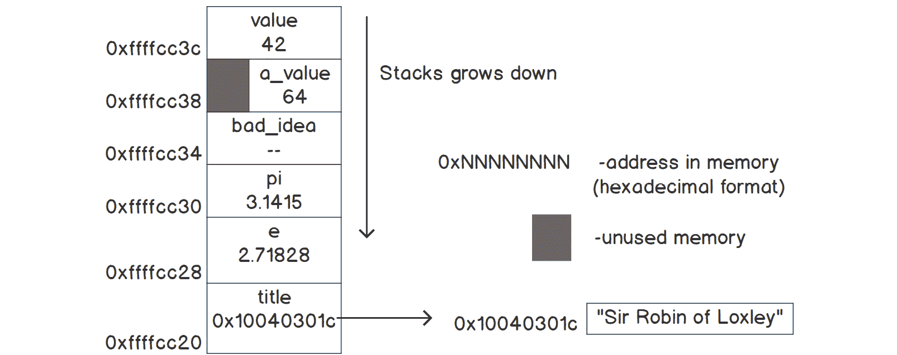

**图 2A.1：变量的内存布局**

编译器将按照我们声明变量的顺序分配内存。出现未使用的内存是因为编译器分配内存的方式使得基本类型通常能被原子访问，并为效率对齐到适当的内存边界。请注意，`title` 的类型是 `const char *`，这是一种 `pointer`（指针），我们将在下一节讨论它，连同 `const` 一起。字符串 `"Sir Robin of Loxley"` 将存储在内存的另一部分，该部分在程序加载时初始化。我们稍后将讨论程序内存。

对标量声明语法稍作修改，即可得到声明值数组的语法：

```
type-specifier ary[count];                       // 1. Default-initialized
type-specifier ary[count] = {comma-separated list}; // 2. Assignment initialized
type-specifier ary[count]{comma-separated list};    // 3. Brace-initialized
```

多维数组也可以这样做：

```
type-specifier ary2d[countX][countY];
type-specifier ary3d[countX][countY][countZ];
// etc...
```

请注意，前面声明中的 `count`、`countX` 和其他项目必须在编译期求值为常量，否则将导致错误。此外，逗号分隔的初始化列表中的项目数量必须小于或等于 `count`，否则同样会导致编译错误。在下一节中，我们将在练习中应用迄今所学的概念。

#### 注意

在解决本章中的任何实践之前，请下载本书的 GitHub 仓库 (`https://github.com/TrainingByPackt/Advanced-CPlusPlus`) 并在 Eclipse 中导入 Lesson 2A 文件夹，以便您可以查看每个练习和活动的代码。

### 练习 1：声明变量并探索大小

本练习将设置本章的所有练习，并让您熟悉声明和初始化内置类型的变量。您还将接触到 `auto declaration`（auto 声明）、`arrays`（数组）和 `sizeof`。让我们开始吧：

1. 打开 Eclipse（在 *第 1 章*、*可移植 C++ 软件的剖析* 中使用），如果出现启动器窗口，请点击 Launch（启动）。

2. 转到 **File**（文件），在 **New**（新建）**►** 下选择 **Project…**（项目……），然后选择 C++ Project（C++ 项目）（不是 C/C++ Project）。

3. 点击 **Next >**（下一步 >），清除 **Use default location**（使用默认位置）复选框，并输入 **Lesson2A** 作为 **Project name**（项目名称）。

4. 为 **Project Type**（项目类型）选择 **Empty Project**（空项目）。然后，点击 **Browse…**（浏览……）并导航到包含 Lesson2A 示例的文件夹。

5. 点击 **Open**（打开）以选择文件夹并关闭对话框。

6. 点击 **Next >**、**Next >**，然后点击 **Finish**（完成）。

7. 为了帮助您完成练习，我们将配置工作区在构建前自动保存文件。转到 **Window**（窗口）并选择 **Preferences**（首选项）。在 **General**（常规）下，展开 **Workspace**（工作区）并选择 **Build**（构建）。

8. 勾选 **Save automatically before build**（构建前自动保存）复选框，然后点击 **Apply and Close**（应用并关闭）。

9. 就像 *第 1 章*、*可移植 C++ 软件的剖析* 一样，这是一个基于 CMake 的项目，因此我们需要更改当前的构建器。在 **Project Explorer**（项目资源管理器）中点击 **Lesson2A**，然后在 **Project**（项目）菜单下选择 **Properties**（属性）。从左侧窗格中选择 C/C++ Build 下的 Tool Chain Editor（工具链编辑器），并将 Current builder（当前构建器）设置为 Cmake Build (portable)。

10. 点击 **Apply and Close**（应用并关闭）。然后，选择 **Project** | **Build All** 菜单项以构建所有练习。默认情况下，屏幕底部的控制台将显示 **CMake Console [Lesson2A]**（CMake 控制台 [Lesson2A]）：

     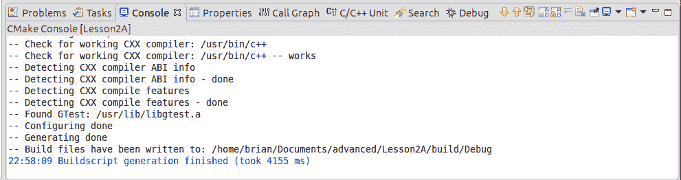

     **图 2A.2：CMake 控制台输出**

11. 在控制台右上角，点击 **Display Selected Console**（显示选定的控制台）按钮，然后从列表中选择 **CDT Global Build Console**（CDT 全局构建控制台）：

     

     **图 2A.3：选择不同的控制台**

     这将显示构建结果——应显示 0 个错误和 3 个警告：

     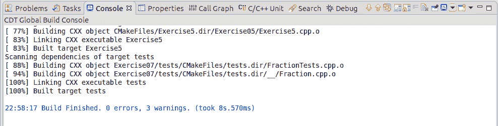

     **图 2A.4：构建过程控制台输出**

12. 由于构建成功，我们想要运行 Exercise1。在窗口顶部，点击显示 **No Launch Configurations**（无启动配置）的下拉列表：

     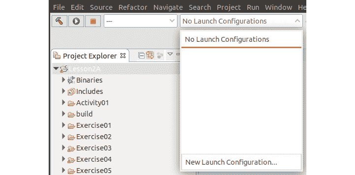

     **图 2A.5：启动配置菜单**

13. 点击 **New Launch Configuration…**（新建启动配置……）。保持默认值不变，然后点击 **Next >**（下一步 >）。

14. 将 **Name**（名称）更改为 **Exercise1**，然后点击 **Search Project**（搜索项目）：

     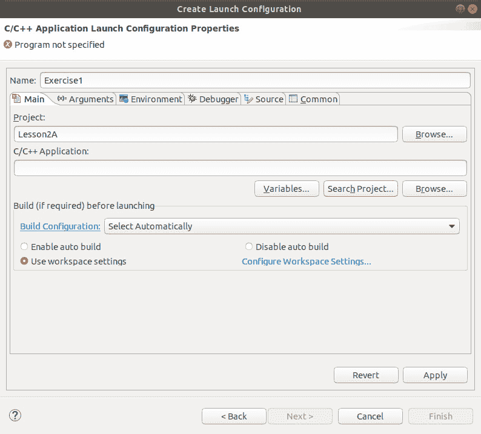

     **图 2A.6：Exercise1 启动配置**

15. 在 Binaries（二进制文件）窗口显示的程序列表中，点击 **Exercise1** 并点击 **OK**。

16. 点击 **Finish**（完成）。这将导致 exercise1 显示在 Launch Configuration（启动配置）下拉框中：

     

     **图 2A.7：更改启动配置**

17. 要运行 **Exercise1**，请点击 **Run**（运行）按钮。Exercise1 将执行并在控制台中显示其输出：

     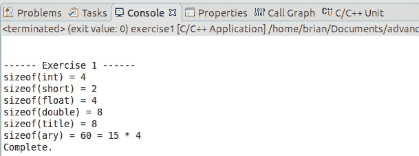

     **图 2A.8：练习 1 的输出**

     该程序没有任何实质功能——它只是输出您系统上各种类型的大小。但这表明该程序是有效的且可以编译。请注意，您系统上的数字可能不同（特别是 `sizeof(title)` 的值）。

18. 在 **Project Explorer**（项目资源管理器）中，展开 **Lesson2A**，然后展开 **Exercise01**，双击 **Exercise1.cpp** 以在编辑器中打开该练习的文件：

```
int main(int argc, char** argv)
{
    std::cout << "\n\n------ Exercise 1 ------\n";
    int value = 42;          // declare value to be an integer & initialize to 42
    short a_value{64};       // declare a_value to be a short integer &
                             // initialize to 64
    int bad_idea;            // declare bad_idea to be an integer and DO NOT
                             // initialize it. Use of this variable before
                             // setting it is UNDEFINED BEHAVIOUR.
    float pi = 3.1415F;      // declare pi to be a single precision floating
                             // point number and initialize it to pi.
    double e{2.71828};       // declare e to be a double precision floating point
                             // number and initialize it to natural number e.
    auto title = "Sir Robin of Loxley";
                             // Let the compiler determine the type
    int ary[15]{};           // array of 15 integers - zero initialized
    // double pi = 3.14159;   // step 24 - remove comment at front
    // auto speed;            // step 25 - remove comment at front
    // value = "Hello world"; // step 26 - remove comment at front
    // title = 123456789;     // step 27 - remove comment at front
    // short sh_int{32768};   // step 28 - remove comment at front
}
```


```cpp
std::cout << "sizeof(int) = " << sizeof(int) << "\n";

std::cout << "sizeof(short) = " << sizeof(short) << "\n";

std::cout << "sizeof(float) = " << sizeof(float) << "\n";

std::cout << "sizeof(double) = " << sizeof(double) << "\n";

std::cout << "sizeof(title) = " << sizeof(title) << "\n";

std::cout << "sizeof(ary) = " << sizeof(ary)
        << " = " << sizeof(ary)/sizeof(ary[0])
        << " * " << sizeof(ary[0]) << "\n";

std::cout << "Complete.\n";

return 0;

}
```

关于前面程序需要注意的一点是，`main` 函数的第一条语句实际上是一条可执行语句，而不是声明。C++ 允许你在几乎任何地方声明变量。它的前身 C 语言最初要求所有变量必须在任何可执行语句之前声明。

### 最佳实践

在尽可能接近变量使用位置的地方声明变量，并对其进行初始化。

19. 在编辑器中，通过删除行首的定界符（`//`），取消标记为 **步骤 24** 的行的注释：

```cpp
double pi = 3.14159;  // 步骤 24 - 删除行首注释
// auto speed;         // 步骤 25 - 删除行首注释
// value = "Hello world";// 步骤 26 - 删除行首注释
// title = 123456789;   // 步骤 27 - 删除行首注释
// short sh_int{32768}; // 步骤 28 - 删除行首注释
```

20. 再次单击 **运行** 按钮。这将导致程序再次构建。这一次，构建将因错误而失败：

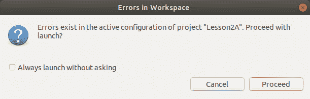

**图 2A.9：工作区错误对话框**

21. 单击 **取消** 关闭对话框。如果未显示 **CDT Build Console [Lesson2A]**，请将其选为活动控制台：

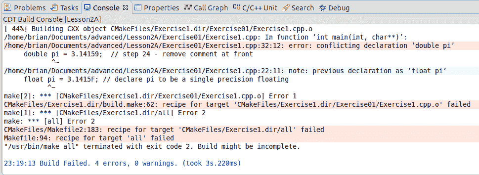

**图 2A.10：重复声明错误**

这一次，构建失败是因为我们尝试重新定义变量的类型，即 `pi`。编译器给出了关于我们需要在何处查看以修复它的有用信息。

22. 在行首恢复注释定界符。在编辑器中，通过删除行首的定界符（`//`），取消标记为 **步骤 25** 的行的注释：

```cpp
// double pi = 3.14159;  // 步骤 24 - 删除行首注释
auto speed;         // 步骤 25 - 删除行首注释
// value = "Hello world";// 步骤 26 - 删除行首注释
// title = 123456789;   // 步骤 27 - 删除行首注释
// short sh_int{32768}; // 步骤 28 - 删除行首注释
```

23. 再次单击 **运行** 按钮。当出现“工作区错误”对话框时，单击 **取消**：

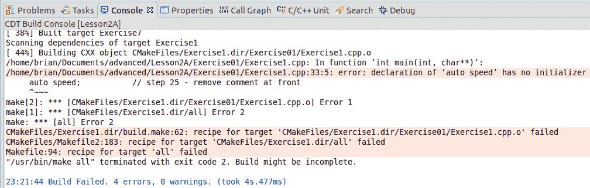

**图 2A.11：auto 声明错误 - 未初始化**

构建再次失败，但这一次，我们没有给编译器足够的信息来推导 `speed` 的类型 —— `auto` 类型的变量**必须**进行初始化。

24. 在行首恢复注释定界符。在编辑器中，通过删除行首的注释起始定界符（`//`），取消标记为 **步骤 26** 的行的注释：

```cpp
// double pi = 3.14159;  // 步骤 24 - 删除行首注释
// auto speed;         // 步骤 25 - 删除行首注释
value = "Hello world";// 步骤 26 - 删除行首注释
// title = 123456789;   // 步骤 27 - 删除行首注释
// short sh_int{32768}; // 步骤 28 - 删除行首注释
```

25. 再次单击 **运行** 按钮。当出现“工作区错误”对话框时，单击 **取消**：

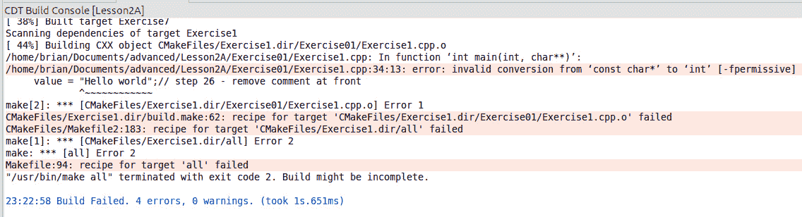

**图 2A.12：将不正确的值类型赋给变量**

这一次，构建失败是因为我们尝试赋错误类型的数据，即 `"Hello world"`（它是 `const char*`），给 `int` 类型的变量 `value`。

26. 在行首恢复注释定界符。在编辑器中，通过删除行首的定界符（`//`），取消标记为 **步骤 27** 的行的注释：

```cpp
// double pi = 3.14159;  // 步骤 24 - 删除行首注释
// auto speed;         // 步骤 25 - 删除行首注释
// value = "Hello world";// 步骤 26 - 删除行首注释
title = 123456789;   // 步骤 27 - 删除行首注释
// short sh_int{32768}; // 步骤 28 - 删除行首注释
```

27. 再次单击 **运行** 按钮。当出现“工作区错误”对话框时，单击 **取消**：

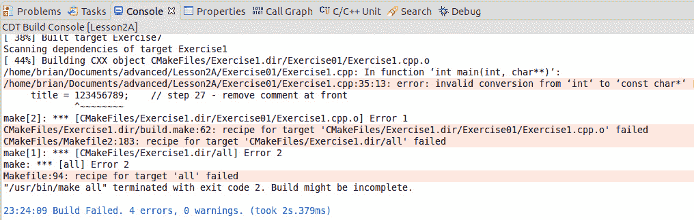

**图 2A.13：将不正确的值类型赋给 auto 变量**

构建再次失败，因为我们尝试赋错误类型的数据，即 `int` 类型的 `123456789`，给 `title`，后者是 `const char*`。这里有一点非常有用：`title` 是用 `auto` 类型声明的。编译器生成的错误消息告诉我们 `title` 被推导为 `const char*` 类型。

28. 在行首恢复注释定界符。在编辑器中，通过删除行首的定界符（`//`），取消标记为 **步骤 28** 的行的注释：

```cpp
// double pi = 3.14159;  // 步骤 24 - 删除行首注释
// auto speed;         // 步骤 25 - 删除行首注释
// value = "Hello world";// 步骤 26 - 删除行首注释
// title = 123456789;   // 步骤 27 - 删除行首注释
short sh_int{32768}; // 步骤 28 - 删除行首注释
```

29. 再次单击 **运行** 按钮。当出现“工作区错误”对话框时，单击 **取消**：

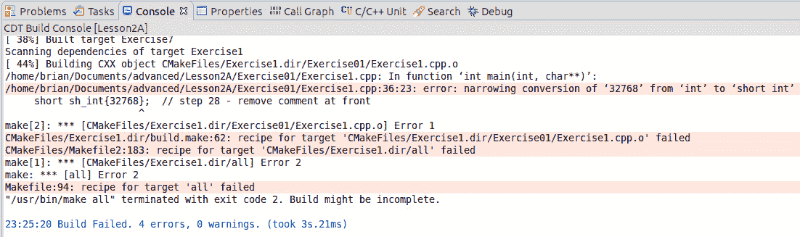

**图 2A.14：赋给变量的值太大，无法容纳**

构建再次失败，但这一次是因为我们尝试用 `32768` 初始化 `sh_int`，该值无法放入分配给 `short` 类型的内存中。`short` 占用两字节内存，被视为 16 位有符号量。这意味着 `short` 可存储的值范围是 `-2^(16-1)` 到 `2^(16-1)-1`，即 `-32768` 到 `32767`。

30. 将值从 `32768` 改为 `32767` 并单击 **运行** 按钮。这一次，程序编译并运行通过，因为该值可以用 `short` 表示。

31. 将值从 `32767` 改为 `-32768` 并单击 **运行** 按钮。同样，程序编译并运行通过，因为该值可以用 `short` 表示。

32. 在行首恢复注释定界符。在编辑器中，对基本类型及其关联字面量的变量声明进行你能想到的任何更改探索，然后根据需要多次单击 **运行** 按钮。检查构建控制台中的输出以查找任何错误消息，因为这可能有助你找到错误。

在本练习中，我们学习了如何设置 Eclipse 开发环境、实现变量声明，以及排查声明相关的问题。

## 指定类型 —— 函数

现在我们可以将变量声明为特定类型，我们需要对这些变量进行一些操作。在 C++ 中，我们通过调用函数来完成操作。函数是一系列产生结果的语句。该结果可能是一个数学计算（例如指数运算），然后被发送到文件或写入终端。


### C++ 中的函数

函数允许我们将解决方案分解为更易于管理和理解的语句序列。当我们编写这些打包好的语句时，可以在合适的地方重复使用它们。如果需要根据上下文以不同方式操作，则传入一个参数。如果它返回结果，则函数需要一个返回类型。

由于 C++ 是一种强类型语言，我们需要指定与所实现函数相关的类型——函数返回的值的类型（包括无返回值）以及传递给它的参数的类型（如果有）。

## Hello World 示例

以下是一个典型的 hello world 程序：

```cpp
#include <iostream>

void hello_world()
{
    std::cout << "Hello world\n";
}

int main(int argc, char** argv)
{
    std::cout << "Starting program\n";
    hello_world();
    std::cout << "Exiting program\n";
    return 0;
}
```

前面的示例中声明了两个函数——`hello_world()` 和 `main()`。`main()` 函数是有史以来每个 C++ 程序的**入口点**，它返回一个传递给宿主系统的 `int` 值。这被称为**退出代码**。

从返回类型声明一直到左大括号（`{`）之间的所有内容称为**函数原型**。它定义了三件事：返回类型、函数名称以及参数的数量和类型。

对于第一个函数，返回类型是 `void`——即不返回任何值；它的名字是 `hello_world`，且不接受参数：


**图 2A.15：不接受参数且无返回值的函数声明**

第二个函数返回一个 `int` 值，名为 `main`，并接受两个参数。这些参数分别是 `argc` 和 `argv`，类型分别为 `int` 和 `char**`（指向 `char` 的指针的指针）：


**图 2A.16：接受两个参数并返回 int 的函数声明**

函数原型之后的所有内容称为**函数体**。函数体包含变量声明和要执行的语句。

## 前向声明

函数必须在使用前声明——即编译器需要知道它的参数和返回类型。如果函数定义在调用它之后的同一个文件中，则可以通过在使用前提供函数的**前向声明**来解决此问题。

前向声明是通过将以分号结尾的函数原型放在调用它之前的文件中来完成的。对于 `hello_world()`，操作如下：

```cpp
void hello_world();
```

对于 `main` 函数，操作如下：

```cpp
int main(int, char**);
```

函数原型不需要参数名称，只需要类型。但是，为了帮助函数的使用者，保留它们是个好主意。

在 C++ 中，函数的定义可以在一个文件中，而需要从另一个文件中调用它。那么，第二个文件如何知道它想要调用的函数的原型呢？这是通过将前向声明放入一个称为**头文件**的单独文件中，并将其包含在第二个文件中来实现的。

## 练习 2：声明函数

在本练习中，我们将测试编译器在遇到函数调用时需要知道什么，并实现前向声明以解决未知函数的问题。

1. 在 Eclipse 中打开 **Lesson2A** 项目，然后在 **Project Explorer** 中展开 **Lesson2A**，再展开 **Exercise02**，双击 **Exercise2.cpp** 将该练习的文件在编辑器中打开。
2. 点击 **Launch Configuration** 下拉菜单并选择 **New Launch Configuration…**。
3. 配置 **Exercise2** 以名为 **Exercise2** 的方式运行。完成后，它将成为当前选定的 Launch Configuration。
4. 点击 **Run** 按钮。练习 2 将运行并产生以下输出：

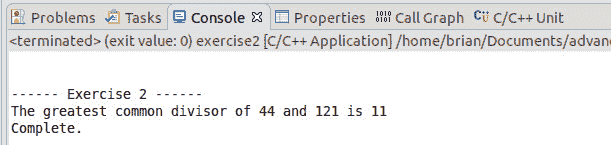

**图 2A.17：exercise2 程序的输出**

5. 进入编辑器并通过移动 `gcd` 函数使其位于 `main` 之后来更改代码。它应该如下所示：

```cpp
int main(int argc, char** argv)
{
    std::cout << "\n\n------ Exercise 2 ------\n";
    std::cout << "The greatest common divisor of 44 and 121 is " << gcd(44, 121) << "\n";
    std::cout << "Complete.\n";
    return 0;
}

int gcd(int x, int y)
{
    while (y != 0)
    {
        auto c { x % y };
        x = y;
        y = c;
    }
    return x;
}
```

6. 再次点击 **Run** 按钮。当出现 **Errors in Workspace** 对话框时，点击 **Cancel**。在 **CDT Build Console [Lesson2A]** 中，我们将看到失败的原因：

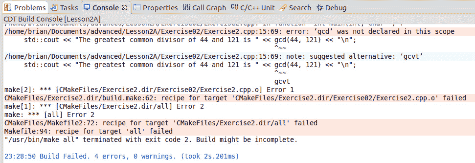

**图 2A.18：因未定义函数导致的构建失败**

这一次，编译器不知道如何处理对 `gcd()` 函数的调用。在需要调用它时，它对该函数一无所知，即使它定义在同一个文件中但位于调用之后。

7. 在编辑器中，在 `main` 函数定义之前放置前向声明。并在末尾添加分号（`;`）：

```cpp
int gcd(int x, int y);
```

8. 再次点击 **Run** 按钮。这一次，程序编译通过，原始输出得以恢复。

在本练习中，我们学习了如何前向声明函数，以及如何排查因函数在使用前未声明而导致的编译器错误。

在早期的 C 编译器版本中，这是可以接受的。程序会假设该函数存在并返回 `int`。函数的参数可以从调用中推断出来。然而，在现代 C++ 中情况并非如此，因为您必须在使用函数、类、变量等之前声明它们。

## 指针类型

由于其源于 C 语言——编写最优高效的系统并直接访问硬件——C++ 允许您将变量声明为**指针类型**。其格式如下：

```cpp
type-specifier* pvar = &var;
```

这与之前相同，除了两点：

* 使用特殊的声明符星号（`*`）来指示名为 `pvar` 的变量指向内存中的一个位置或地址。
* 使用特殊的运算符 Ampersand（`&`）进行初始化，在此上下文中它告诉编译器返回 `var` 变量的地址。

由于 C 是一种高级语言但具有低级访问能力，指针允许用户直接访问内存，这在我们希望向硬件提供输入/输出并从而控制硬件时很有帮助。指针的另一个用途是允许函数访问公共数据项，并在调用函数时消除复制大量数据的需要，因为默认情况下是按值传递。

要访问指针所指向的值，使用特殊的运算符星号（`*`）来**解引用**该位置：

```cpp
int five = 5;           // 声明 five 并初始化它
int *pvalue = &five;    // 声明 pvalue 为指向 int 的指针并使其
                        // 指向 five 的位置
*pvalue = 6;            // 将 6 赋值给 five 所在的位置。
```

下图显示了编译器如何分配内存。`pvalue` 需要内存来存储指针，而 `five` 需要内存来存储整数值 5：


**图 2A.19：指针变量的内存布局**


## 指针与资源管理

当通过指针访问用户定义类型时，有一个第二个特殊运算符（`->`），也用于解引用成员变量和函数。在现代 C++ 中，这些指针被称为**原始指针**，其使用方式已发生显著变化。在 C 和 C++ 中使用指针一直对程序员构成挑战，其错误使用是许多问题的根源，最常见的是资源泄漏。资源泄漏是指程序获取了资源（内存、文件句柄或其他系统资源）供自己使用，但在使用完毕后未能释放。这些资源泄漏可能导致性能问题、程序故障，甚至系统崩溃。自 C++11 引入智能指针以来，在现代 C++ 中使用原始指针管理资源所有权已被弃用。智能指针（作为 STL 中的类实现）现在负责做好宿主系统中良好公民所需的内部管理工作。更多内容将在《第 3 章：Can 和 Should 的距离——对象、指针与继承》中介绍。

在前面的代码中，声明 **`pvalue`** 时，编译器仅分配内存来存储其将引用的内存地址。与其他变量一样，应始终确保指针在使用前已初始化，因为解引用未初始化的指针会导致未定义行为。为存储指针而分配的确切内存量取决于编译器目标系统及处理器支持的位数。但无论指向何种类型，所有指针的大小都相同。

指针也可作为参数传递给函数。这允许函数访问被指向的数据并可能修改它。请看下面的 `swap` 实现：

```
void swap(int* data1, int* data2)
{
    int temp{*data1};          // Initialize temp from value pointed to by data1
    *data1 = *data2;           // Copy data pointed to by data2 into location
                               // pointed to by data1
    *data2 = temp;             // Store the temporarily cached value from temp
                               // into the location pointed to by data2
}
```

这展示了如何声明指针作为函数参数，如何使用解引用运算符 **`*`** 从指针获取值，以及如何通过解引用运算符设置值。

以下示例使用 `new` 运算符从宿主系统分配内存，并使用 `delete` 运算符将其释放回宿主系统：

```
char* name = new char[20];   // Allocate 20 chars worth of memory and assign it
                             // to name.
  Do something with name
delete[] name;
```

在前面的代码中，第一行使用 `new` 运算符的数组分配形式创建了一个 20 字符的数组。它调用宿主系统为我们分配 `20 * sizeof(char)` 字节的内存。实际分配多少内存由宿主系统决定，但保证至少为 `20 * sizeof(char)` 字节。如果无法分配所需内存，则会发生以下两种情况之一：

*   抛出异常
*   返回 **`nullptr`**。这是 C++11 引入的特殊字面量。早期 C++ 使用 `0` 或 `NULL` 表示无效指针。C++11 将其设为强类型值。

在大多数系统上，第一种结果最常见，你需要处理该异常。第二种结果可能源于两种场景：调用 `new` 的 `nothrow` 变体，即 **`new(std::nothrow) int[250]`**；或在嵌入式系统上，异常处理的开销不够确定性。

最后，注意 `delete` 调用使用了 `delete` 运算符的数组形式，即带方括号 **`[]`**。务必确保 `new` 和 `delete` 运算符使用相同形式。当 `new` 用于用户定义类型（将在下一节讨论）时，它不仅分配内存：

```
MyClass* object = new MyClass;
```

在前面的代码中，`new` 调用分配足以存储 `MyClass` 的内存，若成功，则继续调用构造函数初始化数据：

```
MyClass* objects = new MyClass[12];
```

在前面的代码中，`new` 调用分配足以存储 12 个 `MyClass` 副本的内存，若成功，则继续调用 12 次构造函数以初始化每个对象的数据。

注意，前面代码片段中声明的 **`object`** 和 **`objects`** 具有**相同类型**。严格来说，`objects` 应为 `MyClass` 数组的指针，但它实际上是 `MyClass` 实例的指针。`objects` 指向 `MyClass` 数组中的第一个实例。

请看下面的代码片段：

```
void printMyClasses(MyClass* objects, size_t number)
{
    for( auto i{0U} ; i<number ; i++ ) {
        std::cout << objects[i] << "\n";
    }
}

void process()
{
    MyClass objects[12];
    // Do something with objects
    printMyClasses(objects, sizeof(objects)/sizeof(MyClass));
}
```

在 `process()` 函数中，**`objects`** 的类型是“12 个 `MyClass` 项的数组”，但当它传递给 **`printMyClasses()`** 时，会被（编译器）转换为“指向 `MyClass` 的指针”类型。这是设计使然（继承自 C），称为**数组退化**，可能导致新程序员出错。我们可以尝试按如下方式声明 **`printMyClasses()`**：

```
void printMyClasses(MyClass objects[12], size_t number)
```

这仍会遭遇数组退化，因为编译器将参数 `objects` 改为 `MyClass*`；在这种情况下它不保留维度信息。数组退化就是我们需要将 `number` 传递给 **`printMyClasses()`** 函数的原因：以便知道数组中有多少项。C++ 提供两种机制处理数组退化：

*   使用迭代器将范围传递给方法。STL 容器（见《第 2B 章：不允许鸭子——模板与推导》中的“C++ 预打包模板”节）提供 **`begin()`** 和 **`end()`** 方法，以便获取迭代器，允许算法遍历数组或其部分。

    #### Note

    对于 C++20，ISO 标准委员会正在考虑引入称为 Ranges 的概念，这将允许在一个对象中同时捕获 `begin` 和 `end` 迭代器。

*   使用模板（见《第 2B 章：不允许鸭子——模板与推导》中的“非类型模板参数”节）。

## 练习 3：声明和使用指针

在本练习中，我们将实现接受指针和数组作为参数的函数，并在考虑数组退化的情况下比较它们的行为。开始吧：

1.  在 Eclipse 中打开 **`Lesson2A`** 项目，然后在 Project Explorer 中展开 **`Lesson2A`**，再展开 **`Exercise03`**，双击 **`Exercise3.cpp`** 以在编辑器中打开该练习文件。

2.  点击 **Launch Configuration** 下拉菜单，选择 **New Launch Configuration…**。配置 **`Exercise3`** 以名为 **`Exercise3`** 的方式运行。完成后，它将成为当前选中的 Launch Configuration。

3.  点击 **Run** 按钮。练习 3 将运行并产生以下输出：

    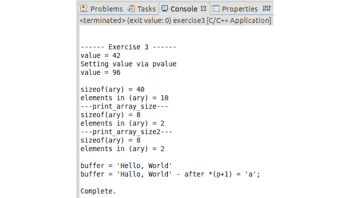

    ###### Figure 2A.20: Exercise 3 output

4.  在编辑器中插入一个空行，然后点击 **Run** 按钮。（通过更改文件，将强制构建系统重新编译 **`Exercise3.cpp`**。）

5.  如果我们现在查看 **CDT Global Build Console**，将看到编译器发出的两个警告：

    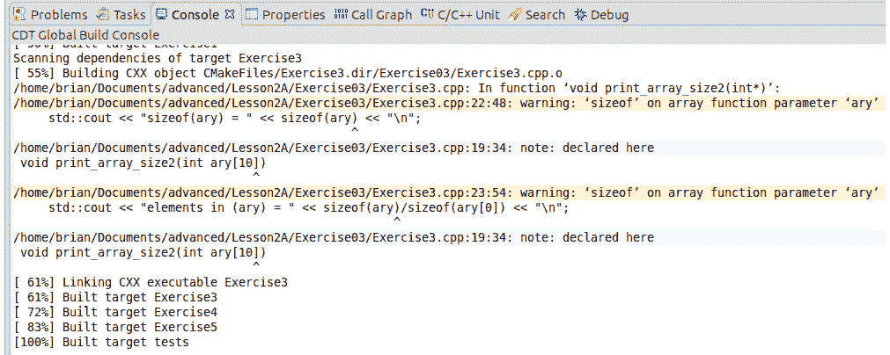

    ###### Figure 2A.21: Exercise 3 compiler warnings


## 练习 3：数组退化分析

前面的屏幕截图未显示完整的警告信息。此处使用的 `gcc` 编译器的完整警告如下：

```
exercise3.cpp:22:45: warning: 'sizeof' on array function parameter 'ary' will return size of 'int*' [-Wsizeof-array-argument]
```

该警告提供了关于导致问题的声明的更多信息。它追溯到以下函数：

```
void print_array_size2(int ary[10])
{
    std::cout << "---print_array_size2---\n";
    std::cout << "sizeof(ary) = " << sizeof(ary) << "\n";
    std::cout << "elements in (ary) = " << sizeof(ary)/sizeof(ary[0]) << "\n";
}
```

这里我们可以看到一个数组退化的例子——实际上是**意外的数组退化**。自 C 语言时代起，数组和指针几乎可以互换。因此，就编译器而言，传递给 `print_array_size2()` 的参数类型为 `int*`，这一点由警告中指出的 `sizeof` **将返回 'int*' 的大小**得到证实：

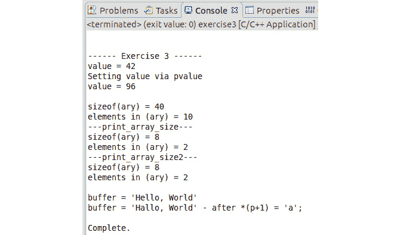

**图 2A.22：练习 3 部分输出**

`sizeof(ary)/sizeof(arg[0])` 计算应返回数组中的元素数量。第一个 `elements in (ary) = 10` 由 `main()` 函数生成，且 `ary` 声明为 `ary[10]`，因此是正确的。`---print_array_size2---` 标题下的 `elements in (ary) = 2` 显示了数组退化的问题以及编译器生成警告的原因。为什么值是 2？在测试 PC 上，指针占用 8 字节（64 位），而 `int` 仅占用 4 字节，所以得到 8/4 = 2。

## 步骤 6：修改数组声明

在编辑器中，找到 `main()` 中声明 `ary` 的那一行，并将其更改为以下内容：

```
int ary[15]{};
```

## 步骤 7：观察数组退化症状

点击**运行**按钮。如果你检查**CDT 全局构建控制台**，你会发现错误数量仍然相同。这是数组退化的另一个症状。假设我们有以下函数原型：

```
void print_array_size2(int ary[10])
```

你可能会预期尝试传递 `int ary[15]` 会导致错误或至少产生警告，因为参数原型不匹配。正如我们之前所述，编译器将参数视为 `int* ary`，因此该函数实际上可以声明为如下形式：

```
void print_array_size2(int* ary)
```

## 步骤 8：函数重定义错误

在编辑器中，将整个文件中的 `print_array_size2` 名称更改为 `print_array_size`。点击**运行**按钮。当出现“工作区错误”对话框时，点击**取消**。打开**CDT 全局构建控制台**并检查错误消息：

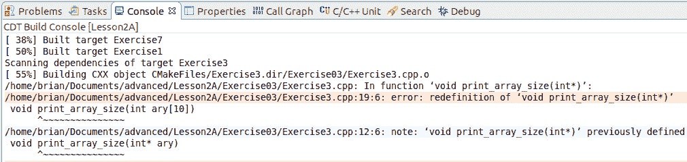

**图 2A.23：重定义错误**

这次，编译器生成了一个重定义错误，指向两个看起来参数类型不同的 `print_array_size` 方法——`int* ary` 和 `int ary[10]`。这证实了当作为函数参数使用时，`int ary[10]` 产生的效果与声明 `int* ary` 相同。

## 步骤 9：恢复原始状态

将文件恢复到原始状态。

## 步骤 10：Const 指针转换错误

在 `main()` 函数中，找到注释中包含**步骤 11** 的那一行，并删除行首的注释符号。点击**运行**按钮。当出现“工作区错误”对话框时，点击**取消**。打开**CDT 全局构建控制台**并检查错误消息：

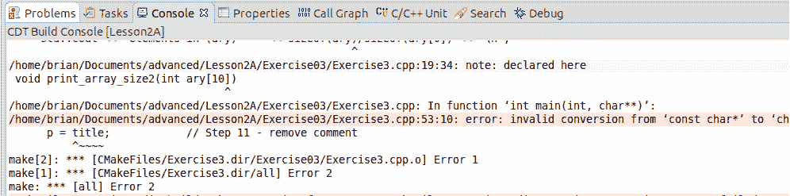

**图 2A.24：重定义错误**

完整错误消息如下：

```
exercise3.cpp:53:9: error: invalid conversion from 'const char*' to 'char*' [-fpermissive]
```

这发生的原因是编译器确定 `title` 的类型为 `const char*`，而 `p` 的类型为 `char*`。const 属性很重要。`p` 指针允许我们更改其指向的值。

## 步骤 11：修复指针赋值

查看以下行：

```
p = title;
```

将其更改为以下内容：

```
title = p;
```

## 步骤 12：构建成功

点击**运行**按钮。这次构建并运行正常。将非 const 指针赋值给 const 指针是可以的。

## 练习总结

在本练习中，我们了解到在将数组传递给函数时需要谨慎处理，因为关键信息（数组的大小）会在调用中丢失。

## 创建用户定义类型

C++ 的伟大之处在于你可以使用 `struct`、`class`、`enum` 或 `union` 创建自己的类型，编译器将在整个代码中将其视为基本类型。在本节中，我们将探讨创建自己的类型以及操作它所需的方法，以及编译器将为我们创建的一些方法。

## 枚举

最简单的用户定义类型是枚举。C++11 对枚举进行了改进，使其更加类型安全，因此我们必须考虑两种不同的声明语法。在了解如何声明它们之前，让我们先弄清楚为什么需要它们。请看以下代码：

```
int check_file(const char* name)
{
    FILE* fptr{fopen(name,"r")};
    if ( fptr == nullptr)
        return -1;
    char buffer[120];
    auto numberRead = fread(buffer, 1, 30, fptr);
    fclose(fptr);
    if (numberRead != 30)
        return -2;
    if(is_valid(buffer))
        return -3;
    return 0;
}
```

这典型地代表了许多 C 库函数，它们返回状态码，你需要查阅手册页才能知道它们的含义。在前面的代码中，`-1`、`-2`、`-3` 和 `0` 被称为**魔数**。你需要阅读代码才能理解每个数字的含义。现在，请看以下版本的代码：

```
FileCheckStatus check_file(const char* name)
{
    FILE* fptr{fopen(name,"r")};
    if ( fptr == nullptr)
        return FileCheckStatus::NotFound;
    char buffer[30];
    auto numberRead = fread(buffer, 1, 30, fptr);
    fclose(fptr);
    if (numberRead != 30)
        return FileCheckStatus::IncorrectSize;
    if(is_valid(buffer))
        return FileCheckStatus::InvalidContents;
    return FileCheckStatus::Good;
}
```

这使用枚举类来传达结果，并将含义附加到值的名称上。函数的使用者现在可以使用枚举，因为代码更易于理解和使用。因此，魔数（与状态相关）已被具有描述性标题的枚举值所取代。让我们通过参考以下代码片段来了解 `FileCheckStatus` 的声明：

```
enum FileCheckStatus      // 旧式枚举声明
{
    Good,                 // = 0 - 值默认为 0
    NotFound,             // = 1 - 值设置为比前一个大 1
    IncorrectSize,        // = 2 - 值设置为比前一个大 1
    InvalidContents,      // = 3 - 值设置为比前一个大 1
};
```

如果我们想使用魔数中的值，则可以这样声明它们：

```
enum FileCheckStatus      // 旧式枚举声明
{
    Good = 0,
    NotFound = -1,
    IncorrectSize = -2,
    InvalidContents = -3,
};
```

或者，通过调整顺序，我们可以设置第一个值，其余由编译器自动推导：

```
enum FileCheckStatus      // 旧式枚举声明
{
    InvalidContents = -3,     // 强制为 -3
    IncorrectSize,            // 设置为 -2(=-3+1)
    NotFound,                 // 设置为 -1(=-2+1)
    Good,                     // 设置为  0(=-1+1)
};
```

前面的函数也可以写成如下形式：

```
FileCheckStatus check_file(const char* name)
{
    FILE* fptr{fopen(name,"r")};
    if ( fptr == nullptr)
        return NotFound;
    char buffer[30];
    auto numberRead = fread(buffer, 1, 30, fptr);
    fclose(fptr);
    if (numberRead != 30)
        return IncorrectSize;
    if(is_valid(buffer))
        return InvalidContents;
    return Good;
}
```


## 作用域枚举（enum class）

请注意，代码中缺少作用域指示符 `FileCheckStatus::`，但它仍然可以编译并工作。这引出了作用域的问题，我们将在 *Chapter 2B*、*No Ducks Allowed – Templates and Deduction* 的 *Visibility, Lifetime, and Access* 一节中详细讨论。目前，只需知道每个类型和变量都有其作用域，而旧式枚举的问题在于它们的枚举项被添加到了与枚举本身相同的作用域中。

假设我们定义了如下两个枚举：

```
enum Result
{
    Pass,
    Fail,
    Unknown,
};

enum Option
{
    Keep,
    Discard,
    Pass,
    Play
};
```

现在我们遇到了一个问题：`Pass` 枚举项被定义了两次，且拥有两个不同的值。旧式枚举还允许我们编写编译有效但逻辑上显然荒谬的代码，例如下面这样：

```
Option option{Keep};
Result result{Unknown};

if (option == result)
{
    // Do something
}
```

既然我们致力于开发意图清晰、易于理解的代码，将 result 与 option 进行比较毫无意义。问题在于编译器会隐式地将值转换为整数，从而使得比较成为可能。

C++11 引入了一个被称为 **enum class** 或 **scoped enumeration**（作用域枚举）的新概念。前面代码的作用域枚举定义如下所示：

```
enum class Result
{
    Pass,
    Fail,
    Unknown,
};

enum class Option
{
    Keep,
    Discard,
    Pass,
    Play
};
```

这意味着前面的代码将不再编译通过：

```
Option option{Keep};        // error: must use scope specifier Option::Keep
Result result{Unknown};     // error: must use scope specifier Result::Unknown

if (option == result)       // error: can no longer compare the different types
{
    // Do something
}
```

顾名思义，**scoped enumeration**（作用域枚举）将枚举项置于枚举名称的作用域内。此外，作用域枚举将不再隐式转换为整数（因此 `if` 语句将无法编译）。你仍然可以将枚举项转换为整数，但需要显式转型：

```
int value = static_cast<int>(Option::Play);
```

## 练习 4：枚举——旧派与新派

在本练习中，我们将实现一个使用枚举来表示预定义值的程序，并确定将它们更改为作用域枚举时所需的相应修改。让我们开始吧：

1. 在 Eclipse 中打开 `Lesson2A` 项目，然后在 **Project Explorer**（项目资源管理器）中展开 `Lesson2A`，再展开 `Exercise04`，双击 `Exercise4.cpp` 在编辑器中打开该练习文件。

2. 点击 **Launch Configuration**（启动配置）下拉菜单并选择 **New Launch Configuration…**（新建启动配置……）。配置 `Exercise4` 以名称 `Exercise4` 运行。

3. 完成后，它将成为当前选中的启动配置。

4. 点击 **Run**（运行）按钮。练习 4 将运行并产生以下输出：

    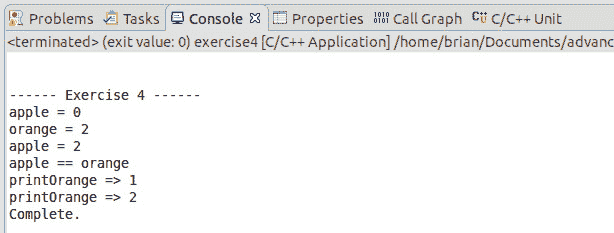

    ###### Figure 2A.25: Exercise 4 output

5. 检查编辑器中的代码。目前，我们可以比较苹果和橘子。在 `printOrange()` 的定义处，将参数类型改为 `Orange`：

    ```
    void printOrange(Orange orange)
    ```

6. 点击 **Run**（运行）按钮。当出现 Errors in Workspace（工作区错误）对话框时，点击 **Cancel**（取消）：

    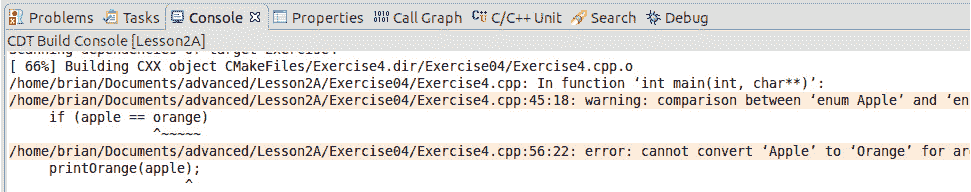

    ###### Figure 2A.26: Cannot convert error

    通过更改参数类型，我们强制编译器强制检查传递给函数的值的类型。

7. 分别传入 `orange` **enum** 变量和 `apple` 变量，调用 `printOrange()` 函数两次：

    ```
    printOrange(orange);
    printOrange(apple);
    ```

    这表明编译器隐式地将 orange 和 apple 转换为 `int` 以便调用该函数。同时，请注意关于比较 `Apple` 和 `Orange` 的警告。

8. 将 `printOrange()` 函数恢复为接受 `int` 参数，并将 `orange` **enum** 的定义更改为以下内容：

    ```
    enum class Orange;
    ```

9. 点击 **Run**（运行）按钮。当出现 Errors in Workspace（工作区错误）对话框时，点击 **Cancel**（取消）：

    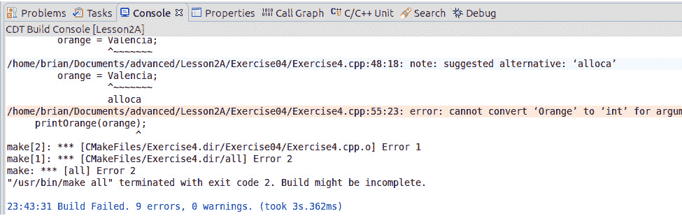

    ###### Figure 2A.27: Multiple errors for scoped enum changes

10. 定位此构建列出的第一个错误：

     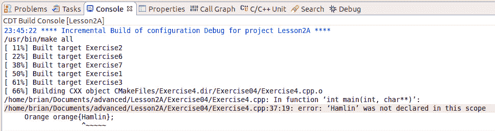

     ###### Figure 2A.28: First scoped enum error

11. 关于作用域枚举首先要注意的一点是，当你引用枚举项时，它们必须带有作用域指示符。因此，在编辑器中，将该行更改为以下内容：

     ```
     Orange orange{Orange::Hamlin};
     ```

12. 点击 **Run**（运行）按钮。当出现 Errors in Workspace（工作区错误）对话框时，点击 **Cancel**（取消）。好消息——错误数量从 9 个减少到了 8 个。查看控制台中的错误并定位第一个：

     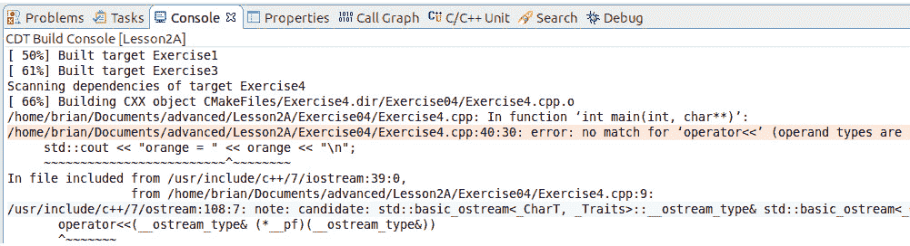

     ###### Figure 2A.29: Second scoped enum error

     该错误报告无法找到能够处理 `Orange` 类型的 `ostream` 插入运算符（`<<`）。因为这涉及基于模板的类（我们稍后会讨论），错误信息变得非常冗长。花一点时间查看从该错误到下一个错误（红色行）之间出现的所有信息。它展示了编译器为了编译该行尝试做了什么。

13. 将指示的行更改为以下内容：

     ```
     std::cout << "orange = " << static_cast<int>(orange) << "\n";
     ```

14. 点击 **Run**（运行）按钮。当出现 Errors in Workspace（工作区错误）对话框时，点击 **Cancel**（取消）。好消息——错误数量从 8 个减少到了 6 个。查看控制台中的错误并定位第一个：

     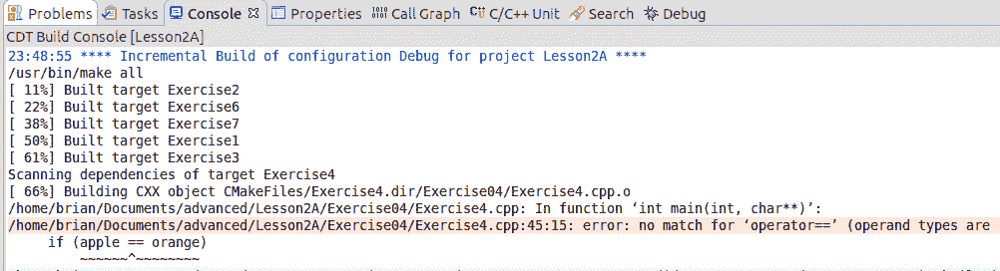

     ###### Figure 2A.30: Third scoped enum error

     该错误报告（终于）指出你无法比较苹果和橘子。此时，我们认为该程序试图做一些毫无意义的事情，因此没有必要尝试修复其余错误。我们可以通过再次转型为 `int` 来修复此错误，但下一个错误也需要转型。最后一个错误将是 `Valencia` 缺少 `Orange::` 作用域指示符。

15. 留作练习，让你尝试使文件在 `orange` 为作用域枚举的情况下重新编译通过。

在本练习中，我们发现作用域枚举改进了 C++ 的强类型检查，如果我们希望将它们作为整型值使用，则需要显式转型，这与非作用域枚举隐式转换形成对比。

### 编译器错误排查

正如前面的练习所见，编译器可能因一个错误而生成大量的错误和警告信息。这就是为什么建议先找到第一个错误并优先修复它。使用对错误进行颜色编码的 IDE 或构建系统可以让这项工作更轻松。

## 结构体与类

枚举是第一种用户定义类型，但它们并没有真正扩展语言，使我们能在适当的抽象层级表达问题的解决方案。然而，结构体和类允许我们捕获并分组数据，然后关联方法以一致且有意义的方式操作这些数据。

如果我们考虑两个矩阵 *A (m x n)* 和 *B (n x p)* 的乘法，其结果为矩阵 *C (m x p)*，则 C 的第 i 行第 j 列的计算公式如下：


###### Figure 2A.31: Equation of ith row and jth column


如果我们每次想要相乘两个矩阵都要编写这段代码，最终会得到许多嵌套的 for 循环。但如果我们能将矩阵抽象为一个类，那么我们就可以像表达两个整数或两个浮点数的乘法一样简单地表达它：

```cpp
Matrix a;

Matrix b;

// 初始化矩阵的代码

auto c = a * b;
```

这就是面向对象设计的美妙之处——数据封装和概念抽象在如此层面上得到解释，以至于我们可以轻松理解程序试图实现的目标，而不必陷入细节之中。一旦我们确定矩阵乘法已正确实现，我们就可以自由地专注于在更高层面上解决我们的问题。

后续的讨论涉及类，但同样适用于结构体，且大多适用于联合体。在我们学习如何定义和使用类之后，将概述类、结构体和联合体之间的区别。

## Fraction 类

为了向您展示如何定义和使用类，我们将致力于开发 `Fraction` 类来实现有理数。定义后，我们可以像使用任何其他内置类型一样使用 `Fraction`（加、减、乘、除），而无需担心细节——这就是抽象。我们现在可以在更高层面上，即抽象层面上思考和推理分数。

`Fraction` 类将执行以下操作：

*   包含两个整数成员变量，`m_numerator` 和 `m_denominator`
*   提供方法以复制自身、赋值、乘、除、加和减
*   提供方法以写入输出流

为了达到上述目标，我们有以下定义：

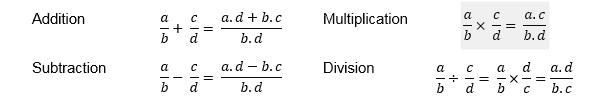

此外，我们执行的操作将需要通过约分到最简项来规范化分数。为此，分子和分母都要除以它们的最大公约数 (GCD)。

## 构造函数、初始化和析构函数

类定义（以 C++ 代码表示）是用于在内存中创建对象并通过其方法操作对象的模式。我们首先需要做的是告诉编译器我们想要声明一个新类型——一个类。要声明 `Fraction` 类，我们从以下内容开始：

```cpp
class Fraction
{
};
```

我们将其放在头文件 `Fraction.h` 中，因为我们希望在代码的其他区域复用此类规范。

接下来我们需要做的是引入要存储在类中的数据，在本例中为 `m_numerator` 和 `m_denominator`。它们都是 `int` 类型：

```cpp
class Fraction
{
  int m_numerator;
  int m_denominator;
};
```

我们现在已经声明了要存储的数据，并给它们起了名字，任何熟悉数学的人都能理解每个成员变量存储的内容：


由于这是一个类，默认情况下，任何声明的项都被假定为 `private`。这意味着没有外部实体可以访问这些变量。正是这种隐藏功能（使数据私有，同样也适用于某些方法）实现了 C++ 中的封装。C++ 有三种类访问修饰符：

*   `public`：这意味着成员（变量或函数）可以从类外部的任何地方访问。
*   `private`：这意味着成员（变量或函数）不能从类外部访问。事实上，甚至无法查看。私有变量和函数只能从类内部或通过友元方法或类访问。私有成员（变量和函数）由公有函数使用以实现所需功能。
*   `protected`：这是 private 和 public 之间的折中。从类外部来看，变量或函数是私有的。然而，对于任何从声明 protected 成员的类派生出的类，它们被视为公有。

在我们对类的定义此时，这不是很有用。让我们将声明更改为以下内容：

```cpp
class Fraction
{
public:
  int m_numerator;
  int m_denominator;
};
```

通过这样做，我们可以访问内部变量。`Fraction number;` 变量声明将导致编译器做两件事：

*   分配足够的内存以容纳两个数据项（根据类型，这可能涉及填充，即包含或添加未使用的内存以对齐成员以实现最高效的访问）。`sizeof` 运算符可以告诉我们为我们的类分配了多少内存。
*   通过调用 `default constructor`（默认构造函数）来初始化数据项。

这些步骤与编译器对内置类型所做的相同，即步骤 2 什么都不做，导致变量未初始化。但什么是默认构造函数？它有什么作用？

首先，默认构造函数是一个特殊的成员函数。它是众多可能的构造函数之一，其中三个被视为特殊成员函数。构造函数可以声明为零个、一个或多个参数，就像任何其他函数一样，但它们**不**指定返回类型。构造函数的特殊目的是初始化所有成员变量，将对象置于一个明确定义的状态。如果成员变量本身是一个类，则可能不需要指定如何初始化该变量。如果成员变量是内置类型，则我们需要为它们提供初始值。

## 类特殊成员函数

当我们定义一个新类型（结构体或类）时，编译器将为我们创建多达六 (6) 个特殊成员函数：

*   **默认构造函数** (`Fraction::Fraction()`)：当未提供参数时调用（如前一节所示）。这可以通过构造函数没有参数列表，或通过为所有参数定义默认值来实现，例如 `Fraction(int numerator=0, denominator=1)`。编译器提供一个 `implicit` `inline` 默认构造函数，对成员变量执行默认初始化——对于内置类型，这意味着什么都不做。
*   **析构函数** (`Fraction::~Fraction()`)：这是一个特殊的成员函数，在对象生命周期结束时调用。其目的是释放对象在其生命周期期间分配并保留的任何资源。编译器提供一个 `public` `inline` 成员函数，调用成员变量的析构函数。
*   **拷贝构造函数** (`Fraction::Fraction(const Fraction&)`)：这是另一个构造函数，其中第一个参数是 `Fraction&` 的一种形式且没有其他参数，或其余参数具有默认值。第一个参数的形式为 `Fraction&`、`const Fraction&`、`volatile Fraction&` 或 `const volatile Fraction&` 之一。我们稍后将处理 `const`，但本书不涉及 `volatile`。编译器提供一个 `non-explicit` `public` `inline` 成员函数，通常形式为 `Fraction::Fraction(const Fraction&)`，按初始化顺序复制每个成员变量。
*   **拷贝赋值** (`Fraction& Fraction::operator=(Fraction&)`)：这是一个名为 `operator=` 的成员函数，其第一个参数是类的值或任何引用类型，在本例中为 `Fraction`、`Fraction&`、`const Fraction&`、`volatile Fraction&` 或 `const volatile Fraction&`。编译器提供一个 `public` `inline` 成员函数，通常形式为 `Fraction::Fraction(const Fraction&)`，按初始化顺序复制每个成员变量。


## 移动构造函数和移动赋值

*   **移动构造函数** (`Fraction::Fraction(Fraction&&)`)：这是在 C++11 中引入的一种新类型的构造函数，其第一个参数是 `Fraction&&` 形式，且没有其他参数，或者其余参数具有默认值。第一个参数的形式可以是 `Fraction&&`、`const Fraction&&`、`volatile Fraction&&` 或 `const volatile Fraction&&` 之一。编译器提供一个 `non-explicit` `public` `inline` 成员函数，通常形式为 `Fraction::Fraction(Fraction&&)`，按照初始化顺序移动每个成员变量。

*   **移动赋值** (`Fraction& Fraction::operator=(Fraction&&)`)：这是在 C++11 中引入的一种新类型的赋值运算符，是一个名为 `operator=` 的成员函数，其第一个参数可以是移动构造函数允许的任何形式。编译器提供一个 `public` `inline` 成员函数，通常形式为 `Fraction::Fraction(Fraction&&)`，按照初始化顺序复制每个成员变量。

除 `默认构造函数` 外，这些函数处理管理该类所拥有的资源——即如何复制/移动它们以及如何销毁它们。另一方面，`默认构造函数` 更像是接受值的任何其他构造函数——它仅初始化资源。

我们可以声明这些特殊函数中的任意一个，强制它们被默认实现（即让编译器生成默认版本），或者强制它们不被创建。关于在存在其他特殊函数时何时自动生成这些函数，也有一些规则。前四个函数在概念上相对简单，但这两个“移动”特殊成员函数需要一些额外的解释。我们将在“第 3 章”“Can 和 Should 之间的距离——对象、指针和继承”中详细讨论所谓的移动语义，但目前它本质上正如其名——将某物从一个对象移动到另一个对象。

## 隐式与显式构造函数

前面的描述提到了编译器生成隐式或非显式构造函数。如果存在一个可以用一个参数调用的构造函数，例如 `拷贝构造函数` 或 `移动构造函数`，默认情况下，编译器被允许在必要时调用它，以便将其从一种类型转换为另一种类型，从而允许对表达式、函数调用或赋值进行编码。这并不总是期望的行为，我们可能希望阻止隐式转换，并确保如果我们的类的用户真的想要这种转换，他们必须在程序中显式写出。为了实现这一点，我们在构造函数声明前加上 `explicit` 关键字，如下所示：

```
explicit Fraction(int numerator, int denominator = 1);
```

`explicit` 关键字也可以应用于其他运算符，编译器可能会将其用于类型转换。

## 类特殊成员函数——编译器生成规则

首先，如果我们声明了任何其他形式的构造函数——`default`、`copy`、`move` 或 `user-defined`，则不会生成 `默认构造函数`。其他特殊成员函数均不影响其生成。

其次，如果声明了析构函数，则不会生成 `析构函数`。其他特殊成员函数均不影响其生成。

其他四个特殊函数的生成取决于 `析构函数` 或其他特殊函数之一的声明是否存在，如下表所示：

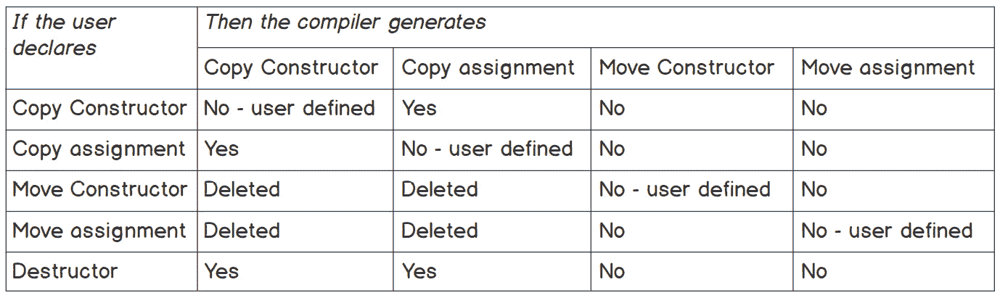

**图 2A.34：特殊成员函数生成规则**

## 特殊成员函数的默认实现与删除

在 C++11 之前，如果我们想阻止使用 `拷贝构造函数` 或 `拷贝赋值` 成员函数，则必须将该函数声明为 `private` 且不提供函数定义：

```cpp
class Fraction
{
public:
  Fraction();
private:
  Fraction(const Fraction&);
  Fraction& operator=(const Fraction&);
};
```

通过这种方式，我们确保如果有人试图从类外部访问 `拷贝构造函数` 或 `拷贝赋值`，编译器会生成错误，指出该函数不可访问。这仍然声明了这些函数，并且它们可以从类内部访问。这是一种有效但不完美的方法，用于移除这些特殊成员函数的使用。

但自 C++11 起，我们可以做得更好，它引入了两种新的声明形式，允许我们覆盖编译器的默认行为，如前面的规则所定义。

首先，我们可以通过使用 `= delete` 后缀声明来强制编译器不生成该方法，如下所示：

`Fraction(const Fraction&) = delete;`

> **注意**
> 如果参数未被使用，我们可以省略参数名称。这适用于任何函数或成员函数。事实上，根据编译器设置的警告级别，它甚至可能会生成一条警告，指出参数未被使用。

或者，我们可以通过使用 `= default` 后缀强制编译器生成特殊成员函数的默认实现，如下所示：

`Fraction(const Fraction&) = default;`

如果这只是函数的声明，我们也可以省略参数名称。虽然，良好的实践要求我们命名参数以表明其用途。这样，我们类的用户就不需要查看调用该函数的实现细节。

> **注意**
> 就上述规则而言，使用 `default` 后缀声明特殊成员函数被视为 `user-defined` 成员函数。

## 三/五法则与零法则

正如我们之前讨论的，除 `默认构造函数` 外，特殊成员函数处理管理该类所拥有资源的语义——即如何复制/移动它们以及如何销毁它们。这导致了 C++ 社区中关于处理特殊函数的两条“法则”。

在 C++11 之前，有 `三法则`，涉及 `拷贝构造函数`、`拷贝赋值运算符` 和 `析构函数`。它基本上指出，由于封装资源的管理是非平凡的，我们需要实现其中的一个方法。

随着 C++11 中 `移动构造函数` 和 `移动赋值运算符` 的引入，该法则扩展为 `五法则`。法则的本质没有改变。只是特殊成员函数的数量增加到了五个。记住编译器生成规则，确保所有五个特殊方法都被实现（或通过 `= default` 强制实现）还有一个额外的原因：如果编译器无法访问 `move-semantic` 函数，它将尝试使用 `copy-semantic` 函数，这可能不是期望的行为。

> **注意**
> 更多详情请参阅 C++ 核心指南中的 `C.ctor: Constructors, assignments, and destructors` 部分，网址为：[`isocpp.github.io/CppCoreGuidelines/CppCoreGuidelines`](http://isocpp.github.io/CppCoreGuidelines/CppCoreGuidelines)。

## 构造函数——初始化对象

构造函数的主要任务是将对象置于稳定状态，以便通过其成员函数对对象执行的任何操作都能产生一致的定义行为。虽然前面的陈述对 `拷贝` 和 `移动构造函数` 也适用，但它们通过不同的语义（从另一个对象复制或移动）来实现这一点。


## C++ 对象初始化机制

我们有四种不同的机制来控制对象的初始状态。C++ 对于在特定情况下使用哪种初始化有许多规则。我们不会深入探讨 C++ 标准中的默认初始化、零初始化、值初始化、常量初始化等细节。只需知道，最好的方法是显式地初始化你的变量。

## 第一种机制：在构造函数体中赋值

**第一种**且最不推荐的初始化机制是在构造函数体中给成员变量赋值，如下所示：

```cpp
Fraction::Fraction()
{
    this->m_numerator = 0;
    this->m_denominator = 1;
}

Fraction::Fraction(int numerator, int denominator)
{
    m_numerator = numerator;
    m_denominator = denominator;
}
```

清楚地知道用什么值初始化变量。严格来说，这不是类的初始化——根据标准，当调用构造函数体时初始化就完成了。这对于维护很简单，特别是在这个类中。对于拥有多个构造函数和许多成员变量的大型类，这可能成为维护问题。如果你修改了一个构造函数，你需要修改所有构造函数。如果成员变量是引用类型（稍后讨论），则不能在构造函数体中完成。

默认构造函数使用 `this` 指针。每个成员函数（包括构造函数和析构函数）都带有一个隐式参数（尽管从未声明）——`this` 指针。`this` 指向当前对象实例。`->` 运算符是另一个解引用运算符，在此处是 `*(this).m_numerator` 的简写。使用 `this->` 是可选的，可以省略。其他语言（如 Python）要求声明并使用隐式指针/引用（Python 的约定称为 `self`）。

## 第二种机制：成员初始化列表

**第二种**机制是使用成员初始化列表，其使用有一个注意事项。对于 `Fraction` 类，我们有以下代码：

```cpp
Fraction::Fraction() : m_numerator(0), m_denominator(1)
{
}

Fraction::Fraction(int numerator, int denominator) :
    m_numerator(numerator), m_denominator(denominator)
{
}
```

冒号 `:` 之后、左大括号 `{` 之前的代码段（即 `m_numerator(0), m_denominator(1)` 和 `m_numerator(numerator), m_denominator(denominator)`）是成员初始化列表。我们可以在成员初始化列表中初始化引用类型。

### 成员初始化列表顺序

无论你在成员初始化列表中以何种顺序放置成员，编译器都将按照它们在类中声明的顺序初始化成员。

## 第三种机制：默认成员初始化（C++11）

**第三种**且**推荐**的初始化是 C++11 引入的默认成员初始化。我们在变量声明时使用赋值或大括号初始化器定义默认初始值：

```cpp
class Fraction
{
public:
    int m_numerator = 0;    // 赋值初始化器
    int m_denominator{1};   // 大括号初始化器
};
```

如果构造函数未定义成员变量的初始值，则使用此默认值初始化变量。这的优势在于确保所有构造函数产生相同的初始化，除非在构造函数定义中显式修改。

## 第四种机制：构造函数委托（C++11）

C++11 还引入了第四种初始化风格，称为构造函数委托。它是成员初始化列表的一种修改，不是列出成员变量及其初始值，而是调用另一个构造函数。以下示例是人为构造的，你不会这样编写类，但它展示了构造函数委托的语法：

```cpp
Fraction::Fraction(int numerator) : m_numerator(numerator), m_denominator(1)
{
}

Fraction::Fraction(int numerator, int denominator) : Fraction(numerator)
{
    auto factor = std::gcd(numerator, denominator);
    m_numerator /= factor;
    m_denominator = denominator / factor;
}
```

你从双参数构造函数中调用单参数构造函数。

## 练习 5：声明并初始化 Fraction

在本练习中，我们将使用可用的不同技术实现类成员初始化，包括构造函数委托。开始吧：

1. 在 Eclipse 中打开 **Lesson2A** 项目，然后在 **Project Explorer** 中展开 **Lesson2A**，再展开 **Exercise05**，双击 **Exercise5.cpp** 在编辑器中打开该练习文件。
2. 点击 **Launch Configuration** 下拉菜单并选择 **New Launch Configuration…**。配置 **Exercise5** 以名为 Exercise5 运行。
3. 完成后，它将成为当前选中的 Launch Configuration。
4. 点击 **Run** 按钮。**Exercise 5** 将运行并产生类似以下输出：

    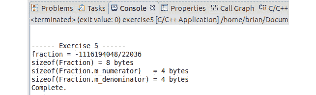

    **Figure 2A.35: Exercise 5 typical output**

    报告的分数值来自于未以任何方式初始化成员变量。如果再次运行，你很可能会得到不同的分数。

5. 多次点击 **Run** 按钮。你将看到分数发生变化。
6. 在编辑器中，将构造函数更改为如下所示：

    ```cpp
    Fraction() : m_numerator{0}, m_denominator{1}
    {
    }
    ```

7. 点击 **Run** 按钮并观察输出：

    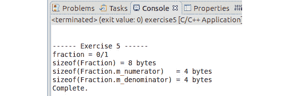

    **Figure 2A.36: Modified Exercise 5 output**

    这次，分数值由我们在成员初始化列表中指定的值定义。

8. 在编辑器中，添加以下两个**构造函数**：

    ```cpp
    Fraction(int numerator) : m_numerator(numerator), m_denominator(1)
    {
    }

    Fraction(int numerator, int denominator) : Fraction(numerator)
    {
        auto factor = std::gcd(numerator, denominator);
        m_numerator /= factor;
        m_denominator = denominator / factor;
    }
    ```

9. 在 `main` 函数中，更改 `fraction` 的声明以包含初始化：

    ```cpp
    Fraction fraction{3,2};
    ```

10. 点击 **Run** 按钮并观察输出：

    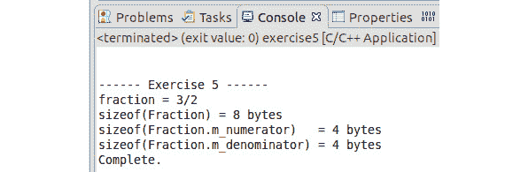

    **Figure 2A.37: Example of constructor delegation**

在本练习中，我们使用成员初始化列表和构造函数委托实现了成员变量初始化。*我们将在练习 7《为 Fraction 类添加运算符》中回到分数。*

## 值与引用和 Const

到目前为止，我们只处理了值类型，即变量持有对象的值。指针持有一个值（即对象的地址），这是我们感兴趣的（或 `nullptr`）。但这可能导致效率低下和资源管理问题。我们将在这里解决效率问题，但在*第 3 章*《Can 和 Should 之间的距离——对象、指针和继承》中处理资源管理问题。

考虑以下问题。我们有一个 `double` 类型的 10×10 矩阵，希望为其编写一个求逆函数。类声明如下：

```cpp
class Matrix10x10
{
private:
    double m_data[10][10];
};
```

如果我们获取 `sizeof(Matrix10x10)`，将得到 `sizeof(double)` × 10 × 10 = 800 字节。现在，如果我们为其实现一个求逆矩阵函数，其签名可能如下所示：

```cpp
Matrix10x10 invert(Matrix10x10 lhs);

Matrix10x10 mat;
// set up mat
Matrix10x10 inv = invert(mat);
```


## 按值传递与按引用传递

## 按值传递的问题

首先，这意味着编译器需要将 `mat` 所持有的值传递给 `invert()` 函数，并将 800 字节复制到栈上。该函数接着执行反转矩阵所需的任何操作（L-U 分解、行列式计算——无论实现者选择哪种方法），然后将 800 字节的结果复制回 `inv` 变量。在栈上传递大值从来都不是好主意，原因有二：

*   栈是由宿主操作系统分配给我们程序的有限资源。
*   在系统中到处复制大值效率低下。

这种方法称为按值传递。即，我们希望处理的项目的值被复制到函数中。

## C/C++ 中的指针

在 C（和 C++）中，通过使用指针来解决这一限制。前面的代码可能变为如下形式：

```
void invert(Matrix10x10* src, Matrix10x10* inv);

Matrix10x10 mat;
Matrix10x10 inv;

// 设置 mat
invert(&mat, &inv);
```

在这里，我们只将 `src` 的地址和用于存储逆矩阵结果的目标地址作为两个指针传递（这只是少量字节）。不幸的是，这导致函数内部的代码每次使用 `src` 或 `inv` 时都必须使用解引用运算符（`*`），使代码更难阅读。此外，指针的使用导致了许多问题。

## C++ 中的引用

C++ 引入了一种更好的方法——变量别名或引用。引用类型使用 `&` 运算符声明。因此，我们可以按如下方式声明 `invert` 方法：

```
void invert(Matrix10x10& src, Matrix10x10& inv);

Matrix10x10 mat;
Matrix10x10 inv;

// 设置 mat
invert(mat, inv);
```

请注意，调用该方法不需要特殊运算符来传递引用。从编译器的角度来看，引用仍然是一个指针，但有一个限制——它不能持有 `nullptr`。从程序员的角度来看，引用让我们能够推理代码，而无需担心在正确的位置放置正确的解引用运算符。这称为按引用传递。

我们看到引用被传递给了拷贝构造函数和拷贝赋值方法。当用于其移动等价物时，引用的类型被称为 `rvalue reference operators`（右值引用运算符），将在*第 3 章*、*能与该做的距离——对象、指针和继承*中解释。

## 引用的 Const 正确性

按值传递的一个优点是，我们无法无意中修改传入方法的变量的值。现在，如果我们按引用传递，就无法保证所调用的方法不会修改原始变量。为了解决这个问题，我们可以将 `invert` 方法的签名更改为如下形式：

```
void invert(const Matrix10x10& src, Matrix10x10& inv);
```

`const` 关键字告诉编译器，在处理 `invert()` 函数的定义时，给 `src` 所引用的值的任何部分赋新值都是非法的。如果该方法试图修改 `src`，编译器将生成错误。

在“指定类型——变量”部分，我们发现 `auto title` 的声明导致 `title` 成为 `const char *` 类型。现在，我们可以解释 `const` 部分了。

`title` 变量是一个指向常量 char 的指针。换句话说，我们无法更改指向内存中存储的数据的值。因此，我们不能执行以下操作：

```
*title = 's';
```

这是因为编译器将生成与更改常量值相关的错误。然而，我们可以更改存储在指针中的值。允许我们执行以下操作：

```
title = "Maid Marian";
```

## 引用作为成员变量

我们现在已经了解了用作函数参数类型的引用，但它们也可以用作成员变量，代替指针。引用和指针之间存在差异：

*   引用必须指向一个实际对象（没有 `nullptr` 的等价物）。
*   引用一旦初始化就不能更改（这导致引用必须要么进行默认成员初始化，要么出现在成员初始化列表中）。
*   对象必须在引用存在的整个期间都存在（如果对象可能在引用销毁之前被销毁，则如果尝试访问该对象，会导致未定义行为的可能性）。

## 练习 6：声明和使用引用类型

在本练习中，我们将声明和使用引用类型，使代码高效且易于阅读。让我们开始吧：

1.  在 Eclipse 中打开 `Lesson2A` 项目，然后在 `Project Explorer` 中展开 `Lesson2A`，再展开 `Exercise06`，双击 `Exercise6.cpp` 在编辑器中打开该练习文件。
2.  点击 `Launch Configuration` 下拉菜单并选择 `New Launch Configuration…`。配置 `Exercise6` 以名称 Exercise6 运行。
3.  完成后，它将成为当前选定的 Launch Configuration。
4.  点击 `Run` 按钮。练习 6 将运行并产生类似以下的输出：

    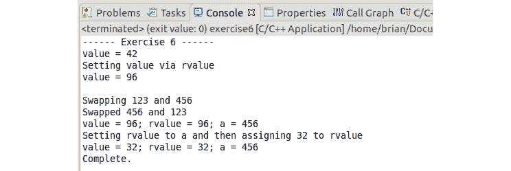

    **图 2A.38：练习 6 输出**

    通过检查代码并将其与输出进行比较，我们将发现 `rvalue` 变量允许我们操作（读取和写入）存储在 `value` 变量中的数据。我们有一个指向 `value` 变量的引用 `rvalue`。我们还可以看到，`a` 和 `b` 变量中存储的值被 `swap()` 函数交换了。

5.  在编辑器中，更改 swap 的函数定义：

    ```
    void swap(const int& lhs, const int& rhs)
    ```

6.  点击 `Run` 按钮。当出现“Errors in Workspace”对话框时，点击 `Cancel`。编译器报告的第一个错误如下所示：

    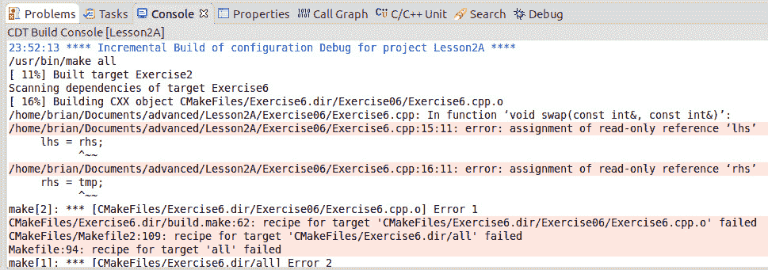

    **图 2A.39：赋值时的只读错误**

    通过将参数从 `int& lhs` 改为 `const int& lhs`，我们告诉编译器参数不应在该函数内部被更改。因为我们在函数中给 `lhs` 赋值，编译器生成关于 `lhs` 为只读的错误并终止。

## 实现标准运算符

要像使用内置类一样使用分数，我们需要它们能与标准数学运算符（`+`、`-`、`*`、`/`）及其赋值对应运算符（`+=`、`-=`、`*=`、`/=`）配合工作。如果您不熟悉赋值运算符，请考虑以下两个表达式——它们产生相同的输出：

```
a = a + b;
a += b;
```

为 `Fraction` 声明这两个运算符的语法如下：

```
// 成员函数声明
Fraction& operator+=(const Fraction& rhs);
Fraction operator+(const Fraction& rhs) const;
// operator+ 的普通函数声明
Fraction operator+(const Fraction& lhs, const Fraction& rhs);
```

因为 `operator+=` 方法修改左侧变量的内容（将 `a` 加到 `b` 并再次存储在 `a` 中），建议将其作为成员变量实现。在这种情况下，因为我们没有创建新值，可以只返回对现有 `lhs` 的引用。

另一方面，`operator+` 方法不应修改 `lhs` 或 `rhs`，并应返回一个新对象。实现者可以自由地将其作为成员函数或自由函数实现。前面的代码展示了这两种方式，但只应存在一种。值得注意的是成员函数实现中声明末尾的 `const` 关键字。这告诉编译器，当调用此成员函数时，它不会修改对象的内部状态。虽然两种方法都有效，但如果可能，`operator+` 应作为普通函数在类外部实现。


同样的方法可用于其他运算符 `-`（减法）、`*`（乘法）和 `/`（除法）。前面的方法实现了标准数学运算符的语义，使我们的类型表现得像内置类型一样。

### 实现输出流运算符 (<<)

C++ 将输入/输出 (I/O) 抽象为标准库中的流类层次结构（我们将在 *第 2B 章*、*不允许鸭子类型 – 模板与推导* 中讨论这一点）。在 *练习 5*、*声明并初始化分数* 中，我们看到可以按如下方式将分数插入输出流：

```cpp
std::cout << "fraction = " << fraction.getNumerator() << "/"
          << fraction.getDenominator() << "\n";
```

到目前为止，对于我们的 `Fraction` 类，我们通过使用 `getNumerator()` 和 `getDenominator()` 方法从外部访问数据值来写出分子和分母的值，但有一种更好的方法可以做到这一点。作为使我们的类成为 C++ 中一等公民的一部分，在合理的情况下，我们应该重载 I/O 运算符。在本章中，我们将只关注输出运算符 `<<`，也称为插入运算符。这样，我们就可以用一个更简洁的版本替换之前的代码：

```cpp
std::cout << "fraction = " << fraction << "\n";
```

我们可以将运算符重载为友元函数或普通函数（如果类提供了我们需要插入的数据的 getter 函数）。为了我们的目的，我们将其定义为普通函数：

```cpp
inline std::ostream& operator<< (std::ostream &out, const Fraction &rhs)
{
    out << rhs.getNumerator() << " / " << rhs.getDenominator();
    return out;
}
```

### 构建我们的代码结构

在我们深入练习实现运算符并将 `Fraction` 变成 C++ 世界中成熟的类型之前，我们需要简要讨论一下将类的各个部分（声明和定义）放在哪里。声明是类的蓝图，它指明了类需要什么数据存储以及将实现哪些方法。定义是每个方法的实际实现细节。

在 Java 和 C# 等语言中，声明和定义是同一个东西，并且它们必须存在于一个文件中 (Java) 或跨多个文件 (C# 部分类)。在 C++ 中，根据类以及你希望向其他类暴露多少内容，声明 **必须** 出现在头文件中（可以在其他文件中通过 `#include` 来使用），而定义可以出现在三个位置之一——内联在定义中、与定义在同一文件中作为 `inline`、或在单独的实现文件中。

头文件通常命名为 `.hpp` 扩展名，而实现文件通常是 `*.cpp` 或 `*.cxx` 之一。实现文件也称为 **翻译单元**。通过将函数定义为 `inline`，我们允许编译器以一种方式优化代码，即该函数甚至可能不存在于最终程序中——它将我们放入函数中的步骤替换到了调用该函数的位置。

### 练习 7：为 Fraction 类添加运算符

在本练习中，我们旨在使用单元测试在 `Fraction` 类中实现运算符以开发功能。这使我们的 `Fraction` 类成为一个真正的类型。让我们开始吧：

1.  在 Eclipse 中打开 `Lesson2A` 项目，然后在 `Project Explorer`（项目资源管理器）中展开 `Lesson2A`，再展开 `Exercise07`，双击 `Exercise7.cpp` 在编辑器中打开该练习的文件。

2.  点击 `Launch Configuration`（启动配置）下拉菜单并选择 `New Launch Configuration…`（新建启动配置……）。配置 `Exercise7` 以名称 `Exercise7` 运行。

3.  完成后，它将成为当前选中的 `Launch Configuration`（启动配置）。

4.  我们还需要配置一个单元测试。在 Eclipse 中，点击名为 `Run` | `Run Configurations…`（运行 | 运行配置……）的菜单项，右键点击左侧的 `C/C++ Unit`，然后选择 `New Configuration`（新建配置）。

5.  将名称从 `Lesson2A Debug` 改为 `Exercise7 Tests`。

6.  在 `C/C++ Application`（C/C++ 应用程序）下，选择 `Search Project`（搜索项目）选项，并在新对话框中选择 `tests`。

7.  接下来，转到 `C/C++ Testing`（C/C++ 测试）选项卡，在下拉菜单中选择 `Google Tests Runner`。点击对话框底部的 `Apply`（应用），然后点击测试的 `Run`（运行）选项，这是我们第一次必须运行它：

    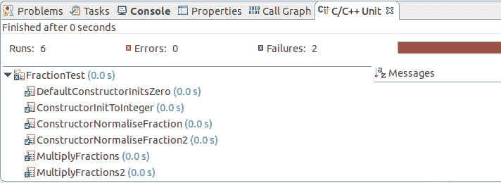

    *图 2A.40：失败的测试 – 乘法*

8.  在编辑器中打开 `Fraction.cpp` 文件并找到 `operator*=` 函数。用以下代码更新它：

    ```cpp
    Fraction& Fraction::operator*=(const Fraction& rhs)
    {
        Fraction tmp(m_numerator*rhs.m_numerator, m_denominator*rhs.m_denominator);
        *this = tmp;
        return *this;
    }
    ```

9.  点击 `Run`（运行）按钮重新运行测试。这次，所有测试都通过了：

    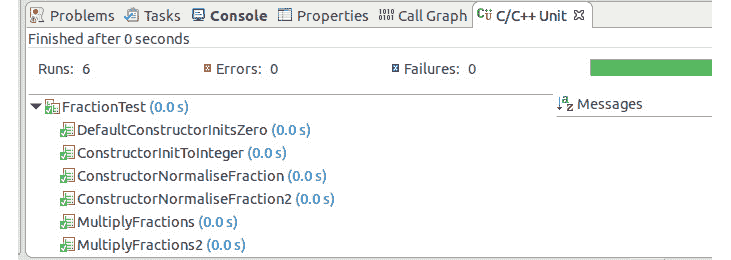

    *图 2A.41：通过的测试*

10. 在 IDE 中打开 `tests/FractionTests.cpp` 文件，找到那两个失败的测试。一个测试 `operator*=()`，另一个测试 `operator*()`。修复 `operator*=()` 是如何修复 `operator*()` 的？如果你在编辑器中打开 `Fraction.hpp`，你会发现 `operator*()` 函数已经为你实现了，它通过调用 `operator*=()` 来实现，也就是说，它被标记为 `inline`，并且是一个普通函数，而不是成员函数。通常，重载这些运算符时采用这种方法——修改调用它的对象的那个是成员函数，而必须生成新值的那个是调用成员函数的普通函数。

11. 在编辑器中打开 `Fraction.hpp` 并更改文件顶部附近的行，使其如下所示：

    ```cpp
    #define EXERCISE7_STEP  11
    ```

12. 点击 `Run`（运行）按钮重新运行测试——这次，我们又添加了两个失败的测试——`AddFractions` 和 `AddFractions2`：

    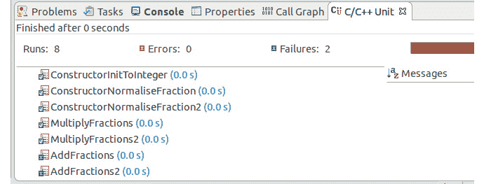

    *图 2A.42：新增的失败测试*

13. 在 `Fraction.cpp` 文件中找到 `operator+=` 函数。

14. 对该函数进行必要的更改，然后点击 `Run`（运行）按钮重新运行测试，直到测试通过。查看前面给出的定义其运算的方程式，看看 `operator*=()` 是如何实现的。

15. 在编辑器中打开 `Fraction.hpp` 并更改文件顶部附近的行，使其如下所示：

    ```cpp
    #define EXERCISE7_STEP  15
    ```

16. 点击 `Run`（运行）按钮重新运行测试——这次，我们又添加了两个失败的测试——`SubtractFractions` 和 `SubtractFractions2`。

17. 在 `Fraction.cpp` 文件中找到 `operator-=` 函数。

18. 对该函数进行必要的更改，然后点击 `Run`（运行）按钮重新运行测试，直到测试通过。

19. 在编辑器中打开 `Fraction.hpp` 并更改文件顶部附近的行，使其如下所示：

    ```cpp
    #define EXERCISE7_STEP  19
    ```

20. 点击 `Run`（运行）按钮重新运行测试——这次，我们又添加了两个失败的测试——`DivideFractions` 和 `DivideFractions2`。

21. 在 `Fraction.cpp` 文件中找到 `operator/=` 函数。

22. 对该函数进行必要的更改，然后点击 `Run`（运行）按钮重新运行测试，直到测试通过。

23. 在编辑器中打开 `Fraction.hpp` 并更改文件顶部附近的行，使其如下所示：

    ```cpp
    #define EXERCISE7_STEP  23
    ```

24. 点击 `Run`（运行）按钮重新运行测试——这次，我们又添加了一个失败的测试——`InsertOperator`。

25. 在 `Fraction.hpp` 文件中找到 `operator<<` 函数。

26. 对该函数进行必要的更改，然后点击 `Run`（运行）按钮重新运行测试，直到测试通过。


27. 从 `Launch Configuration` 中选择 `Exercise7` 并点击 `Run` 按钮。这将产生以下输出：

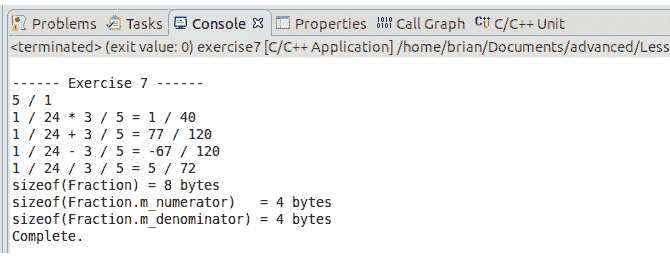

**图 2A.43：函数式 Fraction 类**

这完成了我们目前对 `Fraction` 类的实现。当我们在《第 3 章：能做与该做的距离 — 对象、指针和继承》中讨论异常时，将再次回到它，以便处理分数中的非法值（分母为 0）。

### 函数重载

C++ 支持一种称为函数重载的特性，即两个或多个函数具有相同的名称，但它们的参数列表不同。参数的数量可以相同，但至少有一个参数的类型必须不同。或者，它们可能具有不同数量的参数。因此，这些函数的函数原型是不同的。然而，两个函数不能具有相同的函数名、相同的参数类型和不同的返回类型。以下是一个重载示例：

```cpp
std::ostream& print(std::ostream& os, int value) {
    os << value << " is an int\n";
    return os;
}

std::ostream& print(std::ostream& os, float value) {
    os << value << " is a single precision float\n";
    return os;
}

std::ostream& print(std::ostream& os, double value) {
    os << value << " is a double precision float \n";
    return os;
}

// 下一个函数会导致编译器生成错误
// 因为它仅在返回类型上不同
void print(std::ostream& os, double value) {
    os << value << " is a double precision float!\n";
}
```

到目前为止，`Fraction` 上的多个构造函数和重载的算术运算符都是编译器在遇到这些函数之一时必须引用的重载函数示例。考虑以下代码：

```cpp
int main(int argc, char** argv) {
    print(42);
}
```

当编译器遇到 `print(42)` 这一行时，它需要确定调用之前定义的哪个函数，因此它执行以下过程（极度简化）：

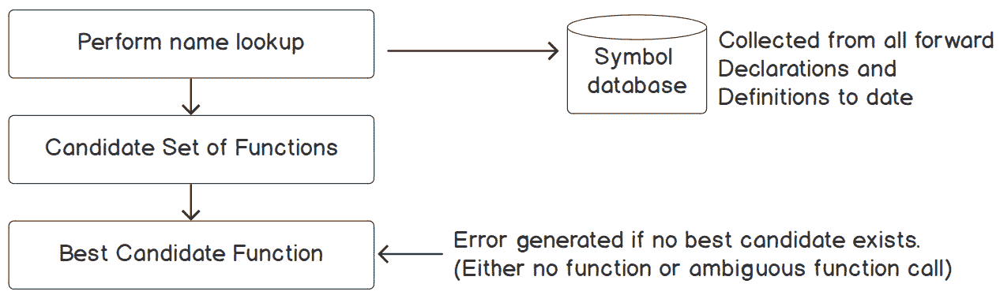

**图 2A.44：函数重载决议（简化版）**

C++ 标准定义了编译器根据如何操作（即转换）参数以获得匹配来确定最佳候选函数的规则。如果不需要转换，则该函数是最佳匹配。

### 类、结构体和联合体

当你定义一个类且未指定访问修饰符（public、protected、private）时，所有成员默认将为 private：

```cpp
class Fraction
{
    Fraction() {};        // 所有这些都是 private
    int m_numerator;
    int m_denominator;
};
```

当你定义一个结构体且未指定访问修饰符（public、protected、private）时，所有成员默认将为 public：

```cpp
struct Fraction
{
    Fraction() {};        // 所有这些都是 public
    int m_numerator;
    int m_denominator;
};
```

还有一个区别，我们将在解释继承和多态后再看。联合体是一种不同于结构体和类的数据构造，但又是相同的。联合体是一种特殊的结构体声明，其中所有成员占用相同的内存，并且在给定时间只有一个成员是有效的。`union` 声明的示例如下：

```cpp
union variant
{
    int m_ivalue;
    float m_fvalue;
    double m_dvalue;
};
```

当你定义一个联合体且未指定访问修饰符（public、protected、private）时，所有成员默认将为 public。

联合体的主要问题是没有内在的方法来知道在任何给定时间哪个值是有效的。这通过定义所谓的 *tagged union*（标记联合体）来解决——即一个包含联合体和一个枚举的结构体，该枚举标识哪个是有效值。还有其他关于联合体中可以和不可以包含什么的限制（例如，只能有一个成员具有默认成员初始化器）。我们将不会在本书中深入探讨联合体。

### 活动 1：图形处理

在现代计算环境中，矩阵被广泛用于解决各种问题——求解联立方程、分析电力网格或电路、为图形渲染执行对象操作以及提供机器学习实现。在图形世界中，无论是二维（2D）还是三维（3D），你想要在对象上执行的所有操作都可以通过矩阵乘法来完成。你的团队被赋予了开发点、变换矩阵以及你可能想要对它们执行的操作的表示的任务。请遵循以下步骤来实现这一点：

1.  从 `Lesson2A/Activity01` 文件夹加载准备好的项目。
2.  创建一个名为 `Point3d` 的类，它可以默认构造为原点，或使用包含三个或四个值的初始化列表构造（数据直接存储在类中）。
3.  创建一个名为 `Matrix3d` 的类，它可以默认构造为单位矩阵，或使用嵌套初始化列表提供所有值（数据直接存储在类中）。
4.  在 `Point3d` 上重载 `operator()`，使其接受 `index` 参数，以返回 `x(0)`、`y(1)`、`z(2)` 和 `w(3)` 处的值。
5.  在 `Matrix3d` 上重载 `operator()` 以接受 `row, col` 参数，从而返回该值。
6.  添加单元测试以验证上述所有功能。
7.  向 `Matrix3d` 类添加 `operator*=(const Matrix3d&)` 和 `operator==(const Matrix3d&)`，以及它们的单元测试。
8.  添加用于相乘两个 `Matrix3d` 对象以及 `Matrix3d` 对象乘以 `Point3d` 对象的自由函数，并附带单元测试。
9.  添加用于创建平移、缩放和旋转（绕 x、y、z 轴）矩阵的独立方法及其单元测试。

实现上述步骤后，预期输出如下：

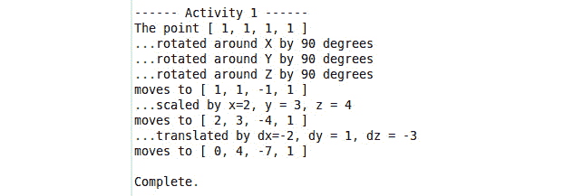

**图 2A.45：活动程序成功运行**

为了本活动的目的，我们将不担心索引越界的可能性。我们将在《第 3 章：能做与该做的距离 — 对象、指针和继承》中讨论这一点。单位矩阵是一个方阵（在我们的例子中为 4 x 4），其中对角线上的所有值都设置为 1，所有其他值为 0。

在使用 3D 图形时，我们对点（顶点）和变换使用增广矩阵，以便所有变换（平移、缩放、旋转）都可以通过乘法来实现。

`n × m` 矩阵是一个包含 n 行 m 个数字的数组。例如，一个 `2 x 3` 矩阵可能如下所示：


**图 2A.46：2x3 矩阵**

三维空间中的顶点可以表示为 `three-tuple (x,y,z)`。然而，我们用另一个纵坐标 `w`（顶点为 `=1`，方向为 `=0`）对其进行增广，使其成为 `four-tuple (x, y, z, 1)`。我们不使用元组，而是将其放在一个 `4 x 1` 矩阵中，如下所示：


**图 2A.47：4x1 矩阵**

如果我们用 `4 x 4` 矩阵（变换）乘以 `4 x 1` 矩阵（点），就可以操作该点。如果 `Ti` 表示一个变换，那么我们可以将变换相乘以实现对点的某种操作：


**图 2A.48：变换相乘**

要相乘变换矩阵 `A x P = B`，我们执行以下操作：


**图 2A.49：变换矩阵相乘**


###### 图 2A.49：变换矩阵相乘

我们也可以这样表示：


###### 图 2A.50：变换相乘的表达式

同样地，两个 **4 x 4** 矩阵相乘也可以这样做，**AxB=C**：

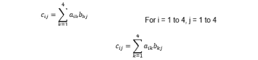

###### 图 2A.51 4x4 矩阵乘法的表达式：

变换的矩阵如下：

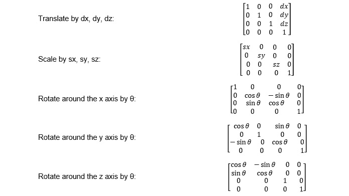

###### 图 2A.52：变换矩阵列表

#### 注

此活动的解答见第 635 页。

## 总结

在本章中，我们学习了 C++ 中的类型。首先，我们涉及了内置类型，然后学习了如何创建表现得像内置类型一样的自定义类型。我们学习了如何声明和初始化变量，窥探了编译器从源代码生成的内容、变量存放的位置、链接器如何将它们组合在一起，以及这些在计算机内存中的样子。我们学习了一些关于 `Rule of Zero`（零法则）和 `Rule of Five`（五法则）的 C++ 部落智慧。这些构成了 C++ 的基石。在下一章中，我们将探讨使用 C++ 模板创建函数和类，并进一步探索适用于模板的类型推导。

# 2B. 禁止鸭子类型 —— 模板与推导

## 学习目标

读完本章后，你将能够：

*   利用继承和多态更有效地开发自己的类
*   实现别名以使代码更易读
*   使用 `SFINAE` 和 `constexpr` 开发模板以简化代码
*   使用 `STL` 实现自己的解决方案以利用泛型编程
*   描述类型推导的上下文和基本规则

本章将展示如何通过继承、多态和模板来定义和扩展你的类型。

## 简介

在上一章中，我们学习了如何在单元测试的帮助下开发自己的类型（类），并使它们表现得像内置类型一样。我们接触了函数重载、`Rule of Three/Five`（三/五法则）和 `Rule of Zero`（零法则）。

在本章中，我们将学习如何进一步扩展类型系统。我们将学习如何使用模板创建函数和类，并重新审视函数重载，因为它受模板使用的影响。我们将接触一项新技术 **SFINAE**，并用它来控制模板中哪些部分包含在生成的代码中。

## 继承、多态与接口

到目前为止，在我们的面向对象设计和 C++ 之旅中，我们专注于抽象和数据封装。现在我们将把注意力转向 **继承** 和 **多态**。什么是继承？什么是多态？为什么我们需要它？请考虑以下三个对象：


###### 图 2B.1：车辆对象

在前面的图表中，我们可以看到有三个截然不同的对象。它们有一些共同点。它们都有轮子（数量不同）、发动机（大小、功率或配置不同）、`StartEngine()`、`Drive()`、`ApplyBrakes()`、`StopEngine()` 等，我们可以使用这些来做一些事情。

因此，我们可以将它们抽象为一种称为“车辆”的东西，它展示了这些属性和通用行为。如果用 C++ 类来表示，可能如下所示：

```cpp
class Vehicle
{
public:
    Vehicle() = default;
    Vehicle(int numberWheels, int engineSize) :
        m_numberOfWheels{numberWheels}, m_engineSizeCC{engineSize}
    {
    }
    bool StartEngine()
    {
        std::cout << "Vehicle::StartEngine " << m_engineSizeCC << " CC\n";
        return true;
    };
    void Drive()
    {
        std::cout << "Vehicle::Drive\n";
    };
    void ApplyBrakes()
    {
        std::cout << "Vehicle::ApplyBrakes to " << m_numberOfWheels << " wheels\n";
    };
    bool StopEngine()
    {
        std::cout << "Vehicle::StopEngine\n";
        return true;
    };

private:
    int m_numberOfWheels {4};
    int m_engineSizeCC{1000};
};
```

`Vehicle` 类是 `Motorcycle`（摩托车）、`Car`（汽车）和 `Truck`（卡车）更泛化（或抽象）的表达。现在我们可以通过复用 `Vehicle` 类中已有的内容来创建更特化的类型。我们将通过继承来复用 `Vehicle` 的属性和方法。继承的语法如下：

```cpp
class DerivedClassName : access_modifier BaseClassName
{
    // Body of DerivedClass
};
```

我们之前遇到过 `public`、`protected` 和 `private` 等访问修饰符。它们控制我们如何访问基类的成员。`Motorcycle` 类将按如下方式派生：

```cpp
class Motorcycle : public Vehicle
{
public:
    Motorcycle(int engineSize) : Vehicle(2, engineSize) {};
};
```

在这种情况下，`Vehicle` 类被称为 **基类** 或 **超类**，而 `Motorcycle` 类被称为 **派生类** 或 **子类**。图形上可以表示如下，箭头从派生类指向基类：


###### 图 2B.2：车辆类层次结构

但摩托车的驾驶方式与通用车辆不同。因此，我们需要修改 `Motorcycle` 类，使其表现不同。更新后的代码如下：

```cpp
class Motorcycle : public Vehicle
{
public:
    Motorcycle(int engineSize) : Vehicle(2, engineSize) {};
    void Drive()
    {
        std::cout << "Motorcycle::Drive\n";
    };
};
```

如果我们考虑面向对象设计，这是关于用协作的对象来建模问题空间。这些对象通过消息相互通信。现在，我们有两个类以不同的方式响应同一个消息（`Drive()` 方法）。消息发送者不知道会发生什么，也不关心，这就是多态的本质。

#### 注

多态源自希腊语 poly 和 morph，其中 **poly** 意为多，**morph** 意为形态。因此，多态意味着 **具有多种形态**。

我们现在可以使用这些类来尝试多态：

```cpp
#include <iostream>

int main()
{
    Vehicle vehicle;
    Motorcycle cycle{1500};
    Vehicle* myVehicle{&vehicle};
    myVehicle->StartEngine();
    myVehicle->Drive();
    myVehicle->ApplyBrakes();
    myVehicle->StopEngine();
    myVehicle = &cycle;
    myVehicle->StartEngine();
    myVehicle->Drive();
    myVehicle->ApplyBrakes();
    myVehicle->StopEngine();
    return 0;
}
```

如果我们编译并运行此程序，将得到以下输出：


###### 图 2B.3：车辆程序输出

在前面的截图中，**Vehicle::StartEngine 1500 cc** 这一行之后的行都与 `Motorcycle` 相关。但 `Drive` 行仍显示 **Vehicle::Drive**，而不是预期的 **Motorcycle::Drive**。这是怎么回事？问题在于我们没有告诉编译器 `Vehicle` 类中的 `Drive` 方法可以被派生类修改（或重写）。我们需要在代码中做一处更改：

```cpp
virtual void Drive()
{
    std::cout << "Vehicle::Drive\n";
};
```

通过在成员函数声明前添加 `virtual` 关键字，我们告诉编译器派生类可以（但不必）重写或替换该函数。如果我们做这个更改，然后编译并运行程序，将得到以下输出：


###### 图 2B.4：带有虚方法的车辆程序输出


# 继承与多态的最佳实践

现在，我们已经学习了继承和多态。我们使用指向 `Vehicle` 类的指针来控制 `Motorcycle` 类。作为最佳实践，还应对代码进行另一项更改。我们还应按如下方式更改 `Motorcycle` 中 `Drive` 函数的声明：

```cpp
void Drive() override
{
  std::cout << "Motorcycle::Drive\n";
};
```

C++11 引入了 `override` 关键字作为给编译器的提示，表明特定方法应与其父类树中的某个方法具有相同的函数原型。如果找不到，编译器将报告错误。这是一个非常有用的功能，能为你节省数小时的调试时间。如果有办法让编译器报告错误，就使用它。缺陷发现得越早，修复起来就越容易。最后一项更改是，每当我们向类添加虚函数时，必须将其析构函数声明为 `virtual`：

```cpp
class Vehicle
{
public:
  // Constructors - hidden
  virtual ~Vehicle() = default;  // Virtual Destructor
  // Other methods and data -- hidden
};
```

我们在 `Drive()` 函数变为虚函数之前就看到了这种情况。当通过指向 `Vehicle` 的指针调用析构函数时，它需要知道该调用哪个析构函数。因此，将其设为 `virtual` 可实现此目的。如果未能这样做，可能会导致资源泄漏或对象切片。

## 继承与访问说明符

如前所述，从超类继承一个子类的一般形式如下：

`class DerivedClassName : access_modifier BaseClassName`

当我们从 `Vehicle` 类派生 `Motorcycle` 类时，使用以下代码：

`class Motorcycle : public Vehicle`

访问修饰符是可选的，是我们之前遇到的几种之一：`public`、`protected` 和 `private`。在下表中，你可以看到基类成员的可访问性。如果省略 `access_modifier`，则编译器假定指定了 `private`。

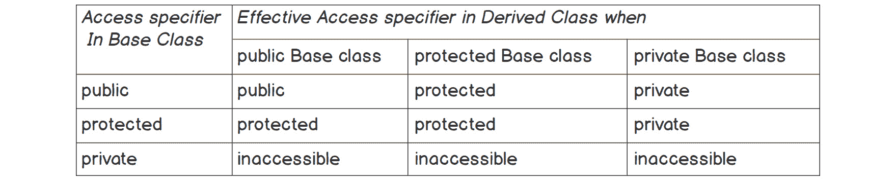

图 2B.5：派生类中基类成员的可访问性

## 抽象类与接口

到目前为止我们讨论的所有类都是 `concrete class`（具体类/实例化类） —— 它们可以作为变量的类型被实例化。还有另一种类型的类 —— `abstract class`（抽象类） —— 它至少包含一个 `pure virtual member function`（纯虚成员函数）。纯虚函数是在类中没有定义（或实现）的虚函数。因为它没有实现，所以该类是不完整的（或抽象的），无法被实例化。如果你尝试创建一个抽象类型的变量，编译器将生成错误。

要声明纯虚成员函数，请在函数原型声明末尾加上 `= 0`。要使 `Drive()` 成为 `Vehicle` 类中的纯虚函数，我们按如下方式声明：

`virtual void Drive() = 0;`

现在，要想将派生类用作变量类型（例如 `Motorcycle` 类），它必须定义 `Drive()` 函数的实现。

但是，你可以声明一个变量为指向抽象类的指针或指向抽象类的引用。无论哪种情况，它必须指向或引用某个从抽象类派生的非抽象类。

在 Java 中，有一个 `interface` 关键字，允许你定义一个全是纯虚函数的类。在 C++ 中，通过声明一个仅包含 `public` 纯虚函数（和一个 `virtual` 析构函数）的类来实现相同的效果。这样，我们就定义了一个接口。

### 注意

在解决本章中的任何实践练习之前，请下载本书的 GitHub 仓库（[`github.com/TrainingByPackt/Advanced-CPlusPlus`](https://github.com/TrainingByPackt/Advanced-CPlusPlus)），并在 Eclipse 中导入 Lesson 2B 的文件夹，以便查看每个练习和活动的代码。

## 练习 1：使用多态实现游戏角色

在本练习中，我们将演示继承、接口和多态。我们将从角色扮演游戏的临时实现开始，并将其演变为更通用、可扩展的版本。让我们开始吧：

1. 打开 Eclipse，使用 `Lesson2B` 示例文件夹中的文件创建一个名为 `Lesson2B` 的新项目。
2. 因为这是一个 `CMake-based project`（基于 CMake 的项目），将当前构建器更改为 `Cmake Build (portable)`。
3. 转到 `Project | Build All` 菜单以构建所有练习。默认情况下，屏幕底部的控制台将显示 `CMake console [Lesson2B]`。
4. 配置一个名为 `L2BExercise1` 的 `New Launch Configuration`（新启动配置），用于运行 `Exercise1` 二进制文件，然后点击 `Run` 以构建并运行 `Exercise 1`。你将获得以下输出：

   

   图 2B.6：练习 1 默认输出

5. 在编辑器中打开 `Exercise1.cpp` 并检查现有代码。你会注意到这三个角色被实现为单独的类，并且它们各自被实例化和操作，通过直接调用 `speak()` 和 `act()`。这对于小程序来说没问题。但随着游戏角色增加到几十或几百个，它将变得难以管理。因此，我们需要抽象所有角色。将以下接口声明添加到文件顶部：

   ```cpp
   class ICharacter
   {
   public:
       ~ICharacter() {
           std::cout << "Destroying Character\n";
       }
       virtual void speak() = 0;
       virtual void act() = 0;
   };
   ```

   通常析构函数应该是空的，但这里添加了日志记录以显示行为。

6. 从该接口类派生 `Wizard`、`Healer` 和 `Warrior` 类，并在每个类的 `speak()` 和 `act()` 函数声明末尾添加 `override` 关键字：

   `class Wizard : public ICharacter { ...`

7. 点击 `Run` 按钮以重新构建并运行练习。现在我们将看到基类析构函数也在派生类析构函数之后被调用：

   

   图 2B.7：修改后程序的输出

8. 创建角色并在诸如 `vector` 之类的容器中管理它们。在文件中 `main()` 函数之前创建以下两个方法：

   ```cpp
   void createCharacters(std::vector<ICharacter*>& cast)
   {
       cast.push_back(new Wizard("Gandalf"));
       cast.push_back(new Healer("Glenda"));
       cast.push_back(new Warrior("Ben Grimm"));
   }

   void freeCharacters(std::vector<ICharacter*>& cast)
   {
       for(auto* character : cast)
       {
           delete character;
       }
       cast.clear();
   }
   ```

9. 用以下代码替换 `main()` 的内容：

   ```cpp
   int main(int argc, char**argv)
   {
       std::cout << "\n------ Exercise 1 ------\n";
       std::vector<ICharacter*> cast;
       createCharacters(cast);
       for(auto* character : cast)
       {
           character->speak();
       }
       for(auto* character : cast)
       {
           character->act();
       }
       freeCharacters(cast);
       std::cout << "Complete.\n";
       return 0;
   }
   ```

10. 点击 `Run` 按钮以重新构建并运行练习。以下是生成的输出：

    

    图 2B.8：多态版本的输出

    从前面的屏幕截图可以看出，`Destroying Wizard` 等日志记录消失了。问题在于容器持有指向基类的指针，并且不知道在每种情况下如何调用完整的析构函数。

11. 要修复此问题，只需将 `ICharacter` 的析构函数声明为 `virtual`：


```cpp
virtual ~ICharacter() {
```

12. 点击 `Run` 按钮以重新构建并运行练习。输出现在如下所示：


*Figure 2B.9: Output from the full polymorphic version*

我们现在已经为 `ICharacter` 角色实现了一个接口，并通过存储在容器中的基类指针简单地调用 `speak()` 和 `act()` 方法，以多态方式使用了它们。

## 类、结构体和联合体重访

之前我们讨论过，`class` 和 `struct` 的区别在于默认访问修饰符——`class` 为 `private`，`struct` 为 `public`。这个区别还更进一步——如果基类未指定任何内容，则适用于基类：

```cpp
class DerivedC : Base  // 继承方式如同使用了 "class DerivedC : private Base"
{
};
```

```cpp
struct DerivedS : Base // 继承方式如同使用了 "struct DerivedS : public Base"
{
};
```

应当注意，`union` 既不能作为基类，也不能从基类派生。如果 `struct` 和 `class` 本质上没有区别，我们应该使用哪种类型？本质上，这是一个约定俗成的问题。`struct` 用于将多个相关元素捆绑在一起，而 `class` 可以执行操作并承担职责。`struct` 的一个示例如下：

```cpp
struct Point    // 三维空间中的一个点
{
  double m_x;
  double m_y;
  double m_z;
};
```

在前面的代码中，我们可以看到它将三个坐标组合在一起，以便我们能够推断三维空间中的一个点。该结构可以作为一个连贯的数据集传递给需要点的方法，而不是每个点传递三个单独的参数。另一方面，`class` 对一个可以执行动作的对象建模。请看下面的例子：

```cpp
class Matrix
{
public:
  Matrix& operator*(const Matrix& rhs)
  {
      // 乘法的具体实现细节
  }
private:
  // 用于存储矩阵的二维数组声明。
};
```

一个经验法则是：如果至少有一个 `private` 成员，则使用 `class`，因为这意味着实现细节将隐藏在公共成员函数之后。

## 可见性、生命周期和访问权限

我们已经讨论了创建自己的类型以及声明变量和函数，主要集中在简单函数和单个文件上。现在我们将研究当有多个源文件（编译单元）包含类和函数定义时会发生什么。此外，我们还将检查哪些变量和函数可以从源文件的其他部分可见，变量能存活多久，以及内部链接和外部链接的区别。在 *Chapter 1*、*Anatomy of Portable C++ Software* 中，我们了解了工具链如何工作以编译源文件并生成目标文件，以及链接器如何将它们组合在一起形成可执行程序。

当编译器处理一个源文件时，它会生成一个目标文件，其中包含翻译后的 C++ 代码以及足够的信息供链接器解析从编译源文件到另一个源文件的任何引用。在 *Chapter 1*、*Anatomy of Portable C++ Software* 中，`CxxTemplate.cpp` 调用了 `sum()`，该函数定义在 `SumFunc.cpp` 文件中。当编译器构建目标文件时，它会创建以下段：

*   `Code segment`（也称为 text）：这是将 C++ 函数翻译成目标机器指令。
*   `Data segment`：这包含程序中声明的所有变量和数据结构，它们不是局部的，也不是从堆或栈分配的，并且已被初始化。
*   `BSS segment`：这包含程序中声明的所有变量和数据结构，它们不是局部的，也不是从堆或栈分配的，并且未被初始化（但将被初始化为零）。
*   `Database of exported symbols`：此目标文件中变量和函数的列表及其位置。
*   `Database of referenced symbols`：此目标文件从外部需要的变量和函数的列表及其使用位置。

#### Note

`BSS` 用于命名未初始化数据段，其名称在历史上源自 Block Started by Symbol。

然后链接器将所有代码段、数据段和 `BSS` 段收集在一起形成程序。它使用两个数据库（DB）中的信息将所有引用符号解析到导出符号列表，并用这些信息修补代码段，以便它们能正确运行。图形化表示如下：

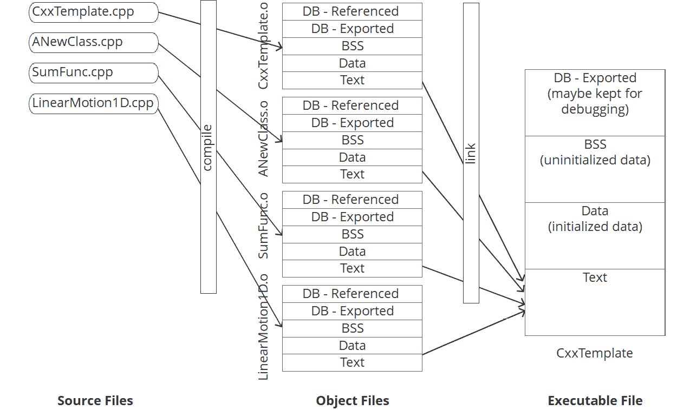

*Figure 2B.10: Parts of the object files and the executable file*

为方便后续讨论，`BSS` 和数据段将统称为数据段（唯一的区别在于 `BSS` 未初始化）。当程序执行时，它被加载到内存中，其内存布局看起来有点像可执行文件布局——它包含文本段、数据段、`BSS` 段，以及由宿主系统分配的空闲内存，其中包含所谓的 `stack` 和 `heap`。`stack` 通常从内存顶部开始并向下增长，而 `heap` 从 `BSS` 结束的地方开始并向上增长，朝向 `stack`：


*Figure 2B.11: CxxTemplate runtime memory map*

变量或标识符可访问的程序部分称为 `scope`。`scope` 有两大类：

*   `Local scope`（也称为 `block scope`）：这适用于包含在花括号（`{}`）中的块内声明的任何内容。变量可以在花括号内访问。就像块可以嵌套一样，变量的作用域也可以嵌套。这通常包括局部变量和函数参数，它们通常存储在 `stack` 中。
*   `Global / file scope`：这适用于在普通函数或类之外声明的变量，以及普通函数。变量可以在文件中的任何位置访问，如果链接正确，也可能从其他文件访问（全局）。这些变量由链接器在数据段中分配内存。标识符被放入全局命名空间，这是默认的命名空间。

### 命名空间

我们可以将 `namespace` 视为变量、函数和用户定义类型名称的字典。对于小程序，使用全局 `namespace` 没问题，因为你创建多个同名变量并导致名称冲突的可能性很小。随着程序变大，并包含更多第三方库，名称冲突的可能性增加。因此，库编写者会将他们的代码放入一个 `namespace` 中（希望是唯一的）。这允许程序员控制对 `namespace` 中标识符的访问。通过使用标准库，我们已经在使用 `std` 命名空间了。`namespace` 的声明如下：

```cpp
namespace name_of_namespace {  // 将声明放在这里 }
```

`name_of_namespace` 通常简短，且命名空间可以嵌套。

#### Note

命名空间的良好用法可以在 `boost` 库中看到：`https://www.boost.org/`。

变量还有另一个属性，即 `lifetime`。有三种基本生命周期；两种由编译器管理，一种由程序员选择：

*   `Automatic lifetime`：局部变量在声明时创建，在退出其所在作用域时销毁。这些由 `stack` 管理。


# 变量生命周期与链接属性

## 永久生命周期

**永久生命周期**：全局变量和静态局部变量。编译器使全局变量在程序开始时（进入 `main()` 函数之前）创建，使静态局部变量在首次访问时创建。在这两种情况下，变量在程序退出时销毁。这些变量由链接器放置在数据段中。

## 动态生命周期

**动态生命周期**：变量由程序员请求创建和销毁（通过使用 `new` 和 `delete`）。这些变量的内存从堆上分配。

## 链接属性

我们将考虑的变量的最后一个属性是**链接属性**。链接属性指示编译器和链接器在遇到具有相同名称（或标识符）的变量和函数时将执行什么操作。对于函数，实际上是所谓的**修饰名**——编译器使用函数名、其返回类型及其参数类型来生成修饰名。共有三种链接类型：

### 无链接

**无链接**：这意味着标识符仅指代其自身，适用于局部变量和局部定义的用户类型（即块内定义）。

### 内部链接

**内部链接**：这意味着标识符可以在声明它的文件中的任何位置访问。这适用于静态全局变量、`const` 全局变量、静态函数，以及在文件内匿名命名空间中声明的任何变量或函数。匿名命名空间是一个没有指定名称的命名空间。

### 外部链接

**外部链接**：这意味着在正确的前向声明下，可以从所有文件中访问。这包括普通函数、非静态全局变量、`extern const` 全局变量和用户定义类型。

虽然这些被称为链接，但只有最后一种真正涉及链接器。其他两种是通过编译器从导出标识符数据库中排除信息来实现的。

# 模板——泛型编程

作为一名计算机科学家或编程爱好者，在某个时刻，你可能不得不编写一个（或多个）排序算法。在讨论算法时，你并不特别关心被排序数据的类型，只关心该类型的两个对象可以比较，且该域是全序集（即，如果一个对象与任何其他对象比较，你可以确定哪个在前）。不同的编程语言为该问题提供不同的解决方案：

*   **Python**：一种动态语言，具有内置的 `sort` 函数和 `list` 的成员函数。作为一种动态语言，如果它可以调用比较运算符和 `swap` 函数，则无需关心类型。
*   **C**：其标准库中有一个名为 `qsort` 的函数，签名如下：

    ```
    void qsort (void* base, size_t num, size_t size,
                int (*compare)(const void*, const void*));
    ```

    这通过 `base` 作为**空指针**来处理不同类型。`size_t size` 定义每个对象的大小，而 `compare()` 函数定义如何比较两个对象。
*   **C++**：`std::sort()` 是其标准库提供的函数，其签名之一如下：

    ```
    template< class RandomIt > void sort( RandomIt first, RandomIt last );
    ```

    在这种情况下，类型的细节被捕获在称为 `RandomIt` 的迭代器类型中，并在编译时传递给方法。

在下一节中，我们将简要定义泛型编程，展示 C++ 如何通过模板实现它，强调语言已提供的内容，并讨论编译器如何推导类型以便用于模板。

## 什么是泛型编程？

当你开发排序算法时，最初可能只关注对普通数字进行排序。但一旦建立了这一点，你可以将其抽象为任何类型，前提是该类型表现出某些属性，如全序集（即比较运算符 `<` 在我们要排序的域中的所有元素之间都有意义）。因此，要用泛型编程表达算法，我们在算法中为需要被该算法操作的类型定义一个占位符。

**泛型编程**是开发与类型无关的通用算法。该算法可以通过传递类型作为参数来重用。这样，算法被抽象化，并允许编译器基于类型进行优化。

换句话说，泛型编程是一种编程方法，其中算法使用类型作为参数进行定义，这些参数在算法实例化时指定。许多语言以不同名称提供对泛型编程的支持。在 C++ 中，泛型编程通过称为模板的语言特性得到支持。

## C++ 模板简介

模板是 C++ 对泛型编程的支持。将模板视为饼干切割器，将我们作为参数传递给它的类型视为饼干面团（可以是巧克力布朗尼、姜饼或其他美味口味）。当我们应用饼干切割器时，我们得到形状相同但口味不同的饼干实例。因此，模板捕获泛型函数或类的定义，当用类型作为参数指定时，编译器会为我们编写类或函数，就像类型是由我们手工编码的一样。它有几个优点，例如：

*   你只需要开发一次类或算法并对其进行演进。
*   你可以将其应用于许多类型。
*   你可以在简单接口后隐藏复杂细节，编译器可以根据类型对生成的代码应用优化。

那么，如何编写模板？让我们从一个模板开始，它允许我们将值钳制在从 `lo` 到 `hi` 的范围内，并能将其用于 `int`、`float`、`double` 或任何其他内置类型：

```
template <class T>
T clamp(T val, T lo, T hi)
{
    return (val < lo) ? lo : (hi < val) ? hi : val;
}
```

让我们分解一下：

*   **第 1 行**：`template <class T>` 声明后面的内容为模板，并在模板中使用一个类型，其占位符为 `T`。
*   **第 2 行**：声明当 `T` 被替换时该函数的原型。它声明函数 `clamp` 接受三个类型为 `T` 的参数并返回类型为 `T` 的值。
*   **第 4 行**：这是模板的优雅之处——只要传入的类型具有 `<` 运算符，我们就可以对三个值执行钳制操作，使 `lo <= val <= hi`。该算法对所有可排序的类型都有效。

假设我们在以下程序中使用它：

```
#include <iostream>

int main()
{
    std::cout << clamp(5, 3, 10) << "\n";
    std::cout << clamp(3, 5, 10) << "\n";
    std::cout << clamp(13, 3, 10) << "\n";
    std::cout << clamp(13.0, 3.0, 10.1) << "\n";
    std::cout << clamp<double>(13.0, 3, 10.2) << "\n";
    return 0;
}
```

我们将得到以下预期输出：


###### 图 2B.12：钳制程序输出


在最后一次调用 `clamp` 时，我们在 `<` 和 `>` 之间向模板传递了 `double` 类型。但我们并未对其他四次调用采用相同做法。为什么？原来编译器随着版本迭代变得越来越聪明。随着标准的每一次发布，它们都会改进所谓的**类型推导**。因为编译器能够推导出类型，所以我们无需告诉它使用什么类型。原因在于，不带模板参数的类调用中，三个实参具有相同的类型——前三个都是 `int`，而第四个是 `double`。但我们必须为最后一次调用告诉编译器使用哪种类型，因为它有两个 `double` 和一个 `int` 作为实参，这导致了编译错误，提示未找到匹配的函数。但随后，它给出了模板无法使用的原因信息。这种强制指定类型的形式被称为**显式模板实参指定**。

## C++ 预置模板

C++ 标准由两大部分组成：

*   **语言定义**，即关键字、语法、词法定义、结构等。
*   **标准库**，即由编译器供应商提供的所有预先编写好的通用函数和类。该库的一个子集是使用模板实现的，称为**标准模板库**（**STL**）。

STL 起源于 Ada 语言中提供的泛型，由 David Musser 和 Alexander Stepanov 开发。Stepanov 强烈主张将泛型编程作为软件开发的基础。在 90 年代，他看到了利用新语言 C++ 影响主流开发的机会，并向 ISO C++ 委员会提议将 STL 作为语言的一部分纳入。其后的发展便成为历史。

STL 包含四类预定义的泛型算法和类：

*   **容器**：通用序列容器（`vector`、`list`、`deque`）和关联容器（`set`、`multiset`、`map`）
*   **迭代器**：一组用于遍历容器并定义容器范围的类（范围表示为 `begin()` 和 `end()`）。注意，STL 的一个基本设计选择是 `end()` 指向最后一个元素之后的位置——数学上表示为 `begin()`, `end()`)。
*   **算法**：涵盖排序、搜索、集合操作等的 100 多种不同算法。
*   **函数**：支持函数对象（可像函数一样调用的对象）。一个用途是在模板算法中用作谓词，例如 `find_if()`。

我们之前实现的 `clamp` 函数模板比较简单，虽然它适用于任何支持小于运算符的类型，但效率不高——如果类型尺寸很大，可能会导致非常大的拷贝开销。自 C++17 起，STL 包含了一个 `std::clamp()` 函数，其声明大致如下：

```cpp
#include <cassert>

template<class T, class Compare>
const T& clamp(const T& v, const T& lo, const T& hi, Compare comp)
{
    return assert(!comp(hi, lo)),
           comp(v, lo) ? lo : comp(hi, v) ? hi : v;
}

template<class T>
const T& clamp(const T& v, const T& lo, const T& hi)
{
    return clamp(v, lo, hi, std::less<>());
}
```

正如我们所见，它对实参和返回值使用了引用。将实参改为引用减少了在栈上传递和返回的内容。此外，请注意，设计者致力于生成一个更通用的模板版本，使我们不必依赖类型现有的 `<` 运算符。不过，我们可以通过传递 `comp` 来定义排序规则。

从前面的示例中，我们已经看到，与函数一样，模板可以接受多个用逗号分隔的参数。

## 类型别名——typedef 和 using

如果你用过 `std::string` 类，那你就用过别名。有几个与字符串相关的模板类需要实现相同的功能。但表示字符的类型不同。例如，`std::string` 的表示是 `char`，而 `std::wstring` 使用 `wchar_t`。还有针对 `char16_t` 和 `char32_t` 的其他几种。功能上的任何差异将通过特性或模板特化来管理。

在 C++11 之前，这将从 `std::basic_string` 基类进行别名定义，如下所示：

```cpp
namespace std {
    typedef basic_string<char> string;
}
```

这主要做两件事：

*   减少声明变量所需的输入量。这是一个简单的例子，但当你声明一个指向字符串到对象映射的唯一指针时，名称会变得非常长，且容易出错：
    ```cpp
    typedef std::unique_ptr<std::map<std::string, myClass>> UptrMapStrToClass;
    ```
*   提高可读性，因为你现在可以在概念上将其视为一个字符串，而无需担心细节。

但 C++11 引入了一种更好的方式——**别名声明**——它利用 **using** 关键字。前面的代码可以这样实现：

```cpp
namespace std {
    using string = basic_string<char>;
}
```

前面的例子很简单，无论是 `typedef` 还是 `using` 别名都不难理解。但当别名涉及更复杂的表达式时，它们也可能变得难以阅读——特别是函数指针。请看下面的代码：

```cpp
typedef int (*FunctionPointer)(const std::string&, const Point&);
```

现在，请看下面的代码：

```cpp
using FunctionPointer = int (*)(const std::string&, const Point&);
```

C++11 引入这项新功能是有原因的，别名声明可以轻松融入模板——它们可以被模板化。`typedef` 无法被模板化，虽然可以用 `typedef` 达到相同的结果，但别名声明（`using`）是首选方法，因为它产生的模板代码更简单、更易懂。

### 练习 2：实现别名

在本练习中，我们将使用 `typedef` 实现别名，并了解如何通过使用引用使代码更易读、更高效。请按以下步骤实现此练习：

1.  在 Eclipse 中打开 `Lesson2B` 项目，然后在项目资源管理器中展开 `Lesson2B`，再展开 `Exercise02`，双击 `Exercise2.cpp` 在编辑器中打开该练习文件。
2.  点击**启动配置**下拉菜单，选择**新建启动配置…**。配置 `L2BExercise2` 以名称为 `Exercise2` 运行。完成后，它将成为当前选定的启动配置。
3.  点击**运行**按钮。**练习 2** 将运行并产生类似以下的输出：
    ![图 2B.13：练习 2 输出
    图 2B.13：练习 2 输出
4.  在编辑器中，在 `printVector()` 函数声明之前，添加以下行：
    ```cpp
    typedef std::vector<int> IntVector;
    ```
5.  现在，将文件中所有出现的 `std::vector<int>` 替换为 `IntVector`。
6.  点击**运行**按钮。输出应与之前相同。
7.  在编辑器中，将之前添加的行更改为以下内容：
    ```cpp
    using IntVector = std::vector<int>;
    ```
8.  点击**运行**按钮。输出应与之前相同。
9.  在编辑器中，添加以下行：
    ```cpp
    using IntVectorIter = std::vector<int>::iterator;
    ```
10. 现在，将 `IntVector::iterator` 的唯一一次出现更改为 `IntVectorIter`。
11. 点击**运行**按钮。输出应与之前相同。


在本练习中，`typedef` 和 `using` 别名之间似乎差别不大。无论哪种情况，使用一个命名良好的别名都能使代码更易于阅读和理解。当涉及更复杂的别名时，`using` 提供了一种更简便的编写别名的方法。`using` 于 C++11 引入，现已成为定义别名的首选方法。它相较于 `typedef` 还有其他优势，例如能够在模板内部使用。

## 模板——不仅仅是泛型编程

模板所能提供的远不止泛型编程（一种带有类型的切割机）。在泛型编程的情况下，模板作为一个无法更改的蓝图运作，并为指定的类型提供模板的编译版本。

模板可以编写为根据涉及的类型提供函数或算法的特化。这被称为 `模板特化`，并不符合我们之前使用的泛型编程的定义。只有当它使某些类型在给定上下文中表现出我们预期的行为时，才能称之为泛型编程。当用于所有类型的算法被修改时，就不能称之为泛型编程。

请检查以下特化代码示例：

```cpp
#include <iostream>
#include <type_traits>

template <typename T, std::enable_if_t<sizeof(T) == 1, int> = 0>
void print(T val)
{
    printf("%c\n", val);
}

template <typename T, std::enable_if_t<sizeof(T) == sizeof(int), int> = 0>
void print(T val)
{
    printf("%d\n", val);
}

template <typename T, std::enable_if_t<sizeof(T) == sizeof(double), int> = 0>
void print(T val)
{
    printf("%f\n", val);
}

int main(int argc, char** argv)
{
    print('c');
    print(55);
    print(32.1F);
    print(77.3);
}
```

它定义了一个模板，该模板根据使用 `std::enable_if_t<>` 和 `sizeof()` 的模板特化，调用带有不同格式字符串的 `printf()`。运行时，将生成以下输出：


图 2B.14：错误的打印模板程序输出

### 替换失败不是错误——SFINAE

为 `32.1F` 打印的值（`-1073741824`）与该数字毫无相似之处。如果我们检查编译器为以下程序生成的代码，会发现它生成的代码就如同我们编写了以下内容（甚至更多）：

```cpp
template<typename int, int=0>
void print<int,0>(int val)
{
    printf("%d\n",val);
}

template<typename float, int=0>
void print<float,0>(float val)
{
    printf("%d\n", val);
}
```

为什么会生成这段代码？前面的模板使用了 C++ 编译器的一项称为 `SFINAE`（替换失败不是错误）的特性。基本上，在模板的替换阶段，基于类型，如果编译器无法形成有效代码，它就会丢弃该定义并继续，而不是产生错误。让我们尝试修复前面的代码，使 `print` 得到正确的结果。为此，我们将引入 `std::enable_if_t<>` 的用法，并访问所谓的 `类型特征` 来帮助我们。首先，我们将用以下代码替换最后一个模板：

```cpp
#include <type_traits>

template <typename T, std::enable_if_t<std::is_floating_point_v<T>, int> = 0>
void print(T val)
{
    printf("%f\n", val);
}
```

这需要一些解释。首先，我们考虑 `std::enable_if_t` 的定义，它实际上是一个类型别名：

```cpp
template<bool B, class T = void>
struct enable_if {};

template<class T>
struct enable_if<true, T> { typedef T type; };

template< bool B, class T = void >
using enable_if_t = typename enable_if<B,T>::type;
```

第一个 `enable_if` 模板将导致一个空结构体（或类）的定义。第二个 `enable_if` 模板是针对第一个模板参数为 `true` 的特化，将导致一个包含 `typedef` 定义的类。`enable_if_t` 的定义是一个辅助模板，它消除了我们在使用时在模板末尾输入 `::type` 的需要。那么，这是如何工作的？请考虑以下代码：

```cpp
template <typename T, std::enable_if_t<condition, int> = 0>
void print(T val) { … }
```

如果在编译时计算的条件结果为 `true`，则 `enable_if_t` 模板将产生如下所示的模板：

```cpp
template <typename T, int = 0>
void print(T val) { … }
```

这是有效的语法，该函数作为候选函数被添加到符号表中。如果在编译时计算的条件结果为 `false`，则 `enable_if_t` 模板将产生如下所示的模板：

```cpp
template <typename T, = 0>
void print(T val) { … }
```

这是格式错误的代码，现在被丢弃了——SFINAE 在起作用。

`std::is_floating_point_v<T>` 是另一个辅助类，它访问 `std::is_floating_point<T>` 模板的 `::value` 成员。它的名字 lo 说明了一切——如果 `T` 是浮点类型（`float`、`double`、`long double`），它将为 `true`；否则为 `false`。如果我们做这个更改，编译器（GCC）将生成以下错误：


图 2B.15：修改后的打印模板程序的编译器错误

现在的问题是，当类型为 `float` 时，有两个模板都能满足条件：

```cpp
template <typename T, std::enable_if_t<sizeof(T) == sizeof(int), int> = 0>
void print(T val)
{
    printf("%d\n", val);
}

template <typename T, std::enable_if_t<std::is_floating_point_v<T>, int> = 0>
void print(T val)
{
    printf("%f\n", val);
}
```

结果发现（通常）`sizeof(float) == sizeof(int)`，所以我们需要做另一个更改。我们将用另一个类型特征——`std::is_integral_v<>` 来替换第一个条件：

```cpp
template <typename T, std::enable_if_t<std::is_integral_v<T>, int> = 0>
void print(T val)
{
    printf("%d\n", val);
}
```

如果我们做这个更改，编译器（GCC）将生成以下错误：


图 2B.16：修改后的打印模板程序的第二个编译器错误

我们修复了浮点数的歧义，但这里的问题是 `std::is_integral_v<char>` 返回 `true`，对于 `char` 类型，模板又生成了两个具有相同原型的函数。结果发现，传递给 `std::enable_if_t<>` 的条件遵循标准的 C++ 逻辑表达式。因此，为了修复这个问题，我们将添加一个额外的条件来排除 `char`：

```cpp
template <typename T, std::enable_if_t<std::is_integral_v<T> && sizeof(T) != 1, int> = 0>
void print(T val)
{
    printf("%d\n", val);
}
```

如果我们现在编译程序，它将完成编译并链接程序。如果我们运行它，现在将产生以下（预期的）输出：


图 2B.17：修正后的打印模板程序输出

### 浮点数表示


难道 `32.099998` 不应该是 `32.1` 吗？传给函数的正是这个值。在计算机上执行浮点运算的问题在于，其表示方式会自动引入误差。实数构成一个连续（无限）的域。如果你考虑实数域中的 1 和 2，那么它们之间有无限多个实数。遗憾的是，计算机对浮点数的表示将数值量化，无法表示所有无限的数字。用于存储数字的位数越多，该值在实数域上的表示就越精确。因此，`long double` 优于 `double`，`double` 优于 `float`。究竟什么适合存储数据，实际上取决于你的问题域。回到 `32.099998`。计算机将单精度数字存储为 2 的幂的和，然后按幂因子移动它们。整数通常很容易，因为它们可以轻松地用 `2^n` 幂的和表示（n>=0）。小数部分，本例中为 0.1，必须表示为 `2^(-n) (n>0)` 的和。我们添加更多的 2 的负幂分数，试图使数字更接近目标，直到用完单精度浮点数中用于精度的 24 位为止。

> **注意**
>
> 如果你想了解更多关于计算机如何存储浮点数的信息，请研究定义它的 IEEE 754 标准。

## Constexpr if 表达式

C++17 引入了 `constexpr if` 表达式，极大地简化了模板编写。我们可以将前面使用 SFINAE 的三个模板重写为一个更简单的模板：

```cpp
#include <iostream>
#include <type_traits>

template <typename T>
void print(T val)
{
    if constexpr(sizeof(T)==1) {
        printf("%c",val);
    }
    else if constexpr(std::is_integral_v<T>) {
        printf("%d",val);
    }
    else if constexpr(std::is_floating_point_v<T>) {
        printf("%f",val);
    }
    printf("\n");
}

int main(int argc, char** argv)
{
    print('c');
    print(55);
    print(32.1F);
    print(77.3);
}
```

对于 `print(55)` 的调用，编译器生成的调用函数如下：

```cpp
template<>
void print<int>(int val)
{
    printf("%d",val);
    printf("\n");
}
```

if/else if 语句去哪了？`constexpr if` 表达式的工作原理是：编译器根据上下文确定条件的值，并将其转换为布尔值（true/false）。如果求值结果为 true，则丢弃 if 条件和 else 子句，仅保留 true 子句生成代码。同样，如果为 false，则保留 false 子句生成代码。换句话说，只有第一个求值为 true 的 `constexpr if` 条件会生成其子句的代码，其余的都会被丢弃。

## 非类型模板参数

到目前为止，我们只见过作为类型的模板参数。也可以将整数值作为模板参数传递。这使我们能够防止函数的数组退化。例如，考虑一个计算 `sum` 的模板函数：

```cpp
template <class T>
T sum(T data[], int number)
{
    T total = 0;
    for(auto i=0U ; i<number ; i++)
    {
        total += data[i];
    }
    return total;
}
```

在这种情况下，我们需要在调用时传递数组的长度：

```cpp
float data[5] = {1.1, 2.2, 3.3, 4.4, 5.5};
auto total = sum(data, 5);
```

但如果我们能直接调用以下代码，不是更好吗？

```cpp
auto total = sum(data);
```

我们可以通过修改模板来实现，如下面的代码所示：

```cpp
template <class T, std::size_t size>
T sum(T (&data)[size])
{
    T total = 0;
    for(auto i=0U ; i< size; i++)
    {
        total += data[i];
    }
    return total;
}
```

这里，我们将 data 改为特定大小数组的引用——这个大小作为模板参数传递——因此编译器能推导出来。我们不再需要函数调用的第二个参数。这个简单的例子展示了如何直接传递和使用非类型参数。我们将在*模板类型推导*一节中进一步探讨这一点。

## 练习 3：实现 Stringify——特化与 constexpr

在本练习中，我们将利用 constexpr 实现一个 stringify 模板，以生成更易读、更简洁的代码版本。请按照以下步骤实现本练习：

> **注意**
>
> stringify 特化模板可在 <https://isocpp.org/wiki/faq/templates#template-specialization-example> 找到。

1. 在 Eclipse 中打开 `Lesson2B` 项目，然后在**项目资源管理器**中展开 `Lesson2B`，再展开 `Exercise03`，双击 `Exercise3.cpp` 在编辑器中打开本练习的文件。

2. 点击**启动配置**下拉菜单，选择**新建启动配置…**。配置 `L2BExercise3` 以 `Exercise3` 为名称运行。

3. 点击**运行**按钮。**练习 3** 将运行并产生以下输出：

   

   **图 2B.18：练习 3 特化模板输出**

4. 在 `Exercise3.cpp` 中，注释掉 stringify 模板的所有特化版本，只保留原始的通用模板。

5. 点击**运行**按钮。输出将变为布尔值以数字形式打印，double 类型仅打印两位小数：

   

   **图 2B.19：练习 3 仅通用模板输出**

6. 我们现在再次为布尔类型“特化”模板。在其他 `#include` 旁添加 `#include <type_traits>` 指令，并修改模板如下：

```cpp
template<typename T> std::string stringify(const T& x)
{
    std::ostringstream out;
    if constexpr (std::is_same_v<T, bool>)
    {
        out << std::boolalpha;
    }
    out << x;
    return out.str();
}
```

7. 点击**运行**按钮。布尔值的 stringify 输出恢复正常：

   

   **图 2B.20：针对布尔值定制的 stringify**

8. 我们现在再次为浮点类型（`float`、`double`、`long double`）“特化”模板。修改模板如下：

```cpp
template<typename T> std::string stringify(const T& x)
{
    std::ostringstream out;
    if constexpr (std::is_same_v<T, bool>)
    {
        out << std::boolalpha;
    }
    else if constexpr (std::is_floating_point_v<T>)
    {
        const int sigdigits = std::numeric_limits<T>::digits10;
        out << std::setprecision(sigdigits);
    }
    out << x;
    return out.str();
}
```

9. 点击**运行**按钮。输出恢复为最初的样子：

   

   **图 2B.21：constexpr if 版本模板输出**

10. 如果你将包含多个模板的原始版本与最终版本进行比较，会发现最终版本更像一个普通函数，更易于阅读和维护。

在本练习中，我们了解到使用 C++17 中的新 constexpr if 结构可以使我们的模板变得多么简单和紧凑。

## 重温函数重载


# 带模板的函数重载决议

当我们首次讨论函数重载时，仅考虑了函数名称来自我们手动编写的函数列表的场景。现在，我们需要更新这一认知。我们也可以编写具有相同名称的模板函数。与之前一样，当编译器遇到 `print(55)` 这一行时，它需要确定调用之前定义的哪个函数。因此，它执行以下过程（极度简化）：

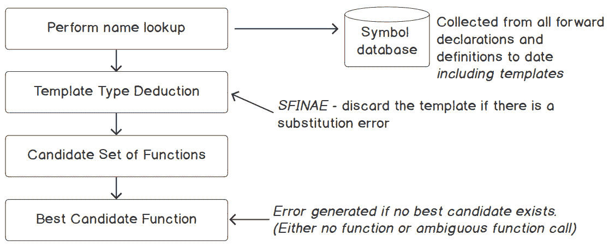

*图 2B.22：带模板的函数重载决议（简化版）*

## 模板类型推导

当我们首次介绍模板时，曾涉及模板类型推导。现在，我们将进一步探讨这一点。我们将从考虑函数模板的通用声明开始：

```cpp
template<typename T>
void function(ParamType parameter);
```

其调用可能如下所示：

```cpp
function(expression); // 从 expression 推导 T 和 ParamType
```

当编译器到达此行时，它现在必须推导出与模板相关的两个类型——`T` 和 `ParamType`。由于附加在 `ParamType` 中的 `T` 上的限定符和其他属性（例如指针、引用、const 等），这两个类型通常是不同的。这些类型虽有关联，但推导过程会根据所用 `expression` 的形式而有所不同。

## 显示推导出的类型

在深入探讨不同形式之前，如果能让编译器告诉我们它推导出的类型，那将很有用。我们有几种选择，包括 IDE 编辑器显示类型、编译器生成错误以及运行时支持（由于 C++ 标准的原因，这不一定有效）。我们将利用编译器错误来帮助我们探索一些类型推导。

我们可以通过声明一个没有定义的模板来实现类型显示器。任何尝试实例化该模板的行为都会导致编译器生成错误消息（因为没有定义），并附带它试图实例化的类型信息：

```cpp
template<typename T>
struct TypeDisplay;
```

让我们尝试编译以下程序：

```cpp
template<typename T>
class TypeDisplay;

int main()
{
    signed int x = 1;
    unsigned int y = 2;
    TypeDisplay<decltype(x)> x_type;
    TypeDisplay<decltype(y)> y_type;
    TypeDisplay<decltype(x+y)> x_y_type;
    return 0;
}
```

编译器吐出以下错误：

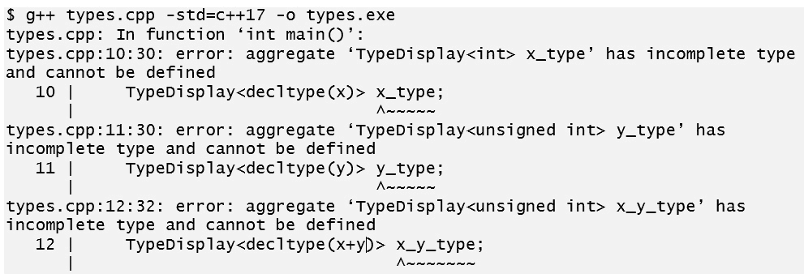

*图 2B.23：显示推导类型的编译器错误*

请注意，在每种情况下，被命名的聚合体都包含正在被推导的类型——对于 `x`，它是 `int`；对于 `y`，是 `unsigned int`；对于 `x+y`，是 `unsigned int`。另请注意，`TypeDisplay` 模板要求其参数为类型，因此使用 `decltype()` 函数让编译器提供括号内表达式的类型。

也可以在运行时显示推导出的类型，既可以使用内置的 `typeid(T).name()` 运算符（返回 `std::string`），也可以使用名为 `type_index` 的 boost 库。

### 注意

有关更多信息，请访问以下链接：[`www.boost.org/doc/libs/1_70_0/doc/html/boost_typeindex.html`](https://www.boost.org/doc/libs/1_70_0/doc/html/boost_typeindex.html)。

由于类型推导规则，内置运算符会给你类型的指示，但会丢失引用（`&` 和 `&&`）以及任何 const 信息（const 或 volatile）。如果在运行时需要，请考虑 `boost::type_index`，它将为所有编译器产生相同的输出。

## 模板类型推导——详情

让我们回到通用模板：

```cpp
template<typename T>
void function(ParamType parameter);
```

假设调用如下所示：

```cpp
function(expression); // 从 expression 推导 T 和 ParamType
```

类型推导的进行方式取决于所用 `ParamType` 的形式：

*   `ParamType` 是值（`T`）：传值函数调用
*   `ParamType` 是引用或指针（`T&` 或 `T*`）：传引用函数调用
*   `ParamType` 是右值引用（`T&&`）：传引用函数调用或其他情况

### 情况 1：ParamType 是传值 (T)

```cpp
template<typename T>
void function(T parameter);
```

作为传值调用，这意味着参数将是传入内容的副本。因为这是对象的一个新实例，所以对表达式应用以下规则：

*   如果表达式的类型是引用，则忽略引用部分。
*   如果在步骤 1 之后，剩余类型是 const 和/或 volatile，则也忽略那些。

剩下的就是 `T`。让我们尝试编译以下文件代码：

```cpp
template<typename T>
class TypeDisplay;

template<typename T>
void function(T parameter)
{
    TypeDisplay<T> type;
}

void types()
{
    int x = 42;
    function(x);
}
```

编译器产生以下错误：

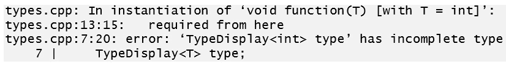

*图 2B.24：显示传值类型推导类型的编译器错误*

因此，类型被推导为 `int`。同样，如果我们声明以下内容，会得到完全相同的错误：

```cpp
const int x = 42;
function(x);
```

如果声明此版本，也会发生同样的情况：

```cpp
int x = 42;
const int& rx = x;
function(rx);
```

在所有三种情况下，根据前面所述规则，推导出的类型均为 `int`。

### 情况 2：ParamType 是传引用 (T&)

作为传引用调用，这意味着参数将能够访问对象的原始存储位置。因此，生成的函数必须遵守我们之前忽略的 constness 和 volatileness。对类型推导应用以下规则：

*   如果表达式的类型是引用，则忽略引用部分。
*   将剩余的表达式类型与 `ParamType` 进行模式匹配以确定 `T`。

让我们尝试编译以下文件：

```cpp
template<typename T>
class TypeDisplay;

template<typename T>
void function(T& parameter)
{
    TypeDisplay<T> type;
}

void types()
{
    int x = 42;
    function(x);
}
```

编译器将生成以下错误：


*图 2B.25：显示传引用推导类型的编译器错误*

由此我们可以看到，编译器从 `ParamType` 为 `int&` 推导出 `T` 为 `int`。将 `x` 改为 `const int` 也不足为奇，因为 `T` 从 `ParamType` 为 `const int&` 推导为 `const int`：

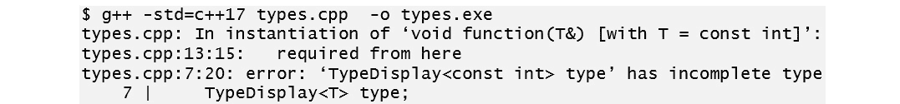

*图 2B.26：显示传 const 引用推导类型的编译器错误*

同样，像以前那样引入 `rx` 作为对 `const int` 的引用，也不足为奇，因为 `T` 从 `ParamType` 为 `const int&` 推导为 `const int`：

```cpp
void types()
{
    const int x = 42;
    const int& rx = x;
    function(rx);
}
```


*图 2B.27：传递 const 引用时显示推导类型的编译器错误*

如果我们更改声明以包含 const，则编译器在从模板生成函数时将遵守 constness：

```cpp
template<typename T>
void function(const T& parameter)
{
    TypeDisplay<T> type;
}
```

这一次，编译器报告如下：

*   `int x`：`T` 为 `int`（将遵守 constness），而参数类型为 `const int&`。
*   `const int x`：`T` 为 `int`（const 在模式中，剩下 int），而参数类型为 `const int&`。


## 模板类型推导：情况 3 — 右值引用 (`T&&`)

*   **`const int& rx`**：`T` 为 `int`（忽略引用，`const` 在模式中，剩下 `int`），而参数的类型为 **`const int&`**。

如果我们尝试编译以下代码，会有什么预期？通常，数组会退化为指针：

```cpp
int ary[15];
function(ary);
```

编译器错误如下：

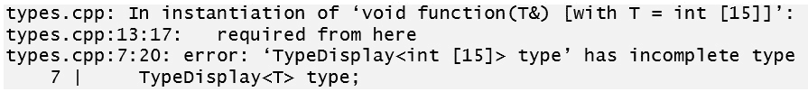

这一次，数组被作为引用捕获，且包含大小。因此，如果 `ary` 声明为 **`ary[10]`**，则会生成一个完全不同的函数。让我们将模板恢复为以下形式：

```cpp
template<typename T>
void function(T parameter)
{
    TypeDisplay<T> type;
}
```

如果我们尝试编译数组调用，则错误会报告如下：

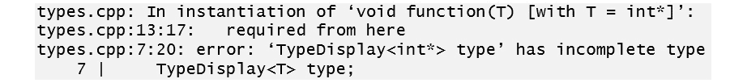

我们可以看到，在这种情况下，数组按将数组传递给函数时的常规行为发生了退化。我们在讨论*非类型模板参数*时见过这种行为。

### 值类别

`T&&` 称为右值引用，而 `T&` 称为左值引用。C++ 不仅按类型表征表达式，还按一种称为**值类别**的属性表征。这些类别控制编译器中的表达式求值，包括创建、复制和移动临时对象的规则。C++17 标准中定义了五种表达式值类别，它们具有以下关系：

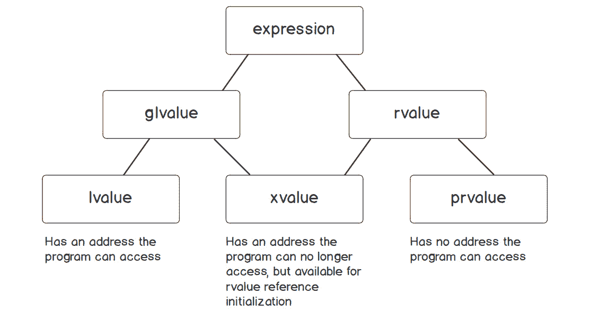

各类别的定义如下：

*   能确定对象标识的表达式是**广义左值**。
*   求值时初始化对象或运算符操作数的表达式是**纯右值**。示例包括字面量（字符串字面量除外），如 `3.1415`、`true` 或 `nullptr`、`this` 指针、后置递增和后置递减表达式。
*   拥有资源且可被复用的广义左值对象（因为其生命周期即将结束）是**将亡值**。示例包括返回类型为对象右值引用的函数调用，如 **`std::move()`**。
*   非将亡值的广义左值是**左值**。示例包括变量名、函数名或数据成员名，或字符串字面量。
*   纯右值或将亡值是**右值**。

对于后续的解释，不必完全理解这些概念——只需知道被视为左值的表达式可以取地址（使用取地址运算符，即 `&`）。以下的类型推导规则要求你知道什么是左值，以及什么不是：

```cpp
template<typename T>
void function(T&& parameter)
{
    TypeDisplay<T> type;
}
```

这种 `ParamType` 形式的类型推导规则如下：

*   如果表达式是左值引用，则 `T` 和 `ParamType` 都被推导为左值引用。这是类型被推导为引用的唯一场景。
*   如果表达式是右值引用，则适用情况 2 的规则。

## SFINAE 表达式与尾置返回类型

C++11 引入了一项称为**尾置返回类型**的特性，为模板提供了一种机制，使其能够泛化返回类型。一个简单示例如下：

```cpp
template<class T>
auto mul(T a, T b) -> decltype(a * b)
{
    return a * b;
}
```

此处，**`auto`** 用于指示定义了尾置返回类型。尾置返回类型以 **`->`** 开始，在此例中，返回类型是 **`a`** 和 **`b`** 相乘所得的类型。编译器将处理 `decltype` 的内容，如果其格式错误，则会按照惯例将该定义从函数名的查找中移除。这种能力开启了许多可能性，因为逗号运算符 **`,`** 可用于 `decltype` 内部以检查特定属性。

如果我们想测试一个类是否实现了某个方法或包含某个类型，则可以将其放入 `decltype` 中，通过将其转换为 `void`（以防逗号运算符被重载），然后在逗号运算符的末尾定义一个真实返回类型的对象。以下程序展示了一个示例：

```cpp
#include <iostream>
#include <algorithm>
#include <utility>
#include <vector>
#include <set>

template<class C, class T>
auto contains(const C& c, const T& x)
    -> decltype((void)(std::declval<C>().find(std::declval<T>())), true)
{
    return end(c) != c.find(x);
}

int main(int argc, char** argv)
{
    std::cout << "\n\n------ SFINAE Exercise ------\n";
    std::set<int> mySet {1,2,3,4,5};
    std::cout << std::boolalpha;
    std::cout << "Set contains 5: " << contains(mySet, 5) << "\n";
    std::cout << "Set contains 15: " << contains(mySet, 15) << "\n";
    std::cout << "Complete.\n";
    return 0;
}
```

编译并执行此程序时，我们获得以下输出：


返回类型由以下代码给出：

```cpp
decltype( (void)(std::declval<C>().find(std::declval<T>())), true)
```

让我们分解一下：

*   **`decltype`** 的操作数是一个由逗号分隔的表达式列表。这意味着编译器将构建但不求值这些表达式，并使用最右侧值的类型来确定函数的返回类型。
*   **`std::declval<T>()`** 允许我们将 `T` 类型转换为引用类型，从而可以在无需实际构造对象的情况下访问成员函数。
*   与所有基于 SFINAE 的操作一样，如果逗号分隔列表中的任何表达式无效，则该函数会被丢弃。如果全部有效，则将其添加到用于查找的函数列表中。
*   转换为 `void` 是为了防止用户重载逗号运算符时可能出现的问题。
*   从本质上讲，这是在测试 **`C`** 类是否有一个名为 **`find()`** 的成员函数，该函数接受 **`class T`**、**`class T&`** 或 **`const class T&`** 作为参数。

此方法适用于 **`std::set`**，后者有一个接受一个参数的 **`find()`** 方法，但会对其他容器失败，因为它们没有 **`find()`** 成员方法。

如果我们只处理一种类型，这种方法效果很好。但如果我们有一个需要根据类型产生不同实现的函数，正如我们之前所见，**`if constexpr`** 方法要简洁得多，通常也更容易理解。要使用 **`if constexpr`** 方法，我们需要生成在编译时求值为 **`true`** 或 **`false`** 的模板。标准库为此提供了辅助类：**`std::true_type`** 和 **`std::false_type`**。这两个结构体分别有一个名为 `value` 的静态常量成员，值设为 **`true`** 和 **`false`**。利用 SFINAE 和模板重载，我们可以创建新的检测类，从这两个类中的任意一个派生，以获得期望的结果：

```cpp
template <class T, class A0>
auto test_find(long) -> std::false_type;

template <class T, class A0>
auto test_find(int)
    -> decltype(void(std::declval<T>().find(std::declval<A0>())), std::true_type{});

template <class T, class A0>
struct has_find : decltype(test_find<T, A0>(0)) {};
```

**`test_find`** 的第一个模板创建了默认行为，将返回类型设为 **`std::false_type`**。注意它有一个 **`long`** 类型的参数。


## `test_find` 的第二个模板

`test_find` 的第二个模板创建了一个特化版本，用于测试一个类是否拥有名为 `find()` 的成员函数，且其返回类型为 `std::true_type`。请注意，该版本的参数类型为 `int`。

`has_find<T,A0>` 模板通过从 `test_find()` 函数的返回类型派生自身来工作。如果 `T` 类没有 `find()` 方法，则只会生成 `std::false_type` 版本的 `test_find()`，因此 `has_find<T,A0>::value` 的值将为 false，并可用于 `if constexpr()` 中。

有趣的部分在于：如果 `T` 类拥有 `find()` 方法，那么两个 `test_find()` 方法都会被生成。但特化版本接受 `int` 类型的参数，而默认版本接受 `long` 类型的参数。当我们用零 (0) “调用”该函数时，它将匹配特化版本并使用它。参数差异很重要，因为不能有两个参数类型相同、仅返回类型不同的函数。如果想验证此行为，可将参数从 0 改为 0L 以强制调用 long 版本。

## 类模板

到目前为止，我们只涉及函数模板。但模板也可用于为类提供蓝图。模板类声明的通用结构如下：

```cpp
template<class T>
class MyClass {
    // 使用 T 的变量和方法。
};
```

函数模板允许我们生成通用算法，而类模板允许我们生成通用数据类型及其相关行为。

当我们介绍标准模板库 (STL) 时，强调了它包含容器模板——`vector`、`deque`、`stack` 等。这些模板允许我们存储和管理任意想要的数据类型，但仍能按预期表现。

### 练习 4：编写类模板

计算机科学中最常用的两种数据结构是栈和队列。两者在 STL 中都有现成实现。但为了让我们熟悉模板类，我们将编写一个可用于任何类型的栈模板类。开始吧：

1.  在 Eclipse 中打开 `Lesson2B` 项目，然后在 **Project Explorer（项目资源管理器）** 中展开 `Lesson2B`，再展开 `Exercise04`，双击 `Exercise4.cpp` 在编辑器中打开该练习文件。

2.  配置一个新的 **Launch Configuration（启动配置）**，名为 `L2BExercise4`，设置运行名称为 **Exercise4**。

3.  同时，配置一个新的 C/C++ Unit Run Configuration（C/C++ 单元测试运行配置），名为 `L2BEx4Tests`，用于运行 `L2BEx4tests`。设置 **Google Tests Runner（Google Test 运行器）**。

4.  点击测试的 **Run（运行）** 选项，首次运行测试：

    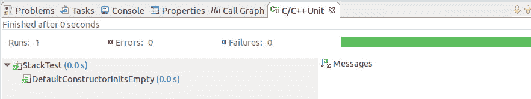

    *Figure 2B.32: 栈的初始单元测试*

5.  在编辑器中打开 `Stack.hpp`。你将看到以下代码：

    ```cpp
    #pragma once

    #include <vector>
    #include <cstddef>

    #define EXERCISE4_STEP  1

    namespace acpp
    {
        template <typename T>
        class Stack
        {
        public:
        private:
            std::vector<T> m_stack;
        };
    } // namespace acpp
    ```

    模板定义的第一个要点是：它必须放在头文件中，以便在需要复用的地方通过 `#include` 包含。其次，我们使用了 pragma 指令 (`#pragma once`)，它告诉编译器：如果再次遇到此文件被 `#include`，则无需再次处理。虽然这不严格属于标准，但几乎所有现代 C++ 编译器都支持它。最后请注意，为了本练习的目的，我们选择使用 STL vector 来存储项。

6.  在编辑器中，在 `Stack` 类的 **public（公有）** 部分添加以下声明：

    ```cpp
    bool empty() const
    {
        return m_stack.empty();
    }
    ```

7.  在文件顶部，将 `EXERCISE4_STEP` 的值改为 `10`。点击 **Run（运行）** 按钮。练习 4 的测试应运行并失败：

    

    *Figure 2B.33: 跳转到失败的测试*

8.  点击失败测试的名称，即 `DefaultConstructorInitsEmpty`。它会在右侧 Messages（消息）区显示失败原因。双击该消息。它将打开包含失败测试的文件并跳转到出错行，如上图所示。该测试存在错误。测试期望栈为空。然而我们可以看到 `empty()` 报告为 false。

9.  将 `ASSERT_FALSE` 改为 `ASSERT_TRUE` 并重新运行测试。这次测试通过，因为它测试的是正确的逻辑。

10. 接下来我们将添加一些类型别名，以便后续几个方法使用。在编辑器中，在 `empty()` 方法上方添加以下行：

    ```cpp
    using value_type = T;
    using reference = value_type&;
    using const_reference = const value_type&;
    using size_type = std::size_t;
    ```

11. 点击 **Run（运行）** 按钮重新运行测试。它们应该通过。在测试驱动开发中，口诀是：编写一个小测试并见其失败，然后编写刚好足够的代码使其通过。在这种情况下，我们实际上测试了别名定义是否正确，因为编译失败也是一种测试失败形式。我们现在准备好添加 push 函数了。

12. 在编辑器中，通过在 `empty()` 方法下方添加以下代码来修改 `Stack.hpp`：

    ```cpp
    void push(const value_type& value)
    {
        m_stack.push_back(value);
    }
    ```

13. 在文件顶部，将 `EXERCISE4_STEP` 的值改为 `15`。点击 **Run（运行）** 按钮。现在有两个测试运行并通过。`StackTests.cpp` 中的新测试 `PushOntoStackNotEmpty` 证明了 push 操作使栈不再为空。我们需要添加更多方法以确保其按预期工作。

14. 在编辑器中，通过在 `push()` 方法下方添加以下代码并将 `EXERCISE4_STEP` 改为 `16` 来修改 `Stack.hpp`：

    ```cpp
    size_type size() const
    {
        return m_stack.size();
    }
    ```

15. 点击 **Run（运行）** 按钮运行测试。现在应该有三个通过的测试。

16. 在编辑器中，通过在 `push()` 方法下方添加以下代码并将 `EXERCISE4_STEP` 改为 `18` 来修改 `Stack.hpp`：

    ```cpp
    void pop()
    {
        m_stack.pop_back();
    }
    ```

17. 点击 **Run（运行）** 按钮运行测试。现在应该有四个通过的测试。

18. 在编辑器中，通过在 `pop()` 方法下方添加以下代码并将 `EXERCISE4_STEP` 改为 `20` 来修改 `Stack.hpp`：

    ```cpp
    reference top()
    {
        m_stack.back();
    }

    const_reference top() const
    {
        m_stack.back();
    }
    ```

19. 点击 **Run（运行）** 按钮运行测试。现在有五个通过的测试，我们已实现了一个栈。

20. 从 Launch Configuration（启动配置）下拉菜单中选择 `L2BExercise4` 并点击 **Run（运行）** 按钮。练习 4 将运行并产生类似以下的输出：

    

    *Figure 2B.34: 练习 4 输出*

检查 `Stack.hpp` 文件中的代码。在类内部定义类型的方法在 STL 中很常见（尽管由于历史原因它们可能使用 `typedef`）。`std::stack` 模板接受两个参数，第二个参数定义要使用的容器——vector 可以作为第一个选择。检查 `StackTests.cpp` 中的测试。测试应以表明其测试目的的方式命名，并应专注于完成该目的。

### 实践 1：开发通用的 "contains" 模板函数


Python 编程语言有一个名为 `in` 的成员运算符，可用于任何序列，即 `list`、`sequence`、`set`、`string` 等。尽管 C++ 拥有 100 多个算法，但没有等效的方法来实现相同功能。C++20 在 `std::set` 上引入了 `contains()` 方法，但这对我们来说还不够。我们需要创建一个 `contains()` 模板函数，使其适用于 `std::set`、`std::string`、`std::vector` 以及任何提供迭代器的容器。这取决于能否在其上调用 `end()`。我们旨在获得最佳性能，因此将在任何拥有 `find()` 成员方法的容器上调用它（这将是最高效的），否则回退到在容器上使用 `std::end()`。我们还需要区别对待 `std::string`，因为其 `find()` 方法返回一个特殊值。

我们可以使用一个通用模板和两个特化来实现这一点，但本活动旨在使用 SFINAE 和 `if constexpr` 技术使其工作。此外，此模板必须仅适用于支持 `end(C)` 的类。请遵循以下步骤实现此活动：

1.  从 `Lesson2B/Activity01` 文件夹加载准备好的项目。
2.  定义辅助模板函数和类，使用 `npos` 成员检测 `std::string` 情况。
3.  定义辅助模板函数和类，检测类是否有 `find()` 方法。
4.  定义 `contains` 模板函数，使用 `constexpr` 在三种实现中选择——字符串情况、有 `find` 方法的情况或一般情况。

实现上述步骤后，预期输出应如下所示：


###### 图 2B.35：contains 成功实现后的输出

#### 注意

该活动的解决方案见第 653 页。

## 总结

在本章中，我们学习了接口、继承和多态，这扩展了我们对类型能力的认识。我们首次涉足泛型编程，接触了 C++ 模板，并了解了 C++ 标准库（包括 STL）免费提供的功能。我们探索了 C++ 的一项开箱即用的特性——模板类型推导，它让使用模板变得更轻松。随后我们深入模板，学习了如何使用 SFINAE 和 `if constexpr` 控制编译器包含的模板部分。这些构成了我们 C++ 之旅的基石。在下一章中，我们将重新审视栈和堆，理解什么是异常、何时发生以及会发生什么。我们还将学习如何在异常发生时保护程序免受资源损失。
