# 3. 杜绝泄漏 - 异常与资源

## 学习目标

本章结束时，你将能够：

*   开发管理资源的类
*   开发异常健壮的代码，使资源不通过 RAII 泄漏
*   实现可通过移动语义转移资源所有权的类
*   实现控制隐式转换的类

在本章中，你将学习如何使用类管理资源、防止泄漏，并防止复制大量数据。

## 简介

在 *Chapter 2A, No Ducks Allowed – Types, and Deduction*（第 2A 章，禁止鸭子类型——类型与推导）中，我们简要涉及了一些概念，如智能指针和移动语义。在本章中，我们将进一步探索它们。事实证明，这些主题与资源管理和编写健壮代码（即能长期、频繁运行且无问题的代码）密切相关。

为了理解发生了什么，我们将探讨变量在内存中的位置，以及它们何时、如何离开作用域。

我们将查看编译器为我们输入的内容生成的汇编代码，并探讨异常发生时所有这些如何受影响。

### 变量作用域与生命周期

在 *Chapter 2B, No Ducks Allowed – Templates, and Deduction*（第 2B 章，禁止鸭子类型——模板与推导）中，我们讨论了变量作用域和生命周期。让我们快速回顾其不同类型：

**作用域**：

*   **局部作用域**（也称为 **块作用域**）：适用于在由花括号（`{}`）包围的块中声明的任何内容。
*   **全局 / 文件作用域**：适用于在普通函数或类之外声明的变量，以及普通函数。

**生命周期**：

*   **自动生命周期**：局部变量在声明时创建，在退出其所在作用域时销毁。这些由栈管理。
*   **永久生命周期**：全局和静态局部变量具有永久生命周期。
*   **动态生命周期**：变量在程序员请求时创建和销毁（使用 `new` 和 `delete` 运算符）。这些变量的内存从堆分配。

我们将使用以下程序来理解 **局部变量** 的行为——那些具有 **自动生命周期** 和那些具有 **动态生命周期** 的：

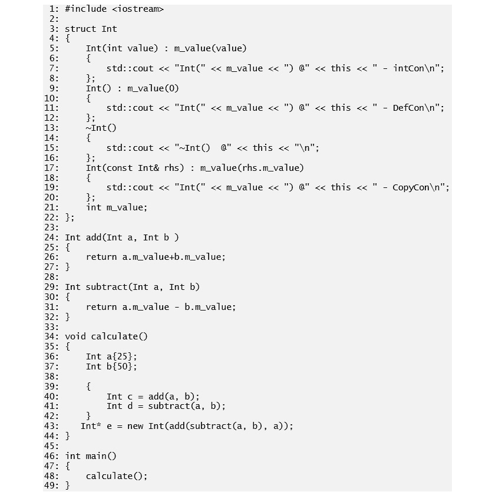

###### 图 3.1：变量作用域与生命周期测试程序

运行上述程序时，会生成以下输出：

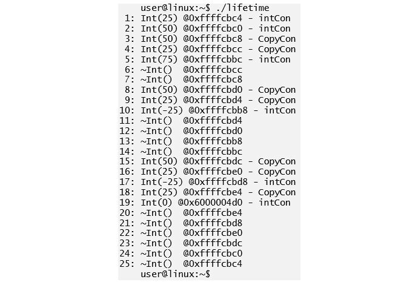

###### 图 3.2：生命周期测试程序的输出

上述输出中的十六进制数字（`0xNNNNNNNN`）是正在构造或析构的 `Int` 对象的地址。我们的程序从第 46 行的 `main()` 函数开始进入。此时，程序已经完成了大量初始化，以便一切随时可用。下图涉及两个栈——**PC Stack** 和 **Data Stack**。

这些是帮助我们解释幕后发生情况的抽象概念。**PC Stack**（**Program Counter Stack**，程序计数器栈）用于记住程序计数器的值（指向下一条需运行指令的寄存器），而 **Data Stack**（数据栈）保存我们正在操作的值或地址。尽管这是两个独立的栈，但在真实 CPU 上，很可能实现为一个栈。让我们看看下表，其中我们用 **OLn** 表示前面程序输出中的行号：

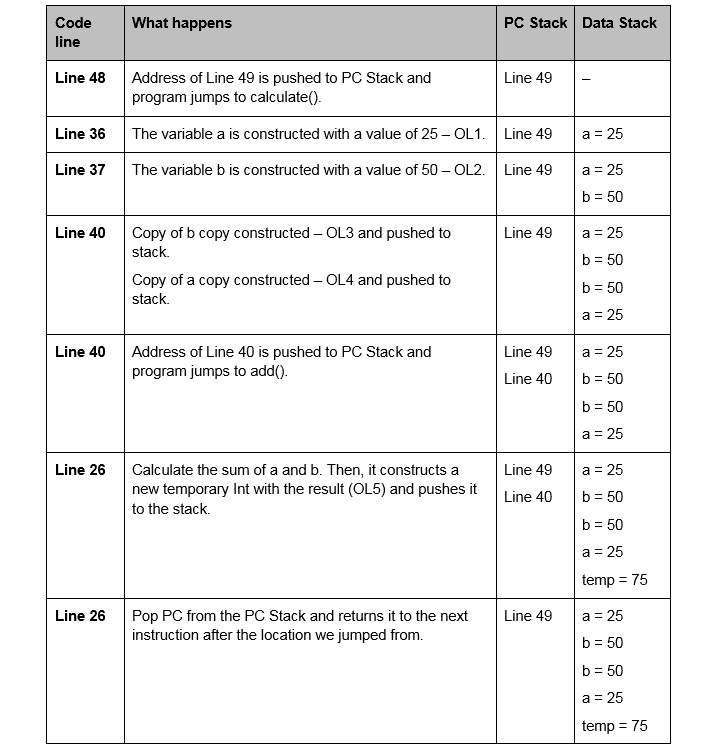

###### 图 3.3：测试程序执行的详细分析（第 1 部分）

下面是测试程序执行的详细分析第二部分：

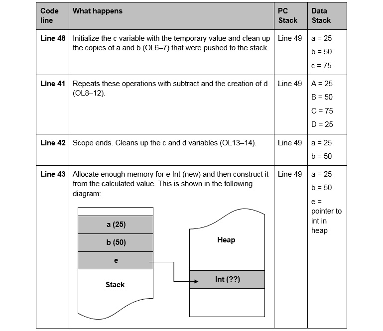

###### 图 3.4：测试程序执行的详细分析（第 2 部分）

下面是测试程序执行的详细分析第三部分：

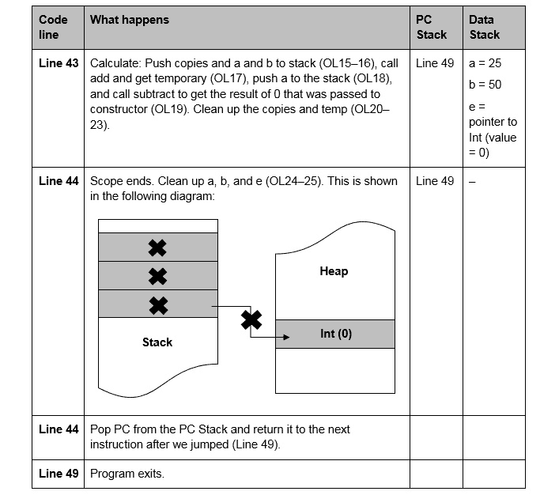

###### 图 3.5：测试程序执行的详细分析（第 3 部分）

从这个简单的程序中，我们学到了一些重要事实：

*   当我们按值传递时（本例中如此），会调用拷贝构造函数。
*   返回类型只会导致调用一次构造函数（不是两次——一次创建返回对象，一次为存储返回数据的变量）——C++ 称之为 **复制消除**，这在标准中现在是强制性的。
*   作用域结束时（右花括号 `}`），任何离开作用域的变量都会调用其析构函数。如果这是真的，那么为什么地址 `0x6000004d0` 没有显示析构函数调用（`~Int()`）？这引出了下一个事实。


`raw pointer` 的析构函数仅“销毁”指针本身，而非其指向的对象。这意味着当我们退出 `calculate()` 方法时，发生了内存泄漏。

最后这两点对于理解和解决因忘记释放资源而导致的资源泄漏问题至关重要。我们将在处理完 C++ 中的异常后探讨资源管理。

# C++ 中的异常

我们已经了解了 C++ 如何管理具有自动和动态生命周期的局部作用域变量。当自动生命周期变量超出作用域时，它会调用它们的析构函数。我们还看到了原始指针在超出作用域时如何被销毁。由于它不会清理动态生命周期变量，我们会丢失它们。这是通向后文 **资源获取即初始化** (`RAII`) 的一部分基础。但首先，我们需要了解异常如何改变程序的流程。

## 异常的必要性

在 *第 2A 章*、*不允许鸭子类型 – 类型与推导* 中，我们介绍了枚举作为处理 `check_file()` 函数魔数的一种方式：

```cpp
FileCheckStatus check_file(const char* name)
{
    FILE* fptr{fopen(name,"r")};
    if ( fptr == nullptr)
        return FileCheckStatus::NotFound;
    char buffer[30];
    auto numberRead = fread(buffer, 1, 30, fptr);
    fclose(fptr);
    if (numberRead != 30)
        return FileCheckStatus::IncorrectSize;
    if(is_valid(buffer))
        return FileCheckStatus::InvalidContents;
    return FileCheckStatus::Good;
}
```

前面的函数使用了一种称为 **状态码** 或 **错误码** 的技术来报告操作结果。这是 C 风格编程采用的方法，其中处理与 `POSIX API` 和 `Windows API` 相关的错误。

### 注意

`POSIX` 代表 **可移植操作系统接口**。它是用于 Unix 变体和其他操作系统之间软件兼容性的 IEEE 标准。

这意味着，方法的调用者必须检查返回值，并针对每种错误类型采取适当的措施。当你能推断代码将产生的错误类型时，这种方法效果很好。但情况并非总是如此。例如，输入程序的数据可能存在问题。这会导致程序进入无法处理的异常状态。包含处理错误逻辑的代码部分与检测问题的代码部分分离开了。

虽然可以编写代码来处理此类问题，但这会增加处理所有错误条件的复杂性，从而使程序难以阅读、难以推断函数的预期行为，因此也非常难以维护。

对于错误处理，异常相较于错误码提供了以下优势：

*   错误码可能被忽略 —— 异常强制处理错误（否则程序终止）。
*   异常可以沿栈向上传播到最适合响应错误的方法。错误码则需要从每个中间方法向外传播。
*   异常将错误处理与主程序流程分离，从而提高软件的可读性和可维护性。
*   异常将检测错误的代码与处理错误的代码分离。

只要你遵循最佳实践，仅将异常用于异常情况，使用异常就没有（时间）开销。这是因为实现良好的编译器会践行 C++ 的信条 —— 你不为你不用的东西买单。它可能会占用一些内存，你的代码体积可能略大，但运行时间应该不受影响。

C++ 使用异常来处理运行时异常。通过使用异常，我们可以检测错误、抛出异常，并让错误传播回可以处理它的位置。让我们修改之前的程序以引入 `divide()` 函数，并更改 `calculate()` 函数来调用它。我们还将向 `main()` 函数添加日志记录，以便探索异常的行为：

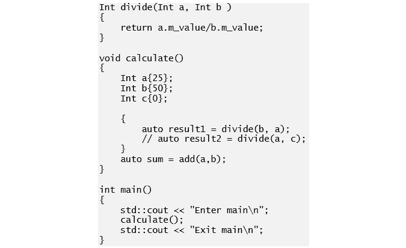
**图 3.6：** 用于研究异常的修改后测试程序

当我们编译并运行前面的程序时，会生成以下输出：

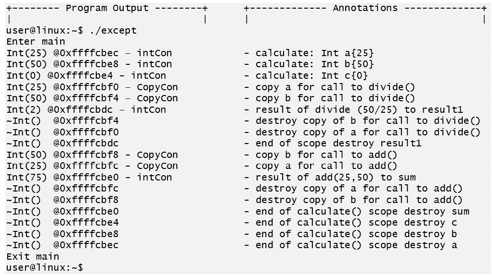
**图 3.7：** 测试程序的输出

在前面的代码中，你可以看到注释被添加在右侧。现在，我们取消程序中 `result2` 行的注释，重新编译程序并再次运行。生成的新输出如下所示：

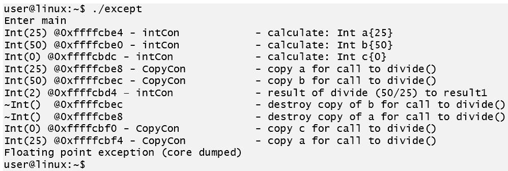
**图 3.8：** 测试程序的输出 – result2

通过比较输出，我们可以看到两者的前八行相同。前面输出的接下来两行是因为 `divide()` 函数被调用了两次而添加的。最后一行表明抛出了异常，程序已终止。

对 `divide()` 函数的第二次调用尝试除以零 —— 这是一种异常操作。这会导致一个异常。如果整数除以零，则会导致浮点异常。这与 `POSIX` 系统生成异常的方式有关 —— 它使用一种称为信号的机制（我们这里不深入信号的细节）。当整数除以零时，`POSIX` 系统将其映射为称为 `SIGFPE` 的信号，该信号最初用于 **浮点错误**，但现在是更通用的 **算术错误**。

### 注意

根据 C++ 标准，如果零作为 '`/`' 运算符（除法）或 '`%`' 运算符（取模）的除数出现，则行为未定义。大多数系统会选择抛出异常。

因此，我们从前面的解释中学到了一个重要事实：未处理的异常将终止程序（内部会调用 `std::terminate()`）。我们将修复 **未定义行为**，捕获异常，并观察输出的变化。要修复 **未定义行为**，我们需要在文件顶部添加 `#include <stdexcept>` 并修改 `divide()` 函数：

```cpp
Int divide(Int a, Int b )
{
    if (b.m_value == 0)
        throw std::domain_error("divide by zero error!");
    return a.m_value/b.m_value;
}
```

当我们重新编译并运行程序时，得到以下输出：


**图 3.9：** 抛出异常时的输出

从前面的输出可以看出，变化不大。只是我们不再得到 **浮点异常** (core dumped) —— 程序仍然终止，但不会转储核心文件。随后我们在 `main()` 函数中添加了一个 `try/catch` 块，以确保异常不再是未处理的。

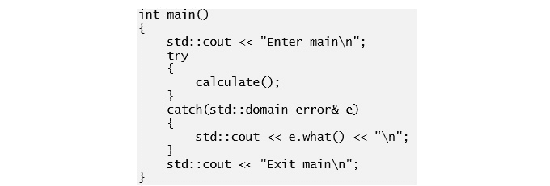
**图 3.10：** 捕获异常

重新编译程序并运行，得到以下输出：

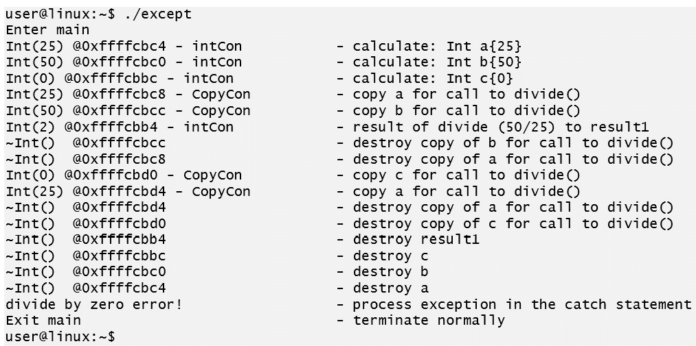
**图 3.11：** 捕获异常的程序输出

在前面的输出中，异常是在标注为“**为调用 divide 复制 a**”的第二行抛出的。此后输出的所有内容都是异常被处理的结果。

我们的代码将程序控制权转移给了 `main()` 函数中的 `catch()` 语句，并执行了所有在栈上构造的变量的析构函数（从 `try` 子句中进行调用时起）。

## 栈展开


## 栈展开与异常处理练习

C++ 语言保证销毁所有局部函数变量的过程称为**栈展开**。当异常发生时栈进行展开，C++ 使用其定义良好的规则来销毁作用域内的所有对象。

当异常发生时，函数调用栈开始从当前函数线性地向回搜索，到调用它的函数，再到调用那个函数的函数，以此类推，直到找到一个与该异常匹配的异常处理程序（由 `catch` 块表示）。

如果找到异常处理程序，则会发生栈展开，销毁栈中所有函数的局部变量。对象按其创建顺序的逆序销毁。如果没有找到处理程序来处理抛出的异常，则程序终止（通常不警告用户）。

## 练习 1：在 `Fraction` 和 `Stack` 中实现异常

在本练习中，我们将回到在*第 2A 章*、*不允许鸭子类型 – 类型与推导* 和 *第 2B 章*、*不允许鸭子类型 – 模板与推导* 中处理过的两个类——`Fraction` 和 `Stack`，它们都可能经历运行时异常。我们将更新它们的代码，以便在检测到任何问题时引发异常。请按照以下步骤实现此练习：

1.  打开 Eclipse 并使用 `Lesson3` 示例文件夹中的文件创建一个名为 `Lesson3` 的新项目。

2.  由于这是一个**基于 CMake 的项目**，请将当前构建器更改为 **CMake Build (portable)**。

3.  转到 **Project** | **Build All** 菜单以构建所有练习。默认情况下，屏幕底部控制台将显示 **CMake Console [Lesson3]**。

4.  配置一个新的 **Launch Configuration**，`L3Exercise1`，设置运行名称为 `Exercise1`。

5.  此外，配置一个新的 C/C++ Unit Run Configuration，`L3Ex1Tests`，用于运行 `L3Ex1tests`。设置 **Google Tests Runner**。

6.  点击现有 **18** 个测试的 **Run** 选项以运行并通过它们。

    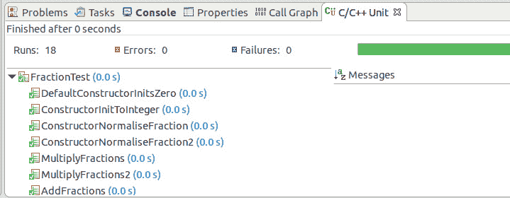

    *图 3.12：现有测试全部通过（运行数：18）*

7.  在编辑器中打开 `Fraction.hpp` 并将文件顶部的行更改为如下内容：

    ```
    #define EXERCISE1_STEP  14
    ```

8.  点击 **Run** 按钮重新运行测试——我们添加了一个测试，尝试创建一个分母为零的 `Fraction`。该测试期望抛出一个异常：

    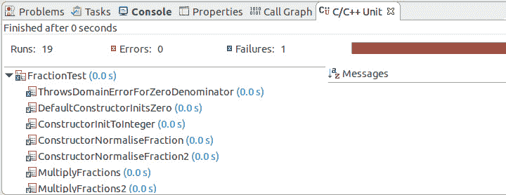

    *图 3.13：新的失败测试 ThrowsDomainErrorForZeroDenominator*

9.  点击失败的测试名称——**Messages** 窗口现在将显示期望行为和实际行为。您可能需要向右滚动以阅读全部内容。最右侧显示 "**Expected … throws an exception of type `std::domain_error`**"（期望……抛出类型为 `std::domain_error` 的异常），下一行显示 "**Actual: it throws nothing**"（实际：未抛出任何内容）。

10. 双击该消息，它将带您到以下测试：

     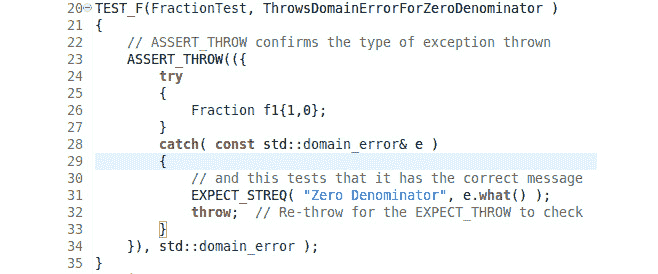

     *图 3.14：失败的测试*

     `ASSERT_THROW()` 宏需要两个参数。由于 `Fraction` 初始化器中包含一个逗号，因此有必要用额外的一组括号将整个第一个参数括起来。第二个参数期望从该构造函数获得 `std::domain_error`。内部的 `try/catch` 结构用于确认期望的字符串被捕获在异常对象内部。如果我们不想检查这一点，则可以简单地这样编写测试：

     ```
     ASSERT_THROW(({Fraction f1{1,0}; }), std::domain_error);
     ```

11. 在编辑器中打开文件 `Fraction.cpp`。在文件顶部附近插入以下行：

     ```
     #include <stdexcept>
     ```

12. 修改构造函数，如果使用零分母创建则抛出异常：

     ```
     Fraction::Fraction(int numerator, int denominator)
         : m_numerator{numerator}, m_denominator{denominator}
     {
         if(m_denominator == 0)
         {
             throw std::domain_error("Zero Denominator");
         }
     }
     ```

13. 点击 **Run** 按钮重新运行测试。现在 **19** 个测试通过。

14. 在编辑器中打开 `Fraction.hpp` 并将文件顶部附近的行更改为如下内容：

     ```
     #define EXERCISE1_STEP  20
     ```

15. 点击 **Run** 按钮重新运行测试——新测试 `ThrowsRunTimeErrorForZeroDenominator` 失败。

16. 点击失败的测试名称——**Messages** 窗口现在将显示期望行为和实际行为。您可能需要向右滚动以阅读全部内容。最右侧显示 "**Expected… throws an exception of type `std::runtime_error`**"（期望……抛出类型为 `std::runtime_error` 的异常），下一行显示 "**Actual: it throws a different type**"（实际：抛出了不同的类型）。

17. 再次双击该消息以打开失败的测试：

     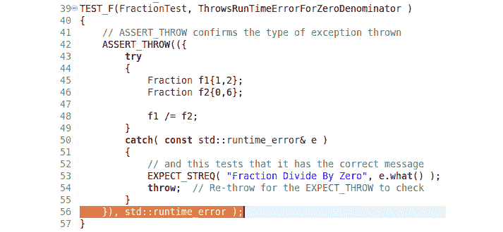

     *图 3.15：另一个失败的测试*

     此测试验证除法赋值运算符是否会因除以零而抛出异常。

18. 打开 `Fraction.cpp` 并找到 `operator/=()` 函数。您将看到，在该函数内部，它实际上使用了 `Fraction` 的构造函数，因此它会抛出 `std::domain_error`。

19. 现在修改 `operator/=()` 以在调用构造函数之前检测此问题，以便抛出带有预期消息的 `std::runtime_error`。

20. 通过添加域错误来修改 `Fraction.cpp`，该错误将检测除法运算符：

     ```
     Fraction& Fraction::operator/=(const Fraction& rhs)
     {
         if (rhs.m_numerator == 0)
         {
             throw std::runtime_error("Fraction Divide By Zero");
         }
         Fraction tmp(m_numerator*rhs.m_denominator,
                      m_denominator*rhs.m_numerator);
         *this = tmp;
         return *this;
     }
     ```

21. 点击 **Run** 按钮重新运行测试。所有 **20** 个测试通过。

22. 在编辑器中打开 `Stack.hpp` 并将文件顶部附近的行更改为如下内容：

     ```
     #define EXERCISE1_STEP  27
     ```

23. 点击 **Run** 按钮重新运行测试——我们添加了一个测试，尝试从空栈中弹出元素。在 **C/C++ Unit** 选项卡窗口中，点击 `FractionTest` 旁边的三角形以折叠测试列表并显示 `StackTest`：

     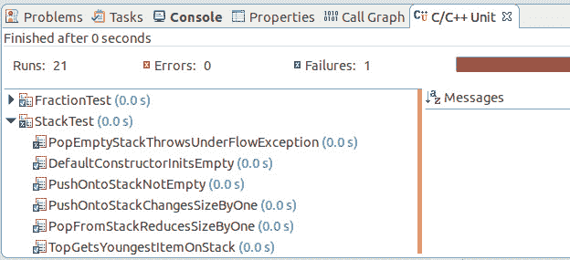

     *图 3.16：pop Stack 测试失败*

24. 使用 **C/C++ Unit** 窗口点击并定位失败的测试。确定期望的异常，然后打开 `Stack.hpp`。在文件顶部添加 `#include <stdexcept>`，然后更新 `pop()` 函数，使其如下所示：

     ```
     void pop()
     {
         if(empty())
             throw std::underflow_error("Pop from empty stack");
         m_stack.pop_back();
     }
     ```

25. 点击 **Run** 按钮重新运行测试。现在 **21** 个测试通过。

26. 在编辑器中打开 `Stack.hpp` 并将文件顶部的行更改为如下内容：

     ```
     #define EXERCISE1_STEP  31
     ```

27. 点击 **Run** 按钮重新运行测试——新添加的测试 `TopEmptyStackThrowsUnderFlowException` 失败。

28. 使用 **C/C++ Unit** 窗口点击并定位失败的测试。确定期望的异常，然后打开 `Stack.hpp`。更新非 const `top()` 方法，使其如下所示：

     ```
     reference top()
     {
         if(empty())
             throw std::underflow_error("Top from empty stack");
         return m_stack.back();
     }
     ```

29. 点击 **Run** 按钮重新运行测试。**22** 个测试通过。

30. 在编辑器中打开 `Stack.hpp` 并将文件顶部的行更改为如下内容：

     ```
     #define EXERCISE1_STEP  35
     ```


## 练习步骤

31. 点击 **Run** 按钮重新运行测试——新添加的测试 `TopEmptyConstStackThrowsUnderFlowException` 失败。

32. 使用 **C/C++ Unit** 窗口点击定位失败的测试。确定预期的异常，然后打开 `Stack.hpp`。更新 const `top()` 方法，使其如下所示：

```cpp
const_reference top() const
{
    if (empty())
        throw std::underflow_error("Top from empty stack");
    return m_stack.back();
}
```

33. 点击 **Run** 按钮重新运行测试。所有 **23** 个测试现在均通过。

在本练习中，我们为 `Fraction` 和 `Stack` 类的正常操作中包含的前置条件添加了运行时检查。仅当某个前置条件被违反时，这段代码才会执行并抛出异常，表明数据或程序执行方式存在问题。

## 异常抛出时会发生什么？

在某个时刻，我们的程序会执行以下语句：

```cpp
throw expression;
```

执行此语句即表示发生了错误条件，且我们希望对其进行处理。接下来会发生以下情况：一个称为 **异常对象** 的 **临时** 对象在未指定的存储区中构造，并从表达式进行复制初始化（这可能会调用移动构造函数，并可能受复制省略优化影响）。异常对象的类型由表达式静态确定，并移除 const 和 volatile 限定符。数组类型退化为指针，函数类型转换为函数指针。如果表达式的类型不完整或为抽象类型，则会发生编译错误。

异常对象构造完成后，控制权连同异常对象一起转移给异常处理程序。被选中的异常处理程序是其类型与异常对象类型在栈展开过程中匹配度最高的处理程序。异常对象一直存在，直到最后一个 catch 子句退出，除非它被重新抛出。表达式的类型必须具有可访问的 **拷贝构造函数** 和 **析构函数**。

## 按值抛出还是按指针抛出

既然知道了会创建、传递并销毁一个临时异常对象，那么 throw 表达式应该使用什么类型？**值** 还是 **指针**？

我们尚未详细讨论 catch 语句中类型的指定方式，稍后会讲到。但目前请注意：要捕获指针类型（被抛出的类型），catch 模式也必须是指针类型。

如果抛出一个指向对象的指针，则抛出方必须确保异常对象所指向的内容（它将是指针的副本）在异常被处理之前一直保持存活，即使经历 **栈展开** 也是如此。

该指针可以指向静态变量、全局变量或从堆上分配的内存，以确保被指向的对象在异常处理时仍然存在。现在，我们解决了保持异常对象存活的问题。但当处理程序处理完它后，捕获方该如何处理它？

异常的捕获方不知道异常对象的创建方式（**全局**、**静态** 或 **堆**），因此不知道是否应该删除接收到的指针。因此，**按指针抛出** 不是抛出异常的推荐方法。

被抛出的对象将被复制到创建的临时异常对象中，并移交给处理程序。异常处理完成后，临时对象将被简单销毁，程序继续执行。对此如何处理不存在歧义。因此，最佳实践是 **按值抛出异常**。

## 标准库异常

C++ 标准库定义 `std::exception` 作为所有标准库异常的基类。标准定义了以下一级 **异常**/**错误** 层级（括号中的数字表示派生自该类的异常数量）：

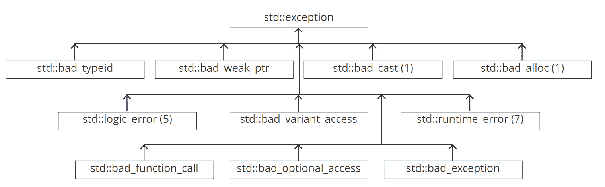

**图 3.17：标准库异常层级（两级）**

这些异常贯穿 C++ 标准库（包括 STL）。创建自定义异常类的最佳实践是从标准异常之一派生。正如我们接下来将看到的，您的特殊异常可以被标准异常的处理程序捕获。

## 捕获异常

在讨论异常的必要性时，我们引入了抛出异常的概念，但并未真正探讨 C++ 如何支持捕获异常。异常处理过程始于一段代码被包裹在 **try** 块中，使其置于 **异常检查** 之下。try 块后跟一个或多个 catch 块，它们是异常处理程序。当在执行 try 块内的代码时发生异常情况，会抛出异常，控制权转移给异常处理程序。如果未抛出异常，则跳过所有异常处理程序，try 块中的代码正常完成，程序继续正常执行。用代码片段表示这些概念：

```cpp
void SomeFunction()
{
    try {
        // code under exception inspection
    }
    catch (myexception e)        // first handler – catch by value
    {
        // some error handling steps
    }
    catch (std::exception* e)    // second handler – catch by pointer
    {
        // some other error handling steps
    }
    catch (std::runtime_error& e) // third handler – catch by reference
    {
        // some other error handling steps
    }
    catch (...)                   // default exception handler – catch any exception
    {
        // some other error handling steps
    }
    // Normal programming continues from here
}
```

上述片段展示了必要的关键字——`try` 和 `catch`，并介绍了三种不同的 catch 模式（不包括默认处理程序）：

*   **按值捕获异常**：这是一种代价高昂的机制，因为异常处理程序像其他函数一样被处理。按值捕获意味着必须创建异常对象的副本并传递给处理程序。第二个副本的创建会降低异常处理速度。这种类型还可能遭受 **对象切片** 问题：当派生类被抛出而 catch 子句是基类时，catch 子句将仅接收基类对象的副本，丢失原始异常对象的属性。因此，应避免按值捕获异常的处理程序。

*   **按指针捕获异常**：正如在按值抛出时讨论的，按指针捕获的处理程序只能捕获按指针抛出的异常。既然我们只想按值抛出，就应避免按指针捕获异常的处理程序。

*   **按引用捕获表达式**：这是推荐的异常处理程序风格，因为它不受按值捕获和按指针捕获相关问题的影响。由于传递的是引用，不会创建异常对象的第二个副本。不会发生切片，因为引用仍指向原始抛出的异常对象。且由于异常是按值抛出的，临时异常对象在处理完成后会自动销毁。

### 注意

处理异常时，**按值抛出** 且 **按引用捕获**。


当存在多个 catch 块时，异常对象的类型用于按指定顺序匹配处理程序。一旦找到匹配的处理程序，它将被执行，其余的异常处理程序将被忽略。这与函数解析不同，编译器会寻找与参数的最佳匹配。因此，异常处理程序（catch 块）应从更具体的定义到更通用的定义。例如，默认处理程序 `catch(...)` 应始终放在定义的最后。

## Exercise 2: Implementing Exception Handlers

在本练习中，我们将实现一个异常处理程序层次结构来管理异常的处理方式。请按照以下步骤实现此练习：

1.  在 Eclipse 中打开 **Lesson3** 项目。然后在 **Project Explorer** 中，展开 **Lesson3** 再展开 **Exercise02**，双击 **exceptions.cpp** 以在编辑器中打开该练习文件。该文件包含以下代码：

```cpp
#include <exception>
#include <iostream>

void run_exceptions()
{
    try
    {
        throw std::domain_error("We got one!!!!");
    }
    catch(...)
    {
        std::cout << "Exception caught by default handler\n";
    }
    catch(const std::exception& e)
    {
        std::cout << "Exception '" << "' caught by std::exception handler\n";
    }
    catch(const std::logic_error& e)
    {
        std::cout << "Exception '" << "' caught by std::logic_error handler\n";
    }
    catch(const std::domain_error& e)
    {
        std::cout << "Exception '" << "' caught by std::domain_error handler\n";
    }
}

int main()
{
    std::cout << "\n\n------ Exercise 2 ------\n";
    run_exceptions();
    std::cout << "Complete.\n";
    return 0;
}
```

#### Note

所有异常处理程序都为异常参数使用了相同的名称 `e`。该变量的作用域仅限于声明它的 catch 块。

2.  点击 **Launch Configuration** 下拉菜单并选择 **New Launch Configuration…**。从 **Search Project** 菜单配置 **L3Exercise2** 应用程序以名称 **L3Exercise2** 运行它。

3.  完成后，它将成为当前选定的 **Launch Configuration**。

4.  点击 **Run** 按钮。练习 2 将运行并产生以下输出：


###### Figure 3.18: Exercise 2 output – default handler caught the exception

5.  在 Console 窗口中，点击 **Display Selected Console** 按钮，并选择 **CDT Global Build Console**。滚动窗口。你将发现（如果使用 GCC 编译器）有五条警告消息与我们放置异常处理程序的顺序有关。（实际上，第一个警告通常会是一个错误，除非 `CMake` 文件在编译此目标时设置了 `-fpermissive` 标志。）

6.  在编辑器中，将默认异常处理程序 `catch(...)` 移动到 `std::domain_error` 处理程序之后。点击 **Run** 按钮。练习 2 将运行并产生以下输出：


###### Figure 3.19: std::exception handler has been used

7.  在编辑器中，将 `std::exception` 处理程序移动到 `std::domain_error` 处理程序之后。点击 **Run** 按钮。这一次，它将报告执行了 `std::logic_error` 处理程序。

8.  在编辑器中，将 `std::logic_error` 处理程序移动到 `std::domain_error` 处理程序之后。点击 **Run** 按钮。这一次，它将报告执行了 `std::domain_error` 处理程序，这实际上是我们所期望的。

9.  现在将 `throw` 行更改为 `std::logic_error` 异常。点击 **Run** 按钮。这一次，它将报告执行了 `std::logic_error` 处理程序，正如预期的那样。

10. 现在将 `throw` 行更改为 `std::underflow_error` 异常。点击 **Run** 按钮，这一次它将报告异常被 `std::exception` 处理程序捕获，正如预期的那样。`std::exception` 是所有标准库异常的基类。

在本练习中，我们实现了一系列异常处理程序，并观察了异常处理程序的顺序如何影响异常的捕获方式，以及异常层次结构如何被使用。

## CMake Generator Expressions

使用 `CMake` 时，有时需要调整变量的值。`CMake` 是一个构建生成器系统，可以为许多构建工具和编译器工具链生成构建文件。由于这种灵活性，如果你想在编译器中开启某个功能，只需将其应用于一种特定类型即可。这是因为不同供应商的命令行选项不同。例如，g++ 编译器启用 C++17 支持的命令行选项是 `-std=c++17`，但对于 `msvc` 则是 `/std:c++17`。如果你打开 `CMakeLists.txt` 文件并找到 `L3Exercise2` `add_executable`，则在其后会有以下行：

```cmake
target_compile_options(L3Exercise2 PRIVATE $<$<CXX_COMPILER_ID:GNU>:-fpermissive>)
```

这使用 `$<CXX_COMPILER_ID:GNU>` 变量查询来检查是否为 GCC 编译器。如果是，则生成 1（真），否则生成 0（假）。它还使用 `$<condition:true_string>` 条件表达式为 `L3Exercise2` 目标添加 `-fpermissive` 到编译器选项，但仅针对 gcc 编译器。这些可以作为对 `target_compile_options` 的单独调用为每种编译器类型添加，或通过一次调用添加。

#### Note

有关生成器表达式的更多信息，请查看以下链接：[`cmake.org/cmake/help/v3.15/manual/cmake-generator-expressions.7.html`](https://cmake.org/cmake/help/v3.15/manual/cmake-generator-expressions.7.html)。

## Exception Usage Guidelines

在 C++ 代码中使用异常时，请记住以下几点：

*   **Throw by value and catch by reference**
*   **Do not use exceptions for normal program flow**。只有当函数遇到异常情况且无法履行其（功能）义务时，才抛出异常。如果函数能够解决异常情况并履行其义务，则这不是异常。它们之所以被称为异常是有原因的，如果你不使用它们，不会产生任何处理开销。
*   **Do not throw an exception from within a destructor**。请记住，由于栈展开，局部变量的析构函数将被执行。如果在栈展开过程中调用析构函数并抛出异常，则程序将终止。
*   **Do not swallow exceptions**。不要使用默认的 catch 处理程序而不对异常做任何处理。异常被抛出是为了表明存在问题，你应该对此做些处理。忽略异常可能导致稍后出现难以排查的故障。因为任何有用的信息都会随被吞没的异常真正丢失。
*   **The exception object is copied from the `throw`**。

## Resource Management (in an Exceptional World)


到目前为止，我们已经研究了局部变量作用域，以及当变量超出作用域时，自动和动态生命周期变量是如何被处理的——自动生命周期变量（放在栈上的变量）会被完全销毁，而动态生命周期变量（由程序员分配在堆上的变量）则不会被销毁：我们只是失去了对它们的访问权。我们还了解到，当抛出异常时，会找到最近的匹配处理程序，并且抛出点和处理程序之间的所有局部变量都将通过栈展开过程被销毁。

我们可以利用这些知识编写健壮的资源管理类，从而免去我们跟踪资源（动态生命周期变量、文件句柄、系统句柄等）的必要，以确保在我们用完它们时它们被释放（归还给系统）。无论在正常操作还是异常情况下，用于管理资源的技术被称为**资源获取即初始化**（RAII）。

## 资源获取即初始化

RAII 是另一个命名不当的概念的绝佳示例（另一个是 SFINAE）。RAII，即 Resource Acquisition is Initialization，描述了用于管理资源的类的行为。如果它被命名为“销毁即资源释放”可能会更好，这真正捕捉了管理类试图做的事情的本质。我们可以从之前的讨论中推断出如何使其工作，但展示一个单独的示例来开发资源管理 `File` 类，并展示 RAII 如何提高可读性以及我们推断函数功能的能力，将更具指导意义。

请考虑以下代码：

```cpp
void do_something()
{
    FILE* out{};
    FILE* in = fopen("input.txt", "r");
    try
    {
        if (in != nullptr)
        {
            // UNSAFE – 此处的异常将造成资源泄漏
            out = fopen("output.txt", "w");
            if (out != nullptr)
            {
                // 执行一些工作
                // UNSAFE – 此处的异常将造成资源泄漏
                fclose(out);
            }
            fclose(in);
        }
    }
    catch(std::exception& e)
    {
        // 响应异常
    }
}
```

这段代码展示了资源管理的两个潜在问题：

*   **最重要的是**，在文件打开和关闭之间发生异常会导致资源泄漏。如果这是系统资源，许多此类泄漏会导致系统不稳定或应用程序性能受到不利影响，因为系统因资源短缺而“挨饿”。
*   此外，在一个方法中管理多个资源可能会因错误处理而导致深度嵌套的子句。这不利于代码的可读性，进而影响其理解和维护。特别是在有多个退出点时，很容易忘记释放资源。

那么，如何管理资源才能使代码既异常安全又简洁？这个问题并非 C++ 独有，不同语言有不同的处理方式。Java、C# 和 Python 使用垃圾回收方法，扫描创建的对象并在它们不再被引用时清理它们。但 C++ 没有垃圾回收，那么解决方案是什么？

请考虑以下类：

```cpp
class File {
public:
    File(const char* name, const char* access) {
        m_file = fopen(name, access);
        if (m_file == nullptr) {
            throw std::ios_base::failure("failed to open file");
        }
    }
    ~File() {
        fclose(m_file);
    }
    operator FILE*() {
        return m_file;
    }
private:
    FILE* m_file{};
};
```

该类实现了以下特征：

*   构造函数获取资源。
*   如果在构造函数中未能获取资源，则抛出异常。
*   当类被销毁时，释放资源。

如果我们在 `do_something()` 方法中使用该类，它看起来将如下所示：

```cpp
void do_something()
{
    try
    {
        File in("input.txt", "r");
        File out("output.txt", "w");
        // 执行一些工作
    }
    catch(std::exception& e)
    {
        // 响应异常
    }
}
```

如果在此过程中发生异常，C++ 保证所有基于栈的对象都会调用其析构函数（栈展开），从而确保文件被关闭。这解决了异常发生时资源泄漏的问题，因为资源现在会被自动清理。此外，该方法非常易读，我们可以在不必担心错误处理的情况下理解逻辑流程。

该技术利用 `File` 对象的生命周期来获取和释放资源，确保资源不泄漏。资源在管理类的构造（初始化）期间获取，在管理类的销毁期间释放。正是这种作用域绑定资源的行为催生了“资源获取即初始化”这一名称。

前面的示例处理的是作为系统资源的文件句柄管理。它适用于任何使用前需要获取、用完后需要释放的资源。RAII 技术可应用于广泛的资源——打开的文件、打开的管道、分配的堆内存、打开的套接字、执行线程、数据库连接、互斥锁/临界区的锁定——基本上任何在宿主系统中供应短缺且需要管理的资源。

## 练习 3：为内存和文件句柄实现 RAII

在本练习中，我们将实现两个不同的类，它们将使用 RAII 技术来管理内存或文件。请按照以下步骤实现此练习：

1.  在 Eclipse 中打开 `Lesson3` 项目。然后在 `Project Explorer` 中展开 `Lesson3`，再展开 `Exercise03`，双击 `Exercise3.cpp` 以在编辑器中打开该练习文件。
2.  点击 `Launch Configuration` 下拉菜单并选择 `New Launch Configuration…`。从 `Search Project` 菜单配置 `L3Exercise3` 应用程序以名称 `L3Exercise3` 运行它。
3.  点击 `Run` 按钮运行练习 3。这将产生以下输出：

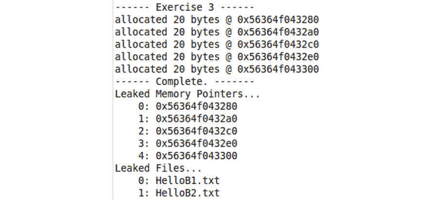

###### 图 3.20：来自 Exercise3.cpp 的内存和文件泄漏

输出显示我们分配了五次内存，地址由 new 返回。当从 `main()` 函数执行且 `monitor` 被销毁时，它会转储一份报告，列出已分配和已释放的内存，以及已打开但从未关闭的文件。

4.  在编辑器中，将以下内容输入到 `File` 类的 `Exercise3.cpp` 文件中：

```cpp
class File {
public:
    File(const char* name, const char* access) {
        m_file = fopen(name, access);
        if (m_file == nullptr) {
            throw std::ios_base::failure("failed to open file");
        }
    }
    ~File() {
        fclose(m_file);
    }
    operator FILE*() {
        return m_file;
    }
private:
    FILE* m_file{};
};
```

5.  点击 `Run` 按钮运行练习 3——它仍然泄漏文件和内存，但代码是正确的。

6.  找到 `LeakFiles()` 函数并修改它，使其使用新的 `File` 类（如前面的代码所示）来防止文件泄漏：

```cpp
void LeakFiles()
{
    File fh1{"HelloB1.txt", "w"};
    fprintf(fh1, "Hello B2\n");
    File fh2{"HelloB2.txt", "w"};
    fprintf(fh2, "Hello B1\n");
}
```


7. 点击 `Run` 按钮运行练习 3。如果你已正确修改 `LeakFiles()`，则输出将如下所示：

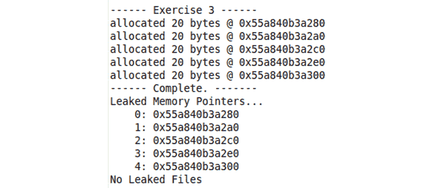

图 3.21：无文件泄漏

8. 现在在 `Exercise3.cpp` 中添加以下 `CharPointer` 类：

```cpp
class CharPointer
{
public:
    void allocate(size_t size)
    {
        m_memory = new char[size];
    }
    operator char*() { return m_memory; }
private:
    char* m_memory{};
};
```

9. 修改 `LeakPointers()` 使其如下所示：

```cpp
void LeakPointers()
{
    CharPointer memory[5];
    for (auto i{0} ; i<5 ; i++)
    {
        memory[i].allocate(20);
        std::cout << "allocated 20 bytes @ " << (void*)memory[i] << "\n";
    }
}
```

10. 点击 `Run` 按钮运行练习 3 —— 它仍然存在内存泄漏，但代码是正确的。

11. 现在，为 `CharPointer` 添加以下析构函数。注意 `delete` 运算符使用了数组 `[]` 语法：

```cpp
~CharPointer()
{
    delete[] m_memory;
}
```

12. 再次点击 `Run` 按钮运行练习 3 —— 这一次，你应该会看到监视器报告无泄漏：

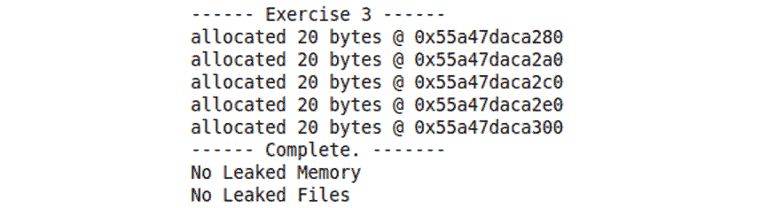

图 3.22：无泄漏 —— 内存或文件

`File` 和 `CharPointer` 的实现体现了 `RAII` 设计方法，但在设计这些类时还有其他考量因素。例如，我们是否需要拷贝构造函数或拷贝赋值函数？在这两种情况下，仅将资源从一个对象复制到另一个对象都可能会导致问题，因为这可能引发两次关闭文件句柄或两次删除内存的尝试。通常这会导致未定义行为。接下来，我们将结合实现资源管理对象（如 `File` 或 `CharPointer`）的情况，重新审视特殊成员函数。

### 特殊编码技巧

`练习 3：为内存和文件句柄实现 RAII` 的代码经过专门编写，以便我们可以监控内存和文件句柄的使用情况，并在退出时报告任何泄漏。请访问 `monitor.h` 和 `monitor.cpp` 文件，检查用于实现监视器的两种技术：

*   **预处理器宏**：这是预处理器宏的特殊用法，用于演示泄漏，不应在生产代码中使用，即通过文本替换来替换函数。

    如果你针对 Windows API 编程，可能偶尔会发现你的方法名称与 Microsoft 用于其 API 方法的宏发生冲突。例如，如果你包含了 `windows.h`，请勿将你的任何方法命名为 `SendMessage`。如果你这样做了，则取决于你是构建 ASCII 模式还是 Unicode 模式，它将分别被替换为 `SendMessageA` 或 `SendMessageW`。

*   **定义我们自己的 new 处理程序**：这是一种高级技术，除非你编写嵌入式代码，否则不太可能用到它。

### C++ 不需要 finally

其他支持异常抛出机制的语言（`C#`、`Java` 和 `Visual Basic.NET`）具有 `try/catch/finally` 范式，其中 `finally` 块中的代码在退出 try 块时被调用 —— 无论是正常退出还是因异常退出。C++ 没有 `finally` 块，因为它拥有一种更好的机制，可确保我们不会忘记释放资源 —— `RAII`。由于资源由局部对象表示，局部对象的析构函数将释放资源。

这种设计模式的额外优势在于，如果管理大量资源，则 `finally` 块会相应地变得很大。`RAII` 消除了对 finally 的需求，从而产生更易于维护的代码。

### RAII 与 STL

标准模板库（`STL`）在其许多模板和类中利用了 `RAII`。例如，C++11 引入的智能指针，即 `std::unique_ptr` 和 `std::shared_ptr`，通过确保内存在使用完毕后被释放，或确保内存在其他地方仍在使用时不被释放，有助于避免许多问题。`STL` 中的其他示例包括 `std::string`（内存）、`std::vector`（内存）和 `std::fstream`（文件句柄）。

### 谁拥有这个对象？

通过前面 `File` 和 `CharPointer` 的实现，我们已经用 `RAII` 测试了资源管理。让我们进一步探索。首先，我们将定义一个拥有不止一种资源的类：

```cpp
class BufferedWriter
{
public:
    BufferedWriter(const char* filename);
    ~BufferedWriter();
    bool write(const char* data, size_t length);
private:
    const size_t BufferSize{4096};
    FILE* m_file{nullptr};
    size_t m_writePos{0};
    char* m_buffer{new char[BufferSize]};
};
```

该类用于缓冲写入文件的操作。

#### 注意

使用 `iostream` 派生类时通常不需要这样做，因为它们已经提供了缓冲功能。

每次调用 `write()` 函数都会将数据添加到分配的缓冲区中，直到达到 `BufferSize`，此时数据才会真正写入文件，并重置缓冲区。

但如果我们想将这个 `BufferedWriter` 实例赋值给另一个实例或拷贝它怎么办？正确的行为是什么？

如果我们让默认的拷贝构造函数/拷贝赋值运算符按部就班地工作，我们将得到成员的逐个复制。这意味着我们将有两个 `BufferedWriter` 实例持有相同的文件句柄和缓冲区指针。当第一个对象实例被销毁时，作为优秀的程序员，我们会通过关闭文件和删除内存来清理资源。第二个实例现在持有一个失效的文件句柄和一个指向我们已告知操作系统回收以供下一个用户使用的内存的指针。任何尝试使用这些资源的行为（包括销毁它们）都将导致未定义行为，极有可能导致程序崩溃。默认的拷贝构造函数/拷贝赋值运算符执行的是所谓的 `浅拷贝` —— 即按位逐个复制所有成员（但不复制它们所指向的内容）。

我们拥有的这两种资源可以区别对待。首先，应该只有一个类拥有 `m_buffer`。处理此问题有两种选择：

*   禁止类的拷贝，从而禁止内存的拷贝
*   执行 `深拷贝`，即在第二个实例中由构造函数分配缓冲区，并复制第一个缓冲区的内容

其次，应该只有一个类拥有文件句柄（`m_file`）。处理此问题有两种选择：

*   禁止类的拷贝，从而禁止文件句柄的拷贝
*   将 `所有权` 从原始实例转移到第二个实例，并将原始实例标记为无效或为空（无论那意味着什么）

实现深拷贝很容易，但我们如何转移资源的所有权？要回答这个问题，我们需要再次审视临时对象和值类别。

### 临时对象

临时对象是在将表达式的中间结果存入变量（或直接丢弃）之前，为存储这些中间结果而创建的。表达式是指任何返回值的代码，包括按值传递给函数、从函数返回值、隐式转换、字面量和二元运算符。临时对象是 `右值表达式`，它们拥有临时分配的内存作为位置，用于存放表达式结果。正是这种临时对象的创建和它们之间的数据复制，在 C++11 之前导致了一些性能问题。为了解决这个问题，C++11 引入了 `右值引用` 以实现所谓的 `移动语义`。

### 移动语义


## 右值引用与移动语义

**右值引用**（用双与号 `&&` 表示）是一种仅绑定到 **右值** 的引用，它会延长该右值的生命周期，直到 **右值引用** 本身结束使用为止。因此，**右值** 可以存活于定义它的表达式之外。有了 **右值引用**，我们现在可以通过移动构造函数和移动赋值运算符来实现移动语义。移动语义的目的是从被引用对象“窃取”资源，从而避免昂贵的拷贝操作。移动完成后，被引用对象必须处于稳定状态。换句话说，被移动的对象必须保持在一种状态下，使其在销毁时不会导致任何未定义行为或程序崩溃，也不应影响已被窃取的资源。

C++11 还引入了一个转型运算符 `std::move()`，它将 **左值** 转换为 **右值**，以便调用移动构造函数或移动赋值运算符来“移动”资源。`std::move()` 方法本身并不实际移动数据。

值得注意的是，在移动构造函数和移动赋值运算符内部，**右值** 引用实际上是一个 **左值**。这意味着，如果你想确保在方法内部发生移动语义，可能需要再次对成员变量使用 `std::move()`。

随着 C++11 引入移动语义，标准库也随之更新以利用这一新能力。例如，`std::string` 和 `std::vector` 已更新以包含移动语义。要获得移动语义的好处，只需使用最新的 C++ 编译器重新编译代码即可。

## 实现智能指针

智能指针是一种资源管理类，它持有指向资源的指针，并在超出作用域时释放该资源。在本节中，我们将实现一个智能指针，观察其作为支持拷贝的类的行为，使其演进以支持移动语义，最后移除其对拷贝操作的支持：

```cpp
#include <iostream>

template<class T>
class smart_ptr
{
public:
    smart_ptr(T* ptr = nullptr) : m_ptr(ptr)
    {
    }
    ~smart_ptr()
    {
        delete m_ptr;
    }
    // 拷贝构造函数 --> 执行深拷贝
    smart_ptr(const smart_ptr& a)
    {
        m_ptr = new T;
        *m_ptr = *a.m_ptr;        // 使用 operator=() 执行深拷贝
    }
    // 拷贝赋值 --> 执行深拷贝
    smart_ptr& operator=(const smart_ptr& a)
    {
        // 自赋值检测
        if (&a == this)
            return *this;
        // 释放当前持有的任何资源
        delete m_ptr;
        // 拷贝资源
        m_ptr = new T;
        *m_ptr = *a.m_ptr;
        return *this;
    }
    T& operator*() const { return *m_ptr; }
    T* operator->() const { return m_ptr; }
    bool is_null() const { return m_ptr == nullptr; }

private:
    T* m_ptr{nullptr};
};

class Resource
{
public:
    Resource() { std::cout << "Resource acquired\n"; }
    ~Resource() { std::cout << "Resource released\n"; }
};

smart_ptr<Resource> createResource()
{
    smart_ptr<Resource> res(new Resource);                       // 步骤 1
    return res; // 返回值调用拷贝构造函数                       // 步骤 2
}

int main()
{
    smart_ptr<Resource> the_res;
    the_res = createResource(); // 赋值调用拷贝赋值 步骤 3/4
    return 0; // 步骤 5
}
```

运行该程序时，将生成以下输出：


**图 3.23：智能指针程序输出**

对于这样一个简单的程序，却发生了大量的资源获取和释放。让我们逐步分析：

1.  `createResource()` 内部的局部变量 `res` 在堆上创建并初始化（动态生命周期），导致第一条 "**Resource acquired**"（资源已获取）消息输出。

2.  编译器可能会创建另一个临时对象来返回值。然而，编译器执行了 **拷贝省略** 以移除该拷贝（即它能直接在调用函数分配的栈位置上构建对象）。编译器具有 **返回值优化** (**RVO**) 和 **命名返回值优化** (**NRVO**) 优化，在 C++17 中，这些在特定情况下已成为强制性的。

3.  临时对象通过拷贝赋值赋给 `main()` 函数中的 `the_res` 变量。由于拷贝赋值执行深拷贝，因此又获取了一份资源副本。

4.  赋值完成后，临时对象超出作用域，我们得到第一条 "Resource released"（资源已释放）消息。

5.  当 `main()` 函数返回时，`the_res` 超出作用域，释放第二个 Resource。

因此，如果资源很大，由于拷贝赋值中的深拷贝，我们在 `main()` 中创建 `the_res` 局部变量的方式效率极低，因为我们在大量创建和拷贝大块内存。然而，我们知道当 `createResource()` 创建的临时变量不再需要时，我们将丢弃它并释放其资源。在这些场景下，将资源从临时对象转移（或移动）给该类型的另一个实例会更高效。移动语义使我们能够重写 `smart_ptr` 模板，使其不执行深拷贝，而是转移资源。

让我们为 `smart_ptr` 类添加移动语义：

```cpp
// 移动构造函数 --> 转移资源
smart_ptr(smart_ptr&& a) : m_ptr(a.m_ptr)
{
    a.m_ptr = nullptr;    // 置于安全状态
}

// 移动赋值 --> 转移资源
smart_ptr& operator=(smart_ptr&& a)
{
    // 自赋值检测
    if (&a == this)
        return *this;
    // 释放当前持有的任何资源
    delete m_ptr;
    // 转移资源
    m_ptr = a.m_ptr;
    a.m_ptr = nullptr;    // 置于安全状态
    return *this;
}
```

重新运行程序后，我们得到以下输出：


**图 3.24：使用移动语义的智能指针程序输出**

现在，因为移动赋值可用，编译器在以下行使用了它：

`the_res = createResource(); // 赋值调用拷贝赋值 步骤 3/4`

**步骤 3** 现在被移动赋值取代，意味着深拷贝已被移除。

**步骤 4** 不再释放资源，因为带注释 `// 置于安全状态` 的那一行代码——它不再拥有资源，因为所有权已被转移。

关于 **移动构造函数** 和 **移动赋值** 的另一点是，它们的参数在拷贝版本中是 `const`，而在移动版本中是 **非 const** 的。这被称为 **所有权转移**，意味着我们需要修改传入的参数。

移动构造函数的另一种实现可能如下所示：

```cpp
// 移动构造函数 --> 转移资源
smart_ptr(smart_ptr&& a)
{
    std::swap(this->m_ptr, a.m_ptr);
}
```

本质上，我们是在交换资源，C++ STL 为 swap 提供了模板支持并有许多特化版本。这之所以有效，是因为我们使用成员初始化将 `m_ptr` 设置为 `nullptr`。所以我们实际上是将一个 `nullptr` 与 `a` 中存储的值进行交换。

既然我们已经解决了不必要的深拷贝问题，实际上可以从 `smart_ptr()` 中移除拷贝操作，因为所有权转移才是我们想要的行为。如果我们将一个非临时 `smart_ptr` 实例拷贝到另一个非临时 `smart_ptr` 实例，那么我们将有两个对象在超出作用域时删除该资源，这不是期望的行为。要移除（深）拷贝操作，我们如下更改成员函数的定义：

```cpp
smart_ptr(const smart_ptr& a) = delete;
```


`smart_ptr& operator=(const smart_ptr& a) = delete;`

`= delete` 这一后缀是我们在 *第 2A 章*、*不允许鸭子类型 – 类型与推导* 中讨论过的，它告诉编译器：尝试访问具有该原型的函数现在是无效代码，并会导致错误。

## STL 智能指针

我们不必自己编写 `smart_ptr`，STL 提供了可用于在对象上实现 RAII（资源获取即初始化）的类。最初的版本是 `std::auto_ptr()`，它在 C++11 中被弃用，在 C++17 中被移除。它是在支持 `rvalue`（右值）引用之前创建的，并因使用拷贝来实现移动语义而导致问题。C++11 引入了三个新模板来管理资源的生命周期和所有权：

*   **`std::unique_ptr`**：通过指针拥有并管理**单个对象**，并在 `unique_ptr` 离开作用域时销毁该对象。它有两个版本：用于单个对象（使用 `new` 创建）和用于对象数组（使用 `new[]` 创建）。`unique_ptr` 的效率与直接使用底层指针相当。

*   **`std::shared_ptr`**：通过指针保留对象的共享所有权。它通过引用计数来管理资源。每次将 `shared_ptr` 拷贝赋值给另一个 `shared_ptr` 时，都会更新引用计数。当引用计数降为零时，意味着不再有所有者，资源将被释放/销毁。

*   **`std::weak_ptr`**：提供与 `shared_ptr` 相同资源的接口，但不修改计数器。它可以检查资源是否仍然存在，但不会阻止资源被销毁。如果确定资源仍然存在，则可以用它来获取指向该资源的 `shared_ptr`。其一个用例是多个 `shared_ptr` 形成循环引用的场景。循环引用会阻止资源的自动释放。`weak_ptr` 用于打破循环，使资源能在适当的时候被释放。

### std::unique_ptr

`std::unique_ptr()` 在 C++11 中引入，用于替代 `std::auto_ptr()`，它提供了 `smart_ptr` 的所有功能（甚至更多）。我们可以按如下方式重写 `smart_ptr` 程序：

```cpp
#include <iostream>
#include <memory>

class Resource
{
public:
    Resource() { std::cout << "Resource acquired\n"; }
    ~Resource() { std::cout << "Resource released\n"; }
};

std::unique_ptr<Resource> createResource()
{
    std::unique_ptr<Resource> res(new Resource);
    return res;
}

int main()
{
    std::unique_ptr<Resource> the_res;
    the_res = createResource(); // assignment invokes the copy assignment
    return 0;
}
```

我们可以更进一步，因为 C++14 引入了一个辅助方法，以确保在处理 `unique_ptr` 时的异常安全：

```cpp
std::unique_ptr<Resource> createResource()
{
    return std::make_unique<Resource>();
}
```

*为什么这很有必要？* 请看下面的函数调用：

`some_function(std::unique_ptr<T>(new T), std::unique_ptr<U>(new U));`

问题在于编译器可以按任何顺序对参数列表中的操作序列进行排序。它可能先调用 `new T`，然后 `new U`，接着 `std::unique_ptr<T>()`，最后 `std::unique_ptr<U>()`。这种顺序的问题在于：如果 `new U` 抛出异常，那么 `new T` 分配的资源尚未被放入 `unique_ptr` 中，因此不会被自动清理。使用 `std::make_unique<>()` 可以保证调用顺序，使资源的构造和 `unique_ptr` 的构造同时发生，从而避免资源泄露。在 C++17 中，由于求值顺序规则收紧，`make_unique` 的必要性已降低。不过，使用 `make_unique<T>()` 方法仍然是个好主意，因为未来转换为 `shared_ptr` 会更容易。

名称 `unique_ptr` 明确表达了该模板的意图：它是所指对象的唯一所有者。这一点从 `auto_ptr` 中并不明显。同样，`shared_ptr` 也清楚地表明了其共享资源的意图。`unique_ptr` 模板提供了以下运算符的访问：

*   `T* get()`：返回托管资源的指针。
*   `operator bool()`：如果实例管理资源则返回 `true`（即 `get() != nullptr`）。
*   `T& operator*()`：托管资源的 `lvalue`（左值）引用。等同于 `*get()`。
*   `T* operator->()`：托管资源的指针。等同于 `get()`。
*   `T& operator[](size_t index)`：对于 `unique_ptr(new [])`，它提供对托管数组的访问，就像原生数组一样。返回 `lvalue`（左值）引用，以便可以设置和获取值。

### std::shared_ptr

当你想要共享资源的所有权时，会使用共享指针。为什么要这样做？有几种场景非常适合共享资源，例如在 GUI（图形用户界面）程序中，你可能想要共享字体对象、位图对象等。**GoF 享元设计模式** 就是另一个例子。

`std::shared_ptr` 提供了与 `std::unique_ptr` 相同的所有功能，但开销更大，因为它必须跟踪对象的引用计数。`std::unique_ptr` 所述的所有运算符均可用于 `std::shared_ptr`。一个区别是，创建 `std::shared_ptr` 的推荐方法是调用 `std::make_shared<>()`。

编写库或工厂时，库的作者并不总是知道用户将如何使用创建的对象，因此建议从工厂方法返回 `unique_ptr<T>`。原因在于用户可以通过赋值轻松地将 `std::unique_ptr` 转换为 `std::shared_ptr`：

```cpp
std::unique_ptr<MyClass> unique_obj = std::make_unique<MyClass>();
std::shared_ptr<MyClass> shared_obj = unique_obj;
```

这将转移所有权，并使 `unique_obj` 变为空。

#### 注意

一旦资源变为共享资源，就无法将其恢复为独占对象。

### std::weak_ptr

弱指针是共享指针的一种变体，但它不持有资源的引用计数。因此，当计数归零时，它不会阻止资源被释放。请看下面的程序结构，这可能发生在普通的图形用户界面 (GUI) 中：

```cpp
#include <iostream>
#include <memory>

struct ScrollBar;
struct TextWindow;

struct Panel
{
    ~Panel() {
        std::cout << "--Panel destroyed\n";
    }
    void setScroll(const std::shared_ptr<ScrollBar> sb) {
        m_scrollbar = sb;
    }
    void setText(const std::shared_ptr<TextWindow> tw) {
        m_text = tw;
    }
    std::weak_ptr<ScrollBar> m_scrollbar;
    std::shared_ptr<TextWindow> m_text;
};

struct ScrollBar
{
    ~ScrollBar() {
        std::cout << "--ScrollBar destroyed\n";
    }
    void setPanel(const std::shared_ptr<Panel> panel) {
        m_panel = panel;
    }
    std::shared_ptr<Panel> m_panel;
};

struct TextWindow
{
    ~TextWindow() {
        std::cout << "--TextWindow destroyed\n";
    }
    void setPanel(const std::shared_ptr<Panel> panel) {
        m_panel = panel;
    }
    std::shared_ptr<Panel> m_panel;
};

void run_app()
{
    std::shared_ptr<Panel> panel = std::make_shared<Panel>();
    std::shared_ptr<ScrollBar> scrollbar = std::make_shared<ScrollBar>();
    std::shared_ptr<TextWindow> textwindow = std::make_shared<TextWindow>();
    scrollbar->setPanel(panel);
    textwindow->setPanel(panel);
    panel->setScroll(scrollbar);
    panel->setText(textwindow);
}

int main()
{
    std::cout << "Starting app\n";
    run_app();
    std::cout << "Exited app\n";
    return 0;
}
```


## 智能指针与函数调用

执行时，它输出以下内容：


*图 3.25：weak_ptr 程序输出*

这表明当应用程序退出时，面板和 `textwindow` 并未被销毁。这是因为它们都持有指向对方的 `shared_ptr`，因此两者的引用计数都不会降为零，从而不会触发析构。如果我们用图表描绘该结构，可以看到它存在一个 `shared_ptr` 循环：


*图 3.26：weak_ptr 与 shared_ptr 循环*

既然我们可以管理资源了，该如何使用它们？我们要到处传递智能指针吗？当我们拥有一个智能指针（`unique_ptr` 或 `shared_ptr`）时，调用函数有四种选择：

*   通过值传递智能指针
*   通过引用传递智能指针
*   通过指针传递被管理的资源
*   通过引用传递被管理的资源

这并非详尽列表，但却是主要考虑的选项。如何传递智能指针或其资源，取决于我们调用函数的**意图**：

*   函数的意图仅仅是**使用资源**吗？
*   函数是否**获取资源的所有权**？
*   函数是否**替换被管理的对象**？

如果函数仅仅是要**使用资源**，那么它甚至不需要知道自己被传递的是一个被管理的资源。它只需使用该资源，因此应通过资源指针、资源引用（甚至资源值）来调用：

```
do_something(Resource* resource);
do_something(Resource& resource);
do_something(Resource resource);
```

如果你想将资源的**所有权传递**给函数，则函数应通过值接收智能指针，并使用 `std::move()` 进行调用：

```
do_something(std::unique_ptr<Resource> resource);
auto res = std::make_unique<Resource>();
do_something(std::move(res));
```

当 `do_something()` 返回时，`res` 变量将为空，资源的所有权现归 `do_something()` 所有。

如果你想**替换被管理的对象**（这一过程称为**重置/重绑定 reseating**），则通过引用传递智能指针：

```
do_something(std::unique_ptr<Resource>& resource);
```

下面的程序将所有这些场景整合在一起，演示了每种情况及如何调用函数：

```cpp
#include <iostream>
#include <memory>
#include <string>
#include <sstream>

class Resource
{
public:
    Resource() { std::cout << "+++Resource acquired [" << m_id << "]\n"; }
    ~Resource() { std::cout << "---Resource released [" << m_id << "]\n"; }
    std::string name() const {
        std::ostringstream ss;
        ss << "the resource [" << m_id << "]";
        return ss.str();
    }
    int m_id{++m_count};
    static int m_count;
};

int Resource::m_count{0};

void use_resource(Resource& res)
{
    std::cout << "Enter use_resource\n";
    std::cout << "...using " << res.name() << "\n";
    std::cout << "Exit use_resource\n";
}

void take_ownership(std::unique_ptr<Resource> res)
{
    std::cout << "Enter take_ownership\n";
    if (res)
        std::cout << "...taken " << res->name() << "\n";
    std::cout << "Exit take_ownership\n";
}

void reseat(std::unique_ptr<Resource>& res)
{
    std::cout << "Enter reseat\n";
    res.reset(new Resource);
    if (res)
        std::cout << "...reseated " << res->name() << "\n";
    std::cout << "Exit reseat\n";
}

int main()
{
    std::cout << "Starting...\n";
    auto res = std::make_unique<Resource>();
    // Use - pass resource by reference
    use_resource(*res);
    if (res)
        std::cout << "We HAVE the resource " << res->name() << "\n\n";
    else
        std::cout << "We have LOST the resource\n\n";
    // Pass ownership - pass smart pointer by value
    take_ownership(std::move(res));
    if (res)
        std::cout << "We HAVE the resource " << res->name() << "\n\n";
    else
        std::cout << "We have LOST the resource\n\n";
    // Replace (reseat) resource - pass smart pointer by reference
    reseat(res);
    if (res)
        std::cout << "We HAVE the resource " << res->name() << "\n\n";
    else
        std::cout << "We have LOST the resource\n\n";
    std::cout << "Exiting...\n";
    return 0;
}
```

运行此程序时，我们得到以下输出：


*图 3.27：所有权传递程序输出*

### 注意

*C++ 核心指南* 专门有一个章节讲解*资源管理*、智能指针及其用法，详见：<http://isocpp.github.io/CppCoreGuidelines/CppCoreGuidelines#S-resource>。我们仅涉及了指南中最重要的几个方面。

## 练习 4：使用 STL 智能指针实现 RAII

在本练习中，我们将实现一个传感器工厂方法，该方法通过 `unique_ptr` 返回传感器资源。我们将实现一个持有数组的 `unique_ptr`，然后开发代码将 `unique_ptr` 转换为共享指针并进一步共享它。请遵循以下步骤实现此练习：

1.  在 Eclipse 中打开 `Lesson3` 项目。然后在 `Project Explorer` 中展开 `Lesson3`，再展开 `Exercise04`，双击 `Exercise4.cpp` 在编辑器中打开该练习文件。
2.  点击 `Launch Configuration` 下拉菜单并选择 `New Launch Configuration…`。从 `Search Project` 菜单配置 `L3Exercise4` 应用程序，使其以名称 `L3Exercise4` 运行。
3.  点击 `Run` 按钮运行练习 4。这将产生以下输出：

    

    *图 3.28：练习 4 输出*

4.  在编辑器中检查代码，特别是工厂方法，即 `createSensor(type)`：

    ```cpp
    std::unique_ptr<ISensor> createSensor(SensorType type)
    {
        std::unique_ptr<ISensor> sensor;
        if (type == SensorType::Light)
        {
            sensor.reset(new LightSensor);
        }
        else if (type == SensorType::Temperature)
        {
            sensor.reset(new TemperatureSensor);
        }
        else if (type == SensorType::Pressure)
        {
            sensor.reset(new PressureSensor);
        }
        return sensor;
    }
    ```

    这创建了一个名为 `sensor` 的空 unique_ptr，然后根据传入的 `type` 重置其内部指针为所需的传感器。

5.  在编辑器中打开 `Exercise4.cpp` 并将文件顶部附近的行修改为如下内容：

    ```cpp
    #define EXERCISE4_STEP  5
    ```

6.  点击 `Run` 按钮编译代码，编译将失败并报出以下错误：

    

    *图 3.29：步骤 5 的编译器错误*

    完整错误信息如下：

    > error: conversion from 'std::unique_ptr<ISensor>' to non-scalar type 'SensorSPtr {aka std::shared_ptr<ISensor>}' requested

    根据错误提示，我们试图将 `unique_ptr` 赋值给 `shared_ptr`，这是不允许的。

7.  找到报错的那一行并将其修改为如下内容：

    ```cpp
    SensorSPtr light2 = std::move(light);
    ```

8.  点击 `Run` 按钮编译并运行程序。输出如下：

    

    *图 3.30：练习 4 成功输出（EXERCISE4_STEP = 5 后）*


前面的输出显示我们创建了三个不同的传感器，光线传感器指针从持有资源直到被移动，且 `Light 2` 共享指针有两个所有者。等等！什么？两个所有者？但我们所做的只是将资源从 `light`（一个 `unique_ptr`）移动到 `light2`（一个 `shared_ptr`）。问题实际上出在模板方法上：

```cpp
template<typename SP>
void printSharedPointer(SP sp, const char* message)
```

第一个参数是按值传递的，这意味着将创建 `shared_ptr` 的一个新副本并传递给该方法进行打印。

### 步骤 9：修复按值传递

现在让我们通过将模板改为按引用传递来修复它。点击 `Run` 按钮编译并运行程序。将生成以下输出：

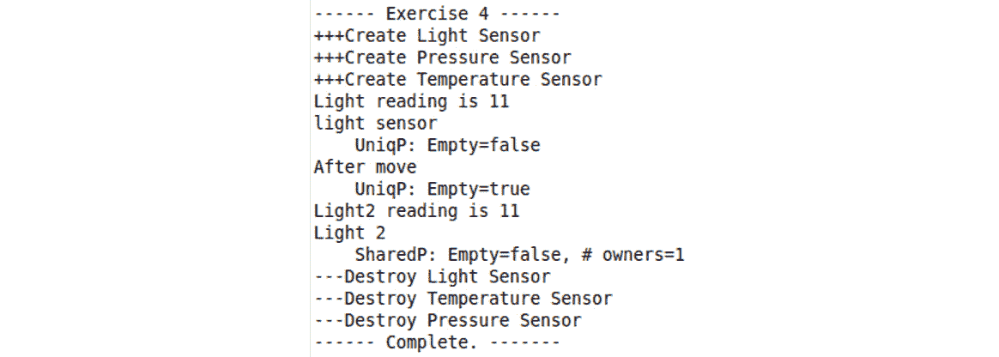

#### 图 3.31：修正后的 printSharedPointer 输出

### 步骤 10：修改 Exercise4.cpp

在编辑器中打开 `Exercise4.cpp` 并将文件顶部附近的行更改为如下内容：

```cpp
#define EXERCISE4_STEP  12
```

### 步骤 11：运行程序

点击 `Run` 按钮编译并运行程序。将生成以下输出：

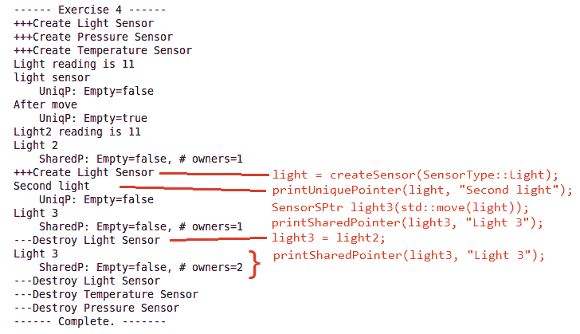

#### 图 3.32：练习 4 步骤 12 的带注释输出

### 步骤 12：对比输出

将输出与 `testSensors()` 方法中的代码进行对比。我们会发现可以轻松地赋值给空的 `unique_ptr`（`light`），并且可以将一个 `shared_ptr` 赋值给另一个（`light3 = light2`），这两种情况都不需要 `std::move()`。

### 步骤 13：更改宏定义

在编辑器中打开 `Exercise4.cpp` 并将文件顶部附近的行更改为如下内容：

```cpp
#define EXERCISE4_STEP  15
```

### 步骤 14：运行程序

点击 `Run` 按钮编译并运行程序。输出切换为以下内容：


#### 图 3.33：在 unique_ptr 中管理数组

### 步骤 15：检查 testArrays() 方法

打开编辑器并找到 `testArrays()` 方法：

```cpp
void testArrays()
{
    std::unique_ptr<int[]> board = std::make_unique<int[]>(8*8);
    for(int i=0; i<8; i++)
        for(int j=0; j<8; j++)
            board[i*8+j] = 10*(i+1)+j+1;
    for(int i=0; i<8; i++)
    {
        char sep{' '};
        for(int j=0; j<8; j++)
            std::cout << board[i*8+j] << sep;
        std::cout << "\n";
    }
}
```

这段代码有几点值得注意。首先，类型声明为 `int[]`。本练习选择了 `int`，但可以是几乎任何类型。其次，当 `unique_ptr`（以及自 C++ 17 起的 `shared_ptr`）用于管理数组时，定义了 `operator[]`。因此，我们通过从二维索引计算一维索引 `board[i*8+j]` 来模拟二维数组。

### 步骤 16：使用 auto 类型

编辑方法的第一行并声明 `auto` 类型：

```cpp
auto board = std::make_unique<int[]>(8*8);
```

### 步骤 17：验证输出

点击 `Run` 按钮编译并运行程序——输出将与之前的运行完全相同。这是一个 `auto` 非常有用的例子，因为你不再需要将所有细节输入到类型声明中，以及 `make_unique()` 调用中。

在本练习中，我们实现了一个工厂函数，该函数使用 `unique_ptr` 管理传感器的生命周期来提供制造好的传感器。然后我们实现了代码将其从 `unique_ptr` 更改为共享给多个对象。最后，我们开发了一种 `unique_ptr` 技术，使用一维数组来管理多维数组。

## 零/五法则——另一种视角

当我们引入 `BufferedWriter` 时，它管理着两种资源：内存和文件。随后我们讨论了编译器默认生成的拷贝操作，即所谓的浅拷贝。我们讨论了如何以不同方式管理资源——禁止拷贝、执行深拷贝或转移所有权。我们在这种情况下所做的决定被称为资源管理策略。你选择的策略会影响你如何执行**零/五法则**。

就资源管理而言，一个类可以不管理资源，管理可拷贝但不可移动的资源，管理可移动但不可拷贝的资源，或管理既不可拷贝也不可移动的资源。以下类展示了如何表达这些情况：

```cpp
struct NoResourceToManage
{
    // 使用编译器生成的拷贝和移动构造函数及赋值运算符
};

struct CopyOnlyResource
{
    ~CopyOnlyResource()                                          { /* 定义 */ }
    CopyOnlyResource(const CopyOnlyResource& rhs)                { /* 定义 */ }
    CopyOnlyResource& operator=(const CopyOnlyResource& rhs)     { /* 定义 */ }
    CopyOnlyResource(CopyOnlyResource&& rhs) = delete;
    CopyOnlyResource& operator=(CopyOnlyResource&& rhs) = delete;
};

struct MoveOnlyResource
{
    ~MoveOnlyResource()                                          { /* 定义 */ }
    MoveOnlyResource(const MoveOnlyResource& rhs)                = delete;
    MoveOnlyResource& operator=(const MoveOnlyResource& rhs)     = delete;
    MoveOnlyResource(MoveOnlyResource&& rhs)                     { /* 定义 */ }
    MoveOnlyResource& operator=(MoveOnlyResource&& rhs)          { /* 定义 */ }
};

struct NoMoveOrCopyResource
{
    ~NoMoveOrCopyResource()                                      { /* 定义 */ }
    NoMoveOrCopyResource(const NoMoveOrCopyResource& rhs)        = delete;
    NoMoveOrCopyResource& operator=(const NoMoveOrCopyResource& rhs) = delete;
    NoMoveOrCopyResource(NoMoveOrCopyResource&& rhs)             = delete;
    NoMoveOrCopyResource& operator=(NoMoveOrCopyResource&& rhs)  = delete;
};
```

由于在所有上下文和异常情况下管理资源的复杂性，最佳实践是：如果一个类负责管理一种资源，那么该类应仅负责管理该资源。

## 实战 1：使用 RAII 和移动语义实现图形处理

在 *第 2A 章* *不允许鸭子——类型与推导* 中，你们团队努力工作并完成了 `Point3d` 和 `Matrix3d` 的实现。现在，公司想要推广该库，在发布前需要两项主要改进：

*   类必须位于我们公司的命名空间中，即 Advanced C Plus Plus Inc.。因此，图形库的命名空间将是 `accp::gfx`。
*   `Point3d` 和 `Matrix3d` 中矩阵的存储是类的固有部分，因此是从栈上分配而非堆上。作为库矩阵支持的演进，我们需要从堆上分配内存。因为我们正致力于在未来的版本中实现更大的矩阵，所以我们也想在类中引入移动语义。

请遵循以下步骤来实现这一点：

1.  从我们当前版本的库开始（可在 `Lesson3/Activity01` 文件夹中找到），将所有类放入 `acpp::gfx` 命名空间。
2.  修复因该更改而失败的所有测试。（失败可能意味着编译失败，而不仅仅是运行测试失败。）
3.  在 `Matrix3d` 中，从直接在类中声明矩阵改为使用堆分配的内存进行存储。
4.  通过实现拷贝构造函数和拷贝赋值运算符的深拷贝实现来修复失败的测试。进行任何其他必要的更改以适应新的内部表示。请注意，你不需要修改任何测试即可使其通过，因为它们只访问公共接口，这意味着我们可以在不影响客户端的情况下更改内部结构。


5. 通过在返回语句中使用 `std::move`，强制在 `CreateTranslationMatrix()` 中调用移动构造函数，从而触发另一个失败。在 `Matrix3d` 类中引入所需的移动操作，使测试能够编译并通过。

6. 对 `Point3d` 重复步骤 3 到 4。

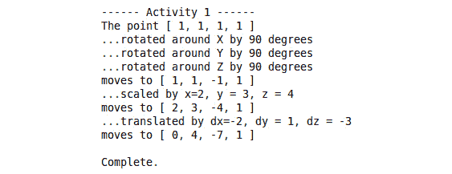

*图 3.34：成功转换为使用 RAII 后的活动 1 输出*

### 注

本活动的解决方案见第 657 页。

### 函数何时被调用？

C++ 程序执行的所有操作本质上都是函数调用（尽管编译器可能会将其优化为内联操作序列）。然而，由于语法糖的存在，你可能并不明显意识到正在进行函数调用。语法糖是编程语言中使代码更易读或表达更简洁的语法。例如，当你编写 `a = 2 + 5` 时，本质上是在调用 `operator=(&a, operator+(2, 5))`。只是语言允许我们编写前一种形式，而后一种形式允许我们重载运算符并将这些能力扩展到用户定义类型。

以下机制会导致函数调用：

*   对函数的**显式调用**。
*   所有运算符，如 `+`、`-`、`*`、`/`、`%` 等，以及 `new`/`delete`。
*   **变量声明**——如果存在初始化值，将导致带参数的构造函数被调用。
*   **用户定义字面量**——我们尚未涉及这些，但本质上，我们为 `type operator "" name(argument)` 定义了一个重载。然后我们可以编写诸如 `10_km` 之类的代码，这使得我们的代码更易理解，因为它携带了语义信息。
*   **从一种值向另一种值的转换**（`static_cast<>`、`const_cast<>`、`reinterpret_cast<>` 和 `dynamic_cast<>`）。同样，我们有另一个运算符重载，允许我们将一种类型转换为另一种类型。
*   **函数重载期间**，可能需要将一种类型转换为另一种类型，以匹配函数原型。这可以通过调用带有正确参数类型的构造函数来创建临时对象，或者通过隐式调用的转换运算符来实现。

每一种情况都会导致编译器确定必须调用一个函数。一旦确定需要调用函数，编译器就必须找到与名称和参数匹配的函数。这将是我们在下一节讨论的内容。

### 调用哪个函数

在*第 2A 章* *不允许鸭子类型——类型与推导* 中，我们看到函数重载决议是按如下方式执行的：

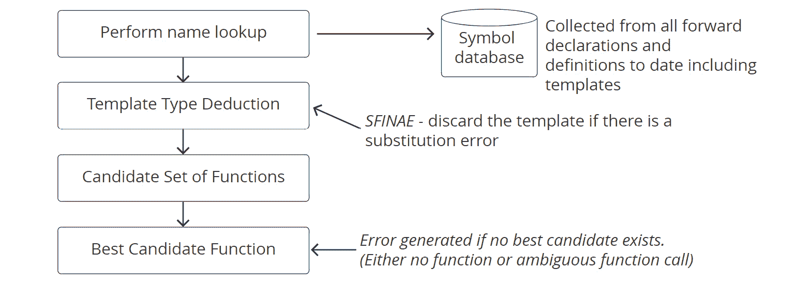

*图 3.35：函数重载决议*

我们真正没有深入探讨的是名称查找的概念。在某个时刻，编译器将遇到对 `func` 函数的以下调用：

`func(a, b);`

当这种情况发生时，它必须将该名称与引入它的声明关联起来。这个过程称为**名称查找**。这种名称查找适用于程序中的所有项目（变量、命名空间、类、函数、函数模板和模板）。为了使程序能够编译，变量、命名空间和类的名称查找过程必须产生单个声明。然而，对于函数和函数模板，编译器可能会将多个声明与同一个名称关联起来——主要是通过函数重载，由于参数依赖查找（ADL），这可能会扩展为考虑额外的函数。

### 标识符

根据 C++ 标准的定义，**标识符**是大写和小写拉丁字母、数字、下划线以及大多数 Unicode 字符的序列。一个有效的标识符必须以非数字字符开头，长度任意，且**区分大小写**。每个字符都很重要。

### 名称

**名称**用于指代一个实体或一个标号。名称采用以下形式之一：

*   一个**标识符**
*   函数表示法中的**重载运算符名称**（例如 `operator-`、`operator delete`）
*   后跟其参数列表的**模板名称**（`vector<int>`）
*   **用户定义转换函数名称**（`operator float`）
*   **用户定义字面量运算符名称**（`operator ""_ms`）

每个实体及其名称由声明引入，而标号的名称由 `goto` 语句或带标签语句引入。根据作用域的不同，一个名称可以在一个文件（或翻译单元）中多次使用以指代不同的实体。根据链接性的不同，一个名称也可以用于跨多个文件（翻译单元）指代同一个实体，或指代不同的实体。编译器通过名称查找，将引入名称的声明与程序中的未知名称关联起来。

### 名称查找

**名称查找**过程分为两种，根据上下文选择：

*   **限定名称查找**：名称出现在作用域解析运算符 `::` 的右侧，或可能出现在 `::` 之后，后跟 `template` 关键字。限定名称可以指代命名空间成员、类成员或枚举器。`::` 运算符左侧的名称定义了查找名称的作用域。如果没有名称，则使用全局命名空间。
*   **非限定名称查找**：除上述情况外的所有情况。在这种情况下，名称查找会检查当前作用域和所有外围作用域。

如果非限定名称位于函数调用运算符 `()` 的左侧，则使用**参数依赖查找**。

### 参数依赖查找

用于查找非限定函数名称的一组规则称为**参数依赖查找**（称为 ADL），或 **Koenig 查找**（以 Andrew Koenig 命名，他定义了它，且是 C++ 标准委员会的长期成员）。非限定函数名称可以作为函数调用表达式出现，或作为对重载运算符的隐式函数调用的一部分出现。

ADL 基本上表示：除了非限定名称查找期间考虑的作用域和命名空间外，所有参数和模板参数的“关联命名空间”也会被考虑在内。请看下面的代码：

```cpp
#include <iostream>
#include <string>

int main()
{
    std::string welcome{"Hello there"};
    std::cout << welcome;
    endl(std::cout);
}
```

当我们编译并运行此代码时，输出符合预期：

```
$ ./adl.exe
Hello there
$
```

这是一种不寻常的编写程序的方式。通常，它会这样写：

```cpp
#include <iostream>
#include <string>

int main()
{
    std::string welcome{"Hello there"};
    std::cout << welcome << std::endl;
}
```

我们使用调用 `endl()` 的奇怪方法来展示 ADL。但这里发生了两次 ADL 查找。

第一个经历 ADL 的函数调用是 `std::cout << welcome`，编译器将其视为 `operator<<(std::cout, welcome)`。运算符名称 `<<` 现在在可用作用域及其参数的命名空间——`std` 中查找。这个额外的命名空间将名称解析为自由函数，即在 string 头文件中声明的 `std::operator<<(ostream& os, string& s)`。

第二个调用更明显：`endl(std::cout)`。同样，编译器可以访问 std 命名空间来解析此名称查找，并在头文件 `ostream`（包含在 `iostream` 中）中找到 `std::endl` 模板。


## 没有 ADL

没有 ADL，编译器无法找到这两个函数中的任何一个，因为它们是自由函数，由 `iostream` 和 `string` 包让我们知晓。插入运算符（`<<`）的魔力将不复存在，如果我们被迫编写 `std::operator<<(std::cout, welcome)`，那将让程序员感到繁琐。如果考虑到链式插入，情况会更糟。或者，你可以编写 `using namespace std;`。这两种选择都不理想，这就是为什么我们需要 ADL（Koenig 查找）。

### Caveat Emptor（买者自负）

我们已经看到 ADL 如何通过包含与函数参数类型相关的命名空间，使程序员的生活更轻松。然而，这种查找能力并非没有风险，我们在很大程度上可以将其最小化。请考虑以下示例代码：

```cpp
#include <iostream>

namespace mylib {

void is_substring(std::string superstring, std::string substring) {
    std::cout << "mylib::is_substring()\n";
}

void contains(std::string superstring, const char* substring) {
    is_substring(superstring, substring);
}

}

int main() {
    mylib::contains("Really long reference", "included");
}
```

当我们编译并运行前面的程序时，会得到预期的输出：


**Figure 3.36: ADL Sample program output**

C++ 标准委员会随后决定引入一个如下所示的 `is_substring()` 函数：

```cpp
namespace std {

void is_substring(std::string superstring, const char* substring) {
    std::cout << "std::is_substring()\n";
}

}
```

如果我们将其添加到文件顶部，编译并重新运行，现在会得到以下输出：


**Figure 3.37: ADL issue program output**

得益于 ADL，（下一版 C++ 标准）编译器选取了一个不同的实现，作为对 `is_substring()` 非限定函数调用更合适的匹配。而且由于参数的隐式转换，它不会产生冲突从而导致歧义和编译错误。它只是悄无声息地采用了新方法，如果参数顺序不同，这可能导致微妙且难以发现的 Bug。编译器只能检测类型和语法差异，而非语义差异。

#### Note

为了演示 ADL 如何工作，我们将函数添加到了 `std` 命名空间。命名空间的作用是分离关注点，向他人的命名空间（特别是**标准库命名空间**（`std`））中添加内容是不良实践。

那么，为什么是 *caveat emptor*（买者自负）？如果你在开发中使用第三方库（这包括 C++ 标准库），那么当你升级库时，你需要确保接口的变化不会因 ADL 而给你带来麻烦。

### 练习 5：实现模板以防止 ADL 问题

在本练习中，我们将演示 C++17 STL 中的一个破坏性变更，它可能在实际中引发问题。C++11 为 `std::begin(type)` 及其同类引入了模板。作为开发者，这是通用接口的一种吸引人的表达，你可能已经为 `size(type)` 和 `empty(type)` 编写了自己的版本。请遵循以下步骤实现此练习：

1.  在 Eclipse 中打开 **Lesson3** 项目。然后在 **Project Explorer** 中展开 **Lesson3**，再展开 **Exercise05**，双击 **Exercise5.cpp** 将该练习文件在编辑器中打开。

2.  点击 **Launch Configuration** 下拉菜单并选择 **New Launch Configuration…**。从 Search Project 菜单配置 **L3Exercise5** 应用程序，使其以名称 **L3Exercise5** 运行。

3.  点击 **Run** 按钮运行练习 5。这将产生以下输出：

    

    **Figure 3.38: Successful execution of Exercise 5**

4.  检查代码可发现两个辅助模板：

    ```cpp
    template<class T>
    bool empty(const T& x) {
        return x.empty();
    }

    template<class T>
    int size(const T& x) {
        return x.size();
    }
    ```

5.  与所有其他练习不同，本练习已配置为在 C++ 14 下构建。打开 **Lesson3** 下的 `CMakeLists.txt` 文件并找到以下行：

    ```cmake
    set_property(TARGET L3Exercise5 PROPERTY CXX_STANDARD 14)
    ```

6.  将 **14** 改为 **17**。

7.  点击 **Run** 按钮编译练习，现在编译失败：

    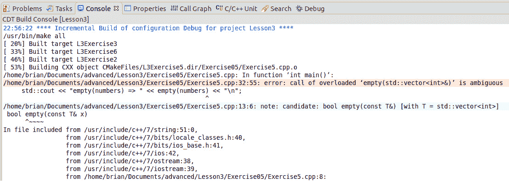

    **Figure 3.39: Compilation fails under C++ 17 – ambiguous function call**

8.  因为传递给 `empty()` 和 `size()` 模板的参数是 `std::vector`，ADL 引入了这些模板新包含的 STL 版本，从而破坏了我们的代码。

9.  在 **Exercise5.cpp** 文件中，找到导致错误的两处 `empty()` 和两处 `size()`，并在它们前面插入两个冒号 `::`（作用域指定符）。

10. 点击 **Run** 按钮编译并运行练习。它现在可以愉快地编译并再次运行，因为对 `empty()` 和 `size()` 函数的调用现在是限定的。我们本可以同样指定 `std::` 作用域。

在本练习中，我们在全局命名空间中实现了两个模板函数，如果在 C++ 14 标准下编译程序，它们工作良好。然而，当我们在 C++17 下编译时，我们的实现崩溃了，因为 STL 库发生了变化，我们不得不更改实现以确保编译器找到并使用我们编写的模板。

### 隐式转换

在 *Figure 3.36*、*Function overload resolution* 中确定候选函数集时，编译器必须查找在名称查找期间找到的所有可用函数，并确定参数数量和类型是否与调用点匹配。在确定类型是否匹配时，它还将检查所有可用的转换，以确定是否存在一种机制，可以将类型 `T1`（传递的参数类型）转换为类型 `T2`（为函数参数指定的类型）。如果它可以为所有参数从 `T1` 转换为 `T2`，则将该函数添加到候选集中。

这种从类型 `T1` 到类型 `T2` 的转换称为**隐式转换**，当某个类型 `T1` 用于不接受该类型但接受其他类型 `T2` 的表达式或上下文中时发生。这发生在以下上下文中：

*   `T1` 作为参数传递给声明参数为 `T2` 的函数时。
*   `T1` 用作期望 `T2` 的运算符的操作数时。
*   `T1` 用于初始化 `T2` 类型的新对象时（包括 return 语句）。
*   `T1` 用于 `switch` 语句中（此时 `T2` 为 `int`）。
*   `T1` 用于 `if` 语句或 `do-while` 或 `while` 循环中（此时 `T2` 为 `bool`）。

如果存在从 `T1` 到 `T2` 的明确转换序列，则程序将通过编译。内置类型之间的转换通常由常规算术转换决定。

### Explicit – 防止隐式转换

隐式转换是一项很棒的功能，它使程序员能够表达意图，并且在大多数情况下都能正常工作。然而，编译器在程序员未提供提示的情况下将一种类型转换为另一种类型的能力并不总是可取的。请考虑以下小程序：

```cpp
#include <iostream>

class Real {
public:
    Real(double value) : m_value{value} {}
    operator float() { return m_value; }
    float getValue() const { return m_value; }

private:
    double m_value {0.0};
};

void test(bool result) {
    std::cout << std::boolalpha;
    std::cout << "Test => " << result << "\n";
}

int main() {
```


```cpp
Real real{3.14159};

test(real);

if ( real )
{

    std::cout << "true: " << real.getValue() << "\\n";

}
else
{

    std::cout << "false: " << real.getValue() << "\\n";

}

}
```

当我们编译并运行前面的程序时，会得到以下输出：


###### 图 3.40：隐式转换示例程序输出

好吧，这可能有点出乎意料，代码竟然编译通过并真的产生了输出。`real` 变量的类型是 `Real`，它有一个转换为 float 的转换运算符 —— `operator float()`。`test()` 函数接受一个 `bool` 作为参数，而 `if` 条件也必须产生一个 `bool` 结果。编译器会将任何数值类型转换为 `boolean` 类型：如果值为零则为 false，如果值不为零则为 true。但如果这不是我们想要的行为，我们可以通过在函数声明前加上 `explicit` 关键字来阻止它。假设我们将该行更改为如下所示：

`explicit operator float() {return m_value;}`

如果我们现在尝试编译，会得到两个错误：


###### 图 3.41：因移除隐式转换导致编译错误

两个错误都与无法将 `Real` 类型转换为 `bool` 有关 —— 首先是在调用 `test()` 的位置，然后是在 `if` 条件中。

现在，让我们引入一个 `bool` 转换运算符来修复这个问题。

`operator bool() {return m_value == 0.0;}`

我们现在可以再次构建程序。将会收到以下输出：


###### 图 3.42：引入 bool 运算符替代隐式转换

现在 `boolean` 值为 false，而之前是 true。这是因为 float 转换返回的值不是零， 隐式转换为 true 了。

自 C++ 11 起，所有构造函数（拷贝和移动构造函数除外）都被视为转换构造函数。这意味着如果它们没有用 `explicit` 声明，则可用于隐式转换。同样，任何未声明为 `explicit` 的转换运算符也可用于隐式转换。

**C++ 核心指南** 有两条与隐式转换相关的规则：

*   **C.46**：默认情况下，将单参数构造函数声明为 `explicit`
*   **C.164**：避免使用隐式转换运算符

## 上下文转换

如果我们现在对小程序做进一步更改，就会涉及到所谓的上下文转换。让我们把 `bool` 运算符设为 `explicit` 并尝试编译程序：

`explicit operator bool() {return m_value == 0.0;}`

我们将收到以下输出：


###### 图 3.43：显式 bool 运算符导致的编译错误

这次我们只在调用 `test()` 的位置有一个错误，而 `if` 条件没有错误。我们可以通过使用 C 风格转换 `(bool)` 或 C++ `static_cast<bool>(real)`（这是首选方法）来修复此错误。当我们添加转换后，程序再次编译并运行。

那么，如果 `bool` 转换是 `explicit` 的，为什么 `if` 表达式的条件不需要转换呢？

C++ 标准允许在特定上下文中，当期望 `bool` 类型且存在 `bool` 转换声明时（无论是否标记为 `explicit`），允许进行隐式转换。这被称为 **上下文转换为 bool**，可发生在以下上下文中：

*   `if`、`while`、`for` 的条件（或控制表达式）
*   内置逻辑运算符的操作数：`!`（非）、`&&`（与）和 `||`（或）
*   三元（或条件）运算符 `?:` 的第一个操作数。

## 练习 6：隐式和显式转换

在本练习中，我们将尝试调用函数、隐式转换、阻止隐式转换以及启用隐式转换。请按照以下步骤实现此练习：

1.  在 Eclipse 中打开 **Lesson3** 项目。然后在 **Project Explorer** 中，展开 **Lesson3** 再展开 **Exercise06**，双击 **Exercise6.cpp** 在编辑器中打开该练习文件。
2.  点击 **Launch Configuration** 下拉菜单并选择 **New Launch Configuration…**。从 **Search Project** 菜单配置 **L3Exercise6** 应用程序，使其以 **L3Exercise6** 为名称运行。
3.  点击 **Run** 按钮运行练习 6。这将产生以下输出：

    

    ###### 图 3.44：练习 6 的默认输出

4.  在文本编辑器中，将 `Voltage` 的构造函数改为 `explicit`：

    ```cpp
    struct Voltage
    {
        explicit Voltage(float emf) : m_emf(emf)
        {
        }
        float m_emf;
    };
    ```

5.  点击 **Run** 按钮重新编译代码 —— 现在我们得到以下错误：

    ###### 

    

    ###### 图 3.45：int 到 Voltage 的转换失败

6.  从构造函数中移除 `explicit`，并将 `calculate` 函数改为接受引用：

    `void calculate(Voltage& v)`

7.  点击 **Run** 按钮重新编译代码 —— 现在，我们得到以下错误：

    ###### 

    

    ###### 图 3.46：int 到 Voltage& 的转换失败

    同一行出现了我们之前遇到的问题，但原因不同。因此，*隐式转换仅适用于值类型*。

8.  注释掉产生错误的那一行，然后在调用 `use_float(42)` 之后，添加以下行：

    `use_float(volts);`

9.  点击 **Run** 按钮重新编译代码 —— 现在我们得到以下错误：

    ###### 

    

    ###### 图 3.47：Voltage 到 float 的转换失败

10. 现在，向 `Voltage` 类添加以下转换运算符：

    ```cpp
    operator float() const
    {
        return m_emf;
    }
    ```

11. 点击 **Run** 按钮重新编译代码并运行：

    

    ###### 图 3.48：成功将 Voltage 转换为 float

12. 现在，在我们刚添加的转换运算符前加上 `explicit` 关键字，然后点击 **Run** 按钮重新编译代码。又得到一个错误：

    ###### 

    

    ###### 图 3.49：无法将 Voltage 转换为 float

13. 通过在转换运算符前添加 `explicit` 声明，我们阻止了编译器使用该转换运算符。将报错的那一行改为将 `volts` 变量转换为 `float`：

    `use_float(static_cast<float>(volts));`

14. 点击 **Run** 按钮重新编译代码并运行。

    

    ###### 图 3.50：使用转换将 Voltage 转换为 float 再次成功

在本练习中，我们已经看到隐式转换可以在类型之间发生（不适用于引用），并且我们可以控制它们发生的时机。现在我们知道如何控制这些转换，就可以努力遵守前面引用的指南 **C.46** 和 **C.164**。

## 活动 2：实现日期计算的类


# 活动：日期库开发

你们团队负责开发一个库，以帮助处理与日期相关的计算。特别是，我们希望能够确定两个日期之间的天数，并且给定一个日期，向其添加（或减去）一定天数以获得一个新日期。本活动将开发两种新类型并对其进行增强，以确保程序员无法意外地让它们与内置类型交互。请遵循以下步骤来实现这一点：

## 步骤

1.  设计并实现一个 `Date` 类，将 `day`、`month` 和 `year` 作为整数存储。

2.  添加方法以访问内部的 `day`、`month` 和 `year` 值。

3.  定义一个类型 `date_t`，用表示自 **纪元日期** 1970 年 1 月 1 日以来的天数。

4.  向 `Date` 类添加一个方法，将其转换为 `date_t`。

5.  添加一个方法，从 `date_t` 值设置 `Date` 类。

6.  创建一个存储天数值的 `Days` 类。

7.  向 `Date` 添加接受 `Days` 作为参数的 `addition` 运算符。

8.  使用 `explicit` 防止数字相加。

9.  添加 `subtraction` 运算符，从两个 `Dates` 的 `difference` 返回一个 `Days` 值。

遵循这些步骤后，你应该会得到以下输出：

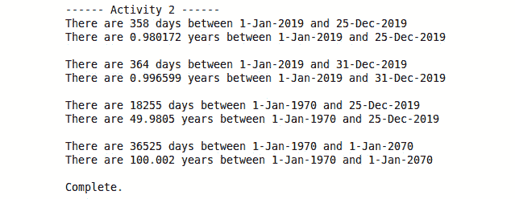

###### 图 3.51：成功的 Date 示例应用程序输出

#### 注意

此活动的解决方案可以在第 664 页找到。

# 总结

在本章中，我们探讨了变量的生命周期——包括自动变量和动态变量，它们存储在哪里，以及何时被销毁。然后我们利用这些信息开发了 `RAII` 技术，使我们几乎可以忽略资源管理，因为自动变量在销毁时会清理它们，即使在发生异常的情况下也是如此。接着，我们研究了抛出异常和捕获异常，以便我们能在合适的层级处理异常情况。从 `RAII` 出发，我们讨论了资源的所有权以及 `STL` 智能指针如何在这方面提供帮助。我们发现几乎所有东西都被视为函数调用，从而允许运算符重载和隐式转换。我们发现了 `argument-dependent lookup`（`ADL`，参数依赖查找）那奇妙（还是可怕？）的世界，以及它未来可能如何让我们绊倒。我们现在对 C++ 的基本特性有了很好的理解。在下一章中，我们将开始探索函数对象，以及如何使用 lambda 函数来实现并实现它们。我们将深入探讨 `STL` 的提供的功能，并在重新审视封装时探索 `PIMPL`。
