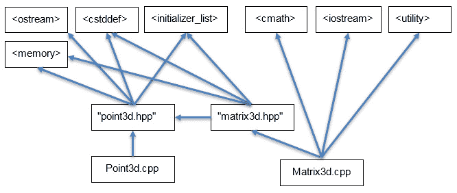
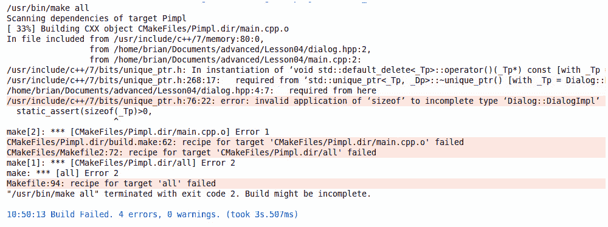
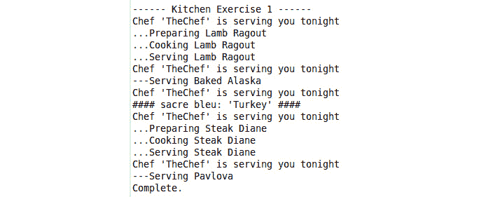
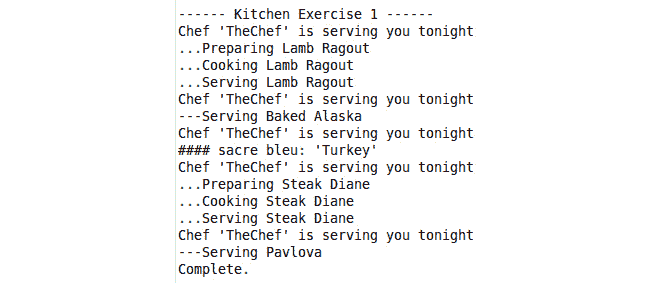
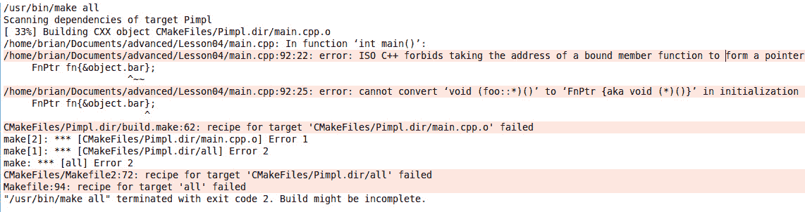
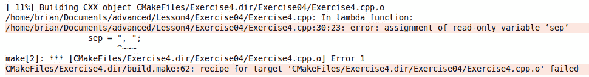
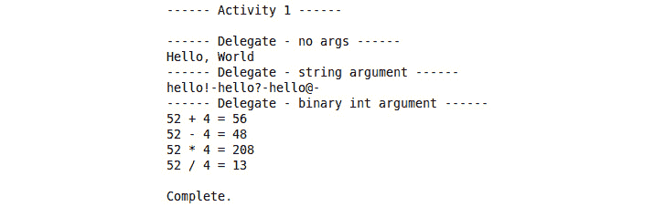

# 第 4 章：关注点分离——软件架构、函数和可变参数模板

## 学习目标

在本章结束时，你将能够：

*   使用 `PIMPL` 惯用语开发类以实现对象级封装
*   使用函数对象、`std::function` 和 lambda 表达式实现回调系统
*   根据情况使用正确的捕获技术实现 lambda
*   开发可变参数模板以实现用于事件处理的 C# 风格委托

本章将向你展示如何实现 `PIMPL` 惯用语，以及如何为你自己的程序开发回调机制。

## 简介

在上一章中，我们学习了如何使用 `RAII` 实现类，以便在发生异常时也能正确管理资源。我们还了解了 `ADL`（`Argument Dependent Lookup`，参数依赖查找）以及它如何确定要调用的函数。最后，我们讨论了如何使用 `explicit` 关键字防止编译器在类型之间进行自动转换，这被称为隐式转换。

在本章中，我们将研究依赖关系，包括物理依赖和逻辑依赖，并了解它们如何对构建时间产生不利影响。我们还将学习如何将可见的接口类与实现细节分离，以提高构建速度。然后我们将学习捕获函数和上下文，以便稍后使用 `functors`（函数对象）、`std::function` 和 `lambda expressions`（lambda 表达式）来调用它们。最后，我们将实现一个可变参数模板来提供基于事件的回调机制。

## 指针指向实现（PIMPL）惯用语

随着用 C++ 实现的项目变得越来越大，构建时间增长的速度很可能会快于文件数量的增长速度。这是因为 C++ 构建模型使用了文本包含模型。这样做是为了让编译器能够确定类的大小和布局，导致 `caller`（调用者）和 `callee`（被调用者）之间产生耦合，但允许进行优化。请记住，所有内容必须在使用前定义。一项名为 `Modules`（模块）的未来功能有望解决此问题，但目前我们需要了解该问题以及用于解决该问题的技术。

## 逻辑依赖和物理依赖

当我们希望从一个类访问另一个类时，我们就存在逻辑依赖。一个类在逻辑上依赖于另一个类。如果我们考虑在《第 2A 章：不允许鸭子——类型与推导》和《第 3 章：能做与该做的距离——对象、指针与继承》中开发的 `Graphics` 类 `Point3d` 和 `Matrix3d`，我们有两个逻辑上独立的类 `Matrix3d` 和 `Point3d`。然而，由于我们实现两者之间乘法运算符的方式，我们创建了一个编译时或**物理依赖**。



###### 图 4.1：Matrix3d 和 Point3d 的物理依赖

正如我们从这些相对简单的类中看到的，头文件和实现文件之间的物理依赖关系可能会迅速变得复杂。正是这种复杂性导致了大型项目的构建时间增加，因为物理（和逻辑）依赖关系的数量增长到数千。我们在前面的图中仅展示了 13 个依赖关系，如箭头所示。但实际上还有更多，因为包含一个标准库头文件通常会引入一系列包含文件。这意味着如果修改了一个头文件，则所有直接或间接依赖它的文件都需要重新编译以适应该更改。即使更改是类的私有成员定义（类的用户甚至无法访问），也会触发此重建。

为了帮助加快编译时间，我们使用了防护技术来防止头文件被多次处理：

```
#if !defined(MY_HEADER_INCLUDED)
#define MY_HEADER_INCLUDED
// definitions
#endif // !defined(MY_HEADER_INCLUDED)
```

最近，大多数编译器现在支持 `#pragma once` 指令，它能达到相同的效果。

实体（文件、类等）之间的这些关系被称为**耦合**。如果对一个文件/类的更改导致另一个文件/类发生更改，则该文件/类与另一个文件/类**高度耦合**。如果对一个文件/类的更改不会导致另一个文件/类发生更改，则该文件/类与另一个文件/类**松散耦合**。

高度耦合的代码（文件/类）会给项目带来问题。高度耦合的代码难以更改（不灵活）、难以测试且难以理解。另一方面，松散耦合的代码更容易更改（只需修改一个类）、高度可测试（只需被测试的类）且更易于阅读和理解。耦合反映了逻辑和物理依赖关系，并与之相关。

## 指针指向实现（PIMPL）惯用语


# PIMPL 惯用法

解决这种耦合问题的一个方案是使用 **Pimpl 惯用法**（代表 **Pointer to Implementation Idiom**，即指向实现的指针惯用法）。这也被称为不透明指针、编译器防火墙惯用法，甚至称为 **柴郡猫技术**。以 **Qt 库**为例，特别是 **Qt 平台抽象 (QPA)**。它是一个抽象层，用于隐藏 Qt 应用程序所托管的操作系统和/或平台的细节。实现这种层的一种方法是使用 PIMPL 惯用法，即向应用程序开发者暴露通用接口，但隐藏功能交付的实现细节。Qt 实际上使用了一种称为 d-pointer 的 PIMPL 变体。

> **注意**：有关 Qt 平台抽象 (QPA) 的更多信息，请访问以下链接：<https://doc.qt.io/qt-5/qpa.html#>。

## 示例：对话框实现

例如，GUI 的一项功能是使用对话框，它是一个弹出窗口，用于显示信息或提示用户输入。它可以在 `dialog.hpp` 中声明如下：

### 头文件 (`dialog.hpp`)

```cpp
#pragma once

class Dialog
{
public:
    Dialog();
    ~Dialog();
    void create(const char* message);
    bool show();

private:
    struct DialogImpl;
    DialogImpl* m_pImpl;
};
```

用户可以访问使用 `Dialog` 所需的所有函数，但不知道它是如何实现的。请注意，我们声明了 `DialogImpl` 但未定义它。通常，对于像 `DialogImpl` 这样的类，我们能做的事情不多。但有一件事是允许的，那就是声明一个指向它的指针。C++ 的这一特性允许我们将实现细节隐藏在实现文件中。这意味着在该简单情况下，我们不需要为此声明包含任何头文件。

### 实现文件 (`dialogImpl.cpp`)

```cpp
#include "dialog.hpp"
#include <iostream>
#include <string>

struct Dialog::DialogImpl
{
    void create(const char* message)
    {
        m_message = message;
        std::cout << "Creating the Dialog\n";
    }

    bool show()
    {
        std::cout << "Showing the message: '" << m_message << "'\n";
        return true;
    }

    std::string m_message;
};

Dialog::Dialog() : m_pImpl(new DialogImpl)
{
}

Dialog::~Dialog()
{
    delete m_pImpl;
}

void Dialog::create(const char* message)
{
    m_pImpl->create(message);
}

bool Dialog::show()
{
    return m_pImpl->show();
}
```

我们从中注意到几点：

*   我们在定义 `Dialog` 所需的方法之前定义了实现类 `DialogImpl`。这是必要的，因为 `Dialog` 需要通过 `m_pImpl` 来调用这些方法，这意味着它们需要先被定义。
*   `Dialog` 的构造函数和析构函数负责内存管理。
*   我们仅在实现文件中包含实现所需的所有必要头文件。这通过最小化 `Dialog.hpp` 中包含的头文件数量来减少耦合。

### 客户端代码 (`main.cpp`)

程序可以按如下方式执行：

```cpp
#include <iostream>
#include "dialog.hpp"

int main()
{
    std::cout << "\n\n------ Pimpl ------\n";
    Dialog dialog;
    dialog.create("Hello World");
    if (dialog.show())
    {
        std::cout << "Dialog displayed\n";
    }
    else
    {
        std::cout << "Dialog not displayed\n";
    }
    std::cout << "Complete.\n";
    return 0;
}
```

### 输出

执行时，上述程序产生以下输出：


**图 4.2：PIMPL 实现示例输出**

## PIMPL 的优缺点

使用 PIMPL 最大的优势在于它打破了类的客户端代码与其实现之间的编译时依赖。这使得构建时间更快，因为 PIMPL 消除了定义（头）文件中大量的 `#include` 指令，而是将它们仅推送到实现文件中按需包含。

它还将实现与客户端代码解耦。我们现在可以自由地更改 PIMPL 类的实现，并且只需重新编译该文件。这防止了编译级联，即对隐藏成员的更改触发客户端代码的重新构建。这被称为编译防火墙。

PIMPL 惯用法的其他一些优点如下：

*   **数据隐藏** – 实现的内部细节真正隔离在实现类中。如果这是库的一部分，则可用于防止信息泄露，例如知识产权。
*   **二进制兼容性** – 类的二进制接口现在独立于私有字段。这意味着我们可以向实现添加字段而不影响客户端代码。这也意味着我们可以将实现类部署在共享库（`DLL` 或 `.so` 文件）中，并可自由更改它而不影响客户端代码。

这些优势是有代价的。缺点如下：

*   **维护工作量** – 可见类中存在将调用转发给实现类的额外代码。这增加了一层间接性，并带来了少量的复杂性增加。
*   **内存管理** – 为实现添加指针现在要求我们管理内存。它还需要额外的存储空间来保存指针，在内存受限的系统中（例如物联网设备），这可能至关重要。

## 使用 `std::unique_ptr<>` 实现 PIMPL

我们目前的 `Dialog` 实现使用原始指针来保存 PIMPL 实现的引用。在 *第 3 章*、*能与该做的距离——对象、指针和继承* 中，我们讨论了对象的所有权，并介绍了智能指针和 RAII。PIMPL 指针指向的隐藏对象是一种需要管理的资源，应使用 **RAII** 和 `std::unique_ptr` 来执行。正如我们将看到的，使用 `std::unique_ptr` 实现 **PIMPL** 有一些注意事项。

让我们更改 `Dialog` 实现以使用智能指针。首先，头文件更改为引入 `#include <memory>` 行，并且可以移除析构函数，因为 `unique_ptr` 会自动删除实现类。

### 更新后的头文件 (`dialog.hpp`)

```cpp
#pragma once
#include <memory>

class Dialog
{
public:
    Dialog();
    void create(const char* message);
    bool show();

private:
    struct DialogImpl;
    std::unique_ptr<DialogImpl> m_pImpl;
};
```

显然，我们从实现文件中移除了析构函数，并修改构造函数以使用 `std::make_unique`。

### 更新后的构造函数

```cpp
Dialog::Dialog() : m_pImpl(std::make_unique<DialogImpl>())
{
}
```

当重新编译我们的新版本时，`Dialog.hpp` 和 `DialogImpl.cpp` 文件没有问题，但我们的客户端 `main.cpp` 报告了以下错误（使用 gcc 编译器），如下所示：



**图 4.3：使用 unique_ptr 编译 Pimpl 失败**

第一个错误报告 **对不完整类型 'Dialog::DialogImpl' 无效地应用了 'sizeof'**。问题在于在 `main.cpp` 中，当 `main()` 函数结束时，编译器试图为我们调用 `Dialog` 的析构函数。正如我们在 *第 2A 章*、*不允许鸭子——类型与推导* 中讨论的，编译器将为我们生成一个析构函数（因为我们移除了它）。这个生成的析构函数将调用 `unique_ptr` 的析构函数，这是错误的原因。如果我们查看 `unique_ptr.h` 的 **第 76 行**，会发现 `unique_ptr` 使用的默认 `deleter` 的 `operator()` 函数具有以下实现（`deleter` 是 `unique_ptr` 在销毁其指向的对象时调用的函数）：

```cpp
void operator()(_Tp* __ptr) const
{
    static_assert(!is_void<_Tp>::value, "can't delete pointer to incomplete type");
}
```


`static_assert(sizeof(_Tp) > 0, "can't delete pointer to incomplete type");`

`delete __ptr;`

}

我们的代码在第二个 `static_assert()` 语句处失败，该语句会因错误而终止编译。问题在于编译器试图为 `std::unique_ptr<DialogImpl>` 生成析构函数，而 `DialogImpl` 是一个不完整类型。因此，为了修复该问题，我们控制析构函数的生成时机，使其发生在 `DialogImpl` 成为完整类型的位置。

为此，我们将析构函数的声明放回类中，并将其实现添加到 `DialogImpl.cpp` 文件中。

```
Dialog::~Dialog()
{
}
```

当我们编译并运行程序时，它产生的输出与之前完全相同。事实上，如果我们只需要一个空析构函数，可以用以下代码替换上述代码：

`Dialog::~Dialog() = default;`

如果我们编译并运行程序，将产生以下输出：


**图 4.4：unique_ptr Pimpl 实现示例输出**

## unique_ptr<> PIMPL 特殊函数

由于 PIMPL 通常意味着可见的接口类拥有实现类，因此移动语义非常契合。然而，正如编译器生成的析构函数实现是正确的一样，编译器生成的移动构造函数和移动赋值运算符也将产生期望的行为，即对成员 `unique_ptr` 执行移动操作。这两种移动操作在赋值转移的值之前都可能需要执行 `delete`，因此它们遭遇了与析构函数相同的不完整类型问题。解决方案与析构函数相同——在头文件中声明方法，并在类型完整时（在实现文件中）实现它。因此，我们的头文件如下所示：

```
class Dialog
{
public:
    Dialog();
    ~Dialog();
    Dialog(Dialog&& rhs);
    Dialog& operator=(Dialog&& rhs);
    void create(const char* message);
    bool show();

private:
    struct DialogImpl;
    std::unique_ptr<DialogImpl> m_pImpl;
};
```

而实现如下所示：

```
Dialog::Dialog() : m_pImpl(std::make_unique<DialogImpl>())
{
}

Dialog::~Dialog() = default;

Dialog::Dialog(Dialog&& rhs) = default;

Dialog& Dialog::operator=(Dialog&& rhs) = default;
```

根据我们在实现类中隐藏的数据项，我们可能还希望 PIMPL 类具有拷贝功能。在 `Dialog` 类中使用 `std::unique_ptr` 会阻止编译器自动生成拷贝构造函数和拷贝赋值运算符，因为内部成员不支持拷贝。此外，正如我们在*第 2A 章*、*不允许鸭子类型——类型与推导*中所见，定义移动成员函数也会阻止编译器生成拷贝版本。另外，即使编译器为我们生成了拷贝语义，那也只是**浅拷贝**。但由于 PIMPL 的实现方式，我们需要**深拷贝**。因此，我们需要编写自己的拷贝特殊成员函数。同样，声明放在头文件中，实现需要在类型完整的地方进行，即在 `DialogImpl.cpp` 文件中。

在头文件中，我们添加以下声明：

`Dialog(const Dialog& rhs);`

`Dialog& operator=(const Dialog& rhs);`

实现如下所示：

```
Dialog::Dialog(const Dialog& rhs) : m_pImpl(nullptr)
{
    if (this == &rhs)    // do nothing on copying self
        return;
    if (rhs.m_pImpl)     // rhs has something -> clone it
        m_pImpl = std::make_unique<DialogImpl>(*rhs.m_pImpl);
}

Dialog& Dialog::operator=(const Dialog& rhs)
{
    if (this == &rhs)    // do nothing on assigning to self
        return *this;
    if (!rhs.m_pImpl)    // rhs is empty -> delete ours
    {
        m_pImpl.reset();
    }
    else if (!m_pImpl)   // ours is empty -> clone rhs
    {
        m_pImpl = std::make_unique<DialogImpl>(*rhs.m_pImpl);
    }
    else // use copy of DialogImpl
    {
        *m_pImpl = *rhs.m_pImpl;
    }
}
```

注意 `if(this == &rhs)` 子句。它们的存在是为了防止对象不必要地拷贝自身。还要注意，我们需要检查任一 `unique_ptr` 是否为空，并相应地处理拷贝。

### 注意

在进行本章的任何实践练习之前，请下载 GitHub 仓库 [`github.com/TrainingByPackt/Advanced-CPlusPlus`](https://github.com/TrainingByPackt/Advanced-CPlusPlus) 并在 Eclipse 中导入第 4 课的文件夹，以便您可以查看每个练习和活动的代码。

## 练习 1：使用 unique_ptr<> 实现厨房

在本练习中，我们将通过使用 `unique_ptr<>` 实现 **Pimpl 惯用法** 来隐藏厨房处理订单的细节。请按照以下步骤实现本练习：

1.  在 Eclipse 中打开 **Lesson4** 项目，然后在 **Project Explorer（项目资源管理器）** 中展开 **Lesson4** 再展开 **Exercise01**，双击 `Exercise1.cpp` 将该练习文件在编辑器中打开。

2.  由于这是一个基于 CMake 的项目，请将当前构建器更改为 **CMake Build (portable)**。

3.  点击 **Launch Configuration（启动配置）** 下拉菜单并选择 **New Launch Configuration…（新建启动配置…）**。配置 `L4Exercise1` 以 **Exercise1** 为名称运行。

4.  点击 **Run（运行）** 按钮。练习 1 将运行并产生以下输出：

    

    **图 4.5：练习 1 程序输出**

5.  在编辑器中打开 `kitchen.hpp`，您将看到以下声明：

    ```
    class Kitchen
    {
    public:
        Kitchen(std::string chef);
        std::string processOrder(std::string order);

    private:
        std::string searchForRecipe(std::string order);
        std::string searchForDessert(std::string order);
        std::string cookRecipe(std::string recipe);
        std::string serveDessert(std::string dessert);
        std::vector<Recipe>::iterator getRecipe(std::string recipe);
        std::vector<Dessert>::iterator getDessert(std::string recipe);
        std::string m_chef;
        std::vector<Recipe> m_recipes;
        std::vector<Dessert> m_desserts;
    };
    ```

    private 部分的所有内容都是关于厨房如何将订单交付给客户的细节。这强制包含了头文件 `recipe.hpp` 和 `dessert.hpp`，从而在这些细节文件和 `Kitchen` 的客户端之间产生了耦合。我们将把所有私有成员移到一个实现类中并隐藏细节。

6.  在 `kitchen.hpp` 文件中，添加 `#include <memory>` 指令以使用 `unique_ptr`。添加析构函数声明 `~Kitchen();`，然后在 private 部分的顶部添加以下两行：

    `struct Impl;`

    `std::unique_ptr<Impl> m_impl;`

7.  打开 `kitchen.cpp` 文件并在 `#include` 指令后添加以下内容：

    ```
    struct Kitchen::Impl
    {
    };

    Kitchen::~Kitchen() = default;
    ```

8.  点击 **Run（运行）** 按钮重新构建程序。您将看到输出仍然与之前相同。

9.  从 `kitchen.hpp` 中的 `Kitchen` 类移除除那两个新成员外的所有私有成员，并将它们添加到 `Kitchen::Impl` 声明中。移除 `#include <vector>`、`#include "recipe.hpp"` 和 `#include "dessert.hpp"` 后，`kitchen.hpp` 文件内容如下：

    ```
    #pragma once

    #include <string>
    #include <memory>

    class Kitchen
    {
    public:
        Kitchen(std::string chef);
        ~Kitchen();
        std::string processOrder(std::string order);

    private:
        struct Impl;
        std::unique_ptr<Impl> m_impl;
    };
    ```

10. 在 `kitchen.cpp` 文件中，将 Kitchen 构造函数改为 `Kitchen::Impl` 构造函数：


## PIMPL 实现步骤（续）

11. 对于其余的原始方法，将其作用域改为 `Kitchen::Impl` 而非 `Kitchen::`。例如，`std::string Kitchen::processOrder(std::string order)` 变为 `std::string Kitchen::Impl::processOrder(std::string order)`。

12. 在 `Kitchen::Impl` 中，添加一个接受 `std::string` 参数的构造函数和 `processOrder()` 方法。`Kitchen::Impl` 的声明现在应如下所示：

```cpp
struct Kitchen::Impl
{
    Impl(std::string chef);
    std::string processOrder(std::string order);
    std::string searchForRecipe(std::string order);
    std::string searchForDessert(std::string order);
    std::string cookRecipe(std::string recipe);
    std::string serveDessert(std::string dessert);
    std::vector<Recipe>::iterator getRecipe(std::string recipe);
    std::vector<Dessert>::iterator getDessert(std::string recipe);
    std::string m_chef;
    std::vector<Recipe> m_recipes;
    std::vector<Dessert> m_desserts;
};
```

13. 在 `kitchen.cpp` 文件顶部添加 `#include <vector>`、`#include "recipe.hpp"` 和 `#include "dessert.hpp"`。

14. 点击 **Run** 按钮重新构建程序，此时将因两个未定义引用 —— `Kitchen::Kitchen` 和 `Kitchen::processOrder` —— 而失败。

15. 在 `Kitchen.cpp` 中，在 `Kitchen::Impl` 方法定义之后，添加以下两个方法：

```cpp
Kitchen::Kitchen(std::string chef) : m_impl(std::make_unique<Kitchen::Impl>(chef))
{
}

std::string Kitchen::processOrder(std::string order)
{
    return m_impl->processOrder(order);
}
```

16. 再次点击 **Run** 按钮重新构建程序。程序将再次运行并产生原始输出。



**图 4.6：使用 Pimpl 的 Kitchen 程序输出**

在本练习中，我们将一个在其私有成员中包含大量细节的类，通过 PIMPL 类将这些细节移出，从而隐藏实现细节，并使用前面描述的技术将接口与实现解耦。

## 函数对象与 Lambda 表达式

编程中常用的一种模式，特别是在实现基于事件的处理（如异步输入输出）时，是使用 **回调**。客户端注册希望在事件发生时收到通知（例如：数据可读、数据传输完成）。这种模式称为 **观察者模式** 或 **发布-订阅模式**。C++ 提供了多种技术来实现回调机制。

### 函数指针

第一种机制是使用 **函数指针**。这是从 C 语言继承的遗留特性。下面的程序展示了函数指针的示例：

```cpp
#include <iostream>

using FnPtr = void (*)(void);

void function1()
{
    std::cout << "function1 called\n";
}

int main()
{
    std::cout << "\n\n------ Function Pointers ------\n";
    FnPtr fn{function1};
    fn();
    std::cout << "Complete.\n";
    return 0;
}
```

编译并执行该程序，将产生以下输出：


**图 4.7：函数指针程序输出**

严格来说，代码应修改如下：

```cpp
FnPtr fn{&function1};

if (fn != nullptr)
    fn();
```

首先，应使用取地址运算符（`&`）来初始化指针。其次，调用前应检查指针是否有效。

```cpp
#include <iostream>

using FnPtr = void (*)(void);

struct foo
{
    void bar() { std::cout << "foo:bar called\n"; }
};

int main()
{
    std::cout << "\n\n------ Function Pointers ------\n";
    foo object;
    FnPtr fn{&object.bar};
    fn();
    std::cout << "Complete.\n";
    return 0;
}
```

尝试编译此程序时，会得到以下错误：



**图 4.8：编译函数指针程序时的错误**

第一个错误的文本是 **ISO C++ forbids taking the address of a bound member function to form a pointer to member function. Say '&foo::bar'**。它告诉我们应使用不同的形式获取函数地址。真正的错误是第二条错误信息：**error: cannot convert 'void (foo::*)()' to 'FnPtr {aka void (*)()}' in initialization**。实际问题是非静态成员函数在被调用时会接收一个隐藏参数 —— `this` 指针。

将上述程序修改为如下形式：

```cpp
#include <iostream>

using FnPtr = void (*)(void);

struct foo
{
    static void bar() { std::cout << "foo:bar called\n"; }
};

int main()
{
    std::cout << "\n\n------ Function Pointers ------\n";
    FnPtr fn{&foo::bar};
    fn();
    std::cout << "Complete.\n";
    return 0;
}
```

即可成功编译并运行：


**图 4.9：使用静态成员函数的函数指针程序**

函数指针技术常用于与使用回调的 C 库以及支持回调的操作系统通知进行交互。在这两种情况下，回调通常会接受一个参数，即指向用户注册数据块的 `void*` 指针。该数据块指针可以是类的 `this` 指针，随后被解引用并将回调转发至成员函数。

在 Python 和 C# 等其他语言中，捕获函数指针时会同时捕获调用该函数所需的足够数据（例如 `self` 或 `this`）。C++ 通过函数调用运算符使任何对象均可调用，这将在下一节介绍。

### 什么是函数对象？

C++ 允许重载函数调用运算符 `operator()`。这使得任何对象均可变为 **可调用** 对象。可调用的对象称为 **仿函数**。下面程序中的 `Scaler` 类实现了一个仿函数。

```cpp
struct Scaler
{
    Scaler(int scale) : m_scale{scale} {};
    int operator()(int value)
    {
        return m_scale * value;
    }
    int m_scale{1};
};

int main()
{
    std::cout << "\n\n------ Functors ------\n";
    Scaler timesTwo{2};
    Scaler timesFour{4};
    std::cout << "3 scaled by 2 = " << timesTwo(3) << "\n";
    std::cout << "3 scaled by 4 = " << timesFour(3) << "\n";
    std::cout << "Complete.\n";
    return 0;
}
```

创建了两个 `Scaler` 类型的对象，它们在生成输出的语句中被用作函数。上述程序产生以下输出：


**图 4.10：仿函数程序输出**

**仿函数** 相较于函数指针的一个优势是它们可以包含状态，无论是作为对象还是跨所有实例。另一个优势是它们可以被传递给期望函数（如 `std::for_each`）或运算符（如 `std::transform`）的 STL 算法。

此类用法的示例如下：

```cpp
#include <iostream>
#include <vector>
#include <algorithm>

struct Scaler
{
    Scaler(int scale) : m_scale{scale} {};
    int operator()(int value)
    {
        return m_scale * value;
    }
    int m_scale{1};
};

void PrintVector(const char* prefix, std::vector<int>& values)
{
    const char* sep = "";
    std::cout << prefix << " = [";
    for (auto n : values)
    {
        std::cout << sep << n;
        sep = ", ";
    }
    std::cout << "]\n";
}

int main()
{
```


std::cout << "\n\n------ Functors with STL ------\n";

std::vector<int> values{1,2,3,4,5};

PrintVector("Before transform", values);

std::transform(values.begin(), values.end(), values.begin(), Scaler(3));

PrintVector("After transform", values);

std::cout << "Complete.\n";

return 0;

}

如果运行此程序，生成的输出将如下所示：


*图 4.11：显示 Scaler 变换向量的程序输出*

## 练习 2：实现函数对象

在本练习中，我们将实现两个不同的函数对象，它们可以与 STL 算法 `for_each` 配合使用。

1.  在 Eclipse 中打开 **Lesson4** 项目，然后在 **Project Explorer** 中展开 **Lesson4** 再展开 **Exercise02**，双击 `Exercise2.cpp` 以在编辑器中打开该练习文件。

2.  由于这是一个基于 CMake 的项目，请将当前构建器更改为 **CMake Build (portable)**。

3.  点击 **Launch Configuration** 下拉菜单并选择 **New Launch Configuration…**。配置 `L4Exercise2` 以 **Exercise2** 为名称运行。

4.  点击 **Run** 按钮。练习 2 将运行并产生以下输出：

    

    *图 4.12：练习 2 初始输出*

    我们要做的第一件事是通过引入一个函数对象来修复输出格式。

5.  在编辑器中，在 `main()` 函数定义之前，添加以下类定义：

    ```cpp
    struct Printer
    {
        void operator()(int n)
        {
            std::cout << m_sep << n;
            m_sep = ", ";
        }
        const char* m_sep = "";
    };
    ```

6.  在 `main()` 方法中，将以下代码：

    ```cpp
    std::cout << "Average of [";
    for (auto n : values)
        std::cout << n << ", ";
    std::cout << "] = ";
    ```

    **改为**

    ```cpp
    std::cout << "Average of [";
    std::for_each(values.begin(), values.end(), Printer());
    std::cout << "] = ";
    ```

7.  点击 **Run** 按钮。练习将运行并产生以下输出：

    

    *图 4.13：练习 2 改进后的输出格式*

8.  `Printer` 类的内部状态允许我们修复格式。现在，引入一个 **聚合器** 类来计算 **平均值**。将以下类定义添加到文件顶部：

    ```cpp
    struct Averager
    {
        void operator()(int n)
        {
            m_sum += n;
            m_count++;
        }
        float operator()() const
        {
            return static_cast<float>(m_sum) / (m_count == 0 ? 1 : m_count);
        }
        int m_count{0};
        int m_sum{0};
    };
    ```

9.  修改 `main()` 方法以使用 `Averager` 类，如下所示：

    ```cpp
    int main(int argc, char** argv)
    {
        std::cout << "\n------ Exercise 2 ------\n";
        std::vector<int> values{1,2,3,4,5,6,7,8,9,10};
        Averager averager = std::for_each(values.begin(), values.end(), Averager());
        std::cout << "Average of [";
        std::for_each(values.begin(), values.end(), Printer());
        std::cout << "] = ";
        std::cout << averager() << "\n";
        std::cout << "Complete.\n";
        return 0;
    }
    ```

10. 点击 **Run** 按钮。练习将运行并产生以下输出：

    

    *图 4.14：带有平均值的练习 2 输出*

请注意，`std::for_each()` 返回传入它的 `Averager` 实例。该实例被复制到变量 `averager` 中，后者随后包含计算平均值所需的数据。在本练习中，我们实现了两个函数对象或 **函数对象** 类：`Averager` 和 `Printer`，当它们被传递给 STL 算法 `for_each` 时，可以作为函数使用。

## std::function<> 模板

C++11 引入了一个通用的多态函数包装器模板 `std::function<>`，它使得实现回调和其他函数相关功能变得更加容易。`std::function` 保存一个称为 **目标** 的可调用对象。如果它不包含目标，则称为 **空**。调用一个空的 `std::function` 将导致抛出 `std::bad_function_call` 异常。

函数对象可以存储、复制或调用以下任意可调用对象作为目标：函数、函数对象（定义了 `operator()`）、成员函数指针或 Lambda 表达式。我们将在 *What is a Lambda Expression?* 主题中详细介绍相关内容。

实例化 `std::function` 对象时，只需提供函数签名而无需提供用于初始化的值，从而得到一个空实例。实例化方式如下：


*图 4.15：std::function 声明的结构*

传递给模板的参数定义了由 `variable` 存储的目标的 **函数签名**。签名以返回类型开始（可以是 void），随后在括号中列出调用该函数时将使用的类型列表。

将自由函数和 **函数对象** 与 `std::function` 配合使用非常直接。只要签名与传递给 `std::function` 模板的参数匹配，我们就可以简单地将自由函数或 **函数对象** 赋值给实例。

```cpp
void FreeFunc(int value);

struct Functor
{
    void operator()(int value);
};

std::function<void(int)> func;
Functor functor;

func = FreeFunc;          // 将目标设为 FreeFunc
func(32);                 // 用参数 32 调用 FreeFunc
func = functor;           // 将目标设为 functor
func(42);                 // 用参数 42 调用 Functor::operator()
```

然而，如果我们想在对象实例上使用成员方法，则需要使用另一个 STL 辅助模板 `std::bind()`。如果运行以下程序：

```cpp
#include <iostream>
#include <functional>

struct Binder
{
    void method(int a, int b)
    {
        std::cout << "Binder::method(" << a << ", " << b << ")\n";
    }
};

int main()
{
    std::cout << "\n\n------ Member Functions using bind ------\n";
    Binder binder;
    std::function<void(int,int)> func;
    auto func1 = std::bind(&Binder::method, &binder, 1, 2);
    auto func2 = std::bind(&Binder::method, &binder, std::placeholders::_1, std::placeholders::_2);
    auto func3 = std::bind(&Binder::method, &binder, std::placeholders::_2, std::placeholders::_1);

    func = func1;
    func(34,56);
    func = func2;
    func(34,56);
    func = func3;
    func(34,56);

    std::cout << "Complete.\n";
    return 0;
}
```

然后我们将得到以下输出：


*图 4.16：使用 std::bind() 和 std::function 的程序输出*

有几点需要注意：

*   函数 `method()` 通过类名作为作用域指定符来引用；
*   `Binder` 实例的地址作为第二个参数传递给 `std::bind()`，这使其成为传递给 `method()` 的第一个参数。这是必要的，因为所有非静态成员都有一个隐式的 `this` 指针作为第一个参数传递。
*   使用 `std::placeholders` 定义，我们可以绑定调用绑定方法时使用的参数，甚至可以改变传递的顺序（如 `func3` 所示）。


C++11 引入了一些语法糖，称为 Lambda 表达式，这使得定义匿名函数变得更加容易，匿名函数也可用于绑定方法并将其赋值给 `std::function` 实例表达式。我们将在主题 `What is a Lambda Expression?` 中详细介绍。

## 练习 3：使用 std::function 实现回调

在本练习中，我们将利用 `std::function<>` 模板实现函数回调。请按照以下步骤实现此练习：

1.  在 Eclipse 中打开 `Lesson4` 项目，然后在 `Project Explorer` 中展开 `Lesson4` 再展开 `Exercise03`，双击 `Exercise3.cpp` 将该练习文件在编辑器中打开。
2.  由于这是一个基于 CMake 的项目，请将当前构建器更改为 `CMake Build (portable)`。
3.  点击 `Launch Configuration` 下拉菜单并选择 `New Launch Configuration…`。配置 `L4Exercise3` 以名称 `Exercise3` 运行。
4.  点击 `Run` 按钮。练习将运行并产生以下输出：

    

    **Figure 4.17: Exercise 3 output (Calling empty `std::function`)**

5.  首先我们要防止调用空的 `std::function`。在函数 `TestFunctionTemplate()` 中找到 `func(42);` 这一行，并用以下代码替换：

    ```
    if (func)
    {
        func(42);
    }
    else
    {
        std::cout << "Not calling an empty func()\n";
    }
    ```

6.  点击 `Run` 按钮。练习将运行并产生以下输出：

    

    **Figure 4.18: Exercise 3 output (preventing call to empty `std::function`)**

7.  在函数 `TestFunctionTemplate()` 之前向文件中添加 `FreeFunction()` 方法：

    ```
    void FreeFunction(int n)
    {
        std::cout << "FreeFunction(" << n << ")\n";
    }
    ```

8.  在 `TestFunctionTemplate()` 函数中，紧接在 `if (func)` 之前添加以下行：

    `func = FreeFunction;`

9.  点击 `Run` 按钮。练习将运行并产生以下输出：

    

    **Figure 4.19: Exercise 3 output (FreeMethod)**

10. 在 `TestFunctionTemplate()` 函数之前添加新的类定义：

    ```
    struct FuncClass
    {
        void member(int n)
        {
            std::cout << "FuncClass::member(" << n << ")\n";
        }
        void operator()(int n)
        {
            std::cout << "FuncClass object(" << n << ")\n";
        }
    };
    ```

11. 用以下代码替换 `func = FreeFunction;` 这一行：

    ```
    FuncClass funcClass;
    func = funcClass;
    ```

12. 点击 `Run` 按钮。练习将运行并产生以下输出：

    

    **Figure 4.20: Exercise 3 output (Object function call override)**

13. 用以下代码替换 `func = funcClass;` 这一行：

    `func = std::bind(&FuncClass::member, &funcClass, std::placeholders::_1);`

14. 点击 `Run` 按钮。练习将运行并产生以下输出：

    

    **Figure 4.21: Exercise 3 output (Member function)**

15. 用以下代码替换 `func = std::bind(…);` 这一行：

    `func = [](int n) {std::cout << "lambda function(" << n << ")\n";};`

16. 点击 `Run` 按钮。练习将运行并产生以下输出：

    

    **Figure 4.22: Exercise 3 output (lambda function)**

在本练习中，我们使用 `std::function` 模板实现了四种不同类型的函数回调——自由函数、类成员函数、类函数调用运算符和 Lambda 函数（我们接下来将介绍）。

## 什么是 Lambda 表达式？

自 C++11 起，C++ 支持 `anonymous functions`（匿名函数），也称为 `lambda expressions`（Lambda 表达式），或简称 `lambdas`。Lambda 表达式最常见的两种形式如下：


**Figure 4.23: Most common forms of lambda expressions**

在正常情况下，编译器能够根据 `function_body`（函数体）中的 return 语句推断出 Lambda 的返回类型（如上图形式 (1) 所示）。然而，如果编译器无法确定返回类型，或者我们希望强制使用不同的类型，则可以使用形式 (2)。

`[captures]` 之后的所有内容与普通函数定义相同，只是缺少了名称。Lambda 是在使用位置定义短方法（仅几行代码）的便捷方式。Lambda 通常作为参数传递，且通常不会被重用。还应注意，Lambda 可以赋值给变量（通常使用 `auto` 声明）。

我们可以重写之前使用 `Scaler` 类的程序，改用 Lambda 以达到相同的效果：

```cpp
#include <iostream>
#include <vector>
#include <algorithm>

void PrintVector(const char* prefix, std::vector<int>& values)
{
    const char* sep = "";
    std::cout << prefix << " = [";
    for(auto n : values)
    {
        std::cout << sep << n;
        sep = ", ";
    }
    std::cout << "]\n";
}

int main()
{
    std::cout << "\n\n------ Lambdas with STL ------\n";
    std::vector<int> values{1,2,3,4,5};
    PrintVector("Before transform", values);
    std::transform(values.begin(), values.end(), values.begin(),
    [] (int n) {return 5*n;}
    );
    PrintVector("After transform", values);
    std::cout << "Complete.\n";
    return 0;
}
```

运行此程序时，输出显示向量已按 5 进行缩放：


**Figure 4.24: Transform using lambda for scaling**

此程序中的 Lambda 是 `[] (int n) {return 5*n;}`，具有空捕获子句 `[]`。空捕获子句意味着 Lambda 函数不访问周围作用域中的任何变量。如果没有参数传递给 Lambda，则参数子句 `()` 是可选的。

## 捕获数据到 Lambda 中

`capture clause`（捕获子句），或根据 C++ 规范称为 `lambda introducer`（Lambda 引入器），允许匿名函数捕获周围作用域中的数据以供后续使用。这种函数与解析函数变量的作用域相结合的形式称为 `closure`（闭包）。在这种情况下，作用域是捕获子句中指定的一组变量绑定。在上一节中，我们说 Lambda 是匿名函数。随着通过闭包添加变量捕获，Lambda 更准确地被识别为匿名函数对象。编译器创建一个带有内联构造函数的匿名类来捕获变量，并创建一个函数调用运算符 `operator()`。

捕获子句是一个由零个或多个捕获变量组成的逗号分隔列表。还有默认捕获的概念——要么按引用，要么按值。因此，捕获的基本语法为：

*   `[&]` – 按引用捕获作用域内所有自动存储期变量
*   `[=]` – 按值捕获作用域内所有自动存储期变量（创建副本）
*   `[&x, y]` – 按引用捕获 x，按值捕获 y


这是编译器将其转换为由匿名**函子**类的构造函数初始化的成员变量。在默认捕获（**`&`** 和 **`=`**）的情况下，它们必须放在最前面，并且只捕获函数体中引用的变量。默认捕获可以通过在默认捕获后将特定变量放入捕获子句中来覆盖。例如，`[&, x]` 将默认按引用捕获所有内容，除了 `x` 它将按值捕获。

然而，虽然默认捕获很方便，但它们不是首选的捕获方法。这是因为这可能导致悬空引用（按引用捕获，且当 lambda 访问时被引用变量不再存在）或悬空指针（按值捕获，特别是 `this` 指针）。显式捕获变量更清晰，这还有一个额外的好处：编译器能够警告你意外的效果（例如试图捕获全局或静态变量）。

C++14 在捕获子句中引入了**初始化捕获**，允许编写更安全的代码和一些优化。初始化捕获在捕获子句中声明一个变量并对其进行初始化，以便在 lambda 内部使用。一个例子如下：

```cpp
int x = 5;
int y = 6;

auto fn = [z = x * x + y, x, y] ()
{
    std::cout << x << " * " << x << " + " << y << " = " << z << "\n";
};

fn();
```

这里，`z` 在捕获子句中声明并初始化，以便在 lambda 中使用。如果你想在 lambda 中使用 `x` 和 `y`，则必须单独捕获它们。正如预期的那样，当调用 lambda 时，它产生以下输出：

```
5 * 5 + 6 = 31
```

初始化捕获也可以用于将可移动对象捕获到 lambda 中，或制作类成员的副本，如下所示：

```cpp
struct LambdaCapture
{
    auto GetTheNameFunc()
    {
        return [myName = myName] () { return myName.c_str(); };
    }
    std::string myName;
};
```

这捕获了成员变量的值，并碰巧给它相同的名称以便在 lambda 内部使用。

默认情况下，lambda 是一个 `const` 函数，这意味着它不能更改按值捕获变量的值。如果需要修改值，我们需要使用下面所示的第三种 lambda 表达式形式。


###### 图 4.25：Lambda 表达式的另一种形式

在这种情况下，`specifiers` 被 `mutable` 替代，告诉编译器我们想要修改捕获的值。如果我们不添加 `mutable`，并尝试修改捕获的值，编译器将产生错误。

### 练习 4：实现 Lambda

在本练习中，我们将实现 lambda 以在 STL 算法的上下文中执行许多操作。请按照以下步骤实现此练习：

1.  在 Eclipse 中打开 **Lesson4** 项目，然后在 **Project Explorer** 中展开 **Lesson4** 再展开 **Exercise04**，双击 **Exercise4.cpp** 将此练习的文件在编辑器中打开。

2.  因为这是一个基于 CMake 的项目，将当前构建器更改为 **CMake Build (portable)**。

3.  点击 **Launch Configuration** 下拉菜单并选择 **New Launch Configuration…**。配置 **L4Exercise4** 以 **Exercise4** 为名称运行。

4.  点击 **Run** 按钮。练习将运行并产生以下输出：

    

    ###### 图 4.26：练习 4 的初始输出

5.  程序 **Exercise4.cpp** 包含两个方法：**`PrintVector()`** 和 **`main()`**。**`PrintVector()`** 与我们在 *What is a Function Object?* 中介绍的版本相同。现在修改它以使用 **`std::for_each()`** 库函数和 lambda 代替范围 for 循环。将 **`PrintVector()`** 更新为：

    ```cpp
    void PrintVector(const char* prefix, std::vector<int>& values)
    {
        const char* sep = "";
        std::cout << prefix << " = [";
        std::for_each(values.begin(), values.end(),
            [&sep] (int n)
            {
                std::cout << sep << n;
                sep = ", ";
            }
        );
        std::cout << "]\n";
    }
    ```

6.  点击 **Run** 按钮，我们得到与之前相同的输出。

7.  检查 lambda，我们按引用捕获了局部变量 `sep`。从 `sep` 中移除 `&` 并点击 **Run** 按钮。这次编译失败，出现以下错误：

    ###### 

    

    ###### 图 4.27：因修改只读变量导致的编译失败

8.  更改 lambda 声明以包含 **`mutable`** 说明符：

    ```cpp
    [sep] (int n) mutable
    {
        std::cout << sep << n;
        sep = ", ";
    }
    ```

9.  点击 **Run** 按钮，我们得到与之前相同的输出。

10. 但我们可以更进一步。从函数 **`PrintVector()`** 中移除 `sep` 的声明，并再次更改 lambda 以包含初始化捕获。编写以下代码来实现这一点：

    ```cpp
    [sep = ""] (int n) mutable
    {
        std::cout << sep << n;
        sep = ", ";
    }
    ```

11. 点击 **Run** 按钮，我们得到与之前相同的输出。如果我们重新格式化函数 **`PrintVector()`**，它现在看起来更紧凑：

    ```cpp
    void PrintVector(const char* prefix, std::vector<int>& values)
    {
        std::cout << prefix << " = [";
        std::for_each(values.begin(), values.end(), [sep = ""] (int n) mutable
            { std::cout << sep << n; sep = ", ";} );
        std::cout << "]\n";
    }
    ```

12. 在 **`main()`** 方法中调用 **`PrintVector()`** 后添加以下行：

    ```cpp
    std::sort(values.begin(), values.end(), [](int a, int b) {return b < a;} );
    PrintVector("After sort", values);
    ```

13. 点击 **Run** 按钮，输出现在添加了按降序排序的值列表：

    

    ###### 图 4.28：降序排序 Lambda 的程序输出

14. 将 lambda 函数体更改为 **`{return a < b;}`**。点击 **Run** 按钮，输出现在显示按升序排序的值：

    

    ###### 图 4.29：升序排序 Lambda 的程序输出

15. 在调用 **`PrintVector()`** 函数后，添加以下代码行：

    ```cpp
    int threshold{25};
    auto pred = [threshold] (int a) { return a > threshold; };
    auto count = std::count_if(values.begin(), values.end(), pred);
    std::cout << "There are " << count << " values > " << threshold << "\n";
    ```

16. 点击 **Run** 按钮，输出现在报告 **`values > 25`** 的数量：

    

    ###### 图 4.30：存储在变量中的 count_if lambda 输出

17. 在上面的行之后添加以下行并点击 **Run** 按钮：

    ```cpp
    threshold = 40;
    count = std::count_if(values.begin(), values.end(), pred);
    std::cout << "There are " << count << " values > " << threshold << "\n";
    ```

    将生成以下输出：

    

    ###### 图 4.31：重用 pred lambda 导致的错误输出

18. 程序错误地报告有 **七个 (7) values > 40**；应该是 **三个 (3)**。问题在于当 lambda 被创建并存储在变量 **`pred`** 中时，它捕获了 `threshold` 的当前值，即 **25**。将定义 **`pred`** 的行更改为以下内容：

    ```cpp
    auto pred = [&threshold] (int a) { return a > threshold; };
    ```


19. 点击 `Run` 按钮，输出现在正确报告计数：


**图 4.32：重用 pred lambda 的正确输出**

### 使用 Lambda 表达式

虽然 lambda 是 C++ 的强大特性，但应适当使用。目标始终是生成可读代码。因此，虽然 lambda 可能简短且切中要害，但有时为了维护，将功能提取到一个命名良好的方法中会更好。

## 可变参数模板

在 *第 2B 章*、*不允许鸭子 - 模板与推导* 中，我们介绍了泛型编程和模板。模板在 C++03 之前就是 C++ 的一部分。在 C++11 之前，模板仅限于固定数量的参数。在某些需要可变参数的情况下，必须为每种所需的参数数量变体编写一个模板。或者，存在像 `printf()` 这样的可变参数函数，可以接受可变数量的参数。可变参数函数的问题在于它们不是类型安全的，因为通过 `va_arg` 宏进行类型转换来访问参数。C++11 通过引入可变参数模板改变了这一切，单个模板可以接受任意数量的参数。C++17 通过引入 `constexpr` if 结构改进了可变参数模板的编写，允许将基本情况模板与“递归”模板合并。

最好的方法是实现一个可变参数模板并解释其工作原理。

```cpp
#include <iostream>
#include <string>

template<typename T, typename... Args>
T summer(T first, Args... args) {
    if constexpr(sizeof...(args) > 0)
        return first + summer(args...);
    else
        return first;
}

int main() {
    std::cout << "\n\n------ Variadic Templates ------\n";
    auto sum = summer(1, 3, 5, 7, 9, 11);
    std::cout << "sum = " << sum << "\n";
    std::string s1{"ab"};
    std::string s2{"cd"};
    std::string s3{"ef"};
    std::string strsum = summer(s1, s2, s3);
    std::cout << "strsum = " << strsum << "\n";
    std::cout << "Complete.\n";
    return 0;
}
```

运行此程序时，我们得到以下输出：


**图 4.33：可变参数模板程序输出**

那么，可变参数模板的组成部分是什么？如何阅读一个？考虑上述程序中的模板：

```cpp
template<typename T, typename... Args>
T summer(T first, Args... args) {
    if constexpr(sizeof...(args) > 0)
        return first + summer(args...);
    else
        return first;
}
```

在上述代码中：

*   `typename... Args` 将 `Args` 声明为**模板参数包**。
*   `Args... args` 是**函数参数包**，即一个参数包，其类型由 `Args` 给出。
*   `sizeof...(args)` 返回 `args` 中包元素的数量。它是包扩展的一种特殊形式。
*   `args...` 在对 `summer()` 的递归调用中扩展包。

或者，你可以将该模板视为实际上等同于：

```cpp
template<typename T, typename T1, typename T2, ..., typename Tn>
T summer(T first, T1 t1, T2, ..., Tn tn) {
    if constexpr(sizeof...(t1, t2, ..., tn) > 0)
        return first + summer(t1, t2, ..., tn);
    else
        return first;
}
```

当编译器在示例程序中处理 `summer(1, 3, 5, 7, 9, 11)` 时，它执行以下操作：

*   它推断 `T` 为 `int`，`Args...` 为我们的参数包 `<int, int, int, int, int>`。
*   由于包中有多于零个参数，编译器生成 `first + summer(args...)`，其中省略号解包模板参数，将 `summer(args...)` 转换为 `summer(3,5,7,9,11)`。
*   编译器接着为 `summer(3,5,7,9,11)` 生成代码。再次导致 `first + summer(args...)` 被应用，其中 `summer(5,7,9,11)`。
*   此过程重复，直到编译器必须为 `summer(11)` 生成代码。在这种情况下，`constexpr` if 语句的 else 分支被触发，仅返回 `first`。

由于类型由模板的参数决定，我们不限于参数具有相同类型。我们已经在 STL 中遇到了几个可变参数模板——`std::function` 和 `std::bind`。

还有另一种可变参数模板，它将参数转发给另一个函数或模板。这种模板本身做的很少，但提供了一种标准方法。一个例子是 `make_unique` 模板，可以实现为：

```cpp
template<typename T, typename... Args>
unique_ptr<T> make_unique(Args&&... args) {
    return unique_ptr<T>(new T(std::forward<Args>(args)...));
}
```

`make_unique` 必须调用 `new` 运算符分配内存，然后为该类型调用适当的构造函数。调用构造函数所需的参数数量可能差异很大。这种形式的可变参数模板引入了一些额外的包扩展：

*   `Args&&...` 意味着我们有一个转发引用列表。
*   `std::forward<Args>(args)...` 包含两个一起扩展且必须具有相同元素数量的参数包——`Args` 模板参数包和 `args` 函数参数包。

每当我们需要在可变参数模板中将一个函数调用转发给另一个函数调用时，就会使用此模式。

### 实践 1：实现多播事件处理器

Microsoft 于 1992 年首次推出 `Microsoft Foundation Class` (`MFC`)，当时 C++ 还处于起步阶段。这意味着围绕类的许多设计选择受到限制。例如，事件的处理程序通常通过 `OnEventXXX()` 方法路由。这些通常使用宏配置，作为从 MFC 类派生的类的一部分。你的团队被要求使用模板实现多播事件处理器，更像 C# 中可用的委托，这些模板体现函数对象并导致可变参数模板以实现可变参数列表。

在 C# 中，你声明委托如下：

```csharp
delegate int Handler(int parameter);
```

这使 `Handler` 成为一个可以赋值并可调用的类型。这本质上是 `std::function<>` 在 C++ 中为我们提供的，除了多播能力。你的团队被要求开发一个模板类 `Delegate`，其行为方式与 C# 委托相同。

*   委托将接受**可变参数列表**但仅返回 `void`
*   `operator+=` 将用于向委托添加新回调
*   将使用 `delegate.Notify(...)` 或 `delegate(...)` 语法调用

遵循以下步骤开发 `Delegate` 模板：

1.  从 `Lesson4/Activity01` 文件夹加载准备好的项目，并将项目的 Current Builder 配置为 `CMake Build (Portable)`。
2.  构建项目，配置启动器并运行单元测试（失败一个虚拟测试）。建议测试运行器使用的名称为 `L4delegateTests`。
3.  实现一个 `Delegate` 类，可以包装一个具有所有必需方法的处理程序，并支持单个 `int` 参数作为回调。
4.  更新模板类以支持多播。
5.  将 `Delegate` 类转换为模板，可以接受单个模板参数，定义回调使用的参数类型。
6.  将 `Delegate` 模板转换为可变参数模板，可以接受零个或多个参数，定义传递给回调的类型。

遵循上述步骤后，预期输出如下所示：




**图 4.34：** Delegate 成功实现的输出

> **注意**
>
> 此活动的解决方案可在 673 页找到。

## 概要

在本章中，我们实现了一种数据和方法隐藏的设计方法 `PIMPL`，它还具有减少依赖和缩短构建时间的额外好处。然后我们直接将函数对象实现为自定义类，接着又作为 lambda 函数实现。随后我们通过深入研究可变参数模板扩展了模板编程技能，最终得到一个可用于事件回调处理的模板。在下一章中，我们将学习如何使用 C++ 的特性来开发多线程程序，并通过并发构造管理它们的协作。
