# 5. 哲学家进餐 – 线程与并发

## 学习目标

读完本章后，你将能够：

*   创建同步和异步多线程应用程序
*   应用同步机制处理数据冒险和竞态条件
*   使用 C++ 线程库基元开发高效的多线程代码
*   利用移动语义创建用于多线程闭包的线程
*   使用 `futures`、`promises` 和 `async` 实现线程通信

## 简介

在上一章中，我们介绍了 C++ 中不同类型的依赖和耦合。我们探讨了常见的 API 设计模式和惯用法如何在 C++ 中实现，以及标准库提供了哪些数据结构及其效能。我们还学习了如何使用函数对象、lambda 表达式和捕获。这些知识将帮助我们学习如何编写清晰高效的多线程程序。

本章标题包含并发编程中最重要的同步问题的名称——哲学家进餐问题。简而言之，其定义如下。

三位哲学家围坐在一张圆形餐桌旁，面前放着寿司碗。筷子放在每两位相邻哲学家之间。同一时间只有一位哲学家能用两根筷子吃寿司。也许每位哲学家会拿起一根筷子，然后等待别人放下另一根筷子。哲学家类比为三个工作进程，筷子类比为共享资源。“谁先抢到两根筷子”象征着**竞态条件**。当每位哲学家手持一根筷子并等待另一根筷子可用时，会导致**死锁**。这个类比解释了多线程过程中会出现的问题。

我们将从主要多线程概念的简要介绍开始本章。我们将探讨同步、异步和线程执行之间的区别。通过清晰简单的示例，我们将从同步、数据冒险和竞态条件入手。我们将弄清它们为何出现在代码中以及如何管理它们。本章的下一部分专门介绍用于线程执行的 C++ 标准库。通过示例，我们将学习如何以及何时使用线程库基元，以及**移动语义**如何与线程交互。我们还将练习使用 **futures**、**promises** 和 **async** 来从线程获取结果。

本章将以一个具有挑战性的活动结束，我们将创建一个艺术画廊模拟器，通过模拟参观者和画廊工作人员来工作。我们将开发一个多线程生成器，同时创建和移除画廊中的参观者。接着，我们将创建一个负责移动参观者穿越画廊的多线程类。它们将使用同步技术相互交互。最后，我们将创建线程安全的存储，其实例将从不同线程被访问。

在下一节中，我们将阐明并发编程概念中细微的区别：**同步**、**异步**和**线程**执行。

## 同步、异步与线程执行

并发编程概念之间存在细微差别：**同步**、**异步**和**线程执行**。为了阐明这一点，我们将从并发和并行程序的概念入手。

### 并发

**并发**的概念是指多个任务同时执行。**并发**不指定如何实现这种同时性。它仅表示在给定时间段内将完成多个任务。任务可以是**依赖**、**并行**、**同步**或**异步**的。下图展示了并发工作的概念：


**图 5.1：** 并发的抽象 - 几个人在同一台电脑上工作

在上图中，三个人同时在一台电脑上工作。我们不关心他们如何做到这一点；对于这个抽象层级来说，这并不重要。

### 并行

当多个任务同时执行时，就会发生**并行**。任务之所以能并行工作，是因为硬件能力。**并行**的最佳例子是多核处理器。对于并行执行，任务被划分为完全独立的子任务，在不同的处理器核心上执行。之后，执行结果可以合并。请看下图以理解并行的概念：

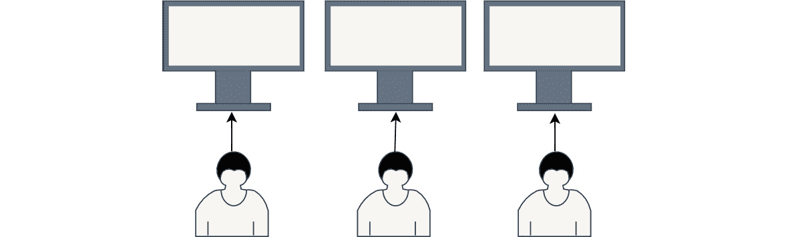

**图 5.2：** 并行的抽象 - 所有任务由不同的人执行；他们不相互交互

在上图中，有三个人同时在各自的电脑上工作——没错，他们在并行工作。

> **注意**
>
> **并发**和**并行**不是一回事。**并行**是并发的补充。它告诉我们任务是如何执行的：它们相互独立，在不同的计算单元（即处理器或核心）中运行。

现在，我们将平滑过渡到线程执行的概念。当我们谈论线程时，指的是执行线程。这是操作系统的一种抽象，允许我们同时执行多个任务。请记住，整个程序在一个独立的进程中执行。操作系统为进程分配**地址空间**、**处理器寄存器**和一些额外资源。所有工作线程都在进程内创建，并共享相同的资源。每个进程至少有一个执行 `main()` 函数的线程。我们可以创建一个新的执行线程，并指定一个起始函数作为该线程的入口点。

> **注意**
>
> 地址空间和处理器寄存器被称为**线程上下文**。当操作系统中断线程工作时，必须保存当前线程的上下文并加载下一个线程的上下文。

让我们通过下面的示例来了解新线程的创建。要创建新线程，必须包含 `<thread>` 头文件。它包含用于管理线程的类和函数。实际上，创建 `std::thread` 对象和执行线程有几种可能的方式，如下所示：


## 创建 `std::thread` 对象

## 无显式初始化

创建一个未显式初始化的 `std::thread` 对象。请记住，线程需要一个启动函数来运行其任务。我们并未指出哪个函数是该线程的主函数。这意味着执行线程并未被创建。让我们看看下面的代码示例，其中我们创建了一个空的 `std::thread` 对象：

```cpp
#include <thread>

int main()
{
    std::thread myThread;
    return 0;
}
```

## 使用函数指针

创建一个 `std::thread` 对象，并将函数指针作为构造函数参数传递。现在，执行线程将被创建，并将从我们在构造函数中传递的函数开始其工作。让我们看看下面的代码示例：

```cpp
#include <iostream>
#include <thread>

void printHello()
{
    std::cout << "hello" << std::endl;
}

int main()
{
    std::thread myThread(printHello);
    myThread.join();
    return 0;
}
```

在这里，我们创建了一个 `std::thread` 对象并用函数指针对其进行初始化。这是一个返回 `void` 且不接受任何参数的简单函数。然后，我们使用 `join()` 函数告诉主线程等待新线程完成。在 `std::thread` 对象的作用域结束之前，我们必须始终 `join()` 或 `detach()` 该线程。如果我们不这样做，我们的应用程序将会被操作系统终止，通过在 `std::thread` 析构函数中调用 `std::terminate()` 函数。除了函数指针，我们还可以传递任何可调用对象，例如 `lambda`、`std::function` 或重载了 `operator()` 的类。

### 线程管理注意事项

执行线程可能在 `std::thread` 对象销毁之前完成其工作。执行线程也可能在完成其工作之前被销毁。请始终在 `std::thread` 对象销毁之前对其进行 `join()` 或 `detach()`。

---

## 同步执行

**同步执行**一词意味着每个子任务将按顺序依次执行。换句话说，这意味着如果我们有几个任务要执行，每个任务只有在前一个任务完成工作后才能开始工作。该术语并未指定执行任务的方式，也未指定它们将在单线程还是多线程中执行。它仅告诉我们执行顺序。

让我们回到哲学家进餐的例子。在单线程世界中，哲学家们将一个接一个地进餐。第一位哲学家拿起两根筷子吃他们的寿司。然后，第二位哲学家拿起两根筷子吃他们的寿司。他们轮流进行，直到所有人都吃完寿司。

## 单线程同步执行

请看下面的图表，它表示四个任务在单线程中的同步执行：

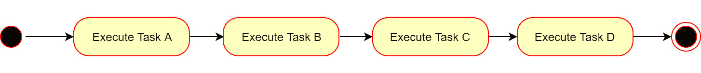

*图 5.3：单线程中的同步执行*

在这里，每个任务都在等待前一个任务完成。

## 多线程同步执行

任务也可以在多线程中同步执行。请看下面的图表，它表示四个任务在多线程中的同步执行。同样，每个任务都在等待前一个任务完成：

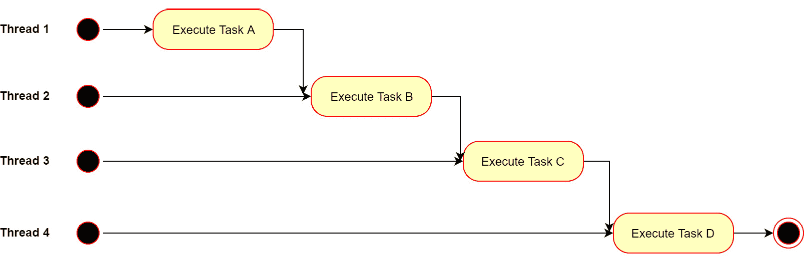

*图 5.4：多线程中的同步执行*

在这种情况下，每个任务都在单独的线程中启动，但仅在前一个线程完成其工作之后。在多线程世界中，哲学家们仍将一个接一个地进餐，但有一个细微的区别。现在，他们每个人都有自己的筷子，但只能按严格的顺序进餐。

### 同步执行注意事项

**同步执行**意味着每个任务的完成时间是同步的。任务的执行顺序是这里的重点。

## 代码示例

### 单线程实现

让我们通过以下代码示例来考虑同步执行。当我们在单线程中运行任务时，我们只需调用普通函数。例如，我们实现了四个向终端打印消息的函数。我们以同步、单线程的方式运行它们：

```cpp
#include <iostream>

void printHello1()
{
    std::cout << "Hello from printHello1()" << std::endl;
}

void printHello2()
{
    std::cout << "Hello from printHello2()" << std::endl;
}

void printHello3()
{
    std::cout << "Hello from printHello3()" << std::endl;
}

void printHello4()
{
    std::cout << "Hello from printHello4()" << std::endl;
}

int main()
{
    printHello1();
    printHello2();
    printHello3();
    printHello4();
    return 0;
}
```

在这里，我们逐个调用所有函数，每个后续函数都在前一个函数执行完成后运行。

### 多线程实现

现在，让我们在不同的线程中运行它们：

```cpp
#include <iostream>
#include <thread>

void printHello1()
{
    std::cout << "Hello from printHello1()" << std::endl;
}

void printHello2()
{
    std::cout << "Hello from printHello2()" << std::endl;
}

void printHello3()
{
    std::cout << "Hello from printHello3()" << std::endl;
}

void printHello4()
{
    std::cout << "Hello from printHello4()" << std::endl;
}

int main()
{
    std::thread thread1(printHello1);
    thread1.join();
    std::thread thread2(printHello2);
    thread2.join();
    std::thread thread3(printHello3);
    thread3.join();
    std::thread thread4(printHello4);
    thread4.join();
    return 0;
}
```

在前面的代码示例中，我们创建了四个线程并立即 join 它们。因此，每个线程在下一个线程运行之前就完成了它的工作。正如你所见，对于任务来说，没有任何变化——它们仍然按严格的顺序执行。

---

## 异步执行

这是指几个任务可以同时执行，而不会阻塞任何线程的执行。通常，主线程发起一个异步操作并继续执行。执行完成后，结果被发送回主线程。通常，执行异步操作与为其创建单独的线程无关。该任务可以由其他实体执行，例如另一个计算设备、远程 Web 服务器或外部设备。

让我们回到哲学家进餐的例子。在**异步执行**的情况下，所有哲学家都将拥有自己的筷子，并独立于彼此进餐。当寿司准备好并由服务员上桌时，他们都开始吃，并可以在各自的时间完成。

### 异步执行注意事项

在**异步执行**中，由于所有任务相互独立工作，因此了解每个任务的完成时间并不重要。

## 图表

请看下面的图表，它表示四个任务在多线程中的异步执行：

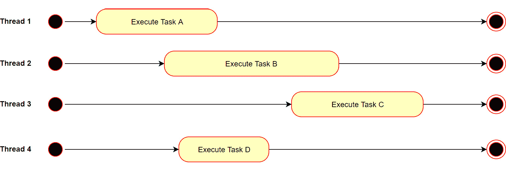

*图 5.5：多线程中的异步执行*

它们每一个都是在不同的时间启动和完成的。

## 代码示例

让我们通过一个代码示例来考虑这种异步执行。例如，我们实现了四个向终端打印消息的函数。我们在不同的线程中运行它们：

```cpp
#include <iostream>
#include <thread>
#include <chrono>

void printHello1()
{
    std::cout << "Hello from thread: " << std::this_thread::get_id() << std::endl;
}

void printHello2()
{
    std::cout << "Hello from thread: " << std::this_thread::get_id() << std::endl;
}

void printHello3()
{
    std::cout << "Hello from thread: " << std::this_thread::get_id() << std::endl;
}

void printHello4()
{
    std::cout << "Hello from thread: " << std::this_thread::get_id() << std::endl;
}

int main()
{
    std::thread thread1(printHello1);
    std::thread thread2(printHello2);
    std::thread thread3(printHello3);
    std::thread thread4(printHello4);
    thread1.detach();
    // ... 其余代码将继续在此处
}
```


## 线程分离与守护线程

```cpp
thread2.detach();
thread3.detach();
thread4.detach();

using namespace std::chrono_literals;

std::this_thread::sleep_for(2s);

return 0;
```

让我们看看这里发生了什么。我们使用了前面示例中的四个函数，但它们稍作了修改。我们通过使用 `std::this_thread::get_id()` 函数添加了线程唯一 ID 的打印。该函数返回 `std::thread::id` 对象，它代表线程的唯一 ID。该类重载了用于输出和比较的运算符，因此我们可以以不同方式使用它。例如，我们可以检查线程 ID，如果它是主线程的 ID，则可以执行特殊任务。在我们的示例中，我们将线程 ID 打印到终端。接下来，我们创建了四个线程并分离了它们。这意味着没有线程会等待其他线程完成工作。从这一刻起，它们就变成了**守护线程**。

它们将继续各自的工作，但没人知情。然后，我们使用了 `std::this_thread::sleep_for(2s)` 函数让主线程等待两秒。我们这样做是因为当主线程完成工作时，应用程序将停止，我们将无法在终端中查看分离线程的输出。下面的屏幕截图是终端输出的一个示例：

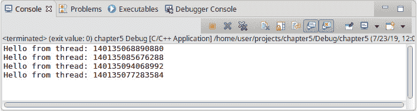

**图 5.6：示例执行的结果**

在您的 IDE 中，输出可能会有所不同，因为执行顺序是未定义的。异步执行的一个现实例子是互联网浏览器，您可以在其中打开多个标签页。当打开一个新标签页时，应用程序会启动一个新线程并将其分离。尽管线程独立工作，但它们可以共享某些资源，例如文件句柄，以写入日志或执行其他操作。

### 注意：`std::thread::get_id()`

`std::thread` 有一个名为 `get_id()` 的成员函数，它返回 `std::thread` 实例的唯一 ID。如果 `std::thread` 实例未初始化，或已被连接或分离，`get_id()` 将返回一个默认的 `std::thread::id` 对象。这意味着没有执行线程与当前的 `std::thread` 实例关联。

## 异步执行示例：货币兑换

让我们使用一些伪代码来展示一个由另一个计算单元进行计算的示例。例如，假设我们正在开发一个执行货币兑换计算的应用程序。用户输入一种货币的金额，选择另一种货币进行兑换，应用程序向他们显示该货币中的金额。应用程序在后台向持有所有货币汇率的远程服务器发送请求。

远程服务器计算给定货币的金额并将结果发送回。此时您的应用程序显示进度条，并允许用户执行其他操作。当它接收到结果时，会在窗口上显示它们。让我们看看下面的代码：

```cpp
#include <thread>

void runMessageLoop()
{
    while (true)
    {
        if (message)
        {
            std::thread procRes(processResults, message);
            procRes.detach();
        }
    }
}

void processResults(Result res)
{
    display();
}

void sendRequest(Currency from, Currency to, double amount)
{
    send();
}

void displayProgress()
{
}

void getUserInput()
{
    Currency from;
    Currency to;
    double amount;
    std::thread progress(displayProgress);
    progress.detach();
    std::thread request(sendRequest, from, to, amount);
    request.detach();
}

int main()
{
    std::thread messageLoop(runMessageLoop);
    messageLoop.detach();
    std::thread userInput(getUserInput);
    userInput.detach();    
    return 0;
}
```

让我们看看这里发生了什么。在 `main()` 函数中，我们创建了一个名为 `messageLoop` 的线程，它执行 `runMessageLoop()` 函数。一些检查是否有来自服务器的新结果的代码可以放在这个函数中。如果接收到新结果，它会创建一个新线程 `procRes`，该线程将在窗口中显示结果。我们还在 `main()` 函数中创建了另一个线程 `userInput`，它从用户处获取货币和金额，并创建一个新线程 `request`，该线程将向远程服务器发送请求。发送请求后，它创建一个新线程 `progress`，该线程将显示进度条，直到接收到结果。由于所有线程都被分离了，它们能够独立工作。当然，这只是伪代码，但主要思想很清楚——我们的应用程序向远程服务器发送请求，由远程服务器为我们的应用程序执行计算。

## 并发概念：日常生活类比

让我们用一个日常生活中的例子来复习我们所学的并发概念。这里有一个背景，您必须编写一个应用程序并提供与之相关的所有文档和架构概念：

- **单线程工作**：您自己编写。
- **多线程工作**：您邀请朋友们一起编写项目。有人编写架构概念，有人负责文档工作，而您专注于编码部分。所有参与者相互沟通以澄清任何问题并共享文档，例如关于规格的问题。
- **并行工作**：任务被分割。有人为项目编写文档，有人设计图表，有人编写测试用例，而您独立工作。参与者之间完全不沟通。
- **同步工作**：在这种情况下，你们每个人都无法理解自己应该做什么。因此，你们决定一个接一个地工作。当架构工作完成后，开发人员开始编写代码。然后，当开发工作完成后，有人开始编写文档。
- **异步工作**：在这种情况下，您雇佣一家外包公司来完成项目。在他们开发项目的同时，您将从事其他任务。

现在，让我们将知识应用到实践中，通过解决一个练习来了解这一切是如何工作的。

### 练习 1：以不同方式创建线程

在本练习中，我们将编写一个简单的应用程序来创建四个线程；其中两个将以同步方式工作，另外两个将以异步方式工作。它们都将向终端打印一些符号，以便我们可以看到操作系统如何切换线程执行。

#### 注意：链接器标志

在项目设置中添加 `pthread` 链接器标志，以让编译器知道您将使用线程库。对于 Eclipse IDE，您可以按照以下路径操作：**Project** -> **Properties** -> **C/C++ Build** -> **Settings** -> **G++ Linker** -> **Miscellaneous** -> **Linker flags enter '-pthread'**。此路径适用于 **Eclipse Version: 3.8.1**，在不同版本中可能会有所不同。

#### 步骤

1. 包含一些用于线程支持的头文件，即 `<thread>`，流支持，即 `<iostream>`，以及函数对象支持，即 `<functional>`：

```cpp
#include <iostream>
#include <thread>
#include <functional>
```

2. 实现一个自由函数 `printNumbers()`，它在 `for` 循环中打印从 0 到 100 的数字：

```cpp
void printNumbers()
{
    for(int i = 0; i < 100; ++i)
    {
        std::cout << i << " ";
    }
    std::cout << std::endl;
}
```

3. 实现一个可调用对象，即一个 `Printer` 类，带有一个重载的 `operator()`，它在 `for` 循环中打印从 0 到 100000 的 `"*"` 符号。每 `200` 次迭代打印一个换行符，以使输出更具可读性：

```cpp
class Printer
{
public:
    void operator()()
    {
        for(int i = 0; i < 100000; ++i)
        {
            if (!(i % 200))
            {
                std::cout << std::endl;
            }
            std::cout << "*";
        }
    }
};
```


## 练习 1：使用不同方式初始化线程（续）

### 4. 进入 `main()` 函数并创建一个名为 `printRevers` 的 lambda 对象，在 `for` 循环中打印从 100 到 0 的数字：

```cpp
int main()
{
    auto printRevers = []()
    {
        for(int i = 100; i >= 0; --i)
        {
            std::cout << i << " ";
        }
        std::cout << std::endl;
    };
    return 0;
}
```

### 5. 实现一个名为 `printOther` 的 `std::function` 对象，在 `for` 循环中打印从 `0` 到 `100000` 的 `^` 符号。每 `200` 次迭代打印一个换行符以获得更易读的输出：

```cpp
std::function<void()> printOther = []()
{
    for(int i = 0; i < 100000; ++i)
    {
        if (!(i % 200))
        {
            std::cout << std::endl;
        }
        std::cout << "^";
    }
};
```

### 6. 创建第一个线程 `thr1`，将自由函数 `printNumbers` 传递给其构造函数。调用 `join()`：

```cpp
std::thread thr1(printNumbers);
thr1.join();
```

### 7. 创建第二个线程 `thr2`，将 lambda 对象 `printRevers` 传递给其构造函数。调用 `join()`：

```cpp
std::thread thr2(printRevers);
thr2.join();
```

### 8. 创建 `Printer` 类的实例 `print`。创建第三个线程 `thr3` 并用 `print` 对象初始化它。使用 `detach()` 方法分离它：

```cpp
Printer print;
std::thread thr3(print);
thr3.detach();
```

### 9. 创建最后一个线程 `thr4` 并用 `printOther` 对象初始化它。分离它：

```cpp
std::thread thr4(printOther);
thr4.detach();
```

### 10. 在 `main()` 函数退出前添加 `std::getchar()` 函数调用。这可以避免应用程序关闭。我们将有机会看到分离线程如何工作：

```cpp
std::getchar();
```

### 11. 在编辑器中运行此代码。你将看到 `thr1` 开始执行且程序等待。`thr1` 完成后，`thr2` 开始执行且程序等待。这是多线程同步执行的示例。`thr2` 完成工作后，线程 `thr3` 和 `thr4` 开始执行。它们是分离的，所以程序可以继续执行。在以下输出中，你将看到符号混合在一起。这是因为操作系统执行中断且线程同时工作。

你的输出将类似于以下内容：

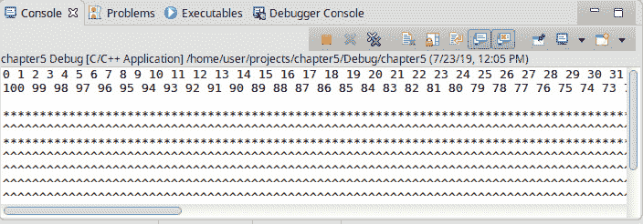

###### 图 5.7：练习执行的结果

在本练习中，我们实现了四种初始化线程的不同方式：使用自由函数、lambda 对象、可调用对象和 `std::function` 对象。还有几种初始化线程的方法，我们将在下一节中讨论。我们还回顾了如何在多线程中实现同步程序。我们也尝试实现了异步程序，并看到线程确实同时且独立地工作。在下一节中，我们将学习数据冒险和竞态条件，以及如何通过同步技术避免它们。

## 回顾同步、数据冒险与竞态条件

多线程编程的关键挑战在于了解线程如何处理**共享数据**。共享数据（也称为资源）不仅包括变量，还包括文件描述符、环境变量，甚至 Windows 注册表。例如，如果线程只是读取数据，则没有问题，也不需要同步。然而，如果至少有一个线程编辑数据，则可能出现**竞态条件**。通常，对数据的操作不是原子的，即需要多个步骤。即使是最简单的数值变量自增操作也分三步执行：

1.  读取变量的值。
2.  增加它。
3.  写入新值。

由于操作系统中断，线程可能在完成操作前被停止。例如，我们有线程 A 和 B，以及一个等于 0 的变量。

线程 A 开始自增：
1.  读取变量的值（`var = 0`）。
2.  增加它（`tmp = 1`）。
3.  被操作系统中断。

线程 B 开始自增：
1.  读取变量的值（`var = 0`）。
2.  增加它（`tmp = 1`）。
3.  写入新值（`var = 1`）。
4.  被操作系统中断。

线程 A 继续自增：
1.  写入新值（`var = 1`）。

因此，我们预期变量在工作完成后等于 2，但实际上它等于 1。请看下图以更好地理解此示例：

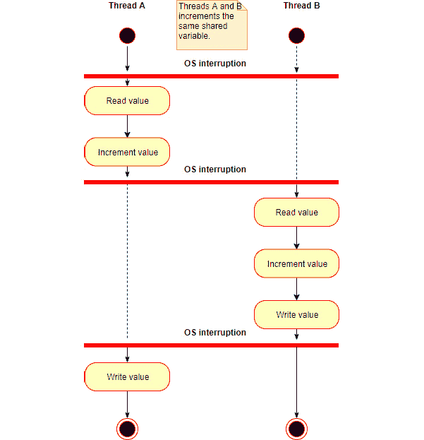

###### 图 5.8：两个线程递增同一个共享变量

回到哲学家进餐的比喻。最初的问题是一位哲学家只有一根筷子。如果他们都饿了，就会争着抢两根筷子。最先抢到两根筷子的哲学家先吃，其他人必须等待。他们会为筷子而竞争。

现在，让我们将知识应用到实践中，编写一些代码来查看竞态条件如何在代码中出现并破坏数据。

### 练习 2：编写竞态条件示例

在本练习中，我们将编写一个简单的应用程序来演示竞态条件的实际效果。我们将创建一个经典的“检查后行动”竞态条件示例。我们将创建一个执行两数相除的线程。我们将通过引用传递这些数字。检查除数是否等于 0 后，我们将设置一个短暂的超时。此时在主线程中，我们将除数设置为 0。当子线程唤醒时，它将执行除以 0 的操作。这将导致应用程序崩溃。我们还将添加一些日志以查看执行流程。

#### 注意

默认情况下，所有变量在传递给线程时都会被复制。要按引用传递变量，请使用 `std::ref()` 函数。

首先，我们实现没有竞态条件的代码并确保其按预期工作。执行以下步骤：

#### 1. 包含线程支持的头文件 `<thread>`、流支持的头文件 `<iostream>` 以及函数对象支持的头文件 `<functional>`：

```cpp
#include <iostream>
#include <chrono>
#include <thread>
```

#### 2. 实现 `divide()` 函数，执行两个整数的除法。通过引用传递 `divisor` 和 `dividend` 变量。检查 `dividend` 是否等于 0。然后添加日志：

```cpp
void divide(int& divisor, int& dividend)
{
    if (0 != dividend)
    {
        std::cout << "Dividend = " << dividend << std::endl;
        std::cout << "Result: " << (divisor / dividend) << std::endl;    
    }
    else
    {
        std::cout << "Error: dividend = 0" << std::endl;
    }
}
```

#### 3. 进入 `main()` 函数，创建两个名为 `divisor` 和 `dividend` 的整数，并用任意非零值初始化它们：

```cpp
int main()
{
    int divisor = 15;
    int dividend = 5;
    return 0;
}
```

#### 4. 创建 `thr1` 线程，传递 `divide` 函数，通过引用使用 `divisor` 和 `dividend`，然后分离线程：

```cpp
std::thread thr1(divide, std::ref(divisor), std::ref(dividend));
thr1.detach();
std::getchar();
```

#### 注意

在 `std::this_thread` 命名空间中有一个名为 `sleep_for` 的函数，它可以阻塞线程指定的时间段。作为参数，它接受 `std::chrono::duration` —— 一个表示时间间隔的模板类。

#### 5. 在编辑器中运行此代码。你将看到 `divide()` 函数在 `thr1` 中正确工作。输出如下所示：


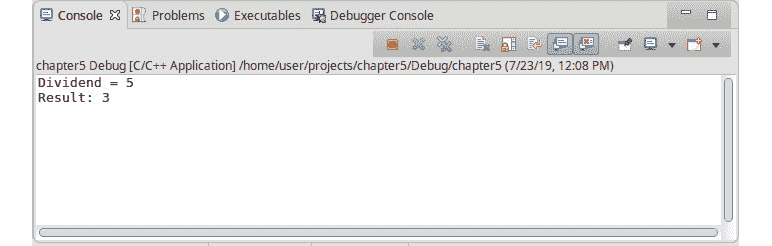

**Figure 5.9: The result of the correct exercise execution**

现在，我们将继续进行更改，以演示竞态条件。

6. 返回函数，在 `if` 条件后将子线程的休眠时间设置为 `2s`。添加日志：

```
if (0 != dividend)
{
    std::cout << "Child thread goes sleep" << std::endl;
    using namespace std::chrono_literals;
    std::this_thread::sleep_for(2s);
    std::cout << "Child thread woke up" << std::endl;
    std::cout << "Dividend = " << dividend << std::endl;
    std::cout << (divisor / dividend) << std::endl;
}
```

7. 返回 `main()` 函数，将主线程的休眠时间设置为 `1s`。之后，将 `dividend` 变量设置为 `0`。添加日志：

```
std::cout << "Main thread goes sleep" << std::endl;
using namespace std::chrono_literals;
std::this_thread::sleep_for(1s);
std::cout << "Main thread woke up" << std::endl;
dividend = 0;
std::cout << "Main thread set dividend to 0" << std::endl;
```

> **Note**
>
> `std::chrono_literals` 命名空间包含用于时间表示的字面量：`h` 代表**小时**，`min` 代表**分钟**，`s` 代表**秒**，`ms` 代表**毫秒**，`us` 代表**微秒**，`ns` 代表**纳秒**。要使用它们，只需将它们添加到数字末尾，例如 `1s`、`1min`、`1h` 等。

8. 在 `main()` 函数退出前添加 `std::getchar()` 函数调用。这可以防止我们关闭应用程序，从而有机会查看分离线程是如何工作的：

```
std::getchar();
```

9. 在编辑器中运行此代码。你将看到主线程休眠 `1s`。然后，子线程进入 `if` 条件并休眠 `2s`，这意味着它验证了 `dividend` 且其不等于 `0`。然后，主线程醒来并将 `dividend` 变量设置为 `0`。接着，子线程醒来并执行除法。但由于 `dividend` 现在等于 `0`，应用程序崩溃。如果你在 Debug 模式下运行此示例，将看到带有消息 "Arithmetic exception" 的 **SIGFPE exception**。你将得到以下输出：

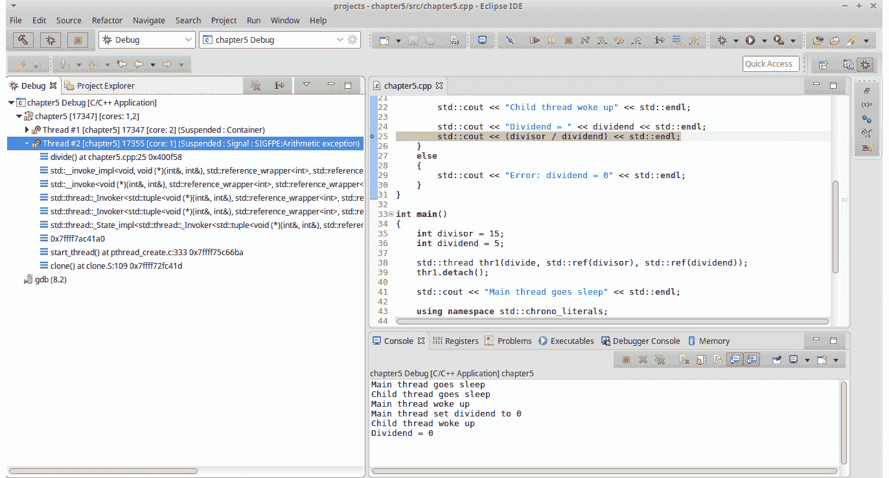

**Figure 5.10: The result of the exercise's execution with race conditions**

在本练习中，我们考虑了“检查后行动”类型的竞态条件。我们为线程设置了休眠周期以模拟操作系统中断，但在实际程序中，这种情况很可能发生，也可能不发生。这完全取决于操作系统及其调度器。这使得调试和修复竞态条件变得极其困难。为了避免本例中的竞态条件，我们可以采取以下几种方式：

*   向线程函数传递变量的副本，而不是传递引用。
*   使用标准库原语同步线程间对共享变量的访问。
*   在主线程将 `dividend` 值更改为 `0` 之前，先连接（join）子线程。

让我们看看修复此竞态条件的几种其他方法。所有这些方法都取决于你尝试实现的任务。在下一节中，我们将讨论 C++ 标准库提供的同步原语。

## 数据冒险

之前，我们考虑了最无害的示例，但有时会出现数据损坏的情况，这会导致未定义的程序行为或异常终止。这种由竞态条件或单纯的错误设计导致的数据损坏被称为**数据冒险**。一般来说，这意味着一项工作的最终结果取决于线程执行的顺序。如果不同线程处理共享数据或全局变量，可能会因为不同线程以错误的顺序执行任务，导致结果随时间变化。这是由于数据在多线程环境下存在依赖关系而发生的。此类依赖问题有条件地分为三组：

*   **真依赖**：**写后读** (RAW)
*   **反依赖**：**读后写** (WAR)
*   **输出依赖**：**写后写** (WAW)

### RAW 依赖

当一个线程计算的值被另一个线程使用时，会发生 **RAW 依赖**。例如，**线程 A** 应完成其工作并将结果写入变量。**线程 B** 必须读取该变量的值并完成其工作。用伪代码表示如下：

```
Thread A: a = doSomeStuff();
Thread B: b = a - doOtherStuff();
```

如果 **线程 B** 先执行，就会出现困难。这将导致 **线程 B** 读取到无效值。线程执行的顺序必须严格保证。**线程 B** 必须读取变量的值，但只能在 **线程 A** 写入之后。否则，将导致未定义行为。下图将帮助你理清导致数据冒险的 RAW 数据依赖：

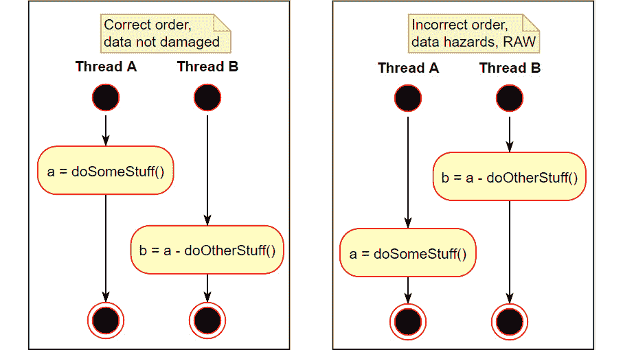

**Figure 5.11: RAW data dependency between two threads**

### WAR 依赖

当一个线程更改另一个线程正在使用的数据时，会发生 **WAR 依赖**。例如，**线程 A** 必须读取变量的值并完成其工作。之后，**线程 B** 应完成其工作并将结果写入变量。用伪代码表示如下：

```
Thread A: b = a - doSomeStuff();
Thread B: a = doOtherStuff();
```

如果 **线程 B** 先执行，就会出现困难。这将导致 **线程 B** 在 **线程 A** 读取值之前更改了该值。线程执行的顺序必须严格保证。**线程 B** 应仅在 **线程 A** 读取其值后，才将新值写入变量。下图将帮助你理清导致数据冒险的 WAR 数据依赖：

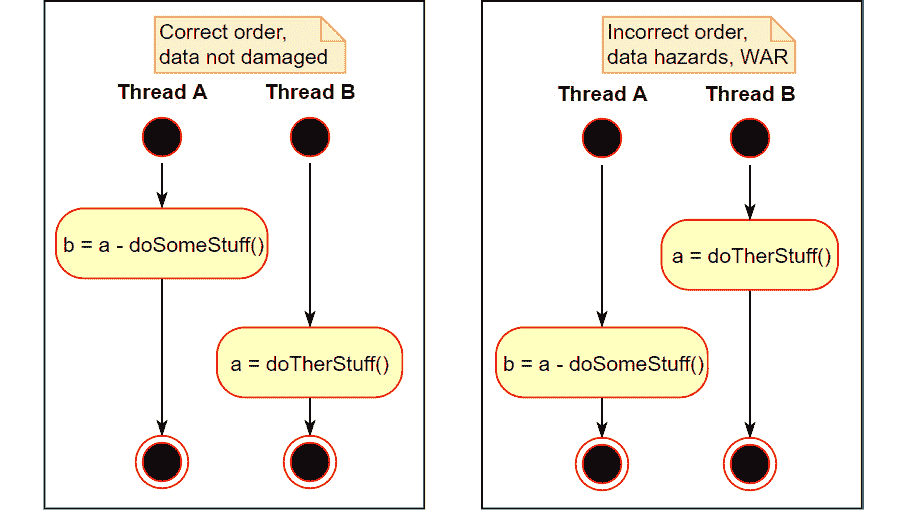

**Figure 5.12: WAR data dependency between two threads**

### WAW 依赖

当多个线程更改同一变量的值，且某个线程读取该值用于计算时，会发生 **WAW 依赖**。例如，**线程 A** 执行其工作并将结果写入变量。**线程 B** 读取变量的值并执行其工作。**线程 C** 执行其工作并将结果写入同一变量。用伪代码表示如下：

```
Thread A: a = doSomeStuff();
Thread B: b = a - doOtherStuff();
Thread C: a = doNewStuff();
```

如果 **线程 C** 在线程 A 和 B 之前执行，就会出现困难。这会导致 **线程 B** 读取到它不应读取的值。线程执行的顺序必须严格保证。**线程 C** 必须将新值写入变量，但只能在 **线程 A** 写入其值且 **线程 B** 读取之后。下图将帮助你理清导致数据冒险的 WAW 数据依赖：

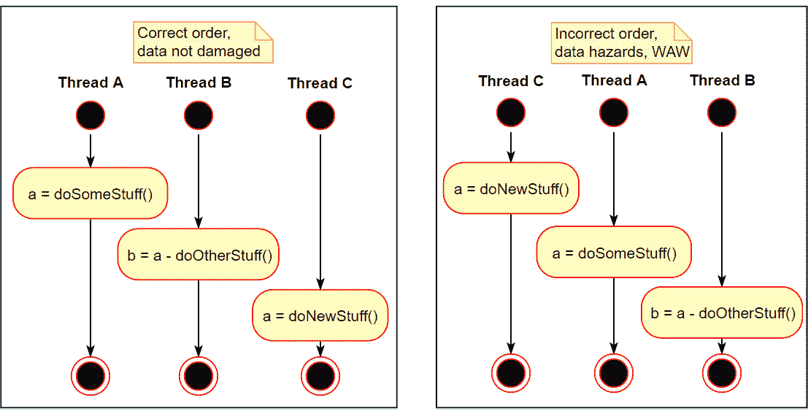

**Figure 5.13: WAW data dependency between two threads**

#### 资源同步


## 线程同步机制

## 资源同步

为防止竞争和数据冒险，存在一种共享数据锁定机制，当某个流意图更改或读取这些数据时会用到它。这种机制称为 `resource synchronization`。为了同步，我们需要分配更改或读取共享资源的代码片段。这类代码片段称为 `critical sections`。同步的做法是：当某个线程进入临界区时，阻塞该临界区。其他同样意图执行该临界区代码的线程将被阻塞。当执行临界区的线程离开时，锁被释放。然后，下一个线程将重复这一过程。

### 同步递增示例

考虑之前的递增示例，但现在采用同步访问。回想一下，我们有 `Thread A` 和 `Thread B`，还有一个值为 0 的变量。

`Thread A` 开始递增：

1. 进入临界区并将其锁定。
2. 读取变量的值（`var = 0`）。
3. 将其递增（`tmp = 1`）。
4. 被操作系统中断。

`Thread B` 开始递增：

1. 尝试进入临界区；但它已锁定，所以线程等待。

`Thread A` 继续递增：

1. 写入新值（`var = 1`）。

`Thread B` 继续递增：

1. 进入临界区并将其锁定。
2. 读取变量的值（`var = 1`）。
3. 将其递增（`tmp = 2`）。
4. 写入新值（`var = 2`）。

两个线程完成后，变量包含正确的结果。因此，同步确保共享数据不会被破坏。请看下图，以更好地理解此示例：

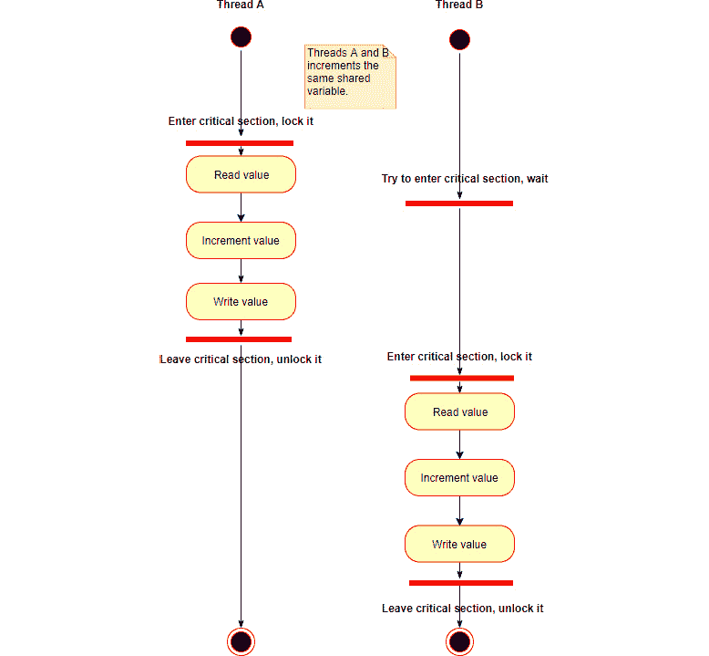

*图 5.14：两个线程以同步方式递增同一个共享变量*

标识临界区并预判非同步访问的可能后果是一项非常困难的任务。因为过度同步违背了多线程工作的初衷。然而，如果两三个线程在一个临界区中工作得相当快，程序中可能有几十个线程全都阻塞在该临界区中。这将极大地拖慢程序速度。

## 事件同步

还有一种同步线程工作的机制——`event synchronization`。这意味着当一个线程挂起工作，直到另一个线程发出某事件发生的信号时，对线程工作进行同步。例如，有 `Thread A`，它从另一个进程接收消息。它将消息写入队列并等待新消息。还有另一个线程 `Thread B`，处理这些消息。它从队列读取消息并对其执行某些操作。当没有消息时，`Thread B` 处于休眠状态。当 `Thread A` 接收到新消息时，它唤醒 `Thread B` 并处理它。下图清晰地展示了两个线程的事件同步：

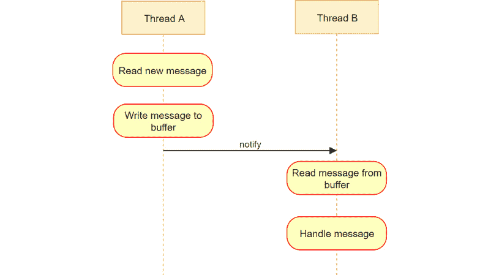

*图 5.15：两个线程的事件同步*

## 有缺陷的接口设计与竞态条件

然而，即使在同步代码中，也可能出现竞态条件的另一个原因——类的有缺陷接口。为了理解这是什么，让我们看看下面的例子：

```cpp
class Messages
{
public:
    Messages(const int& size)
    : ArraySize(size)
    , currentIdx(0)
    , msgArray(new std::string[ArraySize])
    {}

    void push(const std::string& msg)
    {
        msgArray[currentIdx++] = msg;
    }

    std::string pop()
    {
        auto msg = msgArray[currentIdx - 1];
        msgArray[currentIdx - 1] = "";
        --currentIdx;
        return msg;
    }

    bool full()
    {
        return ArraySize == currentIdx;
    }

    bool empty()
    {
        return 0 == currentIdx;
    }

private:
    const int ArraySize;
    int currentIdx;
    std::string * msgArray;
};
```

这里，我们有一个名为 `Messages` 的类，它包含一个动态分配的字符串数组。在构造函数中，它接受数组大小并创建一个指定大小的数组。它有一个函数 `full()`，如果数组已满则返回 `true`，否则返回 `false`。它还有一个 `empty()` 函数，如果数组为空则返回 `true`，否则返回 `false`。用户有责任在压入新值前检查数组是否已满，以及在从数组弹出新值前检查数组是否为空。这是一个导致竞态条件的不良类接口示例。即使我们用锁保护 `push()` 和 `pop()` 函数，竞态条件也不会消失。让我们看看使用 `Messages` 类的下面示例：

```cpp
int main()
{
    Messages msgs(10);
    std::thread thr1([&msgs](){
        while(true)
        {
            if (!msgs.full())
            {
                msgs.push("Hello");
            }
            else
            {
                break;
            }
        }
    });
    std::thread thr2([&msgs](){
        while(true)
        {
            if (!msgs.empty())
            {
                std::cout << msgs.pop() << std::endl;
            }
            else
            {
                break;
            }
        }
    });
    thr1.detach();
    thr2.detach();
    using namespace std::chrono_literals;
    std::this_thread::sleep_for(2s);
    return 0;
}
```

这里，我们创建了一个 `msgs` 变量，然后创建了第一个线程，向 `msgs` 压入值。然后，我们创建了第二个线程，从数组弹出值并将它们分离。即使我们使用锁机制保护所有函数，其中一个线程也可能检查数组大小并被操作系统中断。此时，另一个线程可以更改数组。当第一个线程继续工作时，它可能会尝试向已满数组压入数据或从空数组弹出数据。因此，同步只有配合良好的设计才有效。

## 死锁

还有一个同步问题。让我们回到哲学家进餐的例子。最初的问题是每个哲学家只有一根筷子。所以，他们可以通过互相共享筷子，一个接一个地吃寿司。虽然他们吃完寿司需要很长时间，但大家都能吃饱。但如果他们每个人同时抓起一根筷子且不愿共享第二根筷子，他们就无法吃寿司，因为每个人都会永远等待第二根筷子。这导致 `deadlock`。这发生在两个线程都在等待另一个线程继续其工作时。死锁的原因之一是一个线程 join 另一个线程，但另一个线程也 join 第一个线程。所以，当两个线程相互 join 时，它们都无法继续工作。让我们看看下面的死锁示例：

```cpp
#include <thread>

std::thread* thr1;
std::thread* thr2;

void someStuff()
{
    thr1->join();
}

void someAnotherStuff()
{
    thr2->join();
}

int main()
{
    std::thread t1(someStuff);
    std::thread t2(someAnotherStuff);
    thr1 = &t1;
    thr2 = &t2;
    using namespace std::chrono_literals;
    std::this_thread::sleep_for(2s);
    return 0;
}
```

在 main 函数中，我们有两个线程 `t1` 和 `t2`。我们用 `someStuff()` 函数初始化 `t1` 线程，该函数做一些有用的工作。我们也用 `someAnotherStuff()` 函数初始化 `t2` 线程，该函数做一些更有用的工作。我们有指向这些线程的全局指针，并在 `t2` 执行的函数中 join 指向 `t1` 的指针。我们也在 `t1` 执行的函数中 join 指向 `t2` 的指针。这样做，它们相互 join 了。这导致死锁。


在下一节中，我们将探讨用于同步的 C++ 线程库原语以及死锁的另一个原因。

## 多线程闭包的移动语义

`std::thread` 类不可复制，但如果我们想存储几个线程，或者可能是 10 个或 20 个怎么办？当然，我们可以创建相应数量的线程，然后像这样 join 或 detach 它们：

```cpp
std::thread thr1(someFunc);
std::thread thr2(someFunc);
std::thread thr3(someFunc);
std::thread thr4(someFunc);
std::thread thr5(someFunc);

thr1.join();
thr2.join();
thr3.join();
thr4.join();
thr5.join();
```

但将一组线程存储在 `STL container`（例如线程向量）中会更方便：

```cpp
std::vector<std::thread> threads;
```

`STL containers` 无法用于不支持**复制语义**的对象。多亏了**移动语义**，我们可以将具有移动构造函数和移动赋值运算符的不可复制对象存储到容器中。然后，我们可以配合 `std::move()` 函数使用线程向量。要初始化容器中的线程，我们可以执行类似以下的操作：

```cpp
for (int i = 0; i < 10; i++) {
    auto t = std::thread([i]() {
        std::cout << "thread: " << i << "\n";
    });
    threads.push_back(std::move(t));
}
```

然后，我们可以 join 或 detach 它们所有：

```cpp
for (auto& thr : threads) {
    if (thr.joinable()) {
        thr.join();
    }
}
```

当我们将 `std::thread` 对象作为类成员存储时，移动语义也很有用。在这种情况下，我们应该仔细设计类，删除复制构造函数和赋值运算符，并实现新的移动构造函数和移动赋值运算符。让我们考虑这样一个类的代码示例：

```cpp
class Handler {
    std::thread threadHandler;

public:
    Handler(const Handler&) = delete;
    Handler& operator=(const Handler&) = delete;

    Handler(Handler&& obj)
        : threadHandler(std::move(obj.threadHandler)) {}

    Handler& operator=(Handler&& obj) {
        if (threadHandler.joinable()) {
            threadHandler.join();
        }
        threadHandler = std::move(obj.threadHandler);
        return *this;
    }

    ~Handler() {
        if (threadHandler.joinable()) {
            threadHandler.join();
        }
    }
};
```

在移动赋值运算符中，我们首先检查线程是否可 join。如果是，我们先 join 它，然后才执行赋值操作。

### 注意

我们永远不应该在不使用 `join()` 或 `detach()` 的情况下将一个线程对象赋值给另一个线程对象。这将导致调用 `std::terminate()` 函数。

也可以使用 `std::move()` 函数将对象移动到线程函数中。这对于处理大对象很有帮助，因为复制它们是不建议的。让我们做一个练习，以确保对象可以被移动到线程函数中。

## 练习 3：将对象移动到线程函数

在本练习中，我们将编写一个简单的应用程序，演示 `std::move()` 如何为 `std::thread` 类工作。我们将创建一个同时拥有复制构造函数和移动构造函数的类，以查看当我们将该类的对象移动到 `std::thread` 函数时会调用哪一个。执行以下步骤以完成此练习：

1.  包含线程支持的头文件 `<thread>` 和流支持的头文件 `<iostream>`：

    ```cpp
    #include <iostream>
    #include <thread>
    ```

2.  实现 `Handler` 类，它拥有默认构造函数、析构函数、复制构造函数、赋值运算符、移动构造函数和移动赋值运算符。它们除了打印日志外不做任何事：

    ```cpp
    class Handler {
    public:
        Handler() {
            std::cout << "Handler()" << std::endl;
        }

        Handler(const Handler&) {
            std::cout << "Handler(const Handler&)" << std::endl;
        }

        Handler& operator=(const Handler&) {
            std::cout << "Handler& operator=(const Handler&)" << std::endl;
            return *this;
        }

        Handler(Handler&& obj) {
            std::cout << "Handler(Handler && obj)" << std::endl;
        }

        Handler& operator=(Handler&& obj) {
            std::cout << "Handler & operator=(Handler && obj)" << std::endl;
            return *this;
        }

        ~Handler() {
            std::cout << "~Handler()" << std::endl;
        }
    };
    ```

3.  实现 `doSomeJob()` 函数，它实际上在这里什么都不做，只是打印一条日志消息：

    ```cpp
    void doSomeJob(Handler&& h) {
        std::cout << "I'm here" << std::endl;
    }
    ```

4.  进入 `main()` 函数并创建一个 `Handler` 类型的 `handler` 变量。创建 `thr1`，传递 `doSomeJob()` 函数，并移动 handler 变量：

    ```cpp
    Handler handler;
    std::thread thr1(doSomeJob, std::move(handler));
    ```

5.  分离 `thr1` 线程，并为主线程添加一小段睡眠时间以避免应用程序关闭。我们将能够看到来自分离线程的输出：

    ```cpp
    thr1.detach();
    using namespace std::chrono_literals;
    std::this_thread::sleep_for(5s);
    ```

6.  在编辑器中运行此代码。在终端日志中，从默认构造函数开始，你将看到来自移动运算符的两条日志、一条来自析构函数的日志、来自 `doSomeJob()` 函数的消息，最后是来自析构函数的另外两条日志消息。我们可以看到移动构造函数被调用了两次。

    你将获得以下输出：

    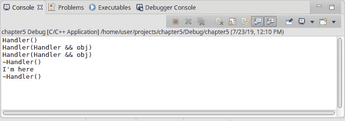

    **图 5.16：** 练习执行的结果

正如你所见，`Handler` 对象被移动到了线程函数中。尽管如此，所有未使用 `std::ref()` 函数传递的参数都被复制到了线程的内存中。

让我们考虑一个有趣的问题。正如你可能记得的，当我们初始化 `std::thread` 时，所有构造函数参数都会被复制到线程内存中，包括可调用对象——lambda、函数或 `std::function`。但如果我们的可调用对象不支持复制语义怎么办？例如，我们创建了一个只有移动构造函数和移动赋值运算符的类：

```cpp
class Converter {
public:
    Converter(Converter&&) {}
    Converter& operator=(Converter&&) { return *this; }
    Converter() = default;
    Converter(const Converter&) = delete;
    Converter& operator=(const Converter&) = delete;
    void operator()(const std::string&) {
        // do nothing
    }
};
```

我们如何将其传递给线程构造函数？如果我们直接原样传递，会得到编译器错误；例如：

```cpp
int main() {
    Converter convert;
    std::thread convertThread(convert, "convert me");
    convertThread.join();
    return 0;
}
```

你将获得以下输出：

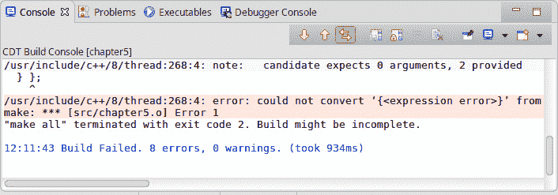

**图 5.17：** 编译错误示例

这里有很多奇怪的错误。为了修复此问题，我们可以使用 `std::move()` 函数来移动可调用对象：

```cpp
std::thread convertThread(std::move(convert), "convert me");
```

现在，一切正常——代码编译通过并完全按我们想要的方式运行。

现在，让我们再考虑一个有趣的例子。例如，你有一个需要捕获不可复制对象（例如 `unique_ptr`）的 lambda 函数：

```cpp
auto unique = std::make_unique<Converter>();
```

从 C++14 开始，我们可以使用 `std::move()` 来捕获可移动对象。因此，要捕获 unique pointer，我们可以使用以下代码：

```cpp
std::thread convertThread([unique = std::move(unique)] {
    unique->operator()("convert me");
});
```

正如你所见，使用 `std::move` 在 lambda 中按值捕获非常有用。当我们不想复制某些对象（因为它们复制起来可能需要很长时间）时，这也很有用。


现在，让我们将所学知识付诸实践，编写一个应用程序示例，演示如何将 `std::move` 与线程配合使用。

### 练习 4：创建并操作 STL 线程容器

在本练习中，我们将编写一个简单的应用程序，在其中使用 `std::move()` 与线程。首先，我们将实现一个可移动构造的类。该类将把小写文本转换为大写文本。然后，我们将创建该类实例的 vector。接着，我们将创建 `std::thread` 对象的 vector。最后，我们将使用第一个 vector 中的对象来初始化线程。

执行以下步骤以完成此练习：

1. 包含线程支持所需的头文件 `<thread>`、流支持所需的 `<iostream>` 以及 `<vector>`：

```cpp
#include <iostream>
#include <thread>
#include <vector>
#include <string>
```

2. 实现 `Converter` 类，它拥有类型为 `const std::vector<std::string>&` 的私有成员 `m_bufferIn`。这是对原始小写字符串 vector 的引用。它还有一个接受 `bufferIn` 变量的用户定义构造函数。然后，我们删除拷贝构造函数和赋值运算符。最后，我们定义重载的 `operator()`，在其中将所有小写字符转换为大写。转换后，我们将结果写入结果缓冲区：

```cpp
class Converter
{
public:
    Converter(std::vector<std::string>& bufferIn)
        : m_bufferIn(bufferIn)
    {
    }
    Converter(Converter&& rhs)
        : m_bufferIn(std::move(rhs.m_bufferIn))
    {
    }
    Converter(const Converter&) = delete;
    Converter& operator=(const Converter&) = delete;
    Converter& operator=(Converter&&) = delete;
    void operator()(const int idx, std::vector<std::string>& result)
    {
        try
        {
            std::string::const_iterator end = m_bufferIn.at(idx).end();
            std::string bufferOut;
            for (std::string::const_iterator iter = m_bufferIn.at(idx).begin(); iter != end; iter++)
            {
                if (*iter >= 97 && *iter <= 122)
                {
                    bufferOut += static_cast<char>(static_cast<int>(*iter) - 32);
                }
                else
                {
                    bufferOut += *iter;
                }
            }
            result[idx] = bufferOut;
        }
        catch(...)
        {
            std::cout << "Invalid index" << std::endl;
        }
    }
private:
    const std::vector<std::string>& m_bufferIn;
};
```

3. 进入 `main()` 函数，创建一个名为 `numberOfTasks` 的常量值，并将其设置为 `5`。然后，创建一个 `Converter` 对象的 vector 并用 `numberOfTasks` 预留其大小。接着，创建一个 `std::thread` 对象的 vector 并用 `numberOfTasks` 预留其大小：

```cpp
const int numberOfTasks = 5;
std::vector<Converter> functions;
functions.reserve(numberOfTasks);
std::vector<std::thread> threads;
threads.reserve(numberOfTasks);
```

4. 创建字符串 vector `textArr`，并压入五个待转换的不同长字符串：

```cpp
std::vector<std::string> textArr;
textArr.emplace_back("In the previous topics, we learned almost all that we need to work with threads. But we still have something interesting to consider – how to synchronize threads using future results. When we considered condition variables we didn't cover the second type of synchronization with future results. Now it's time to learn that.");
textArr.emplace_back("First of all, let's consider a real-life example. Imagine, you just passed the exam at the university. You were asked to wait some amount of time for results. So, you have time to coffee with your mates, and every 10-15 mins you check are results available. Then, when you finished all your other activities, you just come to the door of the lecture room and wait for results.");
textArr.emplace_back("In this exercise, we will write a simple application where we will use std::move() with threads. First of all, we will implement a class that is move constructible. This class will convert lowercase text into uppercase text. Then we will create a vector of instances of this class. Next, we will create a vector of std::thread object. Finally, we will initialize threads with an object from the first vector");
textArr.emplace_back("Let's consider one interesting issue. As you remember when we initialize std::thread all constructor arguments are copied into thread memory, including a callable object – lambda, function, std::function. But what if our callable object doesn't support copy semantic? For example, we created a class that has only move constructor and a move assignment operator:");
textArr.emplace_back("Run this code in your editor. You will see in the terminal log from the default constructor, two logs from the move operator, then one log from a destructor, then message from the doSomeJob() function and, finally two other log messages from the destructor. We see that the move constructor is called twice. You will get the output like the following:");
```

5. 实现一个 `for` 循环，将 `Converter` 对象压入 functions vector：

```cpp
for (int i = 0; i < numberOfTasks; ++i)
{
    functions.push_back(Converter(textArr));
}
```

6. 创建一个字符串结果 vector 并压入五个空字符串。然后，创建一个作为数组元素索引的变量：

```cpp
std::vector<std::string> result;
for (int i = 0; i < numberOfTasks; ++i)
{
    result.push_back("");
}
int idx = 0;
```

7. 实现另一个 `for` 循环，将 `std::thread` 对象压入 threads vector：

```cpp
for (auto iter = functions.begin(); iter != functions.end(); ++iter)
{
    std::thread tmp(std::move(*iter), idx, std::ref(result));       
    threads.push_back(std::move(tmp));
    from = to;
    to += step;
}
```

8. 实现第三个 `for` 循环，分离 `std::thread`：

```cpp
for (auto iter = threads.begin(); iter != threads.end(); ++iter)
{
    (*iter).detach();
}
```

9. 为主线程添加一小段睡眠时间以避免应用程序关闭。现在，我们可以看到分离线程是如何工作的：

```cpp
using namespace std::chrono_literals;
std::this_thread::sleep_for(5s);
```

10. 最后将结果打印到终端：

```cpp
for (const auto& str : result)
{
    std::cout << str;
}
```

11. 在编辑器中运行此代码。在终端中，你可以看到所有字符串均为大写，这意味着所有线程均已成功移动并运行。你将获得如下输出：

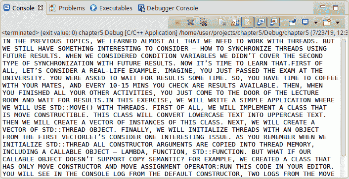

*图 5.18：练习执行结果*

在本练习中，我们练习了如何创建仅可移动对象的 STL 容器。我们还探讨了如何将不可拷贝对象传递给线程构造函数。这些知识将在下一节学习如何从线程获取结果时派上用场。

## Future、Promise 与 Async

在上一节中，我们学习了使用线程所需的几乎所有知识。但我们仍有一个有趣的问题需要考虑，即使用 future 结果同步线程。当我们讨论条件变量时，并未涉及使用 future 结果的第二种同步类型。现在，是时候了解它了。


## C++ Future 结果：`std::future`、`std::shared_future`、`std::async`、`std::packaged_task` 和 `std::promise`

## 简介

假设存在这样一种情况：我们运行某个线程并继续处理其他工作。当我们需要结果时，停下来检查它是否已就绪。这种情况描述了 future 结果的实际工作方式。在 C++ 中，我们有一个名为 `<future>` 的头文件，它包含两个表示 future 结果的模板类：`std::future<>` 和 `std::shared_future<>`。当我们需要单个 future 结果时使用 `std::future<>`，当我们需要多个有效副本时使用 `std::shared_future<>`。我们可以将它们与 `std::unique_ptr` 和 `std::shared_ptr` 进行比较。

## 使用 Future 结果：`std::async`

要使用 future 结果，我们需要一种特殊机制在后台运行任务并稍后接收结果：`std::async()` 模板函数。它接受一个可调用对象作为参数，以及启动模式——deferred（延迟）或 async（异步），当然还有传递给可调用对象的参数。启动模式 `std::launch::async` 和 `std::launch::deferred` 指示如何执行任务。当我们传递 `std::launch::async` 时，期望该函数在单独的线程中执行。当我们传递 `std::launch::deferred` 时，函数调用将被推迟，直到我们请求结果。我们也可以同时传递两者，例如 `std::launch::deferred | std::launch::async`。这意味着运行模式将取决于实现。

## 示例：`std::future` 配合 `std::async`

现在，让我们看一个使用 `std::future` 配合 `std::async` 的示例。我们有一个 `toUppercase()` 函数，用于将给定字符串转换为大写：

```cpp
std::string toUppercase(const std::string& bufIn)
{
    std::string bufferOut;
    for (std::string::const_iterator iter = bufIn.begin(); iter != bufIn.end(); iter++)
    {
        if (*iter >= 97 && *iter <= 122)
        {
            bufferOut += static_cast<char>(static_cast<int>(*iter) - 32);
        }
        else
        {
            bufferOut += *iter;
        }
    }
    return bufferOut;
}
```

然后，在 `main()` 函数中，我们创建一个名为 `result` 的 `std::future` 变量，并使用 `std::async()` 的返回值对其进行初始化。接着，我们通过结果对象的 `get()` 函数获取结果：

```cpp
#include <iostream>
#include <future>

int main()
{
    std::future<std::string> result = std::async(toUppercase, "please, make it uppercase");
    std::cout << "Main thread isn't locked" << std::endl;
    std::cout << "Future result = " << result.get() << std::endl;
    return 0;
}
```

实际上，这里我们创建了一个 future 对象：

```cpp
std::future<std::string> result = std::async(toUppercase, "please, make it uppercase");
```

正如你所见，我们没有向 `std::async()` 函数传递启动模式，这意味着将使用默认模式：`std::launch::deferred | std::launch::async`。你也可以显式地指定：

```cpp
std::future<std::string> result = std::async(std::launch::async, toUppercase, "please, make it uppercase");
```

这里，我们在等待结果：

```cpp
std::cout << "Future result = " << result.get() << std::endl;
```

如果我们的任务耗时较长，线程将在此等待直到结束。

一般来说，我们可以像使用 `std::thread` 构造函数一样使用 `std::async()` 函数。我们可以传递任何可调用对象。默认情况下，所有参数都会被复制，我们可以移动变量和可调用对象，也可以通过引用传递它们。

## `std::future` 和竞态条件

`std::future` 对象不受竞态条件保护。因此，为了从不同线程访问它并防止损坏，我们应该使用互斥量。但如果我们需要共享 future 对象，最好使用 `std::shared_future`。共享 future 结果也不是线程安全的。为了避免竞态条件，我们必须使用互斥量，或者在每个线程中存储 `std::shared_future` 自己的副本。

> **注意**
>
> `std::future` 对象的竞态条件非常棘手。当线程调用 `get()` 函数时，future 对象会变为无效。

## `std::shared_future`

我们可以通过将 future 移动到构造函数中来创建共享 future：

```cpp
std::future<std::string> result = std::async(toUppercase, "please, make it uppercase");
std::cout << "Main thread isn't locked" << std::endl;
std::shared_future<std::string> sharedResult(std::move(result));
std::cout << "Future result = " << sharedResult.get() << std::endl;
std::shared_future<std::string> anotherSharedResult(sharedResult);
std::cout << "Future result = " << anotherSharedResult.get() << std::endl;
```

正如你所见，我们从 `std::future` 创建了一个 `std::shared_future` 变量并复制了它。两个共享 future 对象引用同一个结果。

我们也可以使用 `std::future` 对象的 `share()` 成员函数来创建共享 future 对象：

```cpp
std::future<std::string> result = std::async(toUppercase, "please, make it uppercase");
std::cout << "Main thread isn't locked" << std::endl;
auto sharedResult = result.share();
std::cout << "Future result = " << sharedResult.get() << std::endl;
```

请注意，在上述两种情况下，`std::future` 对象都会变为无效。

## `std::packaged_task`

我们从单独线程获取 future 结果的另一种方法是使用 `std::packaged_task<>` 模板类。如何使用它们？

1.  我们创建一个新的 `std::packaged_task` 并声明可调用函数的签名：
    ```cpp
    std::packaged_task<std::string(const std::string&)> task(toUppercase);
    ```
2.  然后，我们将 future 结果存储在 `std::future` 变量中：
    ```cpp
    auto futureResult = task.get_future();
    ```
3.  接下来，我们在单独的线程中运行此任务或将其作为函数调用：
    ```cpp
    std::thread thr1(std::move(task), "please, make it uppercase");
    thr1.detach();
    ```
4.  最后，我们等待直到 future 结果就绪：
    ```cpp
    std::cout << "Future result = " << futureResult.get() << std::endl;
    ```

> **注意**
>
> `std::packaged_task` 是不可复制的。因此，要在单独的线程中运行它，请使用 `std::move()` 函数。

## `std::future<void>`

还有一件重要的事情需要注意。如果你不需要从线程获取任何结果，只想等待线程完成工作，可以使用 `std::future<void>`。现在，当你调用 `future.get()` 时，当前线程将在此处等待。让我们看一个示例：

```cpp
#include <iostream>
#include <future>

void toUppercase(const std::string& bufIn)
{
    std::string bufferOut;
    for (std::string::const_iterator iter = bufIn.begin(); iter != bufIn.end(); iter++)
    {
        if (*iter >= 97 && *iter <= 122)
        {
            bufferOut += static_cast<char>(static_cast<int>(*iter) - 32);
        }
        else
        {
            bufferOut += *iter;
        }
    }
    using namespace std::chrono_literals;
    std::this_thread::sleep_for(2s);
    std::cout << bufferOut << std::endl;
}

int main()
{
    std::packaged_task<void(const std::string&)> task(toUppercase);
    auto futureResult = task.get_future();
    std::thread thr1(std::move(task), "please, make it uppercase");
    thr1.detach();
    std::cout << "Main thread is not blocked here" << std::endl;
    futureResult.get();
    std::cout << "The packaged_task is done" << std::endl;
    return 0;
}
```

正如你所见，通过等待另一个线程，我们利用了条件变量、future 结果和 promise 等多种技术。

## `std::promise`

现在，让我们继续介绍标准库中的下一个重要特性——`std::promise<>` 模板类。通过这个类，我们可以设置想要接收的类型的值，然后使用 `std::future` 获取它。如何使用它们？为此，我们需要实现一个接受 `std::promise` 参数的函数：

```cpp
void toUppercase(const std::string& bufIn, std::promise<std::string> result)
```

工作完成时，我们需要使用 `std::promise` 初始化一个新值：

```cpp
result.set_value(bufferOut);
```

要在将要使用它的地方创建 `std::promise`，我们需要编写以下代码：

```cpp
std::promise<std::string> stringInUpper;
```

完成后，我们必须创建 `std::future` 并从 promise 获取它：


## 多线程应用程序中的异常处理

## 基本 Promise 和 Future 示例

```cpp
std::future<std::string> futureRes = stringInUpper.get_future();
```

我们需要在单独的线程中运行此函数：

```cpp
std::thread thr(toUppercase, "please, make it uppercase", std::move(stringInUpper));
thr.detach();
```

现在，我们需要等待直到 future 被设置：

```cpp
futureRes.wait();
std::cout << "Result = " << futureRes.get() << std::endl;
```

以下是使用 promise 获取结果的完整示例：

```cpp
#include <iostream>
#include <future>

void toUppercase(const std::string& bufIn, std::promise<std::string> result)
{
    std::string bufferOut;
    for (std::string::const_iterator iter = bufIn.begin(); iter != bufIn.end(); iter++)
    {
        if (*iter >= 97 && *iter <= 122)
        {
            bufferOut += static_cast<char>(static_cast<int>(*iter) - 32);
        }
        else
        {
            bufferOut += *iter;
        }
    }
    result.set_value(bufferOut);
}

int main()
{
    std::promise<std::string> stringInUpper;
    std::future<std::string> futureRes = stringInUpper.get_future();
    std::thread thr(toUppercase, "please, make it uppercase", std::move(stringInUpper));
    thr.detach();
    std::cout << "Main thread is not blocked here" << std::endl;
    futureRes.wait();
    std::cout << "Result = " << futureRes.get() << std::endl;
    return 0;
}
```

## 线程中的异常

因此，我们涵盖了编写多线程应用程序所需的几乎所有内容，除了一个重要的事情——如果在单独的线程中抛出异常会发生什么？例如，你将一个函数传递给线程，而该函数抛出了异常。在这种情况下，将为此线程调用 `std::terminate()`。其他线程将继续它们的工作。让我们考虑一个简单的示例。

我们有一个 `getException()` 函数，它生成一个包含线程 ID 的消息并抛出 `std::runtime_error`：

```cpp
#include <sstream>
#include <exception>
#include <iostream>
#include <future>

std::string getException()
{
    std::stringstream ss;
    ss << "Exception from thread: ";
    ss << std::this_thread::get_id();
    throw std::runtime_error(ss.str());
}
```

我们还有一个 `toUppercase()` 函数，它将给定字符串转换为大写并调用抛出异常的 `getException()` 函数：

```cpp
std::string toUppercase(const std::string& bufIn)
{
    std::string bufferOut;
    for (std::string::const_iterator iter = bufIn.begin(); iter != bufIn.end(); iter++)
    {
        if (*iter >= 97 && *iter <= 122)
        {
            bufferOut += static_cast<char>(static_cast<int>(*iter) - 32);
        }
        else
        {
            bufferOut += *iter;
            getException();
        }
    }
    return bufferOut;
}
```

这是 `main()` 函数，我们在 `try-catch` 块中创建一个新线程 `thr`。我们捕获异常并将消息打印到终端：

```cpp
int main()
{
    try
    {
        std::thread thr(toUppercase, "please, make it uppercase");
        thr.join();
    }
    catch(const std::exception& ex)
    {
        std::cout << "Caught an exception: " << ex.what() << std::endl;
    }
    return 0;
}
```

如果你在 IDE 中运行此代码，将看到以下输出：

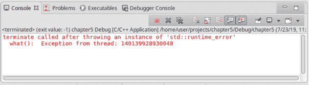

**图 5.19：示例执行的结果**

我们可以看到，抛出异常后调用了 `std::terminate()`。当程序中有大量线程时，很难找到线程终止的确切位置。幸运的是，我们有几种机制可以捕获来自另一个线程的异常。让我们逐一了解它们。

## 使用 std::async 进行异常处理

`std::async` 函数使用 future 结果将异常传递给调用线程。它在 future 结果中存储 `std::exception_ptr` 并设置就绪标志。然后，当你调用 `get()` 时，`std::future` 会检查是否存储了任何 `std::exception_ptr` 并重新抛出异常。我们所要做的就是将 `get()` 调用放在 `try-catch` 块中。让我们看一个例子。我们将使用上一个示例中的两个辅助函数，即 `getException()` 和 `toUppercase()`。它们保持不变。在 `main()` 函数中，我们创建一个名为 `result` 的 `std::future` 对象，并使用 `std::async()` 函数运行 `toUppercase()` 函数。然后，我们在 `try-catch` 块中调用 result 对象的 `get()` 函数并捕获异常：

```cpp
#include <iostream>
#include <future>

int main()
{
    std::future<std::string> result = std::async(toUppercase, "please, make it uppercase");
    try
    {
        std::cout << "Future result = " << result.get() << std::endl;
    }
    catch(const std::exception& ex)
    {
        std::cout << "Caught an exception: " << ex.what() << std::endl;
    }
    return 0;
}
```

如果你在 IDE 中运行前面的代码，将得到以下输出：

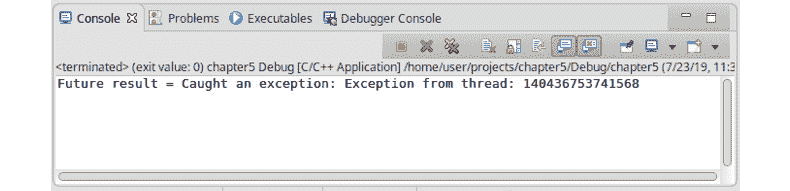

**图 5.20：示例执行的结果**

正如你所见，我们捕获了异常，现在可以以某种方式处理它。

## 使用 std::packaged_task 进行异常处理

`std::packaged_task<>` 类以相同的方式处理异常——它在 future 结果中存储 `std::exception_ptr`，设置就绪标志，然后 `std::future` 在 `get()` 调用中重新抛出异常。让我们看一个小例子。我们将使用上一个示例中的两个辅助函数——`getException()` 和 `toUppercase()`。它们保持不变。在 `main()` 函数中，我们创建一个名为 `task` 的 `std::packaged_task` 对象。通过使用我们的 `toUppercase()` 函数的类型，它返回一个字符串并接受一个字符串作为参数。我们将 `toUppercase()` 函数传递给 `task` 对象。然后，我们创建一个名为 `result` 的 `std::future` 对象，并使用 `get_future()` 函数从 task 对象获取结果。最后，我们在新线程 `thr` 中运行 task 对象，并在 `try-catch` 块中调用 `result` 变量的 `get()` 函数：

```cpp
#include <iostream>
#include <future>

int main()
{
    std::packaged_task<std::string(const std::string&)> task(toUppercase);
    auto result = task.get_future();
    std::thread thr(std::move(task), "please, make it uppercase");
    thr.detach();
    try
    {
        std::cout << "Future result = " << result.get() << std::endl;
    }
    catch(const std::exception& ex)
    {
        std::cout << "Caught an exception: " << ex.what() << std::endl;
    }
    return 0;
}
```

如果你在 IDE 中运行此代码，将得到以下输出：

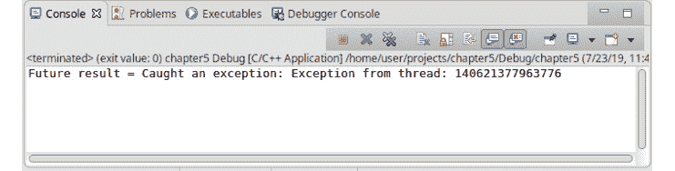

**图 5.21：此示例执行的结果**

## 使用 std::promise 进行异常处理

`std::promise<>` 类以另一种方式处理异常。它允许我们使用 `set_exception()` 或 `set_exception_at_thread_exit()` 函数手动存储异常。要在 `std::promise` 中设置异常，我们必须捕获它。如果我们不捕获异常，错误将在 `std::promise` 的析构函数中被设置为 future 结果中的 `std::future_errc::broken_promise`。当你调用 `get()` 函数时，异常将被重新抛出。让我们看一个例子。我们将使用上一个示例中的一个辅助函数——`getException()`。它保持不变。然而，我们将更改 `toUppercase()` 函数并添加第三个参数 `std::promise`。现在，我们将在 `try` 块中调用 `getException()` 函数，捕获异常，并将其设置为 `std::promise` 的值：

```cpp
void toUppercase(const std::string& bufIn, std::promise<std::string> result)
{
    std::string bufferOut;
    try
    {
        for (std::string::const_iterator iter = bufIn.begin(); iter != bufIn.end(); iter++)
        {
            if (*iter >= 97 && *iter <= 122)
            {
```


## 处理多线程应用程序中的异常

```cpp
bufferOut += static_cast<char>(static_cast<int>(*iter) - 32);
            }
            else
            {
                bufferOut += *iter;
                getException();
            }
        }
    }
    catch(const std::exception& ex)
    {
        result.set_exception(std::make_exception_ptr(ex));
    }
    result.set_value(bufferOut);
}
```

### 注意

有几种方法可以将异常设置给 promise。首先，我们可以捕获 `std::exception` 并使用 `std::make_exception_ptr()` 函数将其转换为 `std::exception_ptr`。也可以使用 `std::current_exception()` 函数，它返回 `std::exception_ptr` 对象。

在 `main()` 函数中，我们创建一个整数类型的 promise，称为 `upperResult`。我们创建一个名为 `futureRes` 的 future 结果，并从 `upperResult` promise 的值设置它。接下来，我们创建一个新线程 `thr`，将 `toUppercase()` 函数传递给它，并移动 `upperResult` promise。然后，我们调用 `futureRes` 对象的 `wait()` 函数，这会使调用线程等待直到结果可用。接着，在 `try-catch` 块中，我们调用 `futureRes` 对象的 `get()` 函数，它会重新抛出异常：

```cpp
#include <iostream>
#include <future>

int main()
{
    std::promise<std::string> upperResult;
    std::future<std::string> futureRes = upperResult.get_future();
    std::thread thr(toUppercase, "please, make it uppercase", std::move(upperResult));
    thr.detach();
    futureRes.wait();
    try
    {
        std::cout << "Result = " << futureRes.get() << std::endl;
    }
    catch(...)
    {
        std::cout << "Caught an exception" << std::endl;
    }
    return 0;
}
```

### 注意

当我们创建 `std::promise<>` 对象时，我们承诺将强制设置值或异常。如果我们不执行其中任何操作，`std::promise` 的析构函数将抛出异常，即 `std::future_error – std::future_errc::broken_promise`。

如果在 IDE 中运行此代码，将获得以下输出：

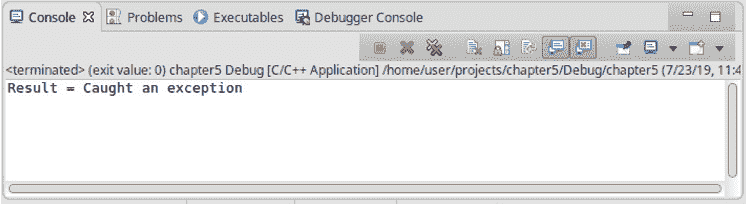

**图 5.22：本示例的执行结果**

这就是多线程应用程序中异常处理的全部内容。正如你所见，这与单线程中的做法非常相似。现在，让我们将所学知识付诸实践，编写一个简单的应用程序示例，演示如何使用不同的 future 结果进行同步。

## 练习 5：使用 Future 结果进行同步

在本练习中，我们将编写一个简单的应用程序，演示如何使用 future 结果从单独的线程接收值。我们将运行 `ToUppercase()` 可调用对象三次。我们将使用 `std::async()` 函数执行第一个任务，使用 `std::packaged_task<>` 模板类执行第二个任务，使用 `std::thread` 和 `std::promise` 执行最后一个任务。

执行以下步骤完成此练习：

1.  包含线程支持的头文件 `<thread>`、流支持的头文件 `<iostream>` 以及 future 结果支持的头文件 `<future>`：

```cpp
#include <iostream>
#include <thread>
#include <future>
```

2.  实现一个 `ToUppercase` 类，将给定字符串转换为大写。它有两个重载的 `operator()`。第一个 `operator()` 接受要转换的字符串并返回大写的结果值。第二个 `operator()` 接受要转换的字符串和一个 `std::promise`，并将返回值存储在 promise 中：

```cpp
class ToUppercase
{
public:
    std::string operator()(const std::string& bufIn)
    {
        std::string bufferOut;
        for (std::string::const_iterator iter = bufIn.begin(); iter != bufIn.end(); iter++)
        {
            if (*iter >= 97 && *iter <= 122)
            {
                bufferOut += static_cast<char>(static_cast<int>(*iter) - 32);
            }
            else
            {
                bufferOut += *iter;
            }
        }
        return bufferOut;
    }
    void operator()(const std::string& bufIn, std::promise<std::string> result)
    {
        std::string bufferOut;
        for (std::string::const_iterator iter = bufIn.begin(); iter != bufIn.end(); iter++)
        {
            if (*iter >= 97 && *iter <= 122)
            {
                bufferOut += static_cast<char>(static_cast<int>(*iter) - 32);
            }
            else
            {
                bufferOut += *iter;
            }
        }
        result.set_value(bufferOut);
    }
};
```

3.  现在，创建一个 `ToUppercase` 对象 `ptConverter`，并创建一个 `std::packaged_task` `upperCaseResult1`，它接受 `ptConverter` 对象作为参数。创建一个 `std::future` 值并从 `upperCaseResult1` 设置它。在单独的线程中运行此任务：

```cpp
ToUppercase ptConverter;
std::packaged_task<std::string(const std::string&)> upperCaseResult1(ptConverter);
std::future<std::string> futureUpperResult1 = upperCaseResult1.get_future();
std::thread thr1(std::move(ptConverter), "This is a string for the first asynchronous task");
thr1.detach();
```

4.  现在，创建第二个 `ToUppercase` 对象 `fConverter`。创建一个名为 `futureUpperResult2` 的 `std::future` 对象并从 `std::async()` 设置它：

```cpp
ToUppercase fConverter;
std::future<std::string> futureUpperResult2 = std::async(fConverter, "This is a string for the asynchronous task");
```

5.  现在，创建第三个 `ToUppercase` 对象 `pConverter`。创建一个名为 `promiseResult` 的 `std::promise` 值。然后，创建一个名为 `futureUpperResult3` 的 `std::future` 值并从 `promiseResult` 设置它。现在，在单独的线程中运行 `pConverter` 任务并将 `promiseResult` 作为参数传递：

```cpp
ToUppercase pConverter;
std::promise<std::string> promiseResult;
std::future<std::string> futureUpperResult3 = promiseResult.get_future();
std::thread thr2(pConverter, "This is a string for the task that returns a promise", std::move(promiseResult));
thr2.detach();
```

6.  现在，为了从所有线程接收结果，等待 `futureUpperResult3` 准备就绪，然后获取所有三个结果并打印它们：

```cpp
futureUpperResult3.wait();
std::cout << "Converted strings: "
          << futureUpperResult1.get() << std::endl
          << futureUpperResult2.get() << std::endl
          << futureUpperResult3.get() << std::endl;
```

7.  在编辑器中运行此代码。你将看到来自所有三个线程的转换后的字符串。

    你将获得以下输出：

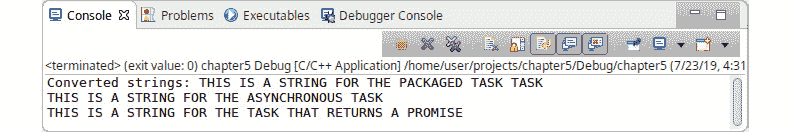

**图 5.23：本练习的执行结果**

那么，我们在这里做了什么？我们将大计算拆分为较小的部分并在单独的线程中运行它们。对于长时间计算，这将提高性能。在本练习中，我们学习了如何从线程接收结果。在本节中，我们还学习了如何将在单独线程中抛出的异常传递给调用线程。我们还学习了如何通过事件同步多个线程的工作，不仅使用条件变量，还使用 future 结果。

## 活动 1：创建一个模拟器以模拟美术馆的工作


在本活动中，我们将创建一个模拟器来模拟艺术画廊的工作。我们设定了画廊的参观者限制——最多只能有 50 人在内部。为了实现此模拟，我们需要创建一个 **Person** 类来表示画廊中的人员。此外，我们还需要一个 **Persons** 类，它是人员的线程安全容器。我们还需要一个 **Watchman** 类来控制内部有多少人。如果超过限制，看门人会将所有新来者放入等待列表。最后，我们需要一个 **Generator** 类，它有两个线程——一个用于创建新访客，另一个用于通知我们有人必须离开画廊。因此，我们将涉及线程、互斥量、条件变量、`lock_guard` 和 `unique_lock` 的使用。该模拟器将使我们能够利用本章介绍的技术。因此，在尝试此活动之前，请确保已完成本章的所有先前练习。

为了实现此应用程序，我们需要描述我们的类。我们有以下类：

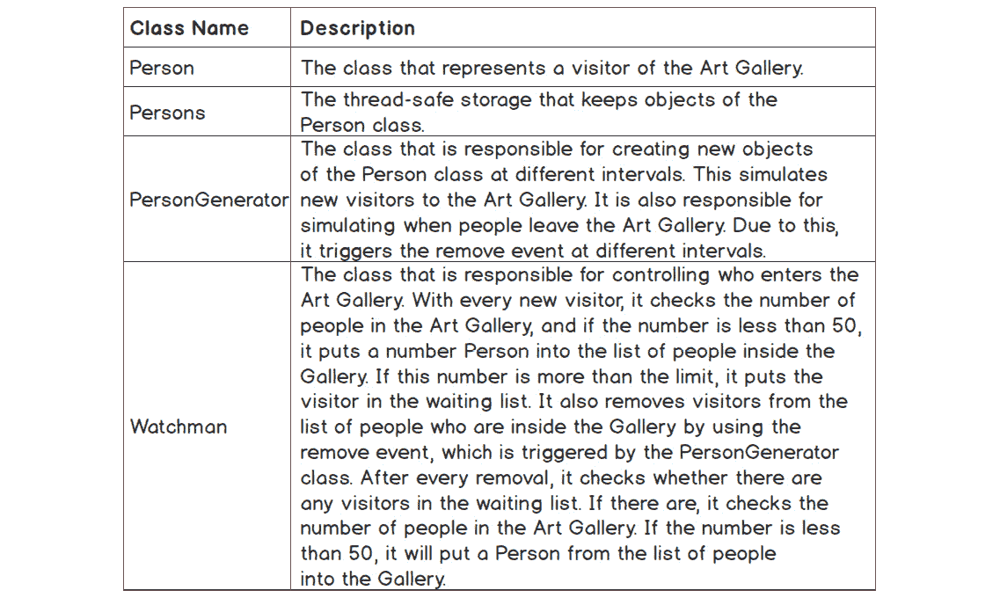

###### Figure 5.24: Description of the classes that are used in this activity

让我们在开始实现之前创建类图。上述所有类及其关系如下图所示：

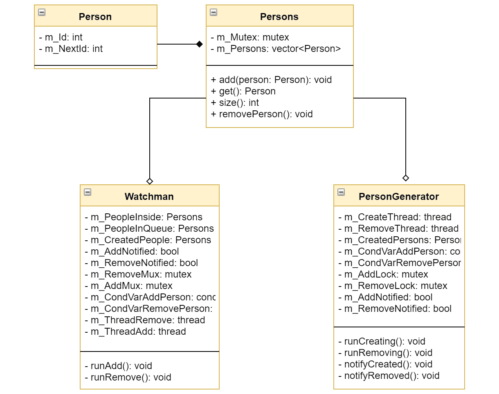

###### Figure 5.25: The class diagram

请遵循以下步骤实现此活动：

1.  定义并实现 `Person` 类，它除了打印日志外不做任何事情。
2.  创建一些 `Person` 的线程安全存储，封装 `std::vector` 类。
3.  实现 `PersonGenerator` 类，它在不同线程的无限循环中创建和移除访客，并通知 `Watchman` 类。
4.  创建 `Watchman` 类，它在单独线程的无限循环中，根据 `PersonGenerator` 类的通知将访客从一个队列移动到另一个队列。
5.  在 `main()` 函数中声明相应的对象，以模拟艺术画廊及其工作方式。

实现这些步骤后，你应该会得到以下输出，其中可以看到所有已实现类的日志。确保模拟按预期流动。预期输出应类似于以下内容：

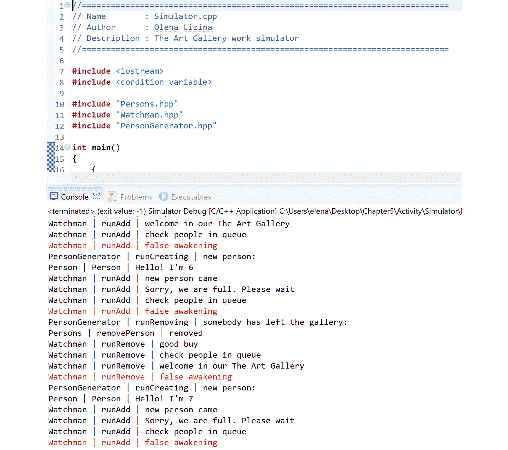

###### Figure 5.26: The result of the application's execution

#### Note

此活动的解决方案可在第 681 页找到。

## Summary

在本章中，我们学习了 C++ 标准库支持的线程工作。如果我们想要编写健壮、快速且清晰的多线程应用程序，这是基础。

我们首先研究了关于并发的一般概念——什么是并行、并发、同步、异步和线程执行。对这些概念的清晰理解使我们能够了解多线程应用程序的架构设计。

接下来，我们研究了开发多线程应用程序时面临的不同问题，例如数据冒险、竞态条件和死锁。理解这些问题帮助我们为项目构建清晰的同步架构。我们通过一些现实生活中的例子考虑了同步概念，这让我们很好地理解了在编程线程应用程序时可能面临的挑战。

接下来，我们尝试使用标准库的不同同步原语。我们尝试弄清楚如何处理竞态条件，并实现了按事件同步和按数据同步的示例。接下来，我们考虑了移动语义如何应用于多线程。我们了解了线程支持库中哪些类是不可复制但可移动的。我们还考虑了移动语义在多线程闭包中的工作原理。最后，我们学习了如何从单独的线程接收结果，以及如何使用 `future`、`promise` 和 `async` 同步线程。

我们通过构建艺术画廊模拟器将所有这些新技能付诸实践。我们构建了一个具有一个主线程和四个子线程的多线程应用程序。我们使用条件变量实现了它们之间的通信。我们使用互斥量保护共享数据。总之，我们采用了本章学到的所有内容。

在下一章中，我们将更仔细地研究 C++ 中的 I/O 操作和类。我们将从标准库的 I/O 支持开始。然后，我们将继续使用流和异步 I/O 操作。接下来，我们将了解线程和 I/O 的交互。我们将编写一个活动，使我们能够掌握 C++ 中 I/O 工作的技能。
