# 6. Streams and I/O

## Learning Objectives

本章结束时，你将能够：

*   使用标准 I/O 库向文件或控制台写入和读取数据
*   使用内存 I/O 接口格式化和解析数据
*   为用户定义类型扩展标准 I/O 流
*   开发从多线程使用 I/O 标准库的应用程序

在本章中，我们将使用 I/O 标准库开发灵活且可维护的应用程序，使用流，学习 I/O 库如何在多线程应用程序中使用，最后学习使用标准库格式化和解析文本数据。

## Introduction

在上一章中，我们涵盖了最具挑战性的主题之一——C++ 中的并发。我们研究了主要的多线程概念，并区分了 C++ 中的同步、异步和线程执行。我们了解了同步、数据冒险和竞态条件的关键点。最后，我们研究了现代 C++ 中的线程工作。在本章中，我们将深入学习如何在多线程应用程序中处理 I/O。

本章专门介绍 C++ 中的 **streams** 和 **I/O**。I/O 是输入和输出操作的通用概念。标准库这部分的主要目的是提供关于数据输入和输出的清晰接口。但这不是唯一目标。有很多情况 I/O 可以帮助我们的应用程序。很难想象有任何应用程序不将错误或异常情况写入日志文件，以便发送给开发团队进行分析。在 GUI 应用程序中，我们总是需要格式化显示的信息或解析用户输入。在复杂和大型应用程序中，我们通常需要记录内部数据结构，等等。在所有这些情况下，我们都使用标准库的 **I/O** 部分。

我们将从标准库的输入/输出部分简介开始本章。我们将了解 I/O 并探索其主要概念和术语。然后，我们将考虑默认支持哪些类型以及如何将流扩展到用户定义类型。接下来，我们将研究 I/O 库的结构并检查可供我们使用的头文件和类。最后，我们将研究如何使用流、读写文件、创建具有输入和输出操作的多线程应用程序，以及格式化和解析文本数据。

本章将以一个具有挑战性和令人兴奋的活动结束，我们将改进上一章的 **Art Gallery Simulator** 项目，并创建一个健壮、清晰、多线程且易于使用的 **Logger**。我们将开发一个具有清晰接口的类，可以从项目的任何地方访问。接下来，我们将使其适应多线程工作。最后，我们将把健壮的记录器集成到艺术画廊模拟器项目中。

让我们开始研究 C++ 标准库的 I/O 部分，了解这组工具为我们提供了什么机会。


## 回顾标准库的 I/O 部分

在计算机科学中，I/O 是指程序、设备、计算机等之间通信的术语。在 C++ 中，我们使用标准输入和标准输出术语来描述 I/O 过程。标准输入是指传输到程序中的数据流。要获取这些数据，程序应执行读取操作。标准输出是指从程序传输到外部设备（如文件、显示器、套接字、打印机等）的数据流。要输出这些数据，程序应执行写入操作。标准输入和输出流从主进程继承而来，并为所有子线程所共享。请查看下图以更好地理解所涉术语：

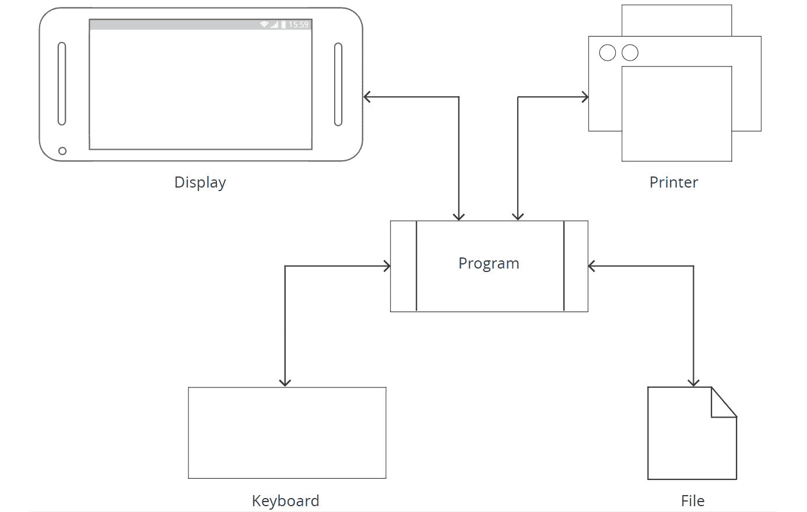

**图 6.1：设备间的 I/O 通信**

在 C++ 标准库中，大多数 I/O 类都是泛化的类模板。它们在逻辑上被分为两类——抽象和实现。我们已经熟悉抽象类，并且知道可以在不重新编译代码的情况下将它们用于不同目的。I/O 库也是如此。这里有六个抽象类，构成了 C++ 中 I/O 操作的基础。我们不会深入探讨这些接口。通常，我们使用更高层级的类来进行操作，仅当我们需要实现自己的派生类时才会涉及它们。

`ios_base` 抽象类负责管理流状态标志、格式化标志、回调函数和私有存储。`basic_streambuf` 抽象类为缓冲输入或输出操作提供接口，并提供对输入源（如文件、套接字）或输出汇（如字符串、向量）的访问。`basic_ios` 抽象类实现了用于处理从 `basic_streambuf` 接口派生的类的工具。`basic_ostream`、`basic_istream` 和 `basic_iostream` 抽象类分别是从 `basic_streambuf` 接口派生的类的包装器，并提供高层输入/输出接口。让我们简要地考察一下它们及其关系，这些关系显示在下面的类图中。你可以看到，除 `ios_base` 外，它们都是模板类。在每个类名下方，可以找到定义该类的文件名：

#### 注意

在 UML 表示法中，我们使用 `<<interface>>` 关键字来表示该类是一个抽象类。

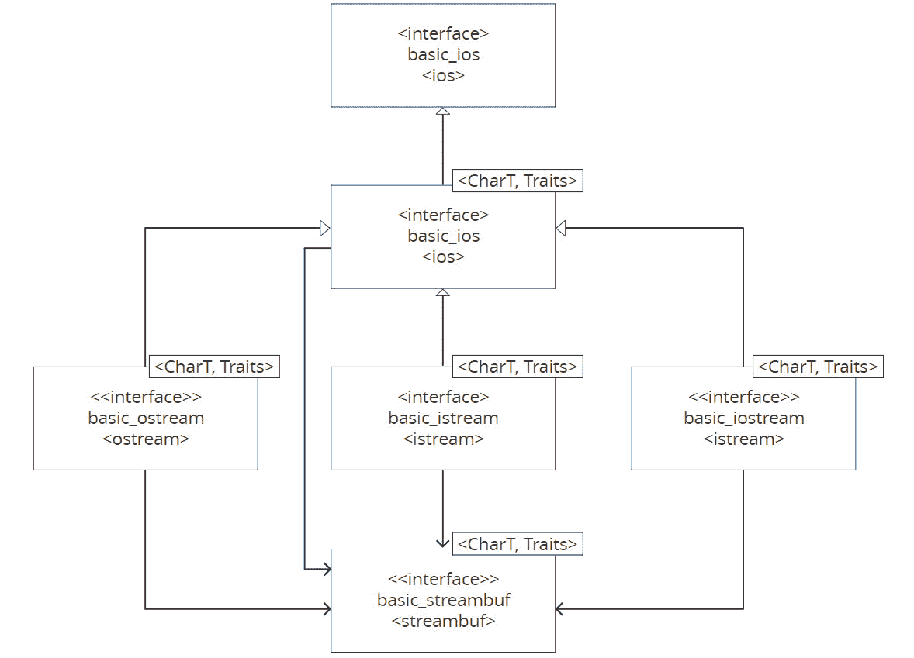

**图 6.2：I/O 抽象接口的类图**

实现类在逻辑上分为以下几类：`文件 I/O`、`字符串 I/O`、`同步 I/O`、`I/O 操纵符` 和预定义标准流对象。它们都派生自上述抽象类。让我们在后续章节中详细探讨每一类。

## 预定义标准流对象

我们将从已经熟悉的 `<iostream>` 头文件中的 `std::cout` 类开始认识 I/O 标准库。我们用它将数据输出到终端。你可能也知道用于读取用户输入的 `std::cin` 类——但并非所有人都知道 `std::cout` 和 `std::cin` 是预定义标准流对象，用于格式化终端的输入和输出。`<iostream>` 头文件还包含 `std::cerr` 和 `std::clog` 流对象，它们用于记录错误。照例，也有带有 `w` 前缀的宽字符对应版本：`wcout`、`wcin`、`wcerr` 和 `wclog`。所有这些对象都在系统启动时自动创建并初始化。尽管从多线程使用这些对象是安全的，但输出可能会混杂。让我们复习一下如何使用它们。由于它们仅为内置类型重载，因此我们应该为用户定义类型编写自己的重载。

`std::cout` 流对象常与 `std::endl` 操纵符一起使用。它在输出序列中插入一个换行符并刷新缓冲区。以下是使用它们的示例：

```
std::string name("Marilyn Monroe");

int age = 18;

std::cout << "Name: " << name << ", age: " << age << std::endl;
```

最初，`std::cin` 对象逐个符号地读取所有输入字符序列。但它为内置类型提供了重载，可以读取诸如 `数字`、`字符串`、`字符` 等值。读取字符串有个小技巧；`std::cin` 读取字符串直到下一个空白符或换行符。因此，如果你需要读取一整行字符串，必须在循环中逐词读取，或者使用 `std::getline()` 函数，该函数接受 `std::cin` 对象作为第一个参数，目标字符串作为第二个参数。

#### 注意

`std::cin` 流对象的右移运算符 `>>` 仅从一行中读取一个单词。使用 `std::getline(std::cin, str)` 读取整行。

以下是将 `std::cin` 与不同类型结合使用的示例：

```
std::string name;

std::string sex;

int age;

std::cout << "Enter your name: " << std::endl;

std::getline(std::cin, name);

std::cout << "Enter your age: " << std::endl;

std::cin >> age;

std::cout << "Enter your sex (male, female):" << std::endl;

std::cin >> sex;

std::cout << "Your name is " << name << ", your age is " << age << ", your sex is " << sex << std::endl;
```

正如你所见，这里我们使用 `std::getline()` 函数读取姓名，因为用户可能输入两三个词。我们还读取了年龄，然后使用右移运算符 `>>` 读取性别，因为我们只需要读取单个单词。然后我们打印读取的数据以确保一切正常。

`std::cerr` 和 `std::clog` 流对象仅在一点上不同——`std::cerr` 立即刷新输出序列，而 `std::clog` 对其进行缓冲，仅在缓冲区满时才刷新。就用法而言，它们与 `std::cout` 非常相似。唯一的区别是（在大多数 IDE 中）来自 `std::cerr` 和 `std::clog` 的消息显示为红色。

在下面的屏幕截图中，你可以看到这些流对象的输出：

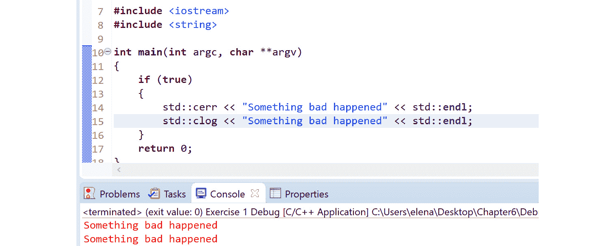

**图 6.3：std::cerr 和 std::clog 流对象的输出**

现在，让我们做一个练习来巩固所学内容。

## 练习 1：为用户定义类型重载左移运算符 `<<`

在本练习中，我们将编写一段非常有用的代码，你可以在任何地方用它来输出用户定义类型。首先，我们将创建一个名为 `Track` 的类，表示一首音乐曲目。它将具有以下私有成员：`name`、`singer`、`length` 和 `date`。然后，我们将为该类重载左移运算符 `<<`。接着，我们将创建该类的一个实例并使用 `std::cout` 流对象输出它。

执行以下步骤以完成此练习：

1.  包含所需的头文件：用于控制台输出的 `<iostream>` 和用于字符串支持的 `<string>`：

    ```
    #include <iostream>
    #include <string>
    ```

2.  声明 `Track` 类，并在私有部分添加变量以保存关于 `track` 的信息，即 `m_Name`、`m_Singer`、`m_Date` 和 `m_LengthInSeconds`。在公有部分，添加一个带有参数的构造函数以初始化所有私有变量。此外，在 `public` 部分为所有类成员添加 getter 方法：

    ```
    class Track
    {
    public:
        Track(const std::string& name,
              const std::string& singer,
              const std::string& date,
              const unsigned int& lengthInSeconds)
            : m_Name(name)
            , m_Singer(singer)
            , m_Date(date)
    ```


## Track 类与运算符重载

### Track 类定义

```cpp
, m_LengthInSeconds(lengthInSeconds)
{

}

std::string getName() const { return m_Name; }
std::string getSinger() const { return m_Singer; }
std::string getDate() const { return m_Date; }
unsigned int getLength() const { return m_LengthInSeconds; }

private:
std::string m_Name;
std::string m_Singer;
std::string m_Date;
unsigned int m_LengthInSeconds;
};
```

### 练习步骤

#### 3. 编写 `Track` 类型的重载函数

这是练习中最困难的部分：为 `Track` 类型编写重载函数。这是一个**模板**函数，具有两个类型参数：`charT` 和 `Traits`：

```cpp
template <typename charT, typename Traits>
```

#### 4. 函数声明

我们将此函数设为 `inline`，以告知编译器我们希望对该函数执行优化。该函数的返回类型是对 `std::basic_ostream<charT, Traits>` 类的引用。函数名为运算符 `<<`。该函数接受两个参数：第一个是对 `std::basic_ostream<charT, Traits>` 类的引用，第二个是 `Track` 变量的副本。完整的函数声明如下：

```cpp
template <typename charT, typename Traits>
inline std::basic_ostream<charT, Traits>&
operator<<(std::basic_ostream<charT, Traits>& os, Track trackItem);
```

#### 5. 函数定义

现在添加函数定义。像使用 `std::cout` 对象一样使用 `os` 变量，并按需格式化输出。然后从函数返回 `os` 变量。重载运算符 `<<` 的完整代码如下：

```cpp
template <typename charT, typename Traits>
inline std::basic_ostream<charT, Traits>&
operator<<(std::basic_ostream<charT, Traits>& os, Track trackItem)
{
    os << "Track information: ["
       << "Name: " << trackItem.getName()
       << ", Singer: " << trackItem.getSinger()
       << ", Date of creation: " << trackItem.getDate()
       << ", Length in seconds: " << trackItem.getLength()
       << "]";
    return os;
}
```

#### 6. 主函数

现在进入 `main` 函数，创建并初始化名为 `track_001` 的 `Track` 类型实例。最后，使用 `std::cout` 打印 `track_001` 的值：

```cpp
int main()
{
    Track track_001("Summer night city",
                    "ABBA",
                    "1979",
                    213);
    std::cout << track_001 << std::endl;
    return 0;
}
```

#### 7. 编译与执行

编译并执行应用程序。运行它。你将获得以下输出：

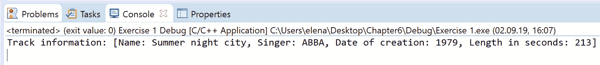

**图 6.4：练习 1 的执行结果**

做得好。在这里，我们考虑了使用预定义的标准流对象，并学习了如何为用户定义类型编写自己的重载移位运算符。让我们继续前进，研究使用 C++ 标准 IO 库进行文件的读写。

## 文件 I/O 实现类

文件流管理文件的输入和输出。它们提供了一个实现**资源获取即初始化**（**RAII**）的接口——文件在流构造时打开，在销毁时自动关闭。在标准库中，文件流由以下类表示：用于输入操作的 `basic_ifstream`，用于输出操作的 `basic_ofstream`，用于输入和输出操作的 `basic_fstream`，以及用于实现原始文件设备的 `basic_filebuf`。它们都定义在 `<fstream>` 头文件中。标准库还为 `char` 和 `wchar_t` 类型提供了 typedef，即 `ifstream`、`fstream` 和 `ofstream`，以及带有 `w` 前缀的同名类型用于宽字符。

我们可以通过两种方式创建文件流。第一种方式是在一行中完成，即通过将文件名传递给构造函数来打开文件并将流连接到文件：

```cpp
std::ofstream outFile(filename);
std::ifstream outFile(filename);
std::fstream outFile(filename);
```

另一种方式是创建一个对象，然后调用 `open()` 函数：

```cpp
std::ofstream outFile;
outFile.open(filename);
```

### 注意

IO 流具有布尔状态标志：`goodbit`、`eofbit`、`failbit` 和 `badbit`。它们用于在每次操作后检查流的状态，并指示流上发生了哪种错误。

创建对象后，我们可以通过检查 `failbit` 或检查与打开文件关联的流来检查流状态。要检查 `failbit`，在文件流上调用 `fail()` 函数：

```cpp
if (outFile.fail())
{
    std::cerr << filename << " file couldn't be opened" << std::endl;
}
```

要检查流是否与打开的文件关联，调用 `is_open()` 函数：

```cpp
if (!outFile.is_open())
{
    std::cerr << filename << " file couldn't be opened" << std::endl;
}
```

输入、输出和双向文件流也可以通过使用标志以不同模式打开。它们声明在 `ios_base` 命名空间中。除了 `ios_base::in` 和 `ios_base::out` 标志外，我们还有 `ios_base::ate`、`ios_base::app`、`ios_base::trunc` 和 `ios_base::binary` 标志。`ios_base::trunc` 标志移除文件内容。`ios_base::app` 标志始终将输出写入文件末尾。即使你决定更改文件中的位置，也无法做到这一点。`ios_base::ate` 标志将文件描述符的位置设置为文件末尾，但允许你稍后修改位置。最后，`ios_base::binary` 标志抑制数据的任何格式化，以便以“原始”格式读取或写入。让我们考虑所有可能的打开模式组合。

默认情况下，`std::ofstream` 以 `ios_base::out` 模式打开，`std::ifstream` 以 `ios_base::in` 模式打开，`std::fstream` 以 `ios_base::in | ios_base::out` 模式打开。`ios_base::out | ios_base::trunc` 模式在文件不存在时创建文件，或移除现有文件的所有内容。`ios_base::out | ios_base::app` 模式在文件不存在时创建文件，或打开现有文件并仅允许在文件末尾写入。上述两种模式都可以与 `ios_base::in` 标志结合，以便同时以读写模式打开文件。

以下是使用上述模式打开文件的示例：

```cpp
std::ofstream outFile(filename, std::ios_base::out | std::ios_base::trunc);
```

你也可以这样做：

```cpp
std::ofstream outFile;
outFile.open(filename, std::ios_base::out | std::ios_base::trunc);
```

在以所需模式打开文件流后，我们可以开始读取或写入文件。文件流允许我们更改在文件中的位置。让我们考虑如何做到这一点。要获取文件的当前位置，可以在 `ios_base::out` 模式下调用 `tellp()` 函数，在 `ios_base::in` 模式下调用 `tellg()` 函数。稍后可以使用它返回到此位置（如果需要）。我们也可以通过在 `ios_base::out` 模式下使用 `seekp()` 函数，在 `ios_base::in` 模式下使用 `seekg()` 函数来查找文件中的确切位置。它接受两个参数：要移动的字符数以及从哪个文件位置开始计数。允许三种定位类型：`std::ios_base::beg`（文件开头）、`std::ios_base::end`（文件末尾）和 `std::ios_base::cur`（当前位置）。以下是调用 `seekp()` 函数的示例：

```cpp
outFile.seekp(-5, std::ios_base::end);
```

正如你所见，我们要求将当前文件位置设置为距文件末尾第 5 个字符处。


## 文件 I/O 操作

### 写入文件

要写入文件，我们可以使用重载的左移运算符 `<<` 进行通用格式化输出，使用 `put()` 函数写入单个字符，或使用 `write()` 函数写入一块字符。使用左移运算符是将数据写入文件最方便的方式，因为你可以将任何内置类型作为参数传递：

```cpp
outFile << "This is line No " << 1 << std::endl;
```

`put()` 和 `write()` 函数只能用于字符值。

### 从文件读取

要从文件读取，我们可以使用重载的右移运算符 `>>`，或使用一组读取字符的函数，如 `read()`、`get()` 和 `getline()`。右移运算符为所有内置类型重载，我们可以这样使用它：

```cpp
std::ifstream inFile(filename);

std::string str;

int num;

float floatNum;

// for data: "book 3 24.5"

inFile >> str >> num >> floatNum;
```

最后，当执行离开可见作用域时，文件流会自动关闭，因此我们不需要执行任何额外操作来关闭文件。

### 注意

从文件读取数据时要小心。右移运算符 `>>` 只会读取字符串直到遇到空白字符或换行符。要读取完整字符串，你可以使用循环，或将每个词读取到单独的变量中，就像我们在*练习 1*、*为用户定义类型重载左移运算符 ,<<,* 中所做的那样。

## 练习 2：将用户定义的数据类型读写到文件

在本练习中，我们将为一家书店编写一段代码。我们需要将书籍价格信息存储在文件中，并在需要时从文件中读取该信息。为了实现这一点，我们将创建一个表示书籍的类，包含名称、作者、出版年份和价格。接下来，我们将创建该类的实例并将其写入文件。稍后，我们将从文件中读取书籍信息到书籍类的实例中。执行以下步骤完成此练习：

### 步骤

1.  包含所需的头文件：`<iostream>` 用于控制台输出，`<string>` 用于字符串支持，`<fstream>` 用于 I/O 文件库支持：

    ```cpp
    #include <fstream>
    #include <iostream>
    #include <string>
    ```

2.  实现 `Book` 类，表示书店中的书籍。在私有部分，定义四个名称不言自明的变量：`m_Name`、`m_Author`、`m_Year` 和 `m_Price`。在公有部分，定义一个带参数的构造函数，用于初始化所有类成员。此外，在 `public` 部分，为所有类成员定义获取器：

    ```cpp
    class Book
    {
    public:
        Book(const std::string& name,
             const std::string& author,
             const int year,
             const float price)
        : m_Name(name)
        , m_Author(author)
        , m_Year(year)
        , m_Price(price) {}
        std::string getName() const { return m_Name; }
        std::string getAuthor() const { return m_Author; }
        int getYear() const { return m_Year; }
        float getPrice() const { return m_Price; }

    private:
        std::string m_Name;
        std::string m_Author;
        int m_Year;
        float m_Price;
    };
    ```

3.  进入 `main` 函数并声明 `pricesFile` 变量，该变量保存文件名：

    ```cpp
    std::string pricesFile("prices.txt");
    ```

4.  接下来，创建 `Book` 类的实例并用 `book name`、`author name`、`year` 和 `price` 初始化它：

    ```cpp
    Book book_001("Brave", "Olena Lizina", 2017, 33.57);
    ```

5.  将此类实例写入文件。创建 `std::ofstream` 类的实例。使用 `pricesFile` 变量名打开文件。检查流是否成功打开，如果未成功则打印错误消息：

    ```cpp
    std::ofstream outFile(pricesFile);
    if (outFile.fail())
    {
        std::cerr << "Failed to open file " << pricesFile << std::endl;
        return 1;
    }
    ```

6.  然后，使用获取器将 `book_001` 书籍的所有信息写入文件，每项之间用空格分隔，末尾加换行符：

    ```cpp
    outFile << book_001.getName() << " "
            << book_001.getAuthor() << " "
            << book_001.getYear() << " "
            << book_001.getPrice() << std::endl;
    ```

7.  编译并执行应用程序。现在，转到项目文件夹并找到 `prices.txt` 文件的位置。在下面的屏幕截图中，你可以看到项目目录中创建的文件位置：

    

    **图 6.5：创建的文件位置**

8.  在**记事本**中打开它。在下面的屏幕截图中，你可以看到输出到文件的内容：

    

    **图 6.6：用户定义类型输出到文件的结果**

9.  现在，让我们将这些数据读取到变量中。创建 `std::ifstream` 类的实例。打开名为 `pricesFile` 的文件。检查流是否成功打开，如果未成功则打印错误消息：

    ```cpp
    std::ifstream inFile(pricesFile);
    if (inFile.fail())
    {
        std::cerr << "Failed to open file " << pricesFile << std::endl;
        return 1;
    }
    ```

10. 创建将用于从文件输入的局部变量，即 `name`、`authorName`、`authorSurname`、`year` 和 `price`。它们的名称不言自明：

    ```cpp
    std::string name;
    std::string authorName;
    std::string authorSurname;
    int year;
    float price;
    ```

11. 现在，按文件中的顺序将数据从文件读取到变量中：

    ```cpp
    inFile >> name >> authorName >> authorSurname >> year >> price;
    ```

12. 创建一个名为 `book_002` 的 `Book` 实例，并用读取的值初始化它：

    ```cpp
    Book book_002(name, std::string(authorName + " " + authorSurname), year, price);
    ```

13. 为了检查读取操作是否成功执行，将 `book_002` 变量打印到控制台：

    ```cpp
    std::cout  << "Book name: " << book_002.getName() << std::endl
               << "Author name: " << book_002.getAuthor() << std::endl
               << "Year: " << book_002.getYear() << std::endl
               << "Price: " << book_002.getPrice() << std::endl;
    ```

### 结果

14. 再次编译并执行应用程序。在控制台中，你将看到以下输出：

    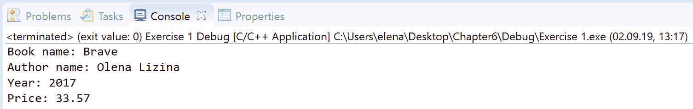

    **图 6.7：执行练习 2 的结果**

正如你所见，我们毫无困难地将自定义格式数据写入文件并从中读取。我们创建了自己的自定义类型，使用 `std::ofstream` 类将其写入文件，并检查一切是否成功写入。然后，我们使用 `std::ifstream` 类从文件中将这些数据读取到自定义变量中，输出到控制台，并确保一切读取正确。通过这样做，我们学习了如何使用 I/O 标准库读写文件数据。现在，让我们继续学习 I/O 库的内存部分。

## 字符串 I/O 实现


## I/O 标准库：字符串流

I/O 标准库允许进行输入和输出操作——不仅针对文件等设备，还针对内存，特别是 `std::string` 对象。在这种情况下，字符串既可以作为输入操作的来源，也可以作为输出操作的目标。在 `<sstream>` 头文件中，声明了管理字符串输入和输出的流类。它们与文件流一样，也提供了一个实现 RAII 的接口——字符串在流创建时打开以供读取或写入，在流销毁时关闭。它们在标准库中由以下类表示：`basic_stringbuf` 实现原始字符串接口，`basic_istringstream` 用于输入操作，`basic_ostringstream` 用于输出操作，`basic_stringstream` 用于输入和输出操作。标准库还为 `char` 和 `wchar_t` 类型提供了 typedef：`istringstream`、`ostringstream` 和 `stringstream`，以及带有 "w" 前缀的同名宽字符类型。

## 创建 `std::istringstream` 对象

要创建 `std::istringstream` 类的对象，我们应该将初始化字符串作为构造函数参数传递，或稍后使用 `str()` 函数设置：

```cpp
std::string track("ABBA 1967 Vule");
std::istringstream iss(track);
```

或者，我们可以执行以下操作：

```cpp
std::string track("ABBA 1967 Vule");
std::istringstream iss;
iss.str(track);
```

接下来，要从流中读取值，请使用右移运算符 `>>`，它为所有内置类型重载：

```cpp
std::string group;
std::string name;
int year;
iss >> group >> year >> name;
```

## 创建 `std::ostringstream` 对象

要创建 `std::ostringstream` 类的对象，我们只需声明一个该类型的变量：

```cpp
std::ostringstream oss;
```

接下来，要将数据写入字符串，请使用左移运算符 `<<`，它为所有内置类型重载：

```cpp
std::string group("ABBA");
std::string name("Vule");
int year = 1967;
oss << group << std::endl
    << name << std::endl
    << year << std::endl;
```

要获取结果字符串，请使用 `str()` 函数：

```cpp
std::cout << oss.str();
```

## 使用 `std::stringstream` 进行双向 I/O

`std::stringstream` 对象双向工作，因此它既有一个默认构造函数，也有一个接受字符串的构造函数。我们可以通过声明该类型的变量来创建默认的 `std::stringstream` 对象，然后将其用于读取和写入：

```cpp
std::stringstream ss;
ss << "45";
int count;
ss >> count;
```

此外，我们可以使用带有字符串参数的构造函数创建 `std::stringstream`。然后，我们可以像往常一样将其用于读取和写入：

```cpp
std::string employee("Alex Ismailow 26");
std::stringstream ss(employee);
```

或者，我们可以创建一个默认的 `std::stringstream` 对象，并通过使用 `str()` 函数设置字符串来初始化它：

```cpp
std::string employee("Charlz Buttler 26");
std::stringstream ss;
ss.str(employee);
```

接下来，我们可以使用 `ss` 对象进行读取和写入：

```cpp
std::string name;
std::string surname;
int age;
ss >> name >> surname >> age;
```

#### 字符串流的打开模式

我们也可以为这些类型的流应用打开模式。它们的功能类似于文件流，但有一点细微差别。`ios_base::binary` 在字符串流的情况下无关紧要，而 `ios_base::trunc` 被忽略。因此，我们可以用四种模式打开任意字符串流：`ios_base::app`、`ios_base::ate` 和 `ios_base::in`/`ios_base::out`。

---

# 练习 3：创建一个用于字符串中单词替换的函数

在本练习中，我们将实现一个函数，该函数解析给定字符串并将给定单词替换为其他单词。为完成此练习，我们将创建一个可调用类，它接受三个参数：原始字符串、要替换的单词和用于替换的单词。结果应返回新字符串。执行以下步骤以完成此练习：

## 步骤 1：包含所需头文件

包含所需头文件：`<iostream>` 用于终端输出，`<sstream>` 用于 I/O 字符串支持：

```cpp
#include <sstream>
#include <iostream>
```

## 步骤 2：实现可调用类 `Replacer`

实现名为 `Replacer` 的可调用类。它只有一个函数——重载的括号运算符 `operator()`，返回字符串并接受三个参数：原始字符串、要替换的单词和用于替换的单词。函数声明如下：

```cpp
std::string operator()(const std::string& originalString,
                       const std::string& wordToBeReplaced,
                       const std::string& wordReplaceBy);
```

## 步骤 3：创建 `istringstream` 对象

创建 `istringstream` 对象 `iss`，并将 `originalString` 变量设置为输入源：

```cpp
std::istringstream iss(originalString);
```

## 步骤 4：创建 `ostringstream` 对象

创建 `ostringstream` 对象 `oss`，用于保存转换后的字符串：

```cpp
std::ostringstream oss;
```

## 步骤 5：实现替换逻辑

然后，在循环中，只要有可能的输入，就执行读取单词到 `word` 变量。检查该单词是否等于 `wordToBeReplaced` 变量。如果是，则用 `wordReplaceBy` 变量替换它并写入 `oss` 流。如果不相等，则将原始单词写入 `oss` 流。每个单词后添加一个空白字符，因为 `iss` 流会截断它们。最后，返回结果。完整类如下：

```cpp
class Replacer
{
public:
    std::string operator()(const std::string& originalString,
                           const std::string& wordToBeReplaced,
                           const std::string& wordReplaceBy)
    {
        std::istringstream iss(originalString);
        std::ostringstream oss;
        std::string word;
        while (iss >> word)
        {
            if (0 == word.compare(wordToBeReplaced))
            {
                oss << wordReplaceBy << " ";
            }
            else
            {
                oss << word << " ";
            }
        }
        return oss.str();
    }
};
```

## 步骤 6：实现 `main` 函数

编写 `main` 函数。创建一个名为 `worker` 的 `Replacer` 类实例。定义 `foodList` 变量并用包含食物列表的字符串初始化它；某些项目应重复。定义 `changedList` 字符串变量并用 `worker()` 函数的返回值初始化它。使用 `std::cout` 在终端显示结果：

```cpp
int main()
{
    Replacer worker;
    std::string foodList("coffee tomatoes coffee cucumbers sugar");
    std::string changedList(worker(foodList, "coffee", "chocolate"));
    std::cout << changedList;
    return 0;
}
```

## 步骤 7：编译、构建和运行

编译、构建并运行练习。结果将获得以下输出：

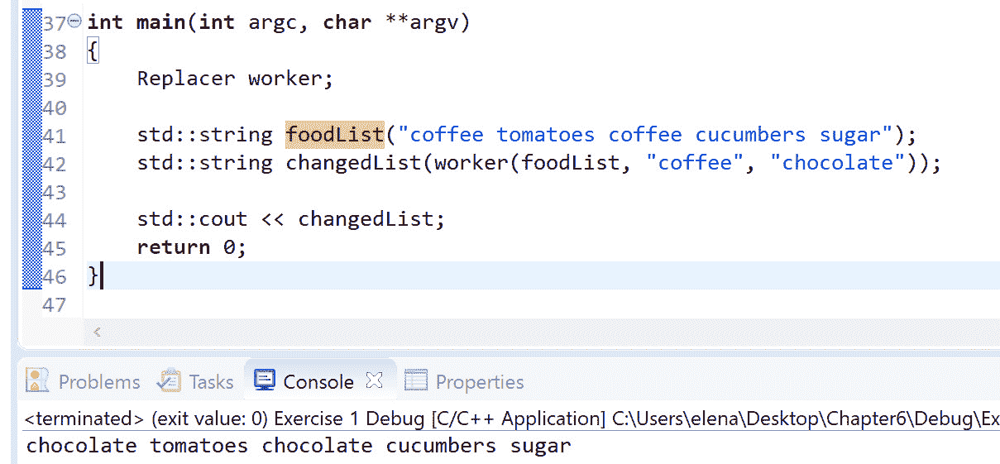

**图 6.8：执行练习 3 的结果**

做得好！在这里，我们学习了如何使用字符串流进行格式化输入和输出。我们创建了一个可以轻松替换句子中单词的应用程序，巩固了我们的知识，现在我们准备好学习 I/O 操纵符，以便提高我们处理线程的技能。

---

## I/O 操纵符

到目前为止，我们已经了解了使用流进行简单的输入和输出，但在许多情况下它们是不够的。对于更复杂的 I/O 数据格式化，标准库拥有大量的 I/O 操纵符。它们是为配合移位运算符（左移 `<<` 和右移 `>>`）而开发的函数，用于控制流的行为。I/O 操纵符分为两类——无需参数调用的和需要参数的。其中一些既适用于输入也适用于输出。让我们简要了解一下它们的含义和用法。


### 用于更改流数制的 I/O 操纵符

在 `<ios>` 头文件中，声明了用于更改流数制的函数：`std::dec`、`std::hex` 和 `std::oct`。它们无需参数即可调用，分别将流的数制设置为十进制、十六进制和八进制。在 `<iomanip>` 头文件中，声明了 `std::setbase` 函数，该函数接受以下参数调用：8、10 和 16。它们可以互换使用，且适用于输入和输出操作。

在 `<ios>` 头文件中，还有 `std::showbase` 和 `std::noshowbase` 函数，它们控制流数制的显示。它们仅影响十六进制和八进制整数的输出（零值除外），以及货币的输入和输出操作。让我们完成一个练习，学习如何在实践中使用它们。

### 练习 4：以不同数制显示输入的数字

在本练习中，我们将开发一个应用程序，它在无限循环中要求用户以以下数制之一输入整数：十进制、十六进制或八进制。读取输入后，它以其他数制表示形式显示该整数。要执行此练习，请完成以下步骤：

1. 包含 `<iostream>` 头文件以支持流操作。声明名为 `BASE` 的枚举并定义三个值：`DECIMAL`、`OCTAL` 和 `HEXADECIMAL`：

```cpp
#include <iostream>

enum BASE
{
    DECIMAL,
    OCTAL,
    HEXADECIMAL
};
```

2. 声明一个名为 `displayInBases` 的函数，它接受两个参数——整数和基数。接下来，定义 switch 语句，测试接收到的数制，并以其他两种数制表示形式显示给定的整数：

```cpp
void displayInBases(const int number, const BASE numberBase)
{
    switch (numberBase)
    {
    case DECIMAL:
        std::cout << "Your input in octal with base: "
                  << std::showbase << std::oct << number
                  << ", without base: "
                  << std::noshowbase << std::oct << number << std::endl;
        std::cout << "Your input in hexadecimal with base: "
                  << std::showbase << std::hex << number
                  << ", without base: "
                  << std::noshowbase << std::hex << number << std::endl;
        break;
    case OCTAL:
        std::cout << "Your input in hexadecimal with base: "
                  << std::showbase << std::hex << number
                  << ", without base: "
                  << std::noshowbase << std::hex << number << std::endl;
        std::cout << "Your input in decimal with base: "
                  << std::showbase << std::dec << number
                  << ", without base: "
                  << std::noshowbase << std::dec << number << std::endl;
        break;
    case HEXADECIMAL:
        std::cout << "Your input in octal with base: "
                  << std::showbase << std::oct << number
                  << ", without base: "
                  << std::noshowbase << std::oct << number << std::endl;
        std::cout << "Your input in decimal with base: "
                  << std::showbase << std::dec << number
                  << ", without base: "
                  << std::noshowbase << std::dec << number << std::endl;
        break;
    }
}
```

3. 进入 `main` 函数并定义用于读取用户输入的整数变量：

```cpp
int integer;
```

4. 创建一个无限 while 循环。在循环内，要求用户输入十进制值。以十进制整数读取输入。将其传递给 `displayInBases` 函数。接下来，要求用户输入十六进制值。以十六进制整数读取输入。将其传递给 `displayInBases` 函数。最后，要求用户输入八进制值。以八进制整数读取输入。将其传递给 `displayInBases` 函数：

```cpp
int main(int argc, char **argv)
{
    int integer;
    while (true)
    {
        std::cout << "Enter the decimal value: ";
        std::cin >> std::dec >> integer;
        displayInBases(integer, BASE::DECIMAL);
        std::cout << "Enter the hexadecimal value: ";
        std::cin >> std::hex >> integer;
        displayInBases(integer, BASE::HEXADECIMAL);
        std::cout << "Enter the octal value: ";
        std::cin >> std::oct >> integer;
        displayInBases(integer, BASE::OCTAL);
    }
    return 0;
}
```

5. 构建并运行应用程序。观察输出并输入例如 12，尝试不同的数制表示。输出应如下所示：

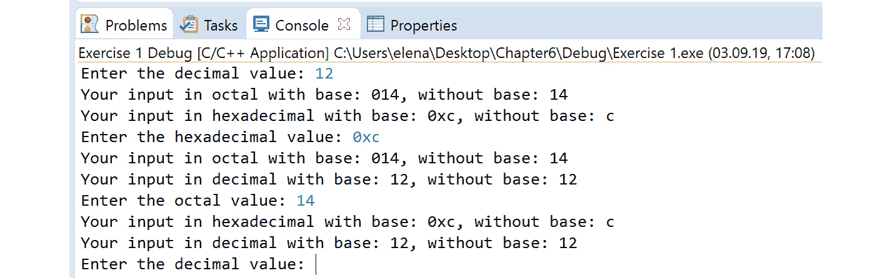

###### 图 6.9：执行练习 4 第 1 部分的结果

6. 现在，让我们将 `main` 函数中的 `std::dec`、`std::oct` 和 `std::hex` 更改为 `std::setbase()` 函数，以检查输出是否相同。首先，添加 `<iomanip>` 头文件以支持 `std::setbase()`。接下来，在循环中的 main 函数内，用 `std::setbase(10)` 替换 `std::dec`，用 `std::setbase(16)` 替换 `std::hex`，用 `std::setbase(8)` 替换 `std::oct`：

```cpp
int main(int argc, char **argv)
{
    int integer;
    while (true)
    {
        std::cout << "Enter the decimal value: ";
        std::cin >> std::setbase(10) >> integer;
        displayInBases(integer, BASE::DECIMAL);
        std::cout << "Enter the hexadecimal value: ";
        std::cin >> std::setbase(16) >> integer;
        displayInBases(integer, BASE::HEXADECIMAL);
        std::cout << "Enter the octal value: ";
        std::cin >> std::setbase(8) >> integer;
        displayInBases(integer, BASE::OCTAL);
    }
    return 0;
}
```

7. 再次构建并运行应用程序。观察输出并以不同的数制表示形式输入相同的整数 (12)。输出应如下所示：

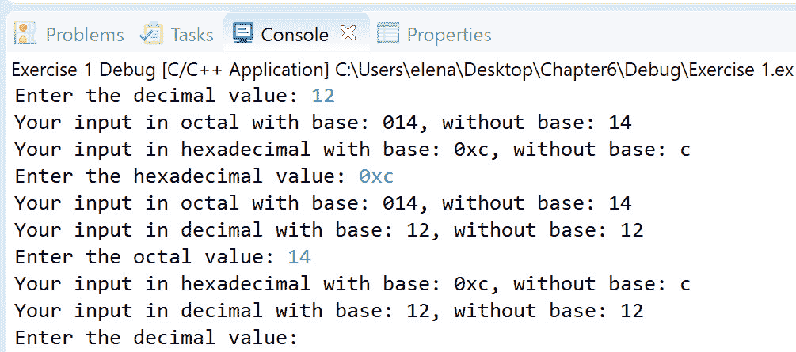

###### 图 6.10：执行练习 4 第 2 部分的结果

现在，比较结果。正如你所见，输出是相同的。通过这样做，我们确认了这些函数可以互换使用。

### 用于浮点数格式化的 I/O 操纵符

在 `<ios>` 头文件中，声明了用于更改浮点数位格式化的函数：`std::fixed`、`std::scientific`、`std::hexfloat` 和 `std::defaultfloat`。它们无需参数即可调用，分别将 `floatfield` 设置为 fixed（定点）、scientific（科学计数法）、fixed 和 scientific（十六进制浮点数）以及默认值。还有 `std::showpoint` 和 `std::noshowpoint` 函数，它们控制浮点数位的显示。它们仅影响输出。`std::noshowpoint` 函数仅影响没有小数部分的浮点数位。

在 `<iomanip>` 头文件中，声明了 `std::setprecision` 函数，该函数接受一个代表精度的数字调用。当小数点右侧的数字被舍去时，结果会四舍五入。如果数字太大无法以正常方式表示，则忽略精度规范，并以更方便的方式显示该数字。你只需设置一次精度，仅在需要其他精度时更改它。当你选择一种数据类型来存储浮点变量时，应该注意一些技巧。在 C++ 中，有三种数据类型可以表示浮点值：`float`、`double` 和 `long double`。

`float` 通常为 4 字节，`double` 为 8 字节，`long double` 为 8、12 或 16 字节。因此，它们每一个的精度都是有限的。`float` 类型最多可容纳 6-9 位有效数字，`double` 类型最多可容纳 15-18 位有效数字，而 `long double` 类型最多可容纳 33-36 位有效数字。如果你想比较它们之间的差异，请查看下表：


## 浮点类型比较

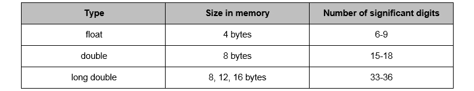

###### 图 6.11：浮点类型比较表

## 注意

当你需要超过六位有效数字的精度时，请优先使用 `double`；否则，你将得到意外的结果。

让我们完成一个练习，学习如何在实践中使用它们。

## 练习 5：使用不同格式显示输入的浮点数

在本练习中，我们将编写一个应用程序，它在一个无限循环中请求用户输入一个浮点数。读取输入后，它会以不同的格式类型显示该数字。要执行此练习，请完成以下步骤：

### 步骤 1：包含头文件

包含用于流支持的 `<iostream>` 头文件和用于 `std::setprecision` 支持的 `<iomanip>` 头文件：

```cpp
#include <iostream>
#include <iomanip>
```

### 步骤 2：声明 `formattingPrint` 函数

接下来，声明一个模板 `formattingPrint` 函数，它有一个名为 `FloatingPoint` 的模板参数，并接受一个该类型的参数变量。然后，通过调用 `std::cout` 对象中的 `precision()` 函数，将之前的精度存储在一个 `auto` 变量中。接着，在终端中以不同格式显示给定的数字：带小数点、不带小数点，以及 `fixed`、`scientific`、`hexfloat` 和 `defaultfloat` 格式。随后，在 `for` 循环中，从 0 到 22，显示具有精度和循环计数器大小的给定数字。循环退出后，使用我们之前存储的值恢复精度：

```cpp
template <typename FloatingPoint>
void formattingPrint(const FloatingPoint number)
{
    auto precision = std::cout.precision();
    std::cout << "Default formatting with point: "
              << std::showpoint << number << std::endl
              << "Default formatting without point: "
              << std::noshowpoint << number << std::endl
              << "Fixed formatting: "
              << std::fixed << number << std::endl
              << "Scientific formatting: "
              << std::scientific << number << std::endl
              << "Hexfloat formatting: "
              << std::hexfloat << number << std::endl
              << "Defaultfloat formatting: "
              << std::defaultfloat << number << std::endl;
    for (int i = 0; i < 22; i++)
    {
        std::cout << "Precision: " << i
                  << ", number: " << std::setprecision(i)
                  << number << std::endl;
    }
    std::cout << std::setprecision(precision);
}
```

### 步骤 3：实现 `main` 函数

进入 `main` 函数。声明一个名为 `floatNum` 的 `float` 变量、一个名为 `doubleNum` 的 `double` 变量和一个名为 `longDoubleNum` 的 `long double` 变量。然后，在无限 `while` 循环中，请求用户输入一个浮点数，将输入读取到 `longDoubleNum` 中，并将其传递给 `formattingPrint` 函数。接下来，使用 `longDoubleNum` 的值初始化 `doubleNum` 并将其传递给 `formattingPrint` 函数。接着，使用 `longDoubleNum` 的值初始化 `floatNum` 并将其传递给 `formattingPrint` 函数：

```cpp
int main(int argc, char **argv)
{
    float floatNum;
    double doubleNum;
    long double longDoubleNum;
    while (true)
    {
        std::cout << "Enter the floating-point digit: ";
        std::cin >> std::setprecision(36) >> longDoubleNum;
        std::cout << "long double output" << std::endl;
        formattingPrint(longDoubleNum);
        doubleNum = longDoubleNum;
        std::cout << "double output" << std::endl;
        formattingPrint(doubleNum);
        floatNum = longDoubleNum;
        std::cout << "float output" << std::endl;
        formattingPrint(floatNum);
    }
    return 0;
}
```

### 步骤 4：构建并运行

构建并运行应用程序。观察输出并输入一个具有 **22** 位有效数字的浮点值，例如 **0.2222222222222222222222**。我们将获得一个很长的输出。现在，我们需要将其拆分以进行分析。这里是 `long double` 值输出部分的截图：

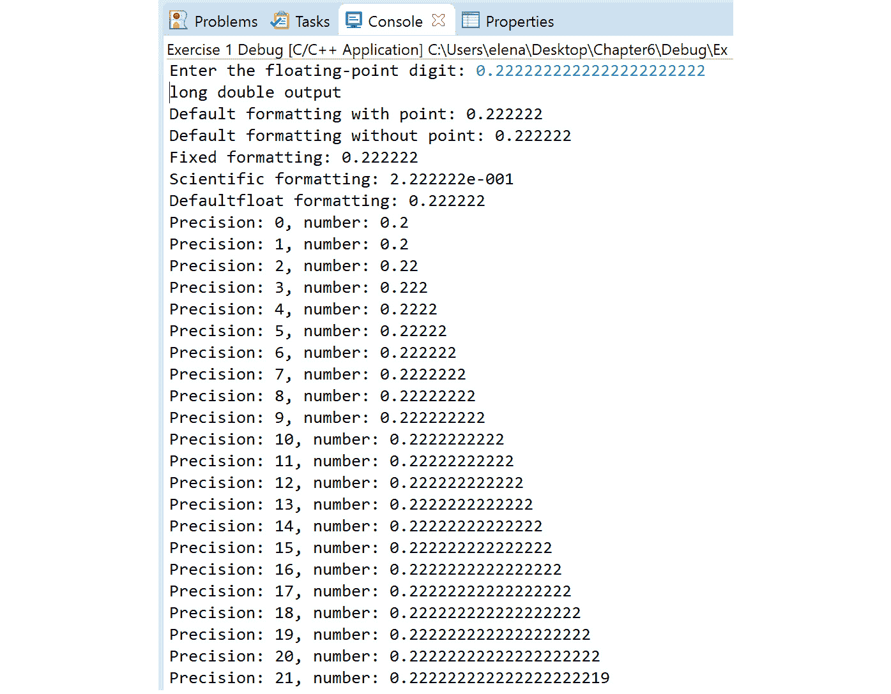

###### 图 6.12：执行练习 5 的结果，第 1 部分

我们可以看到，默认情况下，`fixed` 和 `defaultfloat` 格式仅输出六位有效数字。使用科学计数法格式化时，值的输出符合预期。当我们调用 `setprecision(0)` 或 `setprecision(1)` 时，我们期望小数点后不输出任何数字。但对于小于 1 的数字，`setprecision` 会在小数点后保留一位数字。通过这样做，我们将看到正确的输出直到精度为 21。这意味着在我们的系统上，`long double` 的最大精度为 20 位有效数字。现在，让我们分析 `double` 值的输出：

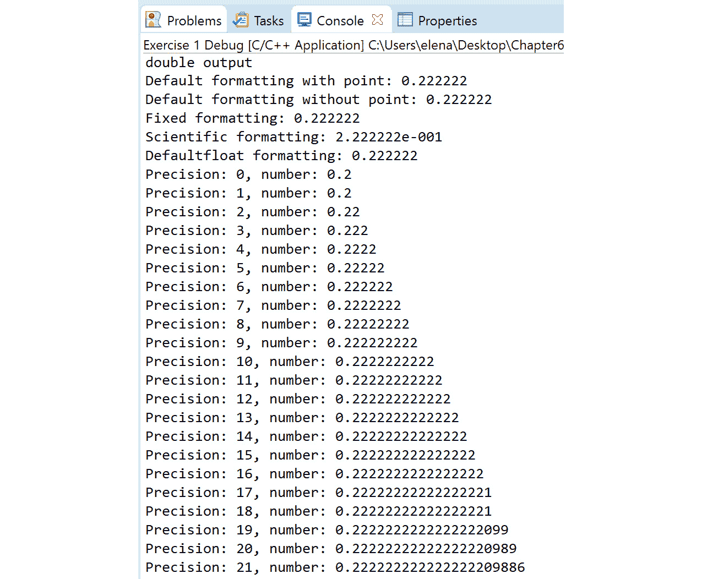

###### 图 6.13：执行练习 5 的结果，第 2 部分

这里，我们可以看到格式化的结果相同，但精度不同。不准确的输出从精度 17 开始。这意味着，在我们的系统上，`double` 的最大精度为 16 位有效数字。现在，让我们分析 `float` 值的输出：

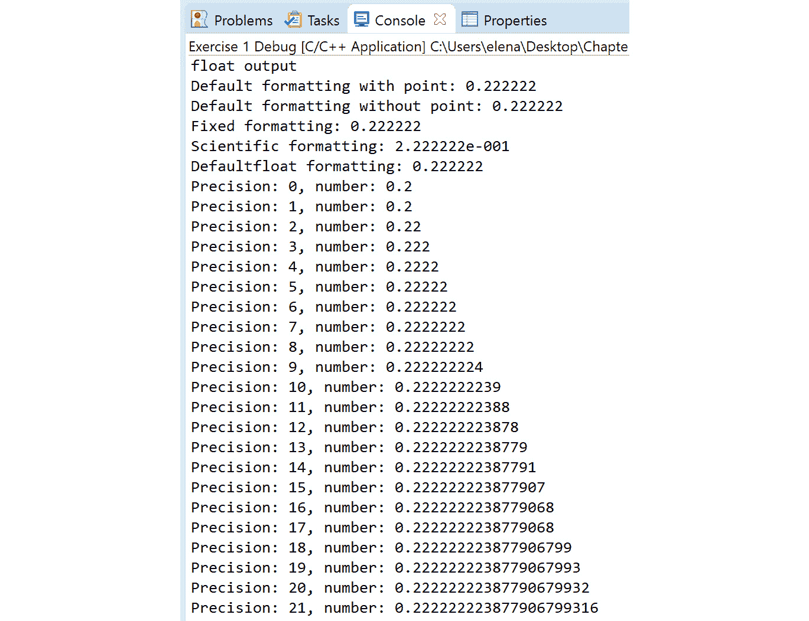

###### 图 6.14：执行练习 5 的结果，第 3 部分

这里，我们可以看到格式化的结果相同，但精度不同。不准确的输出从精度 8 开始。这意味着，在我们的系统上，`float` 的最大精度为 8 位有效数字。不同系统上的结果应该不同。对它们的分析将帮助你为应用程序选择正确的数据类型。

## 注意

切勿使用 `float` 数据类型来表示货币或汇率；否则你可能会得到错误的结果。

## 用于布尔格式化的 I/O 操纵符

在 `<ios>` 头文件中，声明了用于更改布尔格式化的函数：`std::boolalpha` 和 `std::noboolalpha`。它们无需参数即可调用，分别允许我们以文本或数字方式显示布尔值。它们既用于输入操作也用于输出操作。让我们看一个使用这些 I/O 操纵符进行输出操作的示例。我们将以文本和数字两种形式显示布尔值：

```cpp
std::cout << "Default formatting of bool variables: "
          << "true: " << true
          << ", false: " << false << std::endl;

std::cout << "Formatting of bool variables with boolalpha flag is set: "
          << std::boolalpha
          << "true: " << true
          << ", false: " << false << std::endl;

std::cout << "Formatting of bool variables with noboolalpha flag is set: "
          << std::noboolalpha
          << "true: " << true
          << ", false: " << false << std::endl;
```

编译并运行此示例后，你将获得以下输出：

```
Default formatting of bool variables: true: 1, false: 0
Formatting of bool variables with boolalpha flag is set: true: true, false: false
Formatting of bool variables with noboolalpha flag is set: true: 1, false: 0
```

正如你所见，布尔变量的默认格式化是使用 `std::noboolalpha` 标志执行的。要在输入操作中使用这些函数，我们需要一个包含 `true`/`false` 单词或 `0`/`1` 符号的源字符串。输入操作中的 `std::boolalpha` 和 `std::noboolalpha` 函数调用如下：

```cpp
bool trueValue, falseValue;
std::istringstream iss("false true");
iss >> std::boolalpha >> falseValue >> trueValue;

std::istringstream iss("0 1");
iss >> std::noboolalpha >> falseValue >> trueValue;
```

如果你随后输出这些变量，你将看到它们通过读取布尔值被正确初始化了。


### 用于字段宽度和填充控制的 I/O 操纵符

在标准库中，也有用于操纵输出字段宽度的函数，即当宽度大于输出数据时应使用哪些字符，以及这些填充字符应插入在何处。当你想将输出向左或向右对齐，或者想用其他符号替换空格时，这些函数将非常有用。例如，假设你需要在两列中打印价格。如果你使用标准格式化，将得到以下输出：

```
2.33 3.45

2.2 4.55

3.67 3.02
```

这看起来不太好，而且难以阅读。如果我们应用格式化，输出将如下所示：

```
2.33   3.45

2.2    4.55

3.67   3.02
```

这看起来好多了。同样，你可能想检查哪些字符被用来填充空白处，哪些是你实际插在数字之间的空格。让我们将填充字符设置为 "`*`"，例如。你将得到以下输出：

```
2.33* 3.45*

2.2** 4.55**

3.67* 3.02**
```

现在，你可以看到空白处被星号填充了。既然我们已经了解了在哪里格式化宽度和填充输出会很有用，现在让我们看看如何使用 I/O 操纵符来实现这一点。`std::setw` 和 `std::setfill` 函数声明在 `<iomanip>` 头文件中。`std::setw` 接受一个整数值作为参数，并将流的宽度设置为精确的 n 个字符。有几种情况会将宽度设置为 0。它们如下：

*   当移位运算符与 `std::string` 或 `char` 一起调用时
*   当调用 `std::put_money()` 函数时
*   当调用 `std::quoted()` 函数时

在 `<ios>` 头文件中，声明了用于更改填充字符插入位置的函数：`std::internal`、`std::left` 和 `std::right`。它们仅用于输出操作，且仅影响整数、浮点数和货币值。

现在，让我们看一个将它们一起使用的示例。让我们以宽度 10 输出正数、负数、浮点数和十六进制值，并将填充字符替换为 "`#`"：

```
std::cout << "Internal fill: " << std::endl
          << std::setfill('#')
          << std::internal
          << std::setw(10) << -2.38 << std::endl
          << std::setw(10) << 2.38 << std::endl
          << std::setw(10) << std::hex << std::showbase << 0x4b << std::endl;

std::cout << "Left fill: " << std::endl
          << std::left
          << std::setw(10) << -2.38 << std::endl
          << std::setw(10) << 2.38 << std::endl
          << std::setw(10) << std::hex << std::showbase << 0x4b << std::endl;

std::cout << "Right fill: " << std::endl
          << std::right
          << std::setw(10) << -2.38 << std::endl
          << std::setw(10) << 2.38 << std::endl
          << std::setw(10) << std::hex << std::showbase << 0x4b << std::endl;
```

构建并运行此示例后，你将得到以下输出：

```
Internal fill:

-#####2.38

######2.38

0x######4b

Left fill:

-2.38#####

2.38######

0x4b######

Right fill:

#####-2.38

######2.38

######0x4b
```

### 用于其他数值格式化的 I/O 操纵符

如果你需要带 "`+`" 号输出正数值，可以使用来自 `<ios>` 头文件的另一个 I/O 操纵符——`std::showpos` 函数。含义相反的操纵符也存在——`std::noshowpos` 函数。它们都影响输出。它们的用法非常简单。让我们看看下面的例子：

```
std::cout << "Default formatting: " << 13 << " " << 0 << std::endl;
std::cout << "showpos flag is set: " << std::showpos << 13 << " " << 0 << std::endl;
std::cout << "noshowpos flag is set: " << std::noshowpos << 13 << " " << 0 << std::endl;
```

在这里，我们先用默认格式化输出，然后设置 `std::showpos` 标志输出，最后设置 `std::noshowpos` 标志输出。如果你构建并运行这个小例子，你会看到，默认情况下设置的是 `std::noshowpos` 标志。看执行结果：

```
Default formatting: 13 0
showpos flag is set: +13 +0
noshowpos flag is set: 13 0
```

你可能还想为浮点数或十六进制数字输出大写字符，以便可以使用来自 `<ios>` 头文件的函数：`std::uppercase` 和 `std::nouppercase`。它们仅作用于输出。让我们看一个小例子：

```
std::cout << "12345.0 in uppercase with precision 4: "
          << std::setprecision(4) << std::uppercase << 12345.0 << std::endl;
std::cout << "12345.0 in no uppercase with precision 4: "
          << std::setprecision(4) << std::nouppercase << 12345.0 << std::endl;
std::cout << "0x2a in uppercase: "
          << std::hex << std::showbase << std::uppercase << 0x2a << std::endl;
std::cout << "0x2a in nouppercase: "
          << std::hex << std::showbase << std::nouppercase << 0x2a << std::endl;
```

在这里，我们分别带有和不带有 `std::uppercase` 标志输出浮点数和十六进制数字。默认情况下，设置的是 `std::nouppercase` 标志。看执行结果：

```
12345.0 in uppercase with precision 4: 1.234E+004
12345.0 in no uppercase with precision 4: 1.234e+004
0x2a in uppercase: 0X2A
0x2a in nouppercase: 0x2a
```

### 用于空白字符处理的 I/O 操纵符

在标准库中，有用于处理空白字符的函数。来自 `<istream>` 头文件的 `std::ws` 函数仅适用于输入流，并丢弃前导空白字符。来自 `<ios>` 头文件的 `std::skipws` 和 `std::noskipws` 函数用于控制读取和写入前导空白字符。它们适用于输入和输出流。当设置了 `std::skipws` 标志时，流会忽略字符序列输入前的空白字符。默认情况下，设置了 `std::skipws` 标志。让我们看一个使用这些 I/O 操纵符的例子。首先，我们将使用默认格式化读取输入并输出读取的内容。接下来，我们将清空字符串并使用 `std::noskipws` 标志读取数据：

```
std::string name;
std::string surname;
std::istringstream("Peppy Ping") >> name >> surname;
std::cout << "Your name: " << name << ", your surname: " << surname << std::endl;
name.clear();
surname.clear();
std::istringstream("Peppy Ping") >> std::noskipws >> name >> surname;
std::cout << "Your name: " << name << ", your surname: " << surname << std::endl;
```

构建并运行此示例后，我们将得到以下输出：

```
Your name: Peppy, your surname: Ping
Your name: Peppy, your surname:
```

正如你从前面的输出中所见，如果我们设置了 `std::noskipws` 标志，我们也会读取空白字符。

在 `<iomanip>` 头文件中，声明了一个该头文件不寻常的操纵符：`std::quoted`。当此函数应用于输入时，它会用转义字符将给定字符串包裹在引号中。如果输入字符串已经包含转义引号，它也会读取它们。为了理解这一点，让我们看一个小例子。我们将用一些不带引号的文本初始化源字符串，另一个字符串用带有转义引号的文本初始化。接下来，我们将在未设置标志的情况下使用 `std::ostringstream` 读取它们，并通过 `std::cout` 提供输出。请看下面的例子：

```
std::string str1("String without quotes");
std::string str2("String with quotes \"right here\"");
std::ostringstream ss;
ss << str1;
std::cout << "[" << ss.str() << "]" << std::endl;
ss.str("");
ss << str2;
std::cout << "[" << ss.str() << "]" << std::endl;
```

结果，我们将得到以下输出：

```
[String without quotes]
[String with quotes "right here"]
```

现在，让我们做同样的输出，但带上 `std::quoted` 调用：

```
std::string str1("String without quotes");
std::string str2("String with quotes \"right here\"");
std::ostringstream ss;
ss << std::quoted(str1);
```


## 创建额外的流

```
std::cout << "\[" << ss.str() << "\]" << std::endl;

ss.str("");

ss << std::quoted(str2);

std::cout << "\[" << ss.str() << "\]" << std::endl;
```

现在，我们将得到不同的结果：

```
\["String without quotes"\]

\["String with quotes \\"right here\\""\]
```

你注意到了吗？第一个字符串被引号包裹，而第二个字符串中的子串 "right here" 带着转义字符存储。

现在，你知道如何用引号包裹任意字符串了。你甚至可以编写自己的包装器，以减少使用 `std::quoted()` 时的代码行数。例如，我们将流的操作移到了一个单独的函数中：

```
std::string quote(const std::string& str)
{
    std::ostringstream oss;
    oss << std::quoted(str);
    return oss.str();
}
```

然后，当我们需要调用包装器时，执行以下操作：

```
std::string str1("String without quotes");
std::string str2("String with quotes \\"right here\\"");
std::cout << "\[" << quote(str1) << "\]" << std::endl;
std::cout << "\[" << quote(str2) << "\]" << std::endl;
```

现在，看起来好多了。第一个主题到此结束，让我们复习一下刚才学到的内容。在实践中，我们了解了预定义流对象的用法、带有内部内存的文件 I/O 操作、I/O 格式化以及用户定义类型的 I/O。既然我们已经完全理解了如何在 C++ 中使用 I/O 库，我们将探讨当标准流不够用时该怎么办。

## 如何创建额外的流 – 组合

当提供的流接口不足以解决你的任务时，你可能想要创建一个额外的流来复用现有接口之一。你可能需要从特定的外部设备输出或提供输入，或者你可能需要添加调用 I/O 操作的线程 ID。有几种方法可以做到这一点。你可以创建一个新类，将现有流之一作为私有成员进行聚合。它将通过现有的流函数实现所有需要的函数，例如移位运算符。另一种方法是继承现有类之一，并按需重写所有虚函数。

首先，你必须选择要使用的合适类。你的选择应取决于你想添加哪种修改。如果你需要修改输入或输出操作，请选择 `std::basic_istream`、`std::basic_ostream` 和 `std::basic_iostream`。如果你想修改状态信息、控制信息、私有存储等，请选择 `std::ios_base`。如果你想修改与流缓冲区相关的内容，请选择 `std::basic_ios`。选择正确的基类后，继承上述类之一以创建额外的流。

还有一件事你必须知道——如何正确初始化标准流。在文件流或字符串流类以及基本流类的初始化方面，存在巨大差异。让我们回顾一下。要初始化派生自文件流类的类的对象，你需要传递文件名。要初始化派生自字符串流类的类的对象，你需要调用默认构造函数。它们都有自己的流缓冲区，因此在初始化时不需要额外的操作。要初始化派生自基本流类的类的对象，你需要传递一个指向流缓冲区的指针。你可以创建一个缓冲区变量，或者可以使用预定义流对象（如 `std::cout` 或 `std::cerr`）的缓冲区。

让我们详细回顾一下这两种创建额外流的方法。

### 如何创建额外的流 – 组合

组合意味着你在类的私有部分将某些标准流对象声明为类成员。当你选择合适的标准流类后，进入其头文件并注意它有哪些构造函数。然后，你需要在你的类的构造函数中正确初始化该成员。要将你的类用作流对象，你需要实现基本函数，例如移位运算符、`str()` 等。正如你可能记得的，每个流类都为内置类型重载了移位运算符。它们还为预定义函数（如 `std::endl`）重载了移位运算符。你需要能够将你的类用作真正的流对象。我们不需要声明所有 18 个重载的移位运算符，只需创建一个模板即可。此外，为了允许使用预定义的操纵符，我们必须声明一个接受函数指针的移位运算符。

这看起来不难，所以让我们尝试为 `std::ostream` 对象实现这样一个“包装器”。

## 练习 6：在用户定义类中组合标准流对象

在本练习中，我们将创建自己的流对象，它包装 `std::ostream` 对象并添加额外功能。我们将创建一个名为 `extendedOstream` 的类，它将数据输出到终端，并在每次输出前插入以下数据：日期和时间以及线程 ID。要完成此练习，请执行以下步骤：

1.  包含所需的头文件：`<iostream>` 用于 `std::endl` 支持，`<sstream>` 用于 `std::ostream` 支持，`<thread>` 用于 `std::this_thread::get_id()` 支持，`<chrono>` 用于 `std::chrono::system_clock::now()`，以及 `<ctime>` 用于将时间戳转换为可读表示：

    ### 注意

    不要忘记在 Eclipse 项目设置中添加 `pthread` 链接器标志以支持线程：**Project** -> **Properties** -> **C/C++ Build** -> **Settings** -> **G++ Linker** -> **Miscellaneous** -> **Linker flags** 输入 '`-pthread`'。此路径适用于 Eclipse Version: 3.8.1；不同版本可能有所不同。

    ```
    #include <iostream>
    #include <sstream>
    #include <thread>
    #include <chrono>
    #include <ctime>
    ```

2.  接下来，声明 `extendedOstream` 类。声明一个名为 `m_oss` 的 `std::ostream` 变量和一个名为 `writeAdditionalInfo` 的 `bool` 变量。此 `bool` 变量将用于指示是否应打印扩展数据：

    ```
    class extendedOstream
    {
    private:
        std::ostream& m_oss;
        bool writeAdditionalInfo;
    };
    ```

3.  接下来，在公共部分，定义一个默认构造函数，并用 `std::cout` 初始化 `m_oss` 以将输出重定向到终端。用 `true` 初始化 `writeAdditionalInfo`：

    ```
    extendedOstream()
        : m_oss(std::cout)
        , writeAdditionalInfo(true)
    {
    }
    ```

4.  定义一个模板重载左移运算符 `<<`，它返回 `extendedOstream` 的引用并接受一个名为 `value` 的模板参数。然后，如果 `writeAdditionalInfo` 为 `true`，输出时间、线程 ID 和给定的值，并将 `writeAdditionalInfo` 设置为 `false`。如果 `writeAdditionalInfo` 为 `false`，则仅输出给定的值。此函数将用于所有内置类型的输出：

    ```
    template<typename T>
    extendedOstream& operator<<(const T& value)
    {
        if (writeAdditionalInfo)
        {
            std::string time = fTime();
            auto id = threadId();
            m_oss << time << id << value;
            writeAdditionalInfo = false;
        }
        else
        {
            m_oss << value;
        }
        return *this;
    }
    ```

5.  定义另一个重载左移运算符，它接受一个函数指针作为参数并返回 `std::ostream` 的引用。在函数体中，将 `writeAdditionalInfo` 设置为 `true`，调用给定函数，并传递 `m_oss` 作为参数。此重载运算符将用于预定义函数，如 `std::endl`：

    ```
    extendedOstream&
    operator<<(std::ostream& (*pfn)(std::ostream&))
    {
        writeAdditionalInfo = true;
    }
    ```


## 练习 6：继续实现（步骤 6-10）

### 步骤 6：定义 `fTime()` 函数

在私有部分，定义返回 `std::string` 的 `fTime()` 函数。它获取系统时间，将其格式化为可读的表示形式，并返回：

```cpp
std::string fTime()
{
    auto now = std::chrono::system_clock::now();
    std::time_t time = std::chrono::system_clock::to_time_t(now);
    std::ostringstream oss;
    std::string strTime(std::ctime(&time));
    strTime.pop_back();
    oss << "[" << strTime << "]";
    return oss.str();
}
```

### 步骤 7：定义 `threadId()` 函数

在私有部分，定义返回字符串的 `threadId()` 函数。获取当前线程的 `id`，对其进行格式化，并返回：

```cpp
std::string threadId()
{
    auto id = std::this_thread::get_id();
    std::ostringstream oss;
    oss << "[" << std::dec << id << "]";
    return oss.str();
}
```

### 步骤 8：实现 `main()` 函数

进入 `main` 函数。为了测试我们的流对象如何工作，创建一个名为 `oss` 的 `extendedOstream` 类型对象。输出不同的数据，例如整数、浮点数、十六进制数和布尔值：

```cpp
extendedOstream oss;

oss << "Integer: " << 156 << std::endl;
oss << "Float: " << 156.12 << std::endl;
oss << "Hexadecimal: " << std::hex << std::showbase
    << std::uppercase << 0x2a << std::endl;
oss << "Bool: " << std::boolalpha << false << std::endl;
```

### 步骤 9：创建并加入线程

然后，创建一个线程，用 lambda 函数对其进行初始化，并将相同的输出放在 lambda 内部。别忘了加入线程：

```cpp
std::thread thr1([]()
{
    extendedOstream oss;
    oss << "Integer: " << 156 << std::endl;
    oss << "Float: " << 156.12 << std::endl;
    oss << "Hexadecimal: " << std::hex << std::showbase
        << std::uppercase << 0x2a << std::endl;
    oss << "Bool: " << std::boolalpha << false << std::endl;
});

thr1.join();
```

### 步骤 10：构建并运行

现在，构建并运行应用程序。你将获得以下输出：

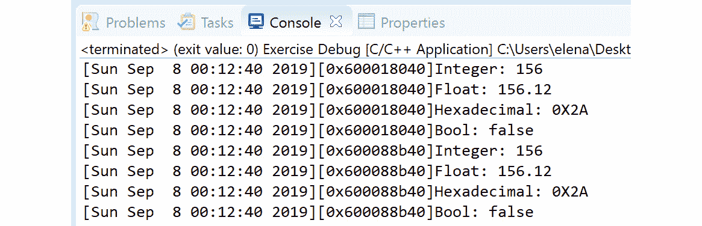

**图 6.15：** 执行练习 6 的结果

仔细观察输出的每一行。你可以看到输出的格式为：`[日期和时间][线程 ID]输出数据`。确保线程 ID 在不同线程间有所不同。然后，数据按预期格式输出。所以，正如你所见，利用标准流的组合来实现自己的 I/O 流对象并不难。

## 如何创建额外的流——继承

继承意味着你创建自己的流类，并从具有虚析构函数的标准流对象之一继承。你的类必须是一个模板类，并具有模板参数，就像父类一样。为了能将所有继承的函数用于你的类的对象，继承应该是公有的。在构造函数中，你应该根据类类型初始化父类——使用文件名、流缓冲区或默认方式。接下来，你应该根据你的需求覆盖那些你想要更改的基本函数。

我们需要继承标准流类的最常见情况是，当我们想要为新设备（如套接字或打印机）实现 I/O 操作时。所有定义的标准流类都负责格式化输入和输出，并为字符串、文件和终端提供重载。只有 `std::basic_streambuf` 类负责与设备交互，因此我们需要继承这个类，编写我们自己的实现，并将其设置为标准类的流缓冲区。`streambuf` 类的核心功能是传输字符。它可以使用缓冲区在刷新之间存储字符，也可以在每次调用后立即刷新。这些概念被称为**缓冲**和**非缓冲**字符传输。

### 输出操作的缓冲字符传输

输出操作的缓冲字符传输工作原理如下：

1. 字符通过 `sputc()` 函数调用被缓冲到内部缓冲区中。
2. 当缓冲区满时，`sputc()` 调用受保护的虚成员函数，即 `overflow()`。
3. `overflow()` 函数将所有缓冲区内容传输到外部设备。
4. 当调用 `pubsync()` 函数时，它会调用称为 `sync()` 的受保护虚成员函数。
5. `sync()` 函数将所有缓冲区内容传输到外部设备。

### 输出操作的非缓冲字符传输

输出操作的非缓冲字符传输工作方式略有不同：

1. 字符被传递给 `sputc()` 函数。
2. `sputc()` 函数立即调用称为 `overflow()` 的受保护虚成员函数。
3. `overflow()` 函数将所有缓冲区内容传输到外部设备。

因此，对于输出操作的缓冲和非缓冲字符传输，我们应该覆盖执行实际工作的 `overflow()` 和 `sync()` 函数。

### 输入操作的缓冲字符传输

输入操作的缓冲字符传输工作原理如下：

1. `sgetc()` 函数从内部缓冲区读取字符。
2. `sgetc()` 函数调用 `sungetc()` 函数，使已消耗的字符再次可用。
3. 如果内部缓冲区为空，`sgetc()` 函数调用 `underflow()` 函数。
4. `underflow()` 函数从外部设备将字符读入内部缓冲区。

`sgetc()` 和 `underflow()` 函数总是返回同一个字符。为了每次读取不同的字符，我们有另一对函数：`sbumpc()` 和 `uflow()`。使用它们读取字符的算法相同：

1. `sbumpc()` 函数从内部缓冲区读取字符。
2. `sbumpc()` 函数调用 `sputbackc()` 函数，使下一个字符可用于输入。
3. 如果内部缓冲区为空，`sbumpc()` 函数调用 `uflow()` 函数。
4. `uflow()` 函数从外部设备将字符读入内部缓冲区。

### 输入操作的非缓冲字符传输

输入操作的非缓冲字符传输工作原理如下：

1. `sgetc()` 函数调用称为 `underflow()` 的受保护虚成员函数。
2. `underflow()` 函数从外部设备将字符读入内部缓冲区。
3. `sbumpc()` 函数调用称为 `uflow()` 的受保护虚成员函数。
4. `uflow()` 函数从外部设备将字符读入内部缓冲区。

如果发生任何错误，将调用称为 `pbackfail()` 的受保护虚成员函数，该函数处理错误情况。因此，正如你所见，要覆盖 `std::basic_streambuf` 类，我们需要覆盖与外部设备交互的虚成员函数。对于输入 `streambuf`，我们应该覆盖 `underflow()`、`uflow()` 和 `pbackfail()` 成员。对于输出 `streambuf`，我们应该覆盖 `overflow()` 和 `sync()` 成员。

让我们更详细地考虑所有这些步骤。

## 练习 7：继承标准流对象

在本练习中，我们将创建一个名为 `extended_streambuf` 的类，它继承自 `std::basic_streambuf`。我们将使用 `std::cout` 流对象的缓冲区，并覆盖 `overflow()` 函数，以便我们可以将数据写入外部设备（`stdout`）。接下来，我们将编写一个继承自 `std::basic_ostream` 类的 `extended_ostream` 类，并将流缓冲区设置为 `extended_streambuf`。最后，我们将对包装类进行微小更改，并将 `extended_ostream` 用作私有流成员。要完成此练习，请执行以下步骤：


# 练习步骤

1. 包含所需头文件：`<iostream>` 用于支持 `std::endl`，`<sstream>` 用于支持 `std::ostream` 和 `std::basic_streambuf`，`<thread>` 用于支持 `std::this_thread::get_id()`，`<chrono>` 用于支持 `std::chrono::system_clock::now()`，`<ctime>` 用于将时间戳转换为可读状态。

2. 创建一个名为 `extended_streambuf` 的模板类，继承自 `std::basic_streambuf` 类。重写一个名为 `overflow()` 的公有成员，该成员向输出流写入一个字符并返回 EOF 或写入的字符：

```cpp
template< class CharT, class Traits = std::char_traits<CharT> >
class extended_streambuf : public std::basic_streambuf< CharT, Traits >
{
public:
    int overflow( int c = EOF ) override
    {
        if (!Traits::eq_int_type(c, EOF))
        {
            return fputc(c, stdout);
        }
        return Traits::not_eof(c);
    }
};
```

3. 接着，创建一个名为 `extended_ostream` 的模板类，继承自 `std::basic_ostream` 类。在私有部分，定义一个 `extended_streambuf` 类的成员，即 `buffer`。使用 `buffer` 成员初始化 `std::basic_ostream` 父类。接着，在构造函数体中，用 `buffer` 作为参数调用父类的 `init()` 函数。同时，重载 `rdbuf()` 函数，返回指向 `buffer` 变量的指针：

```cpp
template< class CharT, class Traits = std::char_traits<CharT> >
class extended_ostream : public std::basic_ostream< CharT, Traits >
{
public:
    extended_ostream()
        : std::basic_ostream< CharT, Traits >::basic_ostream(&buffer)
        , buffer()
    {
        this->init(&buffer);
    }
    extended_streambuf< CharT, Traits >* rdbuf () const
    {
        return (extended_streambuf< CharT, Traits >*)&buffer;
    }
private:
    extended_streambuf< CharT, Traits > buffer;
};
```

4. 将 `extendedOstream` 类重命名为 `logger`，以避免与同名类产生混淆。保留现有接口不变，但将 `std::ostream&` 成员替换为我们自己的流，即 `object - extended_ostream`。完整类如下所示：

```cpp
class logger
{
public:
    logger()
        : m_log()
        , writeAdditionalInfo(true)
    {
    }
    template<typename T>
    logger& operator<<(const T& value)
    {
        if (writeAdditionalInfo)
        {
            std::string time = fTime();
            auto id = threadId();
            m_log << time << id << value;
            writeAdditionalInfo = false;
        }
        else
        {
            m_log << value;
        }
        return *this;
    }
    logger& operator<<(std::ostream& (*pfn)(std::ostream&))
    {
        writeAdditionalInfo = true;
        pfn(m_log);
        return *this;
    }
private:
    std::string fTime()
    {
        auto now = std::chrono::system_clock::now();
        std::time_t time = std::chrono::system_clock::to_time_t(now);
        std::ostringstream log;
        std::string strTime(std::ctime(&time));
        strTime.pop_back();
        log << "[" << strTime << "]";
        return log.str();
    }
    std::string threadId()
    {
        auto id = std::this_thread::get_id();
        std::ostringstream log;
        log << "[" << std::dec << id << "]";
        return log.str();
    }
private:
    extended_ostream<char> m_log;
    bool writeAdditionalInfo;
};
```

5. 进入 `main` 函数，将 `extendedOstream` 对象改为 `logger` 对象。其余代码保持不变。现在，构建并运行练习。你将看到与上一个练习给出的输出相同的结果，但在这种情况下，我们使用了自己的流缓冲区、自己的流对象，以及一个添加额外信息到输出的包装类。查看下面截图中显示的执行结果，并将其与之前的结果进行比较。确保它们相似。如果相似，说明我们做得很好，继承的类按预期工作：

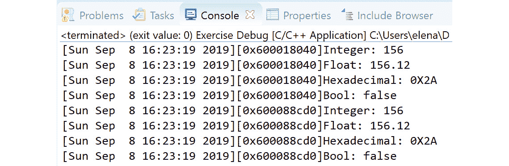

###### 图 6.16：练习 7 的执行结果

## 利用异步 I/O

在许多情况下，I/O 操作可能耗时很长，例如创建备份文件、搜索海量数据库、读取大文件等。你可以使用线程来执行 I/O 操作而不阻塞应用程序的执行。但对于某些应用程序，这并不是处理长时间 I/O 的合适方式，例如每秒可能有数千次 I/O 操作的情况。在这些情况下，C++ 开发者使用异步 I/O。它节省线程资源，并确保执行线程不会被阻塞。让我们来了解什么是同步和异步 I/O。

正如你可能从第 5 章《哲学家的晚餐——线程与并发》中回忆的那样，同步操作意味着某个线程调用该操作并等待其完成。它可以是单线程或多线程应用程序。关键点在于线程在等待 I/O 操作完成。

异步执行发生在操作不阻塞工作线程执行时。执行异步 I/O 操作的线程发送异步请求并继续执行其他任务。当操作完成时，初始线程将收到完成通知，并可根据需要处理结果。

由此看来，异步 I/O 似乎比同步 I/O 好得多，但这取决于具体情况。如果你需要执行大量快速 I/O 操作，由于处理内核 I/O 请求和信号的开销，遵循同步方式会更合适。因此，在为应用程序开发架构时，你需要考虑所有可能的场景。

标准库不支持异步 I/O 操作。因此，要利用异步 I/O，我们需要考虑替代库或编写自己的实现。首先，让我们考虑平台相关的实现。然后，我们将了解跨平台库。

## Windows 平台上的异步 I/O

Windows 支持多种设备的 I/O 操作：文件、目录、驱动器、端口、管道、套接字、终端等。一般来说，我们对所有这些设备使用相同的 I/O 接口，但某些设置因设备而异。让我们来看看 Windows 上的文件 I/O 操作。

在 Windows 中，我们需要打开一个设备并获取其句柄。不同设备的打开方式不同。要打开文件、目录、驱动器或端口，我们使用 `<Windows.h>` 头文件中的 `CreateFile` 函数。要打开管道，我们使用 `CreateNamedPipe` 函数。要打开套接字，我们使用 `socket()` 和 `accept()` 函数。要打开终端，我们使用 `CreateConsoleScreenBuffer` 和 `GetStdHandle` 函数。它们都返回一个设备句柄，用于该设备的所有操作函数中。


## CreateFile 函数

`CreateFile` 函数接受七个参数，用于管理与打开设备的交互工作。函数声明如下：

```cpp
HANDLE CreateFile(
    PCTSTR pszName,
    DWORD dwDesiredAccess,
    DWORD dwShareMode,
    PSECURITY_ATTRIBUTES psa,
    DWORD dwCreationDisposition,
    DWORD dwFlagsAndAttributes,
    HANDLE hFileTemplate
);
```

第一个参数是 `pszName` – 文件的路径。第二个参数 `dwDesiredAccess` 管理对设备的访问权限。它可以取以下值之一：

- `0` // 仅用于配置更改
- `GENERIC_READ` // 仅读取
- `GENERIC_WRITE` // 仅写入
- `GENERIC_READ | GENERIC_WRITE` // 读取和写入均可

第三个参数 `dwShareMode` 管理当文件已打开时，操作系统应如何处理所有新的 `CreateFile` 调用。它可以取以下值之一：

- `0` // 同一时间只能有一个应用程序打开设备
- `FILE_SHARE_READ` // 允许多个应用程序同时读取
- `FILE_SHARE_WRITE` // 允许多个应用程序同时写入
- `FILE_SHARE_READ | FILE_SHARE_WRITE` // 允许多个应用程序同时读取和写入
- `FILE_SHARE_DELETE` // 允许多个应用程序同时移动或删除

第四个参数 `psa` 通常设置为 `NULL`。第五个参数 `dwCreationDisposition` 管理是打开文件还是创建文件。它可以取以下值之一：

- `CREATE_NEW` // 创建新文件，如果文件已存在则失败
- `CREATE_ALWAYS` // 创建新文件，如果文件已存在则覆盖
- `OPEN_EXISTING` // 打开现有文件，如果文件不存在则失败
- `OPEN_ALWAYS` // 打开或创建文件
- `TRUNCATE_EXISTING` // 打开现有文件并将其截断为零字节，如果文件不存在则失败

第六个参数 `dwFlagsAndAttributes` 管理缓存或文件操作方式。对于管理缓存，它可以取以下值之一：

- `FILE_FLAG_NO_BUFFERING` // 不使用缓存
- `FILE_FLAG_SEQUENTIAL_SCAN` // 告知操作系统将按顺序读取文件
- `FILE_FLAG_RANDOM_ACCESS` // 告知操作系统将不按顺序读取文件（随机访问）
- `FILE_FLAG_WRITE_THROUGH` // 写入不使用缓存但读取使用（直写）

对于管理文件操作，它可以取以下值之一：

- `FILE_FLAG_DELETE_ON_CLOSE` // 关闭后删除文件（用于临时文件）
- `FILE_FLAG_BACKUP_SEMANTICS` // 用于备份和恢复程序
- `FILE_FLAG_POSIX_SEMANTICS` // 用于在创建或打开文件时设置区分大小写
- `FILE_FLAG_OPEN_REPARSE_POINT` // 允许以不同方式打开、读取、写入和关闭文件（打开重解析点）
- `FILE_FLAG_OPEN_NO_RECALL` // 防止系统从归档介质恢复文件内容
- `FILE_FLAG_OVERLAPPED` // 允许异步操作设备

对于文件属性，它可以取以下值之一：

- `FILE_ATTRIBUTE_ARCHIVE` // 文件应被删除
- `FILE_ATTRIBUTE_ENCRYPTED` // 文件已加密
- `FILE_ATTRIBUTE_HIDDEN` // 文件隐藏
- `FILE_ATTRIBUTE_NORMAL` // 未设置其他属性
- `FILE_ATTRIBUTE_NOT_CONTENT_INDEXED` // 文件正在被索引服务处理
- `FILE_ATTRIBUTE_OFFLINE` // 文件已转移到归档介质
- `FILE_ATTRIBUTE_READONLY` // 仅读取访问
- `FILE_ATTRIBUTE_SYSTEM` // 系统文件
- `FILE_ATTRIBUTE_TEMPORARY` // 临时文件

最后一个参数 `hFileTemplate` 接受打开文件的句柄或 `NULL` 作为参数。如果传递了文件句柄，`CreateFile` 函数将忽略所有属性和标志，并使用打开文件的属性和标志。

关于 `CreateFile` 参数就介绍到这里。如果无法打开设备，它将返回 `INVALID_HANDLE_VALUE`。以下示例演示如何打开文件以进行读取：

```cpp
#include <iostream>
#include <Windows.h>

int main()
{
    HANDLE hFile = CreateFile(TEXT("Test.txt"), GENERIC_READ,
                              FILE_SHARE_READ | FILE_SHARE_WRITE,
                              NULL, OPEN_ALWAYS, FILE_ATTRIBUTE_NORMAL, NULL);
    if (INVALID_HANDLE_VALUE == hFile)
        std::cout << "Failed to open file for reading" << std::endl;
    else
        std::cout << "Successfully opened file for reading" << std::endl;
    CloseHandle(hFile);
    return 0;
}
```

## ReadFile 函数

接下来，要执行输入操作，我们使用 `ReadFile` 函数。它接受文件描述符作为第一个参数，源缓冲区作为第二个参数，要读取的最大字节数作为第三个参数，读取的字节数作为第四个参数，以及用于同步执行的 `NULL` 值或指向有效且唯一的 `OVERLAPPED` 结构的指针作为最后一个参数。如果操作成功，`ReadFile` 返回 `true`，否则返回 `false`。以下示例演示如何从先前打开的用于读取的文件中输入数据：

```cpp
BYTE pb[20];
DWORD dwNumBytes;
ReadFile(hFile, pb, 20, &dwNumBytes, NULL);
```

## WriteFile 函数

要执行输出操作，我们使用 `WriteFile` 函数。它的声明与 `ReadFile` 相同，但第三个参数设置要写入的字节数，第五个参数是已写入的字节数。以下示例演示如何输出到先前打开的用于写入的文件：

```cpp
BYTE pb[20] = "Some information\0";
DWORD dwNumBytes;
WriteFile(hFile, pb, 20, &dwNumBytes, NULL);
```

## FlushFileBuffers 函数

要将缓存的数据写入设备，请使用 `FlushFileBuffers` 函数。它接受单个参数 – 文件描述符。

## 异步 I/O

让我们转到异步 I/O。要让操作系统知道你计划异步操作设备，你需要使用 `FILE_FLAG_OVERLAPPED` 标志打开它。现在，打开文件进行写入或读取如下所示：

```cpp
#include <iostream>
#include <Windows.h>

int main()
{
    HANDLE hFile = CreateFile(TEXT("Test.txt"), GENERIC_READ,
                              FILE_SHARE_READ | FILE_SHARE_WRITE,
                              NULL, OPEN_ALWAYS, FILE_FLAG_OVERLAPPED, NULL);
    if (INVALID_HANDLE_VALUE == hFile)
        std::cout << "Failed to open file for reading" << std::endl;
    else
        std::cout << "Successfully opened file for reading" << std::endl;
    CloseHandle(hFile);
    return 0;
}
```

我们使用相同的操作来执行文件的读取或写入，即 `ReadFile` 和 `WriteFile`，唯一的区别是读取或写入的字节数设置为 `NULL`，并且我们必须传递一个有效且唯一的 `OVERLAPPED` 对象。

### OVERLAPPED 结构

让我们看看 `OVERLAPPED` 对象的结构：

```cpp
typedef struct _OVERLAPPED {
    DWORD Internal;     // for error code
    DWORD InternalHigh; // for number of read bytes
    DWORD Offset;
    DWORD OffsetHigh;
    HANDLE hEvent;      // handle to an event
} OVERLAPPED, *LPOVERLAPPED;
```

`Internal` 成员被设置为 `STATUS_PENDING`，这意味着操作尚未开始。读取或写入的字节数将被写入 `InternalHigh` 成员。`Offset` 和 `OffsetHigh` 在异步操作中被忽略。`hEvent` 成员用于接收关于异步操作完成的事件。

### 注意

I/O 操作的顺序无法保证，因此你不能依赖这一点。如果你计划在一个位置写入文件，并在另一个位置读取文件，你不能依赖顺序。

在异步模式下使用 `ReadFile` 和 `WriteFile` 有一件不同寻常的事。如果 I/O 请求同步执行，它们将返回非零值。如果它们返回 `FALSE`，你需要调用 `GetLastError` 函数来检查返回 `FALSE` 的原因。如果错误代码是 `ERROR_IO_PENDING`，这意味着 I/O 请求已成功处理，处于挂起状态，稍后将执行。


Finally, remember that the **OVERLAPPED** object or the buffer containing data must not be moved or deleted before the I/O operation completes. A new `OVERLAPPED` object should be created for each I/O operation.

Finally, let's look at the ways the system notifies us of I/O completion. The main mechanisms are: signaling the device, signaling an event, queuing an APC (alert), and using I/O Completion Ports.

## The "Bad" Way

The `WriteFile` and `ReadFile` functions set the device to a non-signaled ("busy") state. Once the I/O operation completes, the driver sets the device to a signaled ("idle") state. We can check if the I/O operation has completed by calling `WaitForSingleObject` or `WaitForMultipleObjects`. The following example demonstrates this approach:

```cpp
#include <Windows.h>
#include <WinError.h>

int main()
{
    HANDLE hFile = CreateFile(TEXT("Test.txt"), GENERIC_READ,
                              FILE_SHARE_READ | FILE_SHARE_WRITE, NULL,
                              OPEN_ALWAYS, FILE_FLAG_OVERLAPPED, NULL);
    BYTE bBuffer[100];
    OVERLAPPED o = { 0 };
    BOOL bResult = ReadFile(hFile, bBuffer, 100, NULL, &o);
    DWORD dwError = GetLastError();
    if (bResult && (dwError == ERROR_IO_PENDING))
    {
        WaitForSingleObject(hFile, INFINITE);
        bResult = TRUE;
    }
    CloseHandle(hFile);
    return 0;
}
```

This is the simplest way to check for I/O completion. However, this method causes the calling thread to wait on the `WaitForSingleObject` call, effectively turning it into a synchronous call. Additionally, you can initiate multiple I/O operations on the device, but you cannot guarantee that the thread will wake up when the desired device is signaled.

## The "Better but Not Best" Way

Remember the last member of the `OVERLAPPED` structure? You can create an event by calling `CreateEvent` and assign it to the `OVERLAPPED` object. When the I/O operation completes, the system calls `SetEvent` to signal the event. Subsequently, when the calling thread needs to retrieve the result of the pending I/O operation, it can call `WaitForSingleObject` passing the event handle. The following example demonstrates this approach:

```cpp
#include <Windows.h>
#include <synchapi.h>

int main()
{
    HANDLE hFile = CreateFile(TEXT("Test.txt"), GENERIC_READ,
                              FILE_SHARE_READ | FILE_SHARE_WRITE,
                              NULL, OPEN_ALWAYS, FILE_FLAG_OVERLAPPED, NULL);
    BYTE bInBuffer[10];
    OVERLAPPED o = { 0 };
    o.hEvent = CreateEvent(NULL, TRUE, FALSE, "IOEvent");
    ReadFile(hFile, bInBuffer, 10, NULL, &o);
    ///// do some work
    HANDLE hEvent = o.hEvent;
    WaitForSingleObject(hEvent, INFINITE);
    CloseHandle(hFile);
    return 0;
}
```

If you want to notify the calling thread of I/O completion, this is a fairly simple method. However, it is not ideal because when there are many such operations, you need to create an event object for each operation.

## Another "Non-Optimal" Way

Alertable I/O works as follows. We call `ReadFileEx` and `WriteFileEx` for input/output. They are similar to the standard `ReadFile` and `WriteFile`, but instead of passing a variable to store the number of bytes read/written, they pass the address of a callback function. This callback function is called a completion routine, and its declaration is as follows:

```cpp
VOID WINAPI CompletionRoutine(DWORD dwError,
                              DWORD dwNumBytes,
                              OVERLAPPED* po);
```

`ReadFileEx` and `WriteFileEx` pass the callback function address to the device driver. When the operation on the device completes, the driver queues the callback function address and a pointer to the `OVERLAPPED` structure to the APC queue. The operating system then calls the function, passing the number of bytes transferred, the error code, and a pointer to the `OVERLAPPED` structure.

The main drawback of this approach is the need to write a callback function, and because the callback context contains little information, it often requires extensive use of global variables. Another reason not to use this method is that only the calling thread can receive the completion notification.

Now that we've covered the bad methods, let's look at the best way to handle I/O results—I/O Completion Ports. I/O Completion Ports are designed to work with thread pools. To create such a port, we use `CreateIoCompletionPort`. Its declaration is as follows:

```cpp
HANDLE CreateIoCompletionPort(HANDLE hFile,
                              HANDLE hExistingCompletionPort,
                              ULONG_PTR CompletionKey,
                              DWORD dwNumberOfConcurrentThreads);
```

This function creates an I/O Completion Port and associates a device with it. To do this, we need to call it twice. The first call to `CreateIoCompletionPort` creates a new completion port: pass `INVALID_HANDLE_VALUE` as the first parameter, `NULL` as the second, `0` as the third, and the number of concurrent threads for the port as the fourth. Passing `0` for the fourth parameter sets the thread count to the number of processors.

> **Note**
>
> For I/O Completion Ports, the recommended number of threads is twice the number of processors.

Next, we need to associate this port with the I/O device. Therefore, we call `CreateIoCompletionPort` a second time, passing the device handle, the created completion port handle, a constant (completion key) indicating a read or write operation on the device, and `0` as the number of threads. Then, when we need to retrieve the completion result, we call `GetQueuedCompletionStatus` on the port handle. If the operation has completed, the function returns the result immediately; otherwise, the thread waits for completion. The following example demonstrates this approach:

```cpp
#include <Windows.h>
#include <synchapi.h>

int main()
{
    HANDLE hFile = CreateFile(TEXT("Test.txt"), GENERIC_READ,
                              FILE_SHARE_READ | FILE_SHARE_WRITE,
                              NULL, OPEN_ALWAYS, FILE_FLAG_OVERLAPPED, NULL);
    HANDLE m_hIOcp = CreateIoCompletionPort(INVALID_HANDLE_VALUE, NULL, 0, 0);
    CreateIoCompletionPort(hFile, m_hIOcp, 1, 0);
    BYTE bInBuffer[10];
    OVERLAPPED o = { 0 };
    ReadFile(hFile, bInBuffer, 10, NULL, &o);
    DWORD dwNumBytes;
    ULONG_PTR completionKey;
    GetQueuedCompletionStatus(m_hIOcp, &dwNumBytes, &completionKey, (OVERLAPPED**) &o, INFINITE);
    CloseHandle(hFile);
    return 0;
}
```

## Asynchronous I/O on Linux

Asynchronous I/O on Linux supports input and output for different devices such as sockets, pipes, and TTYs, **but does not support files**. This sounds strange, but Linux developers believe that file I/O operations are fast enough.

To open an I/O device, we use the `open()` function. Its declaration is as follows:

```c
int open(const char *filename, int flags[, mode_t mode])
```

The first argument is the filename, the second is a bitmask controlling how the file is opened. If the system cannot open the device, `open()` returns `-1`; on success, it returns a file descriptor. Possible flags for the `open` mode are `O_RDONLY`, `O_WRONLY`, and `O_RDWR`.


## 用于异步 I/O 的 POSIX AIO 接口

要执行输入/输出操作，我们使用称为 **aio** 的 **POSIX** 接口。它们有一组定义好的函数，如 `aio_read`、`aio_write`、`aio_fsync` 等。它们用于启动异步操作。要获取执行结果，我们可以使用信号通知或线程实例化。或者，我们也可以选择完全不接收通知。所有这些都在 `<aio.h>` 头文件中声明。

几乎所有这些函数都将 `aiocb` 结构（异步 IO 控制块）作为参数。它控制 IO 操作。该结构的声明如下：

```c
struct aiocb
{
    int aio_fildes;
    off_t aio_offset;
    volatile void *aio_buf;
    size_t aio_nbytes;
    int aio_reqprio;
    struct sigevent aio_sigevent;
    int aio_lio_opcode;
};
```

`aio_fildes` 成员是已打开设备的描述符，而 `aio_offset` 成员是设备中的偏移量，指示读或写操作应在何处进行。`aio_buf` 成员是指向用于读取或写入的缓冲区的指针。`aio_nbytes` 成员是缓冲区的大小。`aio_reqprio` 成员是此 IO 操作执行的优先级。`aio_sigevent` 成员是一个结构，指明调用线程应如何被通知操作完成。`aio_lio_opcode` 成员是 I/O 操作的类型。

以下示例演示如何初始化 `aiocb` 结构：

```cpp
std::string fileContent;
constexpr int BUF_SIZE = 20;
fileContent.resize(BUF_SIZE, 0);

aiocb aiocbObj;
aiocbObj.aio_fildes = open("test.txt", O_RDONLY);

if (aiocbObj.aio_fildes == -1)
{
    std::cerr << "Failed to open file" << std::endl;
    return -1;
}

aiocbObj.aio_buf = const_cast<char*>(fileContent.c_str());
aiocbObj.aio_nbytes = BUF_SIZE;
aiocbObj.aio_reqprio = 0;
aiocbObj.aio_offset = 0;
aiocbObj.aio_sigevent.sigev_notify = SIGEV_SIGNAL;
aiocbObj.aio_sigevent.sigev_signo = SIGUSR1;
aiocbObj.aio_sigevent.sigev_value.sival_ptr = &aiocbObj;
```

这里，我们创建了一个用于读取文件内容的缓冲区，即 `fileContent`。然后，我们创建了一个名为 `aiocbObj` 的 `aiocb` 结构。接下来，我们以只读方式打开一个文件，并检查该操作是否成功。然后，我们设置缓冲区指针和缓冲区大小。缓冲区大小告诉驱动程序应读取或写入多少字节。接着，我们通过将偏移量设置为 0 来指明将从文件开头开始读取。然后，我们将通知类型设置为 `SIGEV_SIGNAL`，这意味着我们希望收到关于操作完成的信号通知。然后，我们设置触发完成通知的信号编号。在本例中，它是 `SIGUSR1`——用户定义的信号。接着，我们将指向 `aiocb` 结构的指针设置给信号处理程序。

在创建并正确初始化 `aiocb` 结构后，我们可以执行输入或输出操作。让我们完成一个练习，以了解如何在 Linux 平台上使用异步 I/O。

## 练习 8：在 Linux 中异步读取文件

在本练习中，我们将开发一个以异步方式从文件读取数据并将读取的数据输出到控制台的应用程序。当执行读取操作时，驱动程序使用触发信号通知应用程序。要完成此练习，请执行以下步骤：

### 步骤 1：包含所需头文件

包含所有必需的头文件：`<aio.h>` 用于异步读写支持，`<signal.h>` 用于信号支持，`<fcntl.h>` 用于文件操作，`<unistd.h>` 用于符号常量支持，`<iostream>` 用于终端输出，`<chrono>` 用于时间选项，以及 `<thread>` 用于线程支持：

```cpp
#include <aio.h>
#include <signal.h>
#include <fcntl.h>
#include <unistd.h>
#include <iostream>
#include <chrono>
#include <thread>
```

### 步骤 2：创建完成标志

创建一个名为 `isDone` 的 `bool` 变量，用于指示操作何时完成：

```cpp
bool isDone{};
```

### 步骤 3：定义信号处理程序

定义将作为我们的信号处理程序的函数，即 `aioSigHandler`。当异步操作完成时将调用它。信号处理程序应具有以下签名：

```cpp
void name(int number, siginfo_t* si, void* additional)
```

第一个参数是信号编号，第二个参数是一个包含信号产生原因信息的结构，最后一个参数是附加信息。它可以转换为 `ucontext_t` 结构的指针，以便我们可以接收被该信号中断的线程上下文。

在 `aioSigHandler` 中，使用 `SI_ASYNCIO` 检查关于异步 I/O 操作的信号是否为常量。如果是，则输出一条消息。接着，将 `isDone` 设置为 `true`：

```cpp
void aioSigHandler(int no, siginfo_t* si, void*)
{
    std::cout << "Signo: " << no << std::endl;
    if (si->si_code == SI_ASYNCIO)
    {
        std::cout << "I/O completion signal received" << std::endl;
    }
    isDone = true;
}
```

### 步骤 4：初始化信号动作

定义另一个名为 `initSigAct` 的辅助函数。它将初始化 `sigaction` 结构。该结构定义在 I/O 操作完成时发送哪个信号以及应调用哪个处理程序。这里我们选择 `SIGUSR1`——一个用户定义的信号。在 `sa_flags` 中，设置我们希望在动作重启或接收到信息时传递此信号：

```cpp
bool initSigAct(struct sigaction& item)
{
    item.sa_flags = SA_RESTART | SA_SIGINFO;
    item.sa_sigaction = aioSigHandler;
    if (-1 == sigaction(SIGUSR1, &item, NULL))
    {
        std::cerr << "sigaction usr1 failed" << std::endl;
        return false;
    }
    std::cout << "Successfully set up a async IO handler to SIGUSR1 action" << std::endl;
    return true;
}
```

### 步骤 5：填充 AIO 控制块

定义名为 `fillAiocb` 的辅助函数，它使用给定参数填充 `aiocb` 结构。它将接受 `aiocb` 结构的引用、文件描述符、缓冲区指针和缓冲区大小作为参数。将 `sigev_signo` 设置为 `SIGUSR1`，这是我们之前初始化的：

```cpp
void fillAiocb(aiocb& item, const int& fileDescriptor,
               char* buffer, const int& bufSize)
{
    item.aio_fildes = fileDescriptor;
    item.aio_buf = static_cast<void*>(buffer);
    item.aio_nbytes = bufSize;
    item.aio_reqprio = 0;
    item.aio_offset = 0;
    item.aio_sigevent.sigev_notify = SIGEV_SIGNAL;
    item.aio_sigevent.sigev_signo = SIGUSR1;
    item.aio_sigevent.sigev_value.sival_ptr = &item;
}
```

### 步骤 6：主函数 - 缓冲区分配

进入 `main` 函数。定义一个名为 `buf_size` 的变量，用于保存缓冲区大小。创建该大小的缓冲区：

```cpp
constexpr int bufSize = 100;
char* buffer = new char(bufSize);

if (!buffer)
{
    std::cerr << "Failed to allocate buffer" << std::endl;
    return -1;
}
```

### 步骤 7：打开文件

创建一个名为 `fileName` 的变量，保存名为 `Test.txt` 的文件。然后，以只读方式打开此文件：

```cpp
const std::string fileName("Test.txt");
int descriptor = open(fileName.c_str(), O_RDONLY);

if (-1 == descriptor)
{
    std::cerr << "Failed to opene file for reading" << std::endl;
    return -1;
}

std::cout << "Successfully opened file for reading" << std::endl;
```

### 步骤 8：初始化信号动作

创建一个 `sigaction` 结构并使用 `initSigAct` 函数初始化它：

```cpp
struct sigaction sa;
if (!initSigAct(sa))
{
    std::cerr << "failed registering signal" << std::endl;
    return -1;
}
```

### 步骤 9：初始化 AIO 控制块

创建一个 `aiocb` 结构并使用 `fillAiocb` 函数初始化它：

```cpp
aiocb aiocbObj;
fillAiocb(aiocbObj, descriptor, buffer, bufSize);
```


## 练习 8：Linux 系统中的异步 I/O

### 步骤 11：使用 `aio_read()` 函数执行 **读取** 操作

```
if (-1 == aio_read(&aiocbObj))
{
    std::cerr << "aio_read failed" << std::endl;
}
```

### 步骤 12：在循环中评估 `isDone` 变量

接下来，在循环中评估 `isDone` 变量。如果它是 `false`，则让线程休眠 **3ms**。通过这样做，我们将等待 I/O 操作完成：

```
while (!isDone)
{
    using namespace std::chrono_literals;
    std::this_thread::sleep_for(3ms);
}

std::cout << "Successfully finished read operation. Buffer: " << std::endl << buffer;
```

### 步骤 13：创建 `Test.txt` 文件

在运行此练习之前，在项目目录中创建一个 **Test.txt** 文件并写入不同的符号。例如，我们的文件包含以下数据：

```
a1a"1 a1\a1 a1 a1
a1a"1 a1\a1 a1 a1
a1a"1 a1\a1 a1 a1
a1a"1 a1\a1 a1 a1
a1a"1 a1\a1 a1 a1
a1a"1 a1\a1 a1 a1
a1a"1 a1\a1 a1 a1
a1a"1 a1\a1 a1 a1
a1a"1 a1\a1 a1 a1
a1a"1 a1\a1 a1 a1
a1a"1 a1\a1 a1 a1
a1a"1 a1\a1 a1 a1
a1a"1 a1\a1 a1 a1
a1a"1 a1\a1 a1 a1
```

这里包含字母字符、数字字符、特殊符号、空格、制表符和换行符。

### 步骤 14：构建并运行

现在，在您的 IDE 中构建并运行此练习。您的输出将类似于以下内容：

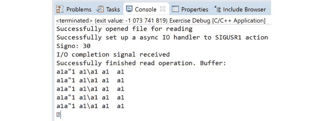

**图 6.17：** 执行练习 8 的结果

您可以看到文件已成功打开以供读取，并且我们成功设置了 `SIGUSR1` 信号及其处理程序。然后，我们接收到了信号编号 30，即 `SI_ASYNCIO` 信号。最后，我们可以输出读取的内容并将其与文件内容进行比较。通过这样做，我们可以确保所有数据都已正确读取。

这就是 Linux 系统中异步 I/O 的全部内容。

> **注意**
>
> 您可以通过访问 Linux 的手册页来查找有关 Linux 中异步 I/O 的更多信息：<http://man7.org/linux/man-pages/man7/aio.7.html>。

现在，让我们了解一下可用于跨平台应用程序的工具。

### 异步跨平台 I/O 库

我们已经探讨了针对异步 I/O 的特定平台决策。现在，要编写跨平台应用程序，您可以使用这些特定平台的方法，并结合预处理指令来使用它们；例如：

```
#ifdef WIN
#include <WinAIO.hpp>
#else
#include <LinAIO.hpp>
#endif
```

在两个头文件中，您可以为特定平台的实现声明相同的接口。您也可以实现自己的 AIO 库，它将在单独的线程中使用某些状态机或队列。此外，您还可以使用一些实现了必要功能的免费库。最流行的库是 **Boost.Asio**。它为异步工作提供了大量接口，例如以下内容：

- 无线程并发
- 线程
- 缓冲区
- 流
- 协程
- TCP、UDP 和 ICMP
- 套接字
- SSL
- 定时器
- 串口

让我们简要了解一下其用于 I/O 操作的接口。我们可以使用 **Asio** 库的接口进行同步和异步操作。所有 I/O 操作都从 `io_service` 类开始，该类提供核心 I/O 功能。它在 `<boost/asio/io_service.hpp>` 头文件中声明。同步 I/O 调用 `io_service` 对象的 `run()` 函数执行单个操作，该操作会阻塞调用线程直到作业完成。异步 I/O 使用 `run()`、`run_one()`、`poll()` 和 `poll_one()` 函数。`run()` 函数运行事件循环以处理请求处理程序。`run_one()` 函数执行相同操作，但事件循环应仅处理一个处理程序。`poll()` 函数运行事件循环以执行所有就绪的处理程序。`poll_one()` 执行相同操作但仅针对一个处理程序。以下示例演示了所有这些函数的用法：

```
boost::asio::io_service io_service1;
io_service1.run();

boost::asio::io_service io_service2;
io_service2.run_one();

boost::asio::io_service io_service3;
io_service3.poll();

boost::asio::io_service io_service4;
io_service4.poll_one();
```

可以在实际 I/O 操作被调用之前运行事件处理程序。将 `work` 类与 `io_service` 类结合使用，可在代码中实现此功能。`work` 类保证 `run()` 函数不会返回，直到您确定不会有未来的 I/O 操作。例如，您可以使 `work` 类成为另一个类的成员，并在析构函数中移除它。因此，在您的类的生命周期内，`io_service` 将保持运行：

```
boost::asio::io_service io_service1;
boost::asio::io_service::work work(io_service1);
io_service1.run();

boost::asio::io_service io_service2;
boost::asio::io_service::work work(io_service2);
io_service2.poll();
```

接下来，要执行任何 I/O 操作，我们需要确切的 I/O 设备，例如文件、套接字等。有许多类实现了与不同 I/O 设备的交互，例如来自 `<boost/asio/ip/tcp.hpp>` 头文件的 `boost::asio::ip::tcp::socket`。接下来，要对套接字进行读写，我们使用 `boost::asio::async_read` 和 `boost::asio::async_write`。它们接受一个套接字、`boost::asio::buffer` 和回调函数作为参数。当异步操作执行时，将调用回调函数。我们可以传递一个 lambda 函数作为回调函数，或使用 `boost::bind` 函数绑定一个现有函数。`boost::bind` 创建一个可调用对象。以下示例演示了如何使用 **Boost.Asio** 向套接字写入数据：

```
boost::asio::io_service ioService;
tcp::socket socket;
int length = 15;
char* msg = new char(length);
msg = "Hello, world!";

auto postHandler = []()
{
    auto writeHandler = [](boost::system::error_code ec, std::size_t length)
    {
        if (ec)
        {
            socket_.close();
        }
        else
        {
            // wrote length characters
        }
    };
    boost::asio::async_write(socket, boost::asio::buffer(msg, length), writeHandler);
};

ioService.post(postHandler);
```

这里，我们使用 lambda 函数作为异步 I/O 操作的回调。

> **注意**
>
> **Boost.Asio** 在 <https://www.boost.org/doc/libs/1_63_0/doc/html/boost_asio.html> 有详细的文档。其中包含大量针对不同 I/O 设备和不同方法的示例。如果您决定在项目中使用 **Boost.Asio**，可以参考此文档。

在这里，我们探讨了实现异步 I/O 操作的不同方法。根据您的需求、环境和允许使用的工具，您可以选择适合在应用程序中实现异步 I/O 的方式。请记住，如果您选择执行许多快速 I/O 操作，最好以同步方式进行，因为这不会占用大量系统资源。现在我们已经了解了如何利用异步 I/O，让我们学习如何在多线程应用程序中使用 I/O。

### 线程与 I/O 的交互

I/O 标准库不是线程安全的。在标准库的文档中，我们可以找到这样的解释：并发访问流或流缓冲区可能导致数据竞争，从而导致未定义行为。为避免这种情况，我们应该使用在 *第 5 章* *《哲学家进餐——线程与并发》* 中学到的技术来同步对流和缓冲区的访问。

让我们稍微谈谈 `std::cin` 和 `std::cout` 对象。对它们的每次调用都是线程安全的，但让我们考虑以下示例：

```
std::cout << "Counter: " << counter << std::endl;
```

在这一行中，我们看到 `std::cout` 被调用了一次，但对移位运算符的每次调用实际上都是对 `std::cout` 对象的不同调用。因此，我们可以将此行重写如下：

```
std::cout << "Counter: ";
```


## 练习 9：为 `std::cout` 开发线程安全包装器

```cpp
std::cout << counter;
std::cout << std::endl;
```

这段代码与之前的单行代码作用完全相同；也就是说，如果你从不同线程调用这单行代码，你的输出将会混杂且不清晰。你可以像下面这样修改它，使其真正实现线程安全：

```cpp
std::stringstream ss;
ss << "Counter: " << counter << std::endl;
std::cout << ss.str();
```

因此，如果你使用第二种方法输出到终端，你的输出将会清晰且线程安全。此行为可能因编译器或标准库版本而异。你还必须知道 `std::cout` 和 `std::cin` 是相互同步的。这意味着调用 `std::cout` 总会刷新 `std::cin` 流，而调用 `std::cin` 总会刷新 `std::cout` 流。

最佳方法是将所有 I/O 操作封装在一个防护类中，该类使用 `mutex`（互斥量）控制对流的访问。如果你需要从多个线程使用 `std::cout` 输出到终端，你可以实现一个非常简单的类，它仅做一件事：锁定 `mutex` 并调用 `std::cout`。让我们完成一个练习并创建这样一个类。

在本练习中，我们将开发一个简单的 `std::cout` 包装器，以产生线程安全的输出。我们将编写一个小的测试函数来检查其工作原理。让我们开始并执行以下步骤：

### 1. 包含所有必需的头文件

```cpp
#include <iostream> // 用于 std::cout
#include <thread>   // 用于 std::thread
#include <mutex>    // 用于 std::mutex
#include <sstream>  // 用于 std::ostringstream
```

现在，让我们思考一下我们的包装器。我们可以在某处创建该类的一个变量并将其传递给每个创建的线程。然而，这是一个糟糕的决定，因为在复杂的应用程序中，这将耗费大量精力。我们也可以将其作为单例模式实现，以便从任何地方访问它。接下来，我们必须考虑类的内容。实际上，我们可以使用在*练习 7*、*继承标准流对象*中创建的类。在该练习中，我们重载了 `std::basic_streambuf` 和 `std::basic_ostream` 并将 `std::cout` 设置为输出设备。我们可以向重载函数添加一个 `mutex` 并原样使用它。请注意，我们不需要任何额外的逻辑——只需使用 `std::cout` 输出数据。为此，我们可以创建一个更简单的类。如果我们没有设置输出设备，应用左移运算符将不会生效，并会将待输出的数据存储在内部缓冲区中。太棒了！现在，我们需要考虑如何获取此缓冲区并使用 `std::cout` 进行输出。

### 2. 实现 `write()` 函数

实现一个诸如 `write()` 的函数，它将锁定一个 `mutex` 并从内部缓冲区输出到 `std::cout`。该函数的用法如下所示：

```cpp
mtcout cout;
cout << msg << std::endl;
cout.write();
```

### 3. 使用析构函数

我们有一个总会被自动调用的函数，我们可以将 `write` 函数的代码放入其中：析构函数。在这种情况下，我们将创建和销毁合并为单行。此类对象的用法将如下所示：

```cpp
mtcout{} << msg << std::endl;
```

### 4. 定义 `mtcout` 类

现在，让我们定义我们的 `mtcout`（多线程 cout）类。它有一个公有的默认构造函数。在私有部分，它有一个静态 `mutex` 变量。正如你可能记得的，静态变量在该类的所有实例间共享。在析构函数中，我们锁定 `mutex` 并使用 `std::cout` 进行输出。为输出添加一个前缀——当前线程的 ID 和一个空格字符：

```cpp
class mtcout : public std::ostringstream
{
public:
    mtcout() = default;
    ~mtcout()
    {
        std::lock_guard<std::mutex> lock(m_mux);
        std::cout << std::this_thread::get_id() << " " << this->str();
    }

private:
    static std::mutex m_mux;
};
```

### 5. 声明 `mutex` 变量

接下来，在类外部声明 `mutex` 变量。我们这样做是因为必须在某个源文件中声明静态变量：

```cpp
std::mutex mtcout::m_mux;
```

### 6. 创建测试 Lambda 表达式

进入 `main` 函数。创建一个名为 `func` 的 Lambda 表达式。它将测试我们的 `mtcout` 类。它接受一个字符串作为参数，并使用 `mtcout` 在循环中从 `0` 到 `1000` 输出该字符串。添加相同的使用 `std::cout` 的输出并将其注释掉。比较这两种情况下的输出：

```cpp
auto func = [](const std::string msg)
{
    using namespace std::chrono_literals;
    for (int i = 0; i < 1000; ++i)
    {
        mtcout{} << msg << std::endl;
        // std::cout << std::this_thread::get_id() << " " << msg << std::endl;
    }
};
```

### 7. 创建并连接线程

创建四个线程并将 Lambda 函数作为参数传递。向每个线程传递不同的字符串。最后，连接所有四个线程：

```cpp
std::thread thr1(func, "111111111");
std::thread thr2(func, "222222222");
std::thread thr3(func, "333333333");
std::thread thr4(func, "444444444");

thr1.join();
thr2.join();
thr3.join();
thr4.join();
```

### 8. 首次运行

首次构建并运行练习。你将获得以下输出：

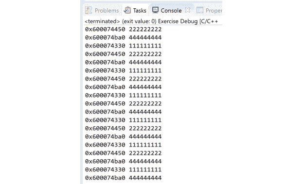

**图 6.18：练习 9 第 1 部分的执行结果**

在这里，我们可以看到每个线程输出其自己的消息。该消息未被打断，输出看起来很清晰。

### 9. 第二次运行（取消注释 `std::cout`）

现在，取消注释 Lambda 表达式中使用 `std::cout` 的输出，并注释掉使用 `mtcout` 的输出。

### 10. 观察混杂输出

再次构建并运行应用程序。现在，你将获得“脏”的、混杂的输出，如下所示：

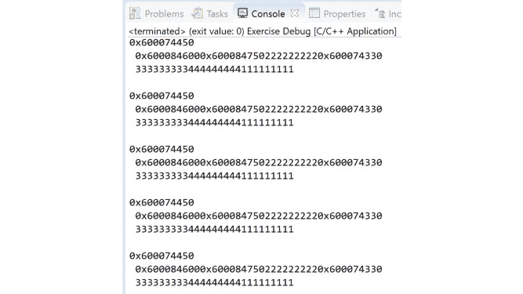

**图 6.19：练习 9 第 2 部分的执行结果**

你可以看到这种混杂输出，因为我们没有输出单个字符串；相反，我们调用了 `std::cout` 四次：

```cpp
std::cout << std::this_thread::get_id();
std::cout << " ";
std::cout << msg;
std::cout << std::endl;
```

当然，我们可以在输出前格式化字符串，但使用 `mtcout` 类更方便，无需担心格式化。你可以为任何流创建类似的包装器，以便安全地执行 I/O 操作。你可以更改输出并添加任何额外信息，例如当前线程的 ID、时间或任何你需要的内容。运用我们在*第 5 章*、*哲学家进餐——线程与并发*中学到的知识，来同步 I/O 操作、扩展流，并使输出更符合你的需求。

## 使用宏

在本章的活动中，我们将使用宏定义来简化和美化代码，所以让我们复习一下如何使用它们。宏定义是预处理器指令。宏定义的语法如下：

```cpp
#define [name] [expression]
```

这里，`[name]` 是任何有意义的名称，`[expression]` 是任何小函数或值。

当预处理器遇到宏名称时，它会用表达式替换它。例如，假设你有以下宏：

```cpp
#define MAX_NUMBER 15
```

然后，你在代码的几个地方使用它：

```cpp
if (val < MAX_NUMBER)
while (val < MAX_NUMBER)
```

当预处理器完成工作后，代码将变为如下：

```cpp
if (val < 15)
while (val < 15)
```

预处理器对函数执行相同的工作。例如，假设你有一个用于获取最大数的宏：

```cpp
#define max(a, b) a < b ? b : a
```

然后，你在代码的几个地方使用它：

```cpp
int res = max(5, 3);
std::cout << (max(a, b));
```

当预处理器完成工作后，代码将变为如下：

```cpp
int res = 5 < 3 ? 3 : 5;
std::cout << (a < b ? b : a);
```


作为表达式，您可以使用任何有效的表达式，例如函数调用、内联函数、值等。如果需要在多行中编写表达式，请使用反斜杠运算符 `\\`。例如，`max` 的定义可以写成两行，如下所示：

```
#define max(a, b) \
a < b ? b : a
```

#### 注意

宏定义源自 C 语言。最好使用 `const` 变量或内联函数代替。然而，在某些情况下使用宏定义更方便，例如在日志记录器中，当您希望定义不同的日志级别时。

现在，我们已经掌握了完成该活动所需的一切知识。那么，让我们总结一下本章学到的内容，并改进我们在 *第 5 章*、*“哲学家进餐——线程与并发”* 中编写的项目。我们将开发一个线程安全的日志记录器并将其集成到项目中。

### 活动 1：艺术画廊模拟器的日志系统

在本活动中，我们将开发一个将格式化日志输出到终端的日志记录器。我们将按以下格式输出日志：

```
[dateTtime][threadId][logLevel][file:line][function] | message
```

我们将为不同的日志级别实现宏定义，这些宏定义将替代直接的函数调用。该日志记录器将是线程安全的，我们将从不同的线程同时调用它。最后，我们将其集成到项目——艺术画廊模拟器中。我们将运行模拟并观察美观打印的日志。我们将创建额外的流，使用带有并发的流，并格式化输出。我们将实现本章学到的几乎所有内容。我们还将采用上一章的同步技术。

因此，在尝试本活动之前，请确保您已完成本章的所有先前练习。

在实现此应用程序之前，让我们描述一下我们的类。我们有以下新创建的类：

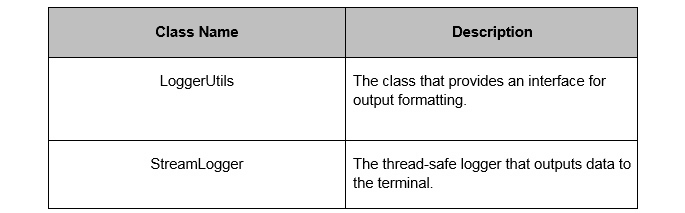

###### 图 6.20：待实现类的说明

我们在艺术画廊模拟器项目中也有以下已实现的类：

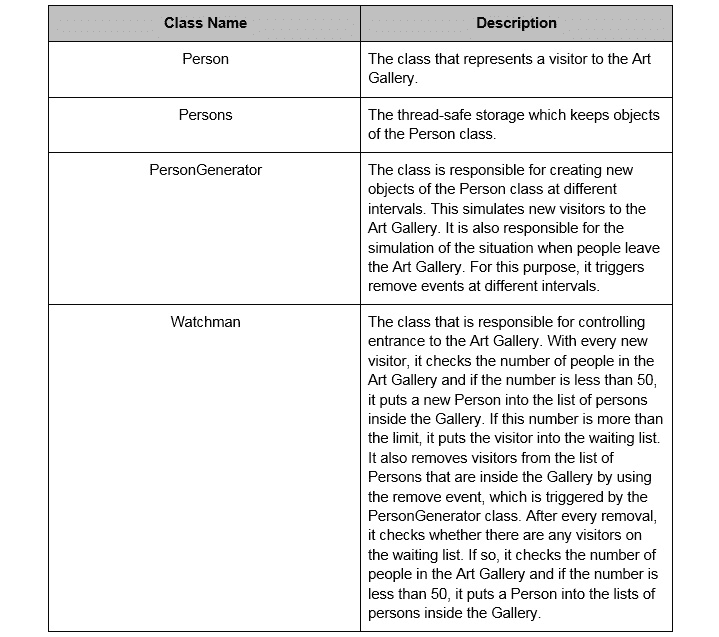

###### 图 6.21：艺术画廊模拟器项目中已实现类的表格

让我们在开始实现之前将新类添加到类图中。所有描述的类及其关系组成在以下图表中：

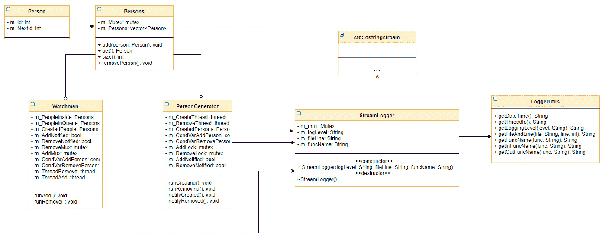

###### 图 6.22：类图

为了按所需格式接收输出，**LoggerUtils** 类应具有以下 **static** 函数：

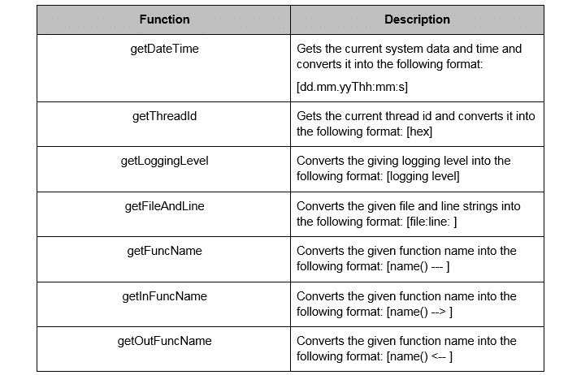

###### 图 6.23：LoggerUtils 成员函数说明

请遵循以下步骤完成此活动：

1.  定义并实现 **LoggerUtils** 类，该类提供输出格式化的接口。它包含将给定数据格式化为所需表示形式的静态变量。

2.  定义并实现 **StreamLogger** 类，该类提供向终端输出的线程安全接口。它应按如下方式格式化输出：

    ```
    [dateTtime][threadId][logLevel][file:line: ][function] | message
    ```

3.  在单独的头文件中，声明不同日志级别的宏定义，这些宏定义返回 **StreamLogger** 类的临时对象。

4.  将实现的日志记录器集成到艺术画廊模拟器的类中。

5.  使用适当的宏定义调用替换所有 **std::cout** 的调用。

实现上述步骤后，您应该会在终端上看到关于所有已实现类的日志输出。查看并确保日志按所需格式输出。预期输出应如下所示：

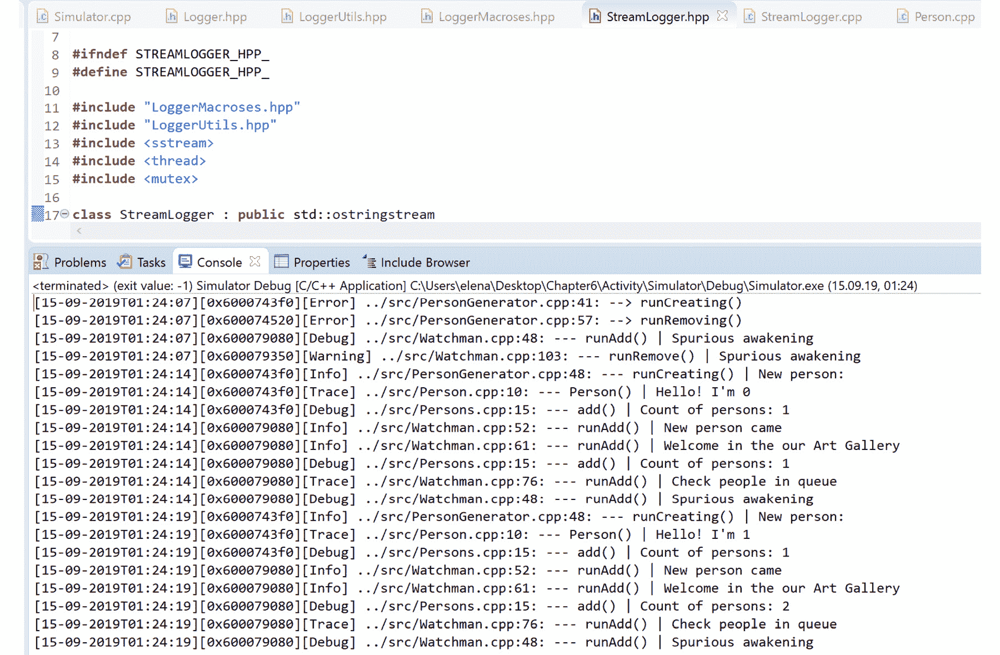

###### 图 6.24：应用程序执行结果

#### 注意

此活动的解决方案可在第 696 页找到。

## 总结

在本章中，我们学习了 C++ 中的 I/O 操作。我们考察了提供同步 I/O 操作接口的 I/O 标准库。此外，我们还考察了用于异步 I/O 的平台相关原生工具，以及用于跨平台异步 I/O 操作的 **Boost.Asio** 库。我们还学习了如何在多线程应用程序中使用 I/O 流。

我们首先查看了标准库为 I/O 操作提供的基本功能。我们了解了预定义的流对象，如 **std::cin** 和 **std::cout**。在实践中，我们学习了如何使用标准流并重写移位运算符，以便轻松读写自定义数据类型。

接下来，我们练习了如何创建额外的流。我们从基本流类继承，实现了自己的流缓冲区类，并在练习中练习了它们的用法。我们了解了最适合继承的流类并考虑了它们的优缺点。

然后，我们考察了不同操作系统上异步 I/O 操作的方法。我们简要考虑了使用名为 **Boost.Asio** 的跨平台 I/O 库，该库为同步和异步操作提供接口。

最后，我们学习了如何在多线程应用程序中执行 I/O 操作。我们通过构建一个多线程日志记录器将所有这些新技能付诸实践。我们创建了一个日志记录器抽象并在艺术画廊模拟器中使用它。结果，我们创建了一个简单、清晰且健壮的日志记录系统，使我们能够轻松地使用日志调试应用程序。总之，我们运用了本章学到的所有内容。

在下一章中，我们将更仔细地研究测试和调试应用程序。我们将从学习断言和安全网开始。然后，我们将练习为接口编写单元测试和模拟测试。之后，我们将在 IDE 中练习调试应用程序：我们将使用断点、观察点和数据可视化。最后，我们将编写一个活动来掌握我们的代码测试技能。
