# 7. 人皆会跌倒，关键在于如何爬起——测试与调试

## 学习目标

本章结束时，您将能够：

*   描述不同类型的断言
*   实现编译时和运行时断言
*   实现异常处理
*   描述并实现单元测试和模拟测试
*   使用断点和观察点调试 C++ 代码
*   在调试器中检查数据变量和 C++ 对象

在本章中，您将学习如何适当地添加断言，添加单元测试用例以使代码按要求运行，并了解调试技术，以便您可以发现代码中的错误并追踪其根本原因。

## 简介

在 **软件开发生命周期**（**SDLC**，Software Development Life Cycle）中，一旦需求收集阶段完成，通常接下来是设计和架构阶段，其中定义了项目的高级流程并将其分解为更小的模块组件。当项目中有许多团队成员时，有必要为每个团队成员明确分配模块的特定部分，并让他们了解自己的需求。这样，他们可以在隔离的环境中独立编写自己的代码部分，并确保其正常工作。一旦他们的工作部分完成，他们可以将自己的模块与其他开发人员的模块集成，并确保整个项目按要求执行。


这一概念也可应用于小型项目，开发人员完全致力于某个需求，将其分解为更小的组件，在隔离环境中开发组件，确保其按计划执行，集成所有小模块以完成项目，最后对其进行测试，以确保整个项目运行正常。

当整个项目集成并执行时，需要进行大量测试。可能会有一个单独的团队（称为**质量保证**，即**QA**）专门执行此任务。与其在项目层面发现问题，不如在每个隔离阶段测试代码，这是一种很好的策略。这种测试需要由负责该模块的开发人员执行。这种测试称为单元测试。在这里，开发人员可以模拟运行该模块所需的环境，并确保他们测试模块中编写的特定功能部分。例如，假设在一个大型项目中，有一个小模块，其功能是解析配置文件并获取设置环境所需的参数。如果解析文件的代码部分将**IP 地址**作为**字符串**获取，则开发人员需要确保其格式为**XXX.XXX.XXX.XXX**，其中**X**是**0**到**9**之间的数字。字符串的长度必须是有限的。

在这里，开发人员可以创建一个测试程序来执行他们的代码部分：解析文件，将**IP 地址**作为字符串提取，并测试其是否采用正确的格式。同样，如果配置有其他需要解析的参数，并且它们需要采用特定格式，如**用户 ID**/**密码**、日志的文件位置或挂载点等，那么所有这些都将成为该模块单元测试的一部分。在本章中，我们将解释**断言**、**安全嵌套**（**异常处理**）、**单元测试**、**模拟**、**断点**、**监视点**和**数据可视化**等技术，以定位错误源并限制其扩大。在下一节中，我们将探讨断言技术。

## 断言

对上述场景使用测试条件将有助于项目更好地开发，因为缺陷将在基础层面被捕获，而不是在后期的 QA 层面。可能会出现这样的场景：即使编写了单元测试用例并成功执行了代码，仍可能发现问题，例如应用程序崩溃、程序意外退出或行为不符合预期。为克服此类场景，通常开发人员会使用调试模式二进制文件来重现问题。**断言**用于确保检查条件，否则将终止程序执行。

这样，问题可以被快速追踪。此外，在**调试模式**下，开发人员可以逐行遍历程序的实际执行过程，检查代码流程是否符合预期，或者变量是否按预期设置并正确访问。有时，如果指针变量未指向有效内存位置，访问它们会导致意外行为。

编写代码时，我们可以检查必要条件是否满足。如果不满足，程序员可能不想继续执行代码。这可以通过断言轻松完成。**断言**是一个宏，用于检查特定条件，如果不符合标准，则调用 abort（停止程序执行）并将错误消息作为**标准错误**打印。这通常是**运行时断言**。也可以在编译时进行断言。我们稍后将讨论这一点。在下一节中，我们将完成一个练习，编写并测试我们的第一个断言。

### 练习 1：编写并测试我们的第一个断言

在此练习中，我们将编写一个函数来解析**IP 地址**并检查其是否有效。根据我们的要求，**IP 地址**将以**XXX.XXX.XXX.XXX**格式作为字符串字面量传递。在此格式中，**X**代表**0**到**9**之间的数字。因此，作为测试的一部分，为了检查正在解析的**字符串**是否正确，我们需要确保该**字符串****非空**且**长度**小于**16**。请遵循以下步骤实现此练习：

1.  创建一个名为 `AssertSample.cpp` 的新文件。

2.  打开文件并编写以下代码以包含头文件：

```
#include <iostream>
#include <cassert>
#include <cstring>

using std::cout;
using std::endl;
```

    在前面的代码中，`#include <cassert>` 表明我们需要包含定义 `assert` 的 `cassert` 文件。

3.  创建一个名为 `checkValidIp()` 的函数，该函数将**IP 地址**作为输入，如果**IP 地址**满足我们的要求，则返回 `true` 值。编写以下代码以定义该函数：

```
bool checkValidIp(const char * ip) {
    assert(ip != NULL);
    assert(strlen(ip) < 16);
    cout << "strlen: " << strlen(ip) << endl;
    return true;
}
```

    这里，`assert(ip != NULL)` 表明 `assert` 宏用于检查传递的 `ip` 变量是否不为 `NULL`。如果为 `NULL`，则会显示错误消息并中止。此外，`assert(strlen(ip) < 16)` 表明 `assert` 用于检查 `ip` 是否为 16 个字符或更少。如果不是，则会显示 `error message` 并中止。

4.  现在，创建一个 `main` 函数，将不同的字符串字面量传递给我们的 `checkValidIp()` 函数，并确保能对其进行适当测试。为 `main` 函数编写以下代码：

```
int main() {
    const char * ip;
    ip = NULL;
    bool check = checkValidIp(ip);
    cout << " IP address is validated as :" << (check ? "true" : "false") << endl;
    return 0;
}
```

    在前面的代码中，我们故意将 `NULL` 传递给 `ip` 变量，以确保调用 `assert`。

5.  打开`命令提示符`并转到存储 `AssertSample.cpp` 文件的位置。通过键入以下命令，使用 `g++` 编译器对其进行编译：

`g++ AssertSample.cpp`

    使用此命令将生成 `a.out` 二进制文件。

6.  在编译器中键入以下命令以运行 `a.out` 二进制文件：

`./a.out`

    您将看到以下输出：

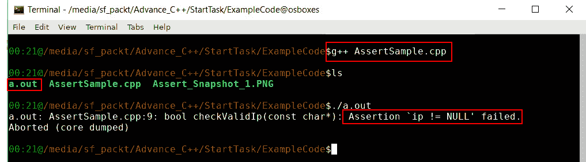

###### 图 7.1：在命令提示符上运行断言二进制文件

    在前面的屏幕截图中，您可以看到三个用红圈标出的代码部分。第一个高亮部分显示 `.cpp` 文件的编译过程。第二个高亮部分显示前面编译生成的 `a.out` 二进制文件。第三个高亮部分显示断言因传递 `NULL` 值而抛出错误。它指示调用断言的行号和函数名。

7.  现在，在 `main` 函数内部，我们将传递长度大于 `16` 的 `ip`，并检查 `assert` 是否也会在此处被调用。编写以下代码以实现此功能：

`ip = "111.111.111.11111";`

    再次打开编译器，编译 `.cpp` 文件，并运行生成的二进制文件。编译器中将显示以下输出：

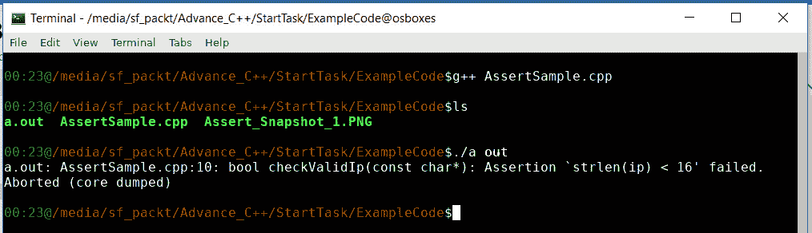

###### 图 7.2：在命令提示符上运行断言二进制文件

    在前面的屏幕截图中，断言抛出错误，因为传递的 `ip` 长度大于 `16`。

8.  现在，为了满足 `assert` 条件以使二进制文件正常运行，我们需要更新 `main` 函数内 `ip` 的值。编写以下代码以执行此操作：

`ip = "111.111.111.111";`


再次打开编译器，编译`.cpp`文件，并运行生成的二进制文件。编译器中显示以下输出：

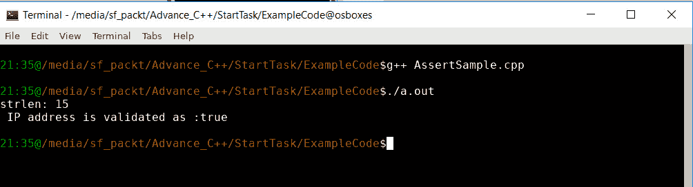

**图 7.3：在命令提示符上运行断言二进制文件**

#### 注意

由于我们仅处理`assert`，因此未向`checkValidIP()`函数添加任何额外功能。不过，我们将在*异常处理*和*单元测试*章节中使用相同的示例，并为函数添加更多功能。

9. 如果不希望可执行文件因生产环境或发布环境中的`assert`而中止，请从代码中移除`assert`宏调用。首先，将`ip`的值更新为长度大于`16`的值。向文件添加以下代码：

    `ip = "111.111.111.11111";`

10. 现在，在编译期间传递`-DNDEBUG`宏。这将确保二进制文件中不调用`assert`。在终端中输入以下命令来编译`.cpp`文件：

    ```
    g++ -DNDEBUG AssertSample.cpp
    ```

    执行二进制文件后，将生成以下输出：

    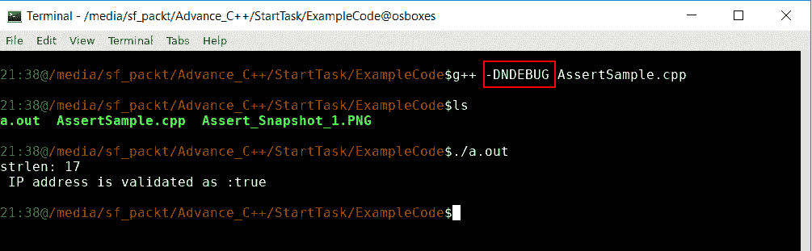

**图 7.4：在命令提示符上运行断言二进制文件**

在前面的屏幕截图中，由于未调用`assert`，将显示字符串长度为`17`，IP 地址验证通过，显示`true`值。在本练习中，我们看到执行二进制文件时会调用断言。我们也可以在代码编译期间进行断言。这在 C++11 中引入，称为**静态断言**，我们将在下一节中探讨。

### 静态断言

有时我们可以在编译时进行条件检查，以避免未来的错误。例如，在项目中，我们可能会使用一个在其中声明了某些数据结构的第三方库。我们从其头文件中了解该结构的信息，如其`size`和`member variables`。利用这些信息，我们可以正确地分配或释放内存，并操作其成员变量。不同版本的第三方库中，该结构的属性可能会发生变化。然而，如果我们的项目代码仍在使用早期版本的结构，则在使用时会产生问题。我们可能在稍后运行二进制文件时收到错误。我们可以使用**静态断言**在编译时捕获此错误。我们可以比较静态数据，如库的版本号，从而确保我们的代码不会面临任何问题。在下一节中，我们将根据此内容完成一个练习。

### 练习 2：测试静态断言

在本练习中，我们将通过**静态断言**比较两个头文件的版本号。如果**版本号**小于`1`，则会抛出静态断言错误。执行以下步骤实现此练习：

1. 创建一个名为`PersonLibrary_ver1.h`的头文件，并添加以下代码：

    ```
    #ifndef __PERSON_H__
    #define __PERSON_H__
    #include<string>
    using std::string;
    #define PERSON_LIB_VERSION 1
    struct person{
        string name;
        int age;
        string address;
    };
    #endif
    ```

    在前面的代码中，定义了`struct person`，包含以下属性：`name`、`age` 和 `address`。它还具有版本号`1`。

2. 创建另一个名为`PersonLibrary_ver2.h`的头文件，并添加以下代码：

    ```
    #ifndef __PERSON_H__
    #define __PERSON_H__
    #include<string>
    using std::string;
    #define PERSON_LIB_VERSION 2
    struct person{
        string name;
        int age;
        string address;
        string Mobile_No;
    };
    #endif
    ```

    在前面的代码中，定义了`struct person`，包含以下属性：`name`、`age`、`address` 和 `Mobile_No`。它还具有**版本号 2**。现在，**版本 1** 是旧版本，**版本 2** 是新版本。以下是两个头文件并排的屏幕截图：

    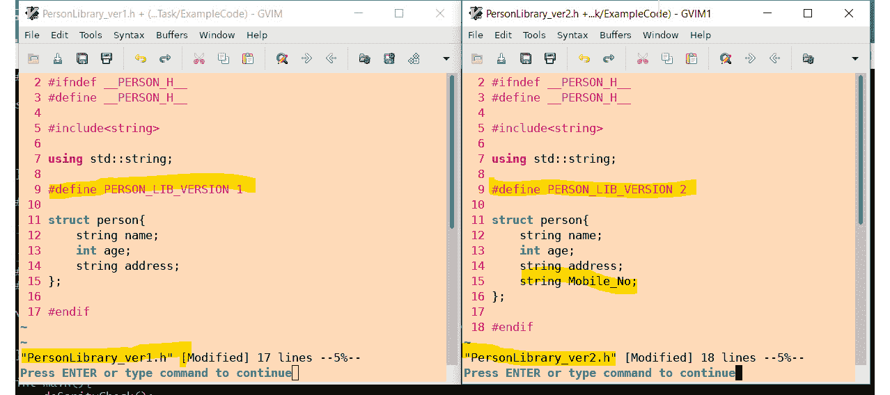

    **图 7.5：具有不同版本的库文件**

3. 创建一个名为`StaticAssertionSample.cpp`的文件，并添加以下代码：

    ```
    #include<iostream>
    #include"PersonLibrary.h"
    void doSanityCheck(){
        static_assert(PERSON_LIB_VERSION > 1 , "PERSON LIBRARY VERSION not greater than 1");
        // Do any more sanity check before starting app ...
    }
    int main(){
        doSanityCheck();
        return 0;
    }
    ```

    在前面的代码中，我们在构建和执行项目前对项目进行完整性检查。我们创建了一个名为`doSanityCheck()`的函数，用于对库执行版本检查。这是使用静态断言完成的，并在编译时执行。代码的第二行显示包含了`PersonLibrary.h`文件。在`doSanityCheck()`函数内部，`static_assert()`函数检查库的版本是否大于 `1`。

    #### 注意

    如果您的项目需要库中定义的**版本 2** 或更高版本的`struct person`才能正确执行，则需要与**版本 2** 匹配的文件，即`PERSON_LIB_VERSION`至少应设置为`2`。如果开发者获得了库的**版本 1** 并尝试为项目创建二进制文件，可能会导致执行时出现问题。为避免这种情况，在项目的主代码中，我们会在构建和执行前对项目进行完整性检查。

4. 要在`.cpp`文件中包含库的**版本 1**，请打开终端并输入以下命令：

    ```
    ln -s PersonLibrary_ver1.h PersonLibrary.h
    ```

    前面的命令将创建一个名为`PersonLibrary.h`的`PersonLibrary_ver1.h`文件的软链接。这就像模拟我们使用**版本 1** 的`PersonLibrary.h`的环境。

5. 使用以下命令在终端中编译`.cpp`文件：

    ```
    g++ StaticAssertionSample.cpp
    ```

    终端中生成的输出如下：

    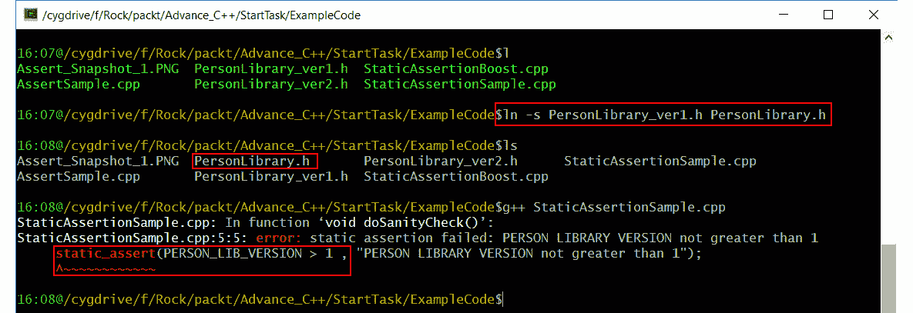

    **图 7.6：查看静态错误**

    在前面的屏幕截图中，三个区域用红色标出。第一个区域给出了创建软链接的命令。第二个命令显示了我们创建的`PersonLibrary.h`文件。第三个区域显示了抛出的`static_assert`错误，因为库的版本不匹配。

6. 现在，要正确编译程序，请移除`ProgramLibrary`的软链接，创建一个指向**版本 2** 的新软链接，然后再次编译。这次将编译成功。在终端中输入以下命令以移除软链接：

    ```
    rm PersonLibrary.h
    ln -s PersonLibrary_ver2.h PersonLibrary.h
    g++ StaticAssertionSample.cpp
    ```

    以下是相同操作的屏幕截图：

    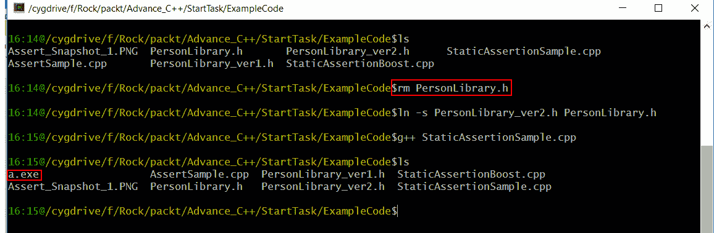

    **图 7.7：静态断言编译文件**

    如您所见，红色标记的区域显示使用了正确版本的`PersonLibrary`，编译顺利进行，没有任何问题。编译后，创建了一个名为`a.exe`的二进制文件。在本练习中，我们通过比较两个头文件的版本号执行了静态断言。在下一节中，我们将探讨异常处理的概念。

### 理解异常处理


## 异常处理

正如我们之前在调试模式二进制文件中所见，我们可以使用运行时断言，在特定条件不满足时中止程序。但在发布模式二进制文件或生产环境中，当客户端正在使用该产品时，突然中止程序并不是一个好主意。最好处理此类错误条件，并继续执行二进制文件的后续部分。

最坏的情况是二进制文件需要退出。它会通过添加正确的日志消息并清理该进程的所有已分配内存，从而优雅地退出。对于这种场景，会使用异常处理。在此机制中，当触发错误条件时，执行流会转移到一个特殊的代码块。异常由以下三个部分组成：

*   **try 块**：在此处，我们检查条件是否满足必要要求。
*   **throw 块**：如果条件不满足，它会抛出一个异常。
*   **catch 块**：它捕获异常，并针对该错误条件执行必要的操作。

在下一节中，我们将通过一个练习，在代码中实现异常处理。

### 练习 3：执行异常处理

在本练习中，我们将对 `AssertSample.cpp` 代码执行异常处理。我们将用异常替换断言条件。请执行以下步骤来实现此练习：

1.  创建一个名为 `ExceptionSample.cpp` 的文件。
2.  添加以下代码以引入头文件：

```cpp
#include<iostream>
#include<cstring>
using std::cout;
using std::endl;
```

3.  创建一个 `checkValidIp()` 函数，其中包含一个 try-catch 块。如果 try 块中的条件不满足，将抛出异常，并打印 catch 块中的消息。添加以下代码以实现此功能：

```cpp
bool checkValidIp(const char * ip){
    try{
        if(ip == NULL)
            throw ("ip is NULL");
        if(strlen(ip) > 15)
            throw int(strlen(ip));
    }
    catch(const char * str){
        cout << "Error in checkValidIp :" << str << endl;
        return false;
    }
    catch(int len){
        cout << "Error in checkValidIp, ip len:" << len << " greater than 15 characters, condition fail" << endl;
        return false;
    }
    cout << "strlen: " << strlen(ip) << endl;
    return true;
}
```

在前面的代码中，可以看到检查条件的 try 块。在 try 块内部，如果 `ip` 为 `NULL`，则会抛出 `const char *` 类型的异常。在下一个条件中，如果 `ip` 长度大于 15，则会抛出带有 `int` 参数类型的异常。该 throw 会被参数匹配（`int` 或 `const char *`）的正确 catch 捕获。两个异常都会返回 `false` 并附带一些错误消息。或者，在 `catch` 块中，如果需要清理，可以执行额外步骤，或对异常中用于比较的变量使用默认值。

#### 注意

存在默认异常；例如，如果嵌套函数抛出一个带有不同参数的错误，它可以在上层函数中通过 `catch(...)` 这样的参数被捕获。同样，在通用 catch 中，你可以为异常处理创建默认行为。

4.  创建 `main()` 函数并在其中编写以下代码：

```cpp
int main(){
    const char * ip;
    ip = NULL;
    if (checkValidIp(ip))
        cout << "IP address is correctly validated" << endl;
    else {
        /// work on error condition
        // if needed exit program gracefully.
        return -1;
    }
    return 0;
}
```

5.  打开终端，编译文件并运行二进制文件。你将看到以下输出：

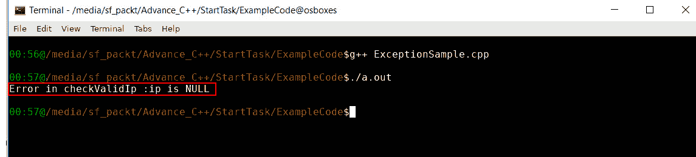

###### 图 7.8：带有异常处理的代码执行示例

前面的示例针对 `ip` 为 `NULL` 的情况抛出异常，并优雅地退出。

6.  现在，通过提供超过 15 个字符来修改 `main` 函数中 `ip` 的值。编写以下代码以实现此操作：

```cpp
ip = "111.111.111.11111";
```

7.  打开终端，编译文件并运行二进制文件。你将看到以下输出：

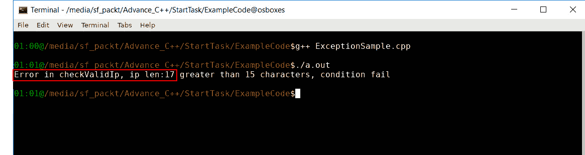

###### 图 7.9：异常处理的另一个示例

它针对 `ip` 字符串的长度不匹配抛出错误。

8.  再次，通过提供少于 15 个字符来修改 `main` 函数中 `ip` 的值。编写以下代码以实现此操作：

```cpp
ip = "111.111.111.111";
```

9.  打开终端，编译文件并运行二进制文件。你将看到以下输出：

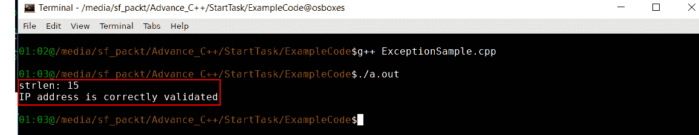

###### 图 7.10：二进制文件正常运行且未抛出异常

正如你从前面的屏幕截图中所见，二进制文件在没有任何异常的情况下正常执行。现在你已经了解了如何处理异常，在下一节中，我们将探讨**单元测试**和**模拟测试**的概念。

## 单元测试和模拟测试

当开发人员开始编写代码时，他们需要确保在单元层面正确测试代码。可能会遗漏边界条件，导致代码在客户端现场运行时崩溃。为避免这种情况，通常建议对代码进行**单元测试**。**单元测试**是在代码的单元层面或基础层面执行的测试，开发人员可以在隔离的环境中测试他们的代码，前提是运行代码功能所需的设置已满足。通常，将模块分解为小函数并单独测试每个函数是一种良好的实践。

例如，假设部分功能是读取配置文件并使用配置文件中的参数设置环境。我们可以创建一个专用函数来编写此功能。因此，要测试此函数，我们可以创建一组单元测试用例，检查可能失败或表现不正确的各种组合。一旦确定了这些测试用例，开发人员就可以编写代码来覆盖该功能，并确保其通过所有单元测试用例。这是开发过程中的良好实践，你首先不断添加测试用例，然后相应地添加代码，接着运行该函数的所有测试用例，确保它们表现正常。

有许多工具可用于为项目编写和集成单元测试用例。其中一些包括 `cppunit`、`Google Test`、`Microsoft Unit Testing Framework` 和 `catch`。为了我们示例的目的，我们将使用 `Google Test 框架`。它免费可用，并可集成到项目中。它使用 `xUnit 测试框架`，并拥有一系列可用于测试测试用例条件的断言。在下一节中，我们将通过一个练习来创建我们的第一个单元测试用例。

### 练习 4：创建我们的第一个单元测试用例


## 练习场景

在本练习中，我们将继续上一节讨论的场景：开发人员需要编写一个函数来解析**配置文件**。配置文件中会传入不同的有效参数，例如**产品可执行文件名**、**版本号**、**数据库连接信息**、**连接服务器的 IP 地址**等。假设开发人员会将解析文件、设置和测试各个属性参数的功能拆分到单独的函数中。在本例中，我们假设开发人员正在编写这样一个功能：已将 **IP 地址** 解析为 **字符串**，并想判断该 **字符串** 是否为有效的 **IP 地址**。目前，判断 **IP 地址** 有效的标准需满足以下条件：

*   **字符串** 不应为空（`NULL`）。
*   **字符串** 长度不应超过 **16** 个字符。
*   **字符串** 应符合 `XXX.XXX.XXX.XXX` 格式，其中 `X` 必须是 `0`-`9` 之间的数字。

## 实现步骤

### 1. 创建 `CheckIp.h` 头文件

创建 `CheckIp.h` 头文件，并在其中编写以下代码：

```cpp
#ifndef _CHECK_IP_H_
#define _CHECK_IP_H_

#include <iostream>
#include <cstring>

using namespace std;

bool checkValidIp(const char *);

#endif
```

在上述代码中，我们编写了一个名为 `checkValidIp()` 的函数来检查 **IP 地址** 是否有效。同样，为了理解 **Google 单元测试**，我们将编写最少量的代码来理解该特性。

### 2. 创建 `CheckIp.cpp` 文件

创建 `CheckIp.cpp` 文件，并编写以下代码，用于检查 `ip` 是否 **不为 NULL** 且长度小于 **16**：

```cpp
#include "CheckIp.h"
#include <string>
#include <sstream>

bool checkValidIp(const char * ip) {
    if (ip == NULL) {
        cout << "Error : IP passes is NULL " << endl;
        return false;
    }
    if (strlen(ip) > 15) {
        cout << "Error: IP size is greater than 15" << endl;
        return false;
    }
    cout << "strlen: " << strlen(ip) << endl;
    return true;
}
```

在上述代码中，如果两个条件均不满足，函数返回 `false`。

### 3. 创建 `MainIp.cpp` 调用 `checkValidIp()` 函数

创建一个名为 `MainIp.cpp` 的新文件来调用 `checkValidIp()` 函数。该文件通常包含项目的主流程，但为练习目的，我们仅调用 `checkValidIp()` 函数。在其中添加以下代码：

```cpp
#include "CheckIp.h"

int main() {
    const char * ip;
    // ip = "111.111.111.111";
    ip = "111.111.111.11111";
    if (checkValidIp(ip))
        cout << "IP address is correctly validated" << endl;
    else {
        /// work on error condition
        // if needed exit program gracefully.
        cout << " Got error in valid ip " << endl;
        return -1;
    }
    return 0;
}
```

### 4. 创建 `TestCases.cpp` 编写测试用例

为了创建测试代码，我们将创建第一个 `.cpp` 文件 `TestCases.cpp`。它将包含 `checkValidIp` 函数的测试用例。在其中编写以下代码：

```cpp
#include "CheckIp.h"
#include <gtest/gtest.h>

using namespace std;

const char * testIp;

TEST(CheckIp, testNull) {
    testIp = NULL;
    ASSERT_FALSE(checkValidIp(testIp));
}

TEST(CheckIp, BadLength) {
    testIp = "232.13.1231.1321.123";
    ASSERT_FALSE(checkValidIp(testIp));
}
```

在上述代码的第二行，我们包含了 `gtest.h` 文件。我们还使用 `TEST` 函数调用测试用例，该函数接受两个参数：第一个是 **测试套件** 名称，第二个是 **测试用例** 名称。在本例中，我们创建了 **测试套件** `CheckIp`。在 `TEST` 代码块中，你会看到 **Google Test** 定义了一个名为 `ASSERT_FALSE` 的 **断言**，用于检查条件是否为 `false`。如果不为 `false`，测试用例将失败并在结果中显示。

#### 注意

通常，对于 **Google Test** 的测试用例和测试套件，可以将它们归组在一个公共命名空间中，并调用 `RUN_ALL_TESTS` 宏，该宏运行附加到测试二进制文件的所有测试用例。对于每个测试用例，它会调用 `SetUp` 函数进行初始化（类似于类的构造函数），然后调用实际的测试用例，最后调用 `TearDown` 函数（类似于类的析构函数）。除非你需要为测试用例初始化某些内容，否则不必编写 `SetUp` 和 `TearDown` 函数。

### 5. 编译 `CheckIp.cpp` 生成目标文件

要运行测试用例，我们将创建测试用例的主 `.cpp` 文件并调用 `RUN_ALL_TESTS` 宏。或者，我们可以通过链接 **Google Test 库** 来创建一个调用 `RUN_ALL_TESTS` 的可执行文件。在本例中，我们采用后者。打开终端并运行以下命令以创建测试运行二进制文件：

```bash
g++ -c CheckIp.cpp
```

这将包含 `CheckIp.cpp` 的目标文件，因为 `checkValidIp` 函数是在其中定义的。

### 6. 链接库创建测试二进制文件

现在，输入以下命令以添加创建二进制文件所需的链接库：

```bash
g++ CheckIp.o TestCases.cpp -lgtest -lgtest_main -pthread -o TestRun
```

### 7. 运行测试二进制文件

现在，使用以下命令运行二进制文件：

```bash
./TestRun
```

这将显示 `CheckIp` **测试套件** 的两个通过测试用例。第一个测试用例 `CheckIp.testNull` 被调用并通过。第二个测试用例 `CheckIp.BadLength` 也被调用并通过。此结果可见于下图：

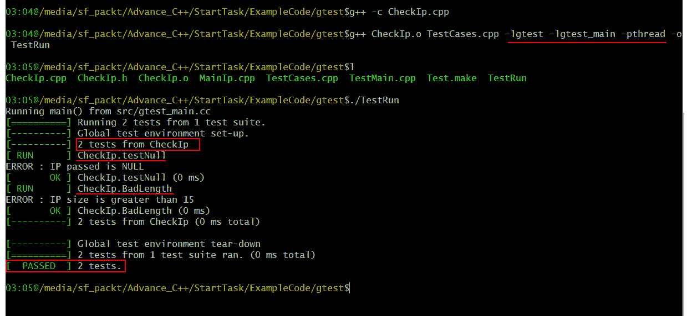

###### Figure 7.11: Compiling and executing test cases

#### 注意

在 **Google Test** 中，我们也可以使用其他断言，但对于我们的测试用例，`ASSERT_FALSE` 已足够，因为我们仅检查传入的 IP 地址的 `false` 条件。

### 8. 添加更多测试用例以增强代码健壮性

现在，我们将添加更多测试用例以使代码更健壮。这是编写代码的良好实践。首先创建测试用例，确保代码对新旧测试用例均能正确运行，且功能正确。要添加更多测试用例，请将以下代码添加到 `TestCases.cpp` 文件中：

```cpp
TEST(CheckIp, WrongTokenCount) {
    testIp = "22.13111.11";
    ASSERT_FALSE(checkValidIp(testIp));
}

TEST(CheckIp, WrongTokenEmpty) {
    testIp = "22.131..11";
    ASSERT_FALSE(checkValidIp(testIp));
}

TEST(CheckIp, WrongTokenStart) {
    testIp = ".2.1.31.11";
    ASSERT_FALSE(checkValidIp(testIp));
}

TEST(CheckIp, WrongTokenEnd) {
    testIp = "2.13.11.1.";
    ASSERT_FALSE(checkValidIp(testIp));
}

TEST(CheckIp, SpaceToken) {
    testIp = "2.13.11. 1";
    ASSERT_FALSE(checkValidIp(testIp));
}

TEST(CheckIp, NonDigit) {
    testIp = "2.13.b1.A1";
    ASSERT_FALSE(checkValidIp(testIp));
}

TEST(CheckIp, NonValidDigit) {
    testIp = "2.13.521.61";
    ASSERT_FALSE(checkValidIp(testIp));
}

TEST(CheckIp, CorrectIp) {
    testIp = "232.13.123.1";
    ASSERT_FALSE(checkValidIp(testIp));
}
```

在上述代码中：
- 前两个用例应因令牌数量不正确而失败。
- 第三个用例应因 **IP** 以 `.` 开头而失败。
- 第四个用例应因 **IP** 以 `.` 结尾而失败。
- 第五个用例应因 **IP** 中间包含空格而失败。
- 第六个用例应因 **IP** 包含非数字字符而失败。
- 第七个用例应因 **IP** 令牌值小于 `0` 或大于 `255` 而失败。
- 最后一个用例应因 **IP** 令牌数量错误而失败。

### 9. 更新 `CheckIp.cpp` 中的 `checkValidIp()` 函数

现在，在 `CheckIp.cpp` 文件的 `checkValidIp()` 函数中添加以下代码，以处理新增的测试用例：


## 使用模拟对象进行单元测试

当开发人员进行单元测试时，可能会遇到某些场景：在具体动作发生后会调用特定接口。例如，正如我们在前面的场景中讨论的那样，假设项目的设计是在执行前，从数据库获取所有配置信息。它查询数据库以获取特定参数，例如 Web 服务器的 **IP 地址**、**用户** 和 **密码**。然后它尝试连接到 Web 服务器（可能有另一个模块处理网络相关任务）或开始处理实际项目所需的项目。之前，我们测试了 IP 地址的有效性。现在，我们将更进一步。假设 IP 地址是从数据库获取的，并且我们有一个处理连接 **DB** 和查询 **IP 地址** 的工具类。

现在，要测试 IP 地址的有效性，我们需要假设数据库连接已建立。这意味着应用程序可以正确查询数据库并获取查询结果，其中之一是 **IP 地址**。只有在那时，我们才能测试 IP 地址的有效性。为了执行此类测试，我们必须假设所有必要的活动都已完成，并且我们已经获得了一个用于测试的 **IP 地址**。这时模拟对象就派上用场了，它的行为就像真实对象一样。它为单元测试提供了便利，使应用程序误以为 IP 地址已经从数据库获取，但实际上我们是模拟的。要创建模拟对象，我们需要从它需要模仿的类继承。在下一节中，我们将通过一个练习来更好地理解模拟对象。

### 练习 5：创建模拟对象

在本练习中，我们将通过假设所有接口都按预期工作来创建模拟对象。使用这些对象，我们将测试一些功能，例如验证 **IP 地址**、检查数据库连接性，以及检查 **用户名** 和 **密码** 格式是否正确。所有测试通过后，我们将确认应用程序并使其准备好进行 **QA**。执行以下步骤以实现此练习：

#### 1. 创建一个名为 `Misc.h` 的头文件并包含必要的库：

```cpp
#include <iostream>
#include <string>
#include <sstream>
#include <vector>
#include <iterator>
#include <regex>

using namespace std;
```

#### 2. 创建一个名为 `ConnectDatabase` 的类，用于连接数据库并返回查询结果。在类中，声明 `Dbname`、`user` 和 `passwd` 变量。此外，声明一个构造函数和两个虚函数。在这两个虚函数中，第一个必须是析构函数，第二个必须是 `getResult()` 函数，它返回来自数据库的查询结果。添加以下代码以实现此功能：

```cpp
class ConnectDatabase {
    string DBname;
    string user;
    string passwd;

public:
    ConnectDatabase() {}
    ConnectDatabase(string _dbname, string _uname, string _passwd) :
        DBname(_dbname), user(_uname), passwd(_passwd) { }

    virtual ~ConnectDatabase() {}
    virtual string getResult(string query);
};
```

#### 3. 创建另一个名为 `WebServerConnect` 的类。在 `class` 内部声明三个 `string` 变量，分别为 `Webserver`、`uname` 和 `passwd`。创建构造函数和两个虚函数。在这两个虚函数中，第一个必须是析构函数，第二个必须是 `getRequest()` 函数。添加以下代码以实现此功能：

```cpp
class WebServerConnect {
    string Webserver;
    string uname;
    string passwd;

public:
    WebServerConnect(string _sname, string _uname, string _passwd) :
        Webserver(_sname), uname(_uname), passwd(_passwd) { }

    virtual ~WebServerConnect() {}
    virtual string getRequest(string req);
};
```

##### 注意

**虚函数** 是必需的，因为我们将从前面的类创建 **模拟类** 并调用这些函数。

#### 4. 创建一个名为 `App` 的类。创建构造函数和析构函数并调用所有函数。添加以下代码以实现此功能：

```cpp
class App {
    ConnectDatabase *DB;
    WebServerConnect *WB;

public:
    App(): DB(NULL), WB(NULL) {}
    ~App() {
        if (DB)  delete DB;
        if (WB)  delete WB;
    }

    bool checkValidIp(string ip);
    string getDBResult(string query);
    string getWebResult(string query);
    void connectDB(string, string, string);
    void connectDB(ConnectDatabase *db);
    void connectWeb(string, string, string);
    void run();
};
```

在前面的代码中，应用程序将首先查询数据库并获取 **IP 地址**。然后使用必要的信息连接到 Web 服务器并查询以获取所需信息。

#### 5. 创建一个名为 `MockMisc.h` 的类并添加以下代码：

```cpp
#include "Misc.h"
#include <gtest/gtest.h>
#include <gmock/gmock.h>

class MockDB : public ConnectDatabase {
public:
    MockDB() {}
    virtual ~MockDB() {}
    MOCK_METHOD1(getResult, string(string));
};
```

### IP 地址验证代码示例

以下代码片段演示了 IP 地址验证逻辑：

```cpp
if (ip[strlen(ip)-1] == '.') {
    cout << "ERROR : Incorrect token at end" << endl;
    return false;
}

istringstream istrstr(ip);
vector<string> tokens;
string token;
regex expression("[⁰-9]");
smatch m;

while (getline(istrstr, token, '.')) {
    if (token.empty()) {
        cout << "ERROR : Got empty token" << endl;
        return false;
    }
    if (token.find(' ') != string::npos) {
        cout << "ERROR : Space character in token" << endl;
        return false;
    }
    if (regex_search(token, m, expression)) {
        cout << "ERROR : NonDigit character in token" << endl;
        return false;
    }
    int val = atoi(token.c_str());
    if (val < 0 || val > 255) {
        cout << "ERROR : Invalid digit in token" << endl;
        return false;
    }
    tokens.push_back(token);
}

if (tokens.size() != 4) {
    cout << "ERROR : Incorrect IP tokens used" << endl;
    return false;
}

cout << "strlen: " << strlen(ip) << endl;
return true;
```

### 运行测试二进制文件

打开终端并输入以下命令以运行二进制文件：

```bash
./TestRun
```

所有测试用例均已执行，如下截图所示：

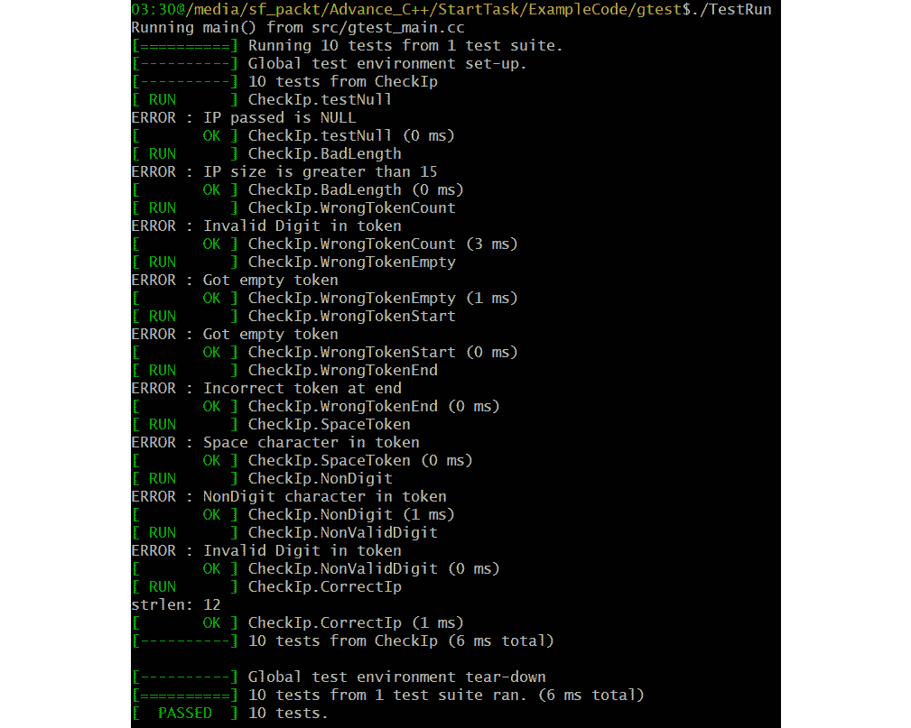

**图 7.12：测试用例运行输出**

前面的截图显示 **CheckIp** 测试套件中有 **10** 个测试用例，并且所有测试用例均运行正常。在下一节中，我们将学习使用模拟对象进行单元测试。


## 使用 gmock 进行模拟

在前面的代码中，可以看到我们包含了 `gmock` 头文件，这是创建模拟类所必需的。此外，`MockDB` 类继承自 `ConnectDatabase` 类。`MOCK_METHOD1(getResult, string(string));` 这一行表明我们将模拟 `getResult` 接口。因此，在单元测试期间，我们可以直接使用期望的结果调用 `getResult` 函数，而无需创建 `ConnectDatabase` 类并对数据库运行真实查询。这里需要注意的一个重要点是：我们需要模拟的函数必须使用 `MOCK_METHOD[N]` 宏定义，其中 N 是接口将接受的参数数量。在我们的例子中，`getResult` 接口接受一个参数，因此使用 `MOCK_METHOD1` 宏进行模拟。

## 步骤 6：创建 Misc.cpp

创建一个名为 `Misc.cpp` 的文件并添加以下代码：

```cpp
#include"Misc.h"

#include <unistd.h>

string ConnectDatabase::getResult(string query){

     // dummy func, need to implement..

     // assuming query sent to DB is success and

     // will return some dummy string

     return string("DB returned success");

}

string WebServerConnect::getRequest(string req){

     // dummy func, need to implement..

     // assume no req string is sent to webserver. .

     // its returns the result returned from server.

     return string("Webserver returned success");

}

void App::connectDB(string dbname, string user, string passwd){

     if ( DB )

         delete DB;

     DB = new ConnectDatabase(dbname, user, passwd);

}

void App::connectDB(ConnectDatabase *db){

     if ( DB )

         delete DB;

     DB = db;

}

void App::connectWeb(string webname, string user, string passwd){

     if ( WB )

         delete WB;

     WB = new WebServerConnect(webname, user, passwd);

}

string App::getDBResult(string query){

     return DB->getResult(query);

}

string App::getWebResult(string query) {

     return WB->getRequest(query);

}

void App::run(){

     if ( (DB == NULL) || (WB == NULL) )

         return ;

     while( true ){

         // read some request to be run on web and get result. ..

         cout << getWebResult("dummy request to webserver") << endl;;

         sleep(5);

     }

}

bool App::checkValidIp(string ip){

     if(ip.empty()){

         cout << "ERROR : IP passed is NULL " << endl;

         return false;

     }

     if(ip.size() > 15){

         cout << "ERROR : IP size is greater than 15" <<endl;

         return false;

     }

     //check if last character in ip is not '.' as that is not captured in tokenizing

     if (ip[ip.size()-1] == '.'){

         cout <<"ERROR : Incorrect token at end" << endl;

         return false;

     }

     istringstream istrstr(ip);

     vector<string> tokens;

     string token;

     regex expression("[⁰-9]");

     smatch m;

     while( getline(istrstr, token, '.') ){

         if ( token.empty() ){

             cout << "ERROR : Got empty token " << endl;

             return false;

         }

         if ( token.find(' ') != string::npos){

             cout << "ERROR : Space character in token " << endl;

             return false;

         }

         if ( regex_search(token, m, expression) ){

             cout << "ERROR : NonDigit character in token " << endl;

             return false;

         }

         int val = atoi(token.c_str());

         if ( val < 0 || val > 255 ){

             cout << "ERROR : Invalid Digit in token " << endl;

             return false;

         }

         tokens.push_back(token);

     }

     if ( tokens.size() != 4 ){

         cout << " ERROR : Incorect IP tokens used" << endl;

         return false;

     }

     cout << "strlen: " << ip.size() << endl;

     return true;

}
```

在前面的代码中，我们创建了一个最小接口和虚拟参数使其能够运行，以便理解实际功能。我们为 `getResult()` 和 `getRequest()` 函数开发了基本功能，其中数据库查询和 `WebServer` 查询返回默认字符串。这里，`App::run()` 函数假设数据库连接和 Web 服务器连接都已执行，现在可以定期执行 Web 查询。每次查询结束时，它将默认返回 `Webserver returned success` 字符串。

## 步骤 7：创建 RunApp.cpp

现在，创建一个名为 `RunApp.cpp` 的文件并在 main 函数中编写以下代码：

```cpp
#include"Misc.h"

int main(){

     App app;

     app.connectDB("dbname","dbuser", "dbpasswd");

     string ip = app.getDBResult("dummy");

     // DB query to get Webserver IP

     // Similarly some miscellaneous activities to get configuratio information

     // Like querying DB to get correct username/passwd to connect to WebServer..

     // After getting IP from DB, check if the IP is valid..

     //app.checkValidIp(ip);

     // Now conect to webserver with parameters extracted from DB.

     app.connectWeb("webname","user", "passwd");

     // Now run the App, like sending some request to webserver,

     // getting result and doing activity with received data.

     app.run();

     return 0;

}
```

正如前面的代码所示，创建了 `App` 类实例。使用该实例，我们借助虚拟参数 `dbname`、`dbuser` 和 `dbpasswd` 连接到数据库。然后，我们查询数据库以获取 IP 地址和其他配置参数。我们注释掉了 `app.checkValidIp(ip)` 行，因为我们假设从数据库获取的 IP 地址需要验证。此外，该函数需要进行单元测试。使用 `connectWeb()` 函数，我们可以通过传递虚拟参数 `webname`、`user` 和 `passwd` 连接到 Web 服务器。最后，我们调用 `run()` 函数，它将迭代运行，从而查询 Web 服务器并给出默认输出。

## 步骤 8：构建二进制文件

保存所有文件并打开终端。为了获得执行项目所需的基本功能，我们将构建二进制文件并执行它以查看结果。在终端中运行以下命令：

```bash
g++ Misc.cpp RunApp.cpp -o RunApp
```

前面的命令将在当前文件夹中创建一个名为 `RunApp` 的二进制文件。

## 步骤 9：运行可执行文件

现在，编写以下命令来运行可执行文件：

```bash
./RunApp
```

前面的命令在终端中生成以下输出：

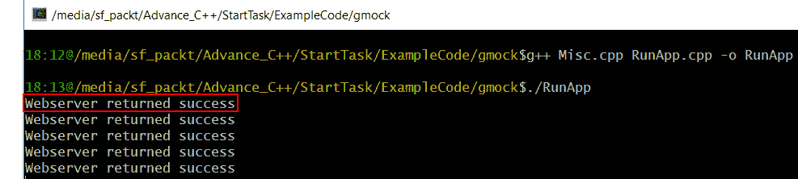

**图 7.13：运行应用程序**

正如前面的屏幕截图所示，二进制文件及时显示输出 `Webserver returned success`。到目前为止，我们的应用程序运行良好，因为它假设所有接口都按预期工作。但在使其准备好进行 `QA` 之前，我们仍然必须测试一些功能，例如验证 `IP address`、`DB connectivity`，检查 `username` 和 `password` 是否采用正确格式（如果有）等。

## 步骤 10：开始单元测试

使用相同的基础设施，开始对每个功能进行单元测试。在我们的练习中，我们将假设 `DB connectivity` 已经完成并已被查询以获取 `IP address`。之后，我们可以开始对 `IP address` 的有效性进行单元测试。因此，在我们的测试用例中，`Database` 类需要被模拟，并且 `getDBResult` 函数必须返回 `IP address`。这个 `IP address` 稍后将被传递给 `checkValidIP` 函数，我们将在其中对其进行测试。为了实现这一点，创建一个名为 `TestApp.cpp` 的类，我们将在其中调用 `checkValidIP` 函数：


## Google Mock 测试与栈数据结构实现

## Google Mock 单元测试示例

以下代码展示了如何使用 Google Mock 编写单元测试：

```cpp
#include "MockMisc.h"

using ::testing::_;
using ::testing::Return;

class TestApp : public ::testing::Test {
protected:
    App testApp;
    MockDB *mdb;

    void SetUp() {
        mdb = new MockDB();
        testApp.connectDB(mdb);
    }

    void TearDown() {}
};

TEST_F(TestApp, NullIP) {
    EXPECT_CALL(*mdb, getResult(_))
        .WillOnce(Return(""));
    ASSERT_FALSE(testApp.checkValidIp(testApp.getDBResult("")));
}

TEST_F(TestApp, SpaceTokenIP) {
    EXPECT_CALL(*mdb, getResult(_))
        .WillOnce(Return("13. 21.31.68"));
    ASSERT_FALSE(testApp.checkValidIp(testApp.getDBResult("")));
}

TEST_F(TestApp, NonValidDigitIP) {
    EXPECT_CALL(*mdb, getResult(_))
        .WillOnce(Return("13.521.31.68"));
    ASSERT_FALSE(testApp.checkValidIp(testApp.getDBResult("")));
}

TEST_F(TestApp, CorrectIP) {
    EXPECT_CALL(*mdb, getResult(_))
        .WillOnce(Return("212.121.21.45"));
    ASSERT_TRUE(testApp.checkValidIp(testApp.getDBResult("")));
}
```

这里我们使用了 `testing` 和 `testing::Return` 命名空间来调用模拟类接口并返回用于测试用例的用户定义值。在 `TEST_F` 函数中，我们使用了 `EXPECT_CALL` 函数，其中第一个参数传入模拟对象实例，第二个参数传入 `getResult()` 函数。`WillOnce(Return(""))` 表示该接口需要被调用一次并返回空字符串 `""`。该值将被传递给 `checkValidIP` 函数以测试空字符串情况，并通过 `ASSERT_FALSE` 宏进行验证。同样，可以使用数据库的模拟对象并传入 IP 地址给 `checkValidIP` 函数来创建其他测试用例。为了创建各种测试用例，`TestApp` 类继承自 `testing::Test` 类，其中包含 `App` 实例和数据库的模拟对象。在 `TestApp` 类中，我们定义了两个函数：`SetUp()` 和 `TearDown()`。在 `SetUp()` 函数内部，我们创建了一个 `MockDB` 实例并将其关联到 `testApp` 实例。由于 `TearDown()` 函数无需执行任何操作，因此保留为空。其析构函数在 `App` 类的析构函数中被调用。此外，我们在 `TEST_F` 函数中传递了两个参数：第一个参数是测试类，第二个参数是测试用例的名称。

### 编译与运行测试

11. 保存所有文件并打开终端。运行以下命令进行编译：

```bash
g++ Misc.cpp TestApp.cpp -lgtest -lgmock -lgtest_main -pthread -o TestApp
```

在上述命令中，我们还链接了 `gmock` 库。现在，输入以下命令运行测试用例：

```bash
./TestApp
```

上述命令生成如下输出：

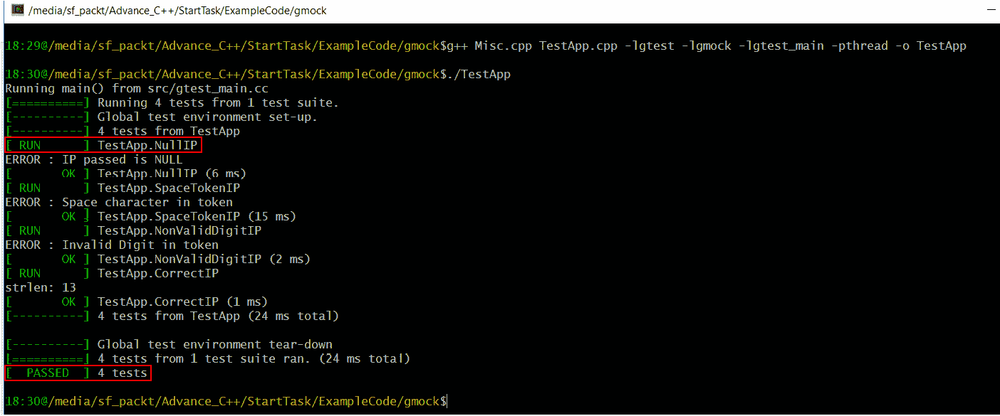

###### 图 7.14：运行 Gmock 测试

从上述命令可以看出，所有测试用例均成功执行并通过。在下一节中，我们将讨论**断点**、**观察点**和**数据可视化**。

## 断点、观察点与数据可视化

在上一节中，我们讨论了单元测试需要在开发者将代码提交到仓库分支之前完成，以便其他团队成员可见并能将其与其他模块集成。虽然单元测试做得很好且开发者提交了代码，但当代码被集成且 QA 团队开始测试时，仍有可能在代码中发现 Bug。通常在这种情况下，错误可能会在一个模块中抛出，而该错误是由其他模块的变更引起的。团队可能难以找出此类问题的真实原因。在这种情况下，**调试** 就派上用场了。它能准确地告诉我们代码是如何表现的，开发者可以获得代码执行的细粒度信息。开发者可以看到函数接收的参数及其返回值。它可以准确地告诉我们变量或指针被赋予了什么值，或者内存中的内容是什么。这对开发者识别代码中哪个部分存在问题非常有帮助。在下一节中，我们将实现一个栈并对其执行一些操作。

## 栈数据结构的使用

考虑这样一个场景：开发者被要求开发自己的栈结构，该结构可以接受任意类型的参数。这里的要求是栈结构必须遵循**后进先出**（`LIFO`）原则，即元素依次放在栈顶，移除时最后放入的元素最先被移除。它应具有以下函数：

*   `push()`：将新元素放在栈顶
*   `top()`：显示栈顶元素（如果有）
*   `pop()`：从栈中移除最后插入的元素
*   `is_empty()`：检查栈是否为空
*   `size()`：显示栈中元素的数量
*   `clean()`：如果栈中有元素则清空栈

以下代码展示了如何在 `Stack.h` 头文件中包含必要的库：

```cpp
#ifndef STACK_H_
#define STACK_H_

#include <iostream>

using namespace std;
```

正如我们已知，栈包含各种操作。为了定义这些函数，我们将编写以下代码：

```cpp
template<typename T>
struct Node {
    T element;
    Node<T> *next;
};

template<typename T>
class Stack {
    Node<T> *head;
    int sz;

public:
    Stack() : head(nullptr), sz(0) {}
    ~Stack();
    bool is_empty();
    int size();
    T top();
    void pop();
    void push(T);
    void clean();
};

template<typename T>
Stack<T>::~Stack() {
    if (head) clean();
}

template<typename T>
void Stack<T>::clean() {
    Node<T> *tmp;
    while (head) {
        tmp = head;
        head = head->next;
        delete tmp;
        sz--;
    }
}

template<typename T>
int Stack<T>::size() {
    return sz;
}

template<typename T>
bool Stack<T>::is_empty() {
    return (head == nullptr) ? true : false;
}

template<typename T>
T Stack<T>::top() {
    if (head == nullptr) {
        // throw error ...
        throw(string("Cannot see top of empty stack"));
    } else {
        return head->element;
    }
}

template<typename T>
void Stack<T>::pop() {
    if (head == nullptr) {
        // throw error
        throw(string("Cannot pop empty stack"));
    } else {
        Node<T> *tmp = head;
        head = head->next;
        delete tmp;
        sz--;
    }
}

template<typename T>
void Stack<T>::push(T val) {
    Node<T> *tmp = new Node<T>();
    tmp->element = val;
    tmp->next = head;
    head = tmp;
    sz++;
}

// 栈的杂项函数..
template<typename T>
void displayStackStats(Stack<T> &st) {
    cout << endl << "------------------------------" << endl;
    cout << "Showing Stack basic Stats ...  " << endl;
    cout << "Stack is empty : " << (st.is_empty() ? "true" : "false") << endl;
    cout << "Stack size :" << st.size() << endl;
    cout << "--------------------------------" << endl << endl;
}

#endif
```


## 使用单链表实现栈及使用 GDB 进行调试

## `Main.cpp` 中的实现

到目前为止，我们已经了解了如何使用`单链表`来实现栈。每当在 `Stack` 中调用 `push` 时，都会创建一个具有给定值的新元素并将其附加到栈的开头。我们称之为 `head` 成员变量，即 `head` 将指向栈中的下一个元素，以此类推。当调用 `pop` 时，将移除 `head` 元素，并使其指向栈中的下一个元素。

让我们在 `Main.cpp` 文件中编写之前创建的 `Stack` 的实现。`main` 函数包含一个 `try` 块，该块创建一个整数 `Stack` 以及一个字符 `Stack`。对两者都进行了几次 `push` 和 `pop` 操作，期间调用 `Stack` 的 `top` 来显示最新元素。对于整数栈，开始涉及三次推入操作：`22`、`426` 和 `57`。当调用 `displayStackStats()` 函数时，它应显示栈的大小为 `3`。然后，我们从栈中弹出 `57`，栈顶元素必须显示 `426`。我们将对 `char` 栈执行相同的操作。以下是栈的完整实现：

```cpp
#include "Stack.h"

int main() {
    try {
        Stack<int> si;
        displayStackStats<int>(si);
        si.push(22);
        si.push(426);
        cout << "Top of stack contains " << si.top() << endl;
        si.push(57);
        displayStackStats<int>(si);
        cout << "Top of stack contains " << si.top() << endl;
        si.pop();
        cout << "Top of stack contains " << si.top() << endl;
        si.pop();
        displayStackStats<int>(si);
        Stack<char> sc;
        sc.push('d');
        sc.push('l');
        displayStackStats<char>(sc);
        cout << "Top of char stack contains:" << sc.top() << endl;
    }
    catch(string str) {
        cout << "Error : " << str << endl;
    }
    catch(...) {
        cout << "Error : Unexpected exception caught " << endl;
    }
    return 0;
}
```

## 编译并运行程序

当我们通过编写以下命令来编译 `Main.cpp` 文件时，将创建 `Main` 可执行文件，且处于调试模式（因为使用了 `-g` 选项）。因此，如果需要，您可以调试该二进制文件：

```bash
g++ -g Main.cpp -o Main
```

我们将写入以下命令来执行该二进制文件：

```bash
./Main
```

上述命令生成如下输出：

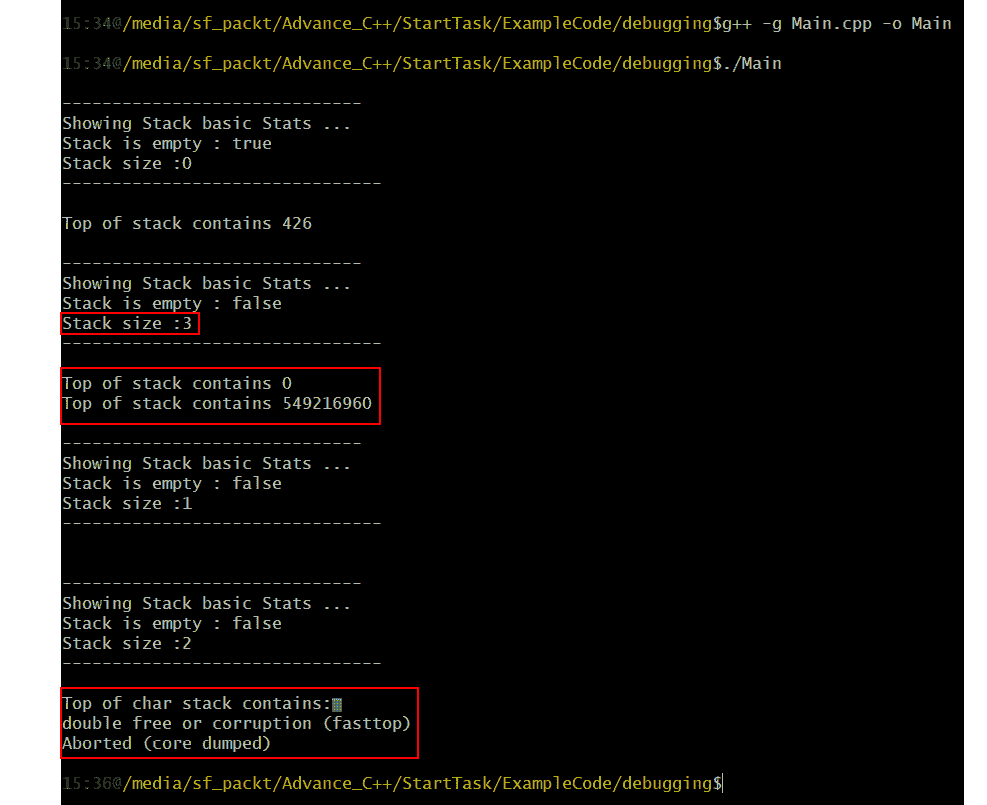

### 图 7.15：使用 Stack 类的 Main 函数

在上述输出中，统计函数第二次调用时的红色标记显示了正确信息，即 `int` 栈中有三个元素。然而，对 `int` 栈顶调用的红色标记显示的是随机或垃圾值。如果再次运行程序，将显示其他随机数字，而非预期的 `57` 和 `426`。同样，对于 `char` 栈，红色高亮显示的部分，即 `char` 栈顶，显示的是垃圾值，而非预期的 `l`。随后，执行显示双重释放或内存损坏错误，这意味着对同一内存位置调用了两次 `free`。最后，可执行文件产生核心转储。程序未按预期执行，且从显示中可能不清楚实际错误何在。为了调试 `Main`，我们将写入以下命令：

```bash
gdb ./Main
```

上述命令生成如下输出：

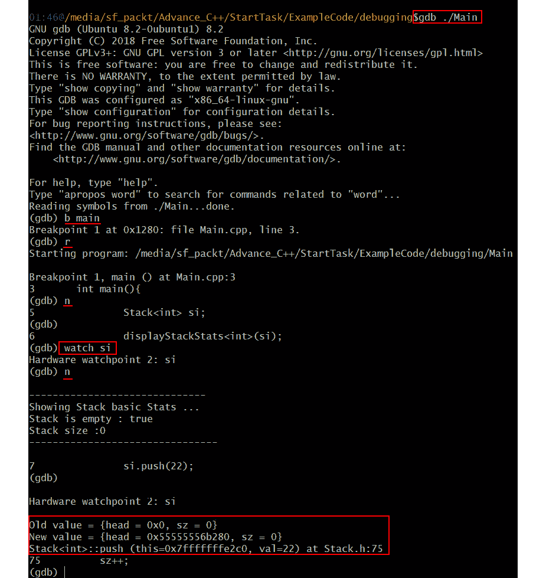

### 图 7.16：调试器显示 – I

在上述截图中，蓝色高亮显示的标记展示了调试器的使用方式及其显示内容。第一个标记显示使用 `gdb` 命令调用调试器。输入 `gdb` 命令后，用户进入调试器的命令模式。以下是命令模式中所用命令的简要信息：

*   `b main`: 告诉调试器在调用 `main` 函数时中断。
*   `r`: 运行可执行文件的简写形式。也可传递参数运行。
*   `n`: `next` 命令的简写，告诉调试器执行下一条语句。
*   `watch si`: 监视 `si` 变量，当其在代码中被调用且值发生变化时，调试器将显示正在使用该变量的代码内容。
*   `s`: `step in` 命令的简写。

即将执行的下一条语句是 `si.push(22)`。由于 `si` 已更新，观察点生效并显示 `si` 的旧值和新值，其中显示 `si` 的旧值为 `head` 为 `NULL` 且 `sz` 为 `0`。`si.push` 执行后，`head` 更新为新值，执行到达 `Stack.h` 文件的第 75 行，即 `sz` 变量递增之处。再次按 `Enter` 键将执行该行。

请注意，执行已自动从 `main` 函数移至 `Stack::push` 函数。以下是调试器上继续执行命令的截图：

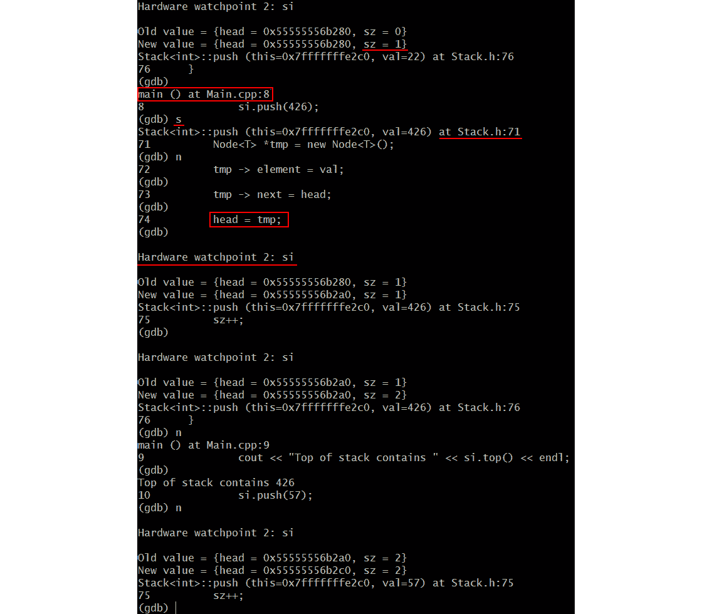

### 图 7.17：调试器显示 – II

下一个命令显示 `sz` �更新为新值 `1`。按 `Enter` 键后，代码执行从 `Stack::push` 的第 76 行返回到 `main` 函数的第 8 行。这在下面的截图中有所体现。它显示执行停在了 `si.push(426)` 调用处。一旦我们步入，将调用 `Stack::push`。执行移至 `Stack.h` 程序的第 71 行，如红色标记所示。一旦执行到达第 74 行，如红色标记所示，将调用观察点，显示 `si` �更新为新值。可以看到，`Stack::push` 函数完成后，流程返回到 `Main` 代码。以下是调试器中执行步骤的截图：

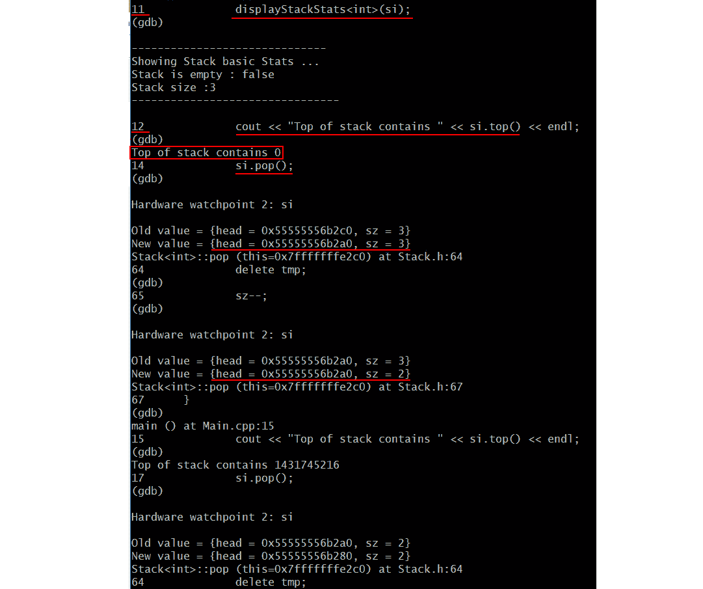

### 图 7.18：调试器显示 – III

按 `Enter` 键后，您将看到在 `Main.cpp` 程序的第 11 行调用了 `displayStackStats`。接下来的命令显示栈的顶部元素，该调用发生在第 12 行。然而，显示的值为 `0`，而非预期的 `57`。这是一个我们仍无法弄清的错误——为什么值会改变？然而，很明显该值可能在之前的某条执行语句中发生了改变，即在 `displayStackStats` 中。因此，这可能使我们对继续往下调试失去兴趣。然而，我们需要继续并从头开始调试。

以下截图显示将用于调试代码的命令：

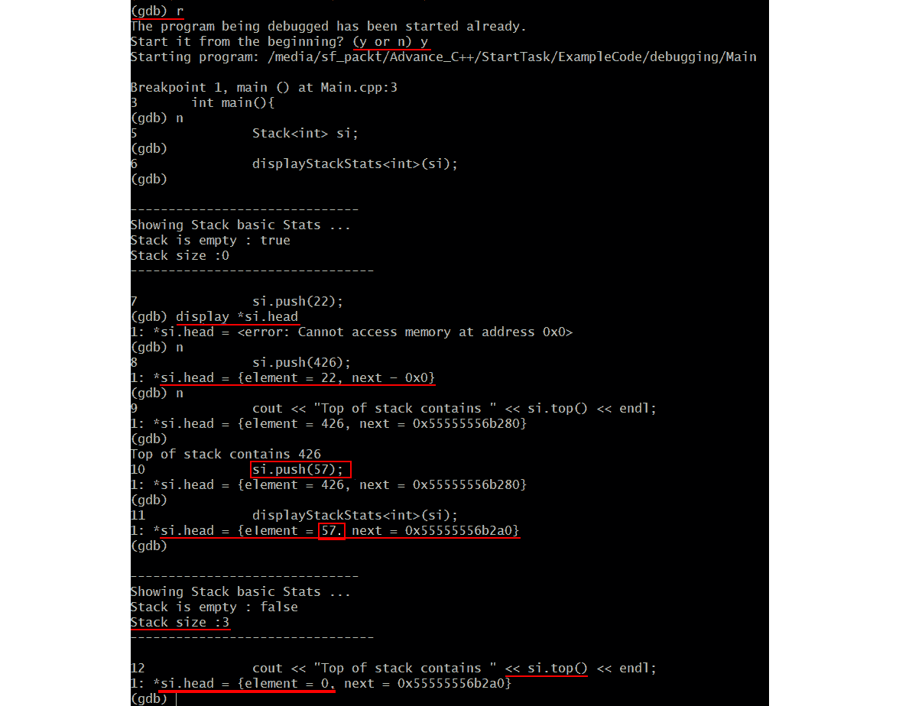

### 图 7.19：调试器显示 – IV

## 重新运行与进一步分析

要从头开始重新运行程序，我们必须按 `r`，为了确认并继续，我们需要按 `y`, 即重新从头开始运行程序。它将请求确认；按 `y` 继续。所有这些命令均在上述截图中以蓝色高亮显示。在执行第 7 行时，我们需要运行 `display *si.head` 命令，该命令将在执行的每条语句后连续显示 `si.head` 内存位置的内容。如红色标记所示，将 `22` 推入栈后，`head` 更新为正确的值。同样，对于值 `426` 和 `57`，当使用 `push` 插入栈时，对 `head` 的调用均更新正确。

随后，当调用 `displayStackStats` 时, 它显示正确的 `size` 为 `3`。但当调用 `top` 命令时，`head` 中显示了错误的值。这在红色标记中有所体现。现在, `top` 命令的代码并不改变 head 的值, 因此很明显错误发生在之前的执行语句中, 即在 `displayStackStats` 中。


## 调试栈实现

因此，我们已经缩小了可能存在问题的代码范围。我们可以运行调试器定位到 `displayStackStats` 并进入 `displayStackStats` 内部，以查明导致 `Stack` 内部值被修改的原因。以下是相关截图，其中用户需要从头开始启动调试器：

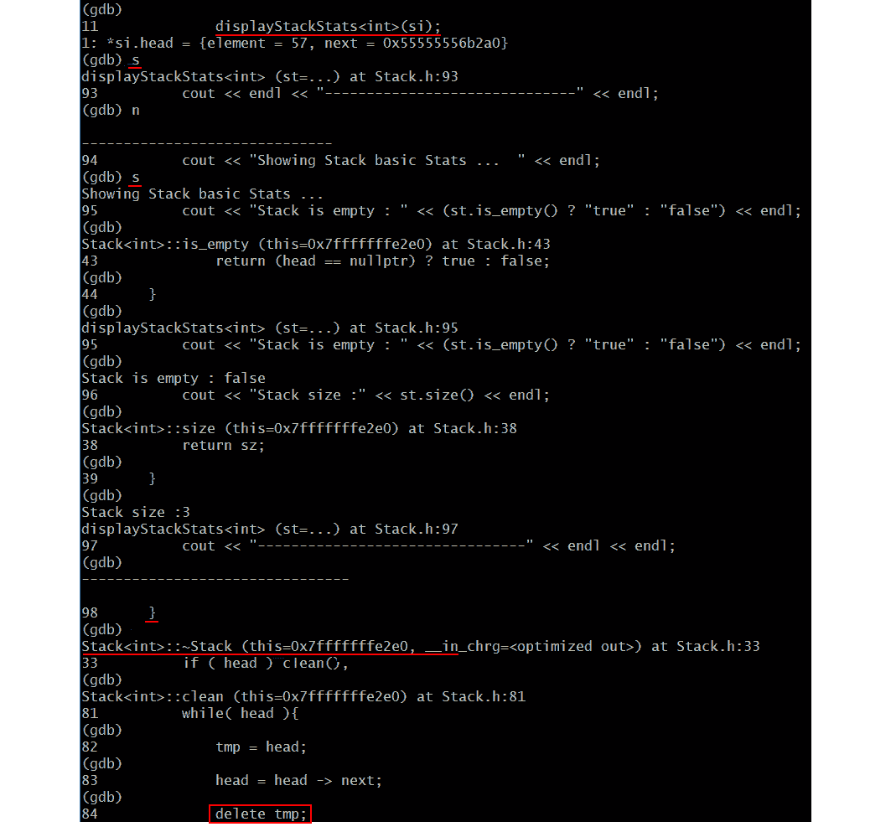

## Figure 7.20: 调试器显示 – IV

重新从头启动调试器并运行到第 11 行调用 `displayStackStats` 的执行点后，我们需要单步进入。流程是进入 `displayStackStats` 函数的开头。此外，我们需要执行下一条语句。由于函数中的初始检查很明确，它们不会改变 `head` 的值，我们可以按 `Enter` 执行后续步骤。当我们怀疑后续步骤可能会改变我们正在查找的变量值时，我们需要单步进入。这在前面的快照中用红色高亮显示。后续执行来到 `line 97`，即 `displayStackStats` 函数的最后一行。

输入 `s` 后，执行移动到析构函数栈并在第 81 行调用 `clean` 函数。该 `clean` 命令删除 `tmp` 变量，其值与 `head` 相同。该函数清空了 `stack`，这原本是不应该运行的。本应仅调用并执行 `displayStackStats` 函数，最终返回 `main` 函数。但析构函数可能会被调用，因为函数中的局部变量在函数完成后超出作用域。这里的局部变量是在第 92 行作为参数传递给 `displayStackStats` 函数的变量。因此，当调用 `displayStackStats` 函数时，会创建 `main` 函数中 `si` 变量的一个局部副本。当该变量超出作用域时，它调用了 `Stack` 的析构函数。现在，`si` 变量的指针已被复制到临时变量，并错误地在最后删除了指针。这并非开发者本意。因此，在代码执行结束时，报告了双重释放错误。当 `si` 变量超出作用域时，它必须调用 `Stack` 析构函数，因为它将尝试再次释放相同的内存。要解决此问题，很明显 `displayStackStats` 函数必须通过引用传递参数来调用。为此，我们必须更新 `Stack.h` 文件中 `displayStackStats` 函数的代码：

```cpp
template<typename T>

void displayStackStats(Stack<T> &st){

    cout << endl << "------------------------------" << endl;

    cout << "Showing Stack basic Stats ...  " << endl;

    cout << "Stack is empty : " << (st.is_empty() ? "true" : "false") << endl;

    cout << "Stack size :" << st.size() << endl;

    cout << "--------------------------------" << endl << endl;

}
```

现在，当我们保存并编译 `Main.cpp` 文件时，将生成二进制文件：

`./Main`

上述命令在终端中生成以下输出：

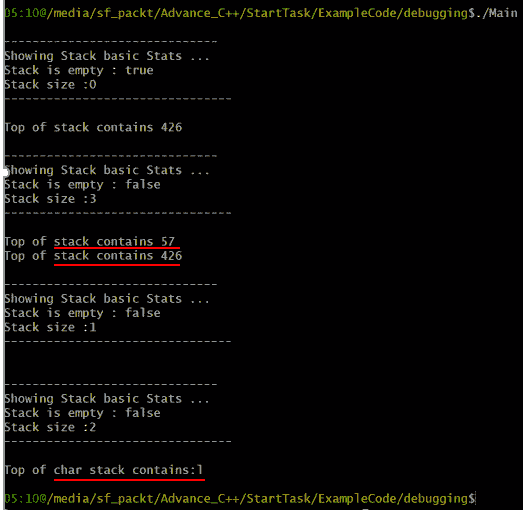

## Figure 7.21: 调试器显示 – IV

从前面的截图中，我们可以看到栈顶显示了预期的 `57` 和 `426` 值。`displayStackStats` 函数也为 `int` 和 `char` `Stack` 显示了正确的信息。最后，我们使用调试器定位了错误并修复了它。在下一节中，我们将完成一个活动，我们将开发用于解析文件的函数，并编写测试用例来检查函数的准确性。

## 活动 1：使用测试用例检查函数的准确性并理解测试驱动开发 (TDD)

在本活动中，我们将开发函数以便解析文件，然后编写测试用例来检查我们开发的函数的正确性。

一家大型零售组织的 IT 团队希望作为其对账工作的一部分，通过在数据库中存储 `Product` 详细信息和 `Customer` 详细信息来跟踪产品销售。销售部门将定期以简单的文本格式向 IT 团队提供此数据。作为开发人员，您需要确保完成数据的基本合理性检查，并且在公司将记录存入数据库之前，所有记录都已被正确解析。销售部门将提供两个文本文件，分别包含所有销售交易的 `Customer` 信息和 `Currency` 信息。您需要编写解析函数来处理这些文件。这两个文件是 `RecordFile.txt` 和 `CurrencyConversion.txt`。`RecordFile.txt` 文件包含客户详细信息、他们购买的产品以及区域货币和外币的总价。`CurrencyConversion.txt` 文件包含两个字段，即 `Currency` 和 `ConversionRatio`。

环境设置所需的所有必要信息都保存在配置文件中。这也将保存文件名，以及其他参数（如 `DB`、`RESTAPI` 等）和变量值，在一个名为 `parse.conf` 的文件中。它将每行包含两个字段，由 `=` 分隔符分隔。第一行将是一个标题，声明 `CONFIGURATION_FILE`。对于 Record 文件，变量名是 `recordFile`，同样对于 Currency 文件，变量名是 `currencyFile`。

## CurrencyConversion.txt 的测试条件

以下是我们将编写的测试条件，用于检查解析 `CurrencyConversion.txt` 文件的函数的准确性：

*   第一行应为标题行，且其第一个字段应包含 `Currency` 字符串。
*   `Currency` 字段应由三个字符组成。例如：`USD`、`GBP` 有效。
*   `ConversionRatio` 字段应由浮点数组成。例如，`1.2`、`0.06` 有效。
*   每行应恰好有两个字段。
*   记录使用的分隔符是 `|`。

## RecordFile.txt 的测试条件

以下是我们将编写的测试条件，用于检查解析 `RecordFile.txt` 文件的函数的准确性：

*   第一行应包含标题行，且其第一个字段应包含 `Customer Id` 字符串。
*   `Customer Id`、`Order Id`、`Product Id` 和 `Quantity` 应均为整数值。例如，`12312`、`4531134` 有效。
*   `TotalPrice (Regional Currency)` 和 `TotalPrice (USD)` 应为浮点值。例如，`2433.34`、`3434.11` 有效。
*   `RegionalCurrency` 字段的值应存在于 `CurrencyConversion.txt` 文件或 `std::map` 中。
*   每行应恰好有九个字段，如文件 `HEADER` 信息中所定义。
*   记录的分隔符是 `|`。

## 实现步骤

请遵循以下步骤实现此活动：

1.  解析 `parse.conf` 配置文件，其中包含项目运行的环境变量。
2.  从步骤 1 中正确设置 `recordFile` 和 `currencyFile` 变量。
3.  使用从配置文件检索到的这些变量，在满足所有条件的情况下解析 Currency 文件。如果条件不满足，则返回适当的错误消息。
4.  在满足所有条件的情况下解析 Record 文件。如果不满足，则返回错误消息。
5.  创建一个名为 `CommonHeader.h` 的头文件，并声明所有工具函数，即 `isAllNumbers()`、`isDigit()`、`parseLine()`、`checkFile()`、`parseConfig()`、`parseCurrencyParameters()`、`fillCurrencyMap()`、`parseRecordFile()`、`checkRecord()`、`displayCurrencyMap()` 和 `displayRecords()`。
6.  创建一个名为 `Util.cpp` 的文件，并定义所有工具函数。


# 文件解析活动步骤

## 实施步骤

7. 创建名为 `ParseFiles.cpp` 的文件，并调用 `parseConfig()`、`fillCurrencyMap()` 和 `parseRecordFile()` 函数。

8. 编译并执行 `Util.cpp` 和 `ParseFiles.cpp` 文件。

9. 创建名为 `ParseFileTestCases.cpp` 的文件，并为以下函数编写测试用例：`trim()`、`isAllNumbers()`、`isDigit()`、`parseCurrencyParameters()`、`checkFile()`、`parseConfig()`、`fillCurrencyMap()` 和 `parseRecordFile()`。

10. 编译并执行 `Util.cpp` 和 `ParseFileTestCases.cpp` 文件。

以下是解析不同文件并显示信息的流程图：

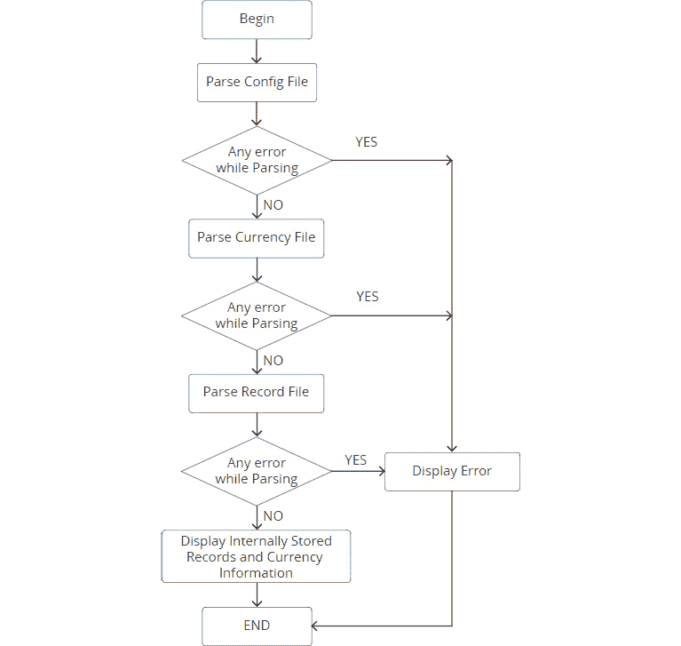

###### Figure 7.22: 流程图

从上述流程图中，我们大致了解了执行流程。在编写代码之前，让我们看看更细节的部分，以获得清晰的理解。这将有助于为每个执行块定义测试用例。

### 解析配置文件块

我们可以将步骤分解为以下几点：

1. 检查配置文件是否存在且具有读取权限。
2. 检查是否有适当的头部信息。
3. 逐行解析整个文件。
4. 对每一行，使用 `=` 作为分隔符解析字段。
5. 如果从上一步得到 2 个字段，则处理以查看它是 `CurrencyFile` 还是 `RecordFile` 变量，并适当存储。
6. 如果步骤 4 中没有得到 2 个字段，则转到下一行。
7. 完全解析文件后，检查上述步骤中的两个变量是否都不为空。
8. 如果为空，则返回错误。

### 解析货币文件块

我们可以将步骤分解为以下几点：

1. 读取 `CurrencyFile` 变量，并查看文件是否存在且具有读取权限。
2. 检查是否有适当的头部信息。
3. 逐行解析整个文件，使用 `|` 作为分隔符。
4. 如果每行恰好找到 2 个字段，则将第一个视为 `Currency field`，第二个视为 `conversion field`。
5. 如果步骤 3 中没有找到 2 个字段，则返回适当的错误消息。
6. 从步骤 4 开始，对 `Currency field`（应为 3 个字符）和 `Conversion Field`（应为数字）进行所有检查。
7. 如果通过步骤 6，则将 `currency`/`conversion` 值作为键值对存储在 map 中，键为 `Currency`，值为数字。
8. 如果未通过步骤 6，则返回针对该 `currency` 的错误。
9. 完全解析 `Currency` 文件后，将创建一个包含所有货币转换值的 map。

### 解析记录文件块

我们可以将步骤分解为以下几点：

1. 读取 `RecordFile` 变量，并查看文件是否存在且具有读取权限。
2. 检查是否有适当的头部信息。
3. 逐行解析整个文件，使用 `|` 作为分隔符。
4. 如果上述步骤未找到 9 个字段，则返回适当的错误消息。
5. 如果找到 9 个字段，则对活动开始时列出的所有字段进行相应检查。
6. 如果步骤 5 未通过，则返回适当的错误消息。
7. 如果步骤 5 通过，则将记录存储在记录向量中。
8. 完全解析 Record 文件后，所有记录将存储在记录向量中。

### 通用步骤与重构

在创建解析所有三个文件的流程时，我们发现几个步骤在所有 3 个文件中重复：

- 检查文件是否存在且可读
- 检查文件是否有正确的头部信息
- 使用分隔符解析记录
- 检查字段是否为 `Digit` 在 `Currency` 和 `Record file` 中通用
- 检查字段是否为 `Numeric` 在 `Currency` 和 `Record file` 中通用

上述要点将有助于重构代码。此外，将有一个用于使用分隔符解析字段的通用函数，即 `trim function`。因此，当我们使用分隔符解析记录时，可能会获得开头或结尾带有空格或制表符的值，这可能不是必需的，所以我们需要在解析记录时对其进行一次修剪。

现在我们知道了上述通用步骤，可以为它们编写单独的函数。为了开始 TDD，我们首先理解函数的需求，并开始编写单元测试用例来测试这些功能。然后编写函数使其通过单元测试用例。如果有几个测试用例失败，我们就迭代更新函数和执行测试用例的步骤，直到所有测试用例都通过。

以我们的例子为例，我们可以编写 `trim` 函数。

现在我们知道在 `trim` 函数中需要移除首尾多余的空格/制表符。例如，如果字符串包含 `" AA "`，`trim` 应返回 `"AA"`，移除所有空格。

`trim` 函数可以返回具有预期值的新字符串，也可以更新传递给它的同一个字符串。

因此，我们现在可以编写 `trim` 函数的签名：`string trim ( string &) ;`

我们可以为它编写以下测试用例：

- 仅包含额外字符 (`" "`) 时，返回空字符串 (`""`)。
- 仅在开头包含空字符 (`" AA"`) 时，返回包含结尾字符的字符串 (`"AA"`)。
- 仅在结尾包含空字符 (`"AA "`) 时，返回包含开头字符的字符串 (`"AA"`)。
- 中间包含字符 (`" AA "`) 时，返回包含字符的字符串 (`"AA"`)。
- 中间包含空格 (`"AA BB"`) 时，返回相同的字符串 (`"AA BB"`)。
- 步骤 3、4、5 使用单个字符。应返回包含单个字符的字符串。

要创建测试用例，请查看文件 `ParseFileTestCases.cpp`，`trim` 函数的测试用例写在测试套件 `trim` 中。现在编写 `Util.cpp` 文件（所有杂项函数都写在 `Util.cpp` 中）。在文件中按上述签名编写 `trim` 函数。执行 `trim` 函数的测试用例，检查是否通过。如果不通过，则适当修改函数并再次测试。重复直到所有测试用例都通过。

现在我们有信心在项目中使用 `trim` 函数。对其余通用函数（`isDigit`、`isNumeric`、`parseHeader` 等）重复类似步骤。请参考 `Util.cpp` 文件和 `ParseFileTestCases.cpp` 进行相同操作并测试所有通用函数。

完成通用函数后，我们可以分别编写解析每个文件的函数。这里要理解和学习的主要内容是如何将模块分解为小函数。找出小的重复任务，为每个任务创建小函数以便重构。理解这些小函数的详细功能并创建适当的单元测试用例。

完成单个函数并彻底测试它，如果失败，则更新函数直到通过所有测试用例。同样完成其他函数。然后为更大的函数编写并执行测试用例，这应该相对容易，因为我们在这些大函数中调用了上面测试过的小函数。

实施上述步骤后，我们将获得以下输出：

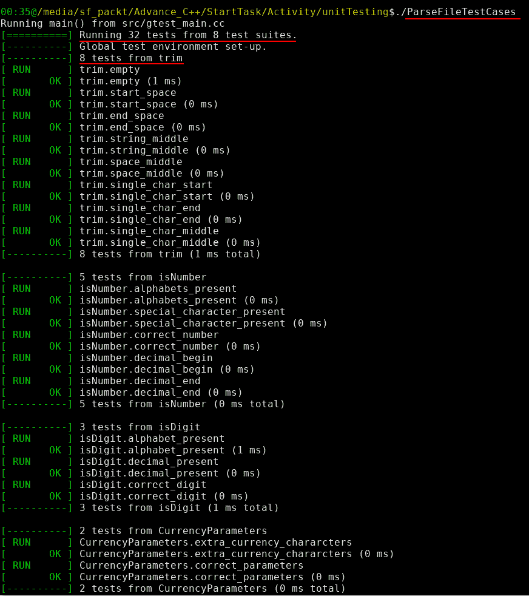

###### Figure 7.23: 所有测试运行正常

下一步的截图如下：

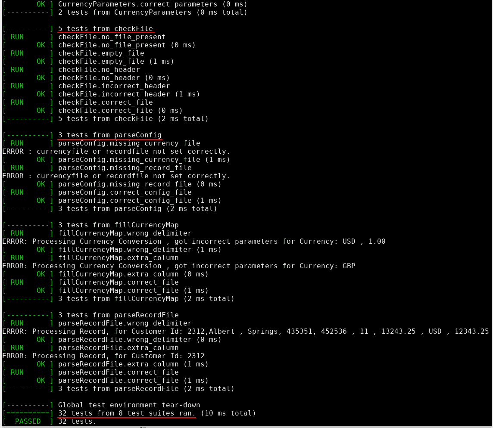

###### Figure 7.24: 所有测试运行正常

#### 注意

此活动的解决方案可在 706 页找到。

## 总结

在本章中，我们探讨了各种方法，可在编译时和运行时使用断言捕获可执行文件抛出的错误。我们还了解了静态断言。我们理解了异常是如何生成的，以及如何在代码中处理它们。我们还看到了单元测试如何成为开发者的救星，因为他们能够在早期发现代码中的任何问题。我们为测试用例中需要使用的类利用了模拟对象。然后我们学习了调试器、断点、观察点和数据可视化。我们能够使用调试器定位代码中的问题并修复它们。我们还完成了一个活动，编写了必要的测试用例来检查用于解析文件的函数的准确性。


在下一章中，我们将学习如何优化代码。我们将回顾处理器如何执行代码和访问内存。我们还将学习如何确定软件执行所需的额外时间。最后，我们将了解内存对齐和缓存访问。
