# 8. 速度的需求——性能与优化

## 学习目标

读完本章后，你将能够：

*   手动计时代码性能
*   使用源代码插桩来测量代码执行时间
*   使用 `perf` 工具分析程序性能
*   使用 `godbolt compiler explorer` 工具分析编译器生成的机器码
*   使用编译器标志生成更好的代码
*   应用能带来性能提升的代码惯用法
*   编写缓存友好的代码
*   将算法级优化应用于实际问题

在本章中，我们将探讨让我们能够编写通用快速代码的概念，以及一些特别适用于 `C++` 的实用技术。

## 简介

在当今极其庞大且复杂的软件系统世界中，**稳定性** 和 **可维护性** 通常被视为大多数软件项目的主要目标，而自 2000 年代以来，优化并未被广泛视为一个值得追求的目标。这是因为硬件技术的飞速发展按固定时间表定期超越了软件需求。

多年来，硬件改进似乎将继续跟上软件的性能需求，但应用程序持续变得更大、更复杂。与 `Python` 或 `Ruby` 等性能较低但更易用的解释型语言相比，`C` 和 `C++` 等底层原生编译语言的流行度有所下降。

然而，到了 2000 年代末，CPU 晶体管数量（及性能）每 18 个月翻一番的趋势（**摩尔定律** 的结果）已经停止，性能改进趋于平缓。由于物理限制和制造成本，5 到 10 GHz 处理器在 2010 年代广泛普及的预期从未实现。然而，移动设备的快速普及以及数据科学和机器学习高性能计算应用的兴起，突然重燃了对快速高效代码的需求。每瓦性能已成为新的优化指标，因为大型数据中心消耗着巨大的电力。例如，2017 年，美国的 Google 服务器耗电量超过了整个英国。

到目前为止，在本书中，我们已经了解了 `C++` 语言在易用性方面是如何演进的，而没有牺牲任何相比 `C` 等传统语言的性能潜力。这意味着我们可以在 `C++` 中编写快速代码，而不必一定牺牲可读性或稳定性。在下一节中，我们将学习性能测量的概念。

## 性能测量

优化最重要的方面是 **代码执行时间的测量**。除非我们使用广泛的输入数据集来测量应用程序的性能，否则我们将无法知道哪部分最耗时，我们的优化努力将像盲人瞎马一样，无法保证有结果。有几种测量方法，其中一些列在此处：

*   运行时插桩或性能分析
*   源代码插桩
*   手动执行计时
*   研究生成的汇编代码
*   通过研究代码和使用的算法进行手动估算

前面的列表按测量准确性排序（最准确的在前）。然而，这些方法各有不同的优势。采用哪种方法取决于优化工作的目标和范围。在为了获得最快可能的实现而进行的全力努力中，可能需要所有这些方法。我们将在以下各节中检查每一种方法。

### 手动估算

性能最大的潜在提升发生在我们用更优的算法替换原有算法时。例如，考虑一个计算从 **1** 到 **n** 的整数和的简单函数的两个版本：

```cpp
int sum1(int n)
{
    int ret = 0;
    for (int i = 1; i <= n; ++i)
    {
        ret += i;
    }
    return ret;
}

int sum2(int n)
{
    return (n * (n + 1)) / 2;
}
```

第一个函数 `sum1` 使用简单循环计算总和，其运行时复杂度与 `n` 成正比；而第二个函数 `sum2` 使用代数求和公式，耗时恒定，与 `n` 无关。在这个颇为人为的例子中，我们仅通过使用基本的代数知识就优化了一个函数。

对于每一种可想象的操作，都有许多已被证明是最优的知名算法。让代码运行得尽可能快的最佳方法是使用算法。

拥有算法词汇至关重要。我们不需要成为算法专家，但至少需要了解各个领域中高效算法的存在，即使我们无法从头实现它们。稍深一点的算法知识将帮助我们找到程序中执行与知名算法相似（如果不完全相同）计算的部分。某些代码特征，如嵌套循环或数据的线性扫描，通常是显而易见的改进候选者，前提是我们能验证这些结构位于代码的**热点** 中。**热点** 是指非常频繁运行并显著影响性能的代码段。`C++` 标准库包含许多基本算法，可用作构建块来提高许多常见操作的效率。

### 研究生成的汇编代码

**汇编语言** 是实际在处理器上执行的二进制机器码的可读表示。对于 `C++` 等编译语言的任何严肃程序员来说，对汇编语言的基本理解都是一项巨大的资产。

研究程序生成的汇编代码可以让我们深入了解编译器的工作原理并估算代码效率。在许多情况下，这是确定效率瓶颈的唯一可行方法。

此外，汇编语言的基本知识对于调试 `C++` 代码至关重要，因为一些最难捕捉的 Bug 与低级生成的代码有关。

一个用于分析编译器生成代码的非常强大且流行的在线工具是 **Compiler Explorer**，我们将在本章中使用它。

> **注意：** **Godbolt compiler explorer** 可在 <https://godbolt.org> 找到。

以下是 Godbolt compiler explorer 的截图：

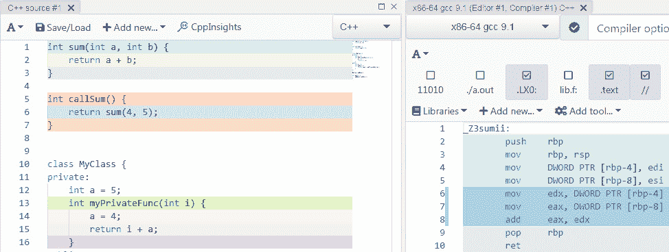

**图 8.1：Godbolt compiler explorer**

正如你所见，Godbolt compiler explorer 由两个窗格组成。左侧窗格用于输入代码，右侧窗格显示生成的汇编代码。左侧窗格有一个下拉菜单，以便我们选择所需的语言。为了我们的目的，我们将使用 `gcc` 编译器的 `C++` 语言。

右侧窗格有选项可用于选择编译器版本。几乎所有流行编译器（如 `gcc`、`clang` 和 `cl`（**Microsoft C++**））的版本都在其中，包括非 X86 架构（如 `ARM`）的版本。

> **注意：** 为简化起见，我们将 Intel 处理器架构称为 `x86`，尽管正确的定义是 `x86/64`。我们将省略 "**64**"，因为目前制造的几乎所有处理器都是 `64 位`。尽管 `x86` 由 Intel 发明，但现在所有 PC 处理器制造商都获得了使用许可。


## 熟悉 Compiler Explorer 与 x86 汇编

## 求和函数示例

为了熟悉 `Compiler Explorer 工具` 的基础知识并从基本层面理解 `x86` 汇编代码，让我们来检查编译器为一个简单的函数生成的汇编代码，该函数用于计算从 `1` 到 `N` 的整数和。以下是需要在 Compiler Explorer 左侧面板编写的 `sum` 函数：

```c
int sum(int n)
{
    int ret = 0;
    for(int i = 1; i <= n; ++i)
    {
        ret += i;
    }
    return ret;
}
```

## 设置编译器

在右侧面板中，编译器必须设置为 `x86-64 gcc 8.3`，如下所示：

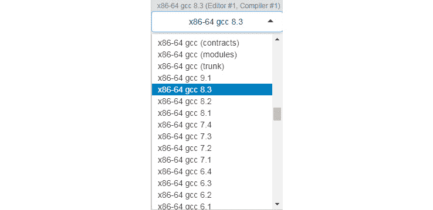

*图 8.2：C++ 编译器*

完成此操作后，左侧面板的代码会自动重新编译，生成的汇编代码将显示在右侧面板中。在这里，输出经过颜色编码，以显示哪些汇编代码行是由哪些 C++ 代码行生成的。以下截图显示了生成的汇编代码：

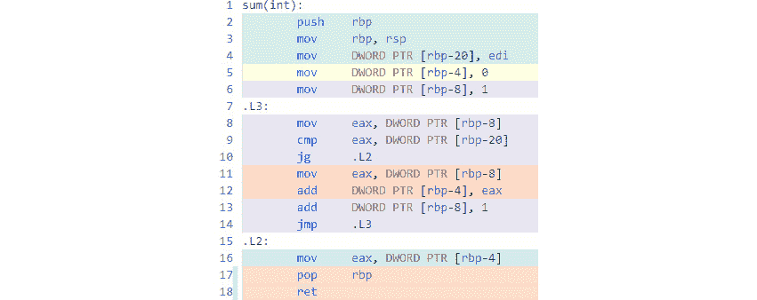

*图 8.3：汇编结果*

## 分析汇编代码

### 函数序言

让我们简要分析一下前面的汇编代码。汇编语言中的每条指令都由一个 `操作码` 和一个或多个 `操作数` 组成，操作数可以是寄存器、常量值或内存地址。`寄存器` 是 CPU 中速度极快的存储位置。在 `x86` 架构中，有八个主要寄存器，分别是 `RAX`、`RBX`、`RCX`、`RDX`、`RSI`、`RDI`、`RSP` 和 `RBP`。Intel x86/x64 架构采用了一种独特的寄存器命名模式：

### 寄存器命名约定

*   `RAX` 是一个 64 位通用整数寄存器。
*   `EAX` 指代 `RAX` 的低 32 位。
*   `AX` 指代 `EAX` 的低 16 位。
*   `AL` 和 `AH` 分别指代 `AX` 的低 8 位和高 8 位。

同样的约定适用于其他通用寄存器，如 `RBX`、`RCX` 和 `RDX`。`RSI`、`RDI` 和 `RBP` 寄存器有 16 位和 32 位版本，但没有 8 位子寄存器。指令的操作码可以是多种类型，包括算术、逻辑、位运算、比较或跳转操作。通常将操作码称为指令。例如，"`mov 指令`" 意味着操作码为 `mov` 的指令。以下是我们的 `sum` 函数的汇编代码快照：


*图 8.4：sum 函数的汇编代码*

在前面的截图中，前几行被称为 `函数序言`，即用于设置 `栈帧` 和局部变量的指令。栈帧代表函数中的局部数据，包括参数和局部变量。当函数返回时，栈帧被丢弃。`mov` 指令用常量值初始化寄存器或内存位置。此处汇编代码的语法称为 `Intel 语法`。该语法的约定是目标操作数始终在第一位。例如，汇编代码 `MOV RAX, RBX` 表示将 `RBX` 寄存器中的值移动到 `RAX` 寄存器中。

> **注意**
> 汇编语言通常不区分大小写，因此 `EAX` 和 `eax` 含义相同。

### 栈帧与内存访问

汇编中的 `DWORD PTR [rbp-8]` 表达式等同于 C 语言表达式 `(*(DWORD*)(rbp - 8))`。换句话说，内存地址 `rbp-8` 作为一个 `4` 字节的 `DWORD`（双字，32 位）被访问。汇编代码中的方括号表示解引用，很像 C/C++ 中的 `*` 运算符。`rbp` 寄存器是基址指针，始终包含当前正在执行的函数栈基址的地址。不必确切了解栈帧如何工作，但请记住，由于栈从较高地址开始向下增长，函数参数和局部变量的地址相对于 `rbp` 为负偏移量。如果你看到相对于 `rbp` 的负偏移量，它指的是局部变量或参数。

在前面的截图中，第一条 `mov` 指令将 `edi` 寄存器中的值放到栈上——在本例中，它代表传入的 `n` 参数。最后两条 `mov` 指令分别将我们代码中的 `ret` 变量和 `i` 循环变量初始化为 `0` 和 `1`。

### For 循环分析

现在，检查序言和初始化之后的汇编代码快照——这是我们的 `for()` 循环：


*图 8.5：for 循环的汇编代码*

在前面的截图中，带有字符串后跟冒号的行称为 `标签`。它们非常类似于 `BASIC`、`C/C++` 或 `Pascal` 等编程语言中的标签，并被用作 `跳转` 指令的目标（汇编语言中 `goto` 语句的等价物）。

在 x86 汇编中以 J 开头的指令都是跳转指令，例如 `JMP`、`JG`、`JGE`、`JL`、`JLE`、`JE`、`JNE` 等。跳转指令是有条件或无条件的 goto。在前面的截图中，`mov` 指令将 `i` 变量的值从内存加载到 `eax` 寄存器中。然后，它通过 `cmp` 指令与内存中的 `n` 值进行比较。

> **注意**
> 此处的 `JG` 指令意为 `大于则跳转`。

如果比较结果为大于，则执行跳转到 `.L2` 标签（位于循环外部）。如果不是，则执行继续进行下一条指令，如下所示：


*图 8.6：下一条指令的汇编代码*

这里，`i` 的值再次被重新加载到 `eax` 中，这似乎是不必要的。但请记住，这段汇编代码未经过优化，因此编译器生成的代码可能不是最优的，并可能包含不必要的工作。然后，`eax` 中的值被加到 `ret` 上，随后 `i` 加 `1`。最后，执行跳回 `.L3` 标签。`.L2` 和 `.L3` 标签之间的这些指令构成了执行 `for` 循环并计算不超过 `n` 的整数序列之和的代码，如下所示：


*图 8.7：for 循环的汇编代码*

### 函数尾声

这被称为 `函数尾声`。首先，要返回的值 `ret` 被移入 `eax` 寄存器——这通常是存储函数返回值的寄存器。然后，栈帧被重置，最后 `ret` 从 `sum()` 函数返回。

> **注意**
> 上述汇编清单中的 "`ret`" 是 `RETURN` 指令的助记符，不应与我们 C++ 代码示例中的 "`ret`" 变量混淆。

## 将源代码映射到汇编

弄清一系列汇编指令的作用并非易事，但通过观察以下要点，可以大致了解源代码与指令之间的映射关系：

*   代码中的常量值可直接在汇编中识别。
*   算术运算（如 `add`、`sub`、`imul`、`idiv` 等）可被识别。
*   条件跳转映射到循环和条件语句。
*   函数调用可直接读取（函数名出现在汇编代码中）。

## 添加优化标志

现在，让我们观察如果在右上角的编译器选项字段中添加编译器优化标志，代码会产生什么效果：

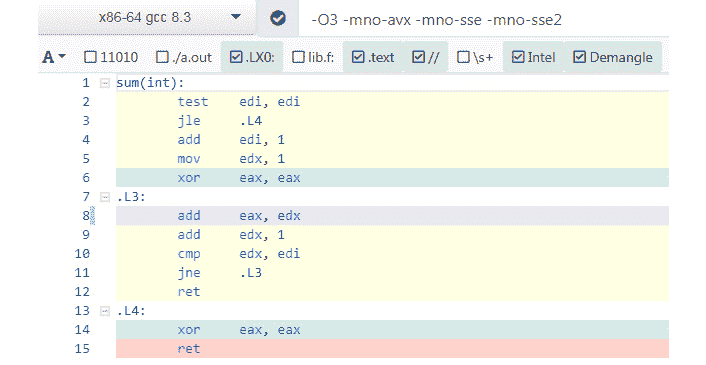

*图 8.8：添加编译器优化标志*


## 编译器优化与汇编分析

在前面的截图中，`O3` 代表**最大优化**。其他标志，如 `-mno-avx`、`-mno-sse` 和 `-mno-sse2`，用于防止编译器生成与当前示例无关的**向量指令**。我们可以看到，编译器不再访问内存，仅使用寄存器工作。请注意 `xor eax, eax` 这行指令，其效果是将 `0` 存入 `eax`——这比从内存加载常量 `0` 到寄存器更高效。由于内存访问需要数个时钟周期（从 `5` 到 `100` 个时钟周期不等），仅使用寄存器本身就会产生巨大的加速效果。

当下拉菜单中的编译器更改为 `x86-64 clang 8.0.0` 时，汇编代码随之改变，如下截图所示：

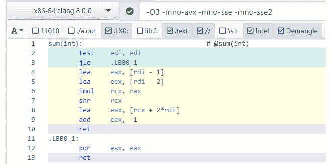

*图 8.9：使用新编译器的汇编代码*

在前面的汇编清单中，观察到没有以 `J` 开头的指令（用于跳转）。因此，根本不存在循环结构！让我们检查编译器是如何计算 `1` 到 `n` 的和的。如果 `n` 的值 `<= 0`，则跳转到 `.LBB0_1` 标签处退出，返回 `0`。让我们分析以下指令：


*图 8.10：使用新编译器的汇编代码*

以下代码是前面指令的 C 语言等价形式。请记住 `n` 在 `EDI` 寄存器中（因此也在 `RDI` 寄存器中，因为它们重叠）：

```
eax = n - 1;
ecx = n - 2;
rcx *= rax;
rcx >>= 1;
eax = rcx + 2 * n;
eax--;
return eax;
```

或者，如果我们用一行代码编写，将如下所示：

```
return ((n-1) * (n-2) / 2) + (n * 2) - 1;
```

如果我们简化这个表达式，将得到以下形式：

`((n² - 3n + 2) / 2) + 2n - 1`

或者，我们可以用以下格式编写：

`((n² - 3n + 2) + 4n - 2) / 2`

这可以简化为：

`(n² + n) / 2`

或者，我们可以写成：

`(n * (n+1)) / 2`

这是包含 `1` 到 `n` 求和的闭式方程，也是计算它的最快方法。编译器极其聪明——它不仅仅逐行查看我们的代码，而是推断出循环的效果是计算求和，并自行推导出了代数公式。它没有找出最简单的表达式，而是找到了一个等价的、只需少量额外操作的表达式。尽管如此，去除循环使该函数变得非常优化。

如果我们修改 `for` 循环中变量 `i` 的初始值或最终值以创建不同的求和，编译器仍能执行必要的代数操作，推导出无需循环的闭式解。

这只是编译器变得极其高效且近乎智能的一个例子。然而，我们必须明白，这种特定的求和优化是专门编程进 `clang` 编译器的。这并不意味着编译器能对任何可能的循环计算执行此类技巧——那实际上要求编译器拥有通用人工智能以及世界上所有的数学知识。

让我们通过生成的汇编代码探索另一个编译器优化示例。请看以下代码：

```cpp
#include <vector>

int three()
{
    const std::vector<int> v = {1, 2};
    return v[0] + v[1];
}
```

在编译器选项中，如果我们选择 `x86-64 clang 8.0.0` 编译器并添加 `-O3 -stdlib=libc++`，将生成以下汇编代码：

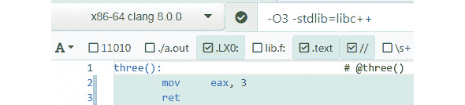

*图 8.11：使用新编译器生成的汇编代码*

正如前面截图所示，编译器正确地判断出向量与该函数无关，并移除了所有开销。它还在编译时完成了加法，并直接使用结果 `3` 作为常量。本节的主要收获如下：

- 给定正确的选项，编译器在优化代码时可以极其聪明。
- 研究生成的汇编代码对于获取执行复杂度的高层估算非常有用。
- 对机器代码工作原理的基本理解对任何 C++ 程序员都很有价值。

## 手动执行计时

这是快速为小程序计时的最简单方法。我们可以使用命令行工具来测量程序执行所需的时间。在 Windows 7 及以上版本中，可以使用以下 PowerShell 命令：

```
powershell -Command "Measure-Command {<your program and arguments here>}"
```

在 **Linux**、**MacOS** 和其他 **类 UNIX** 系统上，可以使用 `time` 命令：

```
time <your program and arguments here>
```

在下一节中，我们将实现一个小程序，并探讨关于程序执行计时的一些注意事项。

## 练习 1：为程序执行计时

在本练习中，我们将编写一个对数组执行求和的程序。这里的目的是为 `sumVector()` 函数计时。当我们希望单独测试一个函数时，此方法很有用。因此，测试程序的唯一目的是执行单个函数。由于计算非常简单，我们需要运行该函数数千次才能获得可测量的执行时间。在这种情况下，我们将从 `main()` 函数调用 `sumVector()` 函数，传递一个包含随机整数的 `std::vector`。

### 注意

用于测试单个函数的程序有时被称为**驱动程序**（不要与设备驱动程序混淆）。

执行以下步骤完成此练习：

1.  创建一个名为 `Snippet1.cpp` 的文件。

2.  定义一个名为 `sumVector` 的函数，在循环中对每个元素求和：

    ```cpp
    int sumVector(std::vector<int> &v)
    {
        int ret = 0;
        for(int i: v)
        {
            ret += i;
        }
        return ret;
    }
    ```

3.  定义 `main` 函数。使用 C++11 随机数生成工具初始化一个包含 `10,000` 个元素的向量，然后调用 `sumVector` 函数 `1,000` 次。编写以下代码实现此功能：

    ```cpp
    #include <random>
    #include <iostream>

    int main()
    {
        // 初始化随机数生成器
        std::random_device dev;
        std::mt19937 rng(dev());
        // 创建一个 0 到 1000 的分布范围
        std::uniform_int_distribution<std::mt19937::result_type> dist(0,1000);
        // 在向量中填充 10000 个数字
        std::vector<int> v;
        v.reserve(10000);
        for(int i = 0; i < 10000; ++i)
        {
            v.push_back(dist(rng));
        }
        // 调用我们的函数 1000 次，累加到总和
        double total = 0.0;
        for(int i = 0; i < 1000; ++i)
        {
            total += sumVector(v);
        }
        std::cout << "Total: " << total << std::endl;
    }
    ```

4.  在 Linux 终端使用以下命令编译、运行并为该程序计时：

    ```
    $ g++ Snippet1.cpp
    $ time ./a.out
    ```

    上一条命令的输出如下：

    

    *图 8.12：为 Snippet1.cpp 代码计时的输出*


从前面的输出可以看出，对于该系统，程序执行耗时 **0.122** 秒（注意结果会因系统配置而异）。如果我们重复运行此计时命令，可能会得到略微不同的结果，因为首次运行后程序会被加载到内存中，后续运行会稍快一些。最好运行并计时程序约 **5** 次并取平均值。我们通常不关心耗时的绝对值，而是关心随着代码优化该值如何改善。

5. 使用以下命令探索编译器优化标志的效果：

```
$ g++ -O3 Snippet1.cpp
$ time ./a.out
```

输出如下：


###### 图 8.13：使用 -O3 编译 Snippet1.cpp 代码的计时输出

从前面的输出可以看出，程序速度提升了约 **60** 倍，这似乎令人难以置信。

6. 修改代码，使循环执行 **100,000** 次而非 **1,000** 次：

```cpp
// Call out function 100000 times
for (int i = 0; i < 100000; ++i) {
    total += sumVector(v);
}
```

7. 使用以下命令重新编译并计时：

```
$ g++ -O3 Snippet1.cpp
$ time ./a.out
```

执行上述命令后的输出如下：


###### 图 8.14：使用 10,000 次迭代计时 Snippet1.cpp 代码的输出

从前面的输出可以看出，耗时似乎完全相同。这看似不可能，但实际发生的情况是：由于我们的程序从未产生任何副作用（如打印求和结果），编译器可以自由地将我们的代码替换为空程序。根据 C++ 标准，从功能上讲，该程序与空程序是等价的，因为运行它没有任何副作用。

8. 打开 Compiler Explorer 并粘贴全部代码。将编译器选项设为 **\-O3** 并观察生成的代码：

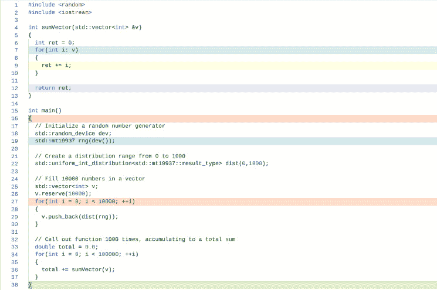

###### 图 8.15：Compiler Explorer 中的 Snippet1.cpp 代码

从前面的截图可以看出，**for** 循环内的行未着色，且未为它们生成汇编代码。

9. 修改代码，通过打印依赖于计算的值来确保求和必须执行，添加以下行：

```cpp
std::cout << "Total:" << total << std::endl;
```

10. 这里我们只是多次将 `sumVector()` 的结果累加到一个哑 `double` 值并打印它。修改代码后，打开终端并输入以下命令：

```
$ g++ -O3 Snippet1.cpp
$ time ./a.out
```

上述命令的输出如下：


###### 图 8.16：具有打印值副作用的 Snippet1.cpp 代码计时输出

在前面的输出中，我们可以看到程序实际执行了计算，而非作为空程序运行。向 **cout** 打印 `total` 是一种副作用，导致编译器不消除该代码。导致依赖于代码执行的副作用（如打印结果）是阻止编译器优化器移除代码的一种方法。在下一节中，我们将学习如何在无副作用的情况下为程序计时。

## 无副作用的程序计时

正如上一个练习所示，我们需要在程序中创建副作用（使用 **cout**），以防止编译器忽略我们编写的所有代码。另一种让编译器认为某代码有副作用的技术是将其结果赋给 **volatile** 变量。`volatile` 限定符告诉编译器：“该变量必须始终从内存读取并写入内存，而非寄存器。” `volatile` 变量的主要目的是访问设备内存，此类设备内存访问必须遵循上述规则。实际上，编译器将 `volatile` 变量视为可能受当前程序外部影响而改变，因此绝不会优化它们。我们将在后续章节中使用此技术。

还有更高级的方法绕过此问题，即向编译器指定特殊的汇编代码指令，而非使用副作用。但这超出了入门教材的范围。后续示例中，我们将始终添加代码，确保函数结果用于副作用或赋给 `volatile` 变量。未来章节中，我们将学习如何检查编译器生成的汇编代码，并检测编译器为优化而消除代码的情况。

## 源代码插桩

**插桩** 是指在不改变程序行为的前提下，向程序添加额外代码并在执行时捕获信息的过程。这可能包括性能计时（以及内存分配、磁盘使用模式等其他度量）。在源代码插桩中，我们手动添加代码为程序执行计时，并在程序结束时记录该数据以供分析。这种方法的优势在于其可移植性且无需外部工具。它还允许我们选择性地为代码的任意部分添加计时。

## 练习 2：编写代码计时器类

在本练习中，我们将创建一个 **RAII** 类，用于测量单个代码块的执行时间。我们将把它作为后续练习中代码的主要计时机制。它不如其他性能测量方法复杂，但使用更简便，能满足大多数需求。我们的类基本要求如下：

*   能记录代码块的累计耗时。
*   能记录调用次数。

执行以下步骤完成此练习：

1. 创建名为 **Snippet2.cpp** 的文件。

2. 包含以下头文件：

```cpp
#include <map>
#include <string>
#include <chrono>
#include <iostream>
#include <cstdint>

using std::map;
using std::string;
using std::cerr;
using std::endl;
```

3. 编写以下代码定义 **Timer** 类及其成员函数：

```cpp
class Timer {
    static map<string, int64_t> ms_Counts;
    static map<string, int64_t> ms_Times;
    const string &m_sName;
    std::chrono::time_point<std::chrono::high_resolution_clock> m_tmStart;
```

从前面的代码可以看出，类成员包含一个名称、一个起始时间戳和两个 **static map**。该类的每个实例旨在为某个代码块计时。该代码块可以是函数作用域或由花括号界定的任意其他块。使用模式是在块顶部定义 `Timer` 类实例并传入名称（可以是函数名或其他方便的标签）。实例化时记录当前时间戳，块退出时，该类的析构函数记录该块的累计耗时及执行次数。时间和计数分别存储在静态 map `ms_Times` 和 `ms_Counts` 中。

4. 编写以下代码定义 **Timer** 类的构造函数：

```cpp
public:
    // When constructed, save the name and current clock time
    Timer(const string &sName) : m_sName(sName) {
        m_tmStart = std::chrono::high_resolution_clock::now();
    }
```


## 运行时性能分析

## 5. 定义 `Timer` 类的析构函数

编写以下代码：

```cpp
// 析构时，累加逝去的时间，并增加该名称下的计数
~Timer()
{
    auto tmNow = std::chrono::high_resolution_clock::now();
    auto msElapsed = std::chrono::duration_cast<std::chrono::milliseconds>(tmNow - m_tmStart);
    ms_Counts[m_sName]++;
    ms_Times[m_sName] += msElapsed.count();
}
```

在前面的代码中，逝去的时间以毫秒为单位计算。然后，我们将其加到该代码块名称的累计逝去时间上，并增加该代码块执行次数的计数。

## 6. 定义一个名为 `dump()` 的 `static` 函数

该函数打印出计时结果的摘要：

```cpp
// 为每个被测量的代码块/函数打印统计信息
static void dump()
{
    cerr << "Name\t\t\tCount\t\t\tTime(ms)\t\tAverage(ms)\n";
    cerr << "-----------------------------------------------------------------------------------\n";
    for(const auto& it: ms_Times)
    {
        auto iCount = ms_Counts[it.first];
        cerr << it.first << "\t\t\t" << iCount << "\t\t\t" << it.second << "\t\t\t" << it.second / iCount << "\n";
    }
}
```

在前面的代码中，名称、执行次数、总时间和平均时间以表格形式打印。我们在字段名和字段值之间使用多个制表符，使它们在控制台上垂直对齐。该函数可根据需要修改。例如，我们可以修改此代码以 CSV 文件形式转储输出，以便导入电子表格进行进一步分析。

## 7. 定义 `static` 成员以完成类定义

```cpp
// 定义静态成员
map<string, int64_t> Timer::ms_Counts;
map<string, int64_t> Timer::ms_Times;

const int64_t N = 1'000'000'000;
```

## 8. 定义两个简单的函数作为计时示例

现在我们已经定义了 `Timer` 类，定义两个简单的函数作为计时示例。一个执行加法，另一个执行乘法。由于这些操作微不足道，我们将循环 **10 亿次**，以便获得可测量的结果。

### 注意

C++ 14 及以上版本允许我们在整数常量中使用单引号符号以提高可读性；例如，我们可以写成 `1'000'000` 而不是 `1000000`。

编写加法和乘法函数。两个函数分别只是将整数 `1` 到 `N` 进行累加和累乘：

```cpp
unsigned int testMul()
{
    Timer t("Mul");
    unsigned int x = 1;
    for(int i = 0; i < N; ++i)
    {
        x *= i;
    }
    return x;
}

unsigned int testAdd()
{
    Timer t("Add");
    unsigned int x = 1;
    for(int i = 0; i < N; ++i)
    {
        x += i;
    }
    return x;
}
```

在前面的代码中，我们对反复 **加**/**乘** 的变量使用了 `unsigned int`。我们使用无符号类型是为了让算术运算时的溢出不会导致未定义行为。如果我们使用有符号类型，程序将会有未定义行为，且无法保证以任何方式正常工作。其次，我们从 `testAdd()` 和 `testMul()` 函数返回计算出的值，以确保编译器不会因为缺乏副作用而移除这些代码。为了给这些函数中的每一个计时，我们只需在函数开头声明一个带有合适标签的 `Timer` 类实例。计时在 `Timer` 对象实例化时立即开始，在该对象超出作用域时停止。

## 9. 编写 `main` 函数

我们将简单地各调用两个测试函数 **10** 次：

```cpp
int main()
{
    volatile unsigned int dummy;
    for(int i = 0; i < 10; ++i)
        dummy = testAdd();
    for(int i = 0; i < 10; ++i)
        dummy = testMul();
    Timer::dump();
}
```

正如你在前面的代码中所见，我们每个函数调用 **10** 次，以便演示 `Timer` 类对函数多次运行进行计时。将函数结果赋值给 `volatile` 变量会强制编译器假设存在全局副作用。因此，它不会在优化时消除我们测试函数中的代码。在退出前，我们调用 `Timer::dump` 静态函数来显示结果。

## 10. 使用 `-O1` 编译并运行

保存程序并打开终端。使用不同的优化级别编译并运行程序——在 `gcc` 和 `clang` 编译器中，这由 `-ON` 编译器标志指定，其中 `N` 是 `1` 到 `3` 的数字。首先添加 `-O1` 编译器标志：

```bash
$ g++ -O1 Snippet2.cpp && ./a.out
```

这段代码生成以下输出：

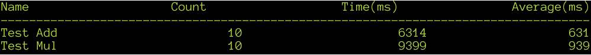

**图 8.17：使用 -O1 选项编译时 Snippet2.cpp 的代码性能**

## 11. 使用 `-O2` 编译并运行

现在，在终端中添加 `-O2` 编译器标志并执行程序：

```bash
$ g++ -O2 Snippet2.cpp && ./a.out
```

这将生成以下输出：

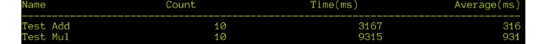

**图 8.18：使用 -O2 选项编译时 Snippet2.cpp 的代码性能**

## 12. 使用 `-O3` 编译并运行

在终端中添加 `-O3` 编译器标志并执行程序：

```bash
$ g++ -O3 Snippet2.cpp && ./a.out
```

这将生成以下输出：

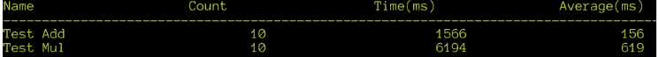

**图 8.19：使用 -O3 选项编译时 Snippet2.cpp 的代码性能**

请注意，`testMul` 函数仅在 `O3` 下变快，但 `testAdd` 函数在 `O2` 下变快，在 `O3` 下**快得多**。我们可以通过多次运行程序并取平均时间来验证这一点。没有明显的原因解释为什么某些函数加速而其他函数没有。我们必须详尽地检查生成的代码才能理解原因。不能保证这会发生在所有具有不同编译器甚至不同编译器版本的系统上。要记住的主要观点是，我们永远不能假设性能，而必须始终对其进行测量，并且如果我们认为所做的任何更改会影响性能，就必须重新测量。

## 13. 定义宏以简化计时

为了更方便地使用我们的 `Timer` 类为单个函数计时，我们可以编写一个宏。C++ 11 及以上版本支持一个特殊的编译器内置宏 `__func__`，它始终包含当前正在执行的函数的名称作为 `const char*`。利用它来定义一个宏，这样我们就不需要为 `Timer` 实例指定标签：

```cpp
#define TIME_IT Timer t(__func__)
```

## 14. 将 `TIME_IT` 宏添加到两个函数中

更改创建 `Timer` 对象的现有行：

```cpp
unsigned int testMul()
{
    TIME_IT;

unsigned int testAdd()
{
    TIME_IT;
```

## 15. 使用宏编译并运行

保存程序并打开终端。使用以下命令再次编译并运行它：

```bash
$ g++ -O3 Snippet2.cpp && ./a.out
```

前面命令的输出如下：

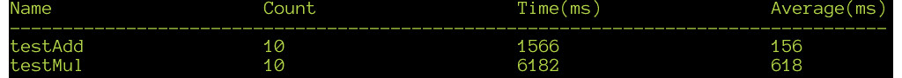

**图 8.20：使用宏进行计时时 Snippet2.cpp 的代码输出**

在前面的输出中，请注意现在打印出了实际的函数名。使用此宏的另一个优点是，我们可以默认将其添加到所有潜在的耗时函数中，并通过简单地将定义更改为空操作（no-op）来为生产构建禁用它，这将导致计时代码永不运行——避免了大量编辑代码的需要。我们将在后续练习中使用这个相同的 `Timer` 类来为代码计时。


## 性能分析

**性能分析** 是一种非侵入式的方法，用于测量程序中函数的性能。性能分析器通过以频繁的间隔（每秒数百次）对程序的当前执行地址进行采样，并记录当时正在执行的函数来工作。这是一种统计采样方法，具有合理的准确性。不过，有时结果可能会令人困惑，因为程序可能会花费大量时间在属于操作系统内核一部分的函数上。Linux 上最流行的运行时性能分析工具是 `perf`。在下一节中，我们将利用 `perf` 来分析我们的程序。

### 练习 3：使用 `perf` 分析程序

`perf` 可以在 `Ubuntu` 上按如下方式安装：

```
apt-get install linux-tools-common linux-tools-generic
```

为了熟悉使用 `perf` 的基础知识，我们将借助 `perf` 工具对上一练习中的程序进行性能分析和分析。执行以下步骤以完成此练习：

1.  打开我们在上一练习中创建的 `Snippet2.cpp` 文件，并移除两个函数中的 `TIME_IT` 宏。

2.  打开终端，使用 `-O3` 标志重新编译代码，然后按如下方式使用 `perf` 创建性能分析数据样本：

    ```
    g++ -O3 Snippet2.cpp
    perf record ./a.out
    ```

    上一条命令的输出如下：

    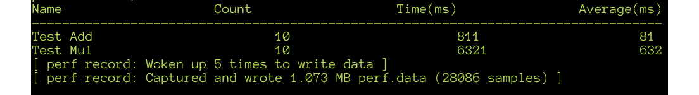

    ###### 图 8.21：使用 `perf` 命令分析 `Snippet2.cpp` 中的代码

    这将创建一个名为 `perf.data` 的文件，该文件可以被分析或可视化。

3.  现在，使用以下命令来可视化记录的数据：

    ```
    perf report
    ```

    执行上一条命令后，基于控制台的 GUI 将显示以下数据：

    

    ###### 图 8.22：使用 `perf` 命令分析 `Snippet2.cpp` 中的代码

    您可以上下移动光标以选择一个函数，然后按 `Enter` 键获取选项列表。

4.  高亮 `testMul`，按 `Enter` 键，并在生成的列表中选择 **注释 testMul**。将显示一份汇编代码列表，其中带有描述每行代码执行时间百分比的注释，如下所示：

    

    ###### 图 8.23：使用 `perf` 命令查看 `Snippet2.cpp` 代码的计时统计

    请注意，**整数乘法**（`IMUL`）指令（整数乘法）占用了超过 **99%** 的执行时间。传统上，整数乘法在 `x86` 架构上一直很昂贵，即使在最新一代 CPU 中，这依然成立。此注释视图会在每条跳转或分支指令旁显示箭头，高亮显示时，会显示其关联的比较指令以及跳转目标地址，并用连线标示。您可以按左箭头键返回上一视图，并使用 `q` 键退出程序。

到目前为止，我们已经了解了几种用于评估程序性能的方法。这是优化中最关键的阶段，因为它告诉我们该将精力集中在何处。在接下来的章节中，我们将探讨各种有助于优化代码的技术。

## 优化策略

代码优化可以通过多种方式完成，例如以下方式：

*   基于编译器的优化
*   源代码微优化
*   缓存友好的代码
*   算法优化

在这里，每种技术都有其优缺点。我们将在接下来的章节中详细研究这些方法。粗略地说，这些方法按所需工作量以及潜在的性能收益排序。我们将在下一节中了解基于编译器的优化。

### 基于编译器的优化

向编译器传递正确的选项可以带来许多性能收益。一个现实世界的例子是英特尔创建的 Clear Linux `distro`（Linux 发行版）。该 `distro` 经过编译以从所有代码中榨取最大性能，在大多数基准测试中比大多数其他 Linux 发行版快 30%，这是一个非常显著的加速。在 `gcc` 和 `clang` 编译器系列中，最基本的优化选项是 `-O<N>`，其中 `N` 是 `1`、`2` 或 `3` 中的一个数字。`-O3` 启用了编译器中几乎所有的优化，但还有其他一些未被该标志启用的优化也能产生影响。

### 循环展开

**循环展开** 是编译器可用来减少执行分支数量的一种技术。每次执行分支时，都会有一定的性能开销。这可以通过多次重复循环体并减少循环执行次数来降低。程序员可以在源代码层面进行循环展开，但现代编译器能自动很好地完成这项工作。

尽管现代处理器通过**分支预测**和**推测执行**电路缓解了分支开销，但循环展开仍能带来性能收益。可以在 `gcc` 和 `clang` 编译器系列中使用 `-funroll-loops` 命令行标志来启用循环展开优化。在下一节中，我们将测试启用和未启用循环展开时的程序性能。

### 练习 4：使用循环展开优化

在本练习中，我们将编写一个使用嵌套循环的简单程序，并测试其在启用和未启用循环展开时的性能。我们将了解编译器实现循环自动展开的方式。

执行以下步骤以完成此练习：

1.  创建一个名为 `Snippet3.cpp` 的文件。

2.  编写一个程序，获取前 **10,000** 个数字并打印出其中有多少互为因数（完整代码可在 `Snippet3.cpp` 中找到）：

    ```cpp
    #include <iostream>

    int main()
    {
        int ret = 0;
        for(size_t i = 1; i < 10000; ++i)
        {
            for(size_t j = 1; j < 10000; ++j)
            {
                if(i % j == 0)
                {
                    ++ret;
                }
            }
        }
        std::cout << "Result: " << ret << std::endl;
    }
    ```

3.  保存程序并打开终端。首先使用 `-O3` 标志编译程序，并使用以下命令计时：

    ```
    g++ -O3 Snippet3.cpp
    time ./a.out
    ```

    上一条命令的输出如下：

    

    ###### 图 8.24：`Snippet3.cpp` 中代码的输出

4.  现在，启用循环展开重新编译相同的代码，并再次计时：

    ```
    g++ -O3 -funroll-loops Snippet3.cpp
    time ./a.out
    ```

    上一条命令的输出如下：

    

    ###### 图 8.25：使用循环展开选项编译的 `Snippet3.cpp` 代码的输出

5.  打开 **Godbolt 编译器资源管理器**，并将前面的完整代码粘贴到左侧。

6.  在右侧，从编译器选项中选择 `x86-64 gcc 8.3`，并在选项中写入 `-O3` 标志。将生成汇编代码。对于 for 循环，您将看到以下输出：

    

    ###### 图 8.26：for 循环的汇编代码


从前面的屏幕截图中可以清晰地看到，`RCX` 寄存器通过 `CMP` 指令与 `10,000` 进行比较，随后是条件跳转 `JNE`（不相等则跳转）。紧接着是外层循环比较，`RSI` 与 `10,000` 比较，随后另一个条件跳转到 `L4` 标签。总体而言，内层条件分支和跳转执行了 `100,000,000` 次。

7. 现在，添加以下选项：`-O3 -funroll-loops`。将生成汇编代码。在该代码中，你会注意到这种代码模式重复了八次（除了 `LEA` 指令，其偏移量会变化）：


**图 8.27：for 循环的汇编代码**

编译器决定将循环体展开八次，将条件跳转指令的执行次数减少了 `87.5%`（约 `8,300,000` 次）。仅此一项就使执行时间提高了 `10%`，这是非常显著的加速。在本练习中我们看到了循环展开的好处——接下来，我们将学习配置文件引导优化。

## 配置文件引导优化

**配置文件引导优化**（PGO）是大多数编译器支持的功能。当程序启用 PGO 编译时，编译器会向程序添加插桩代码。运行这个启用了 PGO 的可执行文件会创建一个日志文件，其中包含程序执行统计信息。**性能分析**（性能分析）是指运行程序以收集性能指标的过程。通常，此分析阶段应使用真实数据集运行，以便生成准确的日志。在此分析运行之后，程序会使用特殊的编译器标志重新编译。此标志使编译器能够根据记录的统计执行数据执行特殊优化。使用这种方法可以实现显著的性能提升。让我们通过一个基于配置文件引导优化的练习来更好地理解这一点。

### 练习 5：使用配置文件引导优化

在本练习中，我们将在上一个练习的代码上使用配置文件引导优化。我们将了解如何配合 `gcc` 编译器使用配置文件引导优化。

执行以下步骤完成此练习：

1. 打开终端，启用分析功能编译上一个练习的代码。包含我们需要的任何其他优化标志（在本例中为 `-O3`）。编写以下代码以实现此功能：

```
$ g++ -O3 -fprofile-generate Snippet3.cpp
```

2. 现在，通过编写以下命令运行分析版本的代码：

```
$ ./a.out
```

程序正常运行并打印结果，没有其他输出——但它生成了一个包含数据的文件，这些数据将帮助编译器在下一步中进行优化。请注意，启用分析后，程序执行速度比正常情况下慢几倍。对于大型程序，请记住这一点。执行上一条命令后，将生成一个名为 `Snippet3.gcda` 的文件，其中包含分析数据。对于大型复杂应用程序，重要的是使用该程序在生产环境中最常遇到的数据集和工作流运行程序。通过在此处正确选择数据，最终的性能增益将更高。

3. 使用 PGO 优化标志重新编译，即 `-fprofile-use` 和 `-fprofile-correction`，如以下代码所示：

```
$ g++ -O3 -fprofile-use -fprofile-correction Snippet3.cpp
```

请注意，除了与分析相关的编译器选项外，其他选项必须与上一编译步骤中的选项完全相同。

4. 现在，如果我们为可执行文件计时，将看到巨大的性能改进：

```
$ time ./a.out
```

上一条命令的输出如下：


**图 8.28：Snippet3.cpp 启用 PGO 优化后的计时代码结果**

在本练习中，我们看到了使用编译器提供的配置文件引导优化所获得的性能收益。对于此代码，性能改进约为 `2.7x`——在更大的程序中，这可能会更高。

## 并行化

如今大多数 CPU 都有多个核心，甚至手机也有四核处理器。我们可以通过指示编译器生成并行代码的编译器标志，非常简单地利用这种并行处理能力。并行化代码的一种机制是使用 C/C++ 语言的 **OpenMP** 扩展。但是，这意味着更改源代码并详细了解如何使用这些扩展。另一种更简单的选择是 `gcc` 编译器特有的功能——它提供了一个扩展标准库，该库实现了大多数算法以并行方式运行。

### 注意

这种自动并行化仅适用于 `gcc` 上的 STL 算法，并不属于 C++ 标准。C++17 标准为大多数算法的并行版本提出了标准库扩展，但尚未得到所有编译器的支持。此外，为了利用此功能，代码必须进行大量重写。

### 练习 6：使用编译器并行化

在本练习中，我们将使用 `gcc` 并行扩展功能来加速标准库函数。我们的目标是了解如何使用 `gcc` 并行扩展。

执行以下步骤完成此练习：

1. 创建一个名为 `Snippet4.cpp` 的文件。

2. 编写一个简单程序，使用 `std::accumulate` 对初始化数组求和。添加以下代码以实现此功能：

```cpp
#include <vector>
#include <string>
#include <iostream>
#include <algorithm>
#include <numeric>
#include <cstdint>

using std::cerr;
using std::endl;

int main()
{
    // Fill 100,000,000 1s in a vector
    std::vector<int> v(100'000'000, 1);
    // Call accumulate 100 times, accumulating to a total sum
    uint64_t total = 0;
    for (int i = 0; i < 100; ++i)
    {
        total += std::accumulate(v.begin(), v.end(), 0);
    }
    std::cout << "Total: " << total << std::endl;
}
```

3. 保存程序并打开终端。正常编译程序并使用以下命令计时执行：

```
$ g++ -O3 Snippet4.cpp
$ time ./a.out
```

上一条命令的输出如下：


**图 8.29：Snippet4.cpp 代码的输出**

4. 现在，使用并行化选项编译代码，即 `-O3 -fopenmp` 和 `-D_GLIBCXX_PARALLEL`：

```
$ g++ -O3 -fopenmp -D_GLIBCXX_PARALLEL Snippet4.cpp
$ time ./a.out
```

输出如下：


**图 8.30：使用并行化选项编译 Snippet4.cpp 代码的输出**


In the previous output, the `user` field shows cumulative CPU time, while the `real` field shows wall-clock time. Their ratio is approximately `7x`. This ratio varies with the number of system CPU cores (eight in this example). If the compiler achieved `100%` parallelization, the ratio on this system could reach `8x`. Note that despite using eight cores, the actual execution time improvement is only about `1.3x`. This is likely because vector allocation and initialization consume most of the time. This is a case of **Amdahl's Law**: once the parallelizable portion is parallelized, the program's serial portion dominates execution time. Nevertheless, our code achieved a `1.3x` speedup, which is a very good optimization result.

So far, we have covered some of the most impactful optimization features in modern compilers. Beyond these, there are other optimization flags, though performance gains may be marginal. Two specific optimization flags are relevant for large projects comprising numerous source files: **Link-Time Optimization (LTO)** or **Link-Time Code Generation (LTCG)**. These are worth enabling in large projects. The next section explores source-code micro-optimizations.

### Source-Code Micro-Optimizations

These techniques involve using specific idiomatic patterns in source code that are typically faster than equivalent alternatives. Early compilers were not smart enough, so micro-optimizations had a significant effect. However, compiler technology is now highly advanced, and micro-optimizations are less impactful. Even so, adopting these habits is beneficial because they speed up code execution even without optimizations enabled. Even in debug builds, faster code saves time during testing and debugging. The next section introduces the `std::vector` container:

### Efficient Use of std::vector Container

`std::vector` is one of the simplest and most useful containers in the standard library. It has no overhead compared to plain C-style arrays, yet provides dynamic growth and optional bounds checking. When the number of elements is unknown at compile time, `std::vector` should almost always be used.

A common idiom with `std::vector` is calling `push_back()` in a loop — as it grows, the vector reallocates a larger buffer (the exact growth factor depends on the standard library implementation). Theoretically, reallocation cost is negligible (since it happens infrequently), but in practice, vector resizing involves copying elements from the old buffer to a newly allocated larger buffer, which can be expensive.

If you know in advance how many elements the vector will hold, calling `reserve()` to preallocate storage can significantly reduce repeated allocations and copies. The next section optimizes vector growth through an exercise.

### Exercise 7: Optimizing Vector Growth

This exercise times a comparison of using `push_back()` in a loop with and without calling `reserve()`. First, extract the `Timer` class used in previous sections into separate header and implementation files for reuse in subsequent snippets. Follow these steps:

1.  Create a header file named `Timer.h`.
2.  Include necessary headers:

```cpp
#include <map>
#include <string>
#include <chrono>
#include <cstdint>
```

3.  Create the `Timer` class. Declare four variables in the class: `ms_Counts`, `ms_Times`, `m_tmStart`, `m_sName`. Declare the constructor, destructor, and `dump()` method. Implementation code is as follows:

```cpp
class Timer
{
    static std::map<std::string, int64_t> ms_Counts;
    static std::map<std::string, int64_t> ms_Times;
    std::string m_sName;
    std::chrono::time_point<std::chrono::high_resolution_clock> m_tmStart;
public:
    // Constructor saves name and current clock time
    Timer(std::string sName);
    // Destructor accumulates elapsed time and increments count for that name
    ~Timer();
    // Prints statistics for each timed code block/function
    static void dump();
};
```

4.  Define helper macro `TIME_IT` to time functions:

```cpp
// Helper macro: time a function
#define TIME_IT Timer t(__func__)
```

5.  Create `Timer.cpp` and include `Timer.h`. Write the actual implementation of the constructor, destructor, and `dump()` method:

```cpp
#include <string>
#include <iostream>
#include <cstdint>
#include "Timer.h"

using std::map;
using std::string;
using std::cerr;
using std::endl;

// Constructor saves name and current clock time
Timer::Timer(string sName) : m_sName(sName)
{
    m_tmStart = std::chrono::high_resolution_clock::now();
}

// Destructor accumulates elapsed time and increments count for that name
Timer::~Timer()
{
    auto tmNow = std::chrono::high_resolution_clock::now();
    auto msElapsed = std::chrono::duration_cast<std::chrono::milliseconds>(tmNow - m_tmStart);
    ms_Counts[m_sName]++;
    ms_Times[m_sName] += msElapsed.count();
}

// Prints statistics for each timed code block/function
void Timer::dump()
{
    cerr << "Name\t\t\tCount\t\t\tTime(ms)\t\tAverage(ms)\n";
    cerr << "-----------------------------------------------------------------------------------\n";
    for (const auto& it : ms_Times)
    {
        auto iCount = ms_Counts[it.first];
        cerr << it.first << "\t\t\t" << iCount << "\t\t\t" << it.second << "\t\t\t" << it.second / iCount << "\n";
    }
}

// Define static members
map<string, int64_t> Timer::ms_Counts;
map<string, int64_t> Timer::ms_Times;
```

6.  Create `Snippet5.cpp`, writing two functions: both use `push_back()` to fill a vector with the first `1,000,000` integers. The second function calls `reserve()` beforehand; the first does not:

```cpp
#include <vector>
#include <string>
#include <iostream>
#include "Timer.h"

using std::vector;
using std::cerr;
using std::endl;

const int N = 1000000;

void withoutReserve(vector<int> &v)
{
    TIME_IT;
    for (int i = 0; i < N; ++i)
    {
        v.push_back(i);
    }
}

void withReserve(vector<int> &v)
{
    TIME_IT;
    v.reserve(N);
    for (int i = 0; i < N; ++i)
    {
        v.push_back(i);
    }
}
```

7.  Write the `main` function. Note the use of redundant braces to ensure `v1` and `v2` are destroyed after each loop iteration:

```cpp
int main()
{
    {
        vector<int> v1;
        for (int i = 0; i < 100; ++i)
        {
            withoutReserve(v1);
        }
    }
    {
        vector<int> v2;
        for (int i = 0; i < 100; ++i)
        {
            withReserve(v2);
        }
    }
    Timer::dump();
}
```


传递向量引用是为了防止编译器优化掉两个函数中的所有代码。若按值传递向量，这些函数将无可见副作用，编译器可能会将其完全消除。

8. 保存程序并打开终端。编译 `Timer.cpp` 与 `Snippet5.cpp` 并运行，命令如下：

```
$ g++ -O3 Snippet5.cpp Timer.cpp
$ ./a.out
```

输出结果如下：

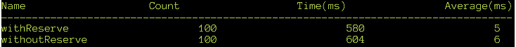

###### Figure 8.31: Output of the code in Snippet5.cpp showing the effect of vector::reserve()

可以看到，调用 `reserve()` 使执行时间缩减了约 4%。在长时间运行的大型程序中，系统内存往往高度碎片化。此时，使用 `reserve()` 预分配内存带来的性能提升可能更为显著。通常，预先保留内存比即时增量分配更高效。即使是 Java 虚拟机，出于性能考虑，启动时也会采用这种一次性分配大块内存的技术。

## 短路逻辑运算符

`&&` 和 `||` 逻辑运算符具有**短路**特性，即：

*   若 `||` 运算符左侧为 `true`，则不再计算右侧。
*   若 `&&` 运算符左侧为 `false`，则不再计算右侧。

将为真概率较低（或开销较小）的表达式置于左侧，有助于减少计算工作量。下一节将通过练习演示如何最优地编写逻辑表达式。

### 练习 8：优化逻辑运算符

本练习将研究条件表达式在逻辑运算符中的顺序影响。请按以下步骤操作：

1.  创建一个名为 `Snippet6.cpp` 的新文件。

2.  引入必要的库及上一练习创建的 `Timer.h`，编写如下代码：

```cpp
#include <vector>
#include <string>
#include <iostream>
#include <random>
#include "Timer.h"

using std::vector;
using std::cerr;
using std::endl;
```

3.  定义 `sum1()` 函数，计算 `0` 到 `N` 之间满足特定条件的整数和。条件有二：一是数字小于 `N/2`，二是数字对 3 取余等于 2。此处 `N` 设为 `100,000,000` 以获得可测量的耗时。实现代码如下：

```cpp
const uint64_t N = 100000000;

uint64_t sum1()
{
    TIME_IT;
    uint64_t ret = 0;
    for (uint64_t b = 0; b < N; ++b)
    {
        if (b % 3 == 2 || b < N/2)
        {
            ret += b;
        }
    }
    return ret;
}
```

4.  定义 `sum2()` 函数，逻辑与 `sum1()` 相同，仅反转 `if` 语句中两个条件的顺序。代码如下：

```cpp
uint64_t sum2()
{
    TIME_IT;
    uint64_t ret = 0;
    for (uint64_t b = 0; b < N; ++b)
    {
        if (b < N/2 || b % 3 == 2)
        {
            ret += b;
        }
    }
    return ret;
}
```

注意在 `sum2` 中，`b < N/2` 有 50% 概率为 `true`，因此 `b % 3 == 2` 仅在半数迭代中计算。假设每个条件耗时 1 个单位，`sum2` 总耗时约 `N * 3/2`。而 `sum1` 中左侧条件仅 33% 为 `true`，其余 66% 需计算两个条件，总耗时约 `N * 5/3`。预期 `sum1` 比 `sum2` 慢 **11%**（耗时比 `5/3` : `3/2`）。

5.  在 `main` 函数中添加如下代码：

```cpp
int main()
{
    volatile uint64_t dummy = 0;
    for (int i = 0; i < 100; ++i)
    {
        dummy = sum1();
    }
    for (int i = 0; i < 100; ++i)
    {
        dummy = sum2();
    }
    Timer::dump();
}
```

6.  保存文件并打开终端，编译并运行程序及 `Timer.cpp`：

```
$ g++ -O3 Snippet6.cpp Timer.cpp
$ ./a.out
```

输出结果如下：

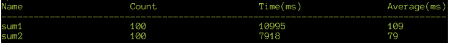

###### Figure 8.32: Output of the code in Snippet6.cpp showing the effect of optimizing boolean conditions

输出显示速度提升约 **38%**，远超预期。原因在于 `%` 执行整数除法，开销远大于比较，而编译器会优化常量表达式 `N/2`，不生成除法指令。

`sum1` 每次迭代都执行取模运算，总耗时主要由除法主导。总之，编写逻辑表达式时须充分考虑短路特性，权衡两侧表达式的开销与执行频率，以确定最优顺序，这实质是期望值计算。下一节将介绍分支预测。

## 分支预测

现代处理器采用流水线架构，类似工厂流水线，指令在流水线中流动并由各阶段并行处理。每个时钟周期指令推进一级。虽单条指令需多周期完成，但整体吞吐率可达每周期一条指令。

缺点是遇到条件分支时，CPU 无法确定加载哪组后续指令（存在两种可能），导致**流水线停顿**，处理器须等待分支条件计算完成，白白浪费周期。

为缓解此问题，现代处理器引入**分支预测**，尝试预判分支方向。随遇到次数增加，预测器置信度逐渐增强。

但 CPU 非全知全能。若预测错误，已加载的预测分支指令作废，后续流水线须清空并重新加载正确分支，下游已完成的工作全部丢弃，更改需回滚。

这是主要性能瓶颈，但可规避——最简单的方法是让分支尽可能始终走同一方向，如循环分支。

### 练习 9：分支预测优化


## 分支预测练习

在本练习中，我们将探索并演示 CPU 分支预测对性能的影响。为了探究这一点，我们将在一个程序中编写两个函数——两者执行相同的计算，均使用两层嵌套循环，分别迭代 **100** 次和 **100,000,000** 次。这两个函数的区别在于：在第一个函数中，外层循环是较大的那个；而在第二个函数中，外层循环是较小的那个。

对于第一个函数，外层循环仅在退出时发生一次分支预测失败，但内层循环发生 **100,000,000** 次分支预测失败——每次退出时一次。对于第二个函数，外层循环同样仅在退出时发生一次分支预测失败，但内层循环仅发生 100 次分支预测失败——每次退出时一次。这两个分支预测失败次数之间 **1,000,000** 倍的差距将导致第一个函数比第二个函数慢。执行以下步骤以完成本练习：

1. 创建一个名为 `Snippet7.cpp` 的文件并包含必要的库：

```cpp
#include <vector>
#include <string>
#include <iostream>
#include <random>
#include "Timer.h"

using std::vector;
using std::cerr;
using std::endl;
```

2. 定义一个名为 `sum1()` 的函数，包含嵌套循环。外层 `for` 循环应循环 `N` 次，而内层 `for` 循环应迭代 **100** 次。将 `N` 的值设为 **100000000**。编写以下代码来实现此功能：

```cpp
const uint64_t N = 100000000;

uint64_t sum1()
{
    TIME_IT;
    uint64_t ret = 0;
    for(int i = 0; i < N; ++i)
    {
        for(int j = 0; j < 100; ++j)
        {
            ret += i ^ j;
        }
    }
    return ret;
}
```

如果我们假设处理器预测循环中的分支（从统计学上讲，循环末尾的分支指令跳转到循环开头的可能性比不跳转大），那么每当 `j` 达到 **100** 时，它最终都会发生预测错误——换句话说，会发生 `N` 次。

3. 定义一个新函数 `sum2()`，包含嵌套循环。此处唯一的变化是我们必须将内层循环计数设为 `N`，外层循环计数设为 **100**。添加以下代码来实现此功能：

```cpp
uint64_t sum2()
{
    TIME_IT;
    uint64_t ret = 0;
    for(int i = 0; i < 100; ++i)
    {
        for(int j = 0; j < N; ++j)
        {
            ret += i ^ j;
        }
    }
    return ret;
}
```

现在，根据我们的推理，分支预测错误仅发生 **100** 次。

4. 在 `main` 函数中添加以下代码：

```cpp
int main()
{
    volatile uint64_t dummy;
    dummy = sum1();
    dummy = sum2();
    Timer::dump();
}
```

5. 保存文件并打开终端。连同 `Timer.cpp` 文件一起编译上述程序，并使用以下命令进行计时。请记住，你需要将之前创建的 `Timer.cpp` 和 `Timer.h` 文件放在同一目录下：

```bash
$ g++ -O3 Snippet7.cpp Timer.cpp
$ ./a.out
```

执行上述命令的输出如下：

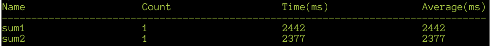

*图 8.33：Snippet7.cpp 代码的输出，展示了分支预测优化的效果*

正如你从上述输出中所见，存在一个微小但确实显著的约 **2%** 的加速，这归因于处理器能够对 `sum2` 函数进行更好的分支预测。在下一节中，我们将探索更多优化技术。

## 进一步优化

还有其他几种技术可以在编码时实现；其中一些不能保证产生更好的代码，但只需很少的努力就能改变你的编码习惯，使其成为一种反射性的行为。它们没有成本，但可能带来收益。其中一些技术如下：

*   尽可能通过 `const` 引用传递非基本类型的参数。即使 `move constructors`（移动构造函数）可以使复制变得廉价，它们仍然比使用 `const` 引用涉及更多的开销。
*   使用前置自增（`++i`）或前置自减（`--i`）运算符，而不是后置版本。这对于整数等简单类型通常没有用处，但对于具有自定义自增运算符的复杂类型可能有用。养成编写 `++i` 而非 `i++` 的习惯是一种良好的实践，除非后置自增确实是期望的行为。除了性能优势外，使用正确的运算符能更清晰地表达代码意图。
*   尽可能晚地声明变量——在 C 语言中，通常在函数顶部声明所有变量，但在 C++ 中，由于变量可能有非平凡的构造函数，因此只在实际使用它们的代码块中声明它们是合理的。
*   就 `loop hoisting`（循环外提/代码外提）而言，如果循环中有任何代码或计算不随循环迭代而变化，将其移到循环外部是合理的。这包括在循环体中创建对象。通常，在循环外部声明一次会更高效。现代编译器会自动执行此操作，但自己动手也不费吹灰之力。
*   尽可能使用 `const`。它不改变代码的含义，但能让编译器对你的代码做出更强的假设，从而可能导致更好的优化。除此之外，使用 `const` 使代码更具可读性和合理性。
*   整数除法、取模和乘法（特别是以非 2 的幂次的数字为操作数时）是在 `X86` 硬件上最慢的操作之一。如果你需要在循环中执行此类操作，或许可以通过一些代数变换来消除它们。

正如我们提到的，编译器本身可能会完成其中的几项优化，但将它们作为一种习惯，能使代码即使在调试模式下也运行得更快，这在调试时是一个巨大的优势。我们已经研究了一些微优化代码的技术——所需的代码更改程度相对较小，其中一些可以显著提高效率。如果你想总体上编写更快的代码，应该致力于将这些技术逐渐融入为默认的编码风格。在下一节中，我们将学习缓存友好的代码。

## 缓存友好的代码

计算机科学发展于 20 世纪中叶，当时计算机几乎不存在，但尽管如此，到了 20 世纪 80 年代，大多数有用的数据结构和算法已经被发现并完善。算法复杂度分析是学习计算机科学的人都会遇到的主题——并且有关于数据结构操作复杂度的公认教科书定义。然而，自这些分析进行以来的 50 年里，计算机已经以一种与当时难以预料的截然不同的方式演变了。例如，一个常见的“事实”是列表数据结构比数组在插入操作上更快。这似乎是常识，因为向数组插入元素涉及将该位置之后的所有项目移动到新位置，而向列表插入仅仅是几次指针操作。我们将在以下练习中测试这一假设。

### 练习 10：探索缓存对数据结构的影响

在本练习中，我们将考察缓存对 C++ 标准库中数组和列表的影响。执行以下步骤以完成本练习：

1. 创建一个名为 `Snippet8.cpp` 的文件。

2. 包含必要的库，以及 `Timer.h` 头文件。编写以下代码来实现此功能：

```cpp
#include <vector>
#include <list>
#include <algorithm>
#include <string>
#include <iostream>
#include <random>
#include "Timer.h"

using std::vector;
using std::list;
using std::cerr;
```


using std::endl;

3. 创建一个常量整型变量 `N`，并将其值设置为 `100000`：

```cpp
const int N = 100000;
```

4. 初始化随机数生成器并创建一个从 `0` 到 `1000` 的分布范围。添加以下代码以实现此功能：

```cpp
std::random_device dev;
std::mt19937 rng(dev());
std::uniform_int_distribution<std::mt19937::result_type> dist(0, N);
```

5. 创建一个名为 `insertRandom()` 的方法，将从 `0` 到 `N` 的元素插入到容器的随机位置。添加以下代码来实现此功能：

```cpp
template<class C> void insertRandom(C &l)
{
    // insert one element to initialize
    l.insert(l.end(), 0);
    for(int i = 0; i < N; ++i)
    {
        int pos = dist(rng) % l.size();
        auto it = l.begin();
        advance(it, pos);
        l.insert(it, i);
    }
}
```

6. 创建一个名为 `insertStart()` 的方法，将从 `0` 到 `N` 的元素插入到容器的开头。添加以下代码来实现此功能：

```cpp
template<class C> void insertStart(C &l)
{
    for(int i = 0; i < N; ++i)
    {
        l.insert(l.begin(), i);
    }
}
```

7. 创建一个名为 `insertEnd()` 的方法，将从 `0` 到 `N` 的元素插入到容器的末尾。添加以下代码来实现此功能：

```cpp
template<class C> void insertEnd(C &l)
{
    for(int i = 0; i < N; ++i)
    {
        l.insert(l.end(), i);
    }
}
```

8. 在 `main` 方法中编写以下代码：

```cpp
int main()
{
    std::list<int> l;
    std::vector<int> v;
    // list
    {
        Timer t("list random");
        insertRandom(l);
    }
    {
        Timer t("list end");
        insertEnd(l);       
    }
    {
        Timer t("list start");
        insertStart(l);
    }
    // vector
    {
        Timer t("vect random");
        insertRandom(v);
    }
    {
        Timer t("vect end");
        insertEnd(v);       
    }
    {
        Timer t("vect start");
        insertStart(v);
    }
    cerr << endl << l.size() << endl << v.size() << endl;
    Timer::dump();
}
```

9. 保存文件并打开终端。通过编写以下命令，连同 `Timer.cpp` 文件一起编译前面的程序：

```bash
$ g++ -O3 Snippet8.cpp Timer.cpp
$ ./a.out
```

前面的命令生成以下输出：

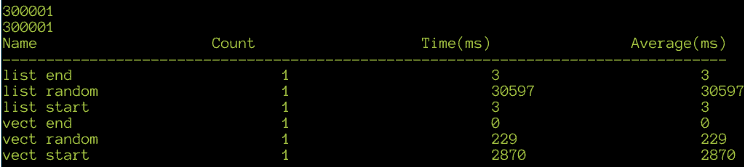

###### 图 8.34：Snippet8.cpp 中代码的输出，对比了 std::list 和 std::vector 插入的耗时

正如你从前面的输出中所见，该代码测量了向 `std::vector` 和 `std::list` 的开头、末尾和随机位置插入 `100000` 个整数所需的时间。**vector 显然以 100 倍或更大的优势赢得了随机插入的情况，甚至 vector 的最坏情况也比 list 的随机情况快 10 倍。**

为什么会发生这种情况？答案在于现代计算机架构的演变方式。CPU 时钟频率从 80 年代初的约 `1 Mhz` 提升到了 2019 年中旬的 `5 GHz`——时钟频率提升了 `5,000 倍`——虽然最早的 CPU 每条指令需要多个周期，但现代 CPU 在单核上每个周期可执行多条指令（得益于流水线等先进技术，我们之前已对此进行过描述）。

例如，原始 `Intel 8088` 上的 `IDIV` 指令需要超过 100 个时钟周期才能完成，而在现代处理器上，它可以在 5 个周期内完成。另一方面，RAM 带宽（读或写一个字节内存所需的时间）增长非常缓慢。

历史上，处理器的速度在 1980 年到 2010 年间提升了约 `16,000 倍`。同一时期，RAM 速度的提升幅度小了一数量级——不到 100 倍。因此，指令对 RAM 的一次访问可能导致 CPU 等待大量的时钟周期。这将造成不可接受的性能下降，因此出现了许多技术来缓解这一问题。在探索这些技术之前，让我们在下一个练习中测量内存访问的影响。

### 练习 11：测量内存访问的影响

在本练习中，我们将检查随机访问内存的性能影响。执行以下步骤以完成此练习：

1. 创建一个名为 `Snippet9.cpp` 的新文件。

2. 包含必要的库以及 `Timer.h` 头文件。创建两个常量整型变量 `SIZE` 和 `N`，并将它们的值设置为 `100000000`。此外，创建一个随机数生成器和一个从 `0` 到 `N-1` 的分布范围。编写以下代码来实现这一点：

```cpp
#include <vector>
#include <list>
#include <algorithm>
#include <string>
#include <iostream>
#include <random>
#include "Timer.h"

using std::vector;
using std::list;
using std::cerr;
using std::endl;

const int SIZE = 100'000'000;
const int N = 100'000'000;

std::random_device dev;
std::mt19937 rng(dev());
std::uniform_int_distribution<std::mt19937::result_type> dist(0, SIZE-1);
```

3. 创建 `getPRIndex()` 函数，该函数返回 `0` 到 `SIZE-1` 之间的伪随机索引，其中 `SIZE` 是数组中的元素数量。编写以下代码来实现这一点：

#### 注意

我们稍后将讨论为什么要使用随机数。

```cpp
uint64_t getPRIndex(uint64_t i)
{
    return (15485863 * i) % SIZE;
}
```

4. 编写一个名为 `sum1()` 的函数，它随机访问一个大型数据数组并对这些元素求和：

```cpp
uint64_t sum1(vector<int> &v)
{
    `TIME_IT`;
    uint64_t sum = 0;
    for(int i = 0; i < N; ++i)
    {
        sum += v[getPRIndex(i)];
    }
    return sum;
}
```

5. 编写一个名为 `sum2()` 的函数，它对随机数求和而不进行任何内存访问：

```cpp
uint64_t sum2()
{
    `TIME_IT`;
    uint64_t sum = 0;
    for(int i = 0; i < N; ++i)
    {
        sum += getPRIndex(i);
    }
    return sum;
}
```

6. 在主函数中初始化向量，使得 `v[i] == i`，因此 `sum1()` 和 `sum2()` 的唯一区别在于 `sum1()` 访问内存而 `sum2()` 仅执行计算。像往常一样，我们使用 `volatile` 防止编译器移除所有代码，因为它没有副作用。在 `main()` 函数中编写以下代码：

```cpp
int main()
{
    // Allocate SIZE integers
    std::vector<int> v(SIZE, 0);
    // Fill 0 to SIZE-1 values into the vector
    for(int i = 0; i < v.size(); ++i)
    {
        v[i] = i;
    }
    volatile uint64_t asum1 = sum1(v);
    volatile uint64_t asum2 = sum2();
    Timer::dump();
}
```

7. 保存程序并打开终端。通过编写以下命令编译并运行程序：

```bash
$ g++ -O3 Snippet9.cpp Timer.cpp
$ ./a.out
```

前面的代码生成以下输出：

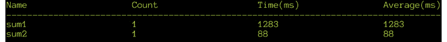

###### 图 8.35：Snippet9.cpp 中代码的输出，对比了计算与随机内存访问的耗时

从前面的输出中，我们可以清楚地看到约 `14 倍` 的性能差异。

8. 创建一个名为 `Snippet10.cpp` 的新文件，并添加 `Snippet9.cpp` 中相同的代码。添加一个名为 `sum3()` 的新函数，该函数线性访问内存而非随机访问。同时，编辑主函数。更新后的代码如下：

```cpp
uint64_t sum3(vector<int> &v)
{
    `TIME_IT`;
    uint64_t sum = 0;
    for(int i = 0; i < N; ++i)
    {
        sum += v[i];
    }
}
```


```cpp
return sum;

}

int main()

{

  // Allocate SIZE integers
  std::vector<int> v(SIZE, 0);
  // Fill 0 to SIZE-1 values into the vector
  for(int i = 0; i < v.size(); ++i)
  {
    v[i] = i;
  }
  volatile uint64_t asum1 = sum1(v);
  volatile uint64_t asum2 = sum2();
  volatile uint64_t asum3 = sum3(v);  
  Timer::dump();
}
```

9. 保存文件并打开终端。编译并运行程序：

```bash
$ g++ -O3 Snippet10.cpp Timer.cpp
$ ./a.out
```

前述命令生成以下输出：

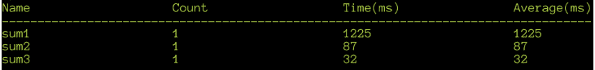

*图 8.36：Snippet10.cpp 中代码的输出，对比了计算与随机及线性内存访问的耗时*

在前述输出中，请注意内存访问现在比之前快了 35 倍以上，且比 `sum2()` 中的计算快 2.5 倍。我们在 `sum1()` 中使用随机访问模式来演示线性与随机内存访问的对比。是什么让线性内存访问比随机访问快这么多？答案在于现代处理器中用于缓解慢速内存影响的两个机制——`caching`（缓存）和 `prefetch`（预取），我们将在以下章节讨论这两者。

## 缓存

现代处理器在处理器寄存器和 RAM 之间拥有多层缓存内存。这些缓存标记为 `L1`、`L2`、`L3`、`L4` 等，其中 `L1` 离处理器最近，`L4` 最远。每一层缓存都比其下一层更快（通常也更小）。以下是 `Haswell` 系列处理器的缓存/内存大小和延迟示例：

*   `L1`：32 KB，4 个周期
*   `L2`：256 KB，12 个周期
*   `L3`：6 MB，20 个周期
*   `L4`：128 MB，58 个周期
*   `RAM`：数 GB，115 个周期

关于缓存如何工作以提升性能的简单模型如下：当访问一个内存地址时，会在 `L1` 缓存中查找——如果找到，则从中获取。如果未找到，则在 `L2` 缓存中查找，如果仍未找到，则查找 `L3` 缓存，以此类推——如果在所有缓存中都未找到，则从内存中获取。当从内存获取时，它会被存储在每一层缓存中，以便稍后更快地访问。这种方法本身作用相当有限，因为它只有在我们反复访问同一内存地址时才能提升性能。第二个方面称为 `prefetching`（预取），它是能让缓存真正发挥作用的机制。

## 预取

预取是一个过程：当执行内存访问时，附近的数据也会被获取到缓存中，即使它未被直接访问。预取的第一个方面与内存总线粒度有关——可以理解为“RAM 子系统一次能发送给处理器的最小数据量是多少？”。在大多数现代处理器中，这是 64 位——换句话说，无论你从内存请求单个字节还是 64 位值，包含该地址的整个 64 位 `machine word`（机器字）都会从 RAM 中读取。这些数据被存储在每一层缓存中，以便稍后更快地访问。显然，这会立即提升内存性能——假设我们读取地址 `0x1000` 处的一个字节；该地址后的另外 7 个字节也会进入缓存。如果我们随后访问地址 `0x1001` 处的字节，它将来自缓存，从而避免昂贵的 RAM 访问。

预取的第二个方面更进一步——当读取某地址处的 RAM 内容时，处理器不仅读取该内存字，还会读取更多内容。在 `x86` 系列处理器上，这通常在 32 到 128 字节之间。这被称为 `cache line`（缓存行）大小——处理器总是以该大小的块来读写内存。当 CPU 硬件检测到内存正以线性方式被访问时，它会根据对后续可能访问地址的预测，将内存预取到一个缓存行中。

CPU 在检测正向和反向的规则访问模式方面非常聪明，并能高效地进行预取。你也可以使用特殊指令向处理器提供提示，使其按照程序员的指示预取数据。这些指令在大多数编译器中作为内部函数提供，以避免使用内联汇编语言。当读取或写入的内存地址不在缓存中时，称为 `cache miss`（缓存未命中），这是一个非常昂贵的事件，应不惜一切代价避免。CPU 硬件会尽最大努力缓解缓存未命中，但程序员可以分析和修改数据访问模式，以最大程度地减少缓存未命中。此处对缓存的描述是一个用于教学目的的简化模型——实际上，CPU 既有用于指令也有用于数据的 `L1` 缓存、多个缓存行，以及非常复杂的机制，以确保多个处理器能保持其独立缓存的同步。

### 注释

关于缓存实现的综合描述（以及关于内存子系统的大量其他信息）可以在以下著名的在线文章中找到：<https://lwn.net/Articles/250967/>。

## 缓存对算法的影响

了解了缓存后，我们现在可以推理为什么我们第一个 vector 与 list 的示例显示了令人惊讶的结果——从计算机科学的角度来看，以下是正确的：

**对于 `std::list`**：

*   迭代到第 N 个位置是 O(N) 复杂度。
*   插入或删除一个元素是 O(1) 复杂度。

**对于数组（或 `std::vector`）**：

*   迭代到第 N 个位置是 O(1) 复杂度。
*   在位置 N 插入或删除元素的复杂度与 `(S - N)` 成正比，其中 `S` 是数组的大小。

然而，对于现代架构，内存访问的成本极高，但随后访问相邻地址的成本几乎为 0，因为它已经在缓存中。这意味着对内存中非顺序定位的 `std::list` 元素进行迭代，很可能总是导致 `cache miss`（缓存未命中），从而造成性能低下。另一方面，由于数组或 `std::vector` 的元素总是相邻的，缓存和预取会大幅降低将 `(S-N)` 个元素复制到新位置的总体成本。因此，传统的两种数据结构分析认为链表更适合随机插入，虽然在理论上正确，但在实践中并不成立，尤其是考虑到现代 CPU 硬件明显复杂的缓存行为。当我们的程序是*数据受限* 时，算法复杂度的分析必须结合对所谓 `data locality`（数据局部性）的理解来进行补充。

数据局部性可以简单定义为：刚刚访问的内存地址与之前访问的内存地址之间的平均距离。换句话说，跨越相距较远的地址进行内存访问会导致严重的减速，因为较近地址的数据很可能已被预取到缓存中。当数据已存在于缓存中时，称为“热”数据；否则称为“冷”数据。利用缓存的代码称为 `cache friendly`（缓存友好）。反之，不利于缓存的代码会导致缓存行被浪费性地重新加载（称为 `cache invalidation`（缓存失效））。在本节的其余部分，我们将探讨编写缓存友好代码的策略。

## 优化缓存友好性


在过去，代码优化涉及尝试最小化代码中的机器指令数量，使用更高效的指令，甚至重新排序指令以使流水线保持满载。到了今天，编译器能够将上述所有优化执行到大多数程序员难以企及的水平——特别是考虑到编译器可以跨越数亿条指令的整个程序进行优化。即使在现在，优化数据访问模式以利用缓存，依然坚定地是程序员的责任。

这项任务非常简单——确保内存访问靠近之前访问过的内存——但实现这一目标的方法可能需要付出大量努力。

## 注意

著名游戏程序员兼代码优化大师 Terje Mathisen 据称在 90 年代说过：“所有编程本质上都是在练习缓存。” 时至 2019 年，这句话在试图编写高性能代码这一子领域中比以往任何时候都更适用。

## 缓存友好性法则

有一些增加缓存友好性的基本经验法则：

* 栈始终是 `hot`（热点）的，因此我们应尽可能使用局部变量。
* 动态分配的对象彼此之间很少具有数据局部性——应避免使用它们，或使用预分配的对象池，使它们在内存中顺序排列。
* 基于指针的数据结构（如树——尤其是链表）由堆上分配的多个节点组成，非常不利于缓存。
* 面向对象代码中虚函数的运行时分发会使指令缓存失效——在性能关键代码中应避免动态分发。

在下一节中，我们将探讨堆分配的成本。

## 练习 12：探究堆分配的成本

在本练习中，我们将检查动态分配内存的性能影响，并考察堆内存如何影响代码性能。执行以下步骤完成此练习：

1. 创建一个名为 `Snippet11.cpp` 的文件。

2. 添加以下代码以包含必要的库：

```
#include <string>
#include <iostream>
#include <random>
#include "Timer.h"
using std::string;
using std::cerr;
using std::endl;
```

3. 声明一个常量变量 `N` 和一个名为 `fruits` 的字符数组。为它们赋值：

```
const int N = 10'000'000;
const char* fruits[] = {"apple", "banana", "cherry", "durian", "guava", "jackfruit", "kumquat", "mango", "orange", "pear"};
```

4. 创建一个名为 `fun1()` 的函数，它仅遍历 `fruits` 中的每个字符串，将其复制到 `string` 中，并对该字符串的字符求和：

```
uint64_t fun1()
{
  TIME_IT;
  uint64_t sum = 0;
  string s1;
  for(uint64_t i = 0; i < N; ++i)
  {
    s1 = fruits[i % 10];
    for(int k = 0; k < s1.size(); ++k) sum += s1[k];
  }
  return sum;
}
```

5. 创建另一个名为 `fun2()` 的函数，它使用局部声明的字符数组代替 `string`，并用循环进行复制：

```
uint64_t fun2()
{
  TIME_IT;
  uint64_t sum = 0;
  char s1[32];
  for(uint64_t i = 0; i < N; ++i)
  {
    char *ps1 = s1;
    const char *p1 = fruits[i % 10];
    do { *ps1++ = *p1; } while(*p1++);
    for(ps1 = s1; *ps1; ++ps1) sum += *ps1;
  }
  return sum;
}
```

6. 在 `main()` 函数中编写以下代码：

```
int main()
{
  for(int i = 0; i < 10; ++i)
  {
    volatile uint64_t asum1 = fun1();
    volatile uint64_t asum2 = fun2();  
  }
  Timer::dump();
}
```

7. 保存文件并打开终端。编译并运行程序：

```
$ g++ -O3 Snippet11.cpp Timer.cpp
$ ./a.out
```

前述命令生成以下输出：

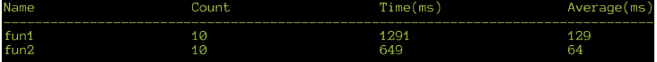

**图 8.37：Snippet11.cpp 代码的输出，展示了堆分配对计时的影响**

从前述输出中注意到，`fun2()` 的速度几乎是 `fun1()` 的两倍。

8. 现在，使用 `perf` 命令进行性能分析：

```
$ perf record ./a.out
```

前述命令生成以下输出：

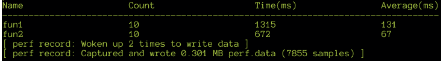

**图 8.38：perf 命令对 Snippet11.cpp 代码进行性能分析的输出**

9. 现在，我们可以使用以下代码查看性能报告：

```
$ perf report
```

我们收到以下输出：

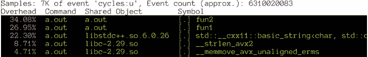

**图 8.39：perf 命令对 Snippet11.cpp 代码的计时报告输出**

在前述输出中注意到，约 33% 的执行时间被 `std::string` 构造函数、`strlen()` 和 `memmove()` 占用。这些都与 `fun1()` 中使用的 `std::string` 有关。特别是堆分配是最慢的操作。

## 结构体数组模式

在许多程序中，我们经常使用同类型对象的数组——这些可能代表数据库记录、游戏实体等。一种常见模式是遍历一个大型结构体数组并对某些字段执行操作。即使结构体在内存中是连续的，如果我们只访问其中几个字段，较大的结构体尺寸会使缓存效果降低。

处理器可能会将多个结构体预取到缓存中，但程序只访问了这些缓存数据的一小部分。由于没有使用每个结构体的每个字段，大部分缓存数据被丢弃。为了避免这种情况，可以使用另一种数据布局——不使用 `结构体数组` (`AoS`) 模式，而是使用 `数组结构体` (`SoA`) 模式。在下一节中，我们将通过一个练习来考察使用 `SoA` 模式相对于 `AoS` 模式的性能优势。

## 练习 13：使用数组结构体模式

在本练习中，我们将考察使用 `SoA` 与 `AoS` 模式的性能优势。执行以下步骤完成此练习：

1. 创建一个名为 `Snippet12.cpp` 的文件。

2. 包含必要的库，以及 `Timer.h` 头文件。初始化随机数生成器，并创建一个从 1 到 N-1 的分布范围。创建一个常量整数变量 `N`，并将其初始化为 100,000,000。添加以下代码以实现此功能：

```
#include <vector>
#include <list>
#include <algorithm>
#include <string>
#include <iostream>
#include <random>
#include "Timer.h"
using std::vector;
using std::list;
using std::cerr;
using std::endl;
const int N = 100'000'000;
std::random_device dev;
std::mt19937 rng(dev());
std::uniform_int_distribution<std::mt19937::result_type> dist(1,N-1);
```

3. 以两种不同方式表示数据——一个 `结构体数组` 和一个 `数组结构体`。使用六个 `uint64_t` 字段，以便模拟大尺寸结构体，这更能代表真实世界的程序：

```
struct Data1
{
  uint64_t field1;
  uint64_t field2;
  uint64_t field3;
  uint64_t field4;
  uint64_t field4;
  uint64_t field5;
  uint64_t field6;
};

struct Data2
{
  vector<uint64_t> field1;
  vector<uint64_t> field2;
  vector<uint64_t> field3;
  vector<uint64_t> field4;
  vector<uint64_t> field5;
  vector<uint64_t> field6;
};

struct Sum
{
  uint64_t field1;
  uint64_t field2;
  uint64_t field3;
  Sum(): field1(), field2(), field3() {}
};
```

4. 定义两个函数，分别名为 `sumAOS` 和 `sumSOA`，它们对前述两种数据结构中的 `field1`、`field2` 和 `field3` 的值求和。编写以下代码以实现此功能：


## 求和函数

```cpp
Sum sumAOS(vector<Data1> &aos)
{
    TIME_IT;
    Sum ret;
    for(int i = 0; i < N; ++i)
    {
        ret.field1 += aos[i].field1;
        ret.field2 += aos[i].field2;
        ret.field3 += aos[i].field3;
    }
    return ret;
}

Sum sumSOA(Data2 &soa)
{
    TIME_IT;
    Sum ret;
    for(int i = 0; i < N; ++i)
    {
        ret.field1 += soa.field1[i];
        ret.field2 += soa.field2[i];
        ret.field3 += soa.field3[i];
    }
    return ret;
}
```

## 主函数实现

5. 在 `main` 函数内编写以下代码：

```cpp
int main()
{
    vector<Data1> arrOfStruct;
    Data2 structOfArr;
    // 预留空间
    structOfArr.field1.reserve(N);
    structOfArr.field2.reserve(N);
    structOfArr.field3.reserve(N);
    arrOfStruct.reserve(N);
    // 填充随机值
    for(int i = 0; i < N; ++i)
    {
        Data1 temp;
        temp.field1 = dist(rng);
        temp.field2 = dist(rng);
        temp.field3 = dist(rng);
        arrOfStruct.push_back(temp);
        structOfArr.field1.push_back(temp.field1);
        structOfArr.field2.push_back(temp.field2);
        structOfArr.field3.push_back(temp.field3);
    }
    Sum s1 = sumAOS(arrOfStruct);
    Sum s2 = sumSOA(structOfArr);
    Timer::dump();
}
```

## 运行程序

6. 保存程序并打开终端。通过添加以下命令运行程序以计时：

```bash
$ g++ -O3 Snippet12.cpp Timer.cpp
$ ./a.out
```

前面的代码生成以下输出：

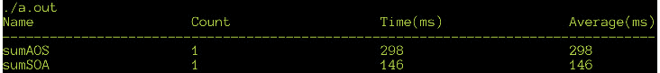

**图 8.40：Snippet12.cpp 中代码的输出，对比 AOS 和 SOA 模式的计时**

结构体数组（SoA）方法比数组结构体（AoS）方法快两倍。考虑到结构体中各向量的地址相距甚远，我们可能会好奇为什么 SoA 情况下的缓存表现更好。原因在于缓存的设计方式——缓存不是作为一个单一的整体块来处理，而是被划分为多个缓存行，正如我们之前讨论的那样。当访问内存地址时，32 位或 64 位地址会被转换成几位的“标签”，并使用与该标签关联的缓存行。非常接近的内存地址将获得相同的标签并到达同一个缓存行。如果访问差异很大的地址，它将到达不同的缓存行。这种基于行的缓存设计对我们的测试程序的影响是，就好像我们为每个向量都有独立的缓存一样。

前面关于缓存行的解释非常简化，但缓存行的基本概念适用。这种结构体数组模式的代码可读性可能看起来稍差，但考虑到性能的提升，这是非常值得的。随着结构体尺寸的增大，这种特定的优化会变得更加有效。此外，请记住，如果字段大小各异，填充结构体可能会使其尺寸膨胀很大倍数。我们已经探讨了内存延迟的性能影响，并学习了一些帮助处理器缓存高效工作的方法。在编写性能关键型程序时，我们应牢记缓存效应。有时，从一开始就采用更友好的缓存架构是合理的。一如既往，在尝试对数据结构进行激进更改之前，我们应始终先测量代码性能。优化应集中在程序中最耗时的区域，而不是每个部分。

## 算法优化

算法优化最简单的形式是寻找能完成你任务的库——最流行的库都经过高度优化且编写精良。例如，`Boost` 库提供了许多实用的库，在许多项目中派上用场，如 `Boost.Geometry`、`Boost.Graph`、`Boost.Interval` 和 `Boost.Multiprecision`，仅举几例。使用专业编写的库比自己尝试创建要容易且明智得多。例如，`Boost.Graph` 实现了十几种处理拓扑图的算法，每一个都经过高度优化。

许多计算可以归结为一系列组合在一起的标准算法——如果做得正确，这些可以产生极其高效的代码——并且通常甚至可以由编译器并行化，以利用多核或 SIMD。在本节的其余部分，我们将采用一个单一程序，并尝试以各种方式对其进行优化——这将是一个具有以下规格的单词计数程序：

*   为隔离磁盘 I/O 所花费的时间，我们将在处理前读取整个文件到内存。
*   将忽略 Unicode 支持，并假设为 ASCII 编码的英文文本。
*   我们将使用网上可用的大型公共领域文学文本作为测试数据。

## 练习 14：优化单词计数程序

在这个漫长的练习中，我们将使用各种优化技术来优化一个程序。我们将对实际程序进行增量优化。我们将使用的测试数据由名为《双城记》的书组成，该书被追加了 512 次。

> **注意**
> 本练习使用的数据集可在此处获得：<https://github.com/TrainingByPackt/Advanced-CPlusPlus/blob/master/Lesson8/Exercise14/data.7z>。你需要解压这个 7zip 压缩包，并将生成的名为 `data.txt` 的文件复制到你进行此练习的文件夹中。

执行以下步骤以完成此练习：

### 步骤 1：样板代码

1. 编写读取文件的基本样板代码（完整代码可在 `SnippetWC.cpp` 中找到）。这将作为我们编写的所有单词计数版本的通用驱动程序：

```cpp
int wordCount(const string &s);

int main(int argc, char **argv)
{
    if(argc > 1)
    {
        TIME_IT;
        string sContent;
        ostringstream buf;
        ifstream ifs(argv[1]);
        {
            Timer t("Read file");
            buf << ifs.rdbuf();
            sContent = buf.str();
            sContent.push_back(' ');
        }
        cerr << wordCount(sContent) << endl;
    }
    Timer::dump();
}
```

我们将使用一个虚拟代码块来分离读取文件的代码计时，并对 `main()` 本身计时以获得总执行时间。

注意 `push_back` 在末尾添加了一个空格——这确保数据以空白字符结尾，简化了我们使用的算法。

### 步骤 2：基本单词计数函数

2. 编写一个基本的单词计数函数。逻辑非常简单——对于字符串中的每个字符，如果该字符不是空白字符而下一个字符是，则它是单词的结尾，应被计数。由于我们的样板代码在末尾添加了一个空格，任何最后的单词都会被计数。该函数定义在 `Snippet13.cpp` 中：

```cpp
int wordCount(const std::string &s)
{
    int count = 0;
    for(int i = 0, j = 1; i < s.size() - 1; ++i, ++j)
    {
        if(!isspace(s[i]) && isspace(s[j]))
        {
            ++count;
        }
    }
    return count;
}
```

### 步骤 3：编译和运行

3. 让我们编译、运行，并了解一下性能。我们将通过将我们代码的结果与标准 `wc` 程序提供的结果进行比较，来验证其是否正常工作：

```bash
$ g++ -O3 Snippet13.cpp SnippetWC.cpp Timer.cpp
$ ./a.out data.txt
```

我们收到以下输出：

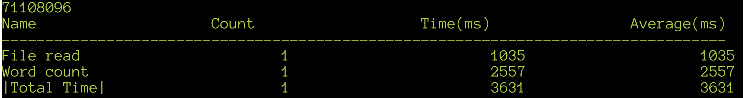

**图 8.41：Snippet13.cpp 中代码的输出，带有基准单词计数实现**

让我们给 `wc` 程序计时：


## 使用查找表优化单词计数

## 初始基准测试

```bash
$ time wc -w data.txt
```

我们收到以下输出：


**图 8.42：wc 程序计时的输出**

`wc` 程序显示相同的单词计数，即 `71108096`，因此我们知道我们的代码是正确的。我们的代码耗时约 `3.6 秒`，包括读取文件，这比 `wc` 慢得多。

## 策略 1：`isspace()` 的查找表 (Snippet14.cpp)

我们的第一个优化策略是看看是否有更好的方法来实现 `isspace()`。我们可以使用一个查找表来判断一个字符是否为空格，而不是使用函数（相关代码可在 **Snippet14.cpp** 中找到）：

```cpp
int wordCount(const std::string &s)
{
    // 创建一个查找表
    bool isSpace[256];
    for(int i = 0; i < 256; ++i)
    {
        isSpace[i] = isspace((unsigned char)i);
    }
    int count = 0;
    int len = s.size() - 1;
    for(int i = 0, j = 1; i < len; ++i, ++j)
    {
        count += !isSpace[s[i]] & isSpace[s[j]];
    }
    return count;
}
```

请记住，C/C++ 中的布尔变量取整数值 `0` 或 `1`，因此我们可以直接编写以下内容：

`!isSpace[s[i]] & isSpace[s[j]]`

这意味着我们不必编写以下内容：

`(!isSpace[s[i]] && isSpace[s[j]]) ? 1 : 0`

直接将布尔值作为数字使用有时可以产生更快的代码，因为我们避免了条件逻辑运算符 `&&` 和 `||`，它们可能会导致分支指令。

## 策略 2：成对查找表（65536 个条目）

现在编译并测试性能：

```bash
$ g++ -O3 Snippet14.cpp SnippetWC.cpp Timer.cpp
$ ./a.out data.txt
```

我们收到以下输出：

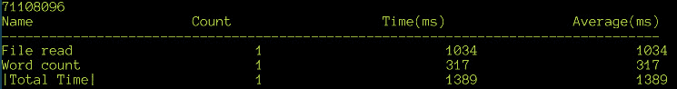

**图 8.43：Snippet14.cpp 中代码的输出**

通过使用查找表这一简单原则，我们实现了单词计数代码 8 倍的加速。我们能做得更好吗？可以——我们可以进一步推进查找表的概念——对于每一对字符，有四种可能性，每种可能性应对应一个动作：

- `[空格 空格]`：无操作
- `[非空格 空格]`：计数加 1
- `[空格 非空格]`：无操作
- `[非空格 非空格]`：无操作

因此，我们可以创建一个包含 `65536` 个条目（`256 * 256`）的表来涵盖所有可能的字符对。

### 创建成对查找表 (Snippet15.cpp)

编写以下代码以创建表：

```cpp
// 为每一对字符创建一个查找表
bool table[65536];
for(int i = 0; i < 256; ++i)
{
    for(int j = 0; j < 256; ++j)
    {
        int idx = j + i * 256;
        table[idx] = !isspace(j) && isspace(i);
    }
}
```

计算单词数的循环变为如下所示（完整代码可在 **Snippet15.cpp** 中找到）：

```cpp
int count = 0;
for(int i = 0; i < s.size() - 1; ++i)
{
    // 将 s[i] 处的 2 个字节作为 16 位值获取
    unsigned short idx;
    memcpy(&idx, &s[i], 2);
    count += table[idx];
}
```

我们将字符串的每个字符作为单个 16 位值读取。直接将指针从 `char*` 转换为另一种类型并解引用它是未定义行为——正确的做法是使用 `memcpy()`。编译器足够聪明，会使用 CPU 内存访问指令，而不是针对 2 个字节实际调用 `memcpy()`。我们最终得到的循环不包含条件语句，这应该会使其快得多。请记住，X86 架构是*小端序*——因此从字符数组读取的 16 位值将把第一个字符作为其 LSB（最低有效位），第二个字符作为其 MSB（最高有效位）。

### 基准测试结果 (Figure 8.44)

现在，为我们编写的代码计时：

```bash
$ g++ -O3 Snippet15.cpp SnippetWC.cpp Timer.cpp
$ ./a.out data.txt
```

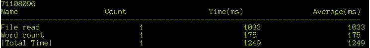

**图 8.44：Snippet15.cpp 中代码的输出**

这个更大的查找表使 `wordCount()` 的速度提高了 1.8 倍。让我们退一步，从另一个角度来看待这个问题，以便有效地使用现有的标准库。这样做有两个优势——首先，代码不易出错；其次，我们可以利用某些编译器提供的并行化功能。

让我们使用标准算法重写使用 `isspace` 查找表的程序版本。如果我们观察计算单词数的主循环，我们会取 2 个字符，并根据某些逻辑将 1 或 0 累加到 `count` 变量中。这是许多代码中常见的模式：

`X OP (a[0] OP2 b[0]) OP (a[1] OP2 b[1]) OP (a[2] OP2 b[2]) ... OP (a[N] OP2 b[N])`

这里，`a` 和 `b` 是大小为 `N` 的数组，`X` 是初始值，`OP` 和 `OP2` 是运算符。有一个封装此模式的标准算法，称为 `std::inner_product`——它接受两个序列，在每对元素之间应用一个运算符 (OP2)，然后从初始值 X 开始在这些结果上应用另一个运算符 (OP)。

## 使用 `std::inner_product` (Snippet16.cpp)

我们可以按如下方式编写该函数（完整代码可在 **Snippet16.cpp** 中找到）：

```cpp
int wordCount(const std::string &s)
{
    // 为每个字符创建一个查找表
    bool table[256];
    for(int i = 0; i < 256; ++i)
    {
        table[i] = isspace((unsigned char)i) ? 1 : 0;
    }
    auto isWordEnd = &
    {
        return !table[a] & table[b];
    };
    return std::inner_product(s.begin(), s.end()-1, s.begin()+1, 0, std::plus<int>(), isWordEnd);
}
```

此 `inner_product()` 调用对每个 `s[n]` 和 `s[n+1]` 应用 `isWordEnd()` lambda 表达式，并在它们的结果之间应用标准加法函数。实际上，当 `s[n]` 和 `s[n+1]` 处于单词结尾时，我们向总数加 1。

> **注意**
>
> 尽管这看起来像是许多嵌套函数调用，但编译器会内联所有内容，因此没有开销。

### 基准测试结果 (Figure 8.45)

编译并计时此版本的执行：

```bash
$ g++ -O3 Snippet16.cpp SnippetWC.cpp Timer.cpp
$ ./a.out data.txt
```

我们收到以下输出：

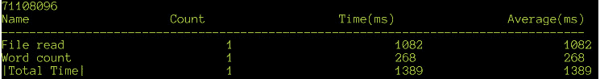

**图 8.45：Snippet16.cpp 中代码的输出**

令人惊讶的是，该代码比 **Snippet14.cpp** 中最初的循环版本略快。

## 将大型查找表与 `std::inner_product` 结合使用 (Snippet17.cpp)

我们能否调整相同的代码以使用大型查找表？确实可以——新函数如下所示（完整代码可在 **Snippet17.cpp** 中找到）：

```cpp
int wordCount(const std::string &s)
{
    // 为每一对字符创建一个查找表
    bool table[65536];
    for(int i = 0; i < 256; ++i)
    {
        for(int j = 0; j < 256; ++j)
        {
            int idx = j + i * 256;
            table[idx] = !isspace(j) && isspace(i);
        }
    }
    auto isWordEnd = &
    {
        unsigned idx = (unsigned)a | (((unsigned)b) << 8);
        return table[idx];
    };
    return std::inner_product(s.begin(), s.end()-1, s.begin()+1, 0, std::plus<int>(), isWordEnd);
}
```

与之前基于循环的代码相比，唯一的变化是我们不再使用 `memcpy()` 将两个连续字节转换为一个字，而是使用按位 `OR` 运算符将它们组合起来。

### 最终基准测试 (Figure 8.46)

编译并计时代码：

```bash
$ g++ -O3 Snippet17.cpp SnippetWC.cpp Timer.cpp
$ ./a.out data.txt
```

我们收到以下输出：

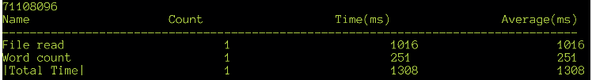

**图 8.46：Snippet17.cpp 中代码的输出**


## 12. 并行化标准库函数

这段代码不如我们在 `Snippet15.cpp` 中基于循环的版本快。原因在于：在循环版本中，我们将 2 个字节组合读取为 `short` 以获取索引，这不需要计算；但在这里，我们通过位运算将 2 个字节读入 `short`。

现在，大部分工作由标准库函数完成，我们可以免费获得自动并行化 —— 按如下方式编译并测试：

```bash
$ g++ -O3 -fopenmp -D_GLIBCXX_PARALLEL Snippet17.cpp SnippetWC.cpp Timer.cpp
$ ./a.out data.txt
```

输出如下：

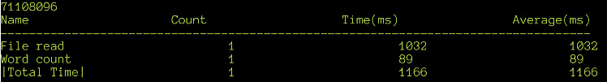

**图 8.47：Snippet17.cpp 中并行化标准库代码的输出**

显然，它无法完全并行化，因此速度仅提升约 2.5 倍，但这无需修改代码即可实现。我们能否以同样的方式使基于循环的代码并行化？理论上可以 —— 我们可以手动使用 `OpenMP` 指令实现；但这需要修改代码并了解 `OpenMP` 的用法。`Snippet16.cpp` 版本呢？

```bash
$ g++ -O3 -fopenmp -D_GLIBCXX_PARALLEL Snippet16.cpp SnippetWC.cpp Timer.cpp
$ ./a.out data.txt
```

输出如下：

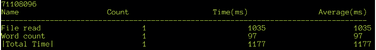

**图 8.48：Snippet16.cpp 中并行化标准库代码的输出**

该版本也有类似的提升。我们完成了吗？还能更快吗？著名游戏程序员 **Michael Abrash** 创造了首字母缩略词 **TANSTATFC** —— 代表 "There ain't no such thing as the fastest code"（不存在最快的代码）。他的意思是：只要投入足够的精力，总能让代码跑得更快。这看似不可能，但一次又一次，人们发现了执行计算的更快方法 —— 我们的代码也不例外，还能再进一步。优化的一个权衡是降低代码的通用性 —— 我们已经给代码加了一些约束，例如只处理 **ASCII** 英文文本。通过给输入数据添加更多约束，我们可以做得更好。假设文件中没有不可打印字符。这对我们的输入数据是合理的假设。如果假设成立，则可以简化空格检测条件 —— 因为所有空白字符的 ASCII 码都大于等于 32，我们可以完全省去查找表。

## 13. 实现简化逻辑的代码

基于上述思路实现代码（完整代码见 `Snippet18.cpp`）：

```cpp
int wordCount(const std::string &s)
{
    auto isWordEnd = &
    {
        return a > 32 & b < 33;
    };
    return std::inner_product(s.begin(), s.end()-1, s.begin()+1, 0, std::plus<int>(), isWordEnd);
}
```

## 14. 编译运行并对比并行化效果

```bash
$ g++ -O3 Snippet18.cpp SnippetWC.cpp Timer.cpp
$ ./a.out data.txt
```

输出如下：

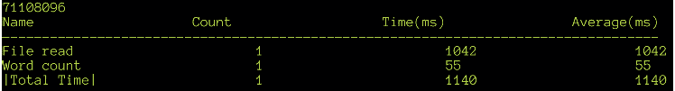

**图 8.49：Snippet18.cpp 中用于检测空格的简化逻辑代码输出**

该版本比并行化版本快一倍，且仅需几行代码。并行化能否让它更快？

```bash
$ g++ -O3 -fopenmp -D_GLIBCXX_PARALLEL Snippet18.cpp SnippetWC.cpp Timer.cpp
$ ./a.out data.txt
```

输出如下：

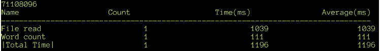

**图 8.50：Snippet18.cpp 中并行化标准库代码的输出**

不幸的是并非如此 —— 反而变慢了。管理多线程和线程竞争的开销有时比多线程代码的收益更大。此时可以看到，文件读取代码占用了大部分时间 —— 我们能优化这部分吗？

## 15. 修改 `main()` 函数分别计时各部分

修改 `main()` 函数以单独计时各个部分（完整代码见 `SnippetWC2.cpp`）：

```cpp
{
    Timer t("File read");
    buf << ifs.rdbuf();
}
{
    Timer t("String copy");
    sContent = buf.str();
}
{
    Timer t("String push");
    sContent.push_back(' ');
}
int wc;
{
    Timer t("Word count");
    wc = wordCount(sContent);
}
```

## 16. 编译运行并分析耗时分布

```bash
$ g++ -O3 Snippet18.cpp SnippetWC2.cpp Timer.cpp
$ ./a.out data.txt
```

输出如下：

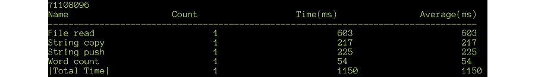

**图 8.51：Snippet18.cpp 中所有操作计时的输出**

大部分时间花在 `push_back()` 和字符串复制上。因为字符串大小正好等于文件大小，`push_back()` 最终会为字符串分配新缓冲区并复制内容。如何消除这个 `push_back()` 调用？我们在末尾追加空格是为了能统一计算最后一个单词（如果有），因为我们的算法统计单词的结尾。有三种方法可以避免：统计单词的开头而非结尾；单独统计最后一个单词（如果有）；使用 `c_str()` 函数，这样末尾会有 `NUL` 字符。下面依次尝试这三种方法。

## 17. 方案一：去掉 `push_back` 的 `main()` 函数

编写不带 `push_back` 的主函数（完整代码见 `SnippetWC3.cpp`）：

```cpp
{
    Timer t("File read");
    buf << ifs.rdbuf();
}
{
    Timer t("String copy");
    sContent = buf.str();
}
int wc;
{
    Timer t("Word count");
    wc = wordCount(sContent);
}
```

## 18. 方案一对应的 `wordCount()` 修改

将 `isWordEnd()` 重命名为 `isWordStart()` 并反转逻辑。若当前字符是空格且后继字符不是，则视为单词开始。若字符串以非空格开头，额外计数一个单词（完整代码见 `Snippet19.cpp`）：

```cpp
int wordCount(const std::string &s)
{
    auto isWordStart = &
    {
        return a < 33 & b > 32;
    };
    // Count the first word if any
    int count = s[0] > 32;
    // count the remaining
    return std::inner_product(s.begin(), s.end()-1, s.begin()+1, count, std::plus<int>(), isWordStart);
}
```

## 19. 方案二：单独统计最后一个单词

代码与 `Snippet18.cpp` 版本几乎相同，只是额外检查最后一个单词（完整代码见 `Snippet20.cpp`）：

```cpp
int count = std::inner_product(s.begin(), s.end()-1, s.begin()+1, 0, std::plus<int>(), isWordEnd);
// count the last word if any
if(s.back() > 32)
{
    ++count;
}
return count;
```

## 20. 方案三：使用 `c_str()`

只需修改 `inner_product()` 的参数（完整代码见 `Snippet21.cpp`）：

```cpp
int wordCount(const std::string &s)
{
    auto isWordEnd = &
    {
        return a > 32 & b < 33;
    };
    const char *p = s.c_str();
    return std::inner_product(p, p + s.size(), p+1, 0, std::plus<int>(), isWordEnd);
}
```

由于 `c_str()` 末尾有 `NUL`，其行为与之前一致。

## 21. 编译并计时所有三个版本


## 编译与运行示例

```bash
$ g++ -O3 Snippet19.cpp SnippetWC3.cpp Timer.cpp
$ ./a.out data.txt
```

我们得到如下输出：

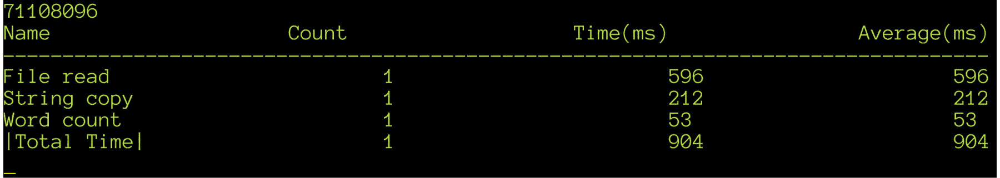

###### Figure 8.52: Snippet19.cpp 中代码的输出，该代码统计单词的开头而非结尾

现在输入以下命令：

```bash
$ g++ -O3 Snippet20.cpp SnippetWC3.cpp Timer.cpp
$ ./a.out data.txt
```

我们得到如下输出：

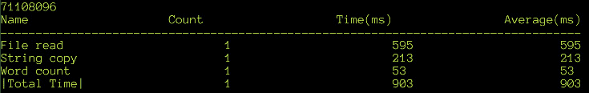

###### Figure 8.53: Snippet20.cpp 中代码的输出

现在输入以下命令：

```bash
$ g++ -O3 Snippet21.cpp SnippetWC3.cpp Timer.cpp
$ ./a.out data.txt
```

我们得到如下输出：


###### Figure 8.54: Snippet21.cpp 中代码的输出

这三个版本运行时间大致相同——几毫秒的微小差异可以忽略不计。

## 22. 字符串复制优化

现在，我们可以解决字符串复制所花费的时间问题——我们将不再使用 `std::stringstream`，而是直接将文件读入字符串缓冲区（完整代码可在 `SnippetWC4.cpp` 中找到）：

```cpp
string sContent;

{
    Timer t("String Alloc");
    // 定位到末尾并预留内存
    ifs.seekg(0, std::ios::end);
    sContent.resize(ifs.tellg());
}

{
    Timer t("File read");
    // 定位回开头并读取数据
    ifs.seekg(0, std::ios::beg);
    ifs.read(&sContent[0], sContent.size());
}

int wc;

{
    Timer t("Word count");
    wc = wordCount(sContent);
}
```

## 23. 编译运行优化版本

编译并运行此版本：

```bash
$ g++ -O3 Snippet21.cpp SnippetWC4.cpp Timer.cpp
```

我们得到如下输出：

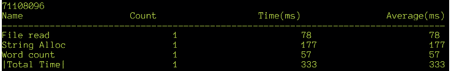

###### Figure 8.55: SnippetWC4.cpp 中修改文件加载代码后的输出

我们现在将文件读取代码的耗时从约 1,000 毫秒降低到了 250 毫秒——提升了 4 倍。单词统计代码的耗时从约 **2,500ms** 降低到了约 60 毫秒——提升了 40 倍。整个程序的总性能提升为 3.6 倍。我们仍可询问这是否是极限——确实，TANSTATFC（没有免费的午餐/总有取舍）依然适用，还有一些事情可以做：与其将数据读入 `std::string`，不如使用**内存映射 I/O** 获取一个直接指向文件的缓冲区。这可能比分配和读取更快——但这将要求修改单词统计代码以接受 `const char*` 和长度，或 `std::string_view`。使用不同的、更快的分配器来分配内存。使用 `-march=native` 标志为本地 CPU 编译。然而，似乎不太可能从这些优化中获得巨大的性能提升，因为这些优化与单词统计算法本身无关。另一个最终的尝试可能是放弃 C++ 构造，使用**编译器内部函数**编写内联 SIMD 代码（这些是编译器直接翻译成单条汇编指令的函数）。所需的知识超出了本入门材料的范围。

## 24. SIMD 优化尝试

尽管如此，对于好奇的学生，我们提供了一个 `wordCount()` 的 **AVX2**（256 位 SIMD）版本（`Snippet23.cpp`）。该版本要求输入字符串的长度是 32 的倍数，且以空格结尾。这意味着必须重写主函数（`SnippetWC5.cpp`）：

```bash
$ g++ -O3 -march=native Snippet22.cpp SnippetWC5.cpp Timer.cpp
$ ./a.out data.txt
```

我们得到如下输出：

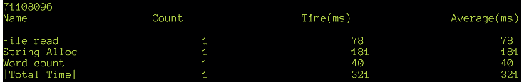

###### Figure 8.56: Snippet22.cpp 中使用 SIMD 内部函数的代码输出

请注意，我们需要使用 `-march=native` 标志，以便编译器使用 AVX SIMD 指令集。如果处理器不支持它，将导致编译错误。如果此可执行文件为 AVX 目标编译，但在处理器不支持这些指令的系统上运行，程序将因“非法指令”异常而崩溃。似乎有一点微小的改进，但不显著——使用汇编或 SIMD 进行优化所需的精力和学习曲线通常太高，除非您的应用程序或行业有这些需求，否则难以证明其合理性。SIMD 版本一次处理 32 字节——但实际上几乎没有性能提升。事实上，如果您在 Compiler Explorer 中检查其他片段中常规 C++ 实现生成的汇编代码，您会发现编译器本身已经使用了 SIMD——这恰恰说明了编译器在让您的代码变快方面已经走多远了。

另一点值得注意的是，现在我们的文件读取和内存分配占用了大部分时间——抛开内存分配不谈，我们可以得出结论：我们的代码已变为**I/O 密集型**而非**CPU 密集型**。这意味着无论我们把代码写得多快，都将受限于数据获取的速度。我们从一个非常简单的单词统计算法实现开始，增加了其复杂度和速度，最终又回到了一个非常简单的实现，它最终成为了最快的。算法的总体速度提升了 40 倍。我们使用了多种方法，从仅重新排列代码、以不同方式重新构想问题，到执行微优化。没有单一的方法能一直奏效，优化始终是一项需要想象力、技巧，且往往需要横向思维的创造性工作。随着编译器变得越来越聪明，要超越它们变得越来越难——然而，程序员是唯一真正理解代码意图的人，总有空间让代码运行得更快。

## 实战 1：优化拼写检查算法

在本实战中，我们将尝试逐步优化一个程序。这是关于一个简单的拼写检查器，它接收一个字典和一个文本文件，并打印出文本中不在字典中的单词列表。`Speller.cpp` 中提供了一个基本的框架程序，以及示例字典和文本文件 `dict.txt` 和 `data.txt`。提供了一个名为 `out.txt` 的文件，其中包含程序的期望输出（拼写错误单词的索引列表）。文本文件位于 **7zip 压缩包** 中，即 `activity1.7z`。

该字典取自许多 Linux 发行版附带的 Linux 单词列表。文本文件类似于我们在上一个练习中使用的文件——它是我们在单词统计练习中使用的同一个大文件，已移除所有标点符号并转换为小写。

请注意，该字典仅为示例，因此请不要假设所有有效单词都存在于其中——输出中的许多单词很可能是拼写正确的单词。框架代码读取字典和文本文件，并对其调用拼写检查代码（由您编写）。之后，它将生成的输出与 `out.txt` 的内容进行比较，并打印程序是否按预期工作。执行拼写检查的函数返回一个向量，包含不在字典中的单词的索引。由于我们仅关注拼写检查算法，因此仅对该代码进行计时。读取文件和比较输出所花费的时间不计入考虑。您将开发该程序逐步更快的版本——参考实现位于 reference 文件夹中，名为 `Speller1.cpp`、`Speller2.cpp` 等。


## 优化活动：拼写检查器实现

在每一步中，你将只获得关于如何修改代码以使其运行得更快的提示——**仅允许修改 `getMisspelt()` 函数中的代码，不得更改任何其他代码**。学生可以自由实现代码，只要它能产生正确的结果且 `main()` 函数中的代码未被更改即可。

### 注意

优化是一个创造性且非确定性的过程——不能保证学生能写出与参考实现相同的代码，也不总是可能做到这一点。如果你编写的代码性能不如参考实现，这不足为奇。事实上，你的代码甚至可能比参考实现更快。

执行以下步骤来实现此活动：

1.  复制 `Speller.cpp` 为 `Speller1.cpp` 并实现 `getMisspelt()` 函数的代码。使用 `std::set` 及其 `count()` 方法来实现。

2.  编写下一个版本的程序 `Speller2.cpp`，然后像之前一样编译并计时。尝试使用 `std::unordered_set` 而不是 `std::set`。使用此实现你应该能获得约 2 倍的加速。

3.  在最终版本 `Speller3.cpp` 中，使用 **Bloom filter** 数据结构来实现拼写检查算法。尝试不同数量的哈希函数和 Bloom filter 的大小，以查看哪种效果最好。

对于上述每个步骤，按如下方式编译并运行程序（根据需要更改输入文件名）：

```
$ g++ -O3 Speller1.cpp Timer.cpp
$ ./a.out
```

### 注意

你不应期望计时结果与此处显示的完全一致，但如果你正确实现代码，速度的相对提升应该接近我们在这里看到的情况。

执行上述每个步骤的命令后，将生成以下输出。输出将显示你的代码计时，如果输出正确则显示初始消息。以下是步骤 1 的输出：

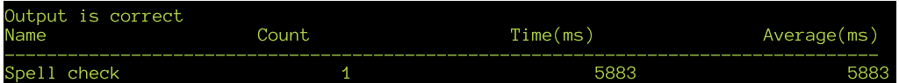

**图 8.57：步骤 1 代码的示例输出**

以下是步骤 2 的输出：

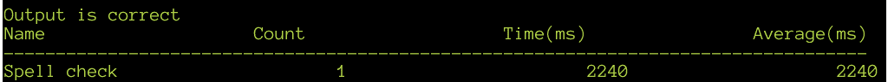

**图 8.58：步骤 2 代码的示例输出**

以下是步骤 3 的输出：

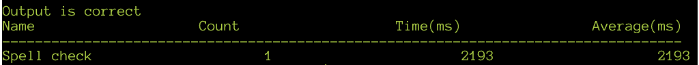

**图 8.59：步骤 3 代码的示例输出**

### 注意

此活动的解决方案见第 725 页。

## 总结

本章涵盖了大量复杂材料。优化代码是一项困难但必要的技能，对任何现代 C++ 开发者而言至关重要。机器学习、超写实游戏、大数据分析和节能计算的需求使这一领域成为任何 C++ 专业人士必须学习的重要内容。我们了解到性能优化过程分为两个阶段。

首先，优化始于适当的性能测量策略，测试条件需镜像真实世界的数据和使用模式。我们学习了通过多种方法测量性能——研究汇编代码、手动计时、源代码插桩和使用运行时分析器。一旦获得准确的测量数据，我们就能真正理解程序中哪些部分实际上很慢，并将精力集中在那里以获得最大改进。

第二阶段涉及实际修改程序——我们学习了几种策略，从为代码使用最佳编译器选项、使用并行化特性、利用配置文件数据帮助编译器开始，接着是一些简单的代码转换，它们在无需重大代码更改的情况下产生微小但有用的性能增益。然后我们学习了如何通过以对分支预测更友好的方式构建循环和条件语句来提高性能。

接着，我们了解了缓存对性能的显著影响，并研究了一些技术（如 SOA 模式），使我们的代码能利用现代 CPU 中的缓存。最后，我们通过一个真实世界的单词计数程序和简单的拼写检查器示例，将所有这些知识结合起来，进行实践。还有许多其他高级技术和理论需要在本章材料之上进一步学习，但我们在这里涵盖的内容应为任何学生未来的学习打下坚实基础。

到这些章节结束时，你已经探索了许多与使用高级 C++ 相关的主题。在前几章中，你学习了如何编写可移植软件，利用模板发挥类型系统的优势，并有效使用指针和继承。然后你探索了 C++ 标准库，包括流和并发，这些是构建大型真实应用程序的必备工具。在最后几节中，你学习了如何测试和调试程序，并优化代码以高效运行。在广泛使用的编程语言中，C++ 或许是最复杂、同时也是表达力最强的语言。本书只是一个开始，将为你继续深造提供坚实的平台。
