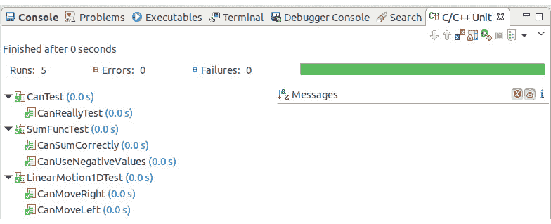
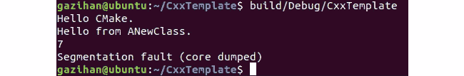
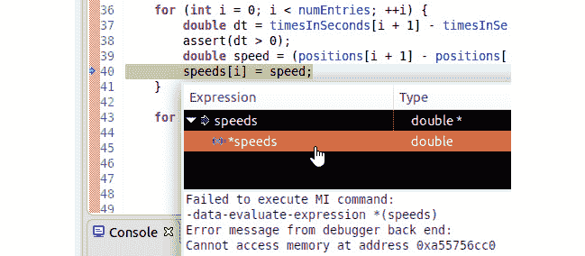
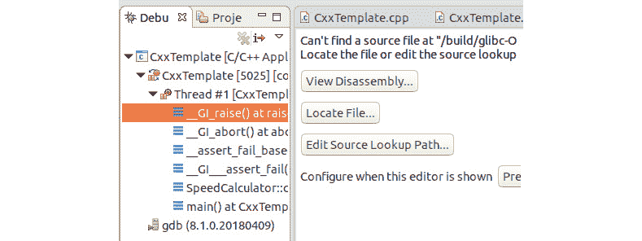
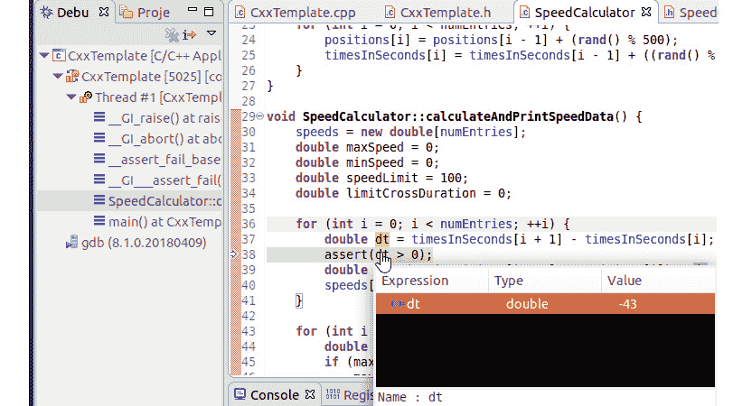
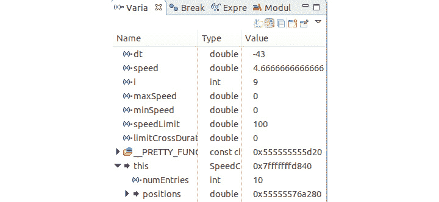
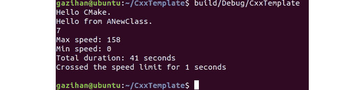
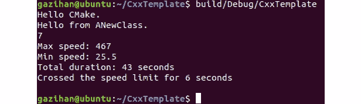
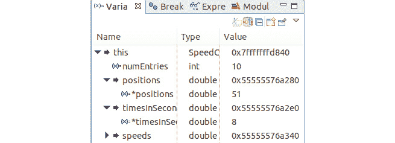
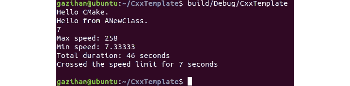

# 附录

## 关于

本节旨在协助学生完成书中的活动。它包含学生为达到活动目标必须执行的详细步骤。

## 第 1 章 - 可移植 C++ 软件的剖析

### 活动 1：向项目添加新的源文件-头文件对

在此活动中，我们将创建一个包含名为 `sum` 的新函数的源文件-头文件对。它接受两个参数并返回它们的和。此文件对将添加到现有项目中。按以下步骤实现此活动：

1.  首先，在 *练习 3* “向 CMake 和 Eclipse CDT 添加新源文件” 中创建的现有项目中打开 Eclipse IDE。在 **Project Explorer** 面板中右键点击 **src** 文件夹。

    #### 注意

    我们可以分别创建 `.cpp` 和 `.h` 文件，或使用新建类向导稍后删除类代码。使用新建类向导很方便，因为它还会创建我们将利用的有用样板代码。

2.  从弹出菜单中选择 **New** | **Class**。输入 **SumFunc** 并点击 **Finish** 按钮。

3.  接下来，编辑 `SumFunc.h` 文件使其如下所示：

```cpp
#ifndef SRC_SUMFUNC_H_
#define SRC_SUMFUNC_H_

int sum(int a, int b);

#endif /* SRC_SUMFUNC_H_ */
```

注意，我们实际上将删除类并仅提供一个函数。我们本可以分别创建这两个文件。然而，**add class** 功能会同时创建它们并添加一些我们将利用的样板代码。在这里，我们的文件以 **include guard** 开始和结束，这是防止重复包含问题的常用策略。我们有函数的前向声明，这允许其他文件在包含此头文件后调用该函数。

4.  接下来，按如下所示编辑 `SumFunc.cpp` 文件：

```cpp
#include "SumFunc.h"
#include <iostream>

int sum(int a, int b) {
    return a + b;
}
```

在此文件中，我们包含头文件并提供函数体，该函数添加并返回两个给定的整数。

5.  编辑 `CMakeFiles.txt` 文件，使其 `add_executable` 部分反映以下代码：

```cmake
add_executable(CxxTemplate
    src/CxxTemplate.cpp
    src/ANewClass.cpp
    src/SumFunc.cpp
)
```

这里，我们将 `src/SumFunc.cpp` 文件添加到可执行源文件列表中，以便它被链接到可执行文件中。

6.  在 `CxxTemplate.cpp` 中进行以下更改：

```cpp
#include "CxxTemplate.h"
#include "ANewClass.h"
#include "SumFunc.h" //add this line
...
```


## 活动 1：添加源文件-头文件对

```cpp
CxxApplication::CxxApplication( int argc, char *argv[] ) {

  std::cout << "Hello CMake." << std::endl;

  ANewClass anew;

  anew.run();

  std::cout << sum(3, 4) << std::endl; // 添加此行

}
```

### 注意

该文件的完整代码可在此处找到：[`github.com/TrainingByPackt/Advanced-CPlusPlus/blob/master/Lesson1/Activity01/src/CxxTemplate.cpp`](https://github.com/TrainingByPackt/Advanced-CPlusPlus/blob/master/Lesson1/Activity01/src/CxxTemplate.cpp)。

在此，我们添加了一行代码，其中调用了带有 `3` 和 `4` 的 `sum` 函数，并将结果打印到控制台。

7. 构建并运行项目（`Project` | `Build All` | `Run` | `Run`）。您看到的输出应如下所示：


*图 1.57：输出*

通过此活动，您练习了向项目添加新的源文件-头文件对。这些文件对是 C++ 开发中非常常见的模式。它们可以容纳全局�数，例如我们在此活动中拥有的那些。更常见的是，它们容纳类及其定义。在整个开发过程中，您将向应用程序添加更多的源文件-头文件对。因此，习惯于添加它们非常重要，不要拖延，否则会导致难以维护和测试的大型单体文件。

## 活动 2：添加新类及其测试

在本活动中，我们将添加一个模拟 `1D` 线性运动的新类。该类将拥有用于 `position` 和 `velocity` 的 `double` 字段。它还将拥有一个 `advanceTimeBy()` 方法，该方法接收一个 `double` `dt` 参数，根据 `velocity` 的值修改 `position`。请对 `double` 值使用 `EXPECT_DOUBLE_EQ` 而不是 `EXPECT_EQ`。在本活动中，我们将向项目添加一个新类及其测试。请按照以下步骤执行此活动：

1. 打开带有我们现有项目的 Eclipse IDE。要创建一个新类，请在 `Project Explorer` 面板中右键单击 `src` 文件夹，然后选择 `New` | `Class`。将名称输入为 `LinearMotion1D` 并创建该类。

2. 打开上一步中创建的 `LinearMotion1D.h` 文件。将 `position` 和 `velocity` `double` 字段添加进去。此外，添加对 `advanceTimeBy` 方法的前向引用，该方法接受一个 `double` `dt` 变量作为参数。构造函数和析构函数已在类中。以下是 `LinearMotion1D.h` 中这些更改的最终结果：

```cpp
#ifndef SRC_LINEARMOTION1D_H_
#define SRC_LINEARMOTION1D_H_

class LinearMotion1D {

public:

  double position;

  double velocity;

  void advanceTimeBy(double dt);

  LinearMotion1D();

  virtual ~LinearMotion1D();

};

#endif /* SRC_LINEARMOTION1D_H_ */
```

3. 现在打开 `LinearMotion1D.cpp` 并添加 `advanceTimeBy` 方法的实现。我们的 `velocity` 是类中的一个字段，时间差是该方法的参数。`position` 的变化等于 `velocity` 乘以时间变化，因此我们计算结果并将其加到 `position` 变量上。我们还使用现有的构造函数代码将 `position` 和 `velocity` 初始化为 0。以下是 `LinearMotion1D.cpp` 中这些更改的最终结果：

```cpp
#include "LinearMotion1D.h"

void LinearMotion1D::advanceTimeBy(double dt) {

  position += velocity * dt;

}

LinearMotion1D::LinearMotion1D() {

  position = 0;

  velocity = 0;

}

LinearMotion1D::~LinearMotion1D() {

}
```

4. 为该类创建一个测试。右键单击 `tests` 文件夹，然后选择 `New` | `Source File`。将名称输入为 `LinearMotion1DTest.cpp` 并创建它。

5. 现在打开 `LinearMotion1DTest.cpp`。为两个不同方向（左和右）的运动创建两个测试。对于每个测试，创建一个 `LinearMotion1D` 对象，初始化其 `position` 和 `velocity`，并调用 `advanceTimeBy` 使运动实际发生。然后，检查它是否移动到了我们预期的同一位置。以下是 `LinearMotion1DTest.cpp` 中这些更改的最终结果：

```cpp
#include "gtest/gtest.h"

#include "../src/LinearMotion1D.h"

namespace {

class LinearMotion1DTest: public ::testing::Test {};

TEST_F(LinearMotion1DTest, CanMoveRight) {

  LinearMotion1D l;

  l.position = 10;

  l.velocity = 2;

  l.advanceTimeBy(3);

  EXPECT_DOUBLE_EQ(16, l.position);

}

TEST_F(LinearMotion1DTest, CanMoveLeft) {

  LinearMotion1D l;

  l.position = 10;

  l.velocity = -2;

  l.advanceTimeBy(3);

  EXPECT_DOUBLE_EQ(4, l.position);

}

}
```

6. 现在修改我们的 CMake 配置文件，以便也使用我们生成的这些源文件。对于 `LinearMotion1D` 类，将其 `.cpp` 文件作为可执行文件添加，以便与其他源文件一起编译和链接。以下是 `CMakeLists.txt` 中 `add_executable` 部分的内容：

```cmake
add_executable(CxxTemplate

  src/CxxTemplate.cpp

  src/ANewClass.cpp

  src/SumFunc.cpp

  src/LinearMotion1D.cpp # added

)
```

7. 对于我们刚刚创建的测试，编辑 `tests/CMakeLists.txt`。在那里，我们需要添加测试源文件 `LinearMotion1DTest.cpp` 和它所使用的类的源文件 `LinearMotion1D.cpp`。由于它们位于不同目录中，请以 `../src/LinearMotion1D.cpp` 的方式访问它们。以下是 `tests/CMakeLists.txt` 中 `add_executable` 部分的内容：

```cmake
add_executable(tests

  CanTest.cpp

  SumFuncTest.cpp

  ../src/SumFunc.cpp

  LinearMotion1DTest.cpp # added

  ../src/LinearMotion1D.cpp # added

)
```

8. 构建项目并运行测试。我们将看到所有测试均成功：



*图 1.58：所有测试成功*

通过此活动，您执行了向项目添加新类及其测试的任务。您创建了一个模拟一维运动的类，并编写了单元测试以确保其正常工作。

## 活动 3：使代码更具可读性

在本活动中，您将练习改进给定代码的质量。请按照以下步骤实施此活动：

1. 打开 Eclipse CDT 并在 Eclipse 中创建一个源文件-头文件对形式的类。为此，请在 `Project Explorer` 中右键单击 `src` 文件夹。从弹出菜单中选择 `New` | `Class`。

2. 将头文件名输入为 `SpeedCalculator` 并单击 `Finish`。它将创建两个文件：`SpeedCalculator.h` 和 `SpeedCalculator.cpp`。我们在上方提供了两个文件的代码。为每个文件添加提供的代码。

3. 现在我们需要将该类添加到 CMake 项目中。打开项目根目录下的 `CMakeLists.txt` 文件（在 `src` 文件夹外部），并在文件中进行以下更改：

```cmake
  src/LinearMotion1D.cpp

  src/SpeedCalculator.cpp # add this line

)
```

4. 现在选择 `File` | `Save All` 以保存所有文件，并通过选择 `Project` | `Build All` 构建项目。确保没有错误。

5. 在我们的 `main()` 函数中创建 `SpeedCalculator` 类的实例并调用其 `run()` 方法。打开 `CxxTemplate.cpp` 并包含我们的新类，然后通过添加以下代码编辑 `main` 函数：

```cpp
#include "SpeedCalculator.h"

int main( int argc, char *argv[] ) {

  cxxt::CxxApplication app( argc, argv );

  // add these three lines

  SpeedCalculator speedCalculator;

  speedCalculator.initializeData(10);

  speedCalculator.calculateAndPrintSpeedData();

  return 0;

}
```

6. 要修复样式，只需使用 `Source` | `Format` 并选择格式化整个文件。幸运的是，变量名没有任何问题。


## 7. 简化代码以使其更易理解

`calculateAndPrintSpeedData` 中的循环同时做了几件事。它计算速度，查找速度的最小值和最大值，检查是否超过了阈值，并存储速度。如果速度是一个瞬态值，将其拆开意味着将其存储在某处以便再次循环遍历。然而，既然我们反正要将其存储在 `speeds` 数组中，我们就可以为了代码清晰度再循环遍历一次。这是更新后的循环版本：

```cpp
for (int i = 0; i < numEntries; ++i) {
    double dt = timesInSeconds[i + 1] - timesInSeconds[i];
    assert(dt > 0);
    double speed = (positions[i + 1] - positions[i]) / dt;
    speeds[i] = speed;
}

for (int i = 0; i < numEntries; ++i) {
    double speed = speeds[i];
    if (maxSpeed < speed) {
        maxSpeed = speed;
    }
    if (minSpeed > speed) {
        minSpeed = speed;
    }
}

for (int i = 0; i < numEntries; ++i) {
    double speed = speeds[i];
    double dt = timesInSeconds[i + 1] - timesInSeconds[i];
    if (speed > speedLimit) {
        limitCrossDuration += dt;
    }
}
```

这在一定程度上是口味问题，但让大的 `for` 循环变得轻量化有助于提高可读性。此外，它分离了任务，并消除了它们在循环迭代期间相互影响的可能性。第一个循环创建并保存速度值。第二个循环查找最小和最大速度值。第三个循环确定超速持续了多长时间。请注意，这是一个效率稍低的实现；然而，它清楚地分离了采取的行动，我们不必在循环的长迭代中在脑海中分离离散的动作。

## 8. 运行前面的代码并在运行时观察问题

虽然代码在风格上现在更好了，但它存在几个错误，其中一些会导致运行时错误。首先，当我们运行应用程序时，会在 Eclipse 中看到以下输出：


**图 1.59：Eclipse CDT 中的程序输出**

请注意顶部的 **exit value: -1**（退出值：-1）。当它不为 **0** 时，意味着我们的代码有问题。

## 9. 在控制台中手动执行程序

这是我们得到的输出：



**图 1.60：终端中的程序输出及错误**

不幸的是，我们在 Eclipse 中看不到 segmentation fault（段错误）错误输出，因此你必须在 Eclipse 控制台视图中检查退出值。为了找到问题，我们将在下一步使用调试器。

## 10. 在 Eclipse 中按下调试工具栏按钮以调试模式启动应用程序

按下恢复按钮继续执行。它将停在 `SpeedCalculator.cpp` 的第 40 行，就在错误即将发生时。如果你将鼠标悬停在 `speeds` 上，你会意识到它是一个无效的内存引用：



**图 1.61：无效内存引用**

## 11. 进一步检查后，我们意识到我们从未将 `speeds` 指针初始化为任何东西

在我们的速度计算器函数中为其分配内存：

```cpp
void SpeedCalculator::calculateAndPrintSpeedData() {
    speeds = new double[numEntries]; // 添加此行
    double maxSpeed = 0;
    ...
}
```

## 12. 再次运行

我们得到以下输出：

```
Hello CMake.
Hello from ANewClass.
7
CxxTemplate: SpeedCalculator.cpp:38: void SpeedCalculator::calculateAndPrintSpeedData(): Assertion `dt > 0' failed.
```

请注意，这是一个断言，代码必须确保计算出的 `dt` 始终大于零。这是我们确信的事情，我们希望它能帮助我们在开发期间捕获错误。断言语句在生产构建中会被忽略，因此你可以在代码中大量放置它们作为保障，以在开发期间捕获错误。特别是因为 C++ 缺乏许多高级语言拥有的安全检查，在潜在不安全的代码中放置 `assert` 语句有助于捕获错误。

## 13. 让我们调查一下为什么我们的 `dt` 最终不大于零

为此，我们再次启动调试器。它停在这个奇怪的地方：



**图 1.62：调试器停在没有源代码的库中**

## 14. 实际错误是在库深处引发的

然而，我们自己的函数仍在堆栈上，我们可以调查它们当时的状态。点击左侧树中 `main` 上方的 `SpeedCalculator`：



**图 1.63：程序运行时 dt 的值**

看来我们的 `dt` 在这里变成了 **-43**（确切值不重要）。查看 **Variables**（变量）视图，我们意识到 `i` 是 **9**，这是我们输入数组的最后一个元素：



**图 1.64：变量的值**

这感觉像是一个边界问题。仔细观察代码，我们意识到我们正在使用 `timesInSeconds[10]`，这是数组中不存在的第十一个元素。进一步思考，我们意识到当我们有 10 个位置时，只能进行 9 次位置对减法，因此只有 9 个速度。这是一个非常常见且难以捕捉的错误，因为 C++ 不强制你停留在数组范围内。

## 15. 重构我们的整个代码以解决此问题

```cpp
void SpeedCalculator::calculateAndPrintSpeedData() {
    speeds = new double[numEntries - 1];
    double maxSpeed = 0;
    ...
    for (int i = 0; i < numEntries - 1; ++i) {
        double dt = timesInSeconds[i + 1] - timesInSeconds[i];
        ...
    }
    for (int i = 0; i < numEntries - 1; ++i) {
        double speed = speeds[i];
        ...
    }
    for (int i = 0; i < numEntries - 1; ++i) {
        double speed = speeds[i];
        ...
    }
}
```

最后，正如我们在以下输出中看到的，我们的代码似乎可以在没有任何错误的情况下运行：



**图 1.65：程序输出**

## 16. 然而，这里有一个奇怪的点：**Min speed**（最小速度）始终是 **0**，无论你运行多少次

为了调查，让我们在以下行设置一个断点：


**图 1.66：设置断点**

## 17. 当我们调试代码时，发现它从未停在这里

这显然是不对的。进一步调查后，我们意识到 `minSpeed` 最初是 0，而其他每个速度值都比它大。我们应该将其初始化为一个非常大的值，或者我们需要获取第一个元素作为最小值。在这里，我们选择第二种方法：

```cpp
for (int i = 0; i < numEntries - 1; ++i) {
    double speed = speeds[i];
    if (i == 0 || maxSpeed < speed) { // 已更改
        maxSpeed = speed;
    }
    if (i == 0 || minSpeed > speed) { // 已更改
        minSpeed = speed;
    }
}
```

虽然 `maxSpeed` 不需要这样做，但保持一致性是好的。现在当我们运行代码时，我们看到最小速度不再是 **0** 了：



**图 1.67：程序输出**

## 18. 我们的代码似乎运行良好

然而，我们犯了另一个错误。当我们调试代码时，我们看到我们的第一个元素不是零：



**图 1.68：变量的值**


## Chapter 1 续：指针解引用与数组边界

指针解引用了数组中的第一个元素。我们在此处将元素初始化为零，但它们似乎并非零。以下是更新后的代码：

```cpp
// 添加这两行：
timesInSeconds[0] = 0.0;
positions[0] = 0.0;

for (int i = 0; i < numEntries; ++i) {
    positions[i] = positions[i - 1] + (rand() % 500);
    timesInSeconds[i] = timesInSeconds[i - 1] + ((rand() % 10) + 1);
}
```

当我们调查时，发现循环从零开始并覆盖了第一个元素。此外，我们尝试访问 `positions[0 - 1]`，这是一个错误，也是 C++ 不强制数组边界的另一个例子。当我们让循环从 1 开始时，所有这些问题都消失了：

```cpp
timesInSeconds[0] = 0.0;
positions[0] = 0.0;

for (int i = 1; i < numEntries; ++i) {
    positions[i] = positions[i - 1] + (rand() % 500);
    timesInSeconds[i] = timesInSeconds[i - 1] + ((rand() % 10) + 1);
}
```

以下是使用更新后代码生成的输出：



###### Figure 1.69: Program output

仅通过观察代码，我们无法分辨差异。这些都是随机值，看起来与之前没有太大不同。此类 Bug 很难发现，并可能导致随机行为，留下难以追踪的错误。避免此类错误的方法包括：解引用指针时格外小心，尤其是在循环中；将代码分离到函数中并为它们编写单元测试；以及大量使用 `assert` 语句来强制执行编译器或运行时不强制的内容。

## 第 2A 章 - 禁止鸭子类型 – 类型与推导

## 活动 1：图形处理

在本活动中，我们将实现两个类（`Point3d` 和 `Matrix3d`），以及乘法运算符，以便我们可以平移、缩放和旋转点。我们还将实现一些创建变换所需矩阵的辅助方法。请按照以下步骤实现此活动：

1.  从 `Lesson2A/Activity01` 文件夹加载准备好的项目，并将项目的 Current Builder 配置为 **CMake 构建 (可移植)**。构建并配置启动器，运行单元测试（测试会失败）。建议测试运行器使用的名称为 `L2AA1graphicstests`。

    ### CMake 配置

    按照 *练习 1* *声明变量并探索大小* 的 *步骤 9* 将项目配置为 CMake 项目。

2.  为 `Point3d` 类添加测试，验证默认构造函数创建原点 `[0, 0, 0, 1]`。

3.  打开 `point3dTests.cpp` 文件，在顶部添加以下行。

4.  用以下测试替换现有的失败测试：

    ```cpp
    TEST_F(Point3dTest, DefaultConstructorIsOrigin)
    {
        Point3d pt;
        float expected[4] = {0,0,0,1};
        for(size_t i=0 ; i < 4 ; i++)
        {
            ASSERT_NEAR(expected[i], pt(i), Epsilon) << "cell [" << i << "]";
        }
    }
    ```

    此测试要求我们编写一个访问运算符。

5.  用以下代码替换 `point3d.hpp` 文件中的当前类定义：

    ```cpp
    #include <cstddef>

    class Point3d
    {
    public:
        static constexpr size_t NumberRows{4};
        float operator()(const int index) const
        {
            return m_data[index];
        }
    private:
        float m_data[NumberRows];
    };
    ```

    测试现在可以构建和运行，但会失败。

6.  向 `Point3d` 声明添加默认构造函数声明：

    ```cpp
    Point3d();
    ```

7.  向 `point3d.cpp` 文件添加实现：

    ```cpp
    Point3d::Point3d()
    {
        for(auto& item : m_data)
        {
            item = 0;
        }
        m_data[NumberRows-1] = 1;
    }
    ```

    测试现在可以构建、运行并通过。

8.  添加下一个测试：

    ```cpp
    TEST_F(Point3dTest, InitListConstructor3)
    {
        Point3d pt {5.2, 3.5, 6.7};
        float expected[4] = {5.2,3.5,6.7,1};
        for(size_t i=0 ; i < 4 ; i++)
        {
            ASSERT_NEAR(expected[i], pt(i), Epsilon) << "cell [" << i << "]";
        }
    }
    ```

    此测试编译失败。因此，我们需要实现另一个构造函数——接受 `std::initializer_list<>` 作为参数的构造函数。

9.  向头文件添加以下 include：

    ```cpp
    #include <initializer_list>
    ```

10. 向头文件中的 `Point3d` 类添加以下构造函数声明：

    ```cpp
    Point3d(std::initializer_list<float> list);
    ```

11. 向实现文件添加以下代码。此代码忽略错误处理，将在 *第 3 课* *能做与该做的距离 – 对象、指针和继承* 中添加：

    ```cpp
    Point3d::Point3d(std::initializer_list<float> list)
    {
        m_data[NumberRows-1] = 1;
        int i{0};
        for(auto it1 = list.begin();
            i<NumberRows && it1 != list.end();
            ++it1, ++i)
        {
            m_data[i] = *it1;
        }
    }
    ```

    测试现在应该可以构建、运行并通过。

12. 添加以下测试：

    ```cpp
    TEST_F(Point3dTest, InitListConstructor4)
    {
        Point3d pt {5.2, 3.5, 6.7, 2.0};
        float expected[4] = {5.2,3.5,6.7,2.0};
        for(size_t i=0 ; i < 4 ; i++)
        {
            ASSERT_NEAR(expected[i], pt(i), Epsilon) << "cell [" << i << "]";
        }
    }
    ```

    测试应该仍然可以构建、运行并通过。

13. 现在是重构测试用例的时候了，将验证循环移入 `Point3dTest` 类中的模板函数。在此类中添加以下模板：

    ```cpp
    template<size_t size>
    void VerifyPoint(Point3d& pt, float (&expected)[size])
    {
        for(size_t i=0 ; i< size ; i++)
        {
            ASSERT_NEAR(expected[i], pt(i), Epsilon) << "cell [" << i << "]";
        }
    }
    ```

14. 这意味着最后一个测试可以重写如下：

    ```cpp
    TEST_F(Point3dTest, InitListConstructor4)
    {
        Point3d pt {5.2, 3.5, 6.7, 2.0};
        float expected[4] = {5.2,3.5,6.7,2.0};
        VerifyPoint(pt, expected);
    }
    ```

    保持测试的可读性与生产代码同样重要。

15. 接下来，通过以下测试添加对相等和不等运算符的支持：

    ```cpp
    TEST_F(Point3dTest, EqualityOperatorEqual)
    {
        Point3d pt1 {1,3,5};
        Point3d pt2 {1,3,5};
        ASSERT_EQ(pt1, pt2);
    }

    TEST_F(Point3dTest, EqualityOperatorNotEqual)
    {
        Point3d pt1 {1,2,3};
        Point3d pt2 {1,2,4};
        ASSERT_NE(pt1, pt2);
    }
    ```

16. 为实现这些，在头文件中添加以下声明/定义：

    ```cpp
    bool operator==(const Point3d& rhs) const;
    bool operator!=(const Point3d& rhs) const
    {
        return !operator==(rhs);
    }
    ```

17. 现在，在 `.cpp` 文件中添加相等运算符的实现：

    ```cpp
    bool Point3d::operator==(const Point3d& rhs) const
    {
        for(int i=0 ; i<NumberRows ; i++)
        {
            if (m_data[i] != rhs.m_data[i])
            {
                return false;
            }
        }
        return true;
    }
    ```

18. 当我们首次添加 `Point3d` 时，实现了一个常量访问器。添加以下测试，我们需要一个非常量访问器以便赋值给成员：

    ```cpp
    TEST_F(Point3dTest, AccessOperator)
    {
        Point3d pt1;
        Point3d pt2 {1,3,5};
        pt1(0) = 1;
        pt1(1) = 3;
        pt1(2) = 5;
        ASSERT_EQ(pt1, pt2);
    }
    ```

19. 为使此测试能够构建，向头文件添加以下访问器：

    ```cpp
    float& operator()(const int index)
    {
        return m_data[index];
    }
    ```


## Matrix3d 类实现教程

### 设置文件与构建系统 (步骤 20-23)

#### 步骤 20
注意它返回一个引用。因此，我们可以将其赋值给成员变量。

完成 `Point3d` 类，在类声明中添加默认拷贝构造函数和拷贝赋值运算符的代码：

```cpp
Point3d(const Point3d&) = default;
Point3d& operator=(const Point3d&) = default;
```

#### 步骤 21
现在，添加 `Matrix3d` 类。首先，在当前项目的顶层文件夹中创建两个空文件 `matrix3d.hpp` 和 `matrix3d.cpp`，然后在 `tests` 文件夹中创建一个名为 `matrix3dTests.cpp` 的空文件。

#### 步骤 22
打开顶层文件夹中的 `CMakeLists.txt` 文件，将 `matrix3d.cpp` 添加到以下行：

```cmake
add_executable(graphics point3d.cpp main.cpp matrix3d.cpp)
```

#### 步骤 23
打开 `tests` 文件夹中的 `CMakeLists.txt` 文件，将 `../matrix3d.cpp` 添加到 `SRC_FILES` 的定义中，将 `matrix3dTests.cpp` 添加到 `TEST_FILES` 的定义中：

```cmake
SET(SRC_FILES
    ../matrix3d.cpp
    ../point3d.cpp)

SET(TEST_FILES
    matrix3dTests.cpp
    point3dTests.cpp)
```

如果你正确地做了这些更改，现有的 `point3d` 测试应该仍然能够构建、运行并通过。

### 编写测试框架 (步骤 24-26)

#### 步骤 24
将以下测试桩代码添加到 `matrix3dTests.cpp`：

```cpp
#include "gtest/gtest.h"
#include "../matrix3d.hpp"

class Matrix3dTest : public ::testing::Test
{
public:
};

TEST_F(Matrix3dTest, DummyTest)
{
    ASSERT_TRUE(false);
}
```

#### 步骤 25
构建并运行测试。我们刚添加的测试应该会失败。

#### 步骤 26
在 `matrix3dTests.cpp` 中用以下测试替换 `DummyTest`：

```cpp
TEST_F(Matrix3dTest, DefaultConstructorIsIdentity)
{
    Matrix3d mat;
    for( int row{0} ; row<4 ; row++)
        for( int col{0} ; col<4 ; col++)
        {
            int expected = (row==col) ? 1 : 0;
            ASSERT_FLOAT_EQ(expected, mat(row,col)) << "cell[" << row << "][" << col << "]";
        }
}
```

由于我们尚未定义 `Matrix3d` 类，构建测试现在将失败。我们将在 `matrix3d.hpp` 中完成此操作。

### 实现 Matrix3d 类基础结构 (步骤 27-31)

#### 步骤 27
将以下定义添加到 `matrix3d.hpp`：

```cpp
class Matrix3d
{
public:
    float operator()(const int row, const int column) const
    {
        return m_data[row][column];
    }

private:
    float m_data[4][4];
};
```

测试现在可以构建，但仍会失败，因为我们还没有创建能生成单位矩阵的默认构造函数。

#### 步骤 28
在 `Matrix3d` 的 `public` 部分添加默认构造函数的声明：

```cpp
Matrix3d();
```

#### 步骤 29
将此定义添加到 `matrix3d.cpp`：

```cpp
#include "matrix3d.hpp"

Matrix3d::Matrix3d()
{
    for (int i{0} ; i< 4 ; i++)
        for (int j{0} ; j< 4 ; j++)
            m_data[i][j] = (i==j);
}
```

测试现在可以构建并通过。

#### 步骤 30
稍微重构代码以提高可读性。修改头文件如下：

```cpp
#include <cstddef>  // Required for size_t definition

class Matrix3d
{
public:
    static constexpr size_t NumberRows{4};
    static constexpr size_t NumberColumns{4};
    Matrix3d();
    float operator()(const int row, const int column) const
    {
        return m_data[row][column];
    }

private:
    float m_data[NumberRows][NumberColumns];
};
```

#### 步骤 31
更新 `matrix3d.cpp` 文件以使用常量：

```cpp
Matrix3d::Matrix3d()
{
    for (int i{0} ; i< NumberRows ; i++)
        for (int j{0} ; j< NumberColumns ; j++)
            m_data[i][j] = (i==j);
}
```

#### 步骤 32
重新构建测试并确保它们仍然通过。

### 添加初始化列表构造函数 (步骤 33-35)

#### 步骤 33
现在，我们需要添加初始化列表构造函数。为此，添加以下测试：

```cpp
TEST_F(Matrix3dTest, InitListConstructor)
{
    Matrix3d mat{ {1,2,3,4}, {5,6,7,8},{9,10,11,12}, {13,14,15,16}};
    int expected{1};
    for( int row{0} ; row<4 ; row++)
        for( int col{0} ; col<4 ; col++, expected++)
        {
            ASSERT_FLOAT_EQ(expected, mat(row,col)) << "cell[" << row << "][" << col << "]";
        }
}
```

#### 步骤 34
在 `matrix3d.hpp` 中添加初始化列表支持的头文件并声明构造函数：

```cpp
#include <initializer_list>

class Matrix3d
{
public:
    Matrix3d(std::initializer_list<std::initializer_list<float>> list);
    // ... 其他成员 ...
};
```

#### 步骤 35
最后，将构造函数的实现添加到 `.cpp` 文件中：

```cpp
Matrix3d::Matrix3d(std::initializer_list<std::initializer_list<float>> list)
{
    int i{0};
    for(auto it1 = list.begin(); i<NumberRows ; ++it1, ++i)
    {
        int j{0};
        for(auto it2 = it1->begin(); j<NumberColumns ; ++it2, ++j)
            m_data[i][j] = *it2;
    }
}
```

### 添加矩阵乘法与辅助函数 (步骤 36-41)

#### 步骤 36
为了提高测试的可读性，向测试框架添加一个辅助方法。在 `Matrix3dTest` 类中声明以下内容：

```cpp
static constexpr float Epsilon{1e-12};
void VerifyMatrixResult(Matrix3d& expected, Matrix3d& actual);
```

#### 步骤 37
添加辅助方法的定义：

```cpp
void Matrix3dTest::VerifyMatrixResult(Matrix3d& expected, Matrix3d& actual)
{
    for( int row{0} ; row<4 ; row++)
        for( int col{0} ; col<4 ; col++)
        {
            ASSERT_NEAR(expected(row,col), actual(row,col), Epsilon)
                << "cell[" << row << "][" << col << "]";
        }
}
```

#### 步骤 38
编写一个测试，将两个矩阵相乘并得到一个新矩阵（`expected` 将手动计算）：

```cpp
TEST_F(Matrix3dTest, MultiplyTwoMatricesGiveExpectedResult)
{
    Matrix3d mat1{ {5,6,7,8}, {9,10,11,12}, {13,14,15,16}, {17,18,19,20}};
    Matrix3d mat2{ {1,2,3,4}, {5,6,7,8}, {9,10,11,12}, {13,14,15,16}};
    Matrix3d expected{ {202,228,254,280},
                       {314,356,398,440},
                       {426,484,542,600},
                       {538,612,686,760}};
    Matrix3d result = mat1 * mat2;
    VerifyMatrixResult(expected, result);
}
```

#### 步骤 39
在头文件中定义 `operator*=`：

```cpp
Matrix3d& operator*=(const Matrix3d& rhs);
```

然后，在类声明外部实现 `operator*` 的内联版本：

```cpp
inline Matrix3d operator*(const Matrix3d& lhs, const Matrix3d& rhs)
{
    Matrix3d temp(lhs);
    temp *= rhs;
    return temp;
}
```

#### 步骤 40
将实现添加到 `matrix3d.cpp` 文件：

```cpp
Matrix3d& Matrix3d::operator*=(const Matrix3d& rhs)
{
    Matrix3d temp;
    for(int i=0 ; i<NumberRows ; i++)
        for(int j=0 ; j<NumberColumns ; j++)
        {
            temp.m_data[i][j] = 0;
            for (int k=0 ; k<NumberRows ; k++)
                temp.m_data[i][j] += m_data[i][k] * rhs.m_data[k][j];
        }
    *this = temp;
    return *this;
}
```

#### 步骤 41
构建并运行测试——它们应该再次通过。

### 重构测试代码 (步骤 42-44)

#### 步骤 42
通过在 `Matrix3dTest` 类中声明它，引入第二个辅助函数到测试类：

```cpp
void VerifyMatrixIsIdentity(Matrix3d& mat);
```

然后，定义它以便我们可以使用它：

```cpp
void Matrix3dTest::VerifyMatrixIsIdentity(Matrix3d& mat)
{
    for( int row{0} ; row<4 ; row++)
        for( int col{0} ; col<4 ; col++)
        {
            int expected = (row==col) ? 1 : 0;
            ASSERT_FLOAT_EQ(expected, mat(row,col))
                << "cell[" << row << "][" << col << "]";
        }
}
```

#### 步骤 43
更新一个测试以使用它：

```cpp
TEST_F(Matrix3dTest, DefaultConstructorIsIdentity)
{
    Matrix3d mat;
    VerifyMatrixIsIdentity(mat);
}
```

#### 步骤 44
编写一个健全性检查测试：


## 45. 构建并运行测试

构建并运行测试——它们应该仍然通过。

## 46. 添加矩阵与点乘法测试

现在，我们需要能够将点与矩阵相乘。添加以下测试：

```cpp
TEST_F(Matrix3dTest, MultiplyMatrixWithPoint)
{
    Matrix3d mat { {1,2,3,4}, {5,6,7,8}, {9,10,11,12}, {13,14,15,16} };
    Point3d pt {15, 25, 35, 45};
    Point3d expected{350, 830, 1310, 1790};
    Point3d pt2 = mat * pt;
    ASSERT_EQ(expected, pt2);
}
```

## 47. 修改 matrix3d.hpp

在 `matrix3d.hpp` 中，添加 `point3d.hpp` 的包含指令，并在 `Matrix3d` 类声明后添加以下声明：

```cpp
Point3d operator*(const Matrix3d& lhs, const Point3d& rhs);
```

## 48. 修改 matrix3d.cpp

在 `matrix3d.cpp` 文件中添加运算符的定义：

```cpp
Point3d operator*(const Matrix3d& lhs, const Point3d& rhs)
{
    Point3d pt;
    for(int row{0} ; row < Matrix3d::NumberRows ; row++)
    {
        float sum{0};
        for(int col{0} ; col < Matrix3d::NumberColumns ; col++)
        {
            sum += lhs(row, col) * rhs(col);
        }
        pt(row) = sum;
    }
    return pt;
}
```

## 49. 再次构建并运行测试

构建并运行测试。它们应该再次全部通过。

## 50. 在 matrix3dtests.cpp 顶部添加包含文件

```cpp
#include <cmath>
```

## 51. 添加变换矩阵工厂方法测试

开始添加变换矩阵工厂方法。使用以下测试，我们将开发各种工厂方法（测试应逐个添加）：

### 51.1 平移矩阵测试

```cpp
TEST_F(Matrix3dTest, CreateTranslateIsCorrect)
{
    Matrix3d mat = createTranslationMatrix(-0.5, 2.5, 10.0);
    Matrix3d expected {{1.0, 0.0, 0.0, -0.5},
                       {0.0, 1.0, 0.0, 2.5},
                       {0.0, 0.0, 1.0, 10.0},
                       {0.0, 0.0, 0.0, 1.0}
    };
    VerifyMatrixResult(expected, mat);
}
```

### 51.2 缩放矩阵测试

```cpp
TEST_F(Matrix3dTest, CreateScaleIsCorrect)
{
    Matrix3d mat = createScaleMatrix(3.0, 2.5, 11.0);
    Matrix3d expected {{3.0, 0.0,  0.0, 0.0},
                       {0.0, 2.5,  0.0, 0.0},
                       {0.0, 0.0, 11.0, 0.0},
                       {0.0, 0.0,  0.0, 1.0}
    };
    VerifyMatrixResult(expected, mat);
}
```

### 51.3 绕 X 轴旋转 90 度测试

```cpp
TEST_F(Matrix3dTest, CreateRotateX90IsCorrect)
{
    Matrix3d mat = createRotationMatrixAboutX(90.0F);
    Matrix3d expected {{1.0, 0.0,  0.0, 0.0},
                       {0.0, 0.0, -1.0, 0.0},
                       {0.0, 1.0,  0.0, 0.0},
                       {0.0, 0.0,  0.0, 1.0}
    };
    VerifyMatrixResult(expected, mat);
}
```

### 51.4 绕 X 轴旋转 60 度测试

```cpp
TEST_F(Matrix3dTest, CreateRotateX60IsCorrect)
{
    Matrix3d mat = createRotationMatrixAboutX(60.0F);
    float sqrt3_2 = static_cast<float>(std::sqrt(3.0)/2.0);
    Matrix3d expected {{1.0, 0.0,      0.0,      0.0},
                       {0.0, 0.5,     -sqrt3_2,  0.0},
                       {0.0, sqrt3_2,  0.5,      0.0},
                       {0.0, 0.0,      0.0,      1.0}
    };
    VerifyMatrixResult(expected, mat);
}
```

### 51.5 绕 Y 轴旋转 90 度测试

```cpp
TEST_F(Matrix3dTest, CreateRotateY90IsCorrect)
{
    Matrix3d mat = createRotationMatrixAboutY(90.0F);
    Matrix3d expected {{0.0, 0.0,  1.0, 0.0},
                       {0.0, 1.0,  0.0, 0.0},
                       {-1.0, 0.0,  0.0, 0.0},
                       {0.0, 0.0,  0.0, 1.0}
    };
    VerifyMatrixResult(expected, mat);
}
```

### 51.6 绕 Y 轴旋转 60 度测试

```cpp
TEST_F(Matrix3dTest, CreateRotateY60IsCorrect)
{
    Matrix3d mat = createRotationMatrixAboutY(60.0F);
    float sqrt3_2 = static_cast<float>(std::sqrt(3.0)/2.0);
    Matrix3d expected {{0.5,      0.0,  sqrt3_2,  0.0},
                       {0.0,      1.0,  0.0,      0.0},
                       {-sqrt3_2, 0.0,  0.5,      0.0},
                       {0.0,      0.0,  0.0,      1.0}
    };
    VerifyMatrixResult(expected, mat);
}
```

### 51.7 绕 Z 轴旋转 90 度测试

```cpp
TEST_F(Matrix3dTest, CreateRotateZ90IsCorrect)
{
    Matrix3d mat = createRotationMatrixAboutZ(90.0F);
    Matrix3d expected {{0.0, -1.0,  0.0, 0.0},
                       {1.0,  0.0,  0.0, 0.0},
                       {0.0,  0.0,  1.0, 0.0},
                       {0.0,  0.0,  0.0, 1.0}
    };
    VerifyMatrixResult(expected, mat);
}
```

### 51.8 绕 Z 轴旋转 60 度测试

```cpp
TEST_F(Matrix3dTest, CreateRotateZ60IsCorrect)
{
    Matrix3d mat = createRotationMatrixAboutZ(60.0F);
    float sqrt3_2 = static_cast<float>(std::sqrt(3.0)/2.0);
    Matrix3d expected {{0.5,     -sqrt3_2,  0.0,  0.0},
                       {sqrt3_2,  0.5,      0.0,  0.0},
                       {0.0,       0.0,      1.0,  0.0},
                       {0.0,       0.0,      0.0,  1.0}
    };
    VerifyMatrixResult(expected, mat);
}
```

## 52. 在 matrix3d 头文件中添加声明

将以下声明添加到 `matrix3d` 头文件中：

```cpp
Matrix3d createTranslationMatrix(float dx, float dy, float dz);
Matrix3d createScaleMatrix(float sx, float sy, float sz);
Matrix3d createRotationMatrixAboutX(float degrees);
Matrix3d createRotationMatrixAboutY(float degrees);
Matrix3d createRotationMatrixAboutZ(float degrees);
```

## 53. 在 matrix3d 实现文件顶部添加包含

在 `matrix3d` 实现文件顶部添加 `#include <cmath>`。

## 54. 在 matrix3d 实现文件中添加实现

最后，将以下实现添加到 `matrix3d` 实现文件中：

### 54.1 createTranslationMatrix 实现

```cpp
Matrix3d createTranslationMatrix(float dx, float dy, float dz)
{
    Matrix3d matrix;
    matrix(0, 3) = dx;
    matrix(1, 3) = dy;
    matrix(2, 3) = dz;
    return matrix;
}
```

### 54.2 createScaleMatrix 实现

```cpp
Matrix3d createScaleMatrix(float sx, float sy, float sz)
{
    Matrix3d matrix;
    matrix(0, 0) = sx;
    matrix(1, 1) = sy;
    matrix(2, 2) = sz;
    return matrix;
}
```

### 54.3 createRotationMatrixAboutX 实现

```cpp
Matrix3d createRotationMatrixAboutX(float degrees)
{
    Matrix3d matrix;
    double pi{4.0F * atan(1.0F)};
    double radians = degrees / 180.0 * pi;
    float cos_theta = static_cast<float>(cos(radians));
    float sin_theta = static_cast<float>(sin(radians));
    matrix(1, 1) =  cos_theta;
    matrix(2, 2) =  cos_theta;
    matrix(1, 2) = -sin_theta;
    matrix(2, 1) =  sin_theta;
    return matrix;
}
```

### 54.4 createRotationMatrixAboutY 实现

```cpp
Matrix3d createRotationMatrixAboutY(float degrees)
{
    Matrix3d matrix;
    double pi{4.0F * atan(1.0F)};
    double radians = degrees / 180.0 * pi;
    float cos_theta = static_cast<float>(cos(radians));
    float sin_theta = static_cast<float>(sin(radians));
    matrix(0, 0) =  cos_theta;
    matrix(2, 2) =  cos_theta;
    matrix(0, 2) =  sin_theta;
    matrix(2, 0) = -sin_theta;
    return matrix;
}
```

### 54.5 createRotationMatrixAboutZ 实现

```cpp
Matrix3d createRotationMatrixAboutZ(float degrees)
{
    Matrix3d matrix;
    double pi{4.0F * atan(1.0F)};
    double radians = degrees / 180.0 * pi;
    float cos_theta = static_cast<float>(cos(radians));
    float sin_theta = static_cast<float>(sin(radians));
    matrix(0, 0) =  cos_theta;
    matrix(1, 1) =  cos_theta;
    matrix(0, 1) = -sin_theta;
    matrix(1, 0) =  sin_theta;
    return matrix;
}
```

## 55. 在 matrix3d 声明中添加访问器

为了使其编译并通过测试，我们需要在 `matrix3d` 的声明中再添加一个访问器：

```cpp
float& operator()(const int row, const int column)
{
    return m_data[row][column];
}
```

## 56. 最终构建并运行所有测试

再次构建并运行所有测试，以显示它们全部通过。


