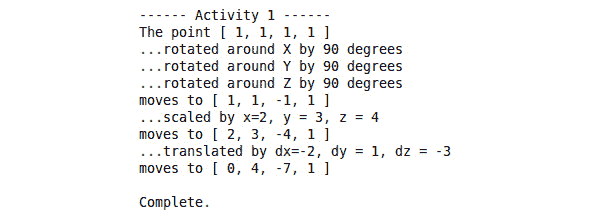

## 第 2A 章 – 使用运算符重载的 3D 图形学

## 活动：实现 Point3d 和 Matrix3d 类

### 步骤 57
在 `point3d.hpp` 中，添加 `<ostream>` 的 include，并在 `Point3d` 类末尾添加以下 friend 声明：

```cpp
friend std::ostream& operator<<(std::ostream&, const Point3d&);
```

### 步骤 58
在类后编写 operator 的内联实现：

```cpp
inline std::ostream& operator<<(std::ostream& os, const Point3d& pt)
{
    const char* sep = "[ ";
    for (auto value : pt.m_data)
    {
        os << sep << value;
        sep = ", ";
    }
    os << " ]";
    return os;
}
```

### 步骤 59
打开 `main.cpp` 文件，移除以下行的注释分隔符 `//`：

```cpp
//#define ACTIVITY1
```

### 步骤 60
构建并运行名为 `graphics` 的应用程序——你需要创建一个新的 Run Configuration。如果 `Point3d` 和 `Matrix3d` 的实现正确，程序将显示以下输出：



在本活动中，我们实现了两个类，它们构成了实现 3D 图形渲染所需所有操作的基础。我们使用运算符重载来实现这一点，使得 `Matrix3d` 和 `Point3d` 可以像原生类型一样使用。这可以轻松扩展以处理点向量，这是操作整个对象所必需的。

---
