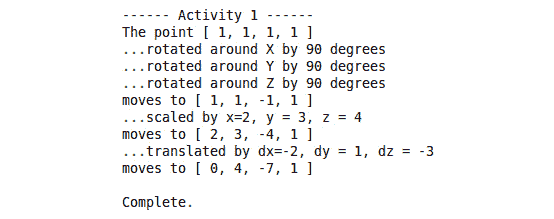
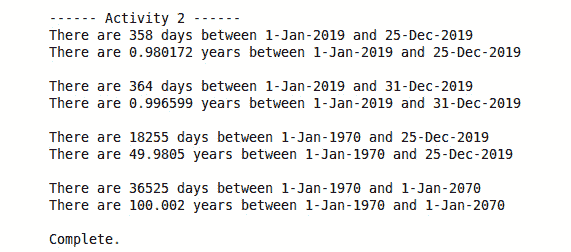

# 第 3 章 – “能做”与“该做”的距离：对象、指针与继承

## 活动 1：使用 RAII 和移动语义实现图形处理

在本活动中，我们将开发之前的 `Matrix3d` 和 `Point3d` 类，使其使用 `unique_ptr<>` 来管理实现这些图形类所需数据结构的相关内存。让我们开始吧：

### 步骤 1
从 `Lesson3/Activity01` 文件夹加载准备好的项目，并将项目的 Current Builder 配置为 `CMake Build (Portable)`。构建并配置启动器，运行单元测试。建议测试运行器使用的名称为 `L3A1graphicstests`。

### 步骤 2
打开 `point3d.hpp` 并将标记有注释的行添加到文件中：

```cpp
// ... lines omitted
#include <initializer_list>
```


# C++ 命名空间与堆内存重构指南

## 初始代码示例

```cpp
#include <ostream>

namespace acpp::gfx { // Add this line

class Point3d
{
    // ... lines omitted
};

} // Add this line
```

注意：添加到文件末尾的右大括号**没有**分号结束。嵌套命名空间语法 `acpp::gfx` 是 C++17 的新特性。以前需要显式使用两次 `namespace` 关键字。另外要小心，IDE 可能会在命名空间声明行后立即插入右大括号。

## 重构步骤

### 3. 处理其他文件
对 `matrix3d.hpp`、`matrix3d.cpp` 和 `point3d.cpp` 重复相同处理——确保头文件不包含在命名空间作用域内。

### 4. 添加 using 声明
在相应文件（`main.cpp`、`matrix3dTests.cpp` 和 `point3dTests.cpp`）的 `#include` 指令之后，插入以下行：

```cpp
using namespace acpp::gfx;
```

### 5. 运行测试
现在运行所有测试。所有 **18** 个现有测试应再次通过。我们已成功将类放入命名空间。

### 6. 转换 Matrix3d 使用堆内存
在 `matrix3d.hpp` 文件中添加 `#include <memory>` 以访问 `unique_ptr<>` 模板。

### 7. 修改 m_data 声明类型
```cpp
std::unique_ptr<float[]> m_data;
```

### 8. 修复编译器报错的运算符重载
尝试构建测试发现头文件中以下两个方法有问题：

```cpp
float operator()(const int row, const int column) const
{
    return m_data[row][column];
}

float& operator()(const int row, const int column)
{
    return m_data[row][column];
}
```

问题在于 `unique_ptr` 持有指向一维数组的指针，而非二维数组。需将行和列转换为单一索引。

### 9. 添加 get_index() 方法并更新运算符
```cpp
float operator()(const int row, const int column) const
{
    return m_data[get_index(row, column)];
}

float& operator()(const int row, const int column)
{
    return m_data[get_index(row, column)];
}

private:
size_t get_index(const int row, const int column) const
{
    return row * NumberColumns + column;
}
```

### 10. 修复内联乘法运算符错误
重新编译后，编译器报错指向以下内联函数：

```cpp
inline Matrix3d operator*(const Matrix3d& lhs, const Matrix3d& rhs)
{
    Matrix3d temp(lhs);  // <=== 编译器错误 – 构造函数格式错误
    temp *= rhs;
    return temp;
}
```

### 11. 声明拷贝构造函数和拷贝赋值运算符
以前默认拷贝构造函数足够，仅浅拷贝数组元素即可。现在有数据间接引用，需实现深拷贝构造函数和拷贝赋值。同时需处理现有构造函数。暂在类中添加构造函数声明（靠近其他构造函数）：

```cpp
Matrix3d(const Matrix3d& rhs);
Matrix3d& operator=(const Matrix3d& rhs);
```

尝试构建测试显示头文件问题已解决，可转至实现文件。

### 12. 修改构造函数初始化 unique_ptr
```cpp
Matrix3d::Matrix3d() : m_data{new float[NumberRows*NumberColumns]}
{
    for (int i{0} ; i < NumberRows ; i++)
        for (int j{0} ; j < NumberColumns ; j++)
            m_data[i][j] = (i==j);
}

Matrix3d::Matrix3d(std::initializer_list<std::initializer_list<float>> list)
    : m_data{new float[NumberRows*NumberColumns]}
{
    int i{0};
    for(auto it1 = list.begin(); i < NumberRows ; ++it1, ++i)
    {
        int j{0};
        for(auto it2 = it1->begin(); j < NumberColumns ; ++it2, ++j)
            m_data[i][j] = *it2;
    }
}
```

### 13. 修正默认构造函数的数组访问
将 `m_data[i][j]` 类型语句改为 `m_data[get_index(i,j)]`：

```cpp
Matrix3d::Matrix3d() : m_data{new float[NumberRows*NumberColumns]}
{
    for (int i{0} ; i < NumberRows ; i++)
        for (int j{0} ; j < NumberColumns ; j++)
            m_data[get_index(i, j)] = (i==j);  // <= 此处修改
}
```

### 14. 修正初始化列表构造函数
```cpp
Matrix3d::Matrix3d(std::initializer_list<std::initializer_list<float>> list)
    : m_data{new float[NumberRows*NumberColumns]}
{
    int i{0};
    for(auto it1 = list.begin(); i < NumberRows ; ++it1, ++i)
    {
        int j{0};
        for(auto it2 = it1->begin(); j < NumberColumns ; ++it2, ++j)
            m_data[get_index(i, j)] = *it2;  // <= 此处修改
    }
}
```

### 15. 修正乘法运算符（注意索引）
```cpp
Matrix3d& Matrix3d::operator*=(const Matrix3d& rhs)
{
    Matrix3d temp;
    for(int i=0 ; i < NumberRows ; i++)
        for(int j=0 ; j < NumberColumns ; j++)
        {
            temp.m_data[get_index(i, j)] = 0;  // <= 此处修改
            for (int k=0 ; k < NumberRows ; k++)
                temp.m_data[get_index(i, j)] += m_data[get_index(i, k)]
                    * rhs.m_data[get_index(k, j)];
                    // <= 此处修改
        }
    *this = temp;
    return *this;
}
```

### 16. 解决链接错误
这些更改修复了所有编译错误，但出现链接错误——第 11 步仅声明的拷贝构造函数缺失定义。

### 17. 在 matrix3d.cpp 中添加定义
```cpp
Matrix3d::Matrix3d(const Matrix3d& rhs) :
    m_data{new float[NumberRows*NumberColumns]}
{
    *this = rhs;
}

Matrix3d& Matrix3d::operator=(const Matrix3d& rhs)
{
    for(int i=0 ; i < NumberRows*NumberColumns ; i++)
        m_data[i] = rhs.m_data[i];
    return *this;
}
```

### 18. 强制移动构造函数
定位 `matrix3d.cpp` 中的 `createTranslationMatrix()` 方法，修改返回语句：

```cpp
return std::move(matrix);
```

### 19. 在 matrix3d.hpp 中声明移动构造函数
```cpp
Matrix3d(Matrix3d&& rhs);
```

### 20. 重新构建测试
现在报错移动构造函数缺失。

### 21. 在 matrix3d.cpp 中实现移动构造函数并重建
```cpp
Matrix3d::Matrix3d(Matrix3d&& rhs)
{
    // std::cerr << "Matrix3d::Matrix3d(Matrix3d&& rhs)\n";
    std::swap(m_data, rhs.m_data);
}
```

### 22. 重建并运行测试
所有测试再次通过。

### 23. 验证移动构造函数被调用
在 `matrix3d.cpp` 添加 `#include <iostream>`，取消移动构造函数中输出行的注释，重新运行测试。测试完成后会报错，因为输出发送到标准错误通道 (`cerr`)。验证后再将该行注释掉。

#### 注意


### 活动 1：将 Point3d 转换为使用堆分配内存

关于移动构造函数的一个简短说明——我们没有像其他构造函数那样显式初始化 `m_data`。这意味着它将被初始化为空，然后与传入的参数（一个临时对象）进行交换，因此事务结束后它不持有数组也是可以接受的——这消除了一次内存分配和释放。

24. 现在让我们转换 `Point3d` 类，使其能够使用堆分配内存。在 `point3d.hpp` 文件中，添加一行 `#include <memory>`，以便我们可以访问 `unique_ptr<>` 模板。

25. 接下来，将 `m_data` 的声明类型更改为如下所示：

```
std::unique_ptr<float[]> m_data;
```

26. 编译器现在会告诉我们，`point3d.hpp` 中的插入运算符（`<<`）存在问题，因为我们不能在 `unique_ptr` 上使用范围 for 循环。将实现替换为以下内容：

```
inline std::ostream&
operator<<(std::ostream& os, const Point3d& pt)
{
    const char* sep = "[ ";
    for(int i{0} ; i < Point3d::NumberRows ; i++)
    {
        os << sep << pt.m_data[i];
        sep = ", ";
    }
    os << " ]";
    return os;
}
```

27. 打开 `point3d.cpp` 并修改默认构造函数以初始化 `unique_ptr`，并更改初始化循环，因为不能在 `unique_ptr` 上使用范围 for 循环：

```
Point3d::Point3d() : m_data{new float[NumberRows]}
{
    for(int i{0} ; i < NumberRows-1 ; i++) {
        m_data[i] = 0;
    }
    m_data[NumberRows-1] = 1;
}
```

28. 通过初始化 `unique_ptr` 来修改另一个构造函数：

```
Point3d::Point3d(std::initializer_list<float> list)
        : m_data{new float[NumberRows]}
```

29. 现在所有测试都能运行并通过，就像之前一样。

30. 现在，如果我们运行原始应用程序 `L3graphics`，输出将与原始输出完全相同，但实现使用 RAII 来分配和管理用于矩阵和点的内存。



*图 3.52：成功转换为使用 RAII 后的活动 1 输出*

## 活动 2：实现日期计算的类

在本活动中，我们将实现两个类 `Date` 和 `Days`，它们将使我们非常容易地处理日期以及它们之间的时间差。让我们开始吧：

1. 从 `Lesson3/Activity02` 文件夹加载准备好的项目，并将项目的当前构建器配置为 **CMake Build (Portable)**。构建并配置启动器，然后运行单元测试。我们建议测试运行器使用的名称为 `L3A2datetests`。该项目包含虚拟文件和一个失败的测试。

2. 在编辑器中打开 `date.hpp` 文件，并在基本 `Date` 类中添加以下行，以允许访问存储的值：

```
int Day()   const {return m_day;}
int Month() const {return m_month;}
int Year()  const {return m_year;}
```

3. 打开 `dateTests.cpp` 文件，并将以下代码添加到 `DateTest` 类中：

```
void VerifyDate(const Date& dt, int yearExp, int monthExp, int dayExp) const
{
    ASSERT_EQ(dayExp, dt.Day());
    ASSERT_EQ(monthExp, dt.Month());
    ASSERT_EQ(yearExp, dt.Year());
}
```

通常，随着测试的开发，你会重构这个测试，但我们将提前把它提取出来。

4. 将现有测试中的 `ASSERT_FALSE()` 替换为以下测试：

```
Date dt;
VerifyDate(dt, 1970, 1, 1);
```

5. 重新构建并运行测试——它们现在应该都能通过。

6. 添加以下测试：

```
TEST_F(DateTest, Constructor1970Jan2)
{
    Date dt(2, 1, 1970);
    VerifyDate(dt, 1970, 1, 2);
}
```

7. 为了使该测试通过，我们需要向 `Date` 类添加以下两个构造函数：

```
Date() = default;
Date(int day, int month, int year) :
        m_year{year}, m_month{month}, m_day{day}
{
}
```

8. 我们现在需要引入转换到/从 `date_t` 类型的函数。在我们的命名空间内，向 `date.hpp` 文件添加以下别名：

```
using date_t = int64_t;
```

9. 向 `Date` 类添加以下方法的声明：

```
date_t ToDateT() const;
```

10. 然后，添加以下测试：

```
TEST_F(DateTest, ToDateTDefaultIsZero)
{
    Date dt;
    ASSERT_EQ(0, dt.ToDateT());
}
```

11. 因为我们正在进行 **TDD**，所以我们添加该方法的最小实现以通过测试。

```
date_t Date::ToDateT() const
{
    return 0;
}
```

12. 现在，我们添加下一个测试：

```
TEST_F(DateTest, ToDateT1970Jan2Is1)
{
    Date dt(2, 1, 1970);
    ASSERT_EQ(1, dt.ToDateT());
}
```

13. 我们继续添加一个又一个测试，同时不断改进 `ToDateT()` 中的算法，首先处理 **1970** 年的日期，然后是 **1971 年 1 月 1 日**，接着是 **1973** 年的一个日期，这意味着我们跨越了一个闰年，依此类推。用于开发 `ToDateT()` 方法的完整测试集如下：

```
TEST_F(DateTest, ToDateT1970Dec31Is364)
{
    Date dt(31, 12, 1970);
    ASSERT_EQ(364, dt.ToDateT());
}

TEST_F(DateTest, ToDateT1971Jan1Is365)
{
    Date dt(1, 1, 1971);
    ASSERT_EQ(365, dt.ToDateT());
}

TEST_F(DateTest, ToDateT1973Jan1Is1096)
{
    Date dt(1, 1, 1973);
    ASSERT_EQ(365*3+1, dt.ToDateT());
}

TEST_F(DateTest, ToDateT2019Aug28Is18136)
{
    Date dt(28, 8, 2019);
    ASSERT_EQ(18136, dt.ToDateT());
}
```

14. 为了通过所有这些测试，我们向 `Date` 类的声明中添加以下项目：

```
public:
    static constexpr int EpochYear = 1970;
    static constexpr int DaysPerCommonYear = 365;
    static constexpr int YearsBetweenLeapYears = 4;

private:
    int GetDayOfYear(int day, int month, int year) const;
    bool IsLeapYear(int year) const;
    int CalcNumberLeapYearsFromEpoch(int year) const;
```

15. `date.cpp` 中 `ToDateT()` 和支持方法的实现如下：

```
namespace {

int daysBeforeMonth[2][12] =
{
    { 0, 31, 59, 90, 120, 151, 181, 212, 243, 273, 204, 334}, // Common Year
    { 0, 31, 50, 91, 121, 152, 182, 213, 244, 274, 205, 335}  // Leap Year
};

}

namespace acpp::date
{

int Date::CalcNumberLeapYearsFromEpoch(int year) const
{
    return (year-1)/YearsBetweenLeapYears
            - (EpochYear-1)/YearsBetweenLeapYears;
}

int Date::GetDayOfYear(int day, int month, int year) const
{
    return daysBeforeMonth[IsLeapYear(year)][month-1] + day;
}

bool Date::IsLeapYear(int year) const
{
    return (year%4)==0;   // Not full story, but good enough to 2100
}

date_t Date::ToDateT() const
{
    date_t value = GetDayOfYear(m_day, m_month, m_year) - 1;
    value += (m_year-EpochYear) * DaysPerCommonYear;
    date_t numberLeapYears = CalcNumberLeapYearsFromEpoch(m_year);
    value += numberLeapYears;
    return value;
}

}
```

16. 现在 `ToDateT()` 已经工作，我们转向它的逆操作，即 `FromDateT()`。同样，我们一次添加一个测试，以在一系列日期上开发算法。使用了以下测试：

```
TEST_F(DateTest, FromDateT0Is1Jan1970)
{
    Date dt;
    dt.FromDateT(0);
    ASSERT_EQ(0, dt.ToDateT());
    VerifyDate(dt, 1970, 1, 1);
}

TEST_F(DateTest, FromDateT1Is2Jan1970)
{
    Date dt;
    dt.FromDateT(1);
    ASSERT_EQ(1, dt.ToDateT());
    VerifyDate(dt, 1970, 1, 2);
}
```


## Date 类的实现与测试

## FromDateT 方法的测试用例

```cpp
TEST_F(DateTest, FromDateT364Is31Dec1970)
{
    Date dt;
    dt.FromDateT(364);
    ASSERT_EQ(364, dt.ToDateT());
    VerifyDate(dt, 1970, 12, 31);
}

TEST_F(DateTest, FromDateT365Is1Jan1971)
{
    Date dt;
    dt.FromDateT(365);
    ASSERT_EQ(365, dt.ToDateT());
    VerifyDate(dt, 1971, 1, 1);
}

TEST_F(DateTest, FromDateT1096Is1Jan1973)
{
    Date dt;
    dt.FromDateT(1096);
    ASSERT_EQ(1096, dt.ToDateT());
    VerifyDate(dt, 1973, 1, 1);
}

TEST_F(DateTest, FromDateT18136Is28Aug2019)
{
    Date dt;
    dt.FromDateT(18136);
    ASSERT_EQ(18136, dt.ToDateT());
    VerifyDate(dt, 2019, 8, 28);
}
```

## 头文件声明

在头文件中添加以下声明：

```cpp
public:
    void FromDateT(date_t date);

private:
    int CalcMonthDayOfYearIsIn(int dayOfYear, bool IsLeapYear) const;
```

## FromDateT 和 CalcMonthDayOfYearIsIn 的实现

```cpp
void Date::FromDateT(date_t date)
{
    int number_years = date / DaysPerCommonYear;
    date = date - number_years * DaysPerCommonYear;
    m_year = EpochYear + number_years;
    date_t numberLeapYears = CalcNumberLeapYearsFromEpoch(m_year);
    date -= numberLeapYears;
    m_month = CalcMonthDayOfYearIsIn(date, IsLeapYear(m_year));
    date -= daysBeforeMonth[IsLeapYear(m_year)][m_month-1];
    m_day = date + 1;
}

int Date::CalcMonthDayOfYearIsIn(int dayOfYear, bool isLeapYear) const
{
    for(int i = 1; i < 12; i++)
    {
        if (daysBeforeMonth[isLeapYear][i] > dayOfYear)
            return i;
    }
    return 12;
}
```

## Days 类的实现

现在我们已经准备好支持例程，可以实现 `Date` 类的真正功能：两个日期之间的差值，以及通过添加天数来确定新日期。这两个操作都需要一个新类型（类）`Days`。

将以下 `Days` 的实现添加到头文件中（位于 `Date` 类上方）：

```cpp
class Days
{
public:
    Days() = default;
    Days(int days) : m_days{days} {}
    operator int() const
    {
        return m_days;
    }

private:
    int m_days{0};
};
```

## Date 和 Days 的加法运算符

### 方法声明

在 `Date` 类的 public 部分添加以下方法声明：

```cpp
Date& operator+=(const Days& day);
```

### 内联实现

在头文件中 `Date` 类外部添加以下内联实现：

```cpp
inline Date operator+(const Date& lhs, const Days& rhs)
{
    Date tmp(lhs);
    tmp += rhs;
    return tmp;
}
```

## 求和操作的测试

```cpp
TEST_F(DateTest, AddZeroDays)
{
    Date dt(28, 8, 2019);
    Days days;
    dt += days;
    VerifyDate(dt, 2019, 8, 28);
}

TEST_F(DateTest, AddFourDays)
{
    Date dt(28, 8, 2019);
    Days days(4);
    dt += days;
    VerifyDate(dt, 2019, 9, 1);
}
```

## 求和操作的实现

```cpp
Date& Date::operator+=(const Days& day)
{
    FromDateT(ToDateT() + day);
    return *this;
}
```

## 添加整数天数的测试

```cpp
TEST_F(DateTest, AddFourDaysAsInt)
{
    Date dt(28, 8, 2019);
    dt += 4;
    VerifyDate(dt, 2019, 9, 1);
}
```

当我们运行测试时，它们都能构建通过，并且该测试也通过了。但这并非预期结果。我们**不希望**用户能将裸整数添加到日期中。（未来版本可能会添加月份和年份，那么添加整数意味着什么？）。为了使构建失败，我们将 `Days` 构造函数改为 `explicit`：

```cpp
explicit Days(int days) : m_days{days} {}
```

现在构建失败了，因此我们需要通过将加法行改为转换为 `Days` 来修复测试，如下所示：

```cpp
dt += static_cast<Days>(4);
```

所有测试应该再次通过。

## 日期差值操作

我们想要的最后一个功能是两个日期之间的差值。以下是用于验证实现的测试：

```cpp
TEST_F(DateTest, DateDifferences27days)
{
    Date dt1(28, 8, 2019);
    Date dt2(1, 8, 2019);
    Days days = dt1 - dt2;
    ASSERT_EQ(27, (int)days);
}

TEST_F(DateTest, DateDifferences365days)
{
    Date dt1(28, 8, 2019);
    Date dt2(28, 8, 2018);
    Days days = dt1 - dt2;
    ASSERT_EQ(365, (int)days);
}
```

### 声明

在头文件中 `Date` 类的 public 部分添加以下函数声明：

```cpp
Days operator-(const Date& rhs) const;
```

### 实现

在头文件中 `Date` 类之后添加以下代码：

```cpp
inline Days Date::operator-(const Date& rhs) const
{
    return Days(ToDateT() - rhs.ToDateT());
}
```

因为我们将 `Days` 构造函数设为 explicit，所以必须在 return 语句中调用它。完成所有这些更改后，所有测试都应该通过。

## 运行示例应用程序

将 `L3A2date` 配置为 `datetools` 二进制文件，并在编辑器中打开 `main.cpp`。取消 `ACTIVITY2` 定义的注释：

```cpp
#define ACTIVITY2
```

构建并运行示例应用程序。这将产生以下输出：



###### 图 3.53：成功的 Date 示例应用程序输出

我们已经实现了 `Date` 和 `Days` 类的所有需求，并通过单元测试交付了所有功能。单元测试使我们能够实现增量功能，以构建两个复杂算法 `ToDateT` 和 `FromDateT`，它们构成了我们想要交付的功能的底层支持。
