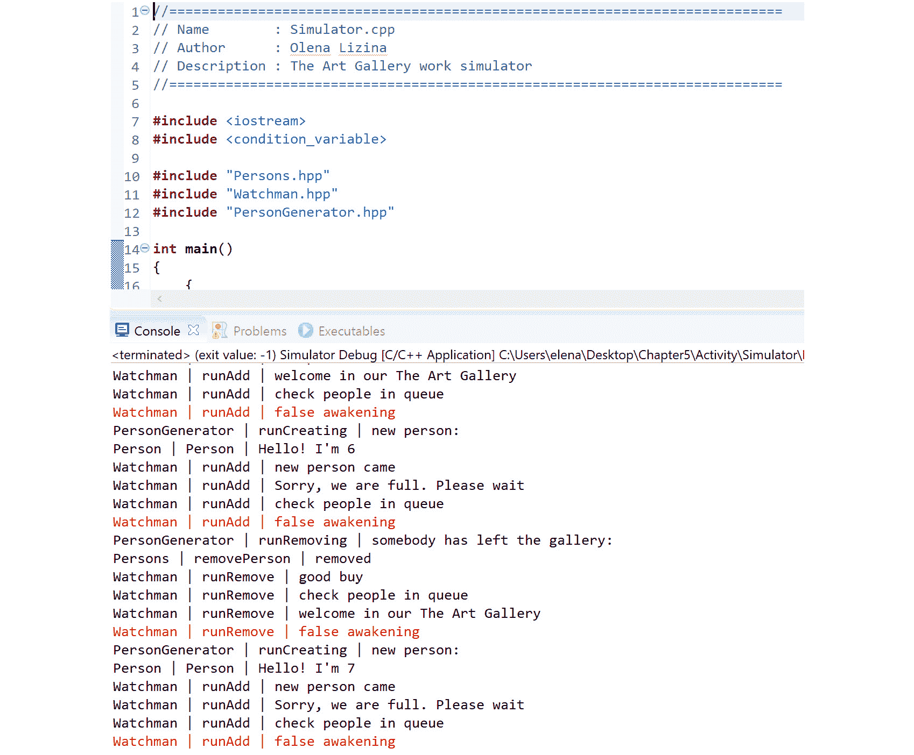
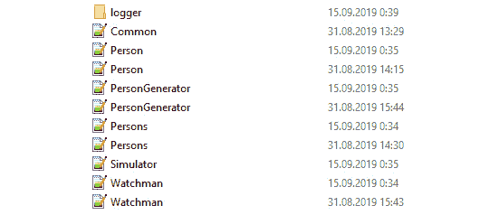
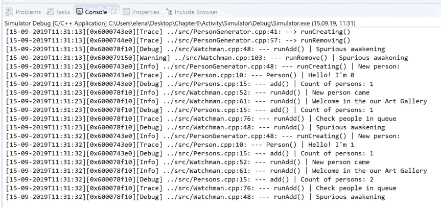

# 第 5 章 - 哲学家进餐 – 线程与并发

## 活动 1：创建模拟器以模拟美术馆的工作

美术馆工作模拟器是一个模拟访客和看守员行为的应用程序。访客数量有限制，即同时只能有 50 人在馆内。访客不断来到美术馆。看守员检查访客数量是否超限。如果超限，则要求新访客等待并将其列入等待名单。如果未超限，则允许他们进入。访客可以随时离开美术馆。如果有人离开，看守员会让等待名单上的人进入美术馆。

请遵循以下步骤实现此活动：

1. 创建一个包含该项目所需所有常量的文件 – `Common.hpp`。

2. 添加包含保护符和第一个变量 `CountPeopleInside`，它表示访客限额为 50 人：

```cpp
#ifndef COMMON_HPP
#define COMMON_HPP

constexpr size_t CountPeopleInside = 5;

#endif // COMMON_HPP
```

3. 现在，为 `Person` 类创建头文件和源文件，即 `Person.hpp` 和 `Person.cpp`。同时添加包含保护符。定义 `Person` 类并删除拷贝构造函数和拷贝赋值运算符；我们将仅使用用户定义的默认构造函数、移动构造函数、移动赋值运算符和默认析构函数。添加一个名为 `m_Id` 的私有变量；我们将用它进行日志记录。此外，添加一个名为 `m_NextId` 的私有静态变量；它将用于生成唯一 ID：

```cpp
#ifndef PERSON_HPP
#define PERSON_HPP

class Person
{
public:
    Person();
    Person& operator=(Person&);
    Person(Person&&);
    ~Person() = default;
    Person(const Person&) = delete;
    Person& operator=(const Person&) = delete;

private:
    int m_Id;
    static int m_NextId;
};

#endif // PERSON_HPP
```

4. 在源文件中，定义我们的静态变量 `m_NextId`。然后，在构造函数中，用 `m_NextId` 的值初始化 `m_Id` 变量。在构造函数中打印日志。实现移动拷贝构造函数和移动赋值运算符。现在，为我们的 `Person` 对象实现线程安全的存储。创建所需的头文件和源文件，即 `Persons.hpp` 和 `Persons.cpp`。同时添加包含保护符。包含 `Person.hpp`、`<mutex>` 和 `<vector>` 头文件。定义 `Persons` 类，带有用户定义的默认构造函数和默认析构函数。声明用于添加 `Person` 的 `add()` 函数和用于获取并从列表中移除 `Person` 的 `get()` 函数。定义用于获取 `Person` 元素数量的 `size()` 函数，以及用于从存储中移除任意人员的 `removePerson()` 函数。在私有部分，声明一个互斥锁类型的变量 `m_Mutex`，以及一个用于存储 `Persons` 的向量 `m_Persons`：

```cpp
#ifndef PERSONS_HPP
#define PERSONS_HPP

#include "Person.hpp"
#include <mutex>
#include <vector>

class Persons
{
public:
    Persons();
    ~Persons() = default;
    void add(Person&& person);
    Person get();
    size_t size() const;
    void removePerson();

private:
    std::mutex m_Mutex;
    std::vector<Person> m_Persons;
};

#endif // PERSONS_HPP
```

5. 在源文件中，声明用户定义的构造函数，其中我们将向量的大小预留为 50 个元素（以避免增长时调整大小）：

```cpp
Persons::Persons()
{
    m_Persons.reserve(CountPeopleInside);
}
```

6. 声明 `add()` 函数，它接受一个 `Person` 类型的右值参数，锁定互斥锁，并使用 `std::move()` 函数将 `Person` 添加到向量中：

```cpp
void Persons::add(Person&& person)
{
    std::lock_guard<std::mutex> m_lock(m_Mutex);
    m_Persons.emplace_back(std::move(person));
}
```

7. 声明 `get()` 函数，它锁定互斥锁并返回最后一个元素，然后将其从向量中移除。如果向量为空，它将抛出异常：

```cpp
Person Persons::get()
{
    std::lock_guard<std::mutex> m_lock(m_Mutex);
    if (m_Persons.empty())
    {
        throw "Empty Persons storage";
    }
    Person result = std::move(m_Persons.back());
    m_Persons.pop_back();
    return result;
}
```

8. 声明 `size()` 函数，它返回向量的大小：

```cpp
size_t Persons::size() const
{
    return m_Persons.size();
}
```

9. 最后，声明 `removePerson()` 函数，它锁定互斥锁并从向量中移除最后一项：

```cpp
void Persons::removePerson()
{
    std::lock_guard<std::mutex> m_lock(m_Mutex);
    m_Persons.pop_back();
    std::cout << "Persons | removePerson | removed" << std::endl;
}
```

10. 现在，实现 `PersonGenerator` 类，它负责创建和移除 `Person` 项。创建相应的头文件和源文件，即 `PersonGenerator.hpp` 和 `PersonGenerator.cpp`。同时添加包含保护符。包含 `Persons.hpp`、`<thread>` 和 `<condition_variable>` 头文件。定义 `PersonGenerator` 类。在私有部分，定义两个 `std::thread` 变量，分别为 `m_CreateThread` 和 `m_RemoveThread`。在一个线程中，我们将创建新的 `Person` 对象，并在另一个线程中异步通知用户移除 `Person` 对象。定义一个对 `Persons` 类型共享变量的引用，即 `m_CreatedPersons`。我们将把每个新人员放入其中。`m_CreatedPersons` 将在多个线程间共享。定义两个对 `std::condition_variable` 的引用，即 `m_CondVarAddPerson` 和 `m_CondVarRemovePerson`。它们将用于线程间通信。定义两个对 `std::mutex` 变量的引用，即 `m_AddLock` 和 `m_RemoveLock`。它们将用于获取条件变量的访问权。最后，定义两个对 `bool` 值的引用，即 `m_AddNotified` 和 `m_RemoveNotified`。它们将用于检查通知是否为真。同样在私有部分，定义两个作为线程启动函数的函数 – `runCreating()` 和 `runRemoving()`。接下来，定义两个触发条件变量的函数，即 `notifyCreated()` 和 `notifyRemoved()`。在公有部分，定义一个构造函数，接受我们在私有部分定义的所有引用作为参数。最后，定义一个析构函数。这将确保其他默认生成的函数被删除：

```cpp
#ifndef PERSON_GENERATOR_HPP
#define PERSON_GENERATOR_HPP

#include "Persons.hpp"
#include <condition_variable>
#include <thread>

class PersonGenerator
{
public:
    PersonGenerator(Persons& persons,
                    std::condition_variable& add_person,
                    std::condition_variable& remove_person,
                    std::mutex& add_lock,
                    std::mutex& remove_lock,
                    bool& addNotified,
                    bool& removeNotified);
```


## PersonGenerator 与 Watchman 实现

## PersonGenerator.hpp（类定义）

```cpp
~PersonGenerator();

PersonGenerator(const PersonGenerator&) = delete;
PersonGenerator(PersonGenerator&&) = delete;
PersonGenerator& operator=(const PersonGenerator&) = delete;
PersonGenerator& operator=(PersonGenerator&&) = delete;

private:
    void runCreating();
    void runRemoving();
    void notifyCreated();
    void notifyRemoved();

private:
    std::thread m_CreateThread;
    std::thread m_RemoveThread;
    Persons& m_CreatedPersons;
    // to notify about creating new person
    std::condition_variable& m_CondVarAddPerson;
    std::mutex& m_AddLock;
    bool& m_AddNotified;
    // to notify that person needs to be removed
    std::condition_variable& m_CondVarRemovePerson;
    std::mutex& m_RemoveLock;
    bool& m_RemoveNotified;
};

#endif // PERSON_GENERATOR_HPP
```

## PersonGenerator.cpp（源文件）

### 步骤 11：包含头文件

现在转到源文件。包含 `<stdlib.h>` 文件以便访问 `srand()` 和 `rand()` 函数，它们用于随机数生成。包含 `<time.h>` 头文件以便访问 `time()` 函数，以及 `std::chrono` 命名空间。它们用于处理时间相关操作。包含 `<ratio>` 文件，它用于类型定义，以便我们可以使用时间库：

```cpp
#include "PersonGenerator.hpp"
#include <iostream>
#include <stdlib.h>   /* srand, rand */
#include <time.h>     /* time, chrono */
#include <ratio>      /* std::milli */
```

### 步骤 12：声明构造函数

声明构造函数，并在初始化列表中初始化除线程外的所有参数。在构造函数体中用适当的函数初始化线程：

```cpp
PersonGenerator::PersonGenerator(Persons& persons,
                                 std::condition_variable& add_person,
                                 std::condition_variable& remove_person,
                                 std::mutex& add_lock,
                                 std::mutex& remove_lock,
                                 bool& addNotified,
                                 bool& removeNotified)
    : m_CreatedPersons(persons)
    , m_CondVarAddPerson(add_person)
    , m_AddLock(add_lock)
    , m_AddNotified(addNotified)
    , m_CondVarRemovePerson(remove_person)
    , m_RemoveLock(remove_lock)
    , m_RemoveNotified(removeNotified)
{
    m_CreateThread = std::thread(&PersonGenerator::runCreating, this);
    m_RemoveThread = std::thread(&PersonGenerator::runRemoving, this);
}
```

### 步骤 13：声明析构函数

声明析构函数，检查线程是否可连接（joinable）。如果不可连接，则连接它们：

```cpp
PersonGenerator::~PersonGenerator()
{
    if (m_CreateThread.joinable())
    {
        m_CreateThread.join();
    }
    if (m_RemoveThread.joinable())
    {
        m_RemoveThread.join();
    }
}
```

### 步骤 14：声明 `runCreating()` 函数

声明 `runCreating()` 函数，它是 `m_CreateThread` 线程的启动函数。在该函数中，通过一个无限循环，生成 1 到 10 的随机数，并让当前线程休眠该时长。之后，创建一个 `Person` 值，将其添加到共享容器中，并通知其他线程：

```cpp
void PersonGenerator::runCreating()
{
    using namespace std::chrono_literals;
    srand(time(NULL));
    while (true)
    {
        std::chrono::duration<int, std::milli> duration((rand() % 10 + 1) * 1000);
        std::this_thread::sleep_for(duration);
        std::cout << "PersonGenerator | runCreating | new person:" << std::endl;
        m_CreatedPersons.add(std::move(Person()));
        notifyCreated();
    }
}
```

### 步骤 15：声明 `runRemoving()` 函数

声明 `runRemoving()` 函数，它是 `m_RemoveThread` 线程的启动函数。在该函数中，通过一个无限循环，生成 20 到 30 的随机数，并让当前线程休眠该时长。之后，通知其他线程有访客需要离开：

```cpp
void PersonGenerator::runRemoving()
{
    using namespace std::chrono_literals;
    srand(time(NULL));
    while (true)
    {
        std::chrono::duration<int, std::milli> duration((rand() % 10 + 20) * 1000);
        std::this_thread::sleep_for(duration);
        std::cout << "PersonGenerator | runRemoving | somebody has left the gallery:" << std::endl;
        notifyRemoved();
    }
}
```

### 步骤 16：声明通知函数

声明 `notifyCreated()` 和 `notifyRemoved()` 函数。在它们的函数体中，锁定相应的互斥量，将相应的 `bool` 变量设为 `true`，并在相应的条件变量上调用 `notify_all()` 函数：

```cpp
void PersonGenerator::notifyCreated()
{
    std::unique_lock<std::mutex> lock(m_AddLock);
    m_AddNotified = true;
    m_CondVarAddPerson.notify_all();
}

void PersonGenerator::notifyRemoved()
{
    std::unique_lock<std::mutex> lock(m_RemoveLock);
    m_RemoveNotified = true;
    m_CondVarRemovePerson.notify_all();
}
```

## Watchman 类定义

### 步骤 17：创建 `Watchman.hpp` 和 `Watchman.cpp`

最后，我们需要为最后一个类 `Watchman` 创建文件，即 `Watchman.hpp` 和 `Watchman.cpp`。照常添加包含保护。包含 `Persons.hpp`、`<thread>`、`<mutex>` 和 `<condition_variable>` 头文件。定义 `Watchman` 类。在私有部分，定义两个 `std::thread` 变量，即 `m_ThreadAdd` 和 `m_ThreadRemove`。在一个线程中，我们将新的 `Person` 对象移动到适当的队列，并在另一个线程中异步移除 `Person` 对象。定义对共享 `Persons` 变量的引用，即 `m_CreatedPeople`、`m_PeopleInside` 和 `m_PeopleInQueue`。我们将从 `m_CreatedPeople` 列表中取出每个新人，如果未超限则移动到 `m_PeopleInside` 列表，否则移动到 `m_PeopleInQueue` 列表。它们将在多个线程间共享。定义两个 `std::condition_variable` 引用，即 `m_CondVarAddPerson` 和 `m_CondVarRemovePerson`。它们将用于线程间通信。定义两个 `std::mutex` 变量的引用，即 `m_AddMux` 和 `m_RemoveMux`。它们将用于获取条件变量的访问权。最后，定义两个 `bool` 值的引用，即 `m_AddNotified` 和 `m_RemoveNotified`。它们将用于检查通知是真还是假。同样在私有部分，定义两个作为线程启动函数的函数——`runAdd()` 和 `runRemove()`。在公共部分，定义一个构造函数，接受私有部分定义的所有引用作为参数。现在，定义一个析构函数。确保删除所有其他默认生成的函数：

```cpp
#ifndef WATCHMAN_HPP
#define WATCHMAN_HPP

#include <mutex>
#include <thread>
#include <condition_variable>
#include "Persons.hpp"

class Watchman
{
public:
    Watchman(std::condition_variable&,
             std::condition_variable&,
             std::mutex&,
             std::mutex&,
             bool&,
             bool&,
             Persons&,
             Persons&,
             Persons&);
    ~Watchman();
    Watchman(const Watchman&) = delete;
    Watchman(Watchman&&) = delete;
    Watchman& operator=(const Watchman&) = delete;
    Watchman& operator=(Watchman&&) = delete;

private:
    void runAdd();
    void runRemove();

private:
    std::thread m_ThreadAdd;
    std::thread m_ThreadRemove;
```


### 18. 包含头文件

现在转到源文件。包含 `Common.hpp` 头文件以便访问 `m_CountPeopleInside` 变量和其他必要的头文件：

```cpp
#include "Watchman.hpp"
#include "Common.hpp"
#include <iostream>
```

### 19. 声明构造函数

声明构造函数并在初始化列表中初始化除线程外的所有参数。在构造函数体中用适当的函数初始化线程：

```cpp
Watchman::Watchman(std::condition_variable& addPerson,
                   std::condition_variable& removePerson,
                   std::mutex& addMux,
                   std::mutex& removeMux,
                   bool& addNotified,
                   bool& removeNotified,
                   Persons& peopleInside,
                   Persons& peopleInQueue,
                   Persons& createdPeople)
    : m_CondVarRemovePerson(removePerson)
    , m_CondVarAddPerson(addPerson)
    , m_AddMux(addMux)
    , m_RemoveMux(removeMux)
    , m_AddNotified(addNotified)
    , m_RemoveNotified(removeNotified)
    , m_PeopleInside(peopleInside)
    , m_PeopleInQueue(peopleInQueue)
    , m_CreatedPeople(createdPeople)
{
    m_ThreadAdd = std::thread(&Watchman::runAdd, this);
    m_ThreadRemove = std::thread(&Watchman::runRemove, this);
}
```

### 20. 声明析构函数

声明析构函数并检查线程是否可连接。如果可连接则连接它们：

```cpp
Watchman::~Watchman()
{
    if (m_ThreadAdd.joinable())
    {
        m_ThreadAdd.join();
    }
    if (m_ThreadRemove.joinable())
    {
        m_ThreadRemove.join();
    }
}
```

### 21. 声明 `runAdd()` 函数

声明 `runAdd()` 函数。这里创建一个无限循环。在循环中，我们等待条件变量。当条件变量通知时，我们从 `m_CreatedPeople` 列表获取人员并将他们移动到适当的列表，即 `m_PeopleInside`，或者如果超过了限制则移动到 `m_PeopleInQueue`。然后，我们检查 `m_PeopleInQueue` 列表中是否有人员且 `m_PeopleInside` 未满，如果是则将他们移入该列表：

```cpp
void Watchman::runAdd()
{
    while (true)
    {
        std::unique_lock<std::mutex> locker(m_AddMux);
        while(!m_AddNotified)
        {
            std::cerr << "Watchman | runAdd | false awakening" << std::endl;
            m_CondVarAddPerson.wait(locker);
        }
        std::cout << "Watchman | runAdd | new person came" << std::endl;
        m_AddNotified = false;
        while (m_CreatedPeople.size() > 0)
        {
            try
            {
                auto person = m_CreatedPeople.get();
                if (m_PeopleInside.size() < CountPeopleInside)
                {
                    std::cout << "Watchman | runAdd | welcome in our The Art Gallery" << std::endl;
                    m_PeopleInside.add(std::move(person));
                }
                else
                {
                    std::cout << "Watchman | runAdd | Sorry, we are full. Please wait" << std::endl;
                    m_PeopleInQueue.add(std::move(person));
                }
            }
            catch(const std::string& e)
            {
                std::cout << e << std::endl;
            }
        }
        std::cout << "Watchman | runAdd | check people in queue" << std::endl;
        if (m_PeopleInQueue.size() > 0)
        {
            while (m_PeopleInside.size() < CountPeopleInside)
            {
                try
                {
                    auto person = m_PeopleInQueue.get();
                    std::cout << "Watchman | runAdd | welcome in our The Art Gallery" << std::endl;
                    m_PeopleInside.add(std::move(person));
                }
                catch(const std::string& e)
                {
                    std::cout << e << std::endl;
                }
            }
        }
    }
}
```

### 22. 声明 `runRemove()` 函数

接下来声明 `runRemove()` 函数，我们将从 `m_PeopleInside` 移除访客。这里同样在无限循环中，我们等待 `m_CondVarRemovePerson` 条件变量。当它通知线程时，我们从访客列表中移除人员。接着，我们检查 `m_PeopleInQueue` 列表中是否有人且未超过限制，如果是则将他们添加到 `m_PeopleInside`：

```cpp
void Watchman::runRemove()
{
    while (true)
    {
        std::unique_lock<std::mutex> locker(m_RemoveMux);
        while(!m_RemoveNotified)
        {
            std::cerr << "Watchman | runRemove | false awakening" << std::endl;
            m_CondVarRemovePerson.wait(locker);
        }
        m_RemoveNotified = false;
        if (m_PeopleInside.size() > 0)
        {
            m_PeopleInside.removePerson();
            std::cout << "Watchman | runRemove | good buy" << std::endl;
        }
        else
        {
            std::cout << "Watchman | runRemove | there is nobody in The Art Gallery" << std::endl;
        }
        std::cout << "Watchman | runRemove | check people in queue" << std::endl;
        if (m_PeopleInQueue.size() > 0)
        {
            while (m_PeopleInside.size() < CountPeopleInside)
            {
                try
                {
                    auto person = m_PeopleInQueue.get();
                    std::cout << "Watchman | runRemove | welcome in our The Art Gallery" << std::endl;
                    m_PeopleInside.add(std::move(person));
                }
                catch(const std::string& e)
                {
                    std::cout << e << std::endl;
                }
            }
        }
    }
}
```

### 23. 编写 `main()` 函数

最后转到 `main()` 函数。首先创建 `Watchman` 和 `PersonGenerator` 类中使用的所有共享变量。接着创建 `Watchman` 和 `PersonGenerator` 变量并将那些共享变量传递给构造函数。在 `main` 函数末尾读取字符以避免应用程序关闭：

```cpp
int main()
{
    {
        std::condition_variable g_CondVarRemovePerson;
        std::condition_variable g_CondVarAddPerson;
        std::mutex g_AddMux;
        std::mutex g_RemoveMux;
        bool g_AddNotified = false;;
        bool g_RemoveNotified = false;
        Persons g_PeopleInside;
        Persons g_PeopleInQueue;
        Persons g_CreatedPersons;
        PersonGenerator generator(g_CreatedPersons, g_CondVarAddPerson, g_CondVarRemovePerson,
                                  g_AddMux, g_RemoveMux, g_AddNotified, g_RemoveNotified);
        Watchman watchman(g_CondVarAddPerson,
                          g_CondVarRemovePerson,
                          g_AddMux,
                          g_RemoveMux,
                          g_AddNotified,
                          g_RemoveNotified,
                          g_PeopleInside,
                          g_PeopleInQueue,
                          g_CreatedPersons);
    }
}
```


```cpp
char a;

std::cin >> a;

return 0;

}
```

24. 编译并运行应用程序。在终端中，你将看到来自不同线程的日志，内容涉及创建人员并将其从一个列表移动到另一个列表。你的输出将类似于以下屏幕截图：



*图 5.27：应用程序执行的结果*

正如你所见，所有线程都以一种非常简单且清晰的方式相互通信。我们通过使用 `mutexes` 保护了共享数据，从而避免了竞争条件。在这里，我们使用异常来警告空列表，并在线程函数中捕获它们，以便我们的线程自行处理异常。我们还在析构函数中连接线程之前检查了线程是否可连接。这使我们能够避免程序意外终止。因此，这个小项目展示了我们在处理线程方面的技能。

#### 第 6 章 – 流与 I/O

### 活动 1：艺术画廊模拟器的日志系统

线程安全的记录器允许我们同时向终端输出数据。我们通过继承 `std::ostringstream` 类并使用 `mutex` 进行同步来实现此记录器。我们将实现一个提供格式化输出接口的类，我们的记录器将使用它来扩展基本输出。我们为不同的日志级别定义宏定义，以提供一个易于使用且清晰的接口。请按照以下步骤完成此活动：

1.  打开 `Lesson6` 中的项目。

2.  在 `src/` 目录内创建一个名为 `logger` 的新目录。你将获得以下层级结构：

    

    *图 6.25：项目的层级结构*

3.  创建一个名为 `LoggerUtils` 的头文件和源文件。在 `LoggerUtils.hpp` 中，添加包含保护符。包含 `<string>` 头文件以添加对字符串操作的支持。定义一个名为 `logger` 的命名空间，然后定义一个嵌套命名空间 `utils`。在 `utils` 命名空间中，声明 `LoggerUtils` 类。

4.  在公共部分，声明以下静态函数：`getDateTime`、`getThreadId`、`getLoggingLevel`、`getFileAndLine`、`getFuncName`、`getInFuncName` 和 `getOutFuncName`。你的类应如下所示：

    ```cpp
    #ifndef LOGGERUTILS_HPP_
    #define LOGGERUTILS_HPP_

    #include <string>

    namespace logger
    {

    namespace utils
    {

    class LoggerUtils
    {

    public:

        static std::string getDateTime();

        static std::string getThreadId();

        static std::string getLoggingLevel(const std::string& level);

        static std::string getFileAndLine(const std::string& file, const int& line);

        static std::string getFuncName(const std::string& func);

        static std::string getInFuncName(const std::string& func);

        static std::string getOutFuncName(const std::string& func);

    };

    } // namespace utils

    } // namespace logger

    #endif /* LOGGERUTILS_HPP_ */
    ```

5.  在 `LoggerUtils.cpp` 中，添加所需的包含：`LoggerUtils.hpp` 头文件、用于 `std::stringstream` 支持的 `<sstream>` 以及用于日期和时间支持的 `<ctime>`：

    ```cpp
    #include "LoggerUtils.hpp"

    #include <sstream>

    #include <ctime>

    #include <thread>
    ```

6.  进入 `logger` 和 `utils` 命名空间。编写所需的函数定义。在 `getDateTime()` 函数中，使用 `localtime()` 函数获取本地时间。使用 `strftime()` 函数将其格式化为字符串。使用 `std::stringstream` 将其转换为所需格式：

    ```cpp
    std::string LoggerUtils::getDateTime()
    {

        time_t rawtime;

        struct tm * timeinfo;

        char buffer[80];

        time (&rawtime);

        timeinfo = localtime(&rawtime);

        strftime(buffer,sizeof(buffer),"%d-%m-%YT%H:%M:%S",timeinfo);

        std::stringstream ss;

        ss << "[";

        ss << buffer;

        ss << "]";

        return ss.str();

    }
    ```

7.  在 `getThreadId()` 函数中，获取当前线程 ID 并使用 `std::stringstream` 将其转换为所需格式：

    ```cpp
    std::string LoggerUtils::getThreadId()
    {

        std::stringstream ss;

        ss << "[";

        ss << std::this_thread::get_id();

        ss << "]";

        return ss.str();

    }
    ```

8.  在 `getLoggingLevel()` 函数中，使用 `std::stringstream` 将给定的字符串转换为所需格式：

    ```cpp
    std::string LoggerUtils::getLoggingLevel(const std::string& level)
    {

        std::stringstream ss;

        ss << "[";

        ss << level;

        ss << "]";

        return ss.str();

    }
    ```

9.  在 `getFileAndLine()` 函数中，使用 `std::stringstream` 将给定的文件和行转换为所需格式：

    ```cpp
    std::string LoggerUtils::getFileAndLine(const std::string& file, const int& line)
    {

        std::stringstream ss;

        ss << " ";

        ss << file;

        ss << ":";

        ss << line;

        ss << ":";

        return ss.str();

    }
    ```

10. 在 `getFuncName()` 函数中，使用 `std::stringstream` 将函数名转换为所需格式：

    ```cpp
    std::string LoggerUtils::getFuncName(const std::string& func)
    {

        std::stringstream ss;

        ss << " --- ";

        ss << func;

        ss << "()";

        return ss.str();

    }
    ```

11. 在 `getInFuncName()` 函数中，使用 `std::stringstream` 将函数名转换为所需格式。

    ```cpp
    std::string LoggerUtils::getInFuncName(const std::string& func)
    {

        std::stringstream ss;

        ss << " --> ";

        ss << func;

        ss << "()";

        return ss.str();

    }
    ```

12. 在 `getOutFuncName()` 函数中，使用 `std::stringstream` 将函数名转换为所需格式：

    ```cpp
    std::string LoggerUtils::getOutFuncName(const std::string& func)
    {

        std::stringstream ss;

        ss << " <-- ";

        ss << func;

        ss << "()";

        return ss.str();

    }
    ```

13. 创建一个名为 `LoggerMacroses.hpp` 的头文件。添加包含保护符。为每个 `LoggerUtils` 函数创建宏定义：`DATETIME` 对应 `getDateTime()` 函数，`THREAD_ID` 对应 `getThreadId()` 函数，`LOG_LEVEL` 对应 `getLoggingLevel()` 函数，`FILE_LINE` 对应 `getFileAndLine()` 函数，`FUNC_NAME` 对应 `getFuncName()` 函数，`FUNC_ENTRY_NAME` 对应 `getInFuncName()` 函数，`FUNC_EXIT_NAME` 对应 `getOutFuncName()` 函数。结果头文件应如下所示：

    ```cpp
    #ifndef LOGGERMACROSES_HPP_
    #define LOGGERMACROSES_HPP_

    #define DATETIME \
        logger::utils::LoggerUtils::getDateTime()

    #define THREAD_ID \
        logger::utils::LoggerUtils::getThreadId()

    #define LOG_LEVEL( level ) \
        logger::utils::LoggerUtils::getLoggingLevel(level)

    #define FILE_LINE \
        logger::utils::LoggerUtils::getFileAndLine(__FILE__, __LINE__)

    #define FUNC_NAME \
        logger::utils::LoggerUtils::getFuncName(__FUNCTION__)

    #define FUNC_ENTRY_NAME \
        logger::utils::LoggerUtils::getInFuncName(__FUNCTION__)

    #define FUNC_EXIT_NAME \
        logger::utils::LoggerUtils::getOutFuncName(__FUNCTION__)

    #endif /* LOGGERMACROSES_HPP_ */
    ```

14. 创建一个名为 `StreamLogger` 的头文件和源文件。在 `StreamLogger.hpp` 中，添加所需的包含保护符。包含 `LoggerMacroses.hpp` 和 `LoggerUtils.hpp` 头文件。然后，包含用于 `std::ostringstream` 支持的 `<sstream>` 头文件、用于 `std::thread` 支持的 `<thread>` 头文件以及用于 `std::mutex` 支持的 `<mutex>` 头文件：


## 实现日志记录器

## 步骤 15：声明 `StreamLogger` 类

进入 `logger` 命名空间。声明 `StreamLogger` 类，该类继承自 `std::ostringstream` 类。这种继承使我们能够使用重载的左移运算符 `<<` 进行日志记录。我们不设置输出设备，因此输出不会被执行——仅存储在内部缓冲区中。

在私有部分，声明一个名为 `m_mux` 的静态 `std::mutex` 变量。声明常量字符串以便存储日志级别、文件和行号、以及函数名。

在公有部分，声明一个接受日志级别、文件和行号、以及函数名作为参数的构造函数。声明类析构函数。类声明应如下所示：

```cpp
#include "LoggerMacroses.hpp"
#include "LoggerUtils.hpp"
#include <sstream>
#include <thread>
#include <mutex>

namespace logger
{
    class StreamLogger : public std::ostringstream
    {
    public:
        StreamLogger(const std::string logLevel,
                     const std::string fileLine,
                     const std::string funcName);
        ~StreamLogger();

    private:
        static std::mutex m_mux;
        const std::string m_logLevel;
        const std::string m_fileLine;
        const std::string m_funcName;
    };
} // namespace logger
```

## 步骤 16：实现 `StreamLogger.cpp`

在 `StreamLogger.cpp` 中，包含 `StreamLogger.hpp` 和 `<iostream>` 头文件以支持 `std::cout`。进入 `logger` 命名空间。定义构造函数并在初始化列表中初始化所有成员。然后定义析构函数并进入其作用域。锁定 `m_mux` 互斥量。

如果内部缓冲区为空，仅输出日期和时间、线程 ID、日志级别、文件和行号、以及函数名。结果将得到以下格式的行：`[dateTtime][threadId][logLevel][file:line: ][name() --- ]`。

如果内部缓冲区包含任何数据，输出相同的字符串并在末尾附加缓冲区内容。结果将得到以下格式的行：`[dateTtime][threadId][logLevel][file:line: ][name() --- ] | message`。

完整源文件应如下所示：

```cpp
#include "StreamLogger.hpp"
#include <iostream>

std::mutex logger::StreamLogger::m_mux;

namespace logger
{
    StreamLogger::StreamLogger(const std::string logLevel,
                               const std::string fileLine,
                               const std::string funcName)
        : m_logLevel(logLevel)
        , m_fileLine(fileLine)
        , m_funcName(funcName)
    {}

    StreamLogger::~StreamLogger()
    {
        std::lock_guard<std::mutex> lock(m_mux);
        if (this->str().empty())
        {
            std::cout << DATETIME << THREAD_ID << m_logLevel << m_fileLine << m_funcName << std::endl;
        }
        else
        {
            std::cout << DATETIME << THREAD_ID << m_logLevel << m_fileLine << m_funcName << " | " << this->str() << std::endl;
        }
    }
}
```

## 步骤 17：创建 `Logger.hpp` 头文件

创建一个名为 `Logger.hpp` 的头文件并添加所需的包含保护。包含 `StreamLogger.hpp` 和 `LoggerMacroses.hpp` 头文件。接着，为不同的日志级别创建宏定义：`LOG_TRACE()`、`LOG_DEBUG()`、`LOG_WARN()`、`LOG_TRACE()`、`LOG_INFO()`、`LOG_ERROR()`、`LOG_TRACE_ENTRY()` 和 `LOG_TRACE_EXIT()`。

完整头文件应如下所示：

```cpp
#ifndef LOGGER_HPP_
#define LOGGER_HPP_

#include "StreamLogger.hpp"
#include "LoggerMacroses.hpp"

#define LOG_TRACE() logger::StreamLogger{LOG_LEVEL("Trace"), FILE_LINE, FUNC_NAME}
#define LOG_DEBUG() logger::StreamLogger{LOG_LEVEL("Debug"), FILE_LINE, FUNC_NAME}
#define LOG_WARN() logger::StreamLogger{LOG_LEVEL("Warning"), FILE_LINE, FUNC_NAME}
#define LOG_TRACE() logger::StreamLogger{LOG_LEVEL("Trace"), FILE_LINE, FUNC_NAME}
#define LOG_INFO() logger::StreamLogger{LOG_LEVEL("Info"), FILE_LINE, FUNC_NAME}
#define LOG_ERROR() logger::StreamLogger{LOG_LEVEL("Error"), FILE_LINE, FUNC_NAME}
#define LOG_TRACE_ENTRY() logger::StreamLogger{LOG_LEVEL("Error"), FILE_LINE, FUNC_ENTRY_NAME}
#define LOG_TRACE_EXIT() logger::StreamLogger{LOG_LEVEL("Error"), FILE_LINE, FUNC_EXIT_NAME}

#endif /* LOGGER_HPP_ */
```

## 步骤 18：替换 `std::cout` 调用为宏

将所有的 `std::cout` 调用替换为相应的宏定义调用。在 `Watchman.cpp` 源文件中包含 `logger/Logger.hpp` 头文件。在 `runAdd()` 函数中，将所有 `std::cout` 实例替换为不同日志级别的宏定义。`runAdd()` 函数应如下所示：

```cpp
void Watchman::runAdd()
{
    while (true)
    {
        std::unique_lock<std::mutex> locker(m_AddMux);
        while(!m_AddNotified)
        {
            LOG_DEBUG() << "Spurious awakening";
            m_CondVarAddPerson.wait(locker);
        }
        LOG_INFO() << "New person came";
        m_AddNotified = false;
        while (m_CreatedPeople.size() > 0)
        {
            try
            {
                auto person = m_CreatedPeople.get();
                if (m_PeopleInside.size() < CountPeopleInside)
                {
                    LOG_INFO() << "Welcome in the our Art Gallery";
                    m_PeopleInside.add(std::move(person));
                }
                else
                {
                    LOG_INFO() << "Sorry, we are full. Please wait";
                    m_PeopleInQueue.add(std::move(person));
                }
            }
            catch(const std::string& e)
            {
                LOG_ERROR() << e;
            }
        }
        LOG_TRACE() << "Check people in queue";
        if (m_PeopleInQueue.size() > 0)
        {
            while (m_PeopleInside.size() < CountPeopleInside)
            {
                try
                {
                    auto person = m_PeopleInQueue.get();
                    LOG_INFO() << "Welcome in the our Art Gallery";
                    m_PeopleInside.add(std::move(person));
                }
                catch(const std::string& e)
                {
                    LOG_ERROR() << e;
                }
            }
        }
    }
}
```

## 步骤 19：使用新日志记录器

注意我们如何使用新的日志记录器。我们带括号调用宏定义并使用左移运算符：

```cpp
LOG_ERROR() << e;
```

或

```cpp
LOG_INFO() << "Welcome in the our Art Gallery";
```

## 步骤 20：对其余代码进行相同替换

对其余代码执行相同的替换操作。

## 步骤 21：构建并运行应用程序

构建并运行应用程序。在终端中，你将看到来自不同线程、具有不同日志级别且包含有用信息的日志消息。过一段时间后，你将获得类似如下的输出：



###### 图 6.26：活动项目的执行结果

正如你所见，日志非常易于阅读和理解。如果你的需求不同，可以轻松修改 `StreamLogger` 类以将日志写入文件系统中的文件。你可以添加任何其他你可能需要的用于调试应用程序的信息，例如输出函数参数。你也可以为自定义类型重载左移运算符，以便轻松输出调试信息。


在本项目中，我们运用了本章学到的许多知识。我们创建了一个用于线程安全输出的额外流，将输出格式化为所需的表示形式，使用了 `std::stringstream` 来执行数据格式化，并使用宏定义以便于记录器的使用。因此，该项目展示了我们在处理并发 I/O 方面的技能。
