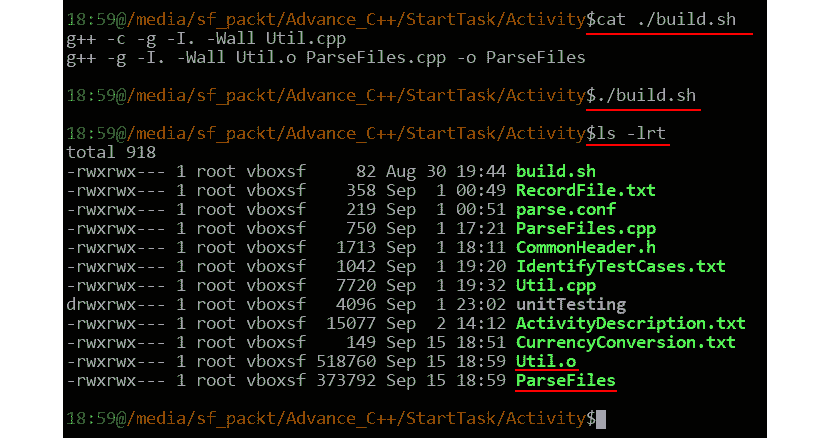
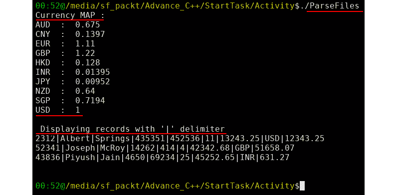
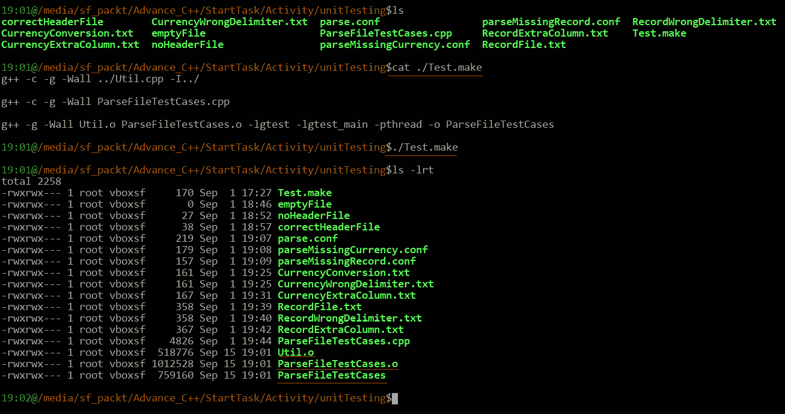

## 第 7 章 - 人皆会跌倒，关键在于如何爬起 —— 测试与调试

## 活动 1：使用测试用例检查函数的准确性并理解测试驱动开发 (TDD)

在此活动中，我们将开发解析 `RecordFile.txt` 和 `CurrencyConversion.txt` 文件的函数，并编写测试用例来检查函数的准确性。请遵循以下步骤实现此活动：

1.  创建一个名为 `parse.conf` 的配置文件并编写配置。

2.  请注意，这里只有两个变量是我们关注的，即 `currencyFile` 和 `recordFile`。其余变量用于其他环境变量：

    ```
    CONFIGURATION_FILE

    currencyFile = ./CurrencyConversion.txt
    recordFile = ./RecordFile.txt
    DatabaseServer = 192.123.41.112
    UserId = sqluser
    Password = sqluser
    RestApiServer = 101.21.231.11
    LogFilePath = /var/project/logs
    ```

3.  创建一个名为 `CommonHeader.h` 的头文件，并声明所有工具函数，即 `isAllNumbers()`、`isDigit()`、`parseLine()`、`checkFile()`、`parseConfig()`、`parseCurrencyParameters()`、`fillCurrencyMap()`、`parseRecordFile()`、`checkRecord()`、`displayCurrencyMap()` 和 `displayRecords()`。

    ```
    #ifndef __COMMON_HEADER__H
    #define __COMMON_HEADER__H

    #include<iostream>
    #include<cstring>
    #include<fstream>
    #include<vector>
    #include<string>
    #include<map>
    #include<sstream>
    #include<iterator>
    #include<algorithm>
    #include<iomanip>

    using namespace std;

    // 全局变量的前向声明。
    extern string configFile;
    extern string recordFile;
    extern string currencyFile;
    extern map<string, float> currencyMap;
    struct record;
    extern vector<record> vecRecord;

    // 用于保存记录数据的结构体。
    struct record {
        int customerId;
        string firstName;
        string lastName;
        int orderId;
        int productId;
        int quantity;
        float totalPriceRegional;
        string currency;
        float totalPriceUsd;
        record(vector<string> & in) {
            customerId = atoi(in[0].c_str());
            firstName = in[1];
            lastName = in[2];
            orderId = atoi(in[3].c_str());
            productId = atoi(in[4].c_str());
            quantity = atoi(in[5].c_str());
            totalPriceRegional = static_cast<float>(atof(in[6].c_str()));
            currency = in[7];
            totalPriceUsd = static_cast<float>(atof(in[8].c_str()));
        }
    };

    // 工具函数声明。
    string trim(string &);
    bool isAllNumbers(const string &);
    bool isDigit(const string &);
    void parseLine(ifstream &, vector<string> &, char);
    bool checkFile(ifstream &, string &, string, char, string &);
    bool parseConfig();
    bool parseCurrencyParameters(vector<string> &);
    bool fillCurrencyMap();
    bool parseRecordFile();
    bool checkRecord(vector<string> &);
    void displayCurrencyMap();
    ostream& operator<<(ostream &, const record &);
    void displayRecords();

    #endif
    ```

4.  创建一个名为 `Util.cpp` 的文件并定义所有工具函数。编写以下代码以定义 `trim()` 函数：

    ```
    #include<CommonHeader.h>

    // 用于移除字符串开头和结尾的空格和制表符的工具函数。
    string trim(string &str) { // remove space and tab from string.
        string res("");
        if ((str.find(' ') != string::npos) || (str.find('\t') != string::npos)) { // if space or tab found..
            size_t begin, end;
            if ((begin = str.find_first_not_of(" \t")) != string::npos) { // if string is not empty..
                end = str.find_last_not_of(" \t");
                if (end >= begin)
                    res = str.substr(begin, end - begin + 1);
            }
        } else {
            res = str; // No space or tab found..
        }
        str = res;
        return res;
    }
    ```

5.  编写以下代码以定义 `isAllNumbers()`、`isDigit()` 和 `parseLine()` 函数：

    ```
    // 用于检查字符串是否仅包含数字 (0-9) 和单个 '.' 的工具函数
    // 例如：1121.23、.113、121. 均有效，但 231.14.143 无效。
    bool isAllNumbers(const string &str) { // make sure, it only contains digit and only single '.' if any
        return (all_of(str.begin(), str.end(), [](char c) { return (isdigit(c) || (c == '.')); })
                && (count(str.begin(), str.end(), '.') <= 1));
    }

    // 用于检查字符串是否仅包含数字 (0-9) 的工具函数。
    bool isDigit(const string &str) {
        return (all_of(str.begin(), str.end(), [](char c) { return isdigit(c); }));
    }

    // 工具函数，使用分隔符解析文件 <infile> 的单行内容。
    // 并将标记存储在字符串向量中。
    void parseLine(ifstream &infile, vector<string> &vec, char delimiter) {
        string line, token;
        getline(infile, line);
        istringstream ss(line);
        vec.clear();
        while (getline(ss, token, delimiter)) // break line using delimiter
            vec.push_back(token); // store tokens in vector of string
    }
    ```

6.  编写以下代码以定义 `parseCurrencyParameters()` 和 `checkRecord()` 函数：

    ```
    // 用于检查包含 2 个字符串的字符串向量是否包含正确的
    // 货币和兑换比率的工具函数。货币应为 3 个字符，兑换比率
    // 应为十进制数字格式。
    bool parseCurrencyParameters(vector<string> &vec) {
        trim(vec[0]); trim(vec[1]);
        return ((!vec[0].empty()) && (vec[0].size() == 3) && (!vec[1].empty()) && (isAllNumbers(vec[1])));
    }

    // 工具函数，用于检查字符串向量是否具有从记录文件解析的记录的正确格式。
    // CustomerId、OrderId、ProductId、Quantity 应为整数格式
    // TotalPrice Regional 和 USD 应为十进制数字格式
    // 货币必须存在于映射表中。
    bool checkRecord(vector<string> &split) {
        // 去除向量中所有字符串的首尾空格
        for (auto &s : split)
            trim(s);
        if (!(isDigit(split[0]) && isDigit(split[3]) && isDigit(split[4]) && isDigit(split[5]))) {
            cerr << "ERROR: Record with customer id:" << split[0] << " doesnt have right DIGIT parameter" << endl;
            return false;
        }
        if (!(isAllNumbers(split[6]) && isAllNumbers(split[8]))) {
            cerr << "ERROR: Record with customer id:" << split[0] << " doesnt have right NUMBER parameter" << endl;
            return false;
        }
        if (currencyMap.find(split[7]) == currencyMap.end()) {
            cerr << "ERROR: Record with customer id :" << split[0] << " has currency :" << split[7] << " not present in map" << endl;
            return false;
        }
        return true;
    }
    ```

7.  编写以下代码以定义 `checkFile()` 函数：

    ```
    // 用于测试文件初始条件的函数..
    // 检查文件是否存在并具有正确的头部信息。
    bool checkFile(ifstream &inFile, string &fileName, string parameter, char delimiter, string &error) {
        bool flag = true;
        inFile.open(fileName);
        if (inFile.fail()) {
    ```


## 解析配置文件与记录文件

## 8. 定义 `parseConfig()` 函数

编写以下代码来定义 `parseConfig()` 函数：

```cpp
// Function to parse Config file. Each line will have '<name> = <value> format
// Store CurrencyConversion file and Record File parameters correctly.

bool parseConfig() {
    ifstream coffle;
    string error;
    if (!checkFile(confFile, configFile, "CONFIGURATION_FILE", '=', error)) {
        cerr << "ERROR: " << error << endl;
        return false;
    }
    bool flag = true;
    vector<string> split;
    while (confFile.good()) {
        parseLine(confFile, split, '=');
        if (split.size() == 2) {
            string name = trim(split[0]);
            string value = trim(split[1]);
            if (name == "currencyFile")
                currencyFile = value;
            else if (name == "recordFile")
                recordFile = value;
        }
    }
    if (currencyFile.empty() || recordFile.empty()) {
        cerr << "ERROR : currencyfile or recordfile not set correctly." << endl;
        flag = false;
    }
    return flag;
}
```

## 9. 定义 `fillCurrencyMap()` 函数

编写以下代码来定义 `fillCurrencyMap()` 函数：

```cpp
// Function to parse CurrencyConversion file and store values in Map.

bool fillCurrencyMap() {
    ifstream currFile;
    string error;
    if (!checkFile(currFile, currencyFile, "Currency", '|', error)) {
        cerr << "ERROR: " << error << endl;
        return false;
    }
    bool flag = true;
    vector<string> split;
    while (currFile.good()) {
        parseLine(currFile, split, '|');
        if (split.size() == 2) {
            if (parseCurrencyParameters(split)) {
                currencyMap[split[0]] = static_cast<float>(atof(split[1].c_str())); // make sure currency is valid.
            } else {
                cerr << "ERROR: Processing Currency Conversion file for Currency: " << split[0] << endl;
                flag = false;
                break;
            }
        } else if (!split.empty()) {
            cerr << "ERROR: Processing Currency Conversion , got incorrect parameters for Currency: " << split[0] << endl;
            flag = false;
            break;
        }
    }
    return flag;
}
```

## 10. 定义 `parseRecordFile()` 函数

编写以下代码来定义 `parseRecordFile()` 函数：

```cpp
// Function to parse Record File ..

bool parseRecordFile() {
    ifstream recFile;
    string error;
    if (!checkFile(recFile, recordFile, "Customer Id", '|', error)) {
        cerr << "ERROR: " << error << endl;
        return false;
    }
    bool flag = true;
    vector<string> split;
    while (recFile.good()) {
        parseLine(recFile, split, '|');
        if (split.size() == 9) {
            if (checkRecord(split)) {
                vecRecord.push_back(split); // Construct struct record and save it in vector...
            } else {
                cerr << "ERROR : Parsing Record, for Customer Id: " << split[0] << endl;
                flag = false;
                break;
            }
        } else if (!split.empty()) {
            cerr << "ERROR: Processing Record, for Customer Id: " << split[0] << endl;
            flag = false;
            break;
        }
    }
    return flag;
}
```

## 11. 定义 `displayCurrencyMap()` 函数与 `operator<<` 重载

编写以下代码来定义 `displayCurrencyMap()` 函数：

```cpp
void displayCurrencyMap() {
    cout << "Currency MAP :" << endl;
    for (auto p : currencyMap)
        cout << p.first << "  :  " << p.second << endl;
    cout << endl;
}

ostream& operator<<(ostream& os, const record& rec) {
    os << rec.customerId << "|" << rec.firstName << "|" << rec.lastName << "|"
       << rec.orderId << "|" << rec.productId << "|" << rec.quantity << "|"
       << fixed << setprecision(2) << rec.totalPriceRegional << "|" << rec.currency << "|"
       << fixed << setprecision(2) << rec.totalPriceUsd << endl;
    return os;
}
```

## 12. 定义 `displayRecords()` 函数

编写以下代码来定义 `displayRecords()` 函数：

```cpp
void displayRecords() {
    cout << " Displaying records with '|' delimiter" << endl;
    for (auto rec : vecRecord) {
        cout << rec;
    }
    cout << endl;
}
```

## 13. 创建 `ParseFiles.cpp` 并调用解析函数

创建名为 `ParseFiles.cpp` 的文件，并调用 `parseConfig()`、`fillCurrencyMap()` 和 `parseRecordFile()` 函数：

```cpp
#include <CommonHeader.h>

// Global variables ...

string configFile = "./parse.conf";
string recordFile;
string currencyFile;
map<string, float>  currencyMap;
vector<record>      vecRecord;

int main() {
    // Read Config file to set global configuration variables.
    if (!parseConfig()) {
        cerr << "Error parsing Config File " << endl;
        return false;
    }
    // Read Currency file and fill map
    if (!fillCurrencyMap()) {
        cerr << "Error setting CurrencyConversion Map " << endl;
        return false;
    }
    if (!parseRecordFile()) {
        cerr << "Error parsing Records File " << endl;
        return false;
    }
    displayCurrencyMap();
    displayRecords();
    return 0;
}
```

## 14. 编译并执行

打开编译器，通过编写以下命令编译并执行 `Util.cpp` 和 `ParseFiles.cpp` 文件：

```bash
g++ -c -g -I. -Wall Util.cpp
g++ -g -I. -Wall Util.o ParseFiles.cpp -o ParseFiles
```

两个文件的二进制文件将会生成。

在下面的截图中，你将看到这两条命令存储在 `build.sh` 脚本中并被执行。运行此脚本后，你将看到最新的 `Util.o` 和 `ParseFiles` 文件已生成：



###### 图 7.25：生成的新文件

## 15. 运行 `ParseFiles` 可执行文件

运行 `ParseFiles` 可执行文件后，我们将收到以下输出：



###### 图 7.26：生成的新文件

## 16. 创建测试用例文件 `ParseFileTestCases.cpp`

创建名为 `ParseFileTestCases.cpp` 的文件，并为工具函数编写测试用例。为 `trim` 函数编写以下测试用例：

```cpp
#include <gtest/gtest.h>
#include "../CommonHeader.h"

using namespace std;

// Global variables ...

string configFile = "./parse.conf";
string recordFile;
string currencyFile;
map<string, float>  currencyMap;
vector<record>      vecRecord;

void setDefault() {
    configFile = "./parse.conf";
    recordFile.clear();
    currencyFile.clear();
    currencyMap.clear();
    vecRecord.clear();
}

// Test Cases for trim function ...

TEST(trim, empty) {
    string str = "    ";
    EXPECT_EQ(trim(str), string());
}

TEST(trim, start_space) {
    string str = "    adas";
    EXPECT_EQ(trim(str), string("adas"));
}
```


## 17. 为 `isAllNumbers` 函数编写以下测试用例：

```cpp
// Test Cases for isAllNumbers function..

TEST(isNumber, alphabets_present) {
    string str = "11.qwe13";
    ASSERT_FALSE(isAllNumbers(str));
}

TEST(isNumber, special_character_present) {
    string str = "34.^%3";
    ASSERT_FALSE(isAllNumbers(str));
}

TEST(isNumber, correct_number) {
    string str = "54.765";
    ASSERT_TRUE(isAllNumbers(str));
}

TEST(isNumber, decimal_begin) {
    string str = ".624";
    ASSERT_TRUE(isAllNumbers(str));
}

TEST(isNumber, decimal_end) {
    string str = "53.";
    ASSERT_TRUE(isAllNumbers(str));
}
```

## 18. 为 `isDigit` 函数编写以下测试用例：

```cpp
// Test Cases for isDigit function...

TEST(isDigit, alphabet_present) {
    string str = "527A";
    ASSERT_FALSE(isDigit(str));
}

TEST(isDigit, decimal_present) {
    string str = "21.55";
    ASSERT_FALSE(isDigit(str));
}

TEST(isDigit, correct_digit) {
    string str = "9769";
    ASSERT_TRUE(isDigit(str));
}
```

## 19. 为 `parseCurrencyParameters` 函数编写以下测试用例：

```cpp
// Test Cases for parseCurrencyParameters function

TEST(CurrencyParameters, extra_currency_characters) {
    vector<string> vec {"ASAA", "34.22"};
    ASSERT_FALSE(parseCurrencyParameters(vec));
}

TEST(CurrencyParameters, correct_parameters) {
    vector<string> vec {"INR", "1.44"};
    ASSERT_TRUE(parseCurrencyParameters(vec));
}
```

## 20. 为 `checkFile` 函数编写以下测试用例：

```cpp
// Test Cases for checkFile function...

TEST(checkFile, no_file_present) {
    string fileName = "./NoFile";
    ifstream infile;
    string parameter("nothing");
    char delimit = ';';
    string err;
    ASSERT_FALSE(checkFile(infile, fileName, parameter, delimit, err));
}

TEST(checkFile, empty_file) {
    string fileName = "./emptyFile";
    ifstream infile;
    string parameter("nothing");
    char delimit = ';';
    string err;
    ASSERT_FALSE(checkFile(infile, fileName, parameter, delimit, err));
}

TEST(checkFile, no_header) {
    string fileName = "./noHeaderFile";
    ifstream infile;
    string parameter("header");
    char delimit = '|';
    string err;
    ASSERT_FALSE(checkFile(infile, fileName, parameter, delimit, err));
}

TEST(checkFile, incorrect_header) {
    string fileName = "./correctHeaderFile";
    ifstream infile;
    string parameter("header");
    char delimit = '|';
    string err;
    ASSERT_FALSE(checkFile(infile, fileName, parameter, delimit, err));
}

TEST(checkFile, correct_file) {
    string fileName = "./correctHeaderFile";
    ifstream infile;
    string parameter("Currency");
    char delimit = '|';
    string err;
    ASSERT_TRUE(checkFile(infile, fileName, parameter, delimit, err));
}
```

### 注意

前面函数中用作输入参数的 `NoFile`、`emptyFile`、`noHeaderFile` 和 `correctHeaderFile` 文件可以在此处找到：[`github.com/TrainingByPackt/Advanced-CPlusPlus/tree/master/Lesson7/Activity01`](https://github.com/TrainingByPackt/Advanced-CPlusPlus/tree/master/Lesson7/Activity01)。

## 21. 为 `parseConfig` 函数编写以下测试用例：

```cpp
// Test Cases for parseConfig function...

TEST(parseConfig, missing_currency_file) {
    setDefault();
    configFile = "./parseMissingCurrency.conf";
    ASSERT_FALSE(parseConfig());
}

TEST(parseConfig, missing_record_file) {
    setDefault();
    configFile = "./parseMissingRecord.conf";
    ASSERT_FALSE(parseConfig());
}

TEST(parseConfig, correct_config_file) {
    setDefault();
    configFile = "./parse.conf";
    ASSERT_TRUE(parseConfig());
}
```

### 注意

前面函数中用作输入参数的 `parseMissingCurrency.conf`、`parseMissingRecord.conf` 和 `parse.conf` 文件可以在此处找到：[`github.com/TrainingByPackt/Advanced-CPlusPlus/tree/master/Lesson7/Activity01`](https://github.com/TrainingByPackt/Advanced-CPlusPlus/tree/master/Lesson7/Activity01)。

## 22. 为 `fillCurrencyMap` 函数编写以下测试用例：

```cpp
// Test Cases for fillCurrencyMap function...

TEST(fillCurrencyMap, wrong_delimiter) {
    currencyFile = "./CurrencyWrongDelimiter.txt";
    ASSERT_FALSE(fillCurrencyMap());
}

TEST(fillCurrencyMap, extra_column) {
    currencyFile = "./CurrencyExtraColumn.txt";
    ASSERT_FALSE(fillCurrencyMap());
}

TEST(fillCurrencyMap, correct_file) {
    currencyFile = "./CurrencyConversion.txt";
    ASSERT_TRUE(fillCurrencyMap());
}
```

### 注意

前面函数中用作输入参数的 `CurrencyWrongDelimiter.txt`、`CurrencyExtraColumn.txt` 和 `CurrencyConversion.txt` 文件可以在此处找到：[`github.com/TrainingByPackt/Advanced-CPlusPlus/tree/master/Lesson7/Activity01`](https://github.com/TrainingByPackt/Advanced-CPlusPlus/tree/master/Lesson7/Activity01)。

## 23. 为 `parseRecordFile` 函数编写以下测试用例：

```cpp
// Test Cases for parseRecordFile function...

TEST(parseRecordFile, wrong_delimiter) {
    recordFile = "./RecordWrongDelimiter.txt";
    ASSERT_FALSE(parseRecordFile());
}

TEST(parseRecordFile, extra_column) {
    recordFile = "./RecordExtraColumn.txt";
    ASSERT_FALSE(parseRecordFile());
}

TEST(parseRecordFile, correct_file) {
    recordFile = "./RecordFile.txt";
    ASSERT_TRUE(parseRecordFile());
}
```

前面函数中用作输入参数的 `RecordWrongDelimiter.txt`、`RecordExtraColumn.txt` 和 `RecordFile.txt` 文件可以在此处找到：[`github.com/TrainingByPackt/Advanced-CPlusPlus/tree/master/Lesson7/Activity01`](https://github.com/TrainingByPackt/Advanced-CPlusPlus/tree/master/Lesson7/Activity01)。

## 24. 打开编译器。通过编写以下命令来编译并执行 `Util.cpp` 和 `ParseFileTestCases.cpp` 文件：

```bash
g++ -c -g -Wall ../Util.cpp -I../
g++ -c -g -Wall ParseFileTestCases.cpp
g++ -g -Wall Util.o ParseFileTestCases.o -lgtest -lgtest_main -pthread -o ParseFileTestCases
```

以下是对此的屏幕截图。你将看到所有命令都存储在 `Test.make` 脚本文件中。执行后，它将创建一个用于单元测试的二进制程序，名为 `ParseFileTestCases`。你还会注意到在 Project 中创建了一个名为 `unitTesting` 的目录。在此目录中，编写了所有与单元测试相关的代码，并创建了一个二进制文件。此外，该项目的依赖库 `Util.o` 也是通过编译 `Util.cpp` 文件中的项目而创建的：




