# 管理 C++ 项目

在 C++ 世界中，我们有多个工具可以帮助管理项目源代码及其依赖项。例如，**pkg-config, Autotools, make,** 和 **CMake** 是社区中最著名的工具。与其他高级语言的工具相比，这些工具使用起来复杂得多。**CMake** 在其中脱颖而出，成为管理 C++ 项目及其依赖项的事实标准。与 **make** 相比，它更具主观性，并且被大多数 IDE（集成开发环境）接受为直接项目格式。

虽然 **CMake** 有助于管理项目及其依赖项，但体验仍然远不及高级语言，在高级语言中，您列出想要使用的库及其版本，其余一切都为您处理好。使用 CMake，您仍然有责任在开发环境中正确安装库，并且您需要使用每个库的兼容版本。在具有广泛包管理器的流行 Linux 发行版中，您可以轻松安装大多数流行库的二进制版本。然而，有时您可能必须自行编译和安装库。这是整个 C++ 开发者体验的一部分，您将通过了解您选择的开发平台而积累。在这里，我们将更专注于如何正确设置我们的 CMake 项目，包括理解和解决与库相关的问题。

## 代码-构建-测试-运行循环

为了让我们的讨论建立在坚实的基础上，我们将立即从一个实际示例开始。我们将从一个 C++ 代码库模板开始，您可以将其用作自己项目的起点。我们将看到如何使用命令行上的 CMake 构建和编译它。我们还将为 C/C++ 开发者设置 Eclipse IDE 并导入我们的 CMake 项目。使用 IDE 将为我们提供便于创建源代码的设施，并使我们能够逐行调试程序，以查看程序执行期间到底发生了什么，并以知情的方式而非试错和迷信的方式纠正我们的错误。


## 构建 CMake 项目

对于 C++ 项目而言，使用 CMake 来组织和构建项目是事实上的标准做法。在这里，我们将使用一个基础模板项目作为起点。以下是一个示例模板的文件夹结构：

```
README.md
CMakeLists.txt
include/CxxTemplatePublic.h
src/CxxTemplate.cpp
src/CxxTemplate.h
.gitignore
LICENSE
cmake/modules/DumpVariables.cmake
cmake/modules/DumpProps.cmake
```

图 1.1：示例模板的文件夹结构

在上图中，.gitignore 文件列出了不应添加到 git 版本控制系统中的文件模式。这些被忽略的文件包括构建过程的输出，它们是在本地创建的，不应在计算机之间共享。

include 和 src 文件夹中的文件是实际的 C++ 源文件，而 CMakeLists.txt 文件是 CMake 脚本文件，它通过处理源编译规则、库依赖项和其他项目设置将项目粘合在一起。CMake 规则是高级的平台无关规则。CMake 使用它们为不同平台创建各种类型的 make 文件。

使用 CMake 构建项目是一个两步过程。首先，我们让 CMake 为将编译和构建项目的原生构建系统生成平台相关的配置文件。然后，我们将使用生成的文件来构建项目。CMake 可以为其生成配置文件的平台相关构建系统包括 UNIX Makefiles、Ninja 构建文件、NMake Makefiles 和 MinGW Makefiles。这里的选择取决于所使用的平台、这些工具的可用性以及个人偏好。UNIX Makefiles 是 Unix 和 Linux 的事实标准，而 NMake 是其在 Windows 和 Visual Studio 中的对应物。另一方面，MinGW 是 Windows 中的类 Unix 环境，其中也使用 Makefile。Ninja 是一个现代构建系统，与其他构建系统相比提供了卓越的速度，同时具有多平台支持，我们在这里选择使用它。此外，除了这些命令行构建系统之外，我们还可以为 Visual Studio、Xcode、Eclipse CDT 等生成 IDE 项目，并在 IDE 内构建我们的项目。因此，CMake 是一个元工具，它将为另一个实际构建项目的系统创建配置文件。在下一节中，我们将解决一个练习，其中我们将使用 CMake 生成 Ninja 构建文件。

### 练习 1：使用 CMake 生成 Ninja 构建文件

在本练习中，我们将使用 **CMake** 生成 **Ninja 构建文件**，用于构建 C++ 项目。我们将首先从 **git** 仓库下载源代码，并使用 CMake 和 Ninja 来构建它。本练习的目标是使用 CMake 生成 Ninja 构建文件，构建项目，然后运行它们。

> **注意**
> 
> GitHub 仓库的链接可以在这里找到：https://github.com/TrainingByPackt/Advanced-CPlusPlus/tree/master/Lesson1/Exercise01/project。

执行以下步骤来完成练习：

- 1. 在终端窗口中，输入以下命令将 **CxxTemplate** 仓库从 GitHub 下载到本地系统：

```
git clone https://github.com/TrainingByPackt/Advanced-CPlusPlus/tree/master/Lesson1/Exercise01/project
```

前一个命令的输出类似于以下内容：

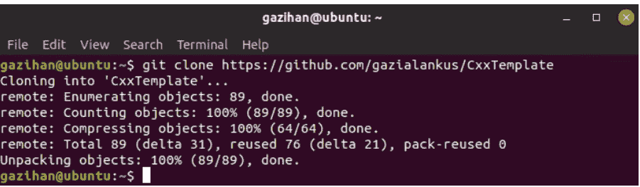

现在你已在 **CxxTemplate** 文件夹中有了源代码。

- 2. 通过在终端中输入以下命令进入 **CxxTemplate** 文件夹：

```
cd CxxTemplate
```

- 3. 现在你可以通过输入以下命令列出项目中的所有文件：

```
find .
```

4. 在 CxxTemplate 文件夹中使用 cmake 命令生成我们的 Ninja 构建文件。为此，写下以下命令：

```
cmake -Bbuild -H. -GNinja
```

前一个命令的输出如下：

```
-- The C compiler identification is GNU 7.4.0
-- The CXX compiler identification is GNU 7.4.0
-- Check for working C compiler: /usr/bin/cc
-- Check for working C compiler: /usr/bin/cc -- works
... (more lines)
-- Configuring done
-- Generating done
-- Build files have been written to:
/home/username/code/CxxTemplate/build
```

图 1.3：生成 Ninja 构建文件

让我们解释前一个命令的各个部分。使用 -Bbuild，我们告诉 CMake 使用 build 文件夹来生成构建产物。由于此文件夹不存在，CMake 将创建它。使用 -H.，我们告诉 CMake 使用当前文件夹作为源。通过使用单独的构建文件夹，我们将保持源文件干净，所有构建产物都将存放在 build 文件夹中，该文件夹由于我们的 .gitignore 文件而被 Git 忽略。使用 -GNinja，我们告诉 CMake 使用 Ninja 构建系统。

5. 运行以下命令列出项目文件并检查 build 文件夹内创建的文件：

```
ls
ls build
```

前一个命令将在终端中显示以下输出：

```
-- Build files have been written to: /home/gazihan/CxxTemplate/build
gazihan@ubuntu:~/CxxTemplate$ ls
build cmake CMakeLists.txt include LICENSE README.md src
gazihan@ubuntu:~/CxxTemplate$ ls build
build.ninja CMakeCache.txt CMakeFiles cmake_install.cmake rules.ninja
gazihan@ubuntu:~/CxxTemplate$
```

图 1.4：build 文件夹中的文件

- 8. 在终端中，输入以下命令运行 **CxxTemplate** 可执行文件：

```
```bash
./CxxTemplate
```
```

终端中前一个命令将提供以下输出：

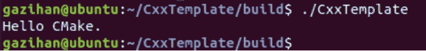

图 1.7：运行可执行文件

以下来自 `src/CxxTemplate.cpp` 文件的行负责写入之前的输出：

```
```cpp
std::cout << "Hello CMake." << std::endl;
```
```

现在你已成功在 Linux 中构建了一个 CMake 项目。Ninja 和 CMake 配合得很好。你只需要运行一次 CMake，Ninja 就会检测是否需要再次调用 CMake 并为你调用。例如，即使你向 `CMakeLists.txt` 文件添加了新的源文件，你也只需在终端中输入 `ninja` 命令，它就会自动为你运行 CMake 以更新 Ninja 构建文件。现在你已经了解了如何在 Linux 中构建 CMake 项目，在下一节中，我们将介绍如何将 CMake 项目导入 Eclipse CDT。

## 将 CMake 项目导入 Eclipse CDT

Ninja 构建文件对于在 Linux 中构建项目很有用。然而，CMake 项目是可移植的，也可与其它构建系统和 IDE 一起使用。许多 IDE 接受 CMake 作为其配置文件，并在你修改和构建项目时提供无缝体验。在本节中，我们将讨论如何将 CMake 项目导入 Eclipse CDT，这是一个流行的跨平台 C/C++ IDE。

使用 Eclipse CDT 与 CMake 有多种方式。CMake 提供的默认方式是 IDE 项目的一次性生成。在这里，你一次性创建 IDE 项目，你对 IDE 项目所做的任何修改都不会改变回原始的 CMake 项目。如果你的项目以 CMake 项目管理，并使用 Eclipse CDT 进行一次性构建，这很有用。然而，如果你想在 Eclipse CDT 中进行开发，这并不理想。

3. 选择 C++ Project 选项并点击 Next 按钮。会出现一个 C++ Project 对话框，如以下屏幕截图所示：

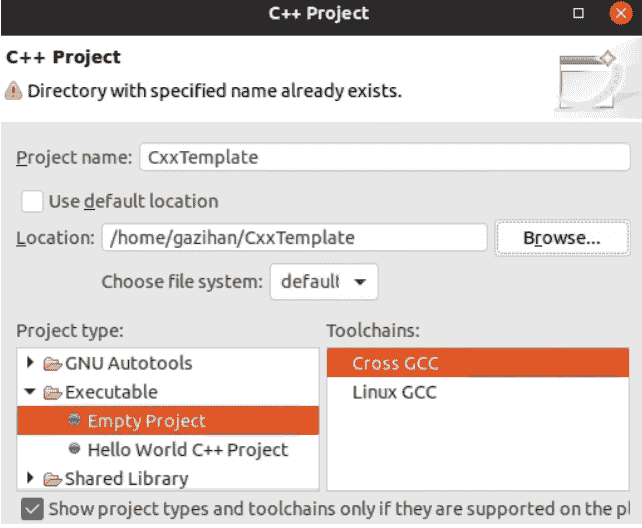

图 1.9：C++ Project 对话框

4. 接受所有内容，包括切换到 C/C++ 透视图，然后点击 Finish。

5. 点击左上角的 Restore 按钮以查看新创建的项目：

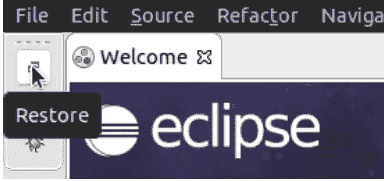

图 1.10：Restore 按钮

- 6. 点击 **CxxTemplate** 项目。转到 **Project | Properties**，然后在左侧窗格中从 **C/C++ Build** 下选择 **Tool Chain Editor**，并将 **Current builder** 设置为 **CMake Builder (portable)**。然后，点击 **Apply and Close** 按钮：

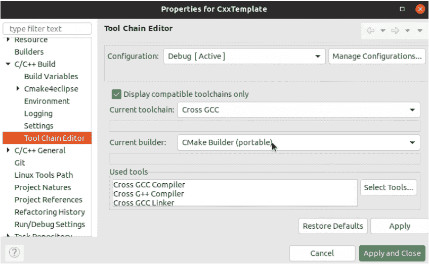

图 1.11：项目属性

- 7. 然后，选择 **Project | Build All** 菜单项以构建项目：

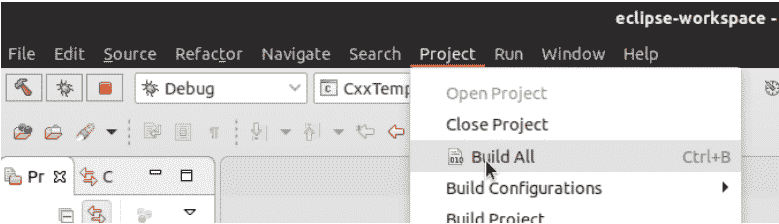

图 1.12：构建项目


你已成功使用 Eclipse CDT 构建并运行了一个 CMake 项目。在下一个练习中，我们将通过添加包含新类的源文件来介绍对项目进行的一项常见更改。

### 练习 3：向 CMake 和 Eclipse CDT 添加新的源文件

随着 C++ 项目变得越来越大，你会倾向于在项目增长以满足设定期望时向其中添加新的源文件。在本练习中，我们将向项目添加一对新的 `.cpp` 和 `.h` 文件，并看看 CMake 和 Eclipse CDT 如何与这些更改协同工作。我们将使用新建类向导在项目内部添加这些文件，但你也可以使用任何其他文本编辑器创建它们。执行以下步骤以向 CMake 和 Eclipse CDT 添加新的源文件：

- 1. 首先，打开我们一直使用到现在的项目。在左侧的 **Project Explorer** 窗格中，展开根条目 **CxxTemplate**，你将看到我们项目的 files 和文件夹。右键单击 **src** 文件夹并从弹出菜单中选择 **New | Class**：

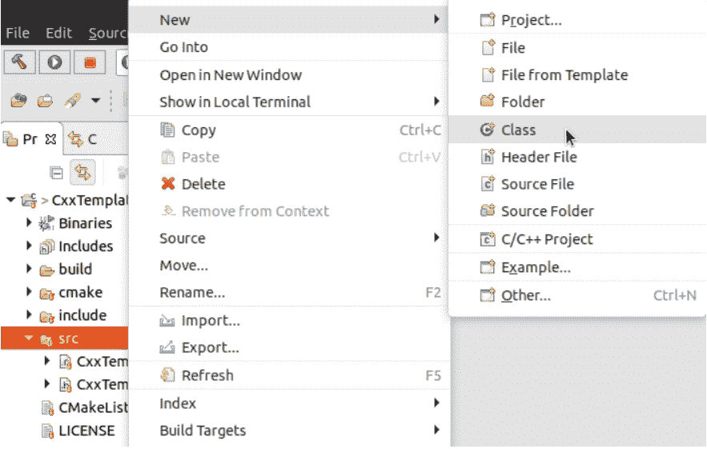

**图 1.16：创建新类**

- 2. 在打开的对话框中，为类名输入 **ANewClass**。当你单击 **Finish** 按钮时，你将看到 **ANewClass.cpp** 和 **ANewClass.h** 文件在 **src** 文件夹下生成。

- 3. 现在，让我们在 **ANewClass** 类中编写一些代码并从我们已有的 **CxxTemplate** 类中访问它。打开 **ANewClass.cpp** 并将文件的开头更改为以下内容，然后保存文件：

```
```cpp
#include "ANewClass.h"
#include <iostream>

void ANewClass::run() {
    std::cout << "Hello from ANewClass." << std::endl;
}
```
```

你会看到 Eclipse 用 **Member declaration not found** 消息警告我们：

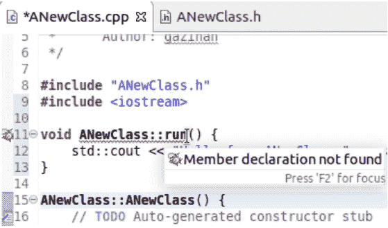

图 1.17：分析器警告

此错误是由于我们需要在 **ANewClass.h** 文件中也添加此内容而生成的。这样的警告是由 IDE 中的分析器实现的，并且非常有用，因为它们帮助你在编译代码时无需运行即可修复代码。

- 4. 打开 **ANewClass.h** 文件，添加以下代码并保存文件：

```
```cpp
public:
    void run(); // we added this line
    ANewClass();
```
```

你应该会看到 **.cpp** 文件中的错误消失了。如果没有消失，可能是因为你忘记保存其中一个文件。你应该养成按 Ctrl + S 保存当前文件，或 *Shift + Ctrl + S* 保存你编辑的所有文件的习惯。

- 5. 现在，让我们从另一个类 **CxxTemplate.cpp** 中使用这个类。打开该文件，执行以下修改并保存文件。在这里，我们首先导入头文件，并在 **CxxApplication** 的构造函数中向控制台打印文本。然后，我们创建 **ANewClass** 的一个新实例并调用其 **run** 方法：

```
```cpp
#include "CxxTemplate.h"
#include "ANewClass.h"

#include <string>

...

CxxApplication::CxxApplication( int argc, char *argv[] ) {
  std::cout << "Hello CMake." << std::endl;
  ::ANewClass anew;
  anew.run();
}
```
```

> **Note**
> 
> 该文件的完整代码可以在这里找到：[https://github.com/TrainingByPackt/Advanced-CPlusPlus/blob/master/Lesson1/Exercise03/src/CxxTemplate.cpp](https://github.com/TrainingByPackt/Advanced-CPlusPlus/blob/master/Lesson1/Exercise03/src/CxxTemplate.cpp)。

- 6. 通过单击 **Project | Build All** 菜单选项尝试构建项目。你将在两行中得到一些未定义引用错误。这是因为我们的项目是使用 CMake 的规则构建的，而我们没有让 CMake 知道这个新文件。打开 **CMakeLists.txt** 文件，进行以下修改并保存文件：

```
```cmake
add_executable(CxxTemplate
  src/CxxTemplate.cpp
  src/ANewClass.cpp
)
```
```

再次尝试构建项目。这次你不应该看到任何错误。

预期的输出应类似于以下内容：

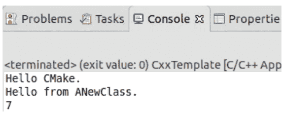

图 1.19：最终输出

Note

此活动的解决方案可在第 620 页找到。

在下一节中，我们将讨论如何为项目编写单元测试。通常将项目分为许多协同工作以实现预期目标的类和函数。你必须使用单元测试来管理这些类和函数的行为，以确保它们以预期方式运行。

## 单元测试

单元测试是编程中的重要组成部分。基本上，单元测试是使用我们的类在各种场景下使用预期结果的小程序，位于项目中平行的文件层次结构中，并且不会最终进入实际的可执行文件，而是在开发过程中由我们单独执行，以确保我们的代码以预期方式运行。我们应该为我们的 C++ 程序编写单元测试，以确保它们在每次更改后按预期运行。

## 为单元测试做准备

我们可以使用 CMake 使用多个 C++ 测试框架。我们将使用 Google Test，它相对于其他选项有几个好处。在下一个练习中，我们将使用 Google Test 为项目准备单元测试。

6. 创建一个 tests/CanTest.cpp 文件。添加此代码以简单地验证测试正在运行，而不实际测试我们实际项目中的任何内容：

```
#include "gtest/gtest.h"

namespace {

class CanTest: public ::testing::Test {};

TEST_F(CanTest, CanReallyTest) {
    EXPECT_EQ(0, 0);
}

}

int main(int argc, char **argv) {
    ::testing::InitGoogleTest(&argc, argv);
    return RUN_ALL_TESTS();
}
```

TEST_F 行是一个单独的测试。现在，EXPECT_EQ(0, 0) 正在测试零是否等于零，如果我们确实可以运行测试，这将始终成功。我们稍后将在这里添加我们自己的类的结果以针对各种值进行测试。现在我们已在项目中为 Google Test 做好了必要的设置。接下来，我们将构建和运行这些测试。

## 构建、运行和编写单元测试

现在，我们将讨论如何构建、运行和编写单元测试。我们到目前为止的示例是一个简单的虚拟测试，准备好构建和运行。稍后，我们将添加更有意义的测试并查看通过和失败测试的输出。在以下练习中，我们将为我们在上一个练习中创建的项目构建、运行和编写单元测试。

### 练习 5：构建和运行测试

到目前为止，你已经创建了一个设置了 **GoogleTest** 的项目，但你没有构建或运行我们创建的测试。在本练习中，我们将构建和运行我们创建的测试。由于我们使用 **add_subdirectory** 添加了 **tests** 文件夹，构建项目将自动构建测试。运行测试将需要更多努力。执行以下步骤完成练习：

- 1. 在 Eclipse CDT 中打开我们的 CMake 项目。
- 2. 要构建测试，只需像以前一样构建项目。以下是使用 **Project | Build All** 从 Eclipse 进行一次完整构建后再次构建项目的输出：

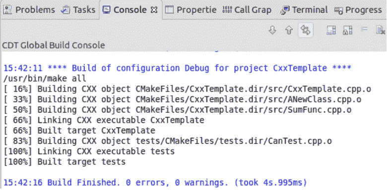

图 1.20：构建操作及其输出

- 3. 如果你没有看到此输出，你的控制台可能在错误的视图中。你可以按以下图所示进行更正：

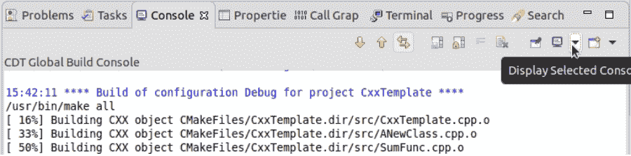

图 1.21：查看正确的控制台输出

5. 你可以通过使用 **ctest** 命令以一种方式运行测试。在项目文件夹中时，在终端中编写以下命令。我们进入 **tests** 可执行文件所在的文件夹，在那里运行 **ctest**，然后返回：

```
cd build/Debug/tests
ctest
cd ../../..
```

你将看到以下输出：

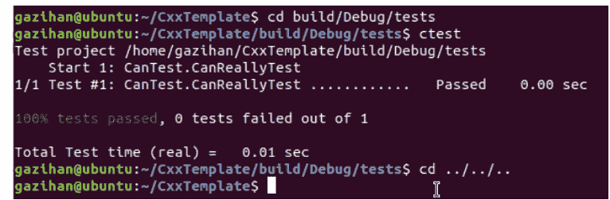

图 1.24：运行 ctest

**Note**
**ctest** 命令可以用许多选项运行你的 **tests** 可执行文件，包括能够自动将测试结果提交到在线仪表板。在这里，我们将简单地运行 **ctest** 命令；其进一步功能留给感兴趣的读者作为练习。你可以输入 **ctest --help** 或访问在线文档以在 https://cmake.org/cmake/help/latest/manual/ctest.1.html# 进一步了解 **ctest**。

6. 另一种运行测试的方法是在 Eclipse 中以漂亮的图形报告格式运行它们。为此，我们将创建一个测试感知的运行配置。在 Eclipse 中，单击 **Run | Run Configurations...**，在左侧右键单击 **C/C++ Unit**，并选择 **New Configuration**。


9. 在新对话框中选择**测试**：

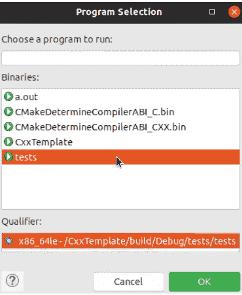

图 1.27：创建测试运行配置并选择测试可执行文件

10. 接下来，转到 **C/C++ Testing** 选项卡，并在下拉菜单中选择 **Google Tests Runner**。点击对话框底部的 **Apply**，然后点击我们首次需要运行的测试对应的 **Run** 选项：

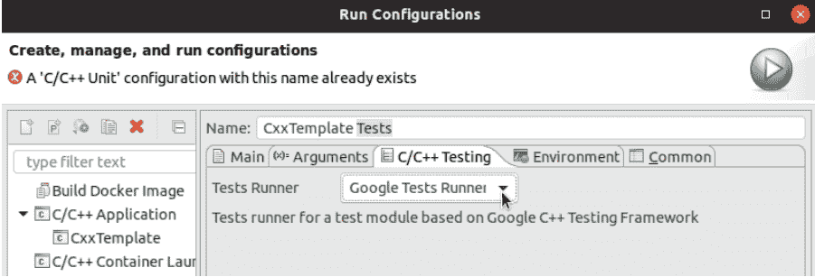

图 1.28：运行配置

11. 在后续运行中，你可以点击工具栏中播放按钮旁边的下拉箭头，或者选择 Run | Run History 来选择 CxxTemplate Tests：

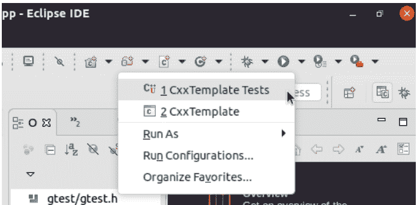

图 1.29：完成运行配置设置并选择要运行的配置

结果将类似于以下截图：

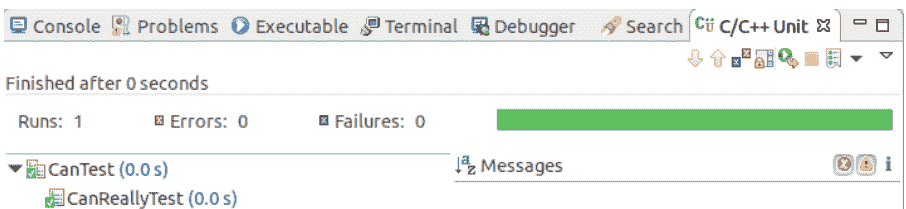

图 1.30：单元测试的运行结果

这是一个不错的报告，其中包含所有测试的条目——目前只有一个。如果你不想离开 IDE，这个方式可能更合你意。此外，当你有很多测试时，这个界面可以帮助你有效筛选它们。现在，你已经构建并运行了使用 Google Test 编写的测试。你以几种不同的方式运行了它们，包括直接执行测试、使用 ctest 以及使用 Eclipse CDT。在下一节中，我们将解决一个练习，实际测试我们代码的功能。

```
}

int main(int argc, char **argv) {
    ::testing::InitGoogleTest(&argc, argv);
    return RUN_ALL_TESTS();
}
```

执行以下步骤以完成练习：

- 1. 在 Eclipse CDT 中打开我们的 CMake 项目。
- 2. 添加一个新的测试源文件（`tests/SumFuncTest.cpp`），内容如下：

```
#include "gtest/gtest.h"
#include "../src/SumFunc.h"

namespace {

class SumFuncTest: public ::testing::Test {};

TEST_F(SumFuncTest, CanSumCorrectly) {
    EXPECT_EQ(7, sum(3, 4));
}
}
```

请注意，这里没有 `main()` 函数，因为 CanTest.cpp 中有一个，它们将被链接在一起。其次，注意这里包含了项目 src 文件夹中的 `SumFunc.h`，并在测试中作为 `sum(3, 4)` 使用。这就是我们在测试中使用项目代码的方式。

- 3. 在 `tests/CMakeLists.txt` 文件中进行以下更改，以构建测试：

```
include(GoogleTest)
add_executable(tests CanTest.cpp SumFuncTest.cpp ../src/SumFunc.cpp) # added files here
target_link_libraries(tests GTest::GTest)
gtest_discover_tests(tests)
```

注意，我们将测试（`SumFuncTest.cpp`）和它测试的代码（`../src/SumFunc.cpp`）都添加到了可执行文件中，因为我们的测试代码使用了实际项目中的代码。

4. 像之前一样构建项目并运行测试。你应该会看到以下报告：

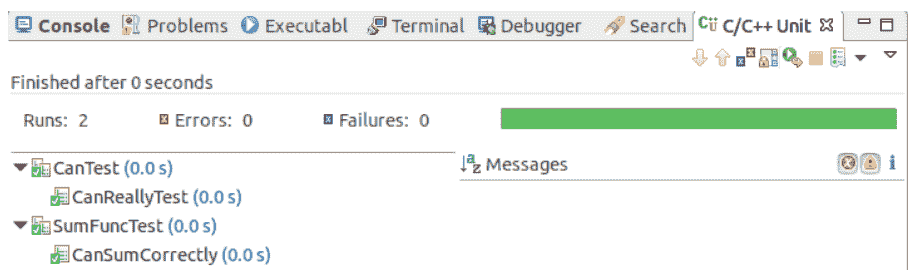

图 1.31：运行测试后的输出

我们可以将此类测试添加到项目中，所有测试都会像前面的截图那样显示在屏幕上。

5. 现在，让我们再添加一个实际会失败的测试。在 `tests/SumFuncTest.cpp` 文件中进行以下更改：

```
TEST_F(SumFuncTest, CanSumCorrectly) {
    EXPECT_EQ(7, sum(3, 4));
}

// add this test
TEST_F(SumFuncTest, CanSumAbsoluteValues) {
    EXPECT_EQ(6, sum(3, -3));
}
```

注意，这个测试假设输入值的绝对值相加，但这是不正确的。此调用的结果是 0，但在该示例中期望是 6。这是我们在项目中添加此测试所需做的唯一更改。

6. 现在，构建项目并运行测试。你应该会看到以下报告：

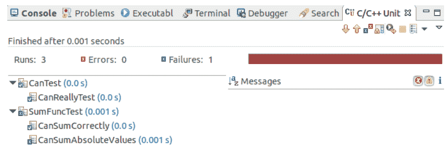

如上图所示，前两个测试通过了，最后一个测试失败了。当我们看到这个输出时，有两种可能：要么我们的项目代码有误，要么测试有误。在这种情况下，我们的测试有误。这是因为我们的 `CanSumAbsoluteValues` 测试用例期望 6 等于 `sum(3, -3)`。这是因为我们假设该函数将提供的整数的绝对值相加。但事实并非如此。我们的函数只是简单地将给定的数字相加，无论它们是正数还是负数。因此，这个测试的假设有误，所以失败了。

7. 让我们修改测试并修正它。更改测试，使其期望 -3 和 3 的和为 0。重命名测试以反映该测试的实际功能：

```
TEST_F(SumFuncTest, CanSumCorrectly) {
    EXPECT_EQ(7, sum(3, 4));
}
```

```
// change this part
TEST_F(SumFuncTest, CanUseNegativeValues) {
    EXPECT_EQ(0, sum(3, -3));
}
```

## 理解编译、链接和目标文件内容

使用 C++ 的主要原因之一是效率。C++ 让我们能够控制内存管理，这就是为什么了解对象在内存中的布局方式很重要。此外，C++ 源文件和库会被编译为目标硬件对应的目标文件，然后链接在一起。C++ 程序员经常需要处理链接器问题，这就是为什么理解编译步骤并能调查目标文件很重要。另一方面，大型项目是由团队在很长一段时间内开发和维护的，因此编写干净且易于理解的代码非常重要。与其他任何软件一样，C++ 项目中也会出现错误，需要通过观察程序行为仔细地识别、分析和解决。因此，学习如何调试 C++ 代码也很重要。在下一节中，我们将学习如何编写高效、能与其他代码良好协作且易于维护的代码。

## 编译和链接步骤

一个 C++ 项目由一组源代码文件和项目配置文件组成，这些文件组织源代码和库依赖关系。在编译步骤中，这些源文件首先被转换为目标文件。在链接步骤中，这些目标文件被链接在一起，形成项目最终输出的可执行文件。项目使用的库也会在此步骤中链接。

在接下来的练习中，我们将使用现有项目来观察编译和链接阶段。然后，我们将手动重新创建这些阶段，以便更详细地查看整个过程。

### 练习 7：识别构建步骤

你一直在构建项目，但没有调查构建操作的细节。在本练习中，我们将调查项目构建步骤的详细信息。执行以下操作以完成练习：

- 1. 打开终端。
- 2. 输入以下命令，导航到存放我们 **Makefile** 文件的 **build** 文件夹：

```
cd build/Debug
```

3. 使用以下命令清理项目并以 VERBOSE 模式运行构建：

```
make clean
make VERBOSE=1 all
```

你将在终端中看到构建过程的详细输出，这可能看起来有点拥挤：

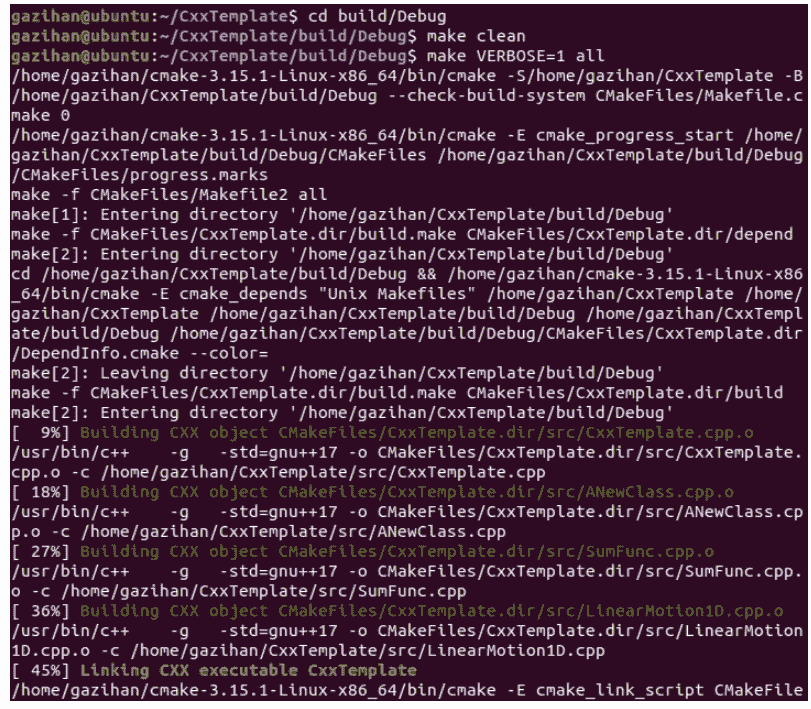

图 1.35：构建过程第 1 部分

```
s/CxxTemplate.dir/link.txt --verbose=1
/usr/bin/c++ -g CMakeFiles/CxxTemplate.dir/src/CxxTemplate.cpp.o CMakeFiles/CxxTemplate.dir/src/ANewClass.cpp.o CMakeFiles/CxxTemplate.dir/src/SumFunc.cpp.o CMakeFiles/CxxTemplate.dir/src/LinearMotion1D.cpp.o -o CxxTemplate -lpthread
make[2]: Leaving directory '/home/gazihan/CxxTemplate/build/Debug'
[ 45%] Built target CxxTemplate
make -f tests/CMakeFiles/tests.dir/build.make tests/CMakeFiles/tests.dir/depend
make[2]: Entering directory '/home/gazihan/CxxTemplate/build/Debug'
cd /home/gazihan/CxxTemplate/build/Debug && /home/gazihan/cmake-3.15.1-Linux-x86_64/bin/cmake -E cmake_depends "Unix Makefiles" /home/gazihan/CxxTemplate /home/gazihan/CxxTemplate/tests /home/gazihan/CxxTemplate/build/Debug /home/gazihan/CxxTemplate/build/Debug/tests /home/gazihan/CxxTemplate/build/Debug/tests/CMakeFiles/tests.dir/DependInfo.cmake --color=
make[2]: Leaving directory '/home/gazihan/CxxTemplate/build/Debug'
make -f tests/CMakeFiles/tests.dir/build.make tests/CMakeFiles/tests.dir/build
make[2]: Entering directory '/home/gazihan/CxxTemplate/build/Debug'
[ 54%] Building CXX object tests/CMakeFiles/tests.dir/CanTest.cpp.o
cd /home/gazihan/CxxTemplate/build/Debug/tests && /usr/bin/c++ -g -std=gnu++17 -o CMakeFiles/tests.dir/CanTest.cpp.o -c /home/gazihan/CxxTemplate/tests/CanTest.cpp
[ 63%] Building CXX object tests/CMakeFiles/tests.dir/SumFuncTest.cpp.o
cd /home/gazihan/CxxTemplate/build/Debug/tests && /usr/bin/c++ -g -std=gnu++17 -o CMakeFiles/tests.dir/SumFuncTest.cpp.o -c /home/gazihan/CxxTemplate/tests/SumFuncTest.cpp
[ 72%] Building CXX object tests/CMakeFiles/tests.dir/__/src/SumFunc.cpp.o
cd /home/gazihan/CxxTemplate/build/Debug/tests && /usr/bin/c++ -g -std=gnu++17 -o CMakeFiles/tests.dir/__/src/SumFunc.cpp.o -c /home/gazihan/CxxTemplate/src/SumFunc.cpp
[ 81%] Building CXX object tests/CMakeFiles/tests.dir/LinearMotion1DTest.cpp.o
cd /home/gazihan/CxxTemplate/build/Debug/tests && /usr/bin/c++ -g -std=gnu++17 -o CMakeFiles/tests.dir/LinearMotion1DTest.cpp.o -c /home/gazihan/CxxTemplate/tests/LinearMotion1DTest.cpp
[ 90%] Building CXX object tests/CMakeFiles/tests.dir/__/src/LinearMotion1D.cpp.o
cd /home/gazihan/CxxTemplate/build/Debug/tests && /usr/bin/c++ -g -std=gnu+
```

图 1.36：构建过程第 2 部分


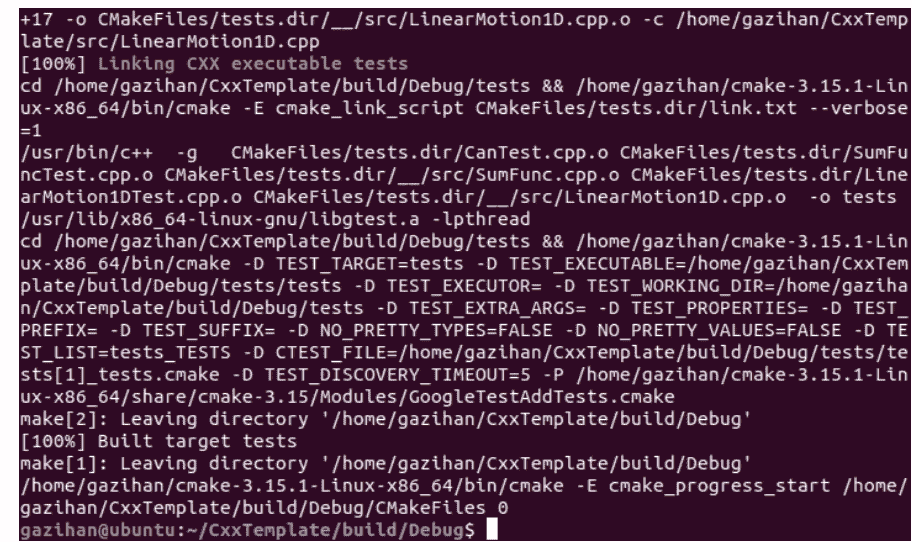

图 1.37：完整的构建输出

以下是此输出中的一些行。以下行与主可执行文件的编译和链接相关：

/usr/bin/c++   -g   -pthread -std=gnu++1z -o CMakeFiles/CxxTemplate.dir/src/CxxTemplate.cpp.o -c /home/username/Packt/Cpp2019/CxxTemplate/src/CxxTemplate.cpp

/usr/bin/c++   -g   -pthread -std=gnu++1z -o CMakeFiles/CxxTemplate.dir/src/ANewClass.cpp.o -c /home/username/Packt/Cpp2019/CxxTemplate/src/ANewClass.cpp

/usr/bin/c++   -g   -pthread -std=gnu++1z -o CMakeFiles/CxxTemplate.dir/src/SumFunc.cpp.o -c /home/username/Packt/Cpp2019/CxxTemplate/src/SumFunc.cpp

/usr/bin/c++  -g  -pthread -std=gnu++1z -o CMakeFiles/CxxTemplate.dir/src/LinearMotion1D.cpp.o -c /home/username/Packt/Cpp2019/CxxTemplate/src/LinearMotion1D.cpp

/usr/bin/c++ -g  CMakeFiles/CxxTemplate.dir/src/CxxTemplate.cpp.o CMakeFiles/CxxTemplate.dir/src/ANewClass.cpp.o CMakeFiles/CxxTemplate.dir/src/SumFunc.cpp.o CMakeFiles/CxxTemplate.dir/src/LinearMotion1D.cpp.o  -o CxxTemplate -pthread

4. 这里的 c++ 命令只是指向 g++ 编译器的符号链接。要查看它实际上是一串符号链接，请键入以下命令：

```
namei /usr/bin/c++
```

你将看到以下输出：

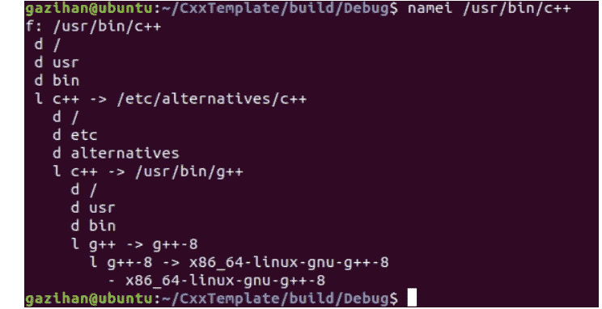

图 1.38：/usr/bin/c++ 的符号链接链

因此，在我们的讨论中，我们将 c++ 和 g++ 互换使用。在前面引用的构建输出中，前四行是将每个 .cpp 源文件编译并创建相应的 .o 目标文件。最后一行是将这些目标文件链接在一起以创建 CxxTemplate 可执行文件。以下图示直观地呈现了此过程：

8. 在下一步中，将目标文件链接在一起形成我们的可执行文件。键入以下命令：

/usr/bin/c++  CxxTemplate.o ANewClass.o SumFunc.o LinearMotion1D.o  -o
CxxTemplate

9. 现在，通过键入以下命令查看我们的工作目录中的可执行文件：

```
ls
```

这将在以下图中显示新的 CxxTemplate 文件：

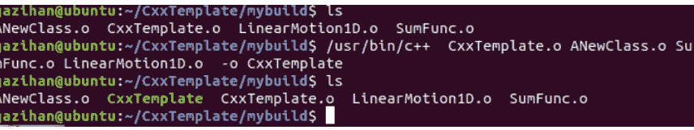

图 1.41：链接后的可执行文件

10. 现在，通过键入以下命令运行我们的可执行文件：

```
./CxxTemplate
```

并查看我们之前看到的输出：

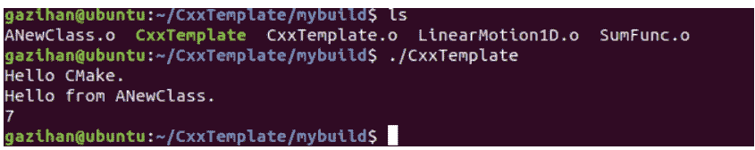

图 1.42：可执行文件输出

现在你已经检查了构建过程的细节并自行重现了它们，在下一节中，让我们探索链接过程。

## 链接步骤

在本节中，让我们看一下两个源文件之间的连接以及它们如何最终进入同一个可执行文件。查看以下图中的 sum 函数：

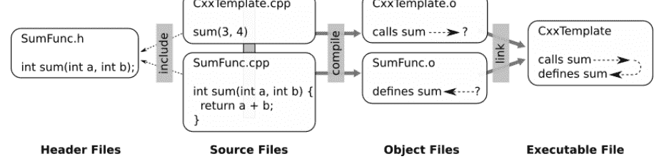

图 1.43：链接过程

sum 函数的函数体在 SumFunc.cpp 中定义。它在 SumFunc.h 中有前向声明。这样，想要使用 sum 函数的源文件就可以知道其签名。一旦它们知道签名，它们就可以调用它并信任实际的函数定义会在运行时存在，而无需与 SumFunc.cpp 产生任何实际交互，而函数就在那里定义。

编译后，调用 sum 函数的 CxxTemplate.cpp 会将其调用带入其目标文件。仍然，它不知道函数定义在哪里。SumFunc.cpp 的目标文件有该定义，但它与 CxxTemplate.o 尚无关系。

在链接步骤中，链接器将 CxxTemplate.o 中的调用与 SumFunc.o 中的定义匹配。因此，调用在可执行文件中正常工作。如果链接器找不到 sum 函数的定义，它将给出链接错误。

链接器通过其名称和参数查找 sum 函数。这称为解析符号。对象文件中定义的类、函数和变量被放置在符号表中，每个符号的引用都通过在此表中的查找来解析。当符号不存在时，你会收到符号无法解析错误。

这带我们经历了构建过程的两个阶段：**编译**和**链接**。请注意，与我们手动编译源代码时相比，我们使用了更简单的命令。随时键入 `man g++` 以查看其中的所有选项。后来，我们讨论了链接以及如何解析符号。我们还谈到了链接步骤中可能出现的问题。在下一节中，我们将学习有关对象文件的内容。

## 深入：查看对象文件

为了使链接步骤无错误地工作，我们需要使所有符号引用与符号定义匹配。大多数时候，我们只需查看源文件就可以分析事物将如何被解析。有时，在复杂的情况下，我们可能很难理解为什么某个符号无法被解析。在这种情况下，查看对象文件的内容以调查引用和定义可能有助于解决问题。除了链接错误之外，了解对象文件内容以及链接的一般工作原理对 C++ 程序员也很有用。了解幕后发生的事情可以帮助程序员更好地理解整个过程。

当我们的源代码编译为对象文件时，我们的语句和表达式会被转换为汇编代码，即 CPU 理解的低级语言。汇编中的每条指令都包含一个操作，后跟操作数，它们是 CPU 的寄存器。有指令将数据加载到寄存器中、从寄存器中加载数据以及对寄存器中的值进行操作。Linux 中的 `objdump` 命令可以帮助我们查看这些对象文件的内容。

> **注意**
> 
> 我们将使用 Compiler Explorer，这是一个更易于使用的在线工具，你可以在左侧窗口编写代码，右侧可以看到编译后的汇编代码。以下是 Compiler Explorer 的链接：https://godbolt.org。

虽然不是很清楚，但你或多或少可以看出它在做什么。我们不会深入汇编代码的细节，但我们将重点关注链接器阶段期间如何解析符号。现在让我们关注以下几行：

```
sum(int, int):
```

```
...
```

```
callSum():
```

```
...
    call  sum(int, int)
```

```
...
```

**call sum(int, int)** 行按预期执行：它调用前面的 **sum** 函数并将参数放在某些寄存器中。这里的重要一点是，函数通过其名称及其参数的类型按顺序标识。链接器会查找具有此签名的适当函数。请注意，返回值不是签名的一部分。

- 2. 禁用 **Demangle** 复选框并查看这些函数名称实际是如何存储的：

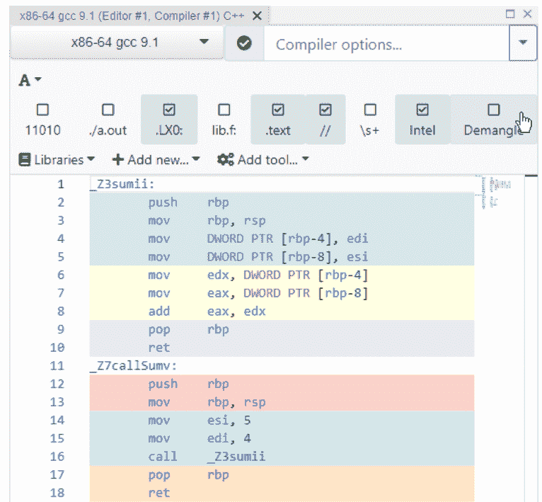

### 图 1.45：未进行去修饰的编译代码

这里，我们的行变成了这样：

```
_Z3sumii:

...

_Z7callSumv:

...
    call    _Z3sumii

...
```

以下是这些添加行的编译版本：

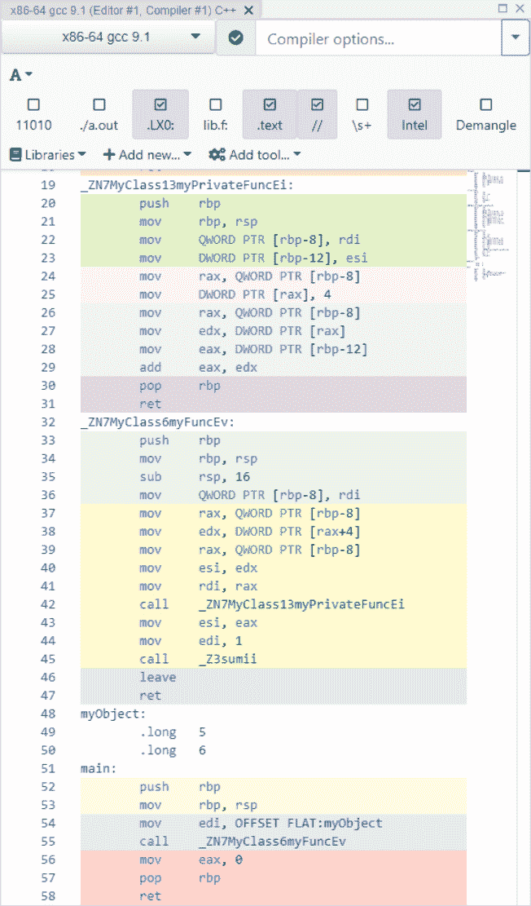

**图 1.46：编译版本**

调试器是处理运行时错误的更好工具。调试器可以让你逐行运行代码，继续运行并在想要的行上暂停，调查内存的值，并在错误时暂停，等等。这让你可以观察程序运行时内存中到底发生了什么，并识别导致不需要行为的代码行。

gdb 是可以调试 C++ 程序的经典命令行调试器。然而，使用起来可能很困难，因为调试本质上是一个视觉任务——你希望能够同时查看代码行、变量值和程序输出。幸运的是，Eclipse CDT 包含一个易于使用的可视化调试器。

### 练习 9：使用 Eclipse CDT 调试

你一直只是运行项目并查看输出。现在你想学习如何详细调试代码。在本练习中，我们将探索 Eclipse CDT 的调试功能。执行以下步骤来完成练习：

- 1. 在 Eclipse CDT 中打开 CMake 项目。
- 2. 为确保我们有一个现有的运行配置，点击 Run | Run Configurations。在那里，你应该在 C/C++ Application 下看到一个 CxxTemplate 条目。
- 3. 关闭对话框以继续。

> 注意
> 
> 由于我们之前运行过项目，它应该在那里。如果没有，请返回并重新创建它。


+   4. 要启动调试器，找到看起来像一只昆虫（bug）的工具栏条目并点击它旁边的下拉菜单。选择 **CxxTemplate** 来调试主应用程序。如果它提示你切换到调试透视图，请接受。现在，Eclipse 的样子如下：

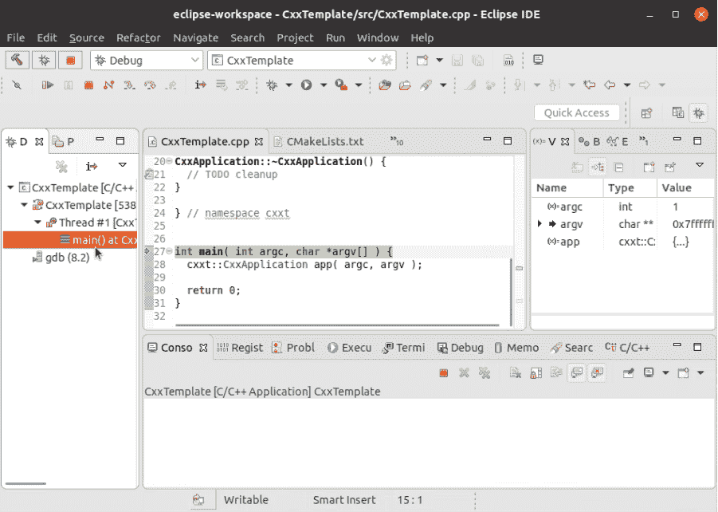

图 1.47：Eclipse 调试屏幕

目前，我们的代码在 **main()** 函数的第一行就冻结了，该行在中央代码视图中用绿色高亮显示并带有箭头。在左侧，我们看到正在运行的线程，目前只有一个。在右侧，我们看到在此上下文中可访问的变量。在底部，我们看到 Eclipse 在幕后用于实际调试可执行文件的 **gdb** 输出。现在，我们的 main 函数并没有太多可调试的内容。

+   5. 点击 **Run** 菜单下的 **Step Over** 或工具栏中的按钮几次，你会看到应用程序很快就会终止。最后，你会看到 **libc-start.c** 库，它是 **main** 函数的调用者。你可以关闭它，并在完成后切换回源文件。当你不再看到红色的停止按钮时，就表示程序执行已结束。

8. 在执行代码的每一行后看到变量的变化，使得算法更容易理解。当你按下 F6 时，请注意 t += i++; 行执行后各次的值如下：

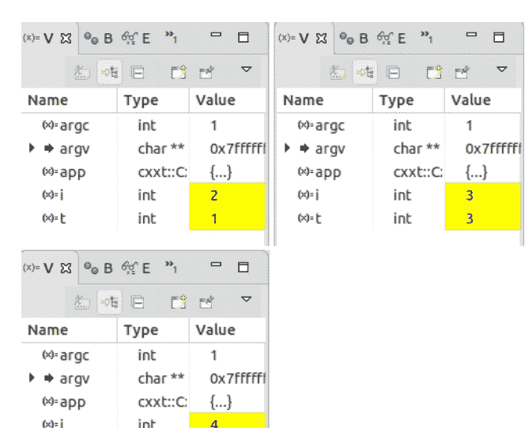

前面的输出清楚地解释了值是如何变化的，以及为什么最后会打印出 6。

9. 探索调试器的其他功能。虽然变量视图很有用，但你也可以将鼠标悬停在任何变量上并浏览其值：

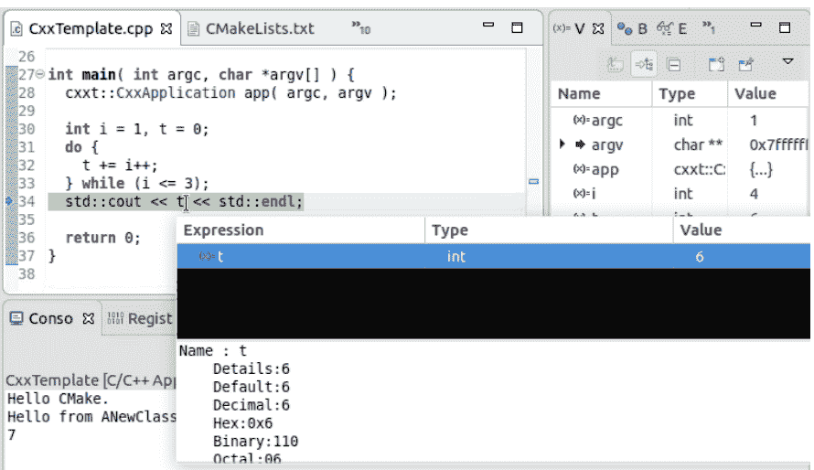

### 图 1.50：调试器的视图选项

此外，表达式视图可以帮助你计算从浏览的值中无法清楚得出的内容。

+   10. 点击右侧的 Expression 并点击添加按钮：

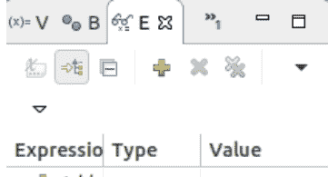

### 图 1.51：添加表达式

+   11. 输入 **t+i** 并按 *Enter*。现在你会在表达式列表中看到总和：

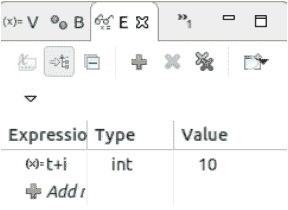

图 1.52：带有新表达式的表达式视图

你可以在工具栏中按下红色方块或选择 **Run | Terminate** 来随时停止调试。另一个功能是断点，它告诉调试器在执行到标记有断点的行时暂停。到目前为止，我们是一行一行地逐步执行代码，这在大型项目中可能非常耗时。相反，你通常希望继续执行，直到到达你感兴趣的代码。

+   12. 现在，不要逐行执行，而是在执行打印操作的这一行添加一个断点。为此，双击该行行号左侧的区域。在下图中，圆点代表一个断点：

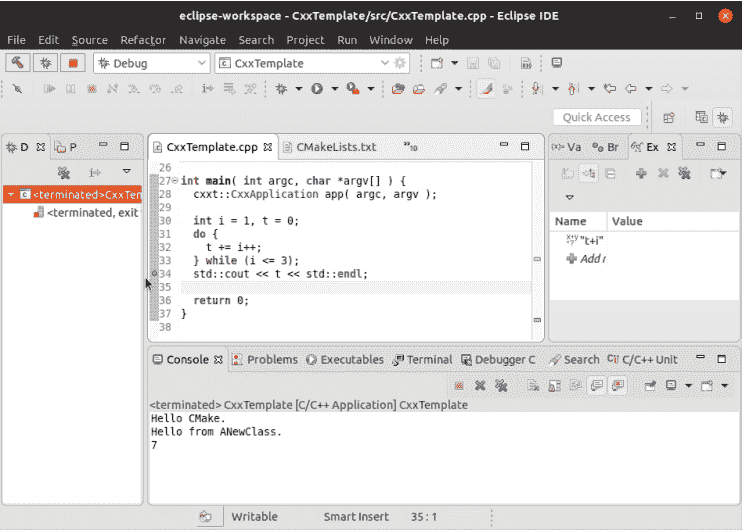

图 1.53：使用断点

13. 现在启动调试器。和往常一样，它会处于暂停状态。现在选择 Run | Resume 或点击工具栏按钮。它将运行循环的三个执行，并在我们的断点处暂停。这样，我们就节省了逐步执行不感兴趣的代码的时间：

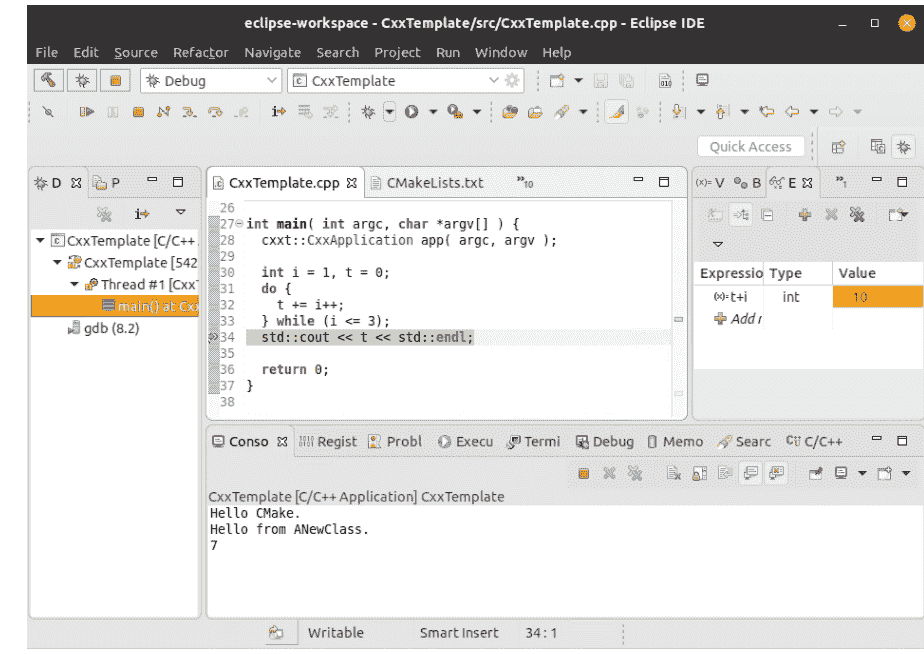

图 1.54：使用调试器

14. 在处理我们添加的循环时，我们忽略了创建 app 对象的那一行。Step Over 命令跳过了这一行。然而，我们也有进入该行中构造函数调用的选项。为此，我们将使用 Run | Step Into 或相应的工具栏按钮。

15. 停止调试器并重新启动它。点击 **Step Over** 进入创建应用程序的那一行：

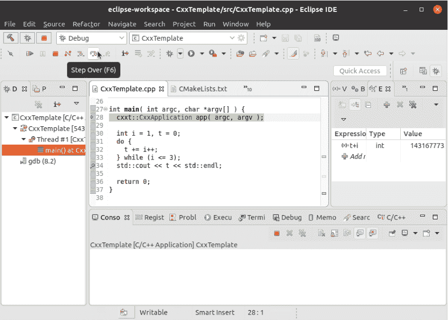

**图 1.55：使用调试器 – Step Over 选项**

16. 高亮显示的是如果再次执行 Step Over 将要执行的下一行。相反，按下 Step Into 按钮。这将带我们进入构造函数调用：

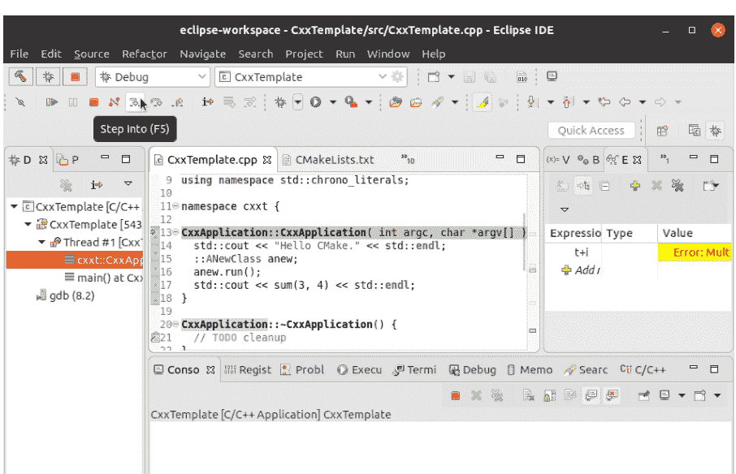

图 1.56：使用调试器 – Step Into 选项

这是一个方便的功能，可以深入函数内部，而不是简单地跳过它。另外，请注意左侧调试视图中的调用栈。你可以随时点击下方的条目来再次查看调用者的上下文。

这就是 Eclipse CDT 调试器的简要介绍，它在幕后使用 GDB 为你提供可视化调试体验。当你尝试更好地理解运行时错误并纠正导致它们的错误时，你可能会发现调试很有用。
