# 编写可读的代码

虽然可视化调试器对于识别和消除运行时错误或非预期的程序行为非常有用，但更好的做法是编写一开始就更不容易出现问题的代码。做到这一点的一种方法是努力编写更易于阅读和理解的代码。这样，在代码中查找问题就更像是识别英文句子之间的矛盾，而不是解决神秘的谜题。当你以易于理解的方式编写代码时，你的错误往往在你犯下时就会显现出来，并且在你回来解决遗漏的问题时也更容易发现。

经过一些不愉快的维护经历后，你会意识到你编写的程序的主要目的不是让计算机按你想要的方式工作，而是告诉读者程序运行时计算机将做什么。这通常意味着你需要输入更多内容，而 IDE 可以帮助你做到这一点。这也可能意味着你有时会编写在执行时间或内存使用方面不是最优的代码。如果这与你所学的内容相悖，请考虑你可能用微不足道的效率换取了出错的风险。凭借我们可用的庞大处理能力和内存，你可能会在追求效率的徒劳尝试中让代码变得不必要地晦涩难懂且可能出现错误。在下一节中，我们将列出一些有助于你编写更具可读性的代码的经验法则。

## 缩进和格式

C++ 代码，如许多其他编程语言一样，由程序块组成。函数有一组语句构成其主体块。循环的块语句将在迭代中执行。**if** 语句的块在给定条件为真时执行，而对应的 **else** 语句的块在条件为假时执行。

大括号，或单语句块中缺少大括号，告知计算机，而以空白形式出现的缩进则告知人类读者块结构。缺乏缩进或误导性缩进会使读者非常难以理解代码的结构。因此，我们应努力保持代码良好的缩进。请考虑以下两个代码块：

```
// Block 1
if (result == 2)
firstFunction();
secondFunction();
```

```
// Block 2
if (result == 2)
    firstFunction();
secondFunction();
```

从执行角度看它们是相同的，但在第二个中，**firstFunction()** 仅在 **result** 为 2 时执行这一点要清晰得多。现在考虑以下代码：

```
if (result == 2)
    firstFunction();
    secondFunction();
```

这纯粹具有误导性。如果读者不够仔细，他们很容易假设 **secondFunction()** 仅在 **result** 为 2 时执行。然而，从执行角度看，这段代码与前两个示例是相同的。

如果你觉得纠正缩进会减慢你的速度，可以使用编辑器的格式化功能来帮助你。在 Eclipse 中，你可以选择一段代码并使用 **Source | Correct Indentation** 来修复该选择的缩进，或使用 **Source | Format** 来修复代码的其他格式问题。

除了缩进之外，其他格式规则，如将大括号放在正确的行、在二元运算符周围插入空格、在每个逗号后插入空格等，也是非常重要的格式规则，你应遵守这些规则以保持代码格式良好且易于阅读。


在Eclipse中，你可以按工作区在**窗口 | 首选项 | C/C++ | 代码风格 | 格式化器**中设置格式化规则，也可以按项目在**项目 | 属性 | C/C++ 常规 | 格式化器**中设置。你可以选择行业标准风格（如K&R或GNU），也可以修改它们并创建自己的风格。当你使用**源代码 | 格式化**来格式化代码时，这一点尤其重要。例如，如果你选择使用空格缩进，但Eclipse的格式化规则设置为制表符，那么你的代码就会变成制表符和空格的混合体。

## 使用有意义的名称作为标识符

在我们的代码中，我们使用标识符来命名许多事物——变量、函数、类名、类型等等。对于计算机来说，这些标识符仅仅是一串字符，用于彼此区分。然而，对于读者来说，它们远不止于此。标识符应该完整且无歧义地描述它所代表的事物。同时，它不应过长。此外，它应该遵守当前正在使用的风格标准。

考虑以下代码：

```
studentsFile File = runFileCheck("students.dat");

bool flag = File.check();

if (flag) {
    int Count_Names = 0;

    while (File.CheckNextElement() == true) {
        Count_Names += 1;
    }

    std::cout << Count_Names << std::endl;
}
```

虽然这是一段完全有效的C++代码，但读起来相当困难。让我们列出它的问题。首先，让我们看看标识符的风格问题。**studentsFile** 类名以小写字母开头，本应大写。**File** 变量本应以小写字母开头。**Count_Names** 变量本应以小写字母开头，并且不应该包含下划线。**CheckNextElement** 方法本应以小写字母开头。虽然这些规则看起来是任意的，但在命名上保持一致会携带关于名称的额外信息——当你看到一个以大写字母开头的单词时，你会立刻明白它必须是类名。此外，拥有不符合当前标准的名称只会分散注意力。

现在，让我们超越风格，审视名称本身。第一个有问题的名称是 **runFileCheck** 函数。方法是一个返回值的动作：它的名称应该清楚地解释它做什么以及返回什么。“Check”是一个过度使用的词，在大多数情况下过于模糊。是的，我们检查了，它在那里——那么我们该怎么办呢？在这种情况下，似乎我们实际上是读取文件并创建一个 **File** 对象。既然如此，**runFileCheck** 应该改为 **readFile**。这清楚地解释了正在执行的动作，返回值也是你所期望的。如果你想更具体地说明返回值，**readAsFile** 可以是另一个选择。类似地，**check** 方法很模糊，应该改为 **exists**。**CheckNextElement** 方法也很模糊，应该改为 **nextElementExists**。

另一个过度使用的模糊词是 **flag**，它常用于布尔变量。这个名称暗示了一种开/关状态，但没有提供其值含义的任何线索。在这种情况下，它的 **true** 值意味着文件存在，**false** 值意味着文件不存在。命名布尔变量的技巧是设计一个在变量值为 **true** 时正确的问题或陈述。在这个例子中，**fileExists** 和 **doesFileExist** 是两个不错的选择。

我们下一个命名不当的变量是 **Count_Names**，或者使用正确大小写的 **countNames**。对于整数来说，这是一个糟糕的名字，因为这个名字并不表示一个数字——它暗示了一个导致数字的动作。相反，像 **numNames** 或 **nameCount** 这样的标识符会清楚地传达内部数字的含义。

```
sum += input[i];
}
```

```
int minVal = 0;
for (int i = 0; i < length; ++i) {
    if (i == 0 || minVal > input[i]) {
        minVal = input[i];
    }
}
```

```
for (int i = 0; i < length; ++i) {
    if (input[i] < 0) {
        input[i] *= -1;
    }
}
```

现在一切清晰多了。第一个循环计算输入的总和，第二个循环找到最小元素，第三个循环找到每个元素的绝对值。虽然它更加清晰和易于理解，但你可能觉得自己在运行三个循环，因此浪费了CPU资源。创建更高效代码的动力可能会促使你合并这些循环。请注意，你在这里获得的效率提升微乎其微；程序的时间复杂度仍然是O(n)。

在编写代码时，可读性和效率是两个经常相互竞争的约束条件。如果你想开发可读且可维护的代码，你应该始终优先考虑可读性。然后，你应该努力开发出同样高效的代码。否则，可读性低的代码可能难以维护，更糟糕的是，可能存在难以识别和修复的bug。当你的程序产生错误结果或添加新功能的成本过高时，其高效率将毫无意义。

### 练习10：让代码可读

以下代码存在样式和缩进问题。空格使用不一致，缩进不正确。此外，对于单语句if块是否使用花括号的决定也不一致。下面这段代码在缩进、格式、命名和清晰度方面都存在问题：

```
```cpp
//a is the input array and Len is its length
        void arrayPlay(int *a, int Len) {

                int S = 0;
                int M = 0;
                int Lim_value = 100;
                bool flag = true;
                for (int i = 0; i < Len; ++i) {
                S += a[i];

                        if (i == 0 || M > a[i]) {
                        M = a[i];
                        }

                        if (a[i] >= Lim_value) {
                                flag = true;
                                }

                        if (a[i] < 0) {
                        a[i] *= 2;
                }
                }
        }
```
```

让我们修复这些问题，并使其兼容常见的C++代码风格。执行以下步骤以完成此练习：

- 1. 打开Eclipse CDT。
- 2. 在**src**文件夹中创建一个新的**ArrayPlay.cpp**文件，并粘贴上述代码。确保你没有选中任何文本。然后，从顶部菜单转到**源代码 | 格式化**，并接受对话框以格式化整个文件。这会使我们的代码看起来如下所示：

```
```cpp
//a is the input array and Len is its length
void arrayPlay(int *a, int Len) {

        int S = 0;
```

```
```cpp
int M = 0;
int Lim_value = 100;
bool flag = true;
for (int i = 0; i < Len; ++i) {
    S += a[i];

    if (i == 0 || M > a[i]) {
        M = a[i];
    }

    if (a[i] >= Lim_value) {
        flag = true;
    }

    if (a[i] < 0) {
        a[i] *= 2;
    }
}
}
```
```

现在代码更容易理解了，让我们试着理解它的作用。得益于注释，我们知道我们有一个输入数组**a**，其长度为**Len**。这些更好的名称是**input**和**inputLength**。

- 3. 让我们进行第一个更改，将**a**重命名为**input**。如果你使用的是Eclipse，可以选择**重构 | 重命名**来重命名一个出现位置，其他所有出现位置也会随之重命名。对**Len**也执行相同操作，将其重命名为**inputLength**。

- 4. 更新后的代码如下所示。注意，由于参数名称不言自明，我们不再需要注释了：

```
```cpp
void arrayPlay(int *input, int inputLength) {

    int S = 0;
    int M = 0;
    int Lim_value = 100;
    bool flag = true;
    for (int i = 0; i < inputLength; ++i) {
        S += input[i];

        if (i == 0 || M > input[i]) {
            M = input[i];
        }
```


现在，让我们看看如何使这段代码更简单、更易于理解。前面的代码做了这些事情：计算输入元素的总和、找到最小值、判断是否超过了上限阈值，以及将每个元素乘以二。

- 7. 由于所有这些操作都在同一个循环中完成，现在算法并不清晰。修复它并使用四个独立的循环：

```cpp
void arrayPlay(int *input, int inputLength) {

    // find the sum of the input
    int sum = 0;
    for (int i = 0; i < inputLength; ++i) {
        sum += input[i];
    }

    // find the smallest element
    int smallest = 0;
    for (int i = 0; i < inputLength; ++i) {
        if (i == 0 || smallest > input[i]) {
            smallest = input[i];
        }
    }

    // determine whether top threshold is crossed
    int topThreshold = 100;
    bool isTopThresholdCrossed = true;
    for (int i = 0; i < inputLength; ++i) {
        if (input[i] >= topThreshold) {
            isTopThresholdCrossed = true;
        }
    }

    // multiply each element by 2
    for (int i = 0; i < inputLength; ++i) {
        if (input[i] < 0) {
            input[i] *= 2;
        }
    }
}
```

现在代码清晰多了。虽然很容易理解每个代码块在做什么，但我们也添加了注释使其更加清晰。在本节中，我们更好地理解了代码是如何被转换为可执行文件的。然后，我们讨论了识别和解决代码中可能出现的错误的方法。我们最后讨论了如何编写可读性更强、问题更少的代码。在下一节中，我们将解决一个活动，在其中我们将使代码更具可读性。

### Activity 3: Making Code More Readable

你可能有难以阅读且包含 bug 的代码，要么是因为你匆忙写成，要么是从别人那里收到的。你希望修改代码以消除 bug 并使其更具可读性。我们有一段需要改进的代码。逐步改进它并使用调试器解决这些问题。执行以下步骤来实现此活动：

- 1. 下面你会找到 **SpeedCalculator.cpp** 和 **SpeedCalculator.h** 的源代码。它们包含 **SpeedCalculator** 类。将这两个文件添加到你的项目中。
- 2. 在你的 **main()** 函数中创建该类的一个实例并调用其 **run()** 方法。
- 3. 修复代码中的风格和命名问题。
- 4. 简化代码使其更易于理解。
- 5. 运行代码并观察运行时的问题。
- 6. 使用调试器修复该问题。

以下是你将添加到项目中的 **SpeedCalculator.cpp** 和 **SpeedCalculator.h** 的代码。你将在此活动中对其进行修改：

```cpp
// SpeedCalculator.h
#ifndef SRC_SPEEDCALCULATOR_H_
#define SRC_SPEEDCALCULATOR_H_

class SpeedCalculator {
private:
    int numEntries;
    double *positions;
    double *timesInSeconds;
    double *speeds;
public:
    void initializeData(int numEntries);
    void calculateAndPrintSpeedData();
};

#endif /* SRC_SPEEDCALCULATOR_H_ */

//SpeedCalculator.cpp
#include "SpeedCalculator.h"
#include <cstdlib>
#include <ctime>
#include <iostream>
#include <cassert>

void SpeedCalculator::initializeData(int numEntries) {
    this->numEntries = numEntries;
    positions = new double[numEntries];
    timesInSeconds = new double[numEntries];
    srand(time(NULL));
    timesInSeconds[0] = 0.0;
    positions[0] = 0.0;
    for (int i = 0; i < numEntries; ++i) {
        positions[i] = positions[i-1] + (rand()%500);
        timesInSeconds[i] = timesInSeconds[i-1] + ((rand()%10) + 1);
    }
}

void SpeedCalculator::calculateAndPrintSpeedData() {
    double maxSpeed = 0;
    double minSpeed = 0;
    double speedLimit = 100;
    double limitCrossDuration = 0;

    for (int i = 0; i < numEntries; ++i) {
        double dt = timesInSeconds[i+1] - timesInSeconds[i];
        assert (dt > 0);
        double speed = (positions[i+1] - positions[i]) / dt;
        if (maxSpeed < speed) {
            maxSpeed = speed;
        }
        if (minSpeed > speed) {
            minSpeed = speed;
        }
        if (speed > speedLimit) {
            limitCrossDuration += dt;
        }
        speeds[i] = speed;
    }

    std::cout << "Max speed: " << maxSpeed << std::endl;
    std::cout << "Min speed: " << minSpeed << std::endl;
    std::cout << "Total duration: " <<
timesInSeconds[numEntries - 1] - timesInSeconds[0] << " seconds" <<
std::endl;
    std::cout << "Crossed the speed limit for " << limitCrossDuration << " seconds" << std::endl;
    delete[] speeds;
}
```

Note

此活动的解决方案可在第 626 页找到。

## Summary

在本章中，我们学习了如何创建可移植且可维护的 C++ 项目。我们首先学习了如何创建 CMake 项目并将其导入 Eclipse CDT，从而可以选择使用命令行或 IDE。本章的其余部分专注于消除项目中的各种问题。首先，我们学习了如何向项目添加单元测试并使用它们来确保代码按预期工作。我们继续讨论了代码所经历的编译和链接步骤，并观察了目标文件的内容，以更好地理解可执行文件。然后，我们学习了如何在 IDE 中以可视化方式调试代码以消除运行时错误。我们最后讨论了一些经验法则，有助于创建可读、易懂且可维护的代码。这些方法将在你的 C++ 之旅中派上用场。在下一章中，我们将学习更多关于 C++ 的类型系统和模板。

## Introduction

C++ 是一种强类型、静态类型语言。编译器使用变量的类型信息及其使用上下文来检测和防止某些类别的编程错误。这意味着每个对象都有一个类型，并且该类型永远不会改变。相比之下，像 Python 和 PHP 这样的动态类型语言会将这种类型检查推迟到运行时（也称为后期绑定），并且变量的类型可能在应用程序执行期间发生变化。这些语言使用鸭子测试而不是变量的类型——也就是说，“如果它走路和说话都像鸭子，那么它一定就是鸭子。” 像 C++ 这样的静态类型语言依赖于类型来确定变量是否可用于特定目的，而动态类型语言则依赖于某些方法和属性的存在来确定其适用性。

C++ 最初被描述为“带类的 C”。这是什么意思？基本上，C 提供了一组内置的基本类型——int、float、char 等——以及这些项目的指针和数组。你使用 struct 将它们聚合为相关项目的结构。C++ 将其扩展为类，以便你可以完全定义自己的类型以及可用于操作它们的运算符，从而使它们成为语言中的一等公民。自从它诞生以来，C++ 已经发展成为远不止“带类的 C”，因为它现在可以表达面向对象范式（封装、多态、抽象和继承）、函数式范式以及通用编程（模板）。

在本书中，我们将重点关注 C++ 支持面向对象范式意味着什么。随着你作为开发者的经验增长，并接触到 Clojure、Haskell、Lisp 等函数式语言，它们将帮助你编写健壮的 C++ 代码。像 Python、PHP 和 Ruby 这样的动态类型语言已经影响了我们编写 C++ 代码的方式。随着 C++17 的到来，引入了 std::variant 类——一个在编译时保存我们选择的任何类型的类，其行为类似于动态语言中的变量。

在上一章中，我们学习了如何使用 CMake 创建可移植且可维护的 C++ 项目。我们学习了如何在项目中加入单元测试以帮助编写正确的代码，以及在出现问题时如何调试问题。我们学习了工具链如何将我们的代码通过一系列程序的管道处理以生成可执行文件。我们最后总结了一些经验法则，有助于我们创建可读、易懂且可维护的代码。

在本章中，我们将对 C++ 类型系统进行一次快速浏览，在此过程中声明和使用我们自己的类型。


## C++ 类型

作为一门强类型且静态类型的语言，C++ 提供了多种基本类型，并允许定义自己的类型，且可以根据当前问题的需要赋予其或多或少的特性。本节首先介绍基本类型、初始化它们、声明变量以及将类型与之关联。然后，我们将探讨如何声明和定义一个新类型。

### C++ 基本类型

C++ 包含几种*基本类型*，也就是*内置类型*。C++ 标准定义了每种类型在内存中的最小大小以及它们之间的相对大小。编译器识别这些基本类型，并具有内置规则来定义可以对它们执行哪些操作以及不能执行哪些操作。还存在类型之间隐式转换的规则；例如，从 int 类型到 float 类型的转换。

> **注意**
>
> 关于所有内置类型的简要描述，请参阅 https://en.cppreference.com/w/cpp/language/types 上的 **基本类型** 部分。

### C++ 字面量

C++ 字面量用于在声明变量或为其赋值时，告诉编译器你希望与该变量关联的值。上一节中的每种内置类型都有一种与之关联的字面量形式。

> **注意**
>
> 关于每种类型字面量的简要描述，请参阅 https://en.cppreference.com/w/cpp/language/expressions 上的 **字面量** 部分。

### 指定类型——变量

由于 C++ 是一种静态类型语言，声明变量时必须指定其类型。声明函数时，必须指定返回类型和传递给函数的参数类型。声明变量时，指定类型有两种选择：

-   **显式指定**：作为程序员，你精确地指定类型是什么。
-   **隐式指定**（使用 auto）：你告诉编译器查看用于初始化变量的值并确定其类型。这称为（auto）类型推导。

标量变量声明的一般形式如下：

```
type-specifier var;                 // 1. Default-initialized variable
type-specifier var = init-value;    // 2. Assignment initialized variable
type-specifier var{init-value};     // 3. Brace-initialize variable
```

**类型说明符（type-specifier）**表示你希望与 **var** 变量关联的类型（基本类型或用户定义类型）。这三种形式都会让编译器分配一些存储空间来保存值，之后所有对 **var** 的引用都将指向该位置。**初始值（init-value）**用于初始化该存储位置。默认初始化对内置类型不执行任何操作；对于用户定义类型，则会根据函数重载解析调用其构造函数来初始化存储。

编译器必须知道要分配多少内存，并提供了一个运算符来确定类型或变量的大小——**sizeof**。

根据声明，编译器会在计算机内存中留出空间来存储变量所引用的数据项。请看以下声明：

```
int value = 42;      // declare value to be an integer and initialize to 42
short a_value{64};   // declare a_value to be a short integer and initialize
                     //     to 64
int bad_idea;        // declare bad_idea to be an integer and DO NOT
                     // initialize it. Use of this variable before setting
                     // it is UNDEFINED BEHAVIOUR.
float pi = 3.1415F;  // declare pi to be a single precision floating point
                     // number and initialize it to pi.
```

```
double e{2.71828};  // declare e to be a double precision floating point
// number and initialize it to natural number e.
auto title = "Sir Robin of Loxley"; // Let the compiler determine the type
```

如果这些变量声明在函数作用域内，编译器会从所谓的栈（stack）中为它们分配内存。其内存布局可能类似于下图：

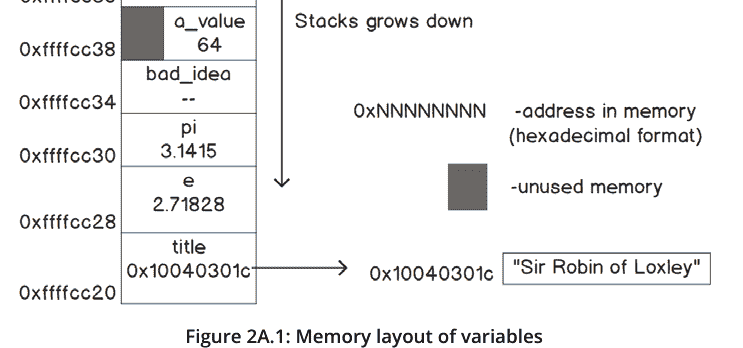

图 2A.1：变量的内存布局

编译器会按照我们声明变量的顺序分配内存。出现未使用的内存，是因为编译器分配内存时，会确保基本类型通常以原子方式访问，并为了效率而按适当的内存边界对齐。请注意，title 的类型是 const char *，这是一个指针，我们将在下一节与 const 一起讨论。“Sir Robin of Loxley”字符串将存储在另一部分内存中，这部分内存在程序加载时完成初始化。我们稍后将讨论程序内存。

对标量声明语法稍作修改，即可得到声明值数组的语法：

```
type-specifier ary[count];                         // 1. Default-initialized
type-specifier ary[count] = {comma-separated list}; // 2. Assignment initialized
type-specifier ary[count]{comma-separated list};     // 3. Brace-initialized
```

多维数组也可以这样声明：

```
type-specifier ary2d[countX][countY];
type-specifier ary3d[countX][countY][countZ];
// etc...
```

请注意，上述声明中的 **count**、**countX** 等项必须在编译时求值为常量，否则会导致错误。此外，逗号分隔的初始化列表中的元素个数必须小于或等于 **count**，否则也会产生编译错误。在下一节中，我们将把目前所学的概念应用到一个练习中。

> **注意**
>
> 在解决本章的任何实操练习之前，请下载本书的 GitHub 仓库（https://github.com/TrainingByPackt/Advanced-CPlusPlus），并在 Eclipse 中导入 Lesson 2A 文件夹，以便查看每个练习和活动的代码。

#### 练习 1：声明变量并探索大小

本练习将搭建本章所有练习所需的环境，并让你熟悉内置类型变量的声明和初始化。你还将了解 **auto** 声明、**数组** 和 **sizeof**。让我们开始吧：

-   1. 打开 Eclipse（在第 1 章*《可移植 C++ 软件剖析》*中使用过）。如果出现启动器窗口，请单击 **Launch（启动）**。
-   2. 转到 **文件（File）**，在 **新建（New ▶）** 下选择 **项目（Project...）**，然后选择 **C++ 项目（C++ Project）**（而不是 **C/C++ 项目（C/C++ Project）**）。
-   3. 单击 **下一步（Next >）**，取消勾选 **使用默认位置（Use default location）** 复选框，然后在 **项目名称（Project name）** 中输入 **Lesson2A**。
-   4. 在 **项目类型（Project Type）** 中选择 **空项目（Empty Project）**。然后，单击 **浏览（Browse...）**，导航到包含 Lesson2A 示例的文件夹。
-   5. 单击 **打开（Open）** 选择该文件夹并关闭对话框。
-   6. 依次单击 **下一步（Next >）**、**下一步（Next >）**，然后 **完成（Finish）**。
-   7. 为帮助你完成练习，我们将配置工作区，使其在构建前自动保存文件。转到 **窗口（Window）** 并选择 **首选项（Preferences）**。在 **常规（General）** 下，打开 **工作区（Workspace）** 并选择 **构建（Build）**。

8. 勾选 **构建前自动保存（Save automatically before build）** 复选框，然后点击 **应用并关闭（Apply and Close）**。

9. 与第 1 章*《可移植 C++ 软件剖析》*一样，这是一个基于 CMake 的项目，因此我们需要更改当前构建器。在 **项目资源管理器（Project Explorer）** 中单击 **Lesson2A**，然后在 **项目（Project）** 菜单下单击 **属性（Properties）**。从左侧窗格中选择 **C/C++ 构建（C/C++ Build）** 下的 **工具链编辑器（Tool Chain Editor）**，并将 **当前构建器（Current builder）** 设置为 **CMake Build (portable)**。

10. 单击 **应用并关闭（Apply and Close）**。然后选择 **项目 | 全部构建（Project | Build All）** 菜单项以构建所有练习。默认情况下，屏幕底部的控制台会显示 **CMake 控制台 [Lesson2A]**：

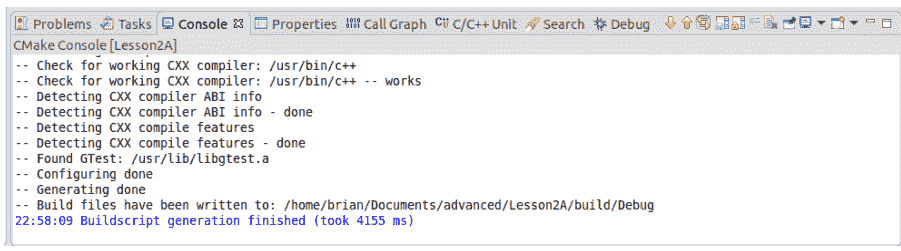

图 2A.2：CMake 控制台输出

11. 在控制台右上角，单击 **显示所选控制台（Display Selected Console）** 按钮，然后从列表中选择 **CDT 全局构建控制台（CDT Global Build Console）**：

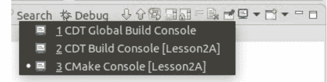

图 2A.3：选择不同的控制台


这将显示构建的结果——它应该显示 0 个错误和 3 个警告：

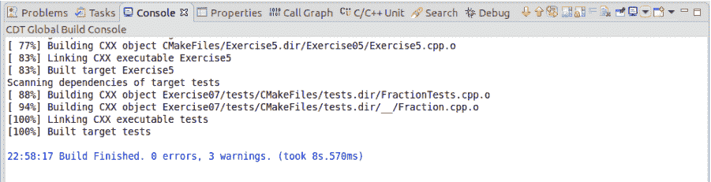

Figure 2A.4: Build process console output

- 12. 由于构建成功，我们想要运行 Exercise1。在窗口顶部，单击下拉列表，其中显示为 **No Launch Configurations**：

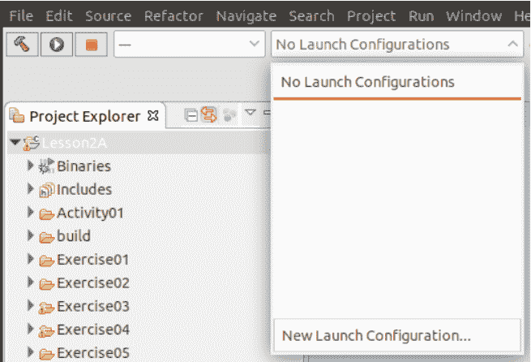

Figure 2A.5: Launch Configuration menu

- 13. 单击 **New Launch Configuration...**。保持默认设置不变并单击 **Next >**。

14. 将名称更改为 Exercise1，然后单击 Search Project：

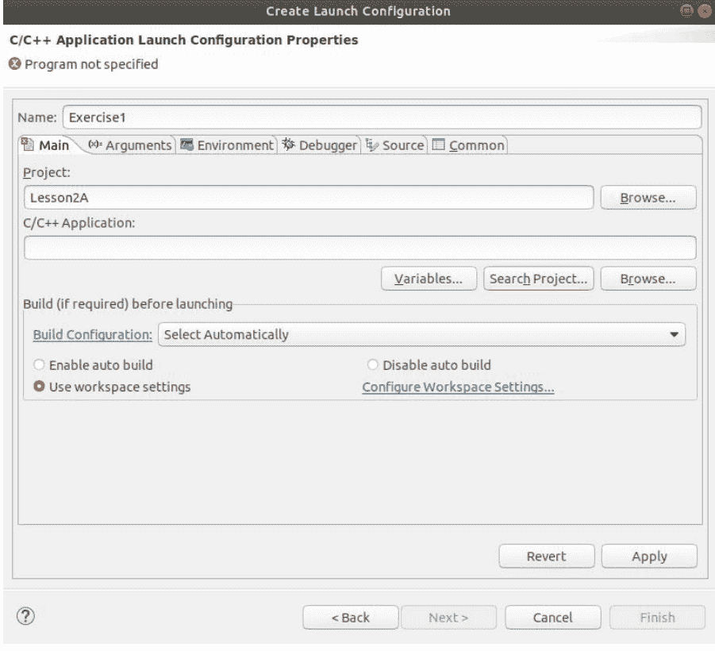

Figure 2A.6: Exercise1 Launch Configuration

15. 从 Binaries 窗口中显示的程序列表中，单击 Exercise1 并单击 OK。

- 16. 单击 **Finish**。这将导致 exercise1 显示在 Launch Configuration 下拉框中：


**Figure 2A.7: Change to Launch Configuration**

- 17. 要运行 **Exercise1**，单击 **Run** 按钮。Exercise1 将执行并在控制台中显示其输出：

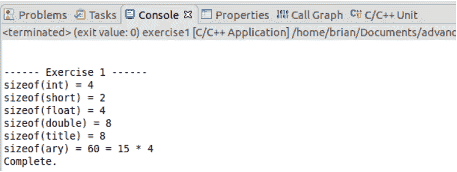

**Figure 2A.8: Output from exercise1**

该程序没有什么有价值的操作——它只是输出系统上各种类型的大小。但这表明程序有效并且可以编译。请注意，你的系统上的数字可能不同（尤其是 sizeof(title) 值）。

- 18. 在 **Project Explorer** 中，展开 **Lesson2A**，然后展开 **Exercise01**，并双击 **Exercise1.cpp** 以在编辑器中打开此练习的文件：

```
```cpp
int main(int argc, char**argv)
{
    std::cout << "\n\n------ Exercise 1 ------\n";

    int value = 42;    // declare value to be an integer & initialize to
42
    short a_value{64}; // declare a_value to be a short integer &
                      // initialize to 64
    int bad_idea;      // declare bad_idea to be an integer and DO NOT
                      // initialize it. Use of this variable before
```

25. 再次单击 Run 按钮。当出现 Errors in Workspace 对话框时，单击 Cancel：

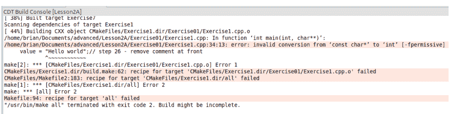

Figure 2A.12: Assignment of an incorrect value type to a variable

这次，构建失败是因为我们尝试将错误类型的数据分配给变量，即 "Hello world"，它是一个 const char*，分配给类型为 int 的变量，即 value。

26. 将注释分隔符恢复到行首。在编辑器中，通过删除行首的分隔符（//）来取消注释标记为步骤 27 的行：

```
// double pi = 3.14159;   // step 24 - remove comment at front
// auto speed;           // step 25 - remove comment at front
// value = "Hello world";// step 26 - remove comment at front
title = 123456789;       // step 27 - remove comment at front
// short sh_int{32768};   // step 28 - remove comment at front
```

27. 再次单击 Run 按钮。当出现 Errors in Workspace 对话框时，单击 Cancel：

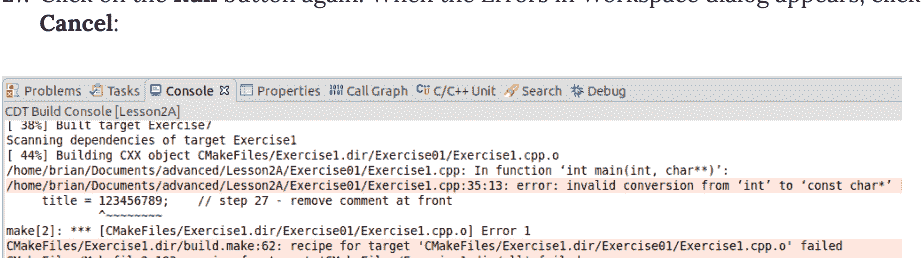

Figure 2A.13: Assignment of an incorrect value type to an auto variable

再次，构建失败，因为我们尝试将错误类型的数据分配给，即 123456789 类型为 **int**，分配给 title，而 title 是一个 **const char***。这里值得注意的一点是，**title** 是使用 **auto** 类型声明的。编译器生成的错误消息告诉我们 title 被推导为 **const char*** 类型。

- 28. 将注释分隔符恢复到行首。在编辑器中，通过删除行首的分隔符（`//`）来取消注释标记为 **step 28** 的行：

```
```cpp
// double pi = 3.14159;  // step 24 - remove comment at front
// auto speed;           // step 25 - remove comment at front
// value = "Hello world";// step 26 - remove comment at front
// title = 123456789;    // step 27 - remove comment at front
short sh_int{32768};     // step 28 - remove comment at front
```
```

- 29. 再次单击 **Run** 按钮。当出现 Errors in Workspace 对话框时，单击 **Cancel**：

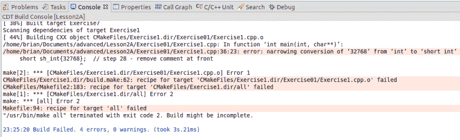

**Figure 2A.14: Assignment of a value that's too large to fit in the variable**

再次，构建失败，但这次是因为我们尝试初始化 **sh_int** 的值（**32768**）无法放入分配给 **short** 类型的内存中。short 占用两个字节的内存，被视为 16 位的有符号量。这意味着可以存储在 short 中的值的范围是 −2^(16−1) 到 2^(16−1)−1，或 −32768 到 32767。

- 30. 将值从 **32768** 更改为 **32767** 并单击 **Run** 按钮。这次，程序编译并运行，因为该值可以用 short 表示。

- 31. 将值从 **32767** 更改为 **-32768** 并单击 **Run** 按钮。再次，程序编译并运行，因为该值可以用 **short** 表示。

```
std::cout << "Starting program\n";
hello_world();
std::cout << "Exiting program\n";
return 0;
}
```

在前面的示例中声明了两个函数——hello_world() 和 main()。main() 函数是每个 C++ 程序的入口点，它返回一个 int 值，该值传递给主机系统。它被称为退出代码。

从返回类型的声明到开括号（{）之前的所有内容都称为函数原型。它定义了三件事，即返回类型、函数名称以及参数的数量和类型。

对于第一个函数，返回类型为 void——即不返回值；它名为 hello_world 且不带参数：

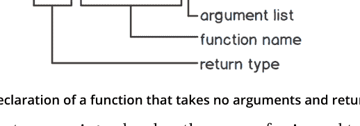

Figure 2A.15: Declaration of a function that takes no arguments and returns nothing

第二个函数返回 int 值，名为 main，并带两个参数。这些参数是 argc 和 argv，类型分别为 int 和指向 char 指针的指针：

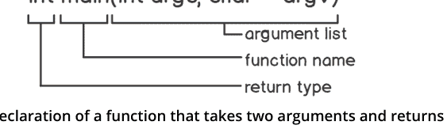

Figure 2A.16: Declaration of a function that takes two arguments and returns an int

函数原型之后的所有内容都称为函数体。函数体包含变量声明和要执行的语句。

函数必须在被使用之前声明——即编译器需要知道其参数和返回类型。如果函数在调用它之后定义在它将被使用的文件中，那么你可以通过在它被使用之前提供该函数的向前声明来解决此问题。

向前声明是通过在调用它之前将以分号结尾的函数原型放在文件中来完成的。对于 `hello_world()`，这将如下所示：

```
void hello_world();
```

对于 main 函数，这将如下所示：

```
int main(int, char**);
```

函数原型不需要参数的名称，只需要类型。然而，为了帮助函数的用户，保持它们是一个好主意。

在 C++ 中，函数的定义可以在一个文件中，并且需要在不同的文件中调用它。那么，第二个文件如何知道它希望调用的函数的原型呢？这是通过将向前声明放在一个单独的文件中，称为头文件，并在第二个文件中包含它来实现的。

#### Exercise 2: Declaring Functions

在本练习中，我们将测试编译器在遇到函数调用时需要知道什么，并实现向前声明以解决未知函数。让我们开始吧。

- 1. 在 Eclipse 中打开 **Lesson2A** 项目，然后在 **Project Explorer** 中展开 **Lesson2A**，然后展开 **Exercise02** 并双击 **Exercise2.cpp** 以在编辑器中打开此练习的文件。
- 2. 单击 **Launch Configuration** 下拉菜单并选择 **New Launch Configuration...**
- 3. 配置 **Exercise2** 以使用名称 **Exercise2** 运行。完成后，它将成为当前选定的 Launch Configuration。


+   4. 点击**运行**按钮。练习 2 将运行并产生以下输出：

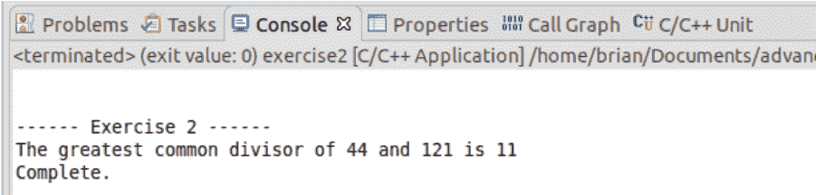

图 2A.17：exercise2 程序的输出

+   5. 进入编辑器，通过移动 `gcd` 函数使其位于 `main` 之后来修改代码。修改后的代码应该如下所示：

```
```cpp
int main(int argc, char**argv)
{
    std::cout << "\n\n----- Exercise 2 -----\n";
    std::cout << "The greatest common divisor of 44 and 121 is " <<
    gcd(44, 121) << "\n";
    std::cout << "Complete.\n";
    return 0;
}

int gcd(int x, int y)
{
    while(y!=0)
    {
        auto c{x%y};
        x = y;
        y = c;
    }
    return x;
}
```
```

+   6. 再次点击**运行**按钮。当**工作区中存在错误**对话框出现时，点击**取消**。在 **CDT 构建控制台 [Lesson2A]** 中，我们将看到失败的原因：

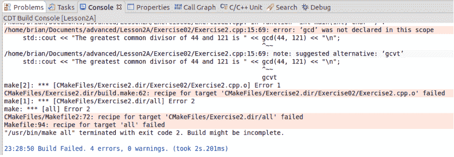

*图 2A.18：由于未定义函数导致的构建失败*

这一次，编译器不知道如何处理对 gcd() 函数的调用。在需要调用该函数的位置，编译器对它一无所知，即使它定义在同一个文件中，只是在调用之后。

+   7. 在编辑器中，将前向声明放在 main 函数定义之前。并在末尾添加一个分号 (;)：

```
```cpp
int gcd(int x, int y);
```
```

+   8. 再次点击**运行**按钮。这一次，程序编译成功，之前的输出得以恢复。

在本练习中，我们学习了如何前向声明函数，以及如何排查因函数在使用前未声明而出现的编译器错误。

在早期版本的 C 编译器中，这是可以接受的。程序会假定该函数存在并返回一个 int。函数的参数可以从调用中推断出来。然而，在现代 C++ 中情况并非如此，因为在使用函数、类、变量等之前必须先声明它们。在下一节中，我们将学习指针类型。

## 指针类型

由于起源于 C 语言，即编写优化高效的系统并直接访问硬件，C++ 允许将变量声明为指针类型。其格式如下：

```
```cpp
type-specifier* pvar = &var;
```
```

这与之前的写法相同，但有两处不同：

-   使用特殊的声明符星号 (*) 来表示名为 pvar 的变量指向内存中的一个位置或地址。
-   它使用特殊的 & 运算符（与号）进行初始化，在这种上下文中，& 告诉编译器返回 var 变量的地址。

由于 C 是一种高级语言，但具有低级访问能力，指针允许用户直接访问内存，这在希望向硬件提供输入/输出并因此控制硬件时很有帮助。指针的另一个用途是，让函数能够访问公共数据项，并省去调用函数时复制大量数据的需要，因为默认情况下是按值传递。要访问指针所指向的值，需要使用特殊的星号运算符 (*) 来**解引用**该位置：

```
int five = 5;             // declare five and initialize it

int *pvalue = &five;       // declare pvalue as pointer to int and have it
                           // point to the location of five

*pvalue = 6;               // Assign 6 into the location five.
```

下图展示了编译器如何分配内存。**pvalue** 需要内存来存储指针，而 **five** 需要内存来存储整数值 5：


**图 2A.19：指针变量的内存布局**

当通过指针访问用户自定义类型时，还有第二个特殊运算符 (->) 也用于解引用成员变量和函数。在现代 C++ 中，这些指针被称为**原始指针**，其使用方式已经发生了显著变化。在 C 和 C++ 中使用指针一直对程序员来说具有挑战性，错误地使用指针是许多问题的根源，其中最常见的是资源泄漏。资源泄漏是指程序为了使用而占用了一个资源（内存、文件句柄或其他系统资源），但在使用完后未能释放它。这些资源泄漏可能导致性能问题、程序故障，甚至系统崩溃。在现代 C++ 中，使用原始指针来管理资源的所有权现在已被弃用，因为 C++11 引入了智能指针。智能指针（在 STL 中作为类实现）现在负责进行所需的资源管理，以成为宿主系统中的“良好公民”。关于这一点的更多内容将在*第 3 章：能与应该之间的距离——对象、指针和继承*中介绍。

在前面的代码中，当声明 **pvalue** 时，编译器只分配内存来存储它将引用的内存地址。与其他变量一样，你应该始终确保指针在使用前被初始化，因为解引用未初始化的指针会导致未定义的行为。到底分配多少内存来存储指针，取决于编译器所针对的系统以及处理器支持的位数。但所有指针的大小都是相同的，无论它们指向什么类型。

指针也可以传递给函数。这允许函数访问所指向的数据，并可能修改它。考虑下面 swap 的实现：

```
void swap(int* data1, int* data2)
{
    int temp{*data1};      // Initialize temp from value pointed to by
data1
    *data1 = *data2;       // Copy data pointed to by data2 into location
                          // pointed to by data1
    *data2 = temp;         // Store the temporarily cached value from
temp
                          // into the location pointed to by data2
}
```

这展示了如何将指针声明为函数的参数，如何使用解引用运算符 * 从指针获取值，以及如何通过解引用运算符设置值。

下面的示例使用 new 运算符从宿主系统分配内存，并使用 delete 运算符将其释放回宿主系统：

```
char* name = new char[20];   // Allocate 20 chars worth of memory and
assign it

                          // to name.

    Do something with name

delete [] name;
```

在前面的代码中，第一行使用 new 运算符的数组分配形式创建了一个包含 20 个字符的数组。它调用宿主系统为我们分配 20 * sizeof(char) 字节的内存。到底分配多少内存由宿主系统决定，但保证至少为 20 * sizeof(char) 字节。如果无法分配所需内存，则会发生以下两种情况之一：

-   它将抛出异常
-   它将返回 `nullptr`。这是 C++11 中引入的一个特殊字面量。更早之前，C++ 使用 0 或 NULL 来表示无效指针。C++11 也将其变成了强类型值。

在大多数系统上，结果是第一种情况，你需要处理该异常。第二种情况可能出现在两种场景中——调用 new 的 nothrow 变体，即 `new(std::nothrow) int [250]`，或者在异常处理开销不够确定的嵌入式系统上。

最后，请注意对 delete 的调用使用了 delete 运算符的数组形式，即使用方括号 []。确保 new 和 delete 运算符使用相同的形式非常重要。当 new 用于用户自定义类型（将在下一节讨论）时，它做的不仅仅是分配内存：

```
MyClass* object = new MyClass;
```

在前面的代码中，对 new 的调用分配了足够的内存来存储 MyClass，如果成功，它接着调用构造函数来初始化数据：

```
MyClass* objects = new MyClass[12];
```

在前面的代码中，对 new 的调用分配了足够的内存来存储 12 个 MyClass 对象，如果成功，它接着调用构造函数 12 次来初始化每个对象的数据。

请注意，在前面代码片段中声明的 **object** 和 **objects** 具有**相同的类型**。严格来说，**objects** 应该是指向 MyClass 数组的指针，但它实际上是指向 MyClass 实例的指针。**objects** 指向 MyClass 数组中的第一个实例。

考虑以下代码片段：

```
void printMyClasses(MyClass* objects, size_t number)
{
    for( auto i{0U} ; i<number ; i++ ) {
        std::cout << objects[i] << "\n";
    }
}
```


```cpp
}

void process()
{
    MyClass objects[12];

    // Do something with objects
    printMyClasses(objects, sizeof(objects)/sizeof(MyClass));
}
```

在 `process()` 函数中，`objects` 的类型是“包含 12 个 `MyClass` 项的数组”，但当它被传递给 `printMyClasses()` 时，它会被编译器转换为“指向 `MyClass` 的指针”类型。这是按设计进行的（继承自 C），被称为数组衰减，并且可能是新手程序员出错的原因。我们可以尝试按如下方式声明 `printMyClasses()`：

```cpp
void printMyClasses(MyClass objects[12], size_t number);
```

这仍然会遭受数组衰减，因为编译器将参数对象更改为 `MyClass*`；在此情况下它不会保留维度信息。数组衰减就是我们需要将 `number` 传递给 `printMyClasses()` 函数的原因：这样我们才知道数组中有多少项。C++ 提供了两种处理数组衰减的机制：

- 使用迭代器将范围传递给方法。STL 容器（参见第 2B 章《No Ducks Allowed – Templates and Deduction》中的 C++ 预打包模板部分）提供 `begin()` 和 `end()` 方法，以便我们可以获取迭代器，让算法遍历数组或其一部分。

> **注意：** 对于 C++20，ISO 标准委员会正在考虑纳入一种称为 Ranges 的概念，它将允许 `begin` 和 `end` 迭代器被捕获在一个对象中。

- 使用模板（参见第 2B 章《No Ducks Allowed – Templates and Deduction》中的非类型模板参数部分）。

### 练习 3：声明和使用指针

在本练习中，我们将实现接受指针和数组作为参数的函数，并比较它们的行为，同时考虑数组衰减。让我们开始：

1. 在 Eclipse 中打开 Lesson2A 项目，然后在 Project Explorer 中展开 Lesson2A，再展开 Exercise03，双击 Exercise3.cpp 以在编辑器中打开此练习的文件。

2. 点击 Launch Configuration 下拉菜单并选择 New Launch Configuration.... 将 Exercise3 配置为以名称 Exercise3 运行。完成后，它将成为当前选定的 Launch Configuration。

3. 点击 Run 按钮。练习 3 将运行并产生以下输出：

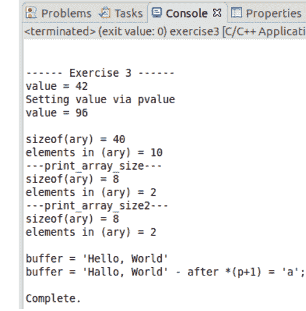

**图 2A.20：练习 3 输出**

4. 在编辑器中插入一个空白行，然后点击 Run 按钮。（通过更改文件，它将强制构建系统重新编译 Exercise3.cpp。）

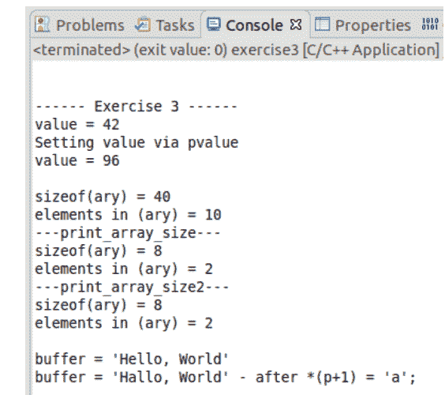

**图 2A.22：练习 3 部分输出**

`sizeof(ary)/sizeof(arg[0])` 计算应返回数组中的元素数。第一个 `elements in (ary) = 10` 是从主函数生成的，而 ary 被声明为 ary[10]，因此是正确的。`---print_array_size2---` 横幅下的 `elements in (ary) = 2` 显示了数组衰减的问题，也是编译器生成警告的原因。为什么是 2 的值？在测试 PC 上，指针占用 8 字节（64 位），而 int 仅占用 4 字节，所以我们得到 8/4 = 2。

6. 在编辑器中，定位 main() 中 ary 的声明行并将其更改为以下内容：

```cpp
int ary[15]{};
```

7. 点击 Run 按钮。如果您检查 CDT Global Build Console，您会看到错误数量仍然相同。这是数组衰减的另一个症状。假设我们有以下函数原型：

```cpp
void print_array_size2(int ary[10]);
```

您可能期望尝试传递 int ary[15] 会导致错误或至少警告，因为参数类型不匹配。正如我们之前所述，编译器将参数视为 int* ary，因此该函数也可能被声明如下：

```cpp
void print_array_size2(int* ary);
```

```cpp
if(is_valid(buffer))
    return -3;
return 0;
}
```

这类似于许多 C 库函数返回的状态码，您需要查阅手册页才知道它们的含义。在前面的代码中，-1、-2、-3 和 0 被称为魔数。您需要阅读代码才能理解每个数字的含义。现在，考虑以下版本的代码：

```cpp
FileCheckStatus check_file(const char* name)
{
    FILE* fptr{fopen(name,"r")};
    if ( fptr == nullptr)
        return FileCheckStatus::NotFound;
    char buffer[30];
    auto numberRead = fread(buffer, 1, 30, fptr);
    fclose(fptr);
    if (numberRead != 30)
        return FileCheckStatus::IncorrectSize;
    if(is_valid(buffer))
        return FileCheckStatus::InvalidContents;
    return FileCheckStatus::Good;
}
```

这使用枚举类来传达结果并将含义附加到值的名称上。函数的用户现在可以使用枚举，因为代码更容易理解和使用。因此，与状态相关的魔数已被具有描述性标题的枚举值所取代。让我们通过参考以下代码片段来了解 FileCheckStatus 的声明：

```cpp
enum FileCheckStatus            // Old-style enum declaration
{
    Good,                       // = 0 - Value defaults to 0
    NotFound,                   // = 1 - Value set to one more than previous
    IncorrectSize,              // = 2 - Value set to one more than previous
    InvalidContents,            // = 3 - Value set to one more than previous
};
```

如果我们想使用魔数中的值，那么我们将像这样声明它们：

```cpp
enum FileCheckStatus             // Old-style enum declaration
{
    Good = 0,
    NotFound = -1,
    IncorrectSize = -2,
    InvalidContents = -3,
};
```

或者，通过反转顺序，我们可以设置第一个值，编译器将完成其余部分：

```cpp
enum FileCheckStatus             // Old-style enum declaration
{
    InvalidContents = -3,          // Force to -3
    IncorrectSize,                 // set to -2(=-3+1)
    NotFound,                      // Set to -1(=-2+1)
    Good,                          // Set to  0(=-1+1)
};
```

前面的函数也可以写成如下形式：

```cpp
FileCheckStatus check_file(const char* name)
{
    FILE* fptr{fopen(name,"r")};

    if ( fptr == nullptr)
        return NotFound;

    char buffer[30];
    auto numberRead = fread(buffer, 1, 30, fptr);
    fclose(fptr);
    if (numberRead != 30)
        return IncorrectSize;
    if(is_valid(buffer))
        return InvalidContents;
    return Good;
}
```

请注意，作用域指令 **FileCheckStatus::** 在代码中缺失，但它仍然可以编译并工作。这引发了作用域的问题，我们将在 *第 2B 章《No Ducks Allowed – Templates and Deduction》* 的可见性、生命周期和访问部分详细讨论它。目前，请知道每种类型和变量都有作用域，而旧式枚举的问题在于它们的枚举数被添加到与枚举相同的范围内。假设我们有如下定义的两个枚举：

```cpp
enum Result
{
    Pass,
    Fail,
    Unknown,
};

enum Option
{
    Keep,
    Discard,
    Pass,
    Play
};
```

我们现在遇到一个问题，即 **Pass** 枚举数被定义了两次并且有两个不同的值。旧式枚举还允许我们编写对编译器有效但显然毫无意义的代码，例如以下内容：

```cpp
Option option{Keep};
Result result{Unknown};
if (option == result)
```

顾名思义，**作用域枚举** 将枚举数置于枚举名称的作用域内。此外，作用域枚举将不再隐式转换为整数（因此 if 语句将无法编译）。您仍然可以将枚举数转换为整数，但需要进行强制转换：

```cpp
int value = static_cast<int>(Option::Play);
```

### 练习 4：枚举 – 旧派和新派

在本练习中，我们将实现一个使用枚举表示预定义值的程序，并确定当它们更改为作用域枚举时所需的相应更改。让我们开始：

1. 在 Eclipse 中打开 **Lesson2A** 项目，然后在 **Project Explorer** 中展开 **Lesson2A**，再展开 **Exercise04**，双击 **Exercise4.cpp** 以在编辑器中打开此练习的文件。

2. 点击 **Launch Configuration** 下拉菜单并选择 **New Launch Configuration...**。将 **Exercise4** 配置为以名称 **Exercise4** 运行。

3. 完成后，它将成为当前选定的 Launch Configuration。

4. 点击 **Run** 按钮。练习 4 将运行并产生以下输出：

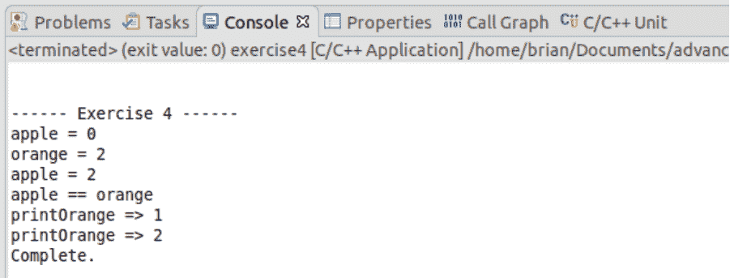

**图 2A.25：练习 4 输出**

5. 检查编辑器中的代码。目前，我们可以比较苹果和橙子。在 **printOrange()** 的定义处，将参数更改为 **Orange**：

```cpp
void printOrange(Orange orange)
```


6. 点击 Run 按钮。当出现 Errors in Workspace 对话框时，点击 Cancel：

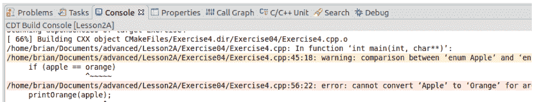

Figure 2A.26: Cannot convert error

通过更改参数类型，我们迫使编译器强制执行传递给函数的值的类型。

7. 分别通过在初始调用中传递 orange 枚举变量，并在第二次调用中传递 apple 变量，来两次调用 printOrange() 函数：

```
printOrange(orange);
printOrange(apple);
```

这表明编译器正在隐式地将 orange 和 apple 转换为 int，以便它可以调用该函数。此外，请注意关于比较 Apple 和 Orange 的警告。

8. 通过接受 int 参数来恢复 printOrange() 函数，并将 orange 枚举的定义更改为以下内容：

```
enum class Orange;
```

9. 点击 Run 按钮。当出现 Errors in Workspace 对话框时，点击 Cancel：

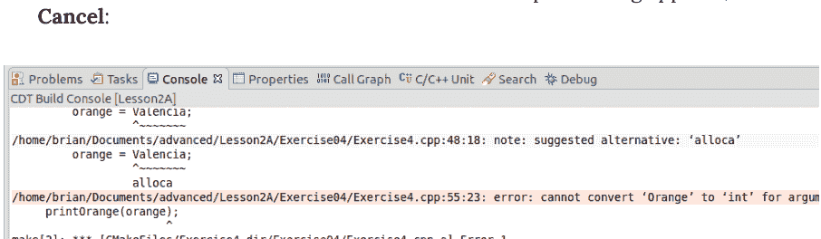

Figure 2A.27: Multiple errors for scoped enum changes

10. 找到本次构建列出的第一个错误：

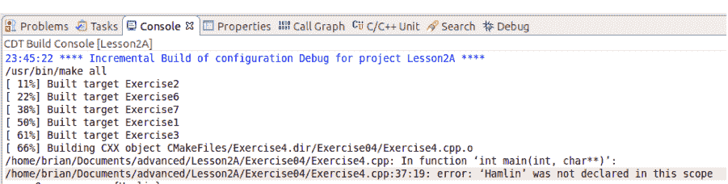

Figure 2A.28: First scoped enum error

11. 有关作用域枚举需要注意的第一件事是，当你引用枚举器时，它们必须具有作用域限定符。因此，在编辑器中，将此行更改为以下内容：

```
Orange orange{Orange::Hamlin};
```

12. 点击 Run 按钮。当出现 Errors in Workspace 对话框时，点击 Cancel。好消息 – 错误计数从 9 下降到 8。检查控制台中的错误并找到第一个错误：

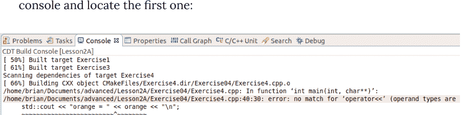

Figure 2A.29: Second scoped enum error

此错误报告说它无法找到一个插入运算符（<<）用于知道如何处理 Orange 类型的 ostream。因为这涉及基于模板的类（我们稍后会讨论），错误消息变得非常冗长。花一点时间查看从此错误到下一个错误（红色行）出现的所有消息。它向你展示了编译器试图做什么以便能够编译该行。

13. 将指示的行更改为以下内容：

```
std::cout << "orange = " << static_cast<int>(orange) << "\n";
```

14. 点击 **Run** 按钮。当出现 Errors in Workspace 对话框时，点击 **Cancel**。好消息 – 错误计数从 8 下降到 6。检查控制台中的错误并找到第一个错误：

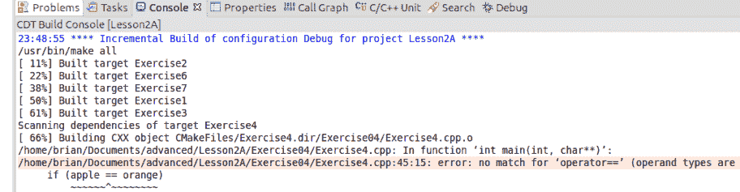

Figure 2A.30: Third scoped enum error

此错误报告（终于）你不能比较苹果和橘子。此时，我们决定程序试图做一些毫无意义的事情，并且没有必要尝试修复其余部分。我们可以通过再次将其转换为 int 来修复此错误，但我们也需要为下一个错误进行转换。最终的错误将是 Valencia 缺少 Orange:: 作用域限定符。

15. 将文件再次编译通过并使 orange 成为作用域枚举，作为你的练习留作练习。

在这个练习中，我们发现作用域枚举提高了 C++ 的强类型检查，如果我们希望将其用作积分值，则需要对其进行转换，而与非作用域枚举不同，非作用域枚举会被隐式转换。

## Troubleshooting Compiler Errors

正如前面的练习所示，编译器可以从一个错误生成非常大量的错误和警告消息。这就是为什么建议找到第一个错误并先修复它的原因。在 IDE 中开发或使用能够着色错误代码的构建系统可以使这变得更容易。

## Structures and Classes

枚举是用户定义类型的第一个，但它们并没有真正扩展语言，以便我们在适当的抽象级别上表达我们问题的解决方案。结构体和类则允许我们捕获和分组数据，然后将方法关联到以一致且有意义的方式操作该数据。

如果我们考虑两个矩阵 A（m x n）和 B（n x p）的乘法，结果为矩阵 C（m x p），那么 C 的第 i 行第 j 列的方程如下：

cᵢⱼ = Σₖ₌₁ⁿ aᵢₖ bₖⱼ

Figure 2A.31: Equation of ith row and jth column

如果我们每次希望乘以两个矩阵时都必须编写它，我们最终会得到许多嵌套的 for 循环。但如果我们可以将矩阵抽象为一个类，那么我们就可以像表达两个整数或两个浮点数的乘法一样简单地表达它：

```
Matrix a;

Matrix b;

// Code to initialize the matrices

auto c = a * b;
```

这就是面向对象设计的美妙之处 – 数据封装和概念的抽象以我们能够轻松理解程序试图实现什么而不被细节淹没的水平来解释。一旦我们确定矩阵乘法已正确实现，那么我们就可以自由地在更高级别上专注于解决我们的问题。

下面讨论的内容指的是类，但它同样适用于结构体，并且在很大程度上适用于联合体。我们将在学习如何定义和使用类之后概述类、结构体和联合体之间的差异。

### Fraction Class

为了向你展示如何定义和使用类，我们将致力于开发 Fraction 类来实现有理数。定义后，我们可以像使用任何其他内置类型一样使用 Fraction（加、减、乘、除）而无需担心细节 – 这就是抽象。我们现在可以只在更高级别，即抽象级别上思考和推理分数。

Fraction 类将执行以下操作：

- 包含两个整数成员变量，m_numerator 和 m_denominator
- 提供方法来复制自身、分配给它、乘法、除法、加法和减法
- 提供一个方法将输出写入输出流

为了实现上述目标，我们有以下定义：

Addition  a/b + c/d = (a.d + b.c)/(b.d)  Multiplication  a/b × c/d = (a.c)/(b.d)
Subtraction  a/b - c/d = (a.d - b.c)/(b.d)  Division  a/b ÷ c/d = a/b × d/c = (a.d)/(b.c)

Figure 2A.32: Definitions of operations

此外，我们执行的操作需要通过将其简化为最低项来规范化分数。为此，分子和分母都除以它们的最大公约数（GCD）。

## Constructors, Initialization, and Destructors

类定义，如 C++ 代码中表达的那样，是用于在内存中创建对象并通过其方法操作对象的模式。我们需要做的第一件事是告诉编译器我们希望声明一个新类型 – 一个类。要声明 Fraction 类，我们从以下内容开始：

```
class Fraction
{
};
```

我们将其放在头文件 Fraction.h 中，因为我们希望在代码的其他区域重用此类规范。

接下来我们需要做的是引入要在类中存储的数据，在本例中为 m_numerator 和 m_denominator。它们都是 int 类型：

```
class Fraction
{
    int m_numerator;
    int m_denominator;
};
```

我们现在声明了要存储的数据，并为它们命名，任何熟悉数学的人都会理解每个成员变量存储的内容：

fraction = numerator / denominator

Figure 2A.33: Formula of fraction

首先，默认构造函数是一个特殊的成员函数。它是许多可能的构造函数之一，其中三个被认为是特殊成员函数。构造函数可以用零个、一个或多个参数声明，就像任何其他函数一样，但它们不指定返回类型。构造函数具有初始化所有成员变量以将对象置于良好定义状态的特殊目的。如果成员变量本身是一个类，则可能不需要指定如何初始化变量。如果成员变量是内置类型，则我们需要为其提供初始值。

### Class Special Member Functions

当我们定义一个新类型（结构体或类）时，编译器将为我们创建多达六个（6 个）特殊成员函数：

- **Default Constructor** (`Fraction::Fraction()`): 这是在未提供参数时调用的（例如在前一节中）。这可以通过为构造函数没有参数列表或为所有参数定义默认值来实现，例如 `Fraction(int numerator=0, denominator=1)`。编译器提供一个 **隐式内联** 默认构造函数，该构造函数执行成员变量的默认初始化 – 对于内置类型，这意味着不执行任何操作。
- **Destructor** (`Fraction::~Fraction()`): 这是一个在对象生命周期结束时调用的特殊成员函数。其目的是释放对象在其生命周期期间分配并保留的任何资源。编译器提供一个 **公共内联** 成员函数，该函数调用成员变量的析构函数。
- **Copy Constructor** (`Fraction::Fraction(const Fraction&)`): 这是另一个构造函数，其中第一个参数是 `Fraction&` 的形式并且没有其他参数，或者其余参数具有默认值。第一个参数的形式是 `Fraction&, const Fraction&, volatile Fraction&,` 或 `const volatile Fraction&` 之一。我们稍后会处理 `const`，但在本书中不会处理 `volatile`。编译器提供一个 **非显式公共内联** 成员函数，通常形式为 `Fraction::Fraction(const Fraction&)`，它按初始化顺序复制每个成员变量。
- **Copy Assignment** (`Fraction& Fraction::operator=(Fraction&)`): 这是一个名称为 `operator=` 的成员函数，第一个参数是值或类的任何引用类型，在本例中为 `Fraction, Fraction&, const Fraction&, volatile Fraction&,` 或 `const volatile Fraction&`。编译器提供一个 **公共内联** 成员函数，通常形式为 `Fraction::Fraction(const Fraction&)`，它按初始化顺序复制每个成员变量。


-   **移动构造函数**（`Fraction::Fraction(Fraction&&)`）：这是C++11中引入的一种新类型的构造函数，其第一个参数是**Fraction&&**的一种形式，且没有其他参数，或者其余参数都有默认值。第一个参数的形式可以是**Fraction&&**、**const Fraction&&**、**volatile Fraction&&**或**const volatile Fraction&&**。编译器会提供一个**非显式公有内联**（non-explicit public inline）成员函数，通常形式为**Fraction::Fraction(Fraction&&)**，它按初始化顺序移动每个成员变量。

-   **移动赋值运算符**（`Fraction& Fraction::operator=(Fraction&&)`）：这是C++11中引入的一种新类型的赋值运算符，是一个名为**operator=**的成员函数，其第一个参数可以是移动构造函数所允许的任何形式。编译器会提供一个**公有内联**（public inline）成员函数，通常形式为**Fraction::operator=(Fraction&&)**，它按初始化顺序移动每个成员变量。

除默认构造函数外，这些函数负责管理该类所拥有的资源——即如何复制/移动它们以及如何处置它们。另一方面，默认构造函数更像其他接受值的构造函数——它只负责初始化资源。

我们可以声明这些特殊函数中的任意一个，强制它们为默认版本（即让编译器生成默认版本），或强制它们不被创建。此外，还有一些规则决定了在其他特殊函数存在时，这些函数何时会被自动生成。前四个函数在概念上相对简单，但两个“移动”特殊成员函数需要额外说明。我们将在第3章《能与应该之间的距离——对象、指针与继承》中详细讨论所谓的移动语义，但现在只需知道它本质上正如其名——将某个东西从一个对象移动到另一个对象。

### 隐式构造函数与显式构造函数

前述内容提到了编译器生成隐式或非显式构造函数。如果存在一个可以用一个参数调用的构造函数，例如复制构造函数或移动构造函数，那么在默认情况下，编译器允许在必要时调用它，以便将一种类型转换为另一种类型，从而使表达式、函数调用或赋值能够被编码。但这并不总是我们所期望的行为，我们可能希望阻止这种隐式转换，并确保如果类的用户确实需要这种转换，他们必须在程序中显式写出来。为此，我们在构造函数声明前加上**explicit**关键字，如下所示：

```
explicit Fraction(int numerator, int denominator = 1);
```

explicit关键字也可以应用于其他运算符，这些运算符可能会被编译器用于类型转换。

### 类的特殊成员函数——编译器生成规则

首先，如果我们声明了任何其他形式的构造函数——默认、复制、移动或用户自定义的构造函数，**默认构造函数**将不会被生成。其他特殊成员函数都不会影响它的生成。

其次，如果声明了析构函数，**析构函数**将不会被生成。其他特殊成员函数都不会影响它的生成。

其他四个特殊函数的生成取决于析构函数或其他特殊函数是否被声明，如下表所示：

| 如果用户声明了 | 复制构造函数 | 复制赋值运算符 | 移动构造函数 | 移动赋值运算符 |
|---|---|---|---|---|
| 复制构造函数 | 否——用户已定义 | 是 | 否 | 否 |
| 复制赋值运算符 | 是 | 否——用户已定义 | 否 | 否 |
| 移动构造函数 | 已删除 | 已删除 | 否——用户已定义 | 否 |
| 移动赋值运算符 | 已删除 | 已删除 | 否 | 否——用户已定义 |
| 析构函数 | 是 | 是 | 否 | 否 |

*图2A.34：特殊成员函数生成规则*

### 默认化与删除特殊成员函数

在C++11之前，如果我们想阻止复制构造函数或复制赋值成员函数被使用，就必须将函数声明为私有，并且不提供函数定义：

```
class Fraction
{
public:
    Fraction();

private:
    Fraction(const Fraction&);
    Fraction& operator=(const Fraction&);
};
```

通过这种方式，我们确保如果有人试图从类外部访问复制构造函数或复制赋值运算符，编译器就会生成错误，指出该函数不可访问。但这仍会声明这些函数，并且它们可以从类内部访问。这是一种有效但并不完美的手段，用来禁止这些特殊成员函数被使用。

但我们可以做得更好，因为C++11引入了两种新的声明形式，允许我们覆盖上述规则中定义的编译器默认行为。

首先，我们可以通过使用`= delete`后缀来声明该方法，从而强制编译器不生成它，如下所示：

```
Fraction(const Fraction&) = delete;
```

> **注意**
>
> 如果参数未被使用，我们可以省略其名称。这对任何函数或成员函数都适用。事实上，根据编译器设置的警告级别，它甚至可能生成一个警告，提示该参数未被使用。

或者，我们可以通过使用`= default`后缀，强制编译器生成特殊成员函数的默认实现，如下所示：

```
Fraction(const Fraction&) = default;
```

如果这只是函数的声明，我们也可以省略参数的名称。不过，良好的实践要求我们为参数命名以表明其用途。这样，我们类的用户就无需查看函数调用的实现。

> **注意**
>
> 就前述规则而言，使用default后缀声明的特殊成员函数被视为用户自定义成员函数。

### 三/五法则和零法则

正如我们之前讨论的，除默认构造函数外，特殊成员函数都涉及管理该类所拥有的资源的语义——即如何复制/移动它们以及如何处置它们。这引出了C++社区中关于处理特殊函数的两个“法则”。

在C++11之前，有三法则，它涉及复制构造函数、复制赋值运算符和析构函数。它基本上指出，我们需要实现这三者中的某一个，因为所封装资源的管理并非微不足道。

随着C++11中移动构造函数和移动赋值运算符的引入，这一法则扩展为五法则。法则的本质并没有改变，只是特殊成员函数的数量增加到了五个。记住编译器生成的规则，还有一个额外的理由来确保所有五个特殊方法都被实现（或通过`= default`强制实现），那就是：如果编译器无法访问移动语义函数，它将尝试使用复制语义函数，而这可能并不是我们想要的。

> **注意**
>
> 更多细节，请参阅C++核心指南中的“C.ctor：构造函数、赋值和析构函数”一节，可在此处找到：http://isocpp.github.io/CppCoreGuidelines/CppCoreGuidelines。

## 构造函数——初始化对象

构造函数的主要任务是将对象置于稳定状态，以便通过其成员函数对对象执行或由对象执行的任何操作都能产生一致且定义明确的行为。虽然前述说法对复制构造函数和移动构造函数同样适用，但它们是经由不同的语义（从另一个对象复制或移动）来实现这一点的。

我们有四种不同的机制可用于控制对象的初始状态。C++对此类情况下使用哪种初始化有大量规则。我们不会深入讨论C++标准的默认初始化、零初始化、值初始化、常量初始化等细节。只需知道，最明智的做法是明确地对变量进行初始化。


# 禁止鸭子——类型与推导

**第一种**也是最不推荐的初始化机制是在构造函数体内给成员变量赋值，如下所示：

```
Fraction::Fraction()
{
    this->m_numerator = 0;
    this->m_denominator = 1;
}
```

```
Fraction::Fraction(int numerator, int denominator)
{
    m_numerator = numerator;
    m_denominator = denominator;
}
```

可以清楚看出用于初始化变量的值。严格来说，这并不算类的初始化——根据标准，构造函数体被调用时初始化才算完成。这种写法易于维护，尤其是在这个类中。对于拥有多个构造函数和许多成员变量的较大类来说，这可能成为维护问题。如果你修改一个构造函数，就需要修改所有构造函数。此外，如果成员变量是引用类型（我们稍后会讨论），则无法在构造函数体内进行初始化。

默认构造函数使用 **this** 指针。每个成员函数，包括构造函数和析构函数，在调用时都带有一个隐式参数（即使从未声明）——即 **this** 指针。**this** 指向对象的当前实例。`->` 运算符是另一种解引用运算符，在这里是简写形式，即 **(*this).m_numerator**。**this->** 的使用是可选的，可以省略。其他语言（如 Python）要求声明并使用隐式指针/引用（Python 中的惯例是将其命名为 self）。

**第二种**机制是使用成员初始化列表，但使用起来有一个注意事项。对于我们的 Fraction 类，我们有以下代码：

```
Fraction::Fraction() : m_numerator(0), m_denominator(1)
{
}
```

```
Fraction::Fraction(int numerator, int denominator) :
    m_numerator(numerator), m_denominator(denominator)
{
}
```

在冒号（`:`）之后、左花括号（`{`）之前的代码段，即 `m_numerator(0), m_denominator(1)` 和 `m_numerator(numerator), m_denominator(denominator)`，就是成员初始化列表。我们可以在成员初始化列表中初始化引用类型。

> **成员初始化列表的顺序**
>
> 无论你在成员初始化列表中按什么顺序放置成员，编译器都会按照成员在类中声明的顺序来初始化它们。

**第三种也是推荐使用**的初始化方式是在 C++11 中引入的默认成员初始化。我们可以在声明变量时通过赋值或花括号初始化器来定义默认初始值：

```
class Fraction
{
public:
    int m_numerator = 0;    // equals initializer
    int m_denominator{1};   // brace initializer
};
```

如果构造函数没有定义成员变量的初始值，那么将使用此默认值来初始化变量。这样做的优点是确保所有构造函数产生相同的初始化结果，除非在构造函数的定义中显式修改了它们。

C++11 还引入了第四种初始化风格，称为构造函数委托。它是成员初始化列表的一种变体，不过不是列出成员变量及其初始值，而是调用另一个构造函数。下面的例子是人为构造的，你不会用这种方式编写类，但它展示了构造函数委托的语法：

```
Fraction::Fraction(int numerator) : m_numerator(numerator), m_denominator(1)
{
}
```

```
Fraction::Fraction(int numerator, int denominator) : Fraction(numerator)
{
    auto factor = std::gcd(numerator, denominator);
    m_numerator /= factor;
    m_denominator = denominator / factor;
}
```

你从带两个参数的构造函数中调用单个参数的构造函数。

### 练习5：声明并初始化分数

在本练习中，我们将使用可用的不同技术来实现类成员初始化，包括构造函数委托。让我们开始吧：

- 1. 在 Eclipse 中打开 Lesson2A 项目，然后在 Project Explorer 中展开 Lesson2A，接着展开 Exercise05，并双击 Exercise5.cpp 在编辑器中打开本练习的文件。
- 2. 点击 Launch Configuration 下拉菜单，选择 New Launch Configuration...。将 Exercise5 配置为以名称 Exercise5 运行。
- 3. 完成上述操作后，它将成为当前选中的 Launch Configuration。
- 4. 点击 Run 按钮。练习5将运行，并产生类似于以下输出的结果：

  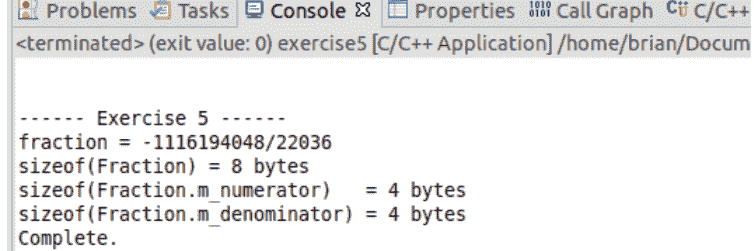

  图 2A.35：练习5的典型输出

  报告出的分数值是因为完全没有初始化成员变量。如果你再次运行，很可能会得到不同的分数。

- 5. 多次点击 Run 按钮。你会看到分数发生了变化。

- 10. 点击 **Run** 按钮并观察输出：

  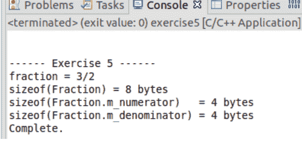

  图 2A.37：构造函数委托示例

在本练习中，我们使用成员初始化列表和构造函数委托实现了成员变量初始化。我们将在练习7“为 Fraction 类添加运算符”中再次回到分数。

## 值与引用及 const

到目前为止，我们只处理了值类型，也就是说，变量保存的是对象的值。指针保存的是我们感兴趣的对象的值（即对象的地址）（或者 nullptr）。但这可能导致效率低下以及资源管理方面的问题。我们将在本文中讨论如何解决效率低下的问题，但资源管理问题将在第3章“能与应之间的距离——对象、指针和继承”中处理。

考虑下面的问题。我们有一个 10×10 的 double 类型矩阵，想为它编写一个求逆函数。该类声明如下：

```
class Matrix10x10
{
private:
    double m_data[10][10];
};
```

如果取 `sizeof(Matrix10x10)`，我们会得到 `sizeof(double)` x 10 x 10 = 800 字节。现在，如果要为其实现一个矩阵求逆函数，其签名可能如下所示：

```
Matrix10x10 invert(Matrix10x10 lhs);
```

```
Matrix10x10 mat;

// set up mat

Matrix10x10 inv = invert(mat);
```

首先，这意味着编译器需要将 `mat` 保存的值传递给 `invert()` 函数，并将这 800 字节复制到栈上。然后，该函数执行求逆所需的操作（如 L-U 分解、计算行列式——无论实现者选择哪种方法），再将 800 字节的结果复制回 `inv` 变量。在栈上传递大值从来都不是一个好主意，原因有二：

- 栈是宿主操作系统分配给程序的有限资源。
- 在系统中复制大值的效率很低。

这种方法称为按值传递。也就是说，我们希望处理的条目的值会被复制到函数中。

在 C（以及 C++）中，这种限制通过指针的使用得以解决。前面的代码可能会变成下面这样：

```
void invert(Matrix10x10* src, Matrix10x10* inv);
```

```
Matrix10x10 mat;

Matrix10x10 inv;

// set up mat

invert(&mat, &inv);
```

在这里，我们只需将 src 和逆结果目标的地址作为两个指针传递（这只需要少量字节）。不幸的是，这会导致函数内部的代码在每次使用 src 或 inv 时都必须使用解引用运算符 (*)，从而使代码更难阅读。此外，指针的使用也引发了许多问题。

C++ 引入了一种更好的方法——变量别名或引用。引用类型使用与号（&）运算符声明。因此，我们可以将 invert 方法声明如下：

```
void invert(Matrix10x10& src, Matrix10x10& inv);
```

```
Matrix10x10 mat;
Matrix10x10 inv;
// set up mat
invert(mat, inv);
```

注意，调用该方法时不需要特殊运算符来传递引用。从编译器的角度来看，引用仍然是指针，但有一个限制——它不能持有 nullptr。从程序员的角度来看，引用让我们能够更清晰地思考代码，而不必担心在正确的位置使用正确的解引用运算符。这种方法称为按引用传递。

我们看到了传递给复制构造函数和复制赋值方法的引用。当引用用于对应的移动操作时，其类型称为右值引用运算符，这将在第3章“能与应之间的距离——对象、指针和继承”中解释。

按值传递的一个优点是，我们不会无意中修改传递给方法的变量的值。现在，如果按引用传递，我们就无法再保证所调用的方法不会修改原始变量。为了解决这个问题，我们可以将 invert 方法的签名改为如下：

```
void invert(const Matrix10x10& src, Matrix10x10& inv);
```

const 关键字告诉编译器，在处理 invert() 函数的定义时，为 src 所引用值的任何部分赋新值都是非法的。如果该方法确实试图修改 src，编译器将生成错误。

在“指定类型——变量”一节中，我们发现 `auto title` 的声明导致 title 具有 `const char *` 类型。现在，我们可以解释 const 部分了。

title 变量是指向常量字符的指针。换句话说，我们不能更改所指向内存中存储的数据值。因此，我们不能执行以下操作：

```
*title = 's';
```


通过检查代码并将其与输出进行比较，我们会发现 **rvalue** 变量允许我们操作（从中读取和写入）存储在 **value** 变量中的数据。我们有一个对 **value** 变量的引用，**rvalue**。我们还可以看到，**a** 和 **b** 变量中存储的值已通过 **swap()** 函数交换。

- 5. 在编辑器中，修改 swap 的函数定义：

```
void swap(const int& lhs, const int& rhs)
```

- 6. 单击 **Run** 按钮。当出现 Errors in Workspace 对话框时，单击 **Cancel**。编译器报告的第一个错误如下所示：

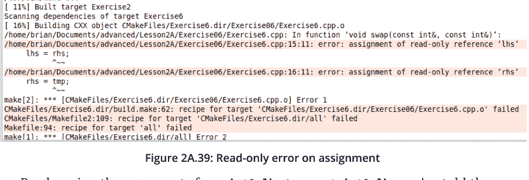

图 2A.39：赋值时只读错误

通过将参数从 **int& lhs** 改为 **const int& lhs**，我们告诉编译器这些参数不应在此函数内部被更改。而由于我们在函数中对 lhs 进行了赋值，编译器会生成关于 lhs 为只读的错误并终止。

## 实现标准运算符

要像内置类一样使用分数，我们需要让它们能够与标准数学运算符（+、-、*、/）及其赋值对应运算符（+=、-=、*=、/=）一起工作。如果你不熟悉赋值运算符，那么请考虑以下两个表达式——它们产生相同的输出：

```
a = a + b;
a += b;
```

为 Fraction 声明这两个运算符的语法如下：

```
// 成员函数声明
Fraction& operator+=(const Fraction& rhs);
Fraction operator+(const Fraction& rhs) const;
```

```
// operator+ 的普通函数声明
Fraction operator+(const Fraction& lhs, const Fraction& rhs);
```

由于 operator+= 方法会修改左值变量的内容（将 a 加到 b 上然后再存回 a），因此建议将其实现为成员函数。在这种情况下，由于我们没有创建新值，我们只需返回对现有 lhs 的引用即可。

另一方面，operator+ 方法不应修改 lhs 也不应修改 rhs，而应返回一个新对象。实现者可以自由地将其实现为成员函数或自由函数。上述代码中展示了这两种方式，但只能存在其中一种。有趣的是要注意成员函数实现末尾的 const 关键字。这告诉编译器在调用此成员函数时，它不会修改对象的内部状态。虽然两种方法都有效，但如果可能，operator+ 应该实现为普通函数，在类之外。

对于其他运算符 -（减法）、*（乘法）和 /（除法）也可以使用相同的方法。上述方法实现了标准数学运算符的语义，并使我们的类型像内置类型一样工作。

### 实现输出流运算符（<<）

C++ 将输入/输出（I/O）抽象为标准库中的流类层次结构（我们将在第 2B 章 No Ducks Allowed - Templates and Deduction 中讨论）。在练习 5，Declaring and Initializing Fractions 中，我们看到可以将分数插入输出流如下：

```
std::cout << "fraction = " << fraction.getNumerator() << "/" << fraction.getDenominator() << "\n";
```

到目前为止，对于我们的 Fraction 类，我们是通过使用 getNumerator() 和 getDenominator() 方法从外部访问数据值来写出分子和分母值，但有更好的方法。作为使我们的类成为 C++ 中的一等公民的一部分，在有意义的地方，我们应该重载 I/O 运算符。在本章中，我们只会查看输出运算符 <<，也称为插入运算符。这样，我们就可以用更简洁的版本替换之前的代码：

```
std::cout << "fraction = " << fraction << "\n";
```

我们可以将运算符重载为友元函数或普通函数（如果类提供了我们需要插入的数据的 getter 函数）。为我们的目的，我们将其定义为普通函数：

```
inline std::ostream& operator<< (std::ostream &out, const Fraction &rhs)
{
    out << rhs.getNumerator() << " / " << rhs.getDenominator();
    return out;
}
```

## 组织我们的代码

在深入到实现运算符并将我们的 Fraction 变成 C++ 世界中的完整类型的练习之前，我们需要简要讨论一下我们将类的各个部分——声明和定义——放在哪里。声明是我们类的蓝图，指示它需要什么数据存储以及它将实现的方法。定义是每个方法的实际实现细节。

在 Java 和 C# 等语言中，声明和定义是同一个东西，它们必须存在于一个文件中（Java）或跨多个文件（C# 局部类）。在 C++ 中，根据类的情况以及你希望向其他类公开多少内容，声明 必须 出现在头文件中（该头文件可以 #include 到其他文件中使用），而定义可以出现在三个地方之一——内联在定义中、内联在与定义相同的源文件中，或在单独的实现文件中。

头文件通常以 .hpp 扩展名命名，而实现文件通常是 *.cpp 或 *.cxx。实现文件也称为翻译单元。通过将函数定义为 inline，我们允许编译器以一种方式优化代码，使得该函数可能甚至不存在于最终程序中——它已将我们放入函数中的步骤替换为我们从中调用函数的位置。

### 练习 7：为 Fraction 类添加运算符

在本练习中，我们的目标是使用单元测试来实现 Fraction 类中的运算符来开发功能。这使我们的 Fraction 类成为真正的类型。让我们开始吧：

- 1. 在 Eclipse 中打开 **Lesson2A** 项目，然后在 **Project Explorer** 中展开 **Lesson2A**，然后展开 **Exercise07**，双击 **Exercise7.cpp** 以在编辑器中打开此练习的文件。
- 2. 单击 **Launch Configuration** 下拉菜单并选择 **New Launch Configuration....** 将 Exercise7 配置为以名称 Exercise7 运行。
- 3. 完成后，它将成为当前选定的 Launch Configuration。
- 4. 我们还需要配置一个单元测试。在 Eclipse 中，单击菜单项 **Run | Run Configurations...**，在左侧右键单击 **C/C++ Unit**，并选择 **New Configuration**。
- 5. 将名称从 **Lesson2A Debug** 改为 **Exercise7 Tests**。
- 6. 在 **C/C++ Application** 下，选择 **Search Project** 选项并在新对话框中选择 **tests**。
- 7. 接下来，转到 **C/C++ Testing** 选项卡并在下拉菜单中选择 **Google Test Runner**。单击对话框底部的 **Apply**，然后单击测试的 **Run** 选项，我们必须首次运行它：

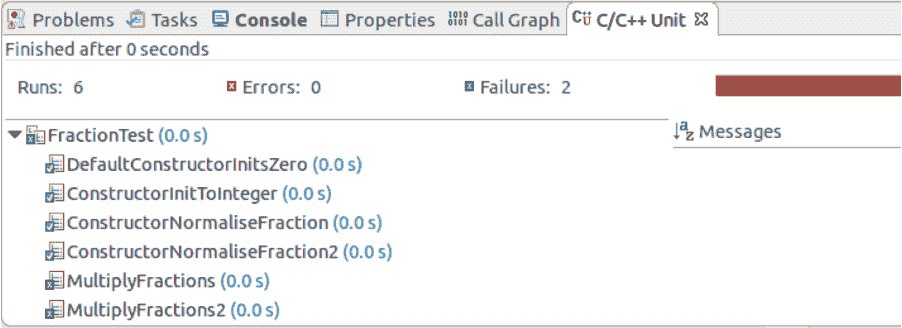

图 2A.40：失败的测试 – 乘法

- 8. 在编辑器中打开 **Fraction.cpp** 文件并找到 **operator*=** 函数。用以下代码更新它：

```
Fraction& Fraction::operator*=(const Fraction& rhs)
{
    Fraction tmp(m_numerator*rhs.m_numerator, m_denominator*rhs.m_denominator);
    *this = tmp;
    return *this;
}
```

- 9. 单击 **Run** 按钮重新运行测试。这次，所有测试都通过了：

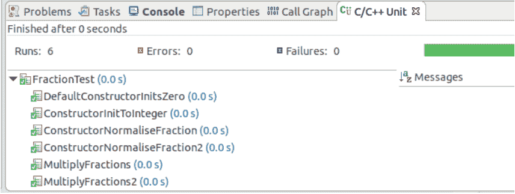

图 2A.41：通过的测试

- 10. 在你的 IDE 中，打开 **tests/FractionTests.cpp** 文件并找到那两个失败的测试。其中一个测试了 **operator*=()**，另一个测试了 **operator*()**。修复 **operator*=()** 如何修复了 **operator*()**？如果你在编辑器中打开 Fraction.hpp，你会发现 **operator*()** 函数是通过调用 **operator*=()** 为你实现的，即它被标记为 inline，并且是普通函数而不是成员函数。通常，重载这些运算符时应采用这种方法——修改调用它的对象的那个是成员函数，而必须生成新值的那个是调用成员函数的普通函数。

- 11. 在编辑器中打开 **Fraction.hpp** 并更改文件顶部附近的行，使其如下所示：

```
#define EXERCISE7_STEP 11
```


12. 点击 Run 按钮重新运行测试——这次，我们添加了两个失败的测试——AddFractions 和 AddFractions2：

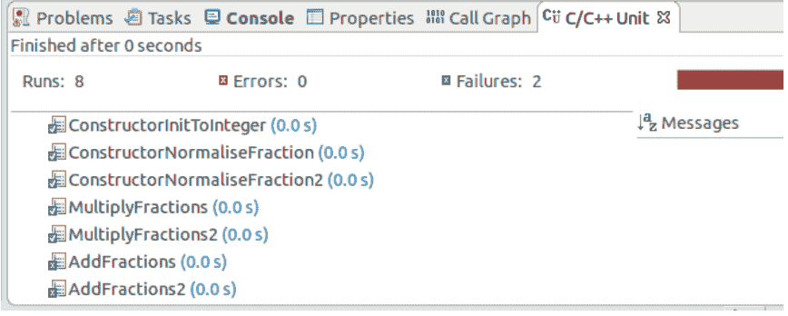

图 2A.42：额外失败的测试

13. 在 Fraction.cpp 文件中定位 operator+= 函数。

14. 对该函数进行必要的修改并点击 Run 按钮重新运行测试，直到测试通过。查看前面给出的定义其操作的等式，并查看 operator*=( ) 是如何实现的。

15. 在编辑器中打开 Fraction.hpp 并将文件顶部附近的行更改为如下所示：

```
#define EXERCISE7_STEP 15
```

16. 点击 Run 按钮重新运行测试——这次，我们添加了两个失败的测试——SubtractFractions 和 SubtractFractions2。

17. 在 Fraction.cpp 文件中定位 operator-= 函数。

18. 对该函数进行必要的修改并点击 Run 按钮重新运行测试，直到测试通过。

19. 在编辑器中打开 Fraction.hpp 并将文件顶部附近的行更改为如下所示：

```
#define EXERCISE7_STEP 19
```

20. 点击 Run 按钮重新运行测试——这次，我们添加了两个失败的测试——DivideFractions 和 DivideFractions2。

21. 在 **Fraction.cpp** 文件中定位 **operator/=** 函数。

22. 对该函数进行必要的修改并点击 **Run** 按钮重新运行测试，直到测试通过。

23. 在编辑器中打开 **Fraction.hpp** 并将文件顶部附近的行更改为如下所示：

```
#define EXERCISE7_STEP 23
```

24. 点击 **Run** 按钮重新运行测试——这次，我们添加了一个失败的测试——InsertOperator。

25. 在 Fraction.hpp 文件中定位 **operator<<** 函数。

26. 对该函数进行必要的修改并点击 **Run** 按钮重新运行测试，直到测试通过。

27. 从 **Launch Configuration** 中选择 **Exercise7** 并点击 **Run** 按钮。这将产生以下输出：

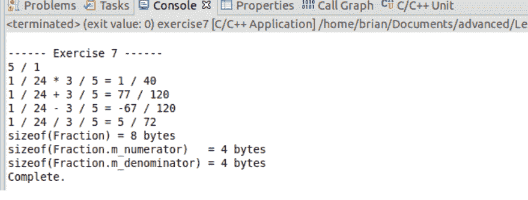

图 2A.43：功能完整的 Fraction 类

至此，我们暂时完成了 **Fraction** 类的实现。我们将在第 3 章 *The Distance Between Can and Should – Objects, Pointers, and Inheritance* 中讨论异常时再次回到它，以便处理分数中的非法值（分母为 0）。

## 函数重载

C++ 支持一种称为函数重载的特性，即两个或多个函数具有相同的名称，但其参数列表不同。参数的数量可以相同，但至少有一个参数类型必须不同。或者，它们可能具有不同的参数数量。因此，多个函数的函数原型是不同的。然而，两个函数不能具有相同的函数名、相同的参数类型，而返回类型不同。以下是重载的示例：

```
std::ostream& print(std::ostream& os, int value) {
    os << value << " is an int\n";
    return os;
}

std::ostream& print(std::ostream& os, float value) {
    os << value << " is a single precision float\n";
    return os;
}

std::ostream& print(std::ostream& os, double value) {
    os << value << " is a double precision float \n";
    return os;
}

// The next function causes the compiler to generate an error
// as it only differs by return type.
void print(std::ostream& os, double value) {
    os << value << " is a double precision float!\n";
}
```

到目前为止，**Fraction** 上的多个构造函数和重载的算术运算符都是编译器在遇到这些函数时必须引用的重载函数的例子。考虑以下代码：

```
int main(int argc, char** argv) {
    print(42);
}
```

当编译器遇到行 **print(42)** 时，它需要确定调用之前定义的哪个函数，因此它执行以下过程（高度简化）：

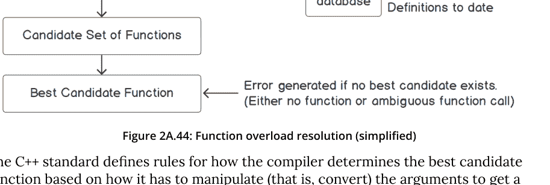

图 2A.44：函数重载解析（简化）

C++ 标准定义了编译器根据如何操作（即转换）参数以获得匹配来确定最佳候选函数的规则。如果不需要转换，则该函数是最好的匹配。

## 类、结构体和联合体

当你定义一个类且未指定访问修饰符（public、protected、private）时，所有成员默认为私有：

```
class Fraction
{
    Fraction() {};        // All of these are private
    int m_numerator;
    int m_denominator;
};
```

### 活动 1：图形处理

在现代计算环境中，矩阵被广泛用于解决各种问题——求解联立方程、分析电力电网或电路、对图形渲染中的对象进行操作，以及实现机器学习。在图形世界中，无论是二维（2D）还是三维（3D），你想对对象执行的所有操作都可以通过矩阵乘法来完成。你的团队被要求开发点、变换矩阵的表示形式，以及可能对其执行的操作。按照以下步骤实现：

- 1. 从 **Lesson2A/Activity01** 文件夹加载准备好的项目。
- 2. 创建一个名为 **Point3d** 的类，可以默认构造为原点，或使用包含三个或四个值的初始化列表构造（数据直接存储在类中）。
- 3. 创建一个名为 **Matrix3d** 的类，可以默认构造为单位矩阵，或使用嵌套初始化列表提供所有值（数据直接存储在类中）。
- 4. 在 **Point3d** 上重载 **operator()**，使其接受 **(index)** 参数以返回 **x(0)、y(1)、z(2) 和 w(3)** 处的值。
- 5. 在 **Matrix3d** 上重载 **operator()** 以接受 **(row, col)** 参数从而返回该值。
- 6. 添加单元测试以验证上述所有功能。
- 7. 向 **Matrix3d** 类添加 **operator*=(const Matrix3d&)** 和 **operator==(const Matrix3d&)**，以及它们的单元测试。
- 8. 添加用于乘以两个 **Matrix3d** 对象和一个 **Matrix3d** 对象与一个 **Point3d** 对象的自由函数，并附带单元测试。
- 9. 添加用于创建平移、缩放和绕 x、y、z 轴旋转的矩阵的独立方法及其单元测试。

实现上述步骤后，预期输出如下：

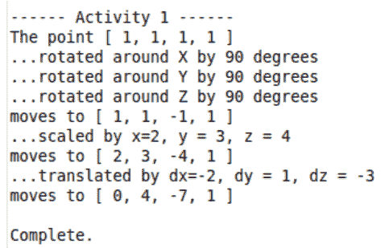

图 2A.45：成功运行活动程序

对于本次活动，我们不会担心索引越界的可能性。我们将在 *第 3 章，The Distance Between Can and Should – Objects, Pointers, and Inheritance* 中讨论这个问题。单位矩阵是一个方矩阵（在我们的例子中为 4 x 4），其中对角线上的所有值都设为 1，所有其他值都为 0。

在处理 3D 图形时，我们对点（顶点）和变换使用增广矩阵，以便所有变换（平移、缩放、旋转）都可以通过乘法实现。

一个 **n × m** 矩阵是 n 行 m 个数字的数组。例如，一个 **2 x 3** 矩阵可能如下所示：

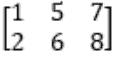

图 2A.46：2x3 矩阵

三维中的一个顶点可以表示为 **三元组 (x, y, z)**。然而，我们用另一个坐标 w 扩充它（**顶点为 =1，方向为 =0**），使其成为 **四元组 (x, y, z, 1)**。而不是使用元组，我们将其放在一个 **4 x 1** 矩阵中，如下所示：

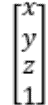

图 2A.47：4x1 矩阵


如果我们将 4×1 矩阵（点）乘以 4×4 矩阵（变换），就可以操纵该点。如果 Ti 表示一个变换，那么我们可以将这些变换相乘，以实现对该点的某种操纵：

```
T₁ × T₂ × T₃ × ⋯ × Tₙ = Tₜ
```

#### 图 2A.48：变换的相乘

要乘以变换矩阵，A × P = B，我们执行如下操作：

```
[a₁₁ a₁₂ a₁₃ a₁₄; a₂₁ a₂₂ a₂₃ a₂₄; a₃₁ a₃₂ a₃₃ a₃₄; a₄₁ a₄₂ a₄₃ a₄₄] × [x; y; z; 1] = [a₁₁x + a₁₂y + a₁₃z + a₁₄; a₂₁x + a₂₂y + a₂₃z + a₂₄; a₃₁x + a₃₂y + a₃₃z + a₃₄; a₄₁x + a₄₂y + a₄₃z + a₄₄]
```

#### 图 2A.49：变换矩阵的相乘

我们还可以这样表示：

```
bᵢ = Σⱼ=1⁴ aᵢⱼ pⱼ
```

#### 图 2A.50：变换相乘的表达式

同样，对于两个 4×4 矩阵相乘，AxB=C，也可以这样做：

```
cᵢⱼ = Σₖ=1⁴ aᵢₖ bₖⱼ
```

对于 i = 1 到 4，j = 1 到 4

```
cᵢⱼ = Σₖ=1⁴ aᵢₖ bₖⱼ
```

#### 图 2A.51：4x4 矩阵相乘的表达式：

变换的矩阵如下所示：

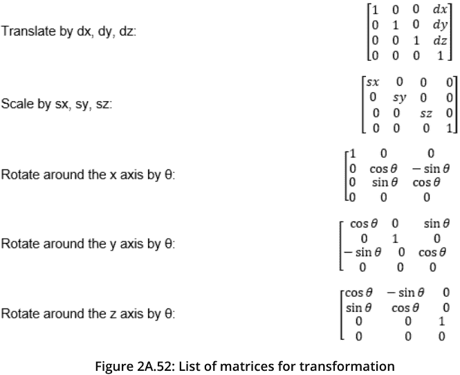

图 2A.52：变换矩阵列表

> **注意**
> 
> 本活动的解决方案可在第 635 页找到。

## 总结

在本章中，我们学习了 C++ 中的类型。首先，我们讨论了内置类型，然后学习了如何创建我们自己的、行为类似内置类型的类型。我们学习了如何声明和初始化变量，初步了解了编译器从源代码生成了什么、变量放在哪里、链接器如何将其组合在一起，以及这在计算机内存中是什么样子。我们学习了 C++ 社区中关于零规则和五规则的一些经验法则。这些构成了 C++ 的构建块。在下一章中，我们将研究如何使用 C++ 模板创建函数和类，并进一步探索适用于模板的类型推导。
