# 2B

禁止鸭子
– 模板与
推导

## 学习目标

学完本章后，你将能够：

- 使用继承和多态更有效地开发你自己的类
- 实现别名，使你的代码更易读
- 使用 SFINAE 和 constexpr 开发模板以简化代码
- 使用 STL 实现你自己的解决方案，以利用泛型编程
- 描述类型推导的上下文和基本规则

本章将向你展示如何通过继承、多态和模板来定义和扩展你的类型。

## 简介

在上一章中，我们学习了如何借助单元测试开发我们自己的类型（类），并使它们表现得像内置类型一样。我们还了解了函数重载、三/五规则和零规则。

在本章中，我们将学习如何进一步扩展类型系统。我们将学习如何使用模板创建函数和类，并重新审视函数重载，因为它受到模板使用的影响。我们将接触到一项新技术 SFINAE，并使用它来控制模板中那些被包含在生成代码中的部分。

## 继承、多态和接口

到目前为止，在我们学习面向对象设计和 C++ 的旅程中，我们一直专注于抽象和数据封装。现在，我们将把注意力转向继承和多态。什么是继承？什么是多态？为什么我们需要它们？考虑以下三个对象：

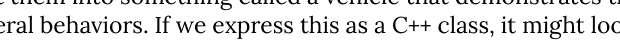

在上面的图中，我们可以看到三个非常不同的对象。它们有一些共同点。它们都有轮子（数量不同）、发动机（尺寸、功率或配置不同），以及启动发动机、驾驶、刹车、停止发动机等操作，我们可以利用这些共同点来做些事情。

因此，我们可以将它们抽象为一种称为“交通工具”的事物，它展示了这些属性和一般行为。如果我们将其表示为 C++ 类，可能如下所示：

```
class Vehicle
{
public:
    Vehicle() = default;
    Vehicle(int numberWheels, int engineSize) :
        m_numberOfWheels{numberWheels}, m_engineSizeCC{engineSize}
    {
    }

```

我们之前遇到过访问修饰符，例如 **public**、**protected** 和 **private**。它们控制我们如何访问基类的成员。Motorcycle 类将如下派生：

```
class Motorcycle : public Vehicle
{
public:
    Motorcycle(int engineSize) : Vehicle(2, engineSize) {};
};
```

在这种情况下，Vehicle 类被称为**基类**或**超类**，而 Motorcycle 类被称为**派生类**或**子类**。我们可以用图形表示如下，其中箭头从派生类指向基类：

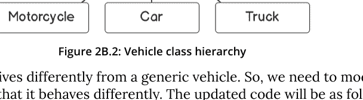

图 2B.2：Vehicle 类层次结构

但是摩托车的驾驶方式与普通交通工具不同。因此，我们需要修改 **Motorcycle** 类，使其行为不同。更新后的代码如下：

```
class Motorcycle : public Vehicle
{
public:
    Motorcycle(int engineSize) : Vehicle(2, engineSize) {};

    void Drive()
    {
        std::cout << "Motorcycle::Drive\n";
    };
};
```

如果我们思考面向对象设计，这就是用协作的对象来建模问题空间。这些对象通过消息相互通信。现在，我们有两个类以不同的方式响应同一条消息（Drive() 方法）。消息的发送者不知道会发生什么，也并不真正关心，这正是多态的本质。

> **注意**
> 
> 多态性来自希腊语 poly 和 morph，其中 **poly** 意为“多”，**morph** 意为“形式”。因此，多态性意味着**具有多种形式。**

我们现在可以使用这些类来尝试多态：

```
#include <iostream>

int main()
{
    Vehicle vehicle;
    Motorcycle cycle{1500};
    Vehicle* myVehicle{&vehicle};

    myVehicle->StartEngine();
    myVehicle->Drive();
    myVehicle->ApplyBrakes();
    myVehicle->StopEngine();

    myVehicle = &cycle;
    myVehicle->StartEngine();
    myVehicle->Drive();
    myVehicle->ApplyBrakes();
    myVehicle->StopEngine();

    return 0;
}
```

如果我们编译并运行这个程序，会得到以下输出：

```
```text
$ ./vehicle.exe
Vehicle::StartEngine 1000 CC
Vehicle::Drive
Vehicle::ApplyBrakes to 4 wheels
Vehicle::StopEngine
Vehicle::StartEngine 1500 CC
Vehicle::Drive
Vehicle::ApplyBrakes to 2 wheels
Vehicle::StopEngine
```
```

图 2B.3：Vehicle 程序输出

在上面的截图中，**Vehicle::StartEngine 1500 CC** 之后的几行都与 **Motorcycle** 有关。但 Drive 行仍然显示 **Vehicle::Drive**，而不是预期的 **Motorcycle::Drive**。这是怎么回事？问题是，我们没有告诉编译器 **Vehicle** 类中的 **Drive** 方法可以被派生类修改（或重写）。我们需要在代码中做一处改动：

```
```cpp
virtual void Drive()
{
    std::cout << "Vehicle::Drive\n";
};
```
```

通过在成员函数声明前添加 **virtual** 关键字，我们告诉编译器：派生类可以（但不是必须）重写或替换这个函数。如果我们做出这一改动，然后编译并运行程序，会得到以下输出：

```
```text
$ ./vehicle.exe
Vehicle::StartEngine 1000 CC
Vehicle::Drive
Vehicle::ApplyBrakes to 4 wheels
Vehicle::StopEngine
Vehicle::StartEngine 1500 CC
Motorcycle::Drive
Vehicle::ApplyBrakes to 2 wheels
Vehicle::StopEngine
```
```

图 2B.4：使用虚方法的 Vehicle 程序输出

### 继承和访问说明符

如前所述，从超类继承子类的通用形式如下：

```
class DerivedClassName : access_modifier BaseClassName
```

当我们从 Vehicle 类派生 Motorcycle 类时，我们使用了以下代码：

```
class Motorcycle : public Vehicle
```

访问修饰符是可选的，并且是我们之前见过的修饰符之一：public、protected 和 private。在下表中，你可以看到基类成员的可访问性。如果省略了 access_modifier，那么编译器会假定指定了 private。

| 基类中的访问说明符 | 派生类中的有效访问说明符（当基类为） |  |  |
|---|---|---|---|
|  | public 基类 | protected 基类 | private 基类 |
| public | public | protected | private |
| protected | protected | protected | private |
| private | 不可访问 | 不可访问 | 不可访问 |

图 2B.5：派生类中基类成员的可访问性

### 抽象类和接口

到目前为止，我们讨论过的所有类都是具体类——它们可以被实例化为变量类型。还有另一种类——抽象类——它包含至少一个纯虚成员函数。纯虚函数是一种在类中没有定义（或实现）的虚函数。正因为它没有实现，这个类是不完整的（或者是抽象的），不能被实例化。如果你试图创建抽象类型的变量，编译器将生成错误。

要声明纯虚成员函数，需要在函数原型声明的末尾加上 = 0。要使 Drive() 成为 Vehicle 类中的纯虚函数，我们将它声明如下：

```
virtual void Drive() = 0;
```

现在，要能够将派生类用作变量类型（例如 Motorcycle 类），它必须定义 Drive() 函数的实现。

但是，你可以将变量声明为指向抽象类的指针或对抽象类的引用。无论哪种情况，它都必须指向或引用某个从抽象类派生的非抽象类。


在Java中，有一个 `interface` 关键字，允许你定义一个全部由纯虚函数组成的类。在C++中，可以通过声明一个只声明公有纯虚函数（以及虚析构函数）的类来实现相同的效果。通过这种方式，我们定义了一个接口。

> **注意**
> 
> 在开始本章中的任何实践练习之前，请下载本书的GitHub仓库（[https://github.com/TrainingByPackt/Advanced-CPlusPlus](https://github.com/TrainingByPackt/Advanced-CPlusPlus)），并在Eclipse中导入**Lesson 2B**文件夹，以便你可以查看每个练习和活动的代码。

#### 练习1：使用多态性实现游戏角色

在本练习中，我们将演示继承、接口和多态性。我们将从一个临时实现的角色扮演游戏开始，并将其演化为更通用和可扩展的版本。让我们开始吧：

- 1. 打开Eclipse，使用**Lesson2B**示例文件夹中的文件创建一个名为**Lesson2B**的新项目。
- 2. 由于这是一个**基于CMake的项目**，请将当前构建器更改为**Cmake Build（可移植）**。
- 3. 转到**Project | Build All**菜单以构建所有练习。默认情况下，屏幕底部的控制台将显示**CMake控制台 [Lesson2B]**。
- 4. 配置一个名为**L2BExercise1**的**新建启动配置**，用于运行**Exercise1**二进制文件，并单击**Run**来构建和运行**练习1**。你将收到以下输出：

```
------ Exercise 1 ------
Gandalf: Abracadabara
Glenda: Chill people
Ben Grimm: Clobbering time
Gandalf: Casts spell
Glenda: Applies soothing balm
Ben Grimm: Hits the nearest bad guy
Complete.
Destroying Warrior: Ben Grimm
Destroying Healer: Glenda
Destroying Wizard: Gandalf
```

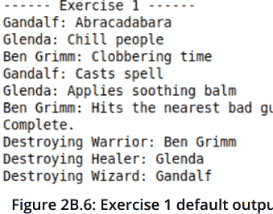

8. 创建角色，并将它们放在诸如**vector**之类的容器中进行管理。在`main()`函数之前，在文件中创建以下两个方法：

```
void createCharacters(std::vector<ICharacter*>& cast)
{
    cast.push_back(new Wizard("Gandalf"));
    cast.push_back(new Healer("Glenda"));
    cast.push_back(new Warrior("Ben Grimm"));
}

void freeCharacters(std::vector<ICharacter*>& cast)
{
    for(auto* character : cast)
    {
        delete character;
    }
    cast.clear();
}
```

9. 用以下代码替换`main()`的内容：

```
int main(int argc, char**argv)
{
    std::cout << "\n------ Exercise 1 ------\n";

    std::vector<ICharacter*> cast;

    createCharacters(cast);
    for(auto* character : cast)
    {
        character->speak();
    }
    for(auto* character : cast)
    {
        character->act();
    }
    freeCharacters(cast);

    std::cout << "Complete.\n";
    return 0;
}
```

10. 单击**Run**按钮重新构建并运行该练习。以下是生成的输出：

```
------ Exercise 1 ------
Gandalf: Abracadabara
Glenda: Chill people
Ben Grimm: Clobbering time
Gandalf: Casts spell
Glenda: Applies soothing balm
Ben Grimm: Hits the nearest bad guy
Destroying Character
Destroying Character
Destroying Character
Complete.
```

图2B.8：多态版本的输出

正如你在前面的截图中所看到的，**Destroying Wizard**等日志已经消失。问题在于容器持有指向基类的指针，并且它不知道如何在每种情况下调用完整的析构函数。

11. 要修复此问题，只需将**ICharacter**的析构函数声明为virtual：

```
virtual ~ICharacter() {
```

12. 单击**Run**按钮重新构建并运行该练习。输出现在如下所示：

```
------ Exercise 1 ------
Gandalf: Abracadabara
Glenda: Chill people
Ben Grimm: Clobbering time
Gandalf: Casts spell
Glenda: Applies soothing balm
Ben Grimm: Hits the nearest bad guy
Destroying Wizard: Gandalf
Destroying Character
Destroying Healer: Glenda
Destroying Character
Destroying Warrior: Ben Grimm
Destroying Character
Complete.
```

图2B.9：完整多态版本的输出

我们现在已经为**ICharacter**角色实现了一个接口，并通过容器中存储的基类指针直接调用**speak()**和**act()**方法，从而以多态方式使用它们。

## 再谈类、结构体和联合体

之前，我们讨论了类与结构体之间的区别在于默认访问修饰符——类的默认访问权限是private，而结构体的默认访问权限是public。这一区别还更进一步——如果基类没有指定任何内容，它也适用于基类：

```cpp
class DerivedC : Base  // inherits as if "class DerivedC : private Base" was used
{
};
```

```cpp
struct DerivedS : Base // inherits as if "struct DerivedS : public Base" was used
{
};
```

应当注意，联合体既不能作为基类，也不能从基类派生。如果结构体和类本质上没有区别，那么我们该使用哪种类型？本质上，这是约定俗成的。**结构体**用于将几个相关元素捆绑在一起，而**类**可以执行操作并承担责任。结构体的一个示例如下：

```cpp
struct Point    // A point in 3D space
{
    double m_x;
    double m_y;
    double m_z;
};
```

在上述代码中，我们可以看到它把三个坐标组合在一起，以便我们可以在三维空间中描述一个点。这个结构体可以作为连贯的数据集传递给需要点的方法，而不是为每个点传递三个单独的参数。另一方面，类则建模一个可以执行操作的对象。请看下面的示例：

```cpp
class Matrix
{
public:
    Matrix& operator*(const Matrix& rhs)
    {
        // nitty gritty of the multiplication
    }

private:
    // Declaration of the 2D array to store matrix.
};
```

经验法则是：如果至少有一个私有成员，就应使用类，因为这意味着实现的细节将被隐藏在公有成员函数之后。

### 可见性、生命周期和访问

我们之前已经讨论过创建自己的类型以及声明变量和函数，当时主要关注简单函数和单个文件。现在，我们将研究当多个源文件（翻译单元）包含类和函数定义时会发生什么。此外，我们还将检查哪些变量和函数可以从源文件的其他部分可见，变量能存活多久，并了解内部链接与外部链接之间的区别。在*第1章《便携式C++软件剖析》*中，我们看到了工具链如何编译源文件并生成目标文件，以及链接器如何将所有文件组合在一起形成可执行程序。

当编译器处理源文件时，它会生成一个目标文件，其中包含翻译后的C++代码以及足够的信息，使链接器能够解析编译后的源文件对其他源文件的任何引用。在*第1章《便携式C++软件剖析》*中，**CxxTemplate.cpp**调用了**sum()**，后者定义在**SumFunc.cpp**文件中。编译器构建目标文件时，会创建以下段：

- **代码段**（也称文本段）：这是C++函数到目标机器指令的翻译。
- **数据段**：包含程序中声明的所有变量和数据结构，这些变量不是局部变量，也不在堆或栈上分配，并且已初始化。
- **BSS段**：包含程序中声明的所有变量和数据结构，这些变量不是局部变量，也不在堆或栈上分配，并且未初始化（但会被初始化为零）。
- **导出符号数据库**：此目标文件中的变量和函数及其位置的列表。
- **引用符号数据库**：此目标文件从自身外部所需的变量和函数以及它们使用位置的列表。

> **注意**
> 
> BSS用于命名未初始化数据段，其名称在历史上源自Block Started by Symbol（由符号启动的块）。

然后，链接器将所有代码段、数据段和**BSS**段收集在一起，构成程序。它利用两个数据库（DB）中的信息，将所有引用符号解析到导出符号列表，并用此信息修补代码段，使它们能够正确运行。图形化表示如下：

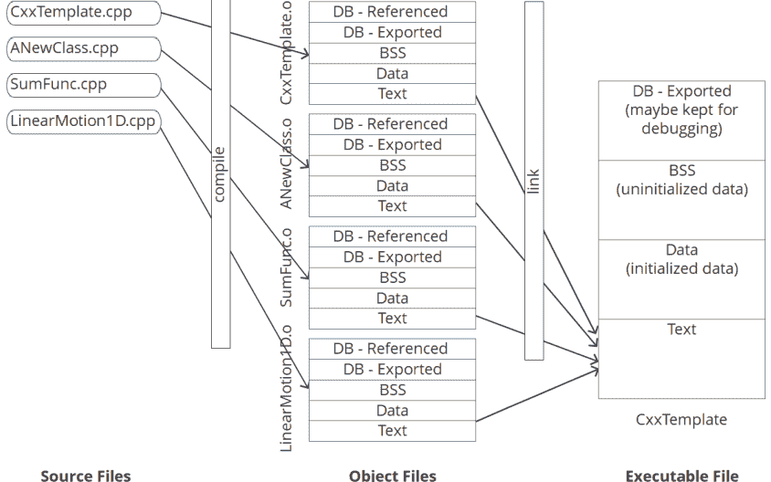

**图2B.10：目标文件和可执行文件的组成部分**


为了下面讨论的目的，BSS 和数据段将统称为数据段（唯一的区别是 BSS 未初始化）。当程序被执行时，它被加载到内存中，其内存看起来有点像可执行文件的布局——它包含文本段、数据段、BSS 段，以及主机系统分配的空闲内存，其中包含所谓的栈和堆。栈通常从内存顶部开始向下增长，而堆从 BSS 结束处开始向上增长，向栈方向增长：

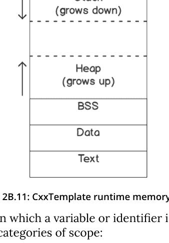

图 2B.11：CxxTemplate 运行时内存映射

程序中变量或标识符可访问的部分称为作用域。有两种广泛的作用域类别：

- **局部作用域**（也称为**块作用域**）：这适用于用花括号 ({}) 括起来的块内声明的任何内容。变量可以在花括号内访问。就像块可以嵌套一样，变量的作用域也可以嵌套。这通常包括局部变量和函数参数，这些通常存储在栈中。
- **全局 / 文件作用域**：这适用于在普通函数或类之外声明的变量，以及普通函数。变量可以在文件中的任何位置访问，并且如果链接正确，可能可以从其他文件（全局）访问。这些变量由链接器在数据段中分配内存。标识符被放置到全局命名空间中，这是默认命名空间。

### 命名空间

我们可以将命名空间视为变量、函数和用户定义类型的名称字典。对于小型程序，使用全局命名空间是可以的，因为你创建多个同名变量并产生名称冲突的可能性非常小。随着程序变大，并且包含更多第三方库，名称冲突的可能性会增加。因此，库编写者会将他们的代码放入命名空间中（最好是唯一的）。这允许程序员控制对命名空间中标识符的访问。通过使用标准库，我们已经在使用 std 命名空间。一个命名空间的声明如下：

```cpp
namespace name_of_namespace {
    // put declarations in here
}
```

通常 `name_of_namespace` 会很短，并且命名空间可以嵌套。

> **注意**
>
> 在 boost 库中可以看到命名空间的良好使用：[https://www.boost.org/](https://www.boost.org/)。

变量还有另一个属性，即**生命周期**。有三种基本生命周期；其中两种由编译器管理，一种由程序员选择：

- **自动生命周期：** 局部变量在声明时创建，在其所在的范围退出时销毁。这些由栈管理。
- **永久生命周期：** 全局变量和静态局部变量。编译器会在程序开始时（在进入 `main()` 函数之前）创建全局变量，并在它们首次被访问时创建静态局部变量。在这两种情况下，变量在程序退出时被销毁。这些变量由链接器放置在数据段中。
- **动态生命周期：** 变量由程序员请求创建和销毁（通过使用 `new` 和 `delete`）。这些变量的内存从堆中分配。

我们将要考虑的变量的最后一个属性是**链接性**。链接性表示如果编译器和链接器遇到具有相同名称（或标识符）的变量和函数时会做什么。对于函数，它实际上是所谓的修饰名——编译器使用函数名、其返回类型和参数类型来生成修饰名。有三种类型的链接性：

- **无链接：** 这意味着标识符仅指自身，适用于局部变量和在块内定义的局部用户类型。
- **内部链接：** 这意味着标识符可以在声明它的文件中任何位置访问。这适用于静态全局变量、const 全局变量、静态函数，以及在文件内的匿名命名空间中声明的任何变量或函数。匿名命名空间是没有指定名称的命名空间。
- **外部链接：** 这意味着在正确的向前声明下，它可以从所有文件中访问。这包括普通函数、非静态全局变量、extern const 全局变量，以及用户定义的类型。

虽然这些被称为链接性，但只有最后一种实际上涉及链接器。其他两种是通过编译器从导出的标识符数据库中排除信息来实现的。

## 模板 – 泛型编程

作为一名计算机科学家，或作为一名编程爱好者，在某个时间点，你可能不得不编写一个（或多个）排序算法。在讨论算法时，你对正在排序的数据类型并没有特别关心，只是这两个该类型的对象可以比较，并且该域是一个全序集（也就是说，如果一个对象与另一个对象比较，你可以确定哪个先）。不同的编程语言对此问题提供了不同的解决方案：

- **Python**：一种动态语言，具有内置函数 sort 和列表上的成员函数。作为动态语言，它不需要关心类型，只要它可以调用比较运算符和 **swap** 函数即可。
- **C**：其标准库中有一个名为 qsort 的函数，其签名如下：

  ```c
  void qsort (void* base, size_t num, size_t size,
      int (*compare)(const void*,const void*));
  ```

  这通过 base 是 **void 指针**来处理不同类型。**size_t** size 定义每个对象的大小，而 **compare()** 函数定义如何比较两个对象。
- **C++：std::sort()** 是其标准库中提供的一个函数，其中一个签名如下：

  ```cpp
  template< class RandomIt > void sort( RandomIt first, RandomIt last );
  ```

  在这种情况下，类型的细节被捕获在名为 **RandomIt** 的迭代器类型中，并在编译时传递给方法。

在下一节中，我们将简要定义泛型编程，展示 C++ 如何通过模板实现它们，突出显示语言已提供的功能，并讨论编译器如何推导出类型以便用于模板。

### 什么是泛型编程？

当你开发排序算法时，你可能最初只关注对纯数字进行排序。但一旦确定，你就可以将其抽象为任何类型，只要该类型表现出某些属性，例如全序集（也就是说，比较运算符 < 在我们排序的域中的所有元素之间都有意义）。因此，为了以泛型编程的方式表达算法，我们在算法中为算法需要操作的类型定义一个占位符。

**泛型编程**是开发一种与类型无关的通用算法。算法可以通过传递类型作为参数来重用。这样，算法被抽象化，并允许编译器基于类型进行优化。

换句话说，泛型编程是一种编程方法，其中算法以类型作为参数定义，这些参数在算法实例化时指定。许多语言以不同的名称提供对泛型编程的支持。在 C++ 中，泛型编程通过称为模板的语言特性得到支持。

### 介绍 C++ 模板

模板是 C++ 对泛型编程的支持。把模板想象成饼干模具，我们作为参数给它的类型想象成饼干面团（可以是巧克力布朗尼、姜味饼干或其他美味口味）。当我们使用饼干模具时，我们得到的是形状相同但口味不同的饼干实例。因此，模板捕获了通用函数或类的定义，当用类型作为参数指定时，编译器会着手为我们编写该类或函数，就好像该类型是我们手工编写的一样。它有几个优点，例如以下几点：

- 你只需要开发一次类或算法并对其进行演进。
- 你可以将其应用于许多类型。


+   - 你可以把复杂的细节隐藏在简单的接口后面，并且编译器可以根据类型对生成的代码进行优化。

那么，我们如何编写一个模板呢？让我们从一个模板开始，该模板允许我们将一个值限制在从 **lo** 到 **hi** 的范围内，并且能够在 **int**、**float**、**double** 或任何其他内置类型上使用：

```
template <class T>
T clamp(T val, T lo, T hi)
{
    return (val < lo) ? lo : (hi < val) ? hi : val;
}
```

让我们分解一下：

+   - **第 1 行：** `template <class T>` 声明其后内容为模板，并使用一个类型，其在模板中的占位符为 **T**。
+   - **第 2 行：** 声明当 **T** 被替换时此函数的原型。它声明函数 clamp 接受三个类型为 **T** 的参数并返回类型为 **T** 的值。
+   - **第 4 行：** 这就是模板的美妙之处——只要传入的类型具有 < 运算符，那么我们就可以对三个值进行钳位，使其满足 **lo <= val <= hi**。该算法适用于所有可排序的类型。

假设我们在以下程序中使用它：

```
#include <iostream>
```

```
int main()
{
    std::cout << clamp(5, 3, 10) << "\n";
    std::cout << clamp(3, 5, 10) << "\n";
    std::cout << clamp(13, 3, 10) << "\n";
    std::cout << clamp(13.0, 3.0, 10.1) << "\n";
    std::cout << clamp<double>(13.0, 3, 10.2) << "\n";
    return 0;
}
```

我们将得到以下预期输出：

```
$ ./a.out
5
5
10
10.1
10.2
```

Figure 2B.12: Clamp program output

在最后一次对 clamp 的调用中，我们在 < 和 > 之间传递了 double 类型。但我们没有对另外四次调用做同样的处理。为什么？事实证明，随着年龄的增长，编译器变得越来越聪明。随着标准的每次发布，他们改进了所谓的类型推导。因为编译器能够推导出类型，所以我们不需要告诉它使用什么类型。其原因在于没有模板参数的类中的三个参数具有相同的类型——前三个都是 int，而第四个是 double。但我们必须告诉编译器最终一个要使用哪种类型，因为它的参数有两个 double 和一个 int，这导致编译错误说找不到函数。但随后，它给出了模板无法使用的原因。这种强制指定类型的形式被称为显式模板参数指定。

### C++ 预包装模板

C++ 标准包含两个主要部分：

+   - 语言定义，即关键字、语法、词法定义、结构等。
+   - 标准库，即编译器供应商提供的所有预写通用函数和类。此库的一个子集使用模板实现，被称为标准模板库（STL）。

STL 的起源可追溯到 Ada 语言中由 David Musser 和 Alexander Stepanov 开发的泛型。Stepanov 强烈主张以通用编程作为软件开发的基础。在 90 年代，他看到了用新语言 C++ 实现这一点的机会，以影响主流开发，并提议向 ISO C++ 委员会提出将 STL 作为语言的一部分包含在内。剩下的就是历史了。

STL 由四类预定义的通用算法和类组成：

+   - **容器**：通用序列容器（vector、list、deque）和关联容器（set、multiset、map）
+   - **迭代器**：一组用于遍历容器并定义容器范围的类（范围表示为 **begin()** 和 **end()**）。请注意，STL 中的一个基本设计选择是 **end()** 指向最后一个项之后的位置——在数学上，这就是 [**begin()**, **end()**）。
+   - **算法**：超过 100 种不同的算法，涵盖排序、搜索、集合操作等。
+   - **函数**：对仿函数（可像函数一样调用的对象）的支持。一个用途是在模板算法中用于谓词，例如 **find_if()**。

我们之前实现的 clamp 函数模板很简单，虽然它适用于任何支持小于运算符的类型，但效率不会很高——如果类型大小很大，可能会导致非常大的拷贝。自 C++17 起，STL 包含一个 **std::clamp()** 函数，其声明更像这样：

```
#include <cassert>

template<class T, class Compare>
const T& clamp( const T& v, const T& lo, const T& hi, Compare comp )
{
    return assert( !comp(hi, lo) ),
        comp(v, lo) ? lo : comp(hi, v) ? hi : v;
}

template<class T>
const T& clamp( const T& v, const T& lo, const T& hi )
{
    return clamp( v, lo, hi, std::less<>() );
}
```

正如我们所见，它对参数和返回值使用引用。将参数改为使用引用减少了需要在栈上传递和返回的内容。此外，请注意，设计者已努力制作更通用的模板版本，以便我们不依赖于类型存在的 < 运算符。然而，我们可以通过传递 comp 来定义排序。

从前面的示例中，我们看到模板与函数一样，可以接受多个以逗号分隔的参数。

### 类型别名 – typedef 和 using

如果你使用过 std::string 类，那么你已经在使用别名了。 与字符串相关的有几个模板类需要实现相同的功能。但表示字符的类型是不同的。例如，对于 std::string，表示是 char，而 std::wstring 使用 wchar_t。还有针对 char16_t 和 char32_t 的其他几种。任何功能上的变化都将通过 traits 或模板特化来管理。

在 C++11 之前，这将从 std::basic_string 基类别名，如下所示：

```
namespace std {
    typedef basic_string<char> string;
}
```

它做了两件主要事情：

+   - 减少声明变量所需的输入量。这是一个简单的情况，但当你声明一个指向字符串到对象的映射的唯一指针时，它会变得很长，你会犯错误：
+     typedef std::unique_ptr<std::map<std::string,myClass>> UptrMapStrToClass;
+   - 提高可读性，因为你现在在概念上将其视为字符串，而无需担心细节。

但 C++11 引入了一种更好的方法——别名声明——它利用 using 关键字。前面代码可以这样实现：

```
namespace std {
    using string = basic_string<char>;
}
```

前面的示例很简单，别名无论是 typedef 还是 using 都很容易理解。但当别名涉及更复杂的表达式时，它们也可能难以阅读——特别是函数指针。考虑以下代码：

```
typedef int (*FunctionPointer)(const std::string&, const Point&);
```

现在，考虑以下代码：

```
using FunctionPointer = int (*)(const std::string&, const Point&);
```

C++11 中引入新功能的原因之一是别名声明可以轻松地合并到模板中——它们可以被模板化。typedef 不能被模板化，虽然可以用 typedef 实现相同的结果，但别名声明（using）是首选方法，因为它会导致更简单、更易于理解的模板代码。

#### 练习 2：实现别名

在本练习中，我们将使用 typedef 实现别名，并看看通过使用引用，代码如何变得更易读和高效。按照以下步骤实现此练习：

+   1. 在 Eclipse 中打开 Lesson2B 项目，然后在 Project Explorer 中展开 Lesson2B，然后展开 Exercise02 并双击 Exercise2.cpp 以在编辑器中打开此练习的文件。
+   2. 单击启动配置下拉菜单并选择 New Launch Configuration.... 将 L2BExercise2 配置为以 Exercise2 的名称运行。完成后，它将成为当前选定的启动配置。
+   3. 单击运行按钮。练习 2 将运行并产生类似于以下输出的结果：
+   4. 在编辑器中，在 printVector() 函数的声明之前，添加以下行：
+   5. 现在，将文件中所有出现的 std::vector<int> 更改为 IntVector。
+   6. 单击运行按钮。输出应与之前相同。
+   7. 在编辑器中，将你之前添加的行更改为以下内容：
+   8. 单击运行按钮。输出应与之前相同。
+   9. 在编辑器中，添加以下行：

```
----- Exercise 2 -----
Array is : 2,4,6,1,3,5,
Complete.
```

Figure 2B.13: Exercise 2 output

```
typedef std::vector<int> IntVector;
```

```
using IntVector = std::vector<int>;
```

```
using IntVectorIter = std::vector<int>::iterator;
```


+   10. 现在，将 `IntVector::iterator` 的唯一出现更改为 `IntVectorIter`。
+   11. 单击 **Run** 按钮。输出应与之前相同。

在本练习中，typedef 和 using 别名之间似乎几乎没有区别。在任何一种情况下，使用一个命名良好的别名都会使代码更易于阅读和理解。当涉及更复杂的别名时，**using** 提供了更简便的写法。**using** 于 C++11 中引入，现在已成为定义别名的首选方法。它相对于 **typedef** 还有其他优势，例如可以在模板内部使用。

## Templates – More than Generic Programming

模板不仅能提供通用编程（一种带类型的 cookie cutter）。在通用编程的情况下，模板作为一个不可更改的蓝图运行，并为指定的类型或类型生成编译后的模板版本。

模板可以编写为基于所涉及类型的函数或算法特化。这被称为 **template specialization**，并且在我们之前使用的意义上并不是通用编程。只有当它使某些类型在给定上下文中按我们期望的方式表现时，才能称之为通用编程。当为所有类型使用的算法被修改时，就不能称之为通用编程。

请检查以下特化代码的示例：

```
```cpp
#include <iostream>

#include <type_traits>

template <typename T, std::enable_if_t<sizeof(T) == 1, int> = 0>
void print(T val)
{
    printf("%c\n", val);
}

template <typename T, std::enable_if_t<sizeof(T) == sizeof(int), int> = 0>
void print(T val)
{
    printf("%d\n", val);
}
```
```

```
}

template <typename T, std::enable_if_t<sizeof(T) == sizeof(double), int> = 0>
void print(T val)
{
    printf("%f\n", val);
}

int main(int argc, char** argv)
{
    print('c');
    print(55);
    print(32.1F);
    print(77.3);
}
```

它定义了一个模板，该模板根据使用 **std::enable_if_t<>** 和 **sizeof()** 的模板特化调用 **printf()**，使用不同的格式字符串。当我们运行它时，会生成以下输出：

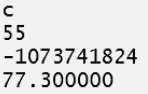

**Figure 2B.14: Erroneous print template program output**

### Substitution Failure Is Not An Error – SFINAE

打印的 **32.1F (-1073741824)** 值与该数字没有任何相似之处。如果我们检查编译器为以下程序生成的代码，就会发现它好像我们写了以下内容（以及更多）：

```
template<typename int, int=0>
void print<int,0>(int val)
{
    printf("%d\n",val);
```

第一个 **enable_if** 模板将导致一个空结构体（或类）的定义。第二个 **enable_if** 模板是针对第一个模板参数为 true 的特化，将导致带有 typedef 定义的类。**enable_if_t** 的定义是一个辅助模板，它消除了我们在使用它时在模板末尾输入 `::type` 的需求。那么，这如何工作？请考虑以下代码：

```
```cpp
template <typename T, std::enable_if_t<condition, int> = 0>

void print(T val) { … }
```
```

如果在编译时评估的条件结果为 **true**，则 **enable_if_t** 模板将导致如下所示的模板：

```
```cpp
template <typename T, int = 0>

void print(T val) { … }
```
```

这是有效的语法，并且该函数作为候选函数添加到符号表中。如果在编译时计算的条件结果为 **false**，则 **enable_if_t** 模板将导致如下所示的模板：

```
```cpp
template <typename T, = 0>

void print(T val) { … }
```
```

这是 **malformed code**，现在被丢弃 – SFINAE 正在发挥作用。

**std::is_floating_point_v<T>** 是另一个辅助类，它访问 **std::is_floating_point<T>** 模板的 `::value` 成员。它的名字说明了一切 – 如果 T 是浮点类型（float、double、long double），它将为 true；否则为 false。如果我们进行此更改，则编译器（GCC）会生成以下错误：

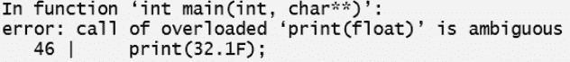

*Figure 2B.15: Compiler error for the modified print template program*

现在的问题是，我们有两个模板可以满足类型为 float 时的条件：

```
```cpp
template <typename T, std::enable_if_t<sizeof(T) == sizeof(int), int> = 0>

void print(T val)
{
    printf("%d\n", val);
}
```
```

如果我们现在编译程序，它会完成编译并链接程序。如果我们运行它，它现在会产生以下（预期）输出：

```
C
55
32.099998
77.300000
```

**Figure 2B.17: Corrected print template program output**

### Floating-Point Representations

**32.099998** 不应该是 **32.1** 吗？那就是传递给函数的值。在计算机上执行浮点运算的问题在于，表示会自动引入误差。实数形成一个连续（无限）的域。如果你考虑实数域中的 1 和 2，那么它们之间有无限多个实数。不幸的是，计算机对浮点数的表示对其值进行了量化，无法表示所有无限多个数字。用于存储数字的位数越多，其在实数域上的表示就越好。因此，long double 比 double 好，比 float 好。它真正取决于你的问题域，什么才适合存储数据。回到 **32.099998**。计算机将单精度数字存储为 2 的幂之和，然后按幂因子移动它们。整数通常很容易，因为它们可以用 **2^n 幂（n>=0）** 的和轻松表示。小数部分，在本例中为 0.1，必须表示为 **2^(-n)（n>0）** 的和。我们添加更多幂−2 分数来尝试使数字更接近目标，直到我们用完单精度浮点数中用于精度的 24 位。

> **Note**
> 
> 如果你想了解计算机如何存储浮点数，请研究定义它的 IEEE 754 标准。

### Constexpr if Expressions

C++17 将 constexpr if 表达式引入了语言，这大大简化了模板的编写。我们可以将前面使用 SFINAE 的三个模板重写为一个更简单的模板：

```
#include <iostream>

#include <type_traits>

template <typename T>
void print(T val)
{
    if constexpr(sizeof(T)==1) {
        printf("%c",val);
    }
    else if constexpr(std::is_integral_v<T>) {
        printf("%d",val);
    }
    else if constexpr(std::is_floating_point_v<T>) {
        printf("%f",val);
    }
    printf("\n");
}

int main(int argc, char** argv)
{
    print('c');
    print(55);
    print(32.1F);
    print(77.3);
}
```

对于对 **print(55)** 的调用，编译器生成的函数调用如下：

```
template<>
void print<int>(int val)
{
    printf("%d",val);
    printf("\n");
}
```

if/else if 语句去哪了？**constexpr if** 表达式发生的情况是，编译器在上下文中确定条件的值并将其转换为布尔值（true/false）。如果评估的值为 true，则 if 条件和 else 子句将被丢弃，只留下 true 子句来生成代码。同样，如果为 false，则 false 子句将被保留以生成代码。换句话说，只有第一个求值为 true 的 constexpr if 条件，其子句的代码才会被生成，而其余的则被丢弃。

### Non-Type Template Arguments

到目前为止，我们只看到模板参数是类型。也可以将整数值作为模板参数传递。这使我们能够防止函数中的数组衰减。例如，考虑一个计算 **sum** 的模板函数：

```
template <class T>
T sum(T data[], int number)
{
    T total = 0;
    for(auto i =0U ; i<number ; i++)
    {
        total += data[i];
    }
    return total;
}
```

在这种情况下，我们需要在调用中传递数组的长度：

```
float data[5] = {1.1, 2.2, 3.3, 4.4, 5.5};

auto total = sum(data, 5);
```


但如果我们能直接调用以下代码不是更好吗？

```cpp
auto total = sum(data);
```

我们可以通过修改模板来实现，就像下面的代码一样：

```cpp
template <class T, std::size_t size>
T sum(T (&data)[size])
{
    T total = 0;
    for(auto i=0U ; i< size; i++)
    {
        total += data[i];
    }
    return total;
}
```

在这里，我们将 data 改为对特定大小数组的引用——该大小作为模板参数传递——因此编译器可以推断出来。我们不再需要在函数调用中提供第二个参数。这个简单的例子展示了如何直接传递和使用非类型参数。我们将在模板类型推导部分进一步探讨这一点。

#### 练习 3：实现 Stringify – 特化与 constexpr

在本练习中，我们将通过利用 constexpr 实现一个 stringify 模板，从而产生更易读且更简单的代码版本。按照以下步骤实现本练习：

> **注意**
> 
> stringify 特化模板可以在 https://isocpp.org/wiki/faq/templates#template-specialization-example 找到。

- 1. 在 Eclipse 中打开 **Lesson2B** 项目，然后在 **Project Explorer** 中展开 **Lesson2B**，再展开 **Exercise03**，双击 **Exercise3.cpp** 在编辑器中打开该练习文件。

- 2. 点击 **Launch Configuration** 下拉菜单并选择 **New Launch Configuration...** 将 **L2BExercise3** 配置为以名称 **Exercise3** 运行。

在本练习中，我们了解到使用 C++17 中的新 `constexpr if` 构造后，我们的模板可以变得多么简单和紧凑。

## 函数重载回顾

当我们首次讨论函数重载时，我们只考虑了函数名来自我们手工编写的函数列表的场景。现在，我们需要对此进行更新。我们也可以编写具有相同名称的模板化函数。就像我们之前所做的那样，当编译器遇到行 `print(55)` 时，它需要确定调用之前定义的哪个函数。因此，它执行以下过程（大幅简化）：

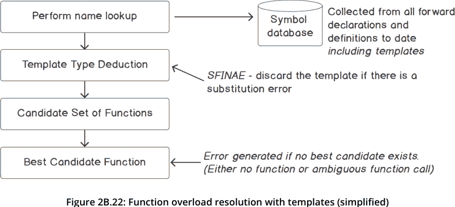

## 模板类型推导

当我们首次介绍模板时，我们涉及到了模板类型推导。现在，我们将进一步探讨这一点。我们将从函数模板的通用声明开始：

```cpp
template<typename T>

void function(ParamType parameter);
```

对此的调用可能如下所示：

```cpp
function(expression);              // 从 expression 推导 T 和 ParamType
```

当编译器到达这一行时，它必须现在推导出与模板相关的两种类型——T 和 **ParamType**。这些通常不同，因为 ParamType 中的 T 附带了限定符和其他属性（例如指针、引用、const 等）。类型相关，但推导过程取决于所使用的 **expression** 的形式而有所不同。

### 显示推导出的类型

在查看不同形式之前，如果我们能让编译器告诉我们它推导出的类型可能会很有用。我们在这里有几个选择，包括 IDE 编辑器显示类型、编译器生成错误，以及运行时支持（由于 C++ 标准，这不一定有效）。我们将使用编译器错误来帮助我们探索一些类型推导。

我们可以通过声明一个没有定义的模板来实现类型显示器。任何尝试实例化该模板的尝试都会导致编译器生成错误消息，因为没有定义，同时还会提供它试图实例化的类型信息：

```cpp
template<typename T>
struct TypeDisplay;
```

让我们尝试编译以下程序：

```cpp
template<typename T>
class TypeDisplay;
```

```cpp
int main()
{
    signed int x = 1;

    unsigned int y = 2;

    TypeDisplay<decltype(x)> x_type;

    TypeDisplay<decltype(y)> y_type;

    TypeDisplay<decltype(x+y)> x_y_type;

    return 0;
}
```

编译器输出以下错误：

```
$ g++ types.cpp -std=c++17 -o types.exe
types.cpp: In function ‘int main()’:
types.cpp:10:30: error: aggregate ‘TypeDisplay<int> x_type’ has incomplete type and cannot be defined
  10 |     TypeDisplay<decltype(x)> x_type;
      |                          ^~~~~~
types.cpp:11:30: error: aggregate ‘TypeDisplay<unsigned int> y_type’ has incomplete type and cannot be defined
  11 |     TypeDisplay<decltype(y)> y_type;
      |                          ^~~~~~
types.cpp:12:32: error: aggregate ‘TypeDisplay<unsigned int> x_y_type’ has incomplete type and cannot be defined
  12 |     TypeDisplay<decltype(x+y)> x_y_type;
      |                                ^~~~~~~~
```

图 2B.23：显示推导类型的编译器错误

请注意，在每种情况下，被命名的聚合都包含正在推导的类型——对于 x，它是 int，对于 y，是 unsigned int，对于 x+y，是 unsigned int。此外，请注意 TypeDisplay 模板需要其参数的类型，因此使用 decltype() 函数让编译器为括号中的表达式提供类型。

也可以在运行时显示推导出的类型，要么使用内置的 typeid(T).name() 运算符，它返回一个 std::string，要么使用名为 type_index 的 boost 库。

> **注意**
> 
> 有关更多信息，请访问以下链接：https://www.boost.org/doc/libs/1_70_0/doc/html/boost_typeindex.html。

由于类型推导规则，内置运算符会给出类型的指示，但会丢失引用（&, 和 &&）以及任何 constness 信息（const 或 volatile）。如果在运行时需要，则考虑 boost::type_index，它将为所有编译器产生相同的输出。

### 模板类型推导 – 细节

让我们回到通用模板：

```cpp
template<typename T>

void function(ParamType parameter);
```

假设调用如下所示：

```cpp
function(expression);    // 从 expression 推导 T 和 ParamType
```

类型推导过程取决于所使用的 ParamType 的形式而有所不同：

- **ParamType 是值（T）**：按值传递函数调用
- **ParamType 是引用或指针（T& 或 T*）**：按引用传递函数调用
- **ParamType 是右值引用（T&&）**：按引用传递函数调用或其他

**情况 1：ParamType 是按值传递（T）**

```cpp
template<typename T>
void function(T parameter);
```

作为按值调用，这意味着参数将是传入内容的副本。因为这是对象的全新实例，所以对表达式应用以下规则：

- 如果表达式的类型是引用，则忽略引用部分。
- 如果在步骤 1 之后，剩余类型为 const 和/或 volatile，则同样忽略它们。

剩下的就是 T。让我们尝试编译以下文件代码：

```cpp
template<typename T>
class TypeDisplay;

template<typename T>
void function(T parameter)
{
    TypeDisplay<T> type;
}

void types()
{
    int x = 42;
    function(x);
}
```

编译器产生以下错误：

```
types.cpp: In instantiation of ‘void function(T) [with T = int]’:
types.cpp:13:15:   required from here
types.cpp:7:20: error: ‘TypeDisplay<int> type’ has incomplete type
    7 |     TypeDisplay<T> type;
```

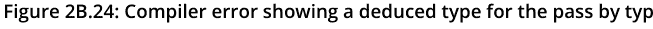

因此，推导出的类型为 **int**。同样，如果我们声明以下内容，我们会得到完全相同的错误：

```cpp
const int x = 42;

function(x);
```

如果我们声明此版本也会发生同样的情况：

```cpp
int x = 42;

const int& rx = x;

function(rx);
```

在这三种情况下，推导出的类型都是 **int**，符合之前所述的规则。

**情况 2：ParamType 是按引用传递（T&）**

作为按引用调用，这意味着参数将能够访问对象的原始存储位置。由于这个原因，生成的函数必须遵守我们之前忽略的 constness 和 volatileness。对类型推导应用以下规则：

- 如果表达式的类型是引用，则忽略引用部分。
- 将表达式类型的剩余部分与 ParamType 进行模式匹配以确定 T。

让我们尝试编译以下文件：

```cpp
template<typename T>
class TypeDisplay;


template<typename T>
void function(T& parameter)
{
    TypeDisplay<T> type;
```


```
}

void types()
{
    int x = 42;
    function(x);
}
```

编译器会生成以下错误：

```
types.cpp: In instantiation of ‘void function(T&) [with T = int]’:
types.cpp:13:15:     required from here
types.cpp:7:20: error: ‘TypeDisplay<int> type’ has incomplete type
  7 |     TypeDisplay<T> type;
```

图 2B.25：编译器错误显示按引用传递的推导类型

由此可见，编译器从 ParamType 作为 int& 推导出 T 为 int。将 x 改为 const int 也不会有意外，因为 T 从 ParamType 作为 const int& 推导为 const int：

```
$ g++ -std=c++17 types.cpp -o types.exe
types.cpp: In instantiation of ‘void function(T&) [with T = const int]’:
types.cpp:13:15:     required from here
types.cpp:7:20: error: ‘TypeDisplay<const int> type’ has incomplete type
  7 |     TypeDisplay<T> type;
```

图 2B.26：编译器错误显示按 const 引用传递的推导类型

同样地，像之前一样引入 rx 作为 const int 的引用，也不会有意外，因为 T 从 ParamType 作为 const int& 推导为 const int：

```
void types()
{
    const int x = 42;
    const int& rx = x;
    function(rx);
}
```

```
types.cpp: In instantiation of ‘void function(T&) [with T = const int]’:
types.cpp:14:16:     required from here
types.cpp:7:20: error: ‘TypeDisplay<const int> type’ has incomplete type
  7 |     TypeDisplay<T> type;
```

图 2B.27：编译器错误显示传递 const 引用时的推导类型

如果我们将声明改为包含 const，那么编译器在从模板生成函数时将尊重 const 属性：

```cpp
template<typename T>
void function(const T& parameter)
{
    TypeDisplay<T> type;
}
```

这次，编译器报告如下

- **int x**：T 为 int（const 会被尊重），而参数的类型为 **const int&**。
- **const int x**：T 为 int（const 在模式中，剩下 int），而参数的类型为 **const int&**。
- **const int& rx**：T 为 int（引用被忽略，const 在模式中，剩下 int），而参数的类型为 **const int&**。

如果我们尝试编译以下内容，我们会期待什么？通常，数组会衰减为指针：

```cpp
int ary[15];

function(ary);
```

编译器错误如下：

```text
types.cpp: In instantiation of ‘void function(T&) [with T = int [15]]’:
types.cpp:13:17:   required from here
types.cpp:7:20: error: ‘TypeDisplay<int [15]> type’ has incomplete type
    7 |     TypeDisplay<T> type;
```

这次，数组被捕获为引用，并且大小也被包含在内。因此，如果 ary 被声明为 **ary[10]**，则会产生完全不同的函数。让我们将模板恢复为以下形式：

```cpp
template<typename T>

void function(T parameter)
{
    TypeDisplay<T> type;
}
```

各定义的如下：

- 一个确定对象身份的表达式是 **glvalue**。
- 一个求值时初始化对象或运算符操作数的表达式是 **prvalue**。示例包括字面量（字符串字面量除外）如 3.1415、true 或 nullptr，this 指针，后自增和后自减表达式。
- 一个具有资源且可以重用的 glvalue 对象（因为其生命周期即将结束）是 **xvalue**。示例包括返回对象 rvalue 引用的函数调用，如 `std::move()`。
- 不是 xvalue 的 glvalue 是 **lvalue**。示例包括变量名、函数或数据成员，或字符串字面量。
- prvalue 或 xvalue 是 **rvalue**。

对于接下来的解释，你是否完全理解这些并不重要——只需知道被认为是 lvalue 的表达式可以取其地址（使用取地址运算符，即 “&”）。以下 ParamType 的类型推导规则要求你知道什么是 lvalue，以及什么不是：

```
template<typename T>

void function(T&& parameter)
{
    TypeDisplay<T> type;
}
```

此 ParamType 形式的类型推导规则如下：

- 如果表达式是 lvalue 引用，则 T 和 ParamType 都被推导为 lvalue 引用。这是唯一推导类型为引用的场景。
- 如果表达式是 rvalue 引用，则适用案例 2 的规则。

## SFINAE 表达式和尾随返回类型

C++11 引入了名为 **尾随返回类型** 的特性，为模板提供了一种机制来泛化返回类型。一个简单的例子如下：

```
template<class T>

auto mul(T a, T b) -> decltype(a * b)
{
    return a * b;
}
```

这里，**auto** 用于指示定义了尾随返回类型。尾随返回类型以 -> 指针开始，在本例中，返回类型是 **a** 和 **b** 相乘返回的类型。编译器会处理 decltype 的内容，如果它格式错误，则会按通常方式将其从函数名查找中移除。此功能开启了许多可能性，因为逗号运算符 “,” 可以在 **decltype** 内部使用来检查某些属性。

如果我们想测试一个类是否实现了方法或包含某种类型，那么我们可以将其放在 decltype 内部，通过将其转换为 void（以防逗号运算符被重载），然后在逗号运算符末尾定义实际返回类型的对象。一个例子在以下程序中展示：

```
#include <iostream>

#include <algorithm>

#include <utility>

#include <vector>

#include <set>

template<class C, class T>
auto contains(const C& c, const T& x)
    -> decltype((void)(std::declval<C>().find(std::declval<T>())),
true)
{
    return end(c) != c.find(x);
}

int main(int argc, char**argv)
{
```

有趣的部分出现在 T 类具有 `find()` 方法时，因为两个 `test_find()` 方法都被生成。但特化版本接受 `int` 类型的参数，而默认版本接受 `long` 类型的参数。由于我们“调用”函数时使用零（0），它将匹配特化版本并使用它。参数差异很重要，因为你不能有两个函数具有相同的参数类型而仅返回类型不同。如果你想检查此行为，请将参数从 0 改为 0L 以强制使用 long 版本。

## 类模板

到目前为止，我们只处理了函数模板。但模板也可以用于为类提供蓝图。模板类声明的一般结构如下：

```
template<class T>

class MyClass {

    // 使用 T 的变量和方法。

};
```

而模板函数允许我们生成通用算法，模板类允许我们生成通用数据类型及其相关行为。

当我们介绍标准模板库时，我们强调它包含容器的模板——**vector**、**deque**、**stack** 等。这些模板允许我们存储和管理任何我们想要的数据类型，同时仍按预期行为。

# 练习 4：编写一个类模板

计算机科学中最常用的两种数据结构是栈和队列。两者目前在 STL 中都有实现。但为了初步接触模板类，我们将编写一个可以用于任何类型的栈模板类。让我们开始：

- 1. 在 Eclipse 中打开 **Lesson2B** 项目，然后在 **Project Explorer** 中展开 **Lesson2B**，然后展开 **Exercise04**，双击 **Exercise4.cpp** 在编辑器中打开此练习的文件。
- 2. 配置一个新的 **Launch Configuration, L2BExercise4**，以名称 **Exercise4** 运行。
- 3. 同时，配置一个新的 C/C++ 单元运行配置，**L2BEx4Tests**，以运行 **L2BEx4tests**。设置 **Google Tests Runner**。
- 4. 点击测试的 **Run** 选项，我们必须第一次运行它：


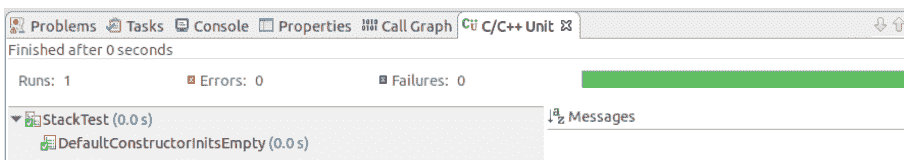

#### 图2B.32：栈的初始单元测试

- 5. 在编辑器中打开 **Stack.hpp**。你将看到以下代码：

```cpp
#pragma once
#include <vector>
#include <cstddef>

#define EXERCISE4_STEP    1

namespace acpp
{

template <typename T>
class Stack
{
public:

private:
    std::vector<T> m_stack;
};

} // namespace acpp
```

关于模板定义，首先需要注意的是，它必须放在头文件中，以便在需要复用时可以包含该文件。其次，我们使用了一个编译指示指令（**#pragma once**），它告诉编译器：如果再次遇到需要 #include 这个文件的情况，则不必重复包含。虽然这并非严格的标准内容，但几乎所有现代 C++ 编译器都支持它。最后要注意的是，出于本练习的目的，我们选择使用 STL 的 vector 来存储元素。

- 6. 在编辑器中，在 **Stack** 类的 **public** 部分添加以下声明：

```cpp
bool empty() const
{
    return m_stack.empty();
}
```

- 7. 在文件顶部，将 EXERCISE4_STEP 改为 10。单击 Run 按钮。Exercise 4 的测试应该会运行并失败：

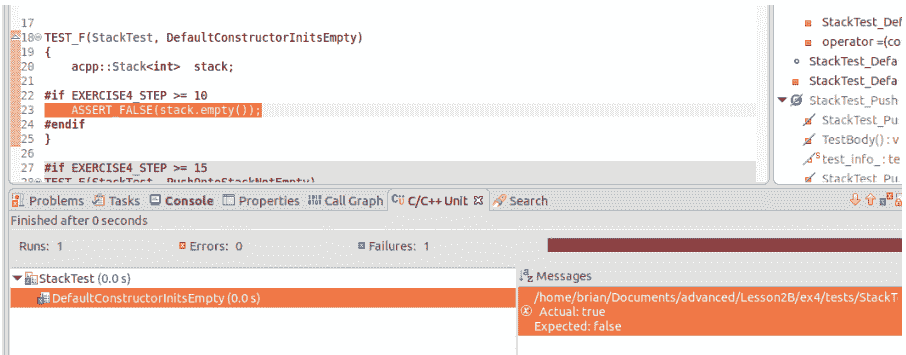

#### 图2B.33：跳转到失败的测试

- 8. 单击失败测试的名称，即 DefaultConstructorInitsEmpty。它会在右侧的 Messages 部分显示失败原因。双击该消息，它会打开包含失败测试的文件并跳转到有问题的行，如前面的截图所示。这个测试有一个错误。在测试中，我们期望栈是空的。然而，我们可以看到 empty() 返回 false。

- 9. 将 ASSERT_FALSE 改为 ASSERT_TRUE，然后重新运行测试。这次测试会通过，因为它测试的是正确的内容。

- 10. 接下来，我们要添加一些类型别名，以备接下来的几个方法使用。在编辑器中，将以下行添加到 empty() 方法的正上方：

```cpp
using value_type = T;
using reference = value_type&;
using const_reference = const value_type&;
using size_type = std::size_t;
```

- 11. 单击 Run 按钮重新运行测试。它们应该会通过。在进行测试驱动开发时，口诀是先编写一个小测试并看到它失败，然后编写刚好足够的代码使其通过。在这种情况下，我们实际上验证了别名定义的正确性，因为编译失败也是测试失败的一种形式。现在我们可以准备添加 push 函数了。

- 12. 在编辑器中，通过修改 **Stack.hpp**，在 **empty()** 方法正下方添加以下代码：

```cpp
void push(const value_type& value)
{
    m_stack.push_back(value);
}
```

- 13. 在文件顶部，将 **EXERCISE4_STEP** 改为 **15**。单击 **Run** 按钮。现在有两个测试会运行并通过。在 **StackTests.cpp** 中的新测试 **PushOntoStackNotEmpty** 证明了 push 操作确实让栈不再为空。我们需要添加更多方法来确保它做了预期的事情。

- 14. 在编辑器中，通过修改 **Stack.hpp**，在 **push()** 方法正下方添加以下代码，并将 **EXERCISE4_STEP** 的值改为 **16**：

```cpp
size_type size() const
{
    return m_stack.size();
}
```

- 15. 单击 **Run** 按钮运行测试。现在应该有三个测试通过。

- 16. 在编辑器中，通过修改 **Stack.hpp**，在 **push()** 方法正下方添加以下代码，并将 **EXERCISE4_STEP** 的值改为 **18**：

```cpp
void pop()
{
    m_stack.pop_back();
}
```

- 17. 单击 **Run** 按钮运行测试。现在应该有四个测试通过。

- 18. 在编辑器中，通过修改 **Stack.hpp**，在 **pop()** 方法正下方添加以下代码，并将 **EXERCISE4_STEP** 的值改为 **20**：

```cpp
reference top()
{
    return m_stack.back();
}

const_reference top() const
{
    return m_stack.back();
}
```

- 19. 单击 Run 按钮运行测试。现在有五个测试通过，我们已经实现了一个栈。

- 20. 从“启动配置”下拉菜单中选择 L2BExercise4，并单击 Run 按钮。Exercise 4 将运行并产生类似下面的输出：

```
------ Exercise 4 ------
Stack is empty
Pushing 0.0F onto stack
Stack is not empty
Pushing 3.14159F onto stack
Stack has 2 items
Top item is 3.14159
Complete.
```

#### 图2B.34：Exercise 4 的输出

检查当前 Stack.hpp 文件中的代码。在类内部定义类型的方法在整个 STL 中都很常见（尽管由于历史原因，它们可能使用 typedef）。std::stack 模板接受两个参数，第二个参数定义了要使用的容器——vector 可能是第一个想到的容器。检查 StackTests.cpp 中的测试。测试的命名应当表明其测试目标，并且测试应当专注于验证该目标。

## 活动1：开发一个通用的“contains”模板函数

Python 编程语言有一个名为 "in" 的成员运算符，可用于任何序列，即列表、序列、集合、字符串等。尽管 C++ 有超过 100 个算法，但它并没有一个等效的方法来实现同样的功能。C++20 在 std::set 上引入了 contains() 方法，但这还不够。我们需要创建一个 contains() 模板函数，使其适用于 std::set、std::string、std::vector 以及任何其他提供迭代器的容器。这一点可以通过该容器是否支持调用 end() 来判断。我们追求最佳性能，因此对于任何拥有 find() 成员方法的容器，我们都会调用该方法（这是最有效的方式），否则就回退到使用容器的 std::end()。我们还需要特殊处理 std::string，因为它的 find() 方法返回一个特殊值。

我们可以使用一个通用模板和两个特化来实现这一点，但本活动的目的是让我们使用 SFINAE 和 if constexpr 的技术使其正常工作。此外，该模板必须只适用于支持 end(C) 的类。请按照以下步骤来实现此活动：

- 1. 从 Lesson2B/Activity01 文件夹加载准备好的项目。
- 2. 定义辅助模板函数和类，使用 npos 成员来检测 std::string 的情况。
- 3. 定义辅助模板函数和类，检测类是否具有 `find()` 方法。
- 4. 定义 contains 模板函数，使用 constexpr 在三种实现之间选择——string 情况、具有 find 方法的情况或一般情况。

完成上述步骤后，预期输出应如下所示：

```
------ Activity 1 ------
Set contains 5: true
Set contains 15: false
Vector contains 5: true
Vector contains 15: false
String contains 'times': true
String contains 'Light': false
String contains 'm': true
String contains 'z': false

Complete.
```

### 图2B.35：contains 成功实现的输出

> **注意**
> 
> 本活动的解决方案可在第 653 页找到。

## 总结

在本章中，我们学习了接口、继承和多态，这些扩展了我们对类型所能执行操作的技能。我们第一次涉足了使用 C++ 模板的泛型编程，并了解了 C++ 标准库（包括 STL）为我们免费提供的内容。我们探索了 C++ 中一个开箱即用的特性，即模板类型推导，它使我们在使用模板时更加轻松。随后，我们进一步深入模板，学习了如何使用 SFINAE 和 if constexpr 来控制编译器包含的模板部分。这些构成了我们 C++ 学习之旅的基础。在下一章中，我们将重新审视栈和堆，并理解什么是异常、异常发生时会发生什么以及何时会发生。我们还将学习如何在发生异常时保护我们的程序免受资源损失。


