# 3 不允许泄漏——异常与资源

## 学习目标

学完本章后，你将能够：

- 开发管理资源的类
- 开发异常健壮的代码，通过RAII确保资源不泄漏
- 实现能够通过移动语义转移资源所有权的类
- 实现控制隐式转换的类

在本章中，你将学习如何使用类来管理资源、防止泄漏，以及避免复制大量数据。

## 引言

在*第2A章：禁止鸭子——类型与推导*中，我们简单接触了一些概念，例如智能指针和移动语义。在本章中，我们将进一步探讨它们。事实证明，这些主题与资源管理和编写健壮代码（能够长时间频繁运行而不出问题的代码）密切相关。

为了理解会发生什么，我们将探讨变量在内存中的位置，以及它们超出作用域时的时间和发生的事情。

我们将查看编译器为我们的输入生成的汇编代码，并探讨当异常发生时这一切会受到怎样的影响。

### 变量作用域与生命周期

在*第2B章：禁止鸭子——模板与推导*中，我们讨论了变量作用域和生命周期。让我们快速回顾它们的不同类型：

**作用域：**

- **局部作用域**（也称为**块作用域**）：适用于在花括号（`{}`）包围的块内声明的任何内容。
- **全局/文件作用域**：适用于在普通函数或类之外声明的变量，也适用于普通函数。

**生命周期：**

- **自动生命周期**：局部变量在声明时创建，离开所在作用域时销毁。它们由栈管理。
- **永久生命周期**：全局变量和静态局部变量具有永久生命周期。
- **动态生命周期**：变量由程序员根据需要创建和销毁（使用`new`和`delete`运算符）。这些变量的内存从堆中分配。

我们将使用以下程序来清晰地说明**局部变量**的行为——包括具有**自动生命周期**的变量和具有**动态生命周期**的变量：

```
 1: #include <iostream>
 2:
 3: struct Int
 4: {
 5:     Int(int value) : m_value(value)
 6:     {
 7:         std::cout << "Int(" << m_value << ") @" << this << " - IntCon\n";
 8:     };
 9:     Int() : m_value(0)
10:     {
11:         std::cout << "Int(" << m_value << ") @" << this << " - DefCon\n";
12:     };
13:     ~Int()
14:     {
15:         std::cout << "~Int()  @" << this << "\n";
16:     };
17:     Int(const Int& rhs) : m_value(rhs.m_value)
18:     {
19:         std::cout << "Int(" << m_value << ") @" << this << " - CopyCon\n";
20:     };
21:     int m_value;
22: };
23:
24: Int add(Int a, Int b)
25: {
26:     return a.m_value + b.m_value;
27: }
28:
29: Int subtract(Int a, Int b)
30: {
31:     return a.m_value - b.m_value;
32: }
33:
34: void calculate()
35: {
36:     Int a{25};
37:     Int b{50};
38:
39:     {
40:         Int c = add(a, b);
41:         Int d = subtract(a, b);
42:     }
43:     Int* e = new Int(add(subtract(a, b), a));
44: }
45:
46: int main()
47: {
48:     calculate();
49: }
```

图3.1：用于测试变量作用域和生命周期的程序

这些抽象概念有助于我们解释幕后发生的事情。PC栈（程序计数器栈）用于保存程序计数器的值（一个指向下一条需要执行指令的寄存器），而数据栈保存我们正在操作的值或地址。虽然它们是两个独立的栈，但在真实的CPU上，很可能实现为一个栈。让我们看看下面的表格，其中我们使用缩写OLn来指代前面程序输出中的行号：

| 代码行 | 发生什么 | PC栈 | 数据栈 |
|---|---|---|---|
| 第48行 | 将第49行的地址压入PC栈，程序跳转到calculate()。 | 第49行 | – |
| 第36行 | 变量a以值25构造 – OL1。 | 第49行 | a = 25 |
| 第37行 | 变量b以值50构造 – OL2。 | 第49行 | a = 25<br>b = 50 |
| 第40行 | b的副本复制构造 – OL3并压入栈。<br>a的副本复制构造 – OL4并压入栈。 | 第49行 | a = 25<br>b = 50<br>b = 50<br>a = 25 |
| 第40行 | 将第40行的地址压入PC栈，程序跳转到add()。 | 第49行<br>第40行 | a = 25<br>b = 50<br>b = 50<br>a = 25 |
| 第26行 | 计算a和b的和。然后，用结果构造一个新的临时Int对象（OL5）并将其压入栈。 | 第49行<br>第40行 | a = 25<br>b = 50<br>b = 50<br>a = 25<br>temp = 75 |
| 第26行 | 从PC栈弹出PC，并返回到我们跳转位置之后的下一条指令。 | 第49行 | a = 25<br>b = 50<br>b = 50<br>a = 25<br>temp = 75 |

图3.3：测试程序执行的详细分析（第1部分）

下面是测试程序执行详细分析的第二部分：

| 代码行 | 发生什么 | PC栈 | 数据栈 |
|---|---|---|---|
| 第40行 | 用临时值初始化变量c，并清理压入栈的a和b的副本（OL6–7）。 | 第49行 | a = 25<br>b = 50<br>c = 75 |
| 第41行 | 使用subtract重复这些操作并创建d（OL8–12）。 | 第49行 | a = 25<br>b = 50<br>c = 75<br>d = 25 |
| 第42行 | 作用域结束。清理c和d变量（OL13–14）。 | 第49行 | a = 25<br>b = 50 |
| 第43行 | 为e分配足够的内存（new Int），然后根据计算出的值构造它。如下图所示： | 第49行 | a = 25<br>b = 50<br>e = 指向堆中Int的指针 |

图3.4：测试程序执行的详细分析（第2部分）

下面是测试程序执行详细分析的第三部分：

| 代码行 | 发生什么 | PC栈 | 数据栈 |
|---|---|---|---|
| **第43行** | 计算：将a和b的副本压入栈（OL15–16），调用subtract得到临时值（OL17），将a压入栈（OL18），调用add得到传递给构造函数的0结果（OL19）。清理副本和临时值（OL20–23）。 | 第49行 | a = 25<br>b = 50<br>e = 指向Int的指针（值 = 0） |
| **第44行** | 作用域结束。清理a、b和e（OL24–25）。如下图所示：<br><br>*[示意图，展示栈和堆，包含三个栈条目和一个`Int (0)`堆对象]* | 第49行 | – |
| **第44行** | 从PC栈弹出PC，并返回到我们跳转后（第49行）的下一条指令。 | – | – |
| **第49行** | 程序退出。 |  |  |

图3.5：测试程序执行的详细分析（第3部分）

从这个简单程序中，我们了解到一些重要事实：

- 当我们按值传递时，会调用复制构造函数（正如本例中所做的那样）。
- 返回一个类型只导致调用一个构造函数（而不是两个构造函数——一个用于创建返回对象，一个用于存储返回数据的变量）——C++称之为**复制省略**，现在这在标准中是强制性的。

```
if (is_valid(buffer))
    return FileCheckStatus::InvalidContents;

return FileCheckStatus::Good;
}
```

前面的函数使用一种称为**状态**或**错误码**的技术来报告操作的结果。这是C风格编程中使用的方法，用于处理与**POSIX API**和**Windows API**相关的错误。

> **注意**
>
> **POSIX** 代表**可移植操作系统接口**。它是IEEE标准，用于Unix变体和其他操作系统之间的软件兼容性。

这意味着方法的调用者必须检查返回值，并为每种错误类型采取适当的措施。当你能推断代码将产生的错误类型时，这种方法效果很好。但情况并不总是如此。例如，输入程序的数据可能存在问题。这会导致程序进入无法处理的异常状态。处理错误的逻辑代码与检测问题的代码被分离开来。

虽然编写处理此类问题的代码是可能的，但它增加了处理所有错误条件的复杂性，从而使程序难以阅读，难以推断函数应该做什么，因此非常难以维护。

对于错误处理，异常相比错误码具有以下优势：

- 错误码可以被忽略——异常强制处理错误（否则程序终止）。
- 异常可以沿着栈向上传播到最适合响应错误的方法。错误码则需要通过每个中间方法进行传播。
- 异常将错误处理与主程序流程分离，从而使软件易于阅读和维护。
- 异常将检测错误的代码与处理错误的代码分离开来。


只要遵循最佳实践并将异常用于异常情况，使用异常就不会有（时间）开销。这是因为一个实现良好的编译器会提供 C++ 的格言——你不为未使用的功能付费。它可能会占用一些内存，你的代码可能会大一点，但运行时间应该不受影响。

C++ 使用异常来处理运行时异常。通过使用异常，我们可以检测到错误，抛出异常，并且错误会向后传播到可以处理它的位置。让我们修改之前的程序来引入 `divide()` 函数，并更改 `calculate()` 函数使其调用它。我们还将在 `main()` 函数中添加日志，以便我们可以探索异常的行为：

```
```cpp
Int divide(Int a, Int b )
{
    return a.m_value/b.m_value;
}

void calculate()
{
    Int a{25};
    Int b{50};
    Int c{0};

    {
        auto result1 = divide(b, a);
        // auto result2 = divide(a, c);
    }
    auto sum = add(a,b);
}

int main()
{
    std::cout << "Enter main\n";
    calculate();
    std::cout << "Exit main\n";
}
```
```

图 3.6：用于研究异常的修改后的测试程序

当我们编译并运行前面的程序时，会生成以下输出：

```
+-------- Program Output --------+
|                               |
user@linux:~$ ./except
Enter main
Int(25) @0xffffffcbe c - intCon          - calculate: Int a{25}
Int(50) @0xffffffcbe8 - intCon          - calculate: Int b{50}
Int(0) @0xffffffcbe4 - intCon           - calculate: Int c{0}
Int(25) @0xffffffcbf0 - CopyCon         - copy a for call to divide()
Int(50) @0xffffffcbf4 - CopyCon         - copy b for call to divide()
Int(2) @0xffffffc bdc - intCon          - result of divide (50/25) to result1
~Int() @0xffffffcbf4                     - destroy copy of b for call to divide()
~Int() @0xffffffcbf0                     - destroy copy of a for call to divide()
~Int() @0xffffffc bdc                    - end of scope destroy result1
Int(50) @0xffffffcbf8 - CopyCon         - copy b for call to add()
Int(25) @0xffffffcbfc - CopyCon         - copy a for call to add()
Int(75) @0xffffffcbe0 - intCon          - result of add(25,50) to sum
~Int() @0xffffffcbfc                     - destroy copy of a for call to add()
~Int() @0xffffffcbf8                     - destroy copy of b for call to add()
~Int() @0xffffffcbe0                     - end of calculate() scope destroy sum
~Int() @0xffffffcbe4                     - end of calculate() scope destroy c
~Int() @0xffffffcbe8                     - end of calculate() scope destroy b
~Int() @0xffffffcbe c                    - end of calculate() scope destroy a
Exit main
user@linux:~$
```

图 3.7：测试程序的输出

在前面的代码中，你可以看到注释被添加到右侧。现在，我们删除程序中 result2 行的注释，重新编译程序并重新运行它。生成的新的输出如下所示：

```
user@linux:~$ ./except
Enter main
Int(25) @0xffffffcbe4 - intCon          - calculate: Int a{25}
Int(50) @0xffffffcbe0 - intCon          - calculate: Int b{50}
Int(0) @0xffffffc bdc - intCon          - calculate: Int c{0}
Int(25) @0xffffffcbe8 - CopyCon         - copy a for call to divide()
Int(50) @0xffffffcbe c - CopyCon        - copy b for call to divide()
Int(2) @0xffffffcbd4 - intCon           - result of divide (50/25) to result1
~Int() @0xffffffcbe c                   - destroy copy of b for call to divide()
~Int() @0xffffffcbe8                   - destroy copy of a for call to divide()
Int(0) @0xffffffcbf0 - CopyCon          - copy c for call to divide()
Int(25) @0xffffffcbf4 - CopyCon         - copy a for call to divide()
Floating point exception (core dumped)
user@linux:~$
```

图 3.8：测试程序的输出 – result2

通过比较输出，我们可以看到每个输出的前八行是相同的。前一个输出的接下来的两行被添加，因为 `divide()` 函数被调用了两次。最后一行表明抛出了一个异常并且程序被终止了。

我们的代码已将程序控制转移到 `main()` 函数中的 `catch()` 语句，并已执行在 `try` 子句中调用时在栈上构造的所有变量的析构函数。

## 栈展开

销毁所有局部函数变量的过程，由 C++ 语言保证，被称为栈展开。当异常存在时栈展开时，C++ 使用其明确定义的规则销毁作用域中的所有对象。

当发生异常时，函数调用栈从当前函数开始线性搜索回调用它的函数，再到调用它的那个函数，依此类推，直到找到匹配该异常的异常处理程序（由 catch 块表示）。

如果找到异常处理程序，则会发生栈展开，销毁栈中所有函数的所有局部变量。对象以与创建顺序相反的顺序销毁。如果没有找到处理程序来处理抛出的异常，则程序终止（通常不会警告用户）。

### 练习 1：在 Fraction 和 Stack 中实现异常

在本练习中，我们将回到我们在第 2A 章《No Ducks Allowed – Types and Deduction》和第 2B 章《No Ducks Allowed – Templates and Deduction》中处理的两个类——Fraction 和 Stack，这两个类都可能出现运行时异常。我们将更新它们的代码，以便在检测到任何问题时都可以引发异常。按照以下步骤实现此练习：

- 1. 打开 Eclipse 并使用 Lesson3 示例文件夹中的文件创建一个名为 Lesson3 的新项目。
- 2. 由于这是一个基于 CMake 的项目，请将当前构建器更改为 CMake Build（便携式）。
- 3. 转到 Project | Build All 菜单以构建所有练习。默认情况下，屏幕底部的控制台将显示 CMake Console [Lesson3]。
- 4. 配置一个新的启动配置 L3Exercise1 以使用名称 Exercise1 运行。
- 5. 另外，配置一个新的 C/C++ 单元运行配置 L3Ex1Tests，以运行 L3Ex1tests。设置 Google Tests Runner。
- 9. 单击失败的测试名称 – **Messages** 窗口现在将显示预期行为和实际行为。你可能需要向右滚动才能全部阅读。在最右边它指示“**Expected ... throws an exception of type std::domain_error**”并且下一行说明“**Actual: it throws nothing**”。
- 10. 双击消息，它将带你到以下测试：

```
20 TEST_F(FractionTest, ThrowsDomainErrorForZeroDenominator )
21 {
22     // ASSERT_THROW confirms the type of exception thrown
23     ASSERT_THROW(({
24         try
25         {
26             Fraction f1{1,0};
27         }
28         catch( const std::domain_error& e )
29         {
30             // and this tests that it has the correct message
31             EXPECT_STREQ( "Zero Denominator", e.what() );
32             throw; // Re-throw for the EXPECT_THROW to check
33         }
34     }), std::domain_error );
35 }
```

图 3.14：失败的测试

**ASSERT_THROW()** 宏需要两个参数。由于 **Fraction 初始化器** 中包含逗号，因此有必要将整个第一个参数用额外的一组括号括起来。第二个参数期望从此构造函数获得 **std::domain_error**。内部的 **try/catch** 结构用于确认预期的字符串是否被捕获在异常对象内部。如果我们不想检查它，那么我们可以简单地这样编写测试：

```
ASSERT_THROW(({Fraction f1{1,0}; }), std::domain_error);
```

- 11. 在编辑器中打开文件 **Fraction.cpp**。在文件顶部附近插入以下行：

```
#include <stdexcept>
```

- 12. 修改构造函数以在用零分母创建时抛出异常：

```
Fraction::Fraction(int numerator, int denominator)
    : m_numerator{numerator}, m_denominator{denominator}
{
    if(m_denominator == 0)
    {
```


```
throw std::domain_error("Zero Denominator");
}
}
```

- 13. 点击 **Run** 按钮重新运行测试。**19 tests** 现在通过。
- 14. 在编辑器中打开 **Fraction.hpp** 并将文件顶部附近的行更改为如下所示：

```cpp
#define EXERCISE1_STEP 20
```

- 15. 点击 **Run** 按钮重新运行测试 – 新的测试 **ThrowsRunTimeErrorForZeroDenominator** 失败。
- 16. 点击失败的测试名称 – **Messages** 窗口现在将显示预期的行为和实际行为。你可能需要向右滚动以全部阅读。在最右边它指示 **"Expected... throws an exception of type std::runtime_error"** 而下一行说明 **"Actual: it throws a different type"**。
- 17. 再次双击消息以打开失败的测试：

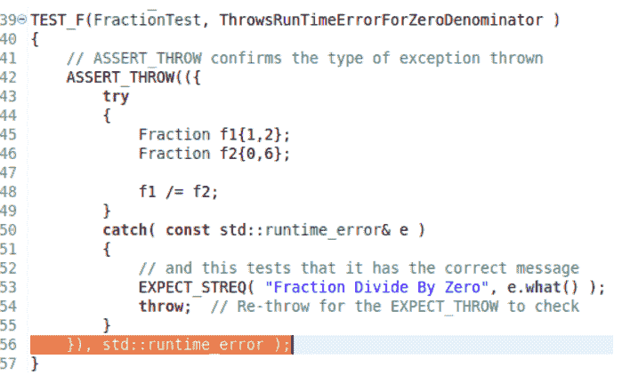

图 3.15：另一个失败的测试

该测试正在验证除法赋值运算符会在除零时抛出异常。

- 18. 打开 **Fraction.cpp** 并找到 **operator/=()** 函数。你会看到，在此函数内部，它实际上使用了 **Fraction** 的构造函数，因此它会抛出 **std::domain_error**。

- 19. 现在修改 operator/=( )，使其在调用构造函数之前检测此问题，以便它抛出具有预期消息的 std::runtime_error。
- 20. 通过添加将检测除法运算符的域错误来修改 Fraction.cpp：

```
Fraction& Fraction::operator/=(const Fraction& rhs)
{
    if (rhs.m_numerator == 0)
    {
        throw std::runtime_error("Fraction Divide By Zero");
    }
    Fraction tmp(m_numerator*rhs.m_denominator,
    m_denominator*rhs.m_numerator);
    *this = tmp;
    return *this;
}
```

- 21. 点击 Run 按钮重新运行测试。全部 20 个测试通过。
- 22. 在编辑器中打开 Stack.hpp 并将文件顶部附近的行更改为如下所示：

```
#define EXERCISE1_STEP 27
```

- 23. 点击 Run 按钮重新运行测试 – 我们添加了一个测试，它将尝试从空栈中弹出。在 C/C++ Unit 选项卡窗口中，点击 FractionTest 旁边的三角形以折叠测试列表并显示 StackTest：

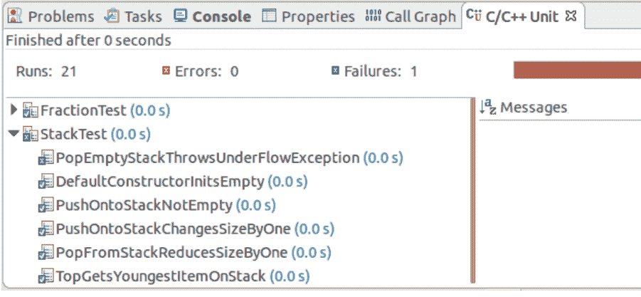

图 3.16：pop Stack 测试失败

- 24. 使用 C/C++ Unit 窗口点击浏览并找到失败的测试。确定预期的异常，然后打开 Stack.hpp。在文件顶部添加 #include <stdexcept>，然后更新 pop() 函数使其如下所示：

```
void pop()
{
    if(empty())
        throw std::underflow_error("Pop from empty stack");
    m_stack.pop_back();
}
```

- 25. 点击 Run 按钮重新运行测试。21 个测试现在通过。
- 26. 在编辑器中打开 Stack.hpp 并将文件顶部的行更改为如下所示：

```
#define EXERCISE1_STEP  31
```

- 27. 点击 Run 按钮重新运行测试 – 新添加的测试 TopEmptyStackThrowsUnderFlowException 失败。
- 28. 使用 C/C++ Unit 窗口点击浏览并找到失败的测试。确定预期的异常，然后打开 Stack.hpp。更新非 const top() 方法使其如下所示：

```
reference top()
{
    if(empty())
        throw std::underflow_error("Top from empty stack");
    return m_stack.back();
}
```

- 29. 点击 Run 按钮重新运行测试。22 个测试通过。
- 30. 在编辑器中打开 Stack.hpp 并将文件顶部的行更改为如下所示：

```
#define EXERCISE1_STEP  35
```

- 31. 点击 Run 按钮重新运行测试 – 新添加的测试 TopEmptyConstStackThrowsUnderFlowException 失败。
- 32. 使用 C/C++ Unit 窗口点击浏览并找到失败的测试。确定预期的异常，然后打开 Stack.hpp。更新 const top() 方法使其如下所示：

```
const_reference top() const
{
```

指针可能指向静态变量、全局变量，或从堆分配的内存，以确保指向的对象在异常被处理时仍然存在。现在，我们已经解决了保持异常对象存活的问题。但当处理程序处理完它之后，捕获者会对其做什么呢？

异常的捕获者并不了解异常对象的创建方式（**global**、**static** 或 **heap**），因此它不知道是否应该删除接收到的指针。因此，通过指针抛出异常并不是推荐的抛出异常方法。

抛出的对象将被复制到创建的临时异常对象中并交给处理程序。当异常被处理后，临时对象将简单地被销毁，程序将继续执行。对其的处理没有任何歧义。因此，最佳实践是按 **值** 抛出异常。

## 标准库异常

C++ 标准库将 **std::exception** 定义为所有标准库异常的基类。标准定义了以下 **exceptions/errors** 的第一级层次结构（括号中的数字表示从该类派生的异常数量）：

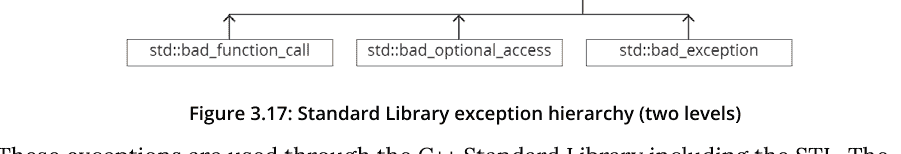

图 3.17：标准库异常层次结构（两级）

这些异常在 C++ 标准库包括 STL 中使用。当创建自己的异常类时，最佳实践是从标准异常之一派生它。正如我们接下来将看到的，你的特殊异常可以被标准异常之一的处理程序捕获。

## 捕获异常

在讨论异常的必要性时，我们介绍了抛出异常的想法，但并没有真正查看 C++ 如何支持捕获异常。异常处理过程从将一段代码包装在 try 块中开始，以将其置于异常检查之下。try 块后面跟着一个或多个 catch 块，它们是异常处理程序。当在 try 块内部执行的代码发生异常情况时，会抛出异常，控制权转移到异常处理程序。如果没有抛出异常，则所有异常处理程序都会被跳过，try 块中的代码完成，正常执行继续。让我们用代码片段表达这些概念：

```
void SomeFunction()
{
    try {
        // code under exception inspection
    }
    catch(myexception e)        // first handler - catch by value
    {
        // some error handling steps
    }
    catch(std::exception* e)    // second handler - catch by pointer
    {
        // some other error handling steps
    }
    catch(std::runtime_error& e) // third handler - catch by reference
    {
        // some other error handling steps
    }
    catch(...)                  // default exception handler - catch any exception
    {
        // some other error handling steps
    }
    // Normal programming continues from here
}
```

前面的片段显示了必要的关键字 – try 和 catch 并介绍了三种不同的 catch 模式（不包括默认处理程序）：

- **按值捕获异常**：这是一种昂贵的方法，因为异常处理程序像任何其他函数一样被处理。按值捕获意味着必须创建异常对象的副本然后传递给处理程序。第二个副本的创建减慢了异常处理过程。此类型也可能遭受对象切片，其中抛出子类，而 catch 子句是超类。catch 子句然后只会接收超类对象的副本，从而丢失原始异常对象的属性。因此，我们应避免按值捕获异常的处理程序。
- **按指针捕获异常**：如在讨论按值抛出时所述，使用这种异常处理程序样式，只能捕获通过指针抛出的异常。由于我们只想按值抛出，因此应避免按指针捕获异常的处理程序。
- **按引用捕获异常**：这是推荐的异常处理程序样式，因为它不会遭受按值捕获和按指针捕获相关的问题。由于向处理程序传递的是引用，因此不会创建异常对象的第二个副本。切片不会发生，因为引用仍然引用最初抛出的异常对象。而且由于异常是按值抛出的，临时异常对象将在我们使用完它后自动销毁。

> **Note**
> 处理异常时，应为 **throw-by-value** 和 **catch-by-reference**。

当有多个 catch 块时，异常对象类型用于按指定的顺序匹配处理程序。一旦找到匹配的处理程序，它将被执行，其余的异常处理程序将被忽略。这与函数解析不同，后者编译器会找到与参数的最佳匹配。因此，异常处理程序（catch 块）应从更具体到更一般进行定义。例如，默认处理程序（**catch(...)**）应始终在定义中最后出现。


### 练习 2：实现异常处理器

在本练习中，我们将实现一个异常处理器层次结构来管理异常的处理方式。按照以下步骤实现本练习：

+   1. 在 Eclipse 中打开 **Lesson3** 项目。然后在 **Project Explorer** 中展开 **Lesson3** 然后 **Exercise02** 并双击 **exceptions.cpp** 以在编辑器中打开该练习的文件。此文件包含以下代码：

```
```cpp
#include <exception>
#include <iostream>

void run_exceptions()
{
    try
    {
        throw std::domain_error("We got one!!!!");
    }
    catch(...)
    {
        std::cout << "Exception caught by default handler\n";
    }
    catch(const std::exception& e)
    {
        std::cout << "Exception '" << e << "' caught by std::exception handler\n";
    }
    catch(const std::logic_error& e)
    {
        std::cout << "Exception '" << e << "' caught by std::logic_error handler\n";
    }
    catch(const std::domain_error& e)
    {
        std::cout << "Exception '" << e << "' caught by std::domain_error handler\n";
    }
}

int main()
{
    std::cout << "\n\n------ Exercise 2 ------\n";
    run_exceptions();
```

```
std::cout << "Complete.\n";
return 0;
}
```

> **注意**
> 
> 所有异常处理器都使用了相同的异常参数名称，即 *e*。该变量的作用域仅限于声明它的 catch 块。

+   2. 点击 **Launch Configuration** 下拉菜单并选择 **New Launch Configuration....** 从 **Search Project** 菜单配置 **L3Exercise2** 应用程序以使用名称 **L3Exercise2** 运行它。
+   3. 完成后，它将成为当前选定的 **Launch Configuration**。
+   4. 点击 **Run** 按钮。练习 2 将运行并产生以下输出：

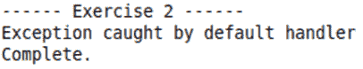

图 3.18：练习 2 输出 – 默认处理器捕获了异常

+   5. 在 Console 窗口中，点击 **Display Selected Console** 按钮，并选择 **CDT Global Build Console**。滚动浏览窗口。你会发现（如果使用的是 GCC 编译器）与我们放置异常处理器的顺序相关的五条警告信息。（实际上，第一条警告通常会是错误，只是 **CMake** 文件在编译此目标时设置了 **-fpermissive** 标志。）
+   6. 在编辑器中，将默认异常处理器 **catch(...)** 移到 **std::domain_error** 处理器之后。点击 **Run** 按钮。练习 2 将运行并产生以下输出：

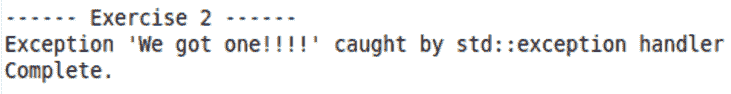

图 3.19：std::exception 处理器已被使用

+   7. 在编辑器中，将 **std::exception** 处理器移到 **std::domain_error** 处理器之后。点击 **Run** 按钮。这次，它将报告 **std::logic_error** 处理器被执行。
+   8. 在编辑器中，将 `std::logic_error` 处理器移到 `std::domain_error` 处理器之后。点击 **Run** 按钮。这次，它将报告 `std::domain_error` 处理器被执行，这正是我们所期望的。
+   9. 现在将 `throw` 行改为 `std::logic_error` 异常。点击 **Run** 按钮。这次，它将报告 `std::logic_error` 处理器被执行，如预期。
+   10. 现在将 `throw` 行改为 `std::underflow_error` 异常。点击 **Run** 按钮，这次它将报告异常被 `std::exception` 处理器捕获，如预期。`std::exception` 是所有标准库异常的基类。

在本练习中，我们实现了一系列异常处理器并观察了异常处理器的顺序如何影响异常的捕获方式，以及如何使用异常层次结构。

## CMake 生成器表达式

在使用 **CMake** 时，有时需要调整变量的值。**CMake** 是一个构建生成系统，可以为许多构建工具和编译器工具链生成构建文件。由于这种灵活性，如果你想在编译器中启用某个功能，只需将其应用于特定类型即可。这是因为不同厂商之间的命令行选项不同。例如，启用 g++ 编译器 C++17 支持的命令行选项是 **-std=c++17**，但对于 **msvc** 则是 **/std:c++17**。如果打开 **CMakeLists.txt** 文件并定位 **L3Exercise2 add_executable**，则其后会有以下行：

```
target_compile_options(L3Exercise2 PRIVATE $<$<CXX_COMPILER_ID:GNU>:-fpermissive>)
```

这使用了 **$<CXX_COMPILER_ID:GNU>** 变量查询来检查是否为 GCC 编译器。如果是，则生成 1（真），否则为 0（假）。它还使用了 **$<condition:true_string>** 条件表达式，仅为 **L3Exercise2** 目标的 gcc 编译器将 **-fpermissive** 添加到编译器选项中。这些可以为每种编译器类型分别通过对 **target_compile_options** 的调用添加，也可以通过一次调用完成。

> **注意**
> 
> 有关生成器表达式的更多信息，请查看以下链接：https://cmake.org/cmake/help/v3.15/manual/cmake-generator-expressions.7.html。

## 异常使用指南

在使用 C++ 代码中的异常时，请记住以下几点：

+   - 原则：**按值抛出，按引用捕获**
+   - **不要使用异常进行正常程序流程。** 如果函数遇到异常条件且无法满足其（功能）义务，则仅在此时才抛出异常。如果函数可以解决异常条件并履行其义务，则这不是异常。它们被称为异常是有原因的，如果你不使用它们，就不会产生任何处理开销。
+   - **不要在析构函数中抛出异常。** 请记住，由于栈展开，局部变量析构函数将被执行。如果在栈展开过程中调用析构函数并抛出异常，则程序将终止。
+   - **不要吞掉异常。** 不要使用默认的 catch 处理器而不对异常做任何处理。异常被抛出是为了指示存在问题，你应该对此采取行动。忽略异常可能导致以后难以排查的故障。这是因为吞掉的异常会真正丢失任何有用的信息。
+   - **异常对象是从 throw 处复制的。**

## 资源管理（在异常世界中）

到目前为止，我们已经研究了局部变量作用域，以及当变量超出作用域时 `automatic` 和 `dynamic lifetime variables` 如何被处理 – 自动生命周期变量（放置在栈上的变量）会被完全析构，而 `dynamic lifetime variables`（由程序员分配到堆上的变量）不会被析构：我们只是丢失了对它们的访问。我们还看到，当抛出异常时，会找到最近匹配的处理程序，并且在抛出点和处理程序之间的所有局部变量都将通过栈展开过程被析构。

我们可以利用这一知识编写健壮的资源管理类，使我们无需跟踪资源（动态生命周期变量、文件句柄、系统句柄等），以确保在我们使用完后将其释放（归还）。用于在正常操作和异常情况下管理资源的技巧被称为 **资源获取即初始化（RAII）**。

// 响应异常
}
}

这段代码显示了资源管理存在的两个潜在问题：

+   - 最重要的是，在打开和关闭文件之间发生异常会导致资源泄漏。如果这是系统资源，许多此类泄漏可能导致系统不稳定或应用程序性能受损，因为资源被耗尽。
+   - 此外，在一个方法中管理多个资源可能导致因错误处理而产生深层嵌套子句。这不利于代码的可读性，从而影响其理解和可维护性。很容易忘记释放资源，尤其是在存在多个退出点时。

那么，我们如何管理资源以获得异常安全且更简单的代码？这个问题并不独特于 C++，不同语言以不同方式处理它。Java、C# 和 Python 使用垃圾回收方法，在对象不再被引用时对其进行清理。但 C++ 没有垃圾回收，那么解决方案是什么？

考虑以下类：

```
class File {
public:
    File(const char* name, const char* access) {
        m_file = fopen(name, access);
        if (m_file == nullptr) {
            throw std::ios_base::failure("failed to open file");
        }
    }

    ~File() {
        fclose(m_file);
    }

    operator FILE*() {
        return m_file;
```


```
}

private:
    FILE* m_file{};
};
```

该类实现了以下特性：

+   - 构造函数获取资源。
+   - 如果构造函数中未能获取资源，则抛出异常。
+   - 当类被销毁时，释放资源。

如果我们在 **do_something()** 方法中使用这个类，代码将如下所示：

```
void do_something()
{
    try
    {
        File in("input.txt", "r");
        File out("output.txt", "w");

        // Do some work
    }
    catch(std::exception& e)
    {
        // Respond to the exception
    }
}
```

如果在执行此操作时发生异常，C++ 保证所有基于栈的对象都会调用其析构函数（**栈展开**），从而确保文件被关闭。这解决了因异常而发生资源泄漏的问题，因为资源现在会被自动清理。此外，这种方法非常易于阅读，我们无需担心错误处理就能理解逻辑流程。

该技术利用 File 对象的生命周期来获取和释放资源，确保资源不会泄漏。资源在管理类的构造（初始化）期间获取，并在管理类析构期间释放。正是这种作用域绑定资源的行为，催生了“资源获取即初始化”这一名称。

前面的示例处理的是作为系统资源的文件句柄的管理。它适用于任何需要在使用前获取、使用后释放的资源。RAII 技术可广泛应用于多种资源——打开的文件、打开的管道、分配的堆内存、打开的套接字、执行线程、数据库连接、互斥锁/临界区的锁定——基本上涵盖了宿主系统中稀缺且需要管理的任何资源。

### 练习 3：为内存和文件句柄实现 RAII

在本练习中，我们将实现两个不同的类，使用 RAII 技术来管理内存或文件。请按照以下步骤完成本练习：

+   1. 在 Eclipse 中打开 Lesson3 项目。然后在 Project Explorer 中展开 Lesson3，再展开 Exercise03，双击 Exercise3.cpp 在编辑器中打开本练习的文件。
+   2. 单击 Launch Configuration 下拉菜单，选择 New Launch Configuration...。从 Search Project 菜单中配置 L3Exercise3 应用程序，并以名称 L3Exercise3 运行它。
+   3. 单击 Run 按钮运行练习 3。这将产生以下输出：

```
------ Exercise 3 ------
allocated 20 bytes @ 0x56364f043280
allocated 20 bytes @ 0x56364f0432a0
allocated 20 bytes @ 0x56364f0432c0
allocated 20 bytes @ 0x56364f0432e0
allocated 20 bytes @ 0x56364f043300
------ Complete. ------
Leaked Memory Pointers...
  0: 0x56364f043280
  1: 0x56364f0432a0
  2: 0x56364f0432c0
  3: 0x56364f0432e0
  4: 0x56364f043300
Leaked Files...
  0: HelloB1.txt
  1: HelloB2.txt
```

图 3.20：Exercise3.cpp 中的内存和文件泄漏

输出显示我们分配了五次内存，并且地址由 `new` 返回。当从 `main()` 函数执行且 `monitor` 被销毁时，它会转储一份内存分配和释放的报告，以及打开但从未关闭的文件。

+   4. 在编辑器中，将以下内容键入 **Exercise3.cpp** 文件的 **File** 类中：

```
class File {
public:
    File(const char* name, const char* access) {
        m_file = fopen(name, access);
        if (m_file == nullptr) {
            throw std::ios_base::failure("failed to open file");
        }
    }

    ~File() {
        fclose(m_file);
    }

    operator FILE*() {
        return m_file;
    }
private:
    FILE* m_file{};
};
```

+   5. 单击 **Run** 按钮运行练习 3——它仍然会泄漏文件和内存，但代码是正确的。

+   6. 找到 **LeakFiles()** 函数并修改它，使其使用新的 **File** 类（如前面的代码所示）来防止文件泄漏：

```
void LeakFiles()
{
    File fh1{"HelloB1.txt", "w"};
    fprintf(fh1, "Hello B2\n");

    File fh2{"HelloB2.txt", "w"};
    fprintf(fh2, "Hello B1\n");
}
```

+   7. 单击 **Run** 按钮运行练习 3。如果你已正确修改 `LeakFiles()`，则输出将如下所示：

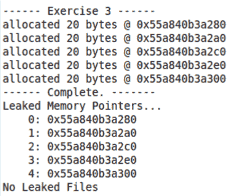

图 3.21：无文件泄漏

+   8. 现在在 **Exercise3.cpp** 中添加以下 `CharPointer` 类：

```
class CharPointer
{
public:
    void allocate(size_t size)
    {
        m_memory = new char[size];
    }

    operator char*() { return m_memory;}

private:
    char* m_memory{};
};
```

+   9. 将 `LeakPointers()` 修改为如下所示：

```
void LeakPointers()
{
    CharPointer memory[5];
    for (auto i{0} ; i<5 ; i++)
```

```
{
    memory[i].allocate(20);
    std::cout << "allocated 20 bytes @ " << (void *)memory[i] << "\n";
}
```

+   10. 单击 **Run** 按钮运行练习 3——它仍然有内存泄漏，但代码是正确的。

+   11. 现在，向 **CharPointer** 添加以下析构函数。请注意，**delete** 运算符使用了数组 [] 语法：

```
~CharPointer()
{
    delete [] m_memory;
}
```

+   12. 再次单击 **Run** 按钮运行练习 3——这一次，你应该会看到 monitor 报告没有泄漏：

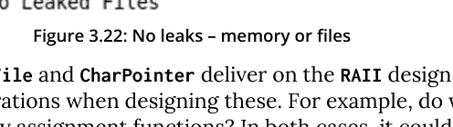

图 3.22：无泄漏——无论是内存还是文件

**File** 和 **CharPointer** 的实现体现了 RAII 设计方法，但在设计这些类时还有其他考虑因素。例如，我们是否需要复制构造函数或复制赋值函数？在这两种情况下，简单地将资源从一个对象复制到另一个对象都可能成为问题，因为这可能导致两次尝试关闭文件句柄或删除内存。通常，这会导致未定义行为。接下来，我们将结合实现资源管理对象（如 **File** 或 **CharPointer**）来重新审视特殊成员函数。

## 特殊编码技术

练习 3（*为内存和文件句柄实现 RAII*）的代码经过特殊编写，以便我们可以监控内存和文件句柄的使用情况，并在退出时报告任何泄漏。请查看 **monitor.h** 和 **monitor.cpp** 文件，并检查用于实现该 monitor 的两种技术：

+   - **预处理器宏**：这是预处理器宏的特殊用法，用于演示泄漏，不应在生产代码中使用，即通过文本替换来替代函数。
+   
+   如果你使用 Windows API 编程，偶尔可能会遇到方法名与 Microsoft 为其 API 方法定义的宏冲突的情况。例如，如果你包含了 **windows.h**，则不要将任何方法命名为 **SendMessage**。如果你这样做了，那么根据你构建的是 ASCII 模式还是 Unicode 模式，它将被分别替换为 **SendMessageA** 或 **SendMessageW**。
+   - **自定义我们自己的 new 处理器**：这是一种高级技术，除非你编写嵌入式代码，否则不太可能需要它。

### C++ 不需要 finally

其他支持异常抛出机制的语言（**C#**、**Java** 和 **Visual Basic.NET**）具有 **try/catch/finally** 范式，其中 **finally** 块中的代码在退出 try 块时被调用——无论是正常退出还是因异常退出。C++ 没有 **finally** 块，因为它拥有一种更好的机制，可以确保我们不会忘记释放资源——RAII。由于资源由局部对象表示，局部对象的析构函数将释放资源。

这种设计模式的另一个优点是，如果管理了大量资源，那么 **finally** 块将相应地变得很大。RAII 消除了对 finally 的需求，并带来了更易于维护的代码。

### RAII 与 STL

标准模板库（STL）在其许多模板和类中使用了 RAII。例如，C++11 中引入的智能指针，即 **std::unique_ptr** 和 **std::shared_ptr**，通过确保内存在使用完毕后被释放，或确保内存在其他地方使用时不被释放，从而避免了许多问题。STL 中的其他示例包括 **std::string**（内存）、**std::vector**（内存）和 **std::fstream**（文件句柄）。

### 谁拥有这个对象？

通过前面 **File** 和 **CharPointer** 的实现，我们已经测试了使用 RAII 进行资源管理。让我们进一步探索。首先，我们将定义一个不只拥有一种资源的类：

```
class BufferedWriter
{
public:
```


```
BufferedWriter(const char* filename);
~BufferedWriter();

bool write(const char* data, size_t length);

private:
    const size_t BufferSize{4096};
    FILE* m_file{nullptr};
    size size_t m_writePos{0};
    char* m_buffer{new char[BufferSize]};
};
```

该类用于缓冲对文件的写入。

> Note
> 使用派生自 iostream 的类时通常不需要此操作，因为它们本身已提供缓冲。

每次调用 write() 函数时，数据都会被添加到分配的缓冲区中，直到达到 BufferSize 时，数据才会被真正写入文件，并且缓冲区会被重置。

但如果我们想将这个 BufferedWriter 实例赋值给另一个实例或复制它呢？正确的行为是什么？

如果我们只是让默认的拷贝构造函数/拷贝赋值按其方式执行，我们会得到成员逐个的拷贝。这意味着我们有两个 BufferedWriter 实例，它们持有对同一文件的句柄和指向缓冲区的指针。当第一个对象实例被销毁时，作为优秀的程序员，我们会清理文件并关闭它，并通过删除来释放内存。第二个实例现在拥有一个已失效的文件句柄和指向我们已告知操作系统为下一个用户回收的内存的指针。任何尝试使用这些资源的行为，包括销毁它们，都会导致未定义行为，并且很可能导致程序崩溃。默认的拷贝构造函数/拷贝赋值运算符执行的是所谓的浅拷贝——也就是说，它按位逐位复制所有成员，但不复制它们所引用的内容。

我们拥有的两个资源可以被不同地处理。首先，只应有一个类拥有 m_buffer。有两种处理方式：

- 阻止类的拷贝，从而阻止内存的拷贝
- 执行深拷贝，其中第二个实例中的缓冲区由构造函数分配，并且第一个缓冲区的內容被复制

其次，只应有一个类拥有文件句柄 m_file。有两种处理方式：

- 阻止类的拷贝，从而阻止文件句柄的拷贝
- 将所有权从原始实例转移到第二个实例，并将原始实例标记为无效或空

实现深拷贝很容易，但我们如何转移资源的所有权？要回答这个问题，我们需要再次查看临时对象和值类别。

## Temporary Objects

临时对象是在表达式的结果被存入变量之前，或被遗忘之前，用于存储表达式的中间结果。表达式是返回值的任何代码，包括按值传递给函数、从函数返回值、隐式转换、字面量和二元运算符。临时对象是右值表达式，它们为表达式结果提供了一个临时分配的内存位置。在 C++11 之前，正是临时对象的创建以及数据在它们之间的拷贝导致了一些性能问题。为了解决这个问题，C++11 引入了右值引用，以实现所谓的移动语义。

## Move Semantics

右值引用（用双与号 '&&' 表示）是一种仅被赋予右值的引用，它会延长右值的生命周期，直到右值引用使用完毕。因此，右值可以活得比定义它的表达式更久。有了右值引用，我们现在可以通过移动构造函数和移动赋值运算符来实现移动语义。移动语义的目的是从被引用的对象窃取资源，从而避免昂贵的拷贝操作。移动完成后，被引用的对象必须被置于稳定状态。换句话说，被移动的对象必须被置于一种状态，在销毁时不会导致任何未定义行为或程序崩溃，并且不应影响从其窃取的资源。

```
smart_ptr(const smart_ptr& a)
{
    m_ptr = new T;
    *m_ptr = *a.m_ptr;      // use operator=() to do deep copy
}

// Copy assignment --> Do deep copy
smart_ptr& operator=(const smart_ptr& a)
{
    // Self-assignment detection
    if (&a == this)
        return *this;

    // Release any resource we're holding
    delete m_ptr;

    // Copy the resource
    m_ptr = new T;
    *m_ptr = *a.m_ptr;

    return *this;
}

T& operator*() const { return *m_ptr; }
T* operator->() const { return m_ptr; }
bool is_null() const { return m_ptr == nullptr; }
private:
    T* m_ptr{nullptr};
};

class Resource
```

```
{
public:
    Resource() { std::cout << "Resource acquired\n"; }
    ~Resource() { std::cout << "Resource released\n"; }
};
```

```
smart_ptr<Resource> createResource()
{
    smart_ptr<Resource> res(new Resource);                     // Step 1
    return res; // return value invokes the copy constructor      // Step 2
}
```

```
int main()
{
    smart_ptr<Resource> the_res;
    the_res = createResource(); // assignment invokes the copy assignment Step 3/4

    return 0; // Step 5
}
```

运行此程序时，生成以下输出：

```
$ ./smart_ptr.exe
Resource acquired
Resource acquired
Resource released
Resource released
$
```

Figure 3.23: Smart Pointer Program output

对于这样一个简单的程序，资源的获取和释放次数很多。让我们拆解一下：

- 1. createResource() 内部的局部变量 res 被创建并在堆上初始化（动态生命周期），导致第一个 "Resource acquired" 消息。

- 2. 编译器可能会为返回值创建另一个临时对象。然而，编译器已执行 **copy elision** 以移除拷贝（也就是说，它能够直接在调用函数分配的栈位置上构建对象）。编译器具有 **Return-Value-Optimization (RVO)** 和 **Named- Return-Value-Optimization (NRVO)** 优化，在 C++17 下在某些情况下这些优化是强制性的。

- 3. 临时对象通过拷贝赋值被赋给 main() 函数中的 `the_res` 变量。由于拷贝赋值执行深拷贝，又获取了资源的另一个拷贝。

- 4. 当赋值完成后，临时对象超出作用域，我们得到第一个 "Resource released" 消息。

- 5. 当 main() 函数返回时，`the_res` 超出作用域，从而释放第二个 Resource。

因此，如果资源很大，我们在 main() 中创建 **the_res** 局部变量的方法非常低效，因为由于拷贝赋值中的深拷贝，我们在创建和拷贝大块内存。然而，我们知道当 **createResource()** 创建的临时变量不再需要时，我们就会丢弃它并释放其资源。在这些场景下，将资源从临时对象转移（或移动）到类型的另一个实例会更高效。移动语义使得我们可以重写 **smart_ptr** 模板，使其不执行深拷贝而是转移资源。

让我们为 **smart_ptr** 类添加移动语义：

// Move constructor --> transfer resource
smart_ptr(smart_ptr&& a) : m_ptr(a.m_ptr)
{
    a.m_ptr = nullptr;    // Put into safe state
}

// Move assignment --> transfer resource
smart_ptr& operator=(smart_ptr&& a)
{
    // Self-assignment detection
    if (&a == this)
        return *this;

    // Release any resource we're holding

```
delete m_ptr;

// Transfer the resource
m_ptr = a.m_ptr;
a.m_ptr = nullptr;  // Put into safe state
return *this;
}
```

重新运行程序后，我们得到以下输出：

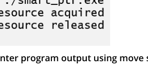

Figure 3.24: Smart pointer program output using move semantics

现在，由于移动赋值可用，编译器在以下行使用它：

```
the_res = createResource(); // assignment invokes the copy assignment Step 3/4
```

步骤 3 现在被移动赋值取代，意味着深拷贝已被移除。

步骤 4 不再释放资源，因为带有注释 "//" 的行将其置于安全状态——它不再拥有资源，因为所有权已被转移。

移动构造函数和移动赋值的一个需要注意的点是，与其拷贝版本的参数为 const 不同，它们的移动版本参数为非 const。这被称为所有权的转移，这意味着我们需要修改传入的参数。

移动构造函数的另一种实现可能如下所示：

// Move constructor --> transfer resource
smart_ptr(smart_ptr&& a)
{
    std::swap(this->m_ptr, a.m_ptr);
}

本质上，我们正在交换资源，并且 C++ STL 对 swap 提供了模板支持并有许多特化。这之所以可行，是因为我们使用成员初始化将 m_ptr 设置为 nullptr。因此，我们正在交换一个 nullptr 与 a 中存储的值。


既然我们已经修复了不必要的深拷贝问题，我们实际上可以从 smart_ptr() 中移除拷贝操作，因为我们真正想要的是所有权转移。如果我们将一个非临时 smart_ptr 实例拷贝到另一个非临时 smart_ptr 实例，那么我们将得到两个对象，它们会在离开作用域时删除资源，这不是期望的行为。为了移除（深）拷贝操作，我们按如下方式修改成员函数的定义：

```
smart_ptr(const smart_ptr& a) = delete;

smart_ptr& operator=(const smart_ptr& a) = delete;
```

我们在第2A章《禁止鸭子——类型与推导》中看到的 = delete 后缀告诉编译器，对具有该原型函数的访问尝试现在不再是有效代码，并会导致错误。

## STL 智能指针

与其编写我们自己的 smart_ptr，STL 提供了我们可以用来在对象上实现 RAII 的类。最初的版本是 std::auto_ptr()，它在 C++ 11 中被弃用，并在 C++ 17 中被移除。它是在右值引用支持之前创建的，并且因为它使用拷贝来实现移动语义而导致问题。C++ 11 引入了三个新模板来管理资源的生命周期和所有权：

- **std::unique_ptr**：通过指针拥有并管理单个对象，并在 unique_ptr 离开作用域时销毁该对象。它有两个版本：用于单个对象（使用 new 创建）和用于对象数组（使用 new[] 创建）。unique_ptr 与直接使用底层指针一样高效。
- **std::shared_ptr**：通过指针保留对象的共享所有权。它通过引用计数器来管理资源。每次将 shared_ptr 赋值给另一个 shared_ptr 的拷贝操作都会更新引用计数。当引用计数归零时，意味着没有所有者了，资源被释放/销毁。
- **std::weak_ptr**：提供与 shared_ptr 相同的资源接口，但不修改计数器。可以检查资源是否仍然存在，但它不会阻止资源被销毁。如果你确定资源仍然存在，那么可以使用它来获取指向该资源的 shared_ptr。它的一个用例是多个 shared_ptr 最终形成循环引用的场景。循环引用会阻止资源的自动释放。weak_ptr 用于打破循环，并允许资源在应该释放时被释放。

### std::unique_ptr

`std::unique_ptr()` 在 C++ 11 中引入，用于替代 `std::auto_ptr()`，它提供了 `smart_ptr` 所具备的一切（甚至更多）。我们可以将 `smart_ptr` 程序重写如下：

```
```cpp
#include <iostream>

#include <memory>

class Resource
{
public:
    Resource() { std::cout << "Resource acquired\n"; }
    ~Resource() { std::cout << "Resource released\n"; }
};

std::unique_ptr<Resource> createResource()
{
    std::unique_ptr<Resource> res(new Resource);
    return res;
}

int main()
{
    std::unique_ptr<Resource> the_res;
    the_res = createResource(); // assignment invokes the copy assignment
    return 0;
}
```
```

我们还可以更进一步，因为 C++ 14 引入了一个辅助方法，以确保在处理 `unique_ptr` 时的异常安全：

```
```cpp
std::unique_ptr<Resource> createResource()
{
    return std::make_unique<Resource>();
}
```
```

为什么这有必要？考虑下面的函数调用：

```
```cpp
some_function(std::unique_ptr<T>(new T), std::unique_ptr<U>(new U));
```
```

问题在于，编译器可以自由选择实参列表中操作的执行顺序。它可能先调用 **new T**，然后调用 **new U**，接着调用 **std::unique_ptr<T>()**，最后调用 **std::unique_ptr<U>()**。这个序列的问题是，如果 **new U** 抛出异常，那么由 **new T** 调用分配的资源还没有被放入 **unique_ptr**，也不会被自动清理。使用 **std::make_unique<>()** 可以保证调用顺序，使资源的构造和 **unique_ptr** 的构造一起发生，从而不会泄漏资源。在 C++17 中，由于这些情况下的求值顺序规则已经收紧，**make_unique** 的需求已被移除。然而，仍然建议使用 **make_unique<T>()** 方法，因为将来转换为 **shared_ptr** 会更容易。

**unique_ptr** 这个名称使得模板的意图很清晰，即它是其所指向的对象的唯一所有者。这在 **auto_ptr** 中并不明显。同样，**shared_ptr** 清楚地表明它是为了共享资源。**unique_ptr** 模板提供以下操作符：

- **T* get()：** 返回指向所托管资源的指针。
- **operator bool()：** 如果实例管理着一个资源，则返回 **true**。（**get() != nullptr**）。
- **T& operator\*()：** 所托管资源的左值引用。同 **\*get()**。
- **T* operator->()：** 指向所托管资源的指针。同 **get()**。
- **T& operator[](size_t index)：** 对于 **unique_ptr(new [])**，它像原生数组一样提供对所托管数组的访问。返回 **左值** 引用，以便可以设置和获取值。

### std::shared_ptr

当你想要共享资源的所有权时，可以使用共享指针。为什么要这样做？有几种场景非常适合资源共享，例如在 GUI 程序中，你可能希望共享字体对象、位图对象等。**GoF 享元设计模式**是另一个例子。

**std::shared_ptr** 提供了与 **std::unique_ptr** 相同的所有功能，但开销更大，因为它现在需要跟踪对象的引用计数。为 **std::unique_ptr** 描述的所有操作符也都可以用于 **std::shared_ptr**。一个区别是，创建 **std::shared_ptr** 的推荐方法是调用 **std::make_shared<>()**。

在编写库或工厂时，库的作者并不总能知道用户将如何使用已创建的对象，因此建议从工厂方法返回 **unique_ptr<T>**。原因在于用户可以通过赋值轻松地将 **std::unique_ptr** 转换为 **std::shared_ptr**：

```
std::unique_ptr<MyClass> unique_obj = std::make_unique<MyClass>();
std::shared_ptr<MyClass> shared_obj = unique_obj;
```

这将转移所有权，并让 **unique_obj** 变为空。

> **注意**
> 
> 一旦资源被设为共享资源，就不能再恢复为独占对象。

### std::weak_ptr

弱指针是共享指针的一种变体，但它不持有资源的引用计数。因此，当计数归零时，它不会阻止资源被释放。考虑下面的程序结构，它可能出现在普通的图形用户界面（GUI）中：

```
#include <iostream>

#include <memory>

struct ScrollBar;

struct TextWindow;

struct Panel
{
    ~Panel() {
        std::cout << "--Panel destroyed\n";
    }

    void setScroll(const std::shared_ptr<ScrollBar> sb) {
        m_scrollbar = sb;
    }

    void setText(const std::shared_ptr<TextWindow> tw) {
        m_text = tw;
```

```
panel->setScroll(scrollbar);
    panel->setText(textwindow);
}
int main()
{
    std::cout << "Starting app\n";
    run_app();
    std::cout << "Exited app\n";
    return 0;
}
```

执行时，它输出以下内容：

```
$ ./weak_ptr.exe
Starting app
--ScrollBar destroyed
Exited app
$
```

图 3.25：弱指针程序输出

这表明 panel 和 textwindow 在应用退出时没有被销毁。这是因为它们彼此都持有对方的 shared_ptr，因此两者的引用计数都不会归零，也就不会触发析构。如果我们用图示来描绘这一结构，就可以看到它有一个 shared_ptr 循环：

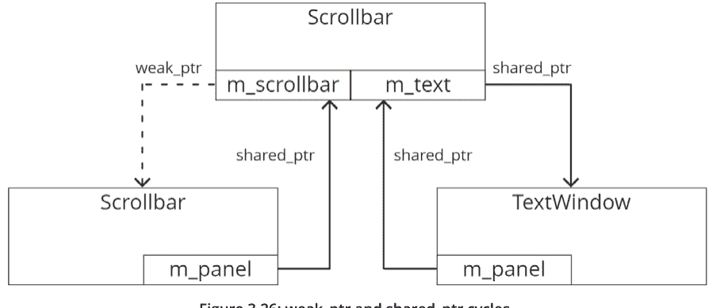

图 3.26：weak_ptr 和 shared_ptr 循环


## 智能指针与函数调用

既然我们已经可以管理资源了，那么如何使用它们呢？我们是否要传递智能指针？当我们拥有一个智能指针（`unique_ptr` 或 `shared_ptr`）时，调用函数时有四种选择：

- 按值传递智能指针
- 按引用传递智能指针
- 按指针传递被管理的资源
- 按引用传递被管理的资源

这并不是一个详尽的列表，但这些是需要考虑的主要选项。我们如何传递智能指针或其资源，取决于我们对函数调用的意图：

- 函数的意图是否只是使用资源？
- 函数是否接管资源的所有权？
- 函数是否替换被管理的对象？

如果函数只是要使用资源，那么它甚至不需要知道它被传递的是一个被管理的资源。它只需要使用它，并且应该通过指针或引用（甚至按值）调用：

```cpp
do_something(Resource* resource);
do_something(Resource& resource);
do_something(Resource resource);
```

如果你想将资源的所有权传递给函数，那么按值传递智能指针并使用 `std::move()` 调用函数：

```cpp
do_something(std::unique_ptr<Resource> resource);
auto res = std::make_unique<Resource>();
do_something(std::move(res));
```

当 `do_something()` 返回时，`res` 变量将为空，资源现在由 `do_something()` 拥有。

如果你想替换被管理的对象（该过程称为重新定位），那么按引用传递智能指针：

```cpp
do_something(std::unique_ptr<Resource>& resource);
```

下面的程序将所有内容结合起来，演示每种场景以及如何调用函数：

```cpp
#include <iostream>
#include <memory>
#include <string>
#include <sstream>

class Resource
{
public:
    Resource() { std::cout << "+++Resource acquired [" << m_id << "]\n"; }
    ~Resource() { std::cout << "---Resource released [" << m_id << "]\n"; }
    std::string name() const {
        std::ostringstream ss;
        ss << "the resource [" << m_id << "]";
        return ss.str();
    }
    int m_id{++m_count};
    static int m_count;
};

int Resource::m_count{0};

void use_resource(Resource& res)
{
    std::cout << "Enter use_resource\n";
    std::cout << "...using " << res.name() << "\n";
    std::cout << "Exit use_resource\n";
}

void take_ownership(std::unique_ptr<Resource> res)
{
    std::cout << "Enter take_ownership\n";
    if (res)
        std::cout << "...taken " << res->name() << "\n";
    std::cout << "Exit take_ownership\n";
}

void reseat(std::unique_ptr<Resource>& res)
{
    std::cout << "Enter reseat\n";
    res.reset(new Resource);
    if (res)
        std::cout << "...reseated " << res->name() << "\n";
    std::cout << "Exit reseat\n";
}

int main()
{
    std::cout << "Starting...\n";
    auto res = std::make_unique<Resource>();

    // Use - pass resource by reference
    use_resource(*res);
    if (res)
        std::cout << "We HAVE the resource " << res->name() << "\n\n";
    else
        std::cout << "We have LOST the resource\n\n";

    // Pass ownership - pass smart pointer by value
    take_ownership(std::move(res));
    if (res)
        std::cout << "We HAVE the resource " << res->name() << "\n\n";
    else
        std::cout << "We have LOST the resource\n\n";

    // Replace (reseat) resource - pass smart pointer by reference
    reseat(res);
    if (res)
        std::cout << "We HAVE the resource " << res->name() << "\n\n";
    else
        std::cout << "We have LOST the resource\n\n";

    std::cout << "Exiting...\n";
    return 0;
}
```

当我们运行此程序时，我们得到以下输出：

```text
$ ./pass_smart
Starting...
+++Resource acquired [1]
Enter use_resource
...using the resource [1]
Exit use_resource
We HAVE the resource the resource [1]

Enter take_ownership
...taken the resource [1]
Exit take_ownership
---Resource released [1]
We have LOST the resource

Enter reseat
+++Resource acquired [2]
...reseated the resource [2]
Exit reseat
We HAVE the resource the resource [2]

Exiting...
---Resource released [2]
$
```

图 3.27：所有权传递程序输出

## 注意

C++ 核心准则对资源管理、智能指针以及如何使用它们有一个完整的章节：http://isocpp.github.io/CppCoreGuidelines/CppCoreGuidelines#S-resource。我们只触及了准则中涵盖的最重要方面。

### 练习 4：使用 STL 智能指针实现 RAII

在本练习中，我们将实现一个传感器工厂方法，该方法通过 `unique_ptr` 返回传感器资源。我们将实现一个用于保存数组的 `unique_ptr`，然后开发将 `unique_ptr` 转换为共享指针并进一步共享的代码。请按照以下步骤实现此练习：

1. 在 Eclipse 中打开 Lesson3 项目。然后在 Project Explorer 中展开 Lesson3，再展开 Exercise04，双击 Exercise4.cpp 以在编辑器中打开此练习的文件。

2. 点击启动配置下拉菜单并选择 New Launch Configuration.... 从 Search Project 菜单中配置 L3Exercise4 应用程序，使其以名称 L3Exercise4 运行。

3. 点击 **Run** 按钮运行练习 4。这将产生以下输出：

```text
----- Exercise 4 -----
+++Create Light Sensor
+++Create Pressure Sensor
+++Create Temperature Sensor
Light reading is 11
light sensor
  UniqP: Empty=false
---Destroy Temperature Sensor
---Destroy Pressure Sensor
---Destroy Light Sensor
----- Complete. ------
```

图 3.28：练习 4 输出

4. 在编辑器中检查代码，特别是工厂方法，即 `createSensor(type)`。

```cpp
std::unique_ptr<ISensor>
createSensor(SensorType type)
{
    std::unique_ptr<ISensor> sensor;

    if (type == SensorType::Light)
    {
        sensor.reset(new LightSensor);
    }
    else if (type == SensorType::Temperature)
    {
        sensor.reset(new TemperatureSensor);
    }
    else if (type == SensorType::Pressure)
    {
        sensor.reset(new PressureSensor);
    }
    return sensor;
}
```

这会创建一个名为 `sensor` 的空 unique 指针，然后根据传入的 `type` 使用期望的传感器重置包含的指针。

5. 在编辑器中打开 Exercise4.cpp 并将文件顶部附近的行更改为如下所示：

```cpp
#define EXERCISE4_STEP 5
```

6. 点击 **Run** 按钮编译代码，编译将失败并出现以下错误：

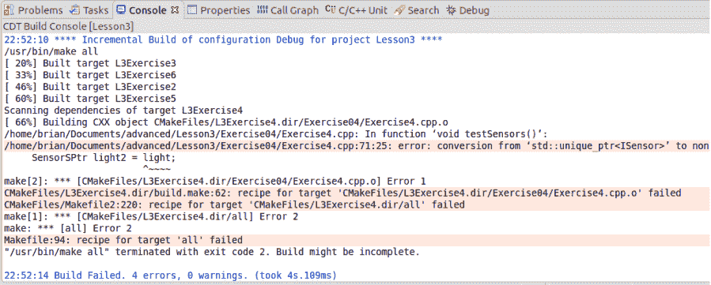

图 3.29：步骤 5 的编译错误

完整的错误信息如下：

```text
error: conversion from 'std::unique_ptr<ISensor>' to non-scalar type
'SensorSPtr {aka std::shared_ptr<ISensor>}' requested
```

根据错误，我们正试图将一个 `unique_ptr` 分配给一个 `shared_ptr`，这是不允许的。

7. 找到报告错误的<|message|> 并将其更改为如下所示：

```cpp
SensorSPtr light2 = std::move(light);
```

8. 点击 Run 按钮编译并运行程序。输出如下：

```text
----- Exercise 4 -----
+++Create Light Sensor
+++Create Pressure Sensor
+++Create Temperature Sensor
Light reading is 11
light sensor
    UniqP: Empty=false
After move
    UniqP: Empty=true
Light2 reading is 11
Light 2
    SharedP: Empty=false, # owners=2
---Destroy Light Sensor
---Destroy Temperature Sensor
---Destroy Pressure Sensor
------ Complete. ------
```

图 3.30：练习 4 的成功输出（EXERCISE4_STEP = 5 之后）

前面的输出显示我们创建了三个不同的传感器，light 传感器指针在被移动前持有资源，并且 Light 2 共享指针有两个所有者。等等！什么？两个所有者？但我们所做的只是将资源从 `light`（一个 `unique_ptr`）移动到 `light2`（一个 `shared_ptr`）。问题实际上是模板方法：

```cpp
template<typename SP>
void printSharedPointer(SP sp, const char* message)
```

第一个参数按值传递，这意味着 `shared_ptr` 的新副本将被创建并传递给方法以进行打印。

9. 现在让我们修复它，通过将模板改为按引用传递。点击 Run 按钮编译并运行程序。生成以下输出：

```text
----- Exercise 4 -----
+++Create Light Sensor
+++Create Pressure Sensor
+++Create Temperature Sensor
Light reading is 11
light sensor
    UniqP: Empty=false
After move
    UniqP: Empty=true
Light2 reading is 11
Light 2
    SharedP: Empty=false, # owners=1
---Destroy Light Sensor
---Destroy Temperature Sensor
---Destroy Pressure Sensor
------ Complete. ------
```

图 3.31：修正后的 printSharedPointer 输出


10. 在编辑器中打开 **Exercise4.cpp** 并将文件顶部附近的那一行更改为如下所示：

```cpp
#define EXERCISE4_STEP 12
```

11. 单击 **Run** 按钮编译并运行程序。生成以下输出：

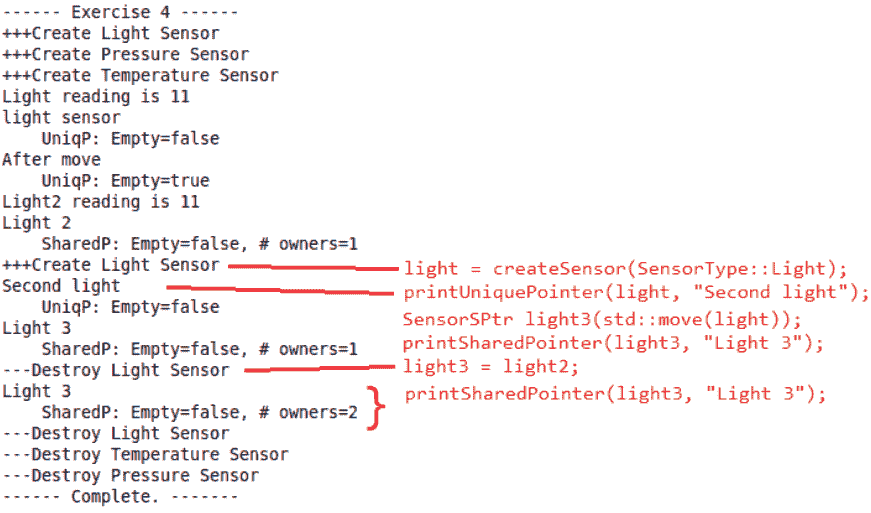

图 3.32：练习 4 的第 12 步注释输出

12. 将输出与 **testSensors()** 方法中的代码进行比较。我们会发现我们可以轻松地将一个空的 **unique_ptr**（**light**）赋值，并且可以将一个 **shared_ptr** 赋值给另一个（**light3 = light2**），在任何一种情况下都不需要使用 **std::move()**。

13. 在编辑器中打开 **Exercise4.cpp** 并将文件顶部附近的那一行更改为如下所示：

```cpp
#define EXERCISE4_STEP 15
```

14. 单击 **Run** 按钮编译并运行程序。输出切换为以下内容：

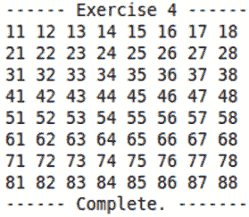

图 3.33：unique_ptr 中数组的管理

15. 打开编辑器并找到 `testArrays()` 方法：

```cpp
void testArrays()
{
    std::unique_ptr<int[]> board = std::make_unique<int[]>(8 * 8);

    for (int i = 0; i < 8; i++)
        for (int j = 0; j < 8; j++)
            board[i * 8 + j] = 10 * (i + 1) + j + 1;

    for (int i = 0; i < 8; i++)
    {
        char sep{' '};
        for (int j = 0; j < 8; j++)
            std::cout << board[i * 8 + j] << sep;
        std::cout << "\n";
    }
}
```

这段代码中有几件事需要注意。首先，类型声明为 `int[]`。我们为本次练习选择了 `int`，但它可以是几乎任何类型。其次，当 **unique_ptr**（以及从 C++17 开始的 **shared_ptr**）用于管理数组时，**operator[]** 被定义。因此，我们通过从二维索引计算一维索引来模拟二维数组：**board[i * 8 + j]**。

16. 编辑该方法的第一行并声明 **auto** 类型：

```cpp
auto board = std::make_unique<int[]>(8 * 8);
```

17. 单击 **Run** 按钮编译并运行程序——输出将与之前的运行结果相同。这是一个 `auto` 非常有帮助的案例，因为你不再需要在类型声明中输入所有细节，也不需要在 `make_unique()` 调用中重复。

在本练习中，我们实现了一个工厂函数，使用 `unique_ptr` 来管理传感器的生命周期。我们随后实现了代码，将其从 `unique_ptr` 更改为共享给多个对象。最后，我们开发了一种 `unique_ptr` 技术，使用一维数组来管理多维数组。

## Rule of Zero/Five – A Different Perspective

当我们引入 **BufferedWriter** 时，它管理着两种资源：内存和文件。我们随后讨论了默认编译器生成的拷贝操作是所谓的浅拷贝。我们谈到了如何以不同的方式管理资源——停止拷贝、执行深拷贝或转移所有权。我们在这些情况下所做的决定被称为资源管理策略。你选择的策略会影响你执行 **Rule of Zero/Five** 的方式。

就资源管理而言，一个类可以不管理任何资源、管理可以拷贝但不能移动的资源、管理可以移动但不能拷贝的资源，或管理不应被拷贝也不应被移动的资源。以下类展示了这些可能的表现形式：

```cpp
struct NoResourceToManage
{
    // use compiler-generated copy & move constructors and operators
};
```

```cpp
struct CopyOnlyResource
{
    ~CopyOnlyResource()                                   {/* defined */ }
    CopyOnlyResource(const CopyOnlyResource& rhs)          {/* defined */ }
    CopyOnlyResource& operator=(const CopyOnlyResource& rhs) {/* defined */ }
    CopyOnlyResource(CopyOnlyResource&& rhs) = delete;
    CopyOnlyResource& operator=(CopyOnlyResource&& rhs) = delete;
```

### Activity 1: Implementing Graphics Processing with RAII and Move

在第 2A 章 No Ducks Allowed – Types and Deduction 中，你的团队努力工作并完成了 Point3d 和 Matrix3d 的实现。现在，你的公司希望推广该库，在推广之前需要进行两项重大改进：

- 类必须位于我们公司的命名空间中，即 Advanced C Plus Plus Inc。因此，图形的命名空间为 `accp::gfx`。
- Point3d 和 Matrix3d 中矩阵的存储是类的内在组成部分，因此它是从栈分配而不是堆分配。随着库矩阵支持的演进，我们需要从堆分配内存。随着我们为未来版本实现更大矩阵的目标，我们还希望在我们的类中引入移动语义。

按照以下步骤实现此目标：

1. 以我们当前版本的库为起点（可在 Lesson3/Activity01 文件夹中找到），将我们所有的类都放入 `accp::gfx` 命名空间中。
2. 修复因更改而导致的所有失败的测试。（失败可能意味着编译失败，而不仅仅是测试运行失败。）
3. 在 Matrix3d 中，将矩阵直接在类中声明的方式改为堆分配内存用于存储。
4. 通过实现拷贝构造函数的深拷贝实现和拷贝赋值运算符来修复失败的测试。进行必要的其他更改以适应新的内部表示。注意，你不需要修改任何测试即可使它们通过；它们只访问公共接口，这意味着我们可以更改内部结构而不影响客户端。
5. 通过在返回语句中使用 `std::move` 强制在 `CreateTranslationMatrix()` 中调用移动构造函数来触发另一个失败。在 Matrix3d 类中引入所需的移动操作以使测试编译并通过。
6. 对 Point3d 重复步骤 3 到 4。

实现上述步骤后，预期的输出应与开始时保持不变：

```text
------ Activity 1 ------
The point [ 1, 1, 1, 1 ]
...rotated around X by 90 degrees
...rotated around Y by 90 degrees
...rotated around Z by 90 degrees
moves to [ 1, 1, -1, 1 ]
...scaled by x=2, y = 3, z = 4
moves to [ 2, 3, -4, 1 ]
...translated by dx=-2, dy = 1, dz = -3
moves to [ 0, 4, -7, 1 ]

Complete.
```

图 3.34：成功转换为使用 RAII 后的活动 1 输出

> **Note**
>
> 本活动的解决方案可在第 657 页找到。

## When Is a Function Called?

C++ 程序执行的所有操作本质上都是函数调用（尽管编译器可能会将它们优化为内联的操作序列）。然而，由于 **syntactic sugar** 的存在，可能并不明显你正在进行函数调用。Syntactic sugar 是编程语言中的语法，使其更易于阅读或表达。例如，当你写 **a = 2 + 5** 时，你本质上是在调用 **operator=(&a, operator+(2, 5))**。只是语言允许我们写第一种形式，但第二种形式允许我们重载运算符并将这些功能扩展到用户定义的类型。

以下机制会导致函数调用：

- 显式调用函数。
- 所有运算符，如 +, -, *, /, % 等，以及 `new`/`delete`。
- 变量声明——如果存在初始化值，将导致使用参数调用构造函数。
- 用户定义字面量——我们尚未处理这些，但本质上，我们为类型 `operator "" name(argument)` 定义重载。然后我们可以写诸如 `10_km`，这使我们的代码更易于理解，因为它携带了语义信息。
- 从一种值到另一种值的转换（`static_cast<>`、`const_cast<>`、`reinterpret_cast<>` 和 `dynamic_cast<>`）。同样，我们有另一个运算符重载，允许我们将一种类型转换为另一种类型。
- 在函数重载期间，可能需要将一种类型转换为另一种类型以使其匹配函数原型。它可以通过使用正确参数类型的构造函数创建临时对象来实现，也可以通过隐式调用的转换运算符来实现。

每一个都会导致编译器确定必须调用一个函数。确定需要调用函数后，它必须找到与名称和参数匹配的函数。这就是我们将在下一节中讨论的内容。

## Which Function to Call

在第 2A 章 No Ducks Allowed – Types and Deduction 中，我们看到函数重载解析按如下方式执行：


我们真正没有深入探讨的是名称查找的概念。在某个时刻，编译器会遇到对 func 函数的以下调用：

```
func(a, b);
```

此时，它必须将该名称与引入它的声明关联起来。这个过程称为**名称查找**。名称查找适用于程序中的全部项（变量、命名空间、类、函数、函数模板和模板）。程序要成功编译，变量、命名空间和类的名称查找过程必须产生唯一的声明。然而，对于函数和函数模板，编译器可能会将同一个名称与多个声明关联起来——这主要是通过函数重载实现的，而且由于**实参依赖查找（ADL）**，还可能进一步扩展以考虑额外的函数。

## 标识符

根据 C++ 标准的定义，**标识符**是由大写和小写拉丁字母、数字、下划线以及大多数 Unicode 字符组成的序列。有效的标识符必须以非数字字符开头，长度任意，并且区分大小写。每个字符都是有意义的。

## 名称

**名称**用于指代实体或标签。名称有以下形式之一：

- 标识符
- 函数表示法中的重载运算符名称（例如 operator-、operator delete）
- 模板名称后跟其参数列表（vector<int>）
- 用户定义的转换函数名称（operator float）
- 用户定义的字面量运算符名称（operator ""_ms）

每个实体及其名称都由声明引入，而标签名称则由 **goto** 语句或带标签的语句引入。名称可以在一个文件（或翻译单元）中多次使用，以根据作用域指代不同的实体。名称也可以跨多个文件（翻译单元）指代同一个实体，也可能指代不同的实体，具体取决于链接性。编译器通过**名称查找**将引入名称的声明与程序中的未知名称关联起来。

## 名称查找

名称查找过程分为两种，具体根据上下文选择：

- **限定名称查找**：名称出现在作用域解析运算符 `::` 的右侧，或者可能出现在 `::` 之后并跟着 **template** 关键字。限定名称可以引用命名空间成员、类成员或枚举器。`::` 运算符左侧的名称定义了进行查找的作用域。如果没有名称，则使用全局命名空间。
- **非限定名称查找**：其他所有情况。在这种情况下，名称查找会检查当前作用域以及所有外围作用域。

如果非限定名称位于函数调用运算符 `()` 的左侧，则使用实参依赖查找。

## 实参依赖查找

用于查找非限定函数名称的规则集合称为**实参依赖查找**（简称 ADL），或 **Koenig 查找**（以 Andrew Koenig 的名字命名，他是该规则的提出者，也是 C++ 标准委员会的长期成员）。非限定函数名称既可以出现在函数调用表达式中，也可以作为重载运算符的隐式函数调用的一部分。

ADL 的基本含义是：除了非限定名称查找期间考虑的作用域和命名空间之外，还会考虑所有实参和模板参数的“关联命名空间”。请看以下代码：

```
#include <iostream>

#include <string>

int main()
{
    std::string welcome{"Hello there"};
    std::cout << welcome;
    endl(std::cout);
}
```

## 买者自负

我们已经看到，ADL 通过包含与函数实参类型相关的命名空间，让程序员的生活变得更轻松。然而，这种查找能力并非没有风险，尽管在大多数情况下我们可以将风险降到最低。请考虑以下示例代码：

```
#include <iostream>

namespace mylib
{
void is_substring(std::string superstring, std::string substring)
{
    std::cout << "mylib::is_substring()\n";
}

void contains(std::string superstring, const char* substring) {
    is_substring(superstring, substring);
}
}

int main() {
    mylib::contains("Really long reference", "included");
}
```

当我们编译并运行上述程序时，会得到预期的输出：

```
$ ./adl_caveat.exe
mylib::is_substring()
$
```

图 3.36：ADL 示例程序的输出

然后 C++ 标准委员会决定引入一个 **is_substring()** 函数，如下所示：

```
namespace std {
    void is_substring(std::string superstring, const char* substring)
    {
        std::cout << "std::is_substring()\n";
    }
}
```

如果我们将这个函数添加到文件顶部，编译并重新运行，现在会得到以下输出：

```
$ ./adl_caveat.exe
std::is_substring()
$
```

图 3.37：ADL 问题程序的输出

由于 ADL，（下一个 C++ 标准的）编译器选择了另一个实现，认为它更适合对 **is_substring()** 的非限定函数调用。而且由于实参的隐式转换，它不会产生会导致歧义和编译错误的冲突。它只是静默地采用新方法，如果实参顺序不同，这可能导致难以发现的细微 bug。编译器只能检测类型和语法上的差异，无法检测语义上的差异。

**注意**

为了演示 ADL 的工作原理，我们将函数添加到了 std 命名空间中。命名空间的目的是分离关注点，而添加到他人命名空间，尤其是**标准库命名空间（std）**，并不是好的做法。

那么，为什么是买者自负（买家当心）呢？如果你在开发中使用第三方库（包括 C++ 标准库），那么在升级库时，你需要确保接口的更改不会因为 ADL 而给你带来问题。

### 练习 5：实现模板以避免 ADL 问题

在本练习中，我们将演示 C++17 STL 中一个不兼容的更改，该更改在实际使用中可能引发问题。C++11 引入了 `std::begin(type)` 及相关函数的模板。作为开发人员，这是通用接口的一种很有吸引力的表达方式，你可能已经编写了自己的 size(type) 和 empty(type) 版本。请按照以下步骤完成本练习：

- 1. 在 Eclipse 中打开 **Lesson3** 项目。然后在**项目资源管理器**中展开 **Lesson3**，再展开 **Exercise05**，双击 **Exercise5.cpp** 在编辑器中打开本练习的文件。
- 2. 单击**启动配置**下拉菜单，选择**新启动配置...**。从“搜索项目”菜单中配置 **L3Exercise5** 应用程序，使其以名称 **L3Exercise5** 运行。
- 3. 单击**运行**按钮运行练习 5。这将产生以下输出：

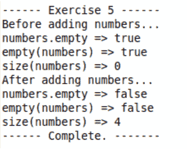

图 3:38：练习 5 执行成功
- 4. 检查代码可以发现两个辅助模板：

```
template<class T>
bool empty(const T& x)
{
    return x.empty();
}

template<class T>
int size(const T& x)
{
    return x.size();
}
```

## 隐式转换

在确定图 3.36 中的函数候选集（即函数重载解析）时，编译器必须检查名称查找过程中找到的所有可用函数，并确定实参的数量和类型是否与调用点匹配。在确定类型是否匹配时，它还会检查所有可用的转换，以确定是否存在从类型 T1（传入实参的类型）到类型 T2（函数参数指定的类型）的转换机制。如果所有实参都能从 T1 转换为 T2，那么该函数就会被添加到候选集。

这种从类型 T1 到类型 T2 的转换称为隐式转换，当某个类型 T1 被用于不接受该类型但接受另一个类型 T2 的表达式或上下文时，就会发生这种转换。这种情况发生在以下上下文中：

- 调用以 T2 为参数声明的函数时，T1 作为实参传递。
- T1 用作期望 T2 的运算符的操作数。
- T1 用于初始化 T2 的新对象（包括 return 语句）。
- T1 用于 switch 语句中（在这种情况下，T2 是 int）。
- T1 用于 if 语句或 do-while 或 while 循环中（在这种情况下，T2 是 bool）。

如果存在从 T1 到 T2 的无歧义转换序列，那么程序将能够编译。内置类型之间的转换通常由通常的算术转换决定。

## 显式——防止隐式转换

隐式转换是一个非常出色的特性，它使程序员能够表达自己的意图，而且在大多数情况下都能正常工作。然而，编译器无需程序员提供提示就能将一种类型转换为另一种类型，这种能力并不总是可取的。请考虑下面这个小程序：

```
#include <iostream>
```

```
class Real
{
public:
```


```cpp
Real(double value) : m_value{value} {}

operator float() { return m_value; }

float getValue() const { return m_value; }

private:
    double m_value {0.0};
};

void test(bool result)
{
    std::cout << std::boolalpha;
    std::cout << "Test => " << result << "\n";
}

int main()
{
    Real real{3.14159};

    test(real);

    if ( real )
    {
        std::cout << "true: " << real.getValue() << "\n";
    }
    else
    {
        std::cout << "false: " << real.getValue() << "\n";
    }
}
```

当我们编译并运行前面的程序时，我们得到以下输出：

```
$ ./implicit.exe
Test => true
true: 3.14159
$
```

Figure 3.40: Implicit conversion sample program output

嗯，这可能有点出乎意料，因为它编译了并且确实产生了输出。real 变量的类型是 Real，它有一个转换为 float 的转换运算符 – operator float()。test() 函数接受一个 bool 作为参数，而 if 条件也必须产生一个 bool。编译器会将任何数值类型转换为布尔类型，如果值为零则为 false，如果值不为零则为 true。但如果这不是我们想要的行为，我们可以通过在函数声明前加上 explicit 关键字来阻止它。假设我们将该行更改为如下所示：

```
explicit operator float() {return m_value;}
```

如果我们现在尝试编译它，我们会得到两个错误：

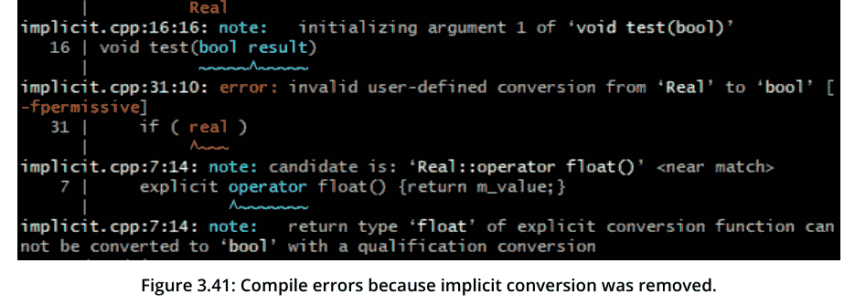

Figure 3.41: Compile errors because implicit conversion was removed.

两者都与无法将 Real 类型转换为 bool 有关 – 首先，在调用 test() 的位置，然后在 if 条件中。

现在，让我们引入一个 bool 转换运算符来修复这个问题。

```
operator bool() {return m_value == 0.0;}
```

我们现在可以再次构建程序。我们将收到以下输出：

```
$ ./implicit.exe
Test => false
false: 3.14159
$
```

Figure 3.42: Introducing the bool operator replaces implicit conversion

布尔值现在为 false，而之前为 true。这是因为 float 转换返回的值的隐式转换不为零，然后被转换为 true。

自 C++ 11 以来，所有构造函数（复制和移动构造函数除外）都被视为转换构造函数。这意味着如果它们没有用 explicit 声明，则可用于隐式转换。同样，任何未声明为 explicit 的强制转换运算符都可用于隐式转换。

C++ 核心指南有两个与隐式转换相关的规则：

- C.46: 默认情况下，将单参数构造函数声明为 explicit
- C.164: 避免隐式转换运算符

## Contextual Conversion

如果我们现在对小程序再做一个更改，我们就可以进入所谓的上下文转换。让我们使 bool 运算符变为 explicit 并尝试编译程序：

```
explicit operator bool() {return m_value == 0.0;}
```

我们将收到以下输出：

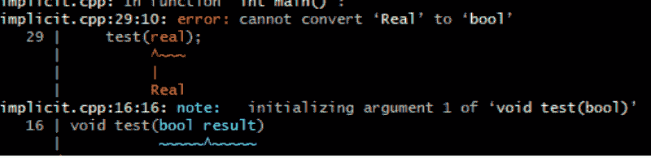

Figure 3.43: Compile errors with explicit bool operator

这次我们在调用 **test()** 的位置只有一个错误，但 if 条件没有错误。我们可以通过使用 C 风格的 case (bool) 或 C++ **static_cast<bool>(real)** 来修复此错误（这是首选方法）。当我们添加强制转换时，程序会编译并再次运行。

那么，如果 bool 强制转换是显式的，为什么 if 表达式的条件不需要强制转换呢？

C++ 标准允许在某些期望 **bool** 类型且存在 bool 转换声明（无论是否标记为 explicit）的上下文中进行隐式转换。如果发生这种情况，则允许隐式转换。这被称为 **上下文转换为 bool**，可以发生在以下上下文中：

- **if**、**while**、**for** 的条件（或控制表达式）
- 内置逻辑运算符 **!**（非）、**&&**（与）和 **||**（或）的操作数
- 三元（或条件）运算符 **?:** 的第一个操作数

### Exercise 6: Implicit and Explicit Conversions

在本练习中，我们将通过调用函数、隐式转换、阻止它们以及启用它们来实验。按照以下步骤实现此练习：

- 1. 在 Eclipse 中打开 **Lesson3** 项目。然后在 **Project Explorer** 中展开 **Lesson3** 然后 **Exercise06** 并双击 **Exercise6.cpp** 以在编辑器中打开此练习的文件。
- 2. 点击 **Launch Configuration** 下拉菜单并选择 **New Launch Configuration...** 从 **Search Project** 菜单配置 **L3Exercise6** 应用程序，使其以名称 **L3Exercise6** 运行。
- 3. 点击 **Run** 按钮运行练习 6。这将产生以下输出：

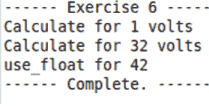

Figure 3.44: Default output from Exercise 6

4. 在文本编辑器中，将 Voltage 的构造函数更改为 explicit：

```
struct Voltage
{
    explicit Voltage(float emf) : m_emf(emf)
    {
    }

    float m_emf;
};
```

5. 点击 Run 按钮重新编译代码 – 现在我们得到以下错误：

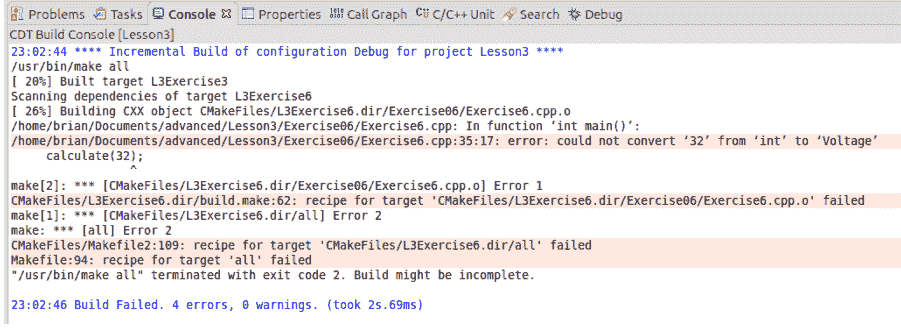

Figure 3.45: Failed conversion of int to Voltage

6. 删除构造函数中的 explicit 并将 calculate 函数更改为接受引用：

```
void calculate(Voltage& v)
```

- 7. 点击 **Run** 按钮重新编译代码 – 现在，我们得到以下错误：

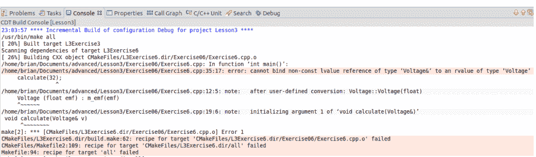

Figure 3.46: Failed conversion of int to Voltage&

同一个行有我们之前遇到的问题，但原因不同。所以，*隐式转换仅适用于值类型。*

- 8. 注释掉产生错误的该行，然后在调用 **use_float(42)** 之后添加以下行：
  
      use_float(volts);

- 9. 点击 **Run** 按钮重新编译代码 – 现在我们得到以下错误：

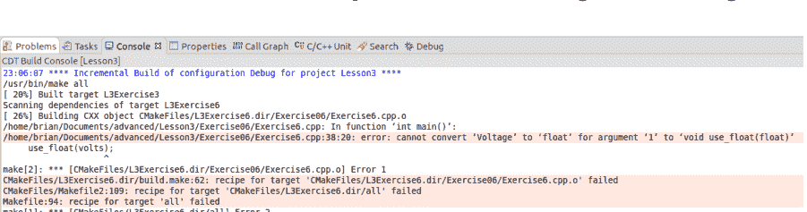

Figure 3.47: Failed conversion of Voltage to float

10. 现在，将以下强制转换运算符添加到 Voltage 类：

```
operator float() const
{
    return m_emf;
}
```

11. 点击 Run 按钮重新编译代码并运行它：

```
------ Exercise 6 ------
Calculate for 1 volts
use_float for 42
use_float for 1
------ Complete. ------
```

Figure 3.48: Successfully converted Voltage to float

12. 现在，在我们刚刚添加的强制转换前加上 explicit 关键字并点击 Run 按钮重新编译代码。再次，我们得到一个错误：

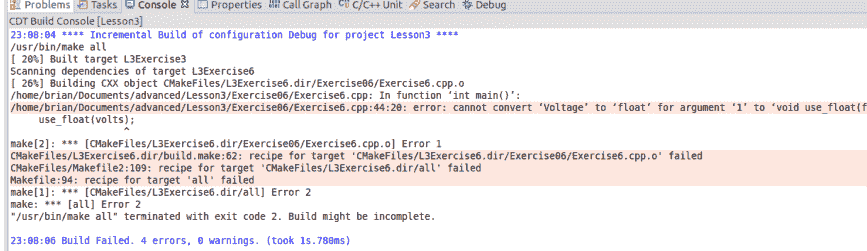

Figure 3.49: Failure to convert Voltage to float

13. 通过向强制转换添加 explicit 声明，我们阻止编译器使用转换运算符。将出现错误的该行更改为将 volts 变量强制转换为 float：

```
use_float(static_cast<float>(volts));
```

14. 点击 **Run** 按钮重新编译代码并运行它。

```
------ Exercise 6 ------
Calculate for 1 volts
use_float for 42
use_float for 1
------ Complete. ------
```

Figure 3.50: Conversion of Voltage into float with cast works again

在本练习中，我们看到隐式转换可以在类型之间发生（不是引用），并且我们可以控制它们发生的时机。现在我们知道如何控制这些转换，我们就可以努力满足之前引用的指南 C.46 和 C.164。

### Activity 2: Implementing classes for Date Calculations

你的团队负责开发一个库来帮助进行与日期相关的计算。特别是，我们希望能够确定两个日期之间的天数，并给定一个日期，加上（或从中减去）天数以获得新日期。此活动将开发两种新类型并增强它们，以确保程序员无法意外地使它们与内置类型交互。按照以下步骤实现：

- 1. 设计并实现一个 Date 类，将日、月、年存储为整数。
- 2. 添加方法来访问内部的日、月、年值。
- 3. 定义一个类型 date_t 来表示从 1970-1-1 纪元日期开始的天数。
- 4. 向 Date 类添加一个方法将其转换为 date_t。
- 5. 添加一个方法从 date_t 值设置 Date 类。
- 6. 创建一个 Days 类来存储天数值。
- 7. 向 Date 添加加法运算符，接受 Days 作为参数。
- 8. 使用 explicit 防止数字的加法。
- 9. 添加减法运算符，从两个 Dates 的差值返回 Days 值。


完成这些步骤后，你应该会收到以下输出：

```
------ Activity 2 ------
There are 358 days between 1-Jan-2019 and 25-Dec-2019
There are 0.980172 years between 1-Jan-2019 and 25-Dec-2019

There are 364 days between 1-Jan-2019 and 31-Dec-2019
There are 0.996599 years between 1-Jan-2019 and 31-Dec-2019

There are 18255 days between 1-Jan-1970 and 25-Dec-2019
There are 49.9805 years between 1-Jan-1970 and 25-Dec-2019

There are 36525 days between 1-Jan-1970 and 1-Jan-2070
There are 100.002 years between 1-Jan-1970 and 1-Jan-2070

Complete.
```

图 3.51：一个成功的 Date 示例应用程序的输出

> Note
> 本活动的解决方案可在第 664 页找到。

# Summary

在本章中，我们探讨了变量的生命周期——自动变量和动态变量，它们存储的位置，以及何时被析构。然后我们利用这些信息开发了 RAII 技术，使我们几乎可以忽略资源管理，因为自动变量会在析构时清理它们，即使在出现异常的情况下也是如此。然后，我们研究了抛出异常和捕获异常，以便在正确的层级处理异常情况。从 RAII 出发，我们进入了关于资源所有权以及 STL 智能指针如何帮助我们的讨论。我们发现几乎所有东西都被视为函数调用，从而允许运算符重载和隐式转换。我们发现了令人惊叹的（或可怕的？）参数依赖查找（ADL）世界，以及它如何可能在未来使我们陷入困境。我们现在对 C++ 的基本特性有了良好的理解。在下一章中，我们将开始探索函数对象以及它们如何使用 lambda 函数实现和实现。我们将进一步深入 STL 的功能，并探索 PIMPL，因为我们将重新审视封装。

# 4
关注点分离 - 软件架构、函数和可变参数模板

## Learning Objectives

到本章结束时，你将能够：

+   - 使用 PIMPL 惯用法开发类以实现对象级封装
+   - 使用仿函数、std::function 和 lambda 表达式实现回调系统
+   - 使用适合情况的正确捕获技术实现 lambda
+   - 开发可变参数模板以实现用于事件处理的 C# 风格委托。

本章将向你展示如何实现 PIMPL 惯用法，以及如何为自己的程序开发回调机制。

## ##Introduction

在上一章中，我们学习了如何使用 RAII 实现类，以便即使在出现异常时也能正确管理资源。我们还学习了 ADL（**Argument Dependent Lookup**）以及它如何确定要调用的函数。最后，我们谈到了 explicit 关键字如何用于防止编译器进行类型之间的自动转换，即隐式转换

在本章中，我们将研究依赖关系，既有物理的也有逻辑的，并了解它们如何对构建时间产生不利影响。我们还将学习如何将可见的接口类与实现细节分离以提高构建速度。然后我们将学习如何捕获函数和上下文，以便稍后使用 **functors**、**std::function** 和 **lambda expressions** 调用它们。最后，我们将实现一个可变参数模板来提供基于事件的回调机制。

## ##The Pointer to Implementation (PIMPL) Idiom

随着用 C++ 实现的项目变得越来越大，构建时间增长速度超过文件数量的可能性就越大。这是因为 C++ 构建模型使用的文本包含模型。这样做是为了让编译器能够确定类的大小和布局，从而在 **caller** 和 **callee** 之间产生耦合，但允许优化。请记住，一切都必须在被使用之前定义好。未来的一项特性 **Modules** 承诺解决这个问题，但现在我们需要了解这个问题以及用于解决该问题的技术。

## ##Logical and Physical Dependencies

当我们希望从另一个类访问一个类时，我们就有了逻辑依赖。一个类在逻辑上依赖于另一个类。如果我们考虑 **Graphics** 类，我们在 *Chapter 2A, No Ducks Allowed – Types and Deduction* 和 *Chapter 3, The Distance between Can and Should – Objects, Pointers and Inheritance* 中开发的 **Point3d** 和 **Matrix3d**，我们有两个逻辑上独立的类 **Matrix3d** 和 **Point3d**。然而，由于我们对两者之间乘法运算符的实现方式，我们创建了一个编译时或 **physical dependency**。

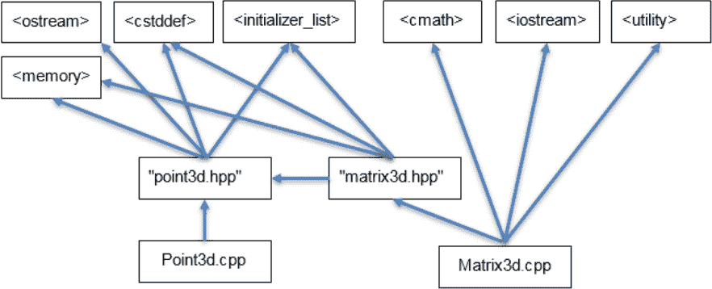

图 4.1：Matrix3d 和 Point3d 的物理依赖关系

正如我们所见，对于这些相对简单的类，头文件和实现文件之间的物理依赖关系会迅速变得复杂。正是这种复杂性导致了大型项目的构建时间增加，因为物理（和逻辑）依赖的数量增长到数千个。前面的图表中仅显示了 13 个依赖关系，如箭头所示。但实际上还有更多，因为包含一个标准库头文件通常会引入一系列包含文件。这意味着如果一个头文件被修改，那么所有直接或间接依赖它的文件都需要重新编译以应对更改。即使更改是对用户甚至无法访问的私有类成员定义的更改，重建的触发也会发生。

为了帮助加快编译时间，我们使用了保护技术来防止头文件被多次处理：

```
```cpp
#if !defined(MY_HEADER_INCLUDED)

#define MY_HEADER_INCLUDED

// definitions

#endif // !defined(MY_HEADER_INCLUDED)
```
```

最近，大多数编译器现在都支持 **#pragma once** 指令，可实现相同的结果。

实体（文件、类等）之间的这些关系被称为 **coupling**。如果对一个文件/类的更改导致另一个文件/类发生更改，则该文件/类与另一个文件/类 **高度耦合**。如果对一个文件/类的更改不会导致另一个文件/类发生更改，则该文件/类与另一个文件/类 **松散耦合**。

高度耦合的代码（文件/类）在项目中引入了问题。高度耦合的代码难以更改（不灵活）、难以测试且难以理解。另一方面，松散耦合的代码更容易更改（只需修改一个类）、高度可测试（只需被测试的类）且更易于阅读和理解。耦合反映了逻辑和物理依赖关系，并且与之相关。

# The Pointer to Implementation (PIMPL) Idiom

解决耦合问题的解决方案之一是使用“**Pimpl Idiom**”（代表 **Pointer to Implementation Idiom**）。这也被称为不透明指针、编译器防火墙惯用法甚至 **Cheshire Cat technique**。考虑 **Qt library**，特别是 **Qt Platform Abstraction (QPA)**。它是一个抽象层，隐藏了 Qt 应用程序所托管的操作系统和/或平台的细节。实现此类层的一种方法是使用 PIMPL 惯用法，其中公共接口暴露给应用程序开发人员，但功能交付的实现方式被隐藏。Qt 实际上使用了一种称为 d-pointer 的 PIMPL 变体。

例如，GUI 的一个功能是使用对话框，即弹出窗口，用于显示信息或提示用户输入。它可以在 **dialog.hpp** 中如下声明：

> **Note**
> 
> 有关 QT Platform Abstraction (QPA) 的更多信息，请访问以下链接：
> https://doc.qt.io/qt-5/qpa.html#

```
#pragma once

class Dialog
{
public:
    Dialog();
    ~Dialog();
```


```
void create(const char* message);
bool show();

private:
    struct DialogImpl;
    DialogImpl* m_pImpl;
};
```

用户可以使用使用对话框所需的所有函数，但并不了解其实现方式。注意，我们声明了DialogImpl但没有定义它。一般来说，对于像DialogImpl这样的类，我们能做的并不多。但有一件事是允许的，那就是声明指向它的指针。C++的这个特性允许我们在实现文件中隐藏实现细节。这意味着在这个简单的情况下，我们不需要为这个声明包含任何头文件。

实现文件dialogImpl.cpp可以实现如下：

```
#include "dialog.hpp"
#include <iostream>
#include <string>

struct Dialog::DialogImpl
{
    void create(const char* message)
    {
        m_message = message;
        std::cout << "Creating the Dialog\n";
    }
    bool show()
    {
        std::cout << "Showing the message: '" << m_message << "'\n";
        return true;
    }

    std::string m_message;
```

```
};

Dialog::Dialog() : m_pImpl(new DialogImpl)
{
}

Dialog::~Dialog()
{
    delete m_pImpl;
}

void Dialog::create(const char* message)
{
    m_pImpl->create(message);
}

bool Dialog::show()
{
    return m_pImpl->show();
}
```

我们从中注意几点：

+   - 我们在定义Dialog所需的方法之前定义实现类**DialogImpl**。这是必要的，因为Dialog需要通过**m_pImpl**调用这些方法，这意味着它们必须先被定义。
+   - **Dialog**的构造函数和析构函数负责内存管理。
+   - 我们只在实现文件中包含实现所需的所有头文件。这通过最小化**Dialog.hpp**中需要包含的头文件数量来减少耦合。

## PIMPL的优点与缺点

使用PIMPL的最大优点是它打破了类的客户端与其实现之间的编译时依赖。这可以实现更快的构建时间，因为PIMPL消除了定义（头）文件中的大量#include指令，而是将它们推迟到仅在实现文件中才需要。

它还使实现与客户端解耦。我们现在可以自由更改PIMPL类的实现，并且只需要重新编译该文件。这避免了因隐藏成员的变化而触发客户端重建的编译级联。这被称为编译防火墙。

PIMPL惯用法的其他一些优点如下：

+   - **数据隐藏** – 实现的内部细节真正隔离在实现类中。如果这是库的一部分，那么它可以用来防止信息披露，例如知识产权。
+   - **二进制兼容性** – 类的二进制接口现在独立于私有字段。这意味着我们可以向实现中添加字段而不影响客户端。这也意味着我们可以将实现类部署在共享库（DLL或.so文件）中，并可以自由更改它而不影响客户端代码。

这些优点是有代价的。缺点如下：

+   - **维护成本** – 可见类中有额外的代码将调用转发给实现类。这增加了一层间接性，并略微增加了复杂性。
+   - **内存管理** – 为实现添加一个指针现在要求我们管理内存。它还需要额外的存储来保存指针，并且在内存受限的系统（例如：物联网设备）中这可能是关键的。

## 使用unique_ptr<>实现PIMPL

我们当前的Dialog实现使用原始指针来持有PIMPL实现引用。在第3章“能与应该之间的距离——对象、指针和继承”中，我们讨论了对象的所有权，并引入了智能指针和RAII。PIMPL指针指向的隐藏对象是需要管理的资源，应该使用RAII和std::unique_ptr来管理。正如我们将看到的，使用std::unique_ptr实现PIMPL有一些注意事项。

让我们更改Dialog实现以使用智能指针。首先，头文件需要引入**#include <memory>**行，并且可以移除析构函数，因为**unique_ptr**会自动删除实现类。

```
#pragma once

#include <memory>

class Dialog
{
public:
    Dialog();
    void create(const char* message);
    bool show();

private:
    struct DialogImpl;
    std::unique_ptr<DialogImpl> m_pImpl;
};
```

显然，我们从实现文件中移除了析构函数，并修改构造函数以使用**std::make_unique**。

```
Dialog::Dialog() : m_pImpl(std::make_unique<DialogImpl>())
{
}
```

重新编译新版本时，**Dialog.hpp**和**DialogImpl.cpp**文件没有问题，但我们的客户端**main.cpp**报告了以下错误（使用gcc编译器），如下所示：

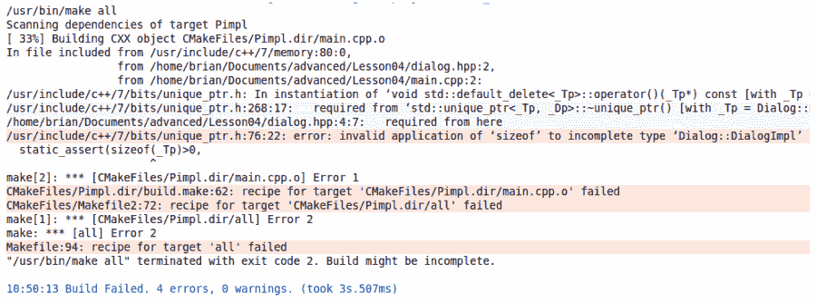

第一个错误报告**对不完整类型'Dialog::DialogImpl'进行了无效的'sizeof'应用**。问题在于，在**main.cpp**文件中，当**main()**函数结束时，编译器试图为我们调用**Dialog**的析构函数。正如我们在*第2A章，不许鸭子——类型与推导*中讨论的那样，编译器会为我们生成一个析构函数（因为我们移除了它）。这个生成的析构函数将调用**unique_ptr**的析构函数，这就是错误的原因。如果查看**unique_ptr.h**文件的**第76行**，我们会发现以下用于**unique_ptr**的默认删除器的**operator()**函数的实现（删除器是**unique_ptr**在销毁其指向的对象时调用的函数）：

```cpp
void

operator()(_Tp* __ptr) const
{
    static_assert(!is_void<_Tp>::value, "can't delete pointer to incomplete type");
    static_assert(sizeof(_Tp)>0, "can't delete pointer to incomplete type");
    delete __ptr;
}
```

我们的代码在第二个static_assert()语句上失败，该语句以错误终止编译。问题在于编译器试图为std::unique_ptr<DialogImpl>生成析构函数，而DialogImpl是一个不完整类型。所以，要解决这个问题，我们控制析构函数的生成在DialogImpl是完整类型的地方。

为此，我们将析构函数的声明放回类中，并将其实现添加到DialogImpl.cpp文件中。

```
Dialog::~Dialog()
{
}
```

当我们编译并运行程序时，它会产生与之前完全相同的输出。实际上，如果我们只需要一个空的析构函数，可以用以下代码替换上面的代码：

```
Dialog::~Dialog() = default;
```

如果我们编译并运行程序，将产生以下输出：

```
------ Pimpl ------
Creating the Dialog
Showing the message: 'Hello World'
Dialog displayed
Complete.
```

图4.4：示例unique_ptr Pimpl实现输出

## unique_ptr<> PIMPL 特殊函数

由于PIMPL通常意味着可见接口类拥有实现类，移动语义是自然契合的。然而，就像编译器生成的析构函数实现是正确的，编译器生成的移动构造函数和移动赋值运算符将给出预期的行为，即对成员unique_ptr执行移动。两个移动操作在赋值转移的值之前都可能需要执行delete，因此会遇到与不完整类型的析构函数相同的问题。解决方案与析构函数相同——在头文件中声明方法，并在类型完整时实现——即在实现文件中实现。所以，我们的头文件如下所示：

```
class Dialog
{
public:
```


在头文件中，我们添加以下声明：

```cpp
Dialog(const Dialog& rhs);
```

```cpp
Dialog& operator=(const Dialog& rhs);
```

实现看起来会像这样：

```cpp
Dialog::Dialog(const Dialog& rhs) : m_pImpl(nullptr)
{
    if (this == &rhs)    // do nothing on copying self
        return;
    if (rhs.m_pImpl)    // rhs has something -> clone it
        m_pImpl = std::make_unique<DialogImpl>(*rhs.m_pImpl);
}
```

```cpp
Dialog& Dialog::operator=(const Dialog& rhs)
{
    if (this == &rhs)    // do nothing on assigning to self
        return *this;
    if (!rhs.m_pImpl)    // rhs is empty -> delete ours
    {
        m_pImpl.reset();
    }
    else if (!m_pImpl)    // ours is empty -> clone rhs
    {
        m_pImpl = std::make_unique<DialogImpl>(*rhs.m_pImpl);
    }
    else // use copy of DialogImpl
    {
        *m_pImpl = *rhs.m_pImpl;
    }
}
```

注意 `if(this == &rhs)` 子句。它们是为了防止对象不必要地复制自身而存在的。此外，请注意我们需要检查 `unique_ptr` 是否为空，并相应地处理复制。

## Note

在解决本章的任何实践之前，请下载 GitHub 仓库 https://github.com/TrainingByPackt/Advanced-CPlusPlus 并在 Eclipse 中导入 Lesson 4 的文件夹，以便您可以查看每个练习和活动的代码。

### Exercise 1: Implementing a Kitchen with unique_ptr<>

在本练习中，我们将通过使用 `unique_ptr<>` 实现 Pimpl 惯用法来隐藏厨房处理订单的细节。按照以下步骤实现此练习：

- 1. 在 Eclipse 中打开 Lesson4 项目，然后在 Project Explorer 中展开 Lesson4，然后展开 Exercise01 并双击 Exercise1.cpp 以在编辑器中打开此练习的文件。
- 2. 由于这是一个基于 CMake 的项目，请将当前构建器更改为 CMake Build（便携式）。
- 3. 点击 Launch Configuration 下拉菜单并选择 New Launch Configuration.... 将 L4Exercise1 配置为以名称 Exercise1 运行。
- 4. 点击 Run 按钮。练习 1 将运行并产生以下输出：

```
------ Kitchen Exercise 1 ------
Chef 'TheChef' is serving you tonight
...Preparing Lamb Ragout
...Cooking Lamb Ragout
...Serving Lamb Ragout
Chef 'TheChef' is serving you tonight
---Serving Baked Alaska
Chef 'TheChef' is serving you tonight
#### sacre bleu: 'Turkey'
Chef 'TheChef' is serving you tonight
...Preparing Steak Diane
...Cooking Steak Diane
...Serving Steak Diane
Chef 'TheChef' is serving you tonight
---Serving Pavlova
Complete.
```

Figure 4.5: Exercise 1 Program output

- 5. 在编辑器中打开 **kitchen.hpp**，您将找到以下声明：

```cpp
class Kitchen
{
public:
    Kitchen(std::string chef);
    std::string processOrder(std::string order);

private:
    std::string searchForRecipe(std::string order);
    std::string searchForDessert(std::string order);
    std::string cookRecipe(std::string recipe);
    std::string serveDessert(std::string dessert);

    std::vector<Recipe>::iterator getRecipe(std::string recipe);
    std::vector<Dessert>::iterator getDessert(std::string recipe);

    std::string m_chef;
    std::vector<Recipe> m_recipes;

    std::vector<Dessert> m_desserts;

};
```

私有部分中的所有内容都是厨房向客户交付订单的细节。它强制包含头文件 **recipe.hpp** 和 **dessert.hpp**，从而在这些细节文件与 Kitchen 的客户端之间创建了耦合。我们将把所有私有成员移入实现类并隐藏细节。

- 6. 在 **kitchen.hpp** 文件中，添加 **#include <memory>** 指令以获得对 **unique_ptr** 的访问。添加析构函数 **~Kitchen()**; 的声明，然后在 private 部分顶部添加以下两行：

```
struct Impl;
std::unique_ptr<Impl> m_impl;
```

- 12. 在 **Kitchen::Impl** 中，添加一个接受 `std::string` 参数的构造函数和 **processOrder()** 方法。**Kitchen::Impl** 声明现在应如下所示：

```cpp
struct Kitchen::Impl
{
    Impl(std::string chef);
    std::string processOrder(std::string order);

    std::string searchForRecipe(std::string order);
    std::string searchForDessert(std::string order);
    std::string cookRecipe(std::string recipe);
    std::string serveDessert(std::string dessert);

    std::vector<Recipe>::iterator getRecipe(std::string recipe);
    std::vector<Dessert>::iterator getDessert(std::string recipe);

    std::string m_chef;
    std::vector<Recipe> m_recipes;
    std::vector<Dessert> m_desserts;
};
```

- 13. 在 **kitchen.cpp** 中，在文件顶部添加 `#include <vector>`、`#include "recipe.hpp"` 和 `#include "dessert.hpp"`。

- 14. 点击 **Run** 按钮重新构建程序，这次它将因两个未定义引用而失败 – **Kitchen::Kitchen** 和 **Kitchen::processOrder**。

- 15. 在 **kitchen.cpp** 中，在 **Kitchen::Impl** 方法定义之后，添加以下两个方法：

```cpp
Kitchen::Kitchen(std::string chef) : m_impl(std::make_unique<Kitchen::Impl>(chef))
{
}

std::string Kitchen::processOrder(std::string order)
{
    return m_impl->processOrder(order);
}
```

- 16. 点击 **Run** 按钮重新构建程序。程序将再次运行以产生原始输出。


**Figure 4.6:** The Kitchen program output using Pimpl

在本练习中，我们取了一个在其私有成员中保存许多细节的类，并将这些细节移入 PIMPL 类以隐藏细节并使用前面描述的技术将接口与实现解耦。

## Function Objects and Lambda Expressions

在编程中使用的一个常见模式，特别是在实现基于事件的处理时，例如异步输入和输出，是使用 **callback**。客户端注册他们希望在事件发生时收到通知（例如：有数据可读，或数据传输完成）。这种模式被称为 **Observer pattern** 或 **Subscriber-Publisher pattern**。C++ 支持多种提供回调机制的技术。

### Function Pointers

第一个机制是使用 **function pointers**。这是一个从 C 语言继承的遗留特性。以下程序展示了函数指针的示例：

```cpp
#include <iostream>

using FnPtr = void (*)(void);

void function1()
{
    std::cout << "function1 called\n";
}
int main()
{
    std::cout << "\n\n----- Function Pointers -----\n";
    FnPtr fn{function1};

    fn();

    std::cout << "Complete.\n";
    return 0;
}
```

该程序在编译和执行后，产生以下输出：

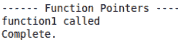

Figure 4.7: Function Pointer Program output

严格来说，代码应修改如下：

```cpp
FnPtr fn{&function1};

if(fn != nullptr)
    fn();
```

首先需要注意的是，应使用取地址符 (`&`) 来初始化指针。其次，我们应该在调用它之前检查指针是否有效。

```cpp
#include <iostream>

using FnPtr = void (*)(void);

struct foo
{
    void bar() { std::cout << "foo::bar called\n"; }
};

int main()
{
    std::cout << "\n\n----- Function Pointers -----\n";
    foo object;

    FnPtr fn{&object.bar};

    fn();

    std::cout << "Complete.\n";
    return 0;
}
```

当我们尝试编译此程序时，会收到以下错误：

```
/usr/bin/make all
Scanning dependencies of target Pimpl
[ 33%] Building CXX object CMakeFiles/Pimpl.dir/main.cpp.o
/home/brian/Documents/advanced/Lesson04/main.cpp: In function 'int main()':
/home/brian/Documents/advanced/Lesson04/main.cpp:92:22: error: ISO C++ forbids taking the address of a bound member function to form a pointer
    FnPtr fn{&object.bar};
/home/brian/Documents/advanced/Lesson04/main.cpp:92:25: error: cannot convert 'void (foo::*)()' to 'FnPtr {aka void (*)()}' in initialization
    FnPtr fn{&object.bar};
CMakeFiles/Pimpl.dir/build.make:62: recipe for target 'CMakeFiles/Pimpl.dir/main.cpp.o' failed
make[2]: *** [CMakeFiles/Pimpl.dir/main.cpp.o] Error 1
make[1]: *** [CMakeFiles/Pimpl.dir/all] Error 2
CMakeFiles/Makefile2:72: recipe for target 'CMakeFiles/Pimpl.dir/all' failed
Makefile:94: recipe for target 'all' failed
"/usr/bin/make all" terminated with exit code 2. Build might be incomplete.
```

Figure 4.8: Errors compiling function pointer program

第一个错误的文本是 **ISO C++ forbids taking the address of a bound member function to form a pointer to member function. Say '&foo::bar'**。它告诉我们应使用不同形式来获取函数地址。真正错误的是第二个错误信息：**error: cannot convert 'void (foo::*)()' to 'FnPtr {aka void (*)()}' in initialization**。真正的问题是非静态成员函数在被调用时接受一个隐藏参数 – this 指针。


通过将上述程序修改为以下内容：

```cpp
#include <iostream>

using FnPtr = void (*)(void);

struct foo
{
    static void bar() { std::cout << "foo:bar called\n"; }
};

int main()
{
    std::cout << "\n\n----- Function Pointers -----\n";

    FnPtr fn{&foo::bar};

    fn();

    std::cout << "Complete.\n";
    return 0;
}
```

它可以成功编译并运行：

```
----- Function Pointers -----
foo:bar called
Complete.
```

图 4.9：使用静态成员函数的函数指针程序

函数指针技术常用于与使用回调的 C 库以及同样支持回调的操作系统通知进行交互。在这两种情况下，回调通常会接受一个参数，该参数是一个指向用户注册的数据块（data blob）指针的 `void *`。这个数据块指针可以是一个类的 `this` 指针，然后被解引用，并将回调转发到成员函数中。

在其他语言（如 Python 和 C#）中，捕获函数指针时也会捕获调用该函数所需的足够数据（例如：**self** 或 **this**），这是语言的一部分。C++ 可以通过函数调用运算符使任何对象可调用，我们将在接下来介绍。

### 什么是函数对象？

C++ 允许重载函数调用运算符 **operator()**。这使得任何对象都可以变得**可调用**。可调用的对象称为**函数对象**。以下程序中的 **Scaler** 类实现了一个**函数对象**。

```cpp
struct Scaler
{
    Scaler(int scale) : m_scale{scale} {};

    int operator()(int value)
    {
        return m_scale * value;
    }

    int m_scale{1};
};

int main()
{
    std::cout << "\n\n------ Functors ------\n";
    Scaler timesTwo{2};
    Scaler timesFour{4};

    std::cout << "3 scaled by 2 = " << timesTwo(3) << "\n";
    std::cout << "3 scaled by 4 = " << timesFour(3) << "\n";

    std::cout << "Complete.\n";
    return 0;
}
```

程序中创建了两个 **Scaler** 类型的对象，它们被用作生成输出的代码行中的函数。上述程序产生以下输出：

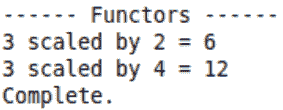

图 4.10：函数对象程序输出

与函数指针相比，**函数对象**的一个优势是它们可以包含状态，无论是作为对象还是跨所有实例。另一个优势是它们可以传递给期望函数（例如 `std::for_each`）或运算符（例如 `std::transform`）的 STL 算法。

此类用法的一个示例如下：

```cpp
#include <iostream>
#include <vector>
#include <algorithm>

struct Scaler
{
    Scaler(int scale) : m_scale{scale} {};

    int operator()(int value)
    {
        return m_scale * value;
    }

    int m_scale{1};
};

void PrintVector(const char* prefix, std::vector<int>& values)
{
    const char* sep = "";
    std::cout << prefix << " = [";
    for(auto n : values)
    {
        std::cout << sep << n;
        sep = ", ";
    }
    std::cout << "]\n";
}

int main()
{
    std::cout << "\n\n------ Functors with STL ------\n";
    std::vector<int> values{1,2,3,4,5};

    PrintVector("Before transform", values);
    std::transform(values.begin(), values.end(), values.begin(), Scaler(3));
    PrintVector("After transform", values);

    std::cout << "Complete.\n";
    return 0;
}
```

如果我们运行这个程序，产生的输出将如下所示：

```
------ Functors with STL ------
Before transform = [1, 2, 3, 4, 5]
After transform = [3, 6, 9, 12, 15]
Complete.
```

图 4.11：显示 Scaler 变换向量的程序输出

使用

```cpp
    std::cout << "Average of [";
    std::for_each(values.begin(), values.end(), Printer());
    std::cout << "] = ";
```

- 7. 单击**运行**按钮。该练习将运行并产生以下输出：

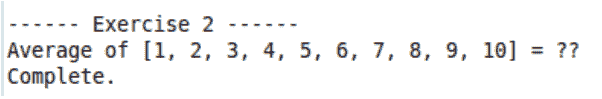

图 4.13：练习 2 改进后的输出格式

- 8. **Printer** 类的内部状态使我们能够修正格式。现在，引入一个**聚合器**类，用于计算**平均值**。将以下类定义添加到文件顶部：

```cpp
struct Averager
{
    void operator()(int n)
    {
        m_sum += n;
        m_count++;
    }

    float operator()() const
    {
        return static_cast<float>(m_sum)/(m_count==0?1:m_count);
    }

    int m_count{0};
    int m_sum{0};
};
```

- 9. 修改 `main()` 方法以使用 **Averager** 类，如下所示：

```cpp
int main(int argc, char**argv)
{
    std::cout << "\n------ Exercise 2 ------\n";
    std::vector<int> values {1,2,3,4,5,6,7,8,9,10};

    Averager averager = std::for_each(values.begin(), values.end(),
```

实例化 `std::function` 对象时，只需提供函数签名，而不需要提供用于初始化它的值，从而生成一个空实例。实例化操作如下所示：

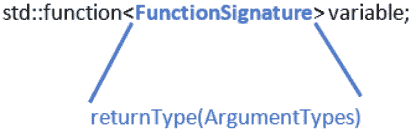

图 4.15：std::function 声明的结构

模板参数定义了存储在 `variable` 中的目标的**函数签名**。签名以返回类型（可以是 void）开头，然后在括号内放置调用函数时将使用的类型列表。

自由函数和**函数对象**与 `std::function` 的使用很直接。只要签名与传递给 `std::function` 模板的参数匹配，我们就可以简单地将自由函数或**函数对象**赋值给该实例。

```cpp
void FreeFunc(int value);
struct Functor
{
    void operator()(int value);
};

std::function<void(int)> func;
Functor functor;

func = FreeFunc;                 // Set target as FreeFunc
func(32);                         // Call FreeFunc with argument 32

func = functor;                   // set target as functor
func(42);                         // Call Functor::operator() with
                                  // argument 42
```

但是，如果我们想使用对象实例上的方法，则需要使用另一个 STL 辅助模板 `std::bind()`。如果我们运行以下程序：

```cpp
#include <iostream>
#include <functional>

struct Binder
{
    void method(int a, int b)
    {
        std::cout << "Binder::method(" << a << ", " << b << ")\n";
    }
};

int main()
{
    std::cout << "\n\n----- Member Functions using bind -----\n";
    Binder binder;
    std::function<void(int,int)> func;

    auto func1 = std::bind(&Binder::method, &binder, 1, 2);
    auto func2 = std::bind(&Binder::method, &binder, std::placeholders::_1, std::placeholders::_2);
    auto func3 = std::bind(&Binder::method, &binder, std::placeholders::_2, std::placeholders::_1);

    func = func1;
    func(34,56);

    func = func2;
    func(34,56);

    func = func3;
    func(34,56);

    std::cout << "Complete.\n";
    return 0;
}
```

那么我们将得到以下输出：

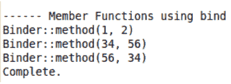

**图 4.16：** 使用 std::bind() 和 std::function 的程序输出

有几点需要注意：

- 使用类作为作用域限定符来引用函数 **method()**；
- **Binder** 实例的地址作为第二个参数传递给 **std::bind()**，这使得它成为传递给 **method()** 的第一个参数。这是必要的，因为所有非静态成员都有一个隐式的 **this** 指针作为第一个参数传入。
- 使用 **std::placeholders** 定义，我们可以绑定调用绑定方法时使用的参数，甚至更改传递的顺序（如 **func3** 所示）。

C++11 引入了一些语法糖，称为 lambda 表达式，使得定义匿名函数更加容易，这些函数也可以用于绑定方法并将它们赋值给 **std::function** 实例。我们将在主题 *什么是 Lambda 表达式？* 中详细介绍。

#### 练习 3：使用 std::function 实现回调

在本练习中，我们将利用 **std::function<>** 模板实现函数回调。按照以下步骤完成此练习：

- 1. 在 Eclipse 中打开 **Lesson4** 项目，然后在 **Project Explorer** 中展开 **Lesson4** 和 **Exercise03**，双击 **Exercise3.cpp** 在编辑器中打开该练习的文件。
- 2. 由于这是一个基于 CMake 的项目，请将当前构建器更改为 CMake Build（便携式）。
- 3. 单击 **Launch Configuration** 下拉菜单，选择 **New Launch Configuration...**。配置 **L4Exercise3** 以名称 **Exercise3** 运行。


**[captures]** 之后的所有内容与普通函数定义相同，只是没有函数名。Lambda 是一种便捷的方式，可以在使用的位置定义一段短小的函数（只需几行）。Lambda 通常作为参数传递，并且一般不会重复使用。还应注意，lambda 可以赋值给变量（通常使用 `auto` 声明）。

我们可以重写之前使用 **Scaler** 类的程序，改用 lambda 来实现相同的效果：

```
#include <iostream>

#include <vector>

#include <algorithm>

void PrintVector(const char* prefix, std::vector<int>& values)
{
    const char* sep = "";
    std::cout << prefix << " = [";
    for(auto n : values)
    {
        std::cout << sep << n;
        sep = ", ";
    }
    std::cout << "]\n";
}

int main()
{
    std::cout << "\n\n------ Lambdas with STL ------\n";
    std::vector<int> values{1,2,3,4,5};

    PrintVector("Before transform", values);
    std::transform(values.begin(), values.end(), values.begin(),
    [] (int n) {return 5*n;}
    );
```

```
PrintVector("After transform", values);

std::cout << "Complete.\n";
return 0;
}
```

该程序运行时，输出显示向量已按比例缩放 5 倍：

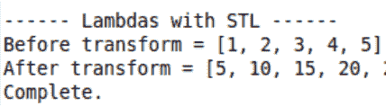

图 4.24：使用 lambda 进行缩放变换

程序中的 lambda 是 `[] (int n) {return 5*n;}`，它有一个空的捕获子句 `[]`。空的捕获子句意味着该 lambda 函数不会访问周边作用域中的任何变量。如果 lambda 不接受任何参数，则参数子句 `()` 是可选的。

### 将数据捕获到 Lambda 中

**捕获子句**（或按照 C++ 规范称为 **lambda 引入器**）允许匿名函数从周边作用域捕获数据以供后续使用。函数与解析函数变量所用作用域的组合被称为**闭包**。此处的“作用域”是捕获子句中指定的一组变量绑定。在前一节中，我们说过 lambda 是匿名函数。通过闭包实现变量捕获后，lambda 更准确地应被称为匿名函数对象。编译器会创建一个匿名类，其中包含一个内联构造函数来捕获变量，以及一个函数调用运算符 **operator()**。

捕获子句是一个以逗号分隔的列表，包含零个或多个被捕获的变量。还存在默认捕获的概念——按引用捕获或按值捕获。因此，捕获的基本语法为：

- `[&]` – 按引用捕获作用域内所有自动存储期变量
- `[=]` – 按值捕获作用域内所有自动存储期变量（生成副本）
- `[&x, y]` – 按引用捕获 `x`，按值捕获 `y`

19. 点击 **Run** 按钮，输出现在正确报告了计数：

```
------ Exercise 4 ------
Initial Vector = [46, 27, 26, 27, 32, 1, 18, 50, 21, 49]
After sort = [1, 18, 21, 26, 27, 27, 32, 46, 49, 50]
There are 7 values > 25
There are 3 values > 40
Complete.
```

图 4.32：重用 pred lambda 得到正确输出

在本练习中，我们实现了多个 lambda，使用了 lambda 表达式语法的各种特性，包括 init 捕获和 `mutable`。

> **使用 lambda**
> 
> 尽管 lambda 是 C++ 的一项强大特性，但应当合理使用。目标始终是生成可读性强的代码。因此，虽然 lambda 可能简洁明了，但有时为了便于维护，最好还是将功能提取为命名良好的方法。

## 可变参数模板

在 *第 2B 章，切勿生搬硬套——模板与推导* 中，我们介绍了泛型编程和模板。模板在 C++03 之前就已经是 C++ 的一部分。在 C++11 之前，模板的参数数量是固定的。在某些需要可变数量参数的情况下，必须为每种所需参数数量编写一个模板。另外，也有像 **printf()** 这样的可变参数函数，可以接受可变数量的参数。可变参数函数的问题在于它们不是类型安全的，因为对参数的访问是通过 `va_arg` 宏进行类型转换实现的。C++11 通过引入可变参数模板改变了这一切，单个模板可以接受任意数量的参数。C++17 通过引入 **constexpr if** 结构改进了可变参数模板的编写方式，该结构允许将基准情形模板与“递归”模板合并。

最好的方法是实现一个可变参数模板并解释其工作原理。

```
#include <iostream>

#include <string>

template<typename T, typename... Args>
T summer(T first, Args... args) {
```

```
T summer(T first, Args... args) {
    if constexpr(sizeof...(args) > 0)
        return first + summer(args...);
    else
        return first;
}
```

在上述代码中：

- `typename... Args` 将 `Args` 声明为**模板参数包**。
- `Args... args` 是一个**函数参数包**，即一个参数包，其类型由 `Args` 给出。
- `sizeof...(args)` 返回 `args` 中包元素的数量。它是包展开的一种特殊形式。
- `args...` 在递归调用 `summer()` 时展开参数包。

或者，你可以将模板看作是等效于：

```
template<typename T, typename T1, typename T2, ..., typename Tn>
T summer(T first, T1 t1, T2, ..., Tn tn) {
    if constexpr(sizeof...( t1, t2, ..., tn) > 0)
        return first + summer(t1, t2, ..., tn);
    else
        return first;
}
```

当编译器处理示例程序中的 `summer(1, 3, 5, 7, 9, 11)` 时，它会执行以下步骤：

- 它推导出 `T` 是 `int`，而 `Args...` 是包含 `<int, int, int, int, int>` 的参数包。
- 由于包中的参数数量大于零，编译器生成 `first + summer(args...)`，其中省略号解包模板实参，将 `summer(args...)` 转换为 `summer(3,5,7,9,11)`。

- 然后编译器为 `summer(3,5,7,9,11)` 生成代码。同样，会应用 `first + summer(args...)`，即 `summer(5,7,9,11)`。
- 此过程不断重复，直到编译器必须为 `summer(11)` 生成代码。在这种情况下，会触发 `constexpr if` 语句的 `else` 分支，仅返回 `first`。

由于类型由模板的参数决定，我们并不局限于所有参数具有相同类型。我们已经在 STL 中见过几个可变参数模板——`std::function` 和 `std::bind`。

还有另一种类型的可变参数模板，它将参数转发给另一个函数或模板。这类模板本身做得很少，但提供了一种标准的处理方式。一个例子是 `make_unique` 模板，它可以实现为：

```
template<typename T, typename... Args>
unique_ptr<T> make_unique(Args&&... args)
{
    return unique_ptr<T>(new T(std::forward<Args>(args)...));
}
```

`make_unique` 必须调用 `new` 运算符来分配内存，然后调用适合该类型的构造函数。调用构造函数所需的参数数量可能差异很大。这种形式的可变参数模板引入了额外的包展开：

- `Args&&...` 表示我们有一组转发引用。
- `std::forward<Args>(args)...` 包含两个同时展开的参数包，它们必须具有相同数量的元素——`Args` 是模板参数包，`args` 是函数参数包。

每当我们需要在可变参数模板中将一个函数调用转发给另一个函数调用时，就会使用这种模式。


### 活动 1：实现多播事件处理程序

Microsoft 于 1992 年首次推出 Microsoft 基础类（MFC），当时 C++ 还处于起步阶段。这意味着围绕这些类所做的许多设计选择都受到了限制。例如，事件处理程序通常通过 OnEventXXX() 方法进行路由，并且通常使用宏来配置，作为从 MFC 类派生的类的一部分。你的团队的任务是使用模板实现一种更类似于 C# 中委托的多播事件处理程序，这些模板体现了函数对象，并最终引入可变参数模板以实现可变参数列表。

在 C# 中，你可以按如下方式声明委托：

```
delegate int Handler(int parameter);
```

这使得 Handler 成为一种可以被赋值的类型，并且该值可以被调用。这基本上就是 C++ 中 std::function<> 为我们提供的功能，只不过它不具备多播能力。你的团队需要开发一个模板类 Delegate，使其行为方式与 C# 的委托相同。

- 委托将接受一个可变参数列表，但只返回 void
- 将使用 operator+= 向委托添加新的回调
- 可以使用 delegate.Notify(...) 或 delegate(...) 这两种语法中的任意一种来调用它

按照以下步骤开发 Delegate 模板：

1. 从 Lesson4/Activity01 文件夹加载准备好的项目，并将项目的当前构建器配置为 CMake Build (Portable)。
2. 构建项目，配置启动器，然后运行单元测试（其中那个占位测试会失败）。建议将测试运行器命名为 L4delegateTests。
3. 实现一个 Delegate 类，它可以包装单个处理程序，包含所有必需的方法，并支持回调使用单个 int 参数。
4. 更新模板类以支持多播。
5. 将 Delegate 类转换为一个模板，该模板可以接受一个模板参数，用于定义回调使用的参数类型。
6. 将 Delegate 模板转换为可变参数模板，使其可以接受零个或多个参数，这些参数定义了传递给回调的类型。

完成上述步骤后，预期输出如下所示：

```
------ Activity 1 ------

------ Delegate - no args ------
Hello, World
------ Delegate - string argument ------
hello!-hello?-hello@-
------ Delegate - binary int argument ------
52 + 4 = 56
52 - 4 = 48
52 * 4 = 208
52 / 4 = 13

Complete.
```

图 4.34：成功实现 Delegate 后的输出

## 注意

本活动的解决方案可在第 673 页找到。

## 总结

在本章中，我们实现了一种数据和方法隐藏的设计方法——PIMPL，它还有一个额外的好处，即减少依赖并缩短构建时间。随后，我们以自定义类的形式直接实现了函数对象，之后又以 lambda 函数的形式实现了函数对象。接着，我们通过深入研究可变参数模板扩展了模板编程技能，最终形成了一个可用于事件回调处理的模板。在下一章中，我们将学习如何使用 C++ 的特性开发多线程程序，并通过并发构造来管理线程间的协作。

# 5
