# 哲学家晚宴——线程与并发

## 学习目标

通过本章的学习，你将能够：

- 创建同步和异步多线程应用程序
- 应用同步机制来处理数据冒险和竞争条件
- 使用 C++ 线程库原语开发高效的多线程代码
- 使用移动语义为多线程闭包创建线程
- 使用 future、promise 和 async 实现线程通信

在本章中，我们将阐明多线程编程中基本术语之间的区别，学习如何编写多线程代码，了解 C++ 标准库为数据访问同步提供了哪些资源，并学习如何防止代码遇到竞争条件和死锁。

## 同步、异步与线程化执行

在并发编程的概念中，**同步**、**异步**和**线程化执行**之间存在着微妙的差别。为厘清这些概念，我们将从头开始，从并发程序和并行程序的概念讲起。

### 并发

**并发**的概念是多个任务同时执行。**并发**并不指明这种同时性如何实现，它只表示在给定时间段内将完成多个任务。任务可以是**有依赖的**、**并行的**、**同步的**或**异步的**。下图展示了并发工作的概念：

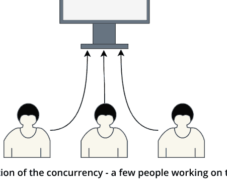

图 5.1：并发的抽象——几个人在同一台计算机上工作

在上图中，有三个人同时在一台计算机上工作。我们并不关心他们以何种方式工作；在这个抽象层次上，这无关紧要。

### 并行

当多个任务同时执行时，就出现了**并行**。这些任务凭借硬件能力并行工作。并行最好的例子是多核处理器。为了实现并行执行，任务会被划分为完全独立的子任务，并在不同处理器核心上执行。之后，可以将执行结果合并。请看下图以理解并行的概念：

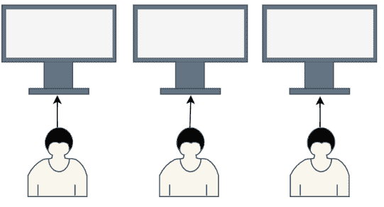

**图 5.2：**并行的抽象——所有任务都由不同的人执行；他们之间互不交互

在上图中，有三个人同时在自己的电脑上工作——嗯，他们正在并行工作。

> **注意**
>
> **并发**和**并行**不是一回事。**并行**是并发的补充。它告诉我们任务的执行方式：任务彼此独立，并在不同的计算单元（即处理器或核心）中运行。

### 同步执行

术语“同步执行”意味着每个子任务将按顺序逐一执行。换句话说，如果要执行几个任务，每个任务只能在前一个任务完成之后才能开始工作。该术语没有规定任务的执行方式，也没有规定任务将在单个线程还是多个线程中执行。它只告诉我们执行顺序。让我们回到哲学家晚宴的例子。在单线程世界中，哲学家们将一个接一个地用餐。

第一位哲学家拿起两根筷子，吃自己的寿司。然后，第二位哲学家拿起两根筷子，吃自己的寿司。他们轮流进行，直到所有人都吃完自己的寿司。请看下图，它展示了四个任务在单个线程中的同步执行：


图 5.3：单个线程中的同步执行

在这里，每个任务都会等待前一个任务完成。任务也可以在多个线程中同步执行。请看下图，它展示了四个任务在多个线程中的同步执行。同样，每个任务都会等待前一个任务完成：

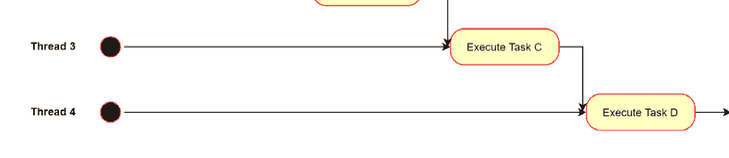

图 5.4：多个线程中的同步执行

在这种情况下，每个任务都在单独的线程中启动，但必须在前一个线程完成其工作之后才启动。在多线程世界中，哲学家们仍然会一个接一个地吃，但有一个小差别：现在他们每个人都拥有自己的筷子，但只能严格按照顺序进食。

> **注意**
>
> **同步执行**意味着每个任务的完成时间是同步的。这里的关键是任务执行的顺序。

我们通过下面的代码示例来理解同步执行。当我们在单个线程中运行任务时，只需调用普通函数。例如，我们实现了四个向终端打印消息的函数，并以同步、单线程的方式运行了它们：

```
#include <iostream>

void printHello1()
{
    std::cout << "Hello from printHello1()" << std::endl;
}

void printHello2()
{
    std::cout << "Hello from printHello2()" << std::endl;
}

void printHello3()
{
    std::cout << "Hello from printHello3()" << std::endl;
}

void printHello4()
{
    std::cout << "Hello from printHello4()" << std::endl;
}
```


```
}

int main()
{
    printHello1();
    printHello2();
    printHello3();
    printHello4();
    return 0;
}
```

这里，我们一次调用所有函数，每个下一个函数在前一个函数执行完毕后运行。现在，让我们以不同的线程运行它们：

```
#include <iostream>

#include <thread>

void printHello1()
{
    std::cout << "Hello from printHello1()" << std::endl;
}

void printHello2()
{
    std::cout << "Hello from printHello2()" << std::endl;
}

void printHello3()
{
    std::cout << "Hello from printHello3()" << std::endl;
}

void printHello4()
{
```

```
```cpp
std::cout << "Hello from printHello4()" << std::endl;
}

int main()
{
    std::thread thread1(printHello1);
    thread1.join();
    std::thread thread2(printHello2);
    thread2.join();
    std::thread thread3(printHello3);
    thread3.join();
    std::thread thread4(printHello4);
    thread4.join();
    return 0;
}
```
```

在前面的代码示例中，我们创建了四个线程并立即对其进行了 join。因此，每个线程在下一个线程可以运行之前必须完成其工作。正如你所见，对任务没有任何变化——它们仍然按严格顺序执行。

### 异步执行

这就是多个任务可以在不阻塞任何线程执行的情况下同时执行的地方。通常，主线程发起一个异步操作并继续执行。执行完成后，结果会发送回主线程。经常，执行一个异步操作并不与为其创建单独的线程相关。任务可以由其他人执行，例如另一台计算设备、远程 Web 服务器或外部设备。让我们回到哲学家就餐的例子。

在 **异步执行** 的情况下，每个哲学家都有自己的筷子，并且彼此独立地进食。当寿司准备好，服务员上菜时，他们都开始进食，并且可以在自己的时间里完成。

> **注意**
> 
> 在 **异步执行** 中，由于所有任务彼此独立工作，因此不需要知道每个任务的完成时间。

请看下面的图表，它表示在多个线程中四个任务的异步执行：

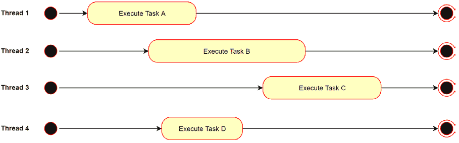

图 5.5：多个线程中的异步执行

它们是在不同的时间启动和完成的。让我们用一个代码示例来考虑这种异步执行。例如，我们实现了四个打印消息到终端的函数。我们在不同的线程中运行它们：

```
```cpp
#include <iostream>

#include <thread>

#include <chrono>

void printHello1()
{
    std::cout << "Hello from thread: " << std::this_thread::get_id() << std::endl;
}

void printHello2()
{
    std::cout << "Hello from thread: " << std::this_thread::get_id() << std::endl;
}

void printHello3()
{
```

```
std::cout << "Hello from thread: " << std::this_thread::get_id() <<
std::endl;
}

void printHello4()
{
    std::cout << "Hello from thread: " << std::this_thread::get_id() <<
std::endl;
}

int main()
{
    std::thread thread1(printHello1);
    std::thread thread2(printHello2);
    std::thread thread3(printHello3);
    std::thread thread4(printHello4);
    thread1.detach();
    thread2.detach();
    thread3.detach();
    thread4.detach();

    using namespace std::chrono_literals;
    std::this_thread::sleep_for(2s);
    return 0;
}
```

让我们看看这里发生了什么。我们使用了来自前一个示例的四个函数，但它们被稍微修改了一些。我们通过使用 std::this_thread::get_id() 函数添加了线程的唯一 ID 打印。该函数返回 std::thread::id 对象，表示线程的唯一 ID。该类重载了输出和比较运算符，因此我们可以以不同的方式使用它。例如，我们可以检查线程 ID，如果它是主线程的 ID，我们可以执行特殊任务。在我们的示例中，我们可以将线程 ID 打印到终端。接下来，我们创建了四个线程并将它们分离。这意味着没有线程会等待另一个线程完成工作。从这一刻起，它们成为守护线程。

它们将继续工作，但没有人知道这一点。然后，我们使用 std::this_thread::sleep_for(2s) 函数使主线程等待两秒钟。我们这样做是因为当主线程完成其工作时，应用程序将停止，我们将无法在终端中查看分离线程的输出。以下屏幕截图是终端输出的一个示例：

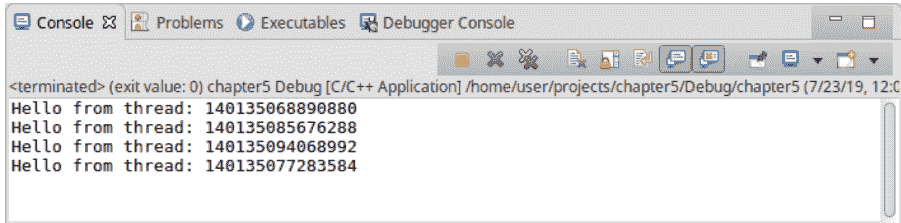

图 5.6：示例执行的結果

在你的 IDE 中，输出可能会发生变化，因为执行顺序是不确定的。异步执行的一个现实世界示例是互联网浏览器，其中你可以打开多个标签。当新标签打开时，应用程序启动一个新线程并将其分离。尽管线程独立工作，但它们可以共享一些资源，例如文件句柄，用于写入日志或执行其他操作。

> 注意
> std::thread 有一个名为 get_id() 的成员函数，它返回 std::thread 实例的唯一 ID。如果 std::thread 实例未初始化或已被 join 或 detach，get_id() 将返回默认的 std::thread::id 对象。这意味着没有执行线程与当前 std::thread 实例相关联。

让我们使用一些伪代码来展示计算由另一个计算单元完成的示例。例如，假设我们开发一个应用程序来执行货币兑换计算。用户输入一种货币的金额，选择要兑换的另一种货币，应用程序向他们显示该货币的金额。应用程序在后台向持有所有货币汇率的远程服务器发送请求。

```
void getUserInput()
{
    Currency from;
    Currency to;
    double amount;
    std::thread progress(displayProgress);
    progress.detach();
    std::thread request(sendRequest, from, to, amount);
    request.detach();
}

int main()
{
    std::thread messageLoop(runMessageLoop);
    messageLoop.detach();

    std::thread userInput(getUserInput);
    userInput.detach();

    return 0;
}
```

让我们看看这里发生了什么。在 main() 函数中，我们创建了一个名为 messageLoop 的线程来执行 runMessageLoop() 函数。一些检查服务器是否有新结果的代码可以放在此函数中。如果收到新结果，它会创建一个新的线程 procRes 来在窗口中显示结果。我们还在 main() 函数中创建了另一个线程 userInput 来从用户获取货币和金额，并创建一个新的线程 request 来向远程服务器发送请求。发送请求后，它会创建一个新的线程 progress，在收到结果之前显示进度条。由于所有线程都被分离，它们能够独立工作。当然，这只是伪代码，但主要思想很清楚——我们的应用程序向远程服务器发送请求，后者为我们的应用程序执行计算。

## 哲学家就餐问题 – 线程与并发

让我们使用一个日常生活中的例子来回顾我们所学到的并发概念。这里有一个背景，你需要编写一个应用程序并提供所有相关文档和架构概念：

- **单线程工作：** 你自己编写。
- **多线程工作：** 你邀请朋友一起编写项目。有人编写架构概念，有人负责文档工作，你专注于编码部分。所有参与者相互沟通以澄清问题并共享文档，例如关于规范的问题。
- **并行工作：** 任务被划分。有人为项目编写文档，有人设计图表，有人编写测试用例，你独立工作。参与者之间完全不沟通。
- **同步工作：** 在这种情况下，你们每个人都无法理解自己应该做什么。因此，你们决定一个接一个地工作。当架构工作完成后，开发人员开始编写代码。然后，当开发工作完成后，有人开始编写文档。
- **异步工作：** 在这种情况下，你雇佣一家外包公司来完成项目。在他们开发项目时，你将从事其他任务。

现在，让我们将我们的知识付诸实践并解决一个练习，看看所有这些是如何工作的。

### 练习 1：以不同方式创建线程

在这个练习中，我们将编写一个简单的应用程序来创建四个线程；其中两个将以同步方式工作，两个将以异步方式工作。它们都将向终端打印一些符号，以便我们可以观察操作系统如何切换线程执行。

> **注意**
> 
> 在项目设置中添加 pthread 链接器标志，让编译器知道你将使用线程库。对于 Eclipse IDE，你可以通过以下路径执行此操作：**Project -> Properties -> C/C++ Build -> Settings -> G++ Linker -> Miscellaneous -> Linker flags 输入 '-pthread'.** 此路径适用于 **Eclipse 版本：3.8.1**，在不同版本中可能有所不同。


执行以下步骤完成此练习：

+   1. 包含一些用于线程支持的头文件，即 `<thread>`，流支持，即 `<iostream>`，以及函数对象支持，即 `<functional>`：

```
```cpp
#include <iostream>
#include <thread>
#include <functional>
```
```

+   2. 实现一个自由函数，**printNumbers()**，它在 **for** 循环中打印从 0 到 100 的数字：

```
```cpp
void printNumbers()
{
    for(int i = 0; i < 100; ++i)
    {
        std::cout << i << " ";
    }
    std::cout << std::endl;
}
```
```

+   3. 实现一个可调用对象，即带有重载 **operator()** 的 **Printer** 类，该类在 **for** 循环中打印从 0 到 100000 的 "*" 符号。每 **200** 次迭代打印一个换行符以获得更易读的输出：

```
```cpp
class Printer
{
public:
    void operator()()
    {
        for(int i = 0; i < 100000; ++i)
        {
            if (!(i % 200))
            {
                std::cout << std::endl;
            }
            std::cout << "*";
        }
    }
};
```
```

8. 创建 Printer 类的一个实例，名为 print。创建一个第三个线程 thr3，并用 print 对象初始化它。使用 detach() 方法将其分离：

```
Printer print;
std::thread thr3(print);
thr3.detach();
```

9. 创建最后一个线程 thr4，并用 printOther 对象初始化它。将其分离：

```
std::thread thr4(printOther);
thr4.detach();
```

10. 在 main() 函数退出前添加 std::getchar() 函数调用。这可以避免关闭应用程序。我们将有机会看到分离线程的工作方式：

```
std::getchar();
```

11. 在编辑器中运行此代码。你会看到 thr1 开始执行，程序等待。thr1 完成后，thr2 开始执行，程序等待。这是同步执行的一个例子。thr2 完成工作后，线程 thr3 和 thr4 开始执行。它们是分离的，所以程序可以继续执行。以下输出中，你会看到符号是混合的。这是因为操作系统执行中断，线程同时工作。

你的输出将类似于以下内容：

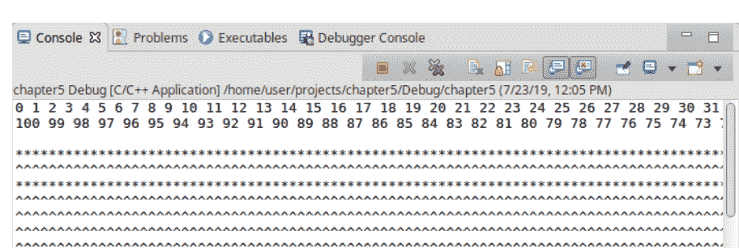

图 5.7：练习执行的結果

线程 A 继续递增：

+   1. 写入新值（var = 1）。

因此，我们期望变量在工作完成后等于 2，但实际上它等于 1。请查看以下图表以更好地理解此示例：

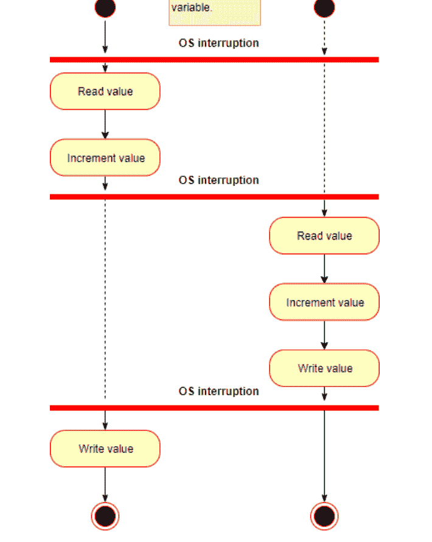

图 5.8：两个线程递增同一个共享变量

```
else
{
    std::cout << "Error: dividend = 0" << std::endl;
}
```

3. 进入 main() 函数，创建两个名为 divisor 和 dividend 的整数，并用任意非零值初始化它们：

```
int main()
{
    int divisor = 15;
    int dividend = 5;
    return 0;
}
```

4. 创建 thr1 线程，传递 divide 函数，通过引用使用 divisor 和 dividend，然后分离线程：

```
std::thread thr1(divide, std::ref(divisor), std::ref(dividend));
thr1.detach();
std::getchar();
```

注意

在 std::this_thread 命名空间中，有一个名为 sleep_for 的函数，它会阻塞线程一段时间。作为参数，它接受 std::chrono::duration —— 一个表示时间间隔的模板类。

5. 在编辑器中运行此代码。你会看到 divide() 函数在 thr1 中正确工作。输出如下：

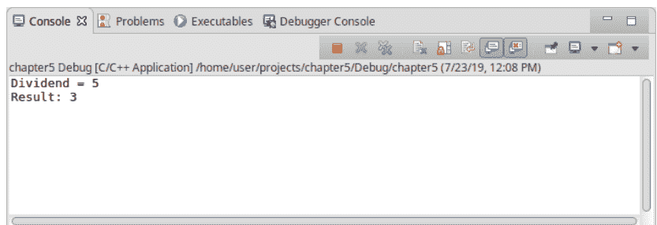

图 5.9：正确练习执行的結果

现在，我们将继续并进行更改以演示竞争条件。

+   6. 返回到函数，并在 **if** 条件之后为子线程设置 **2s** 的睡眠时间。添加日志：

```
if (0 != dividend)
{
    std::cout << "Child thread goes sleep" << std::endl;
    using namespace std::chrono_literals;
    std::this_thread::sleep_for(2s);
    std::cout << "Child thread woke up" << std::endl;
    std::cout << "Dividend = " << dividend << std::endl;
    std::cout << (divisor / dividend) << std::endl;
}
```

+   7. 返回到 **main()** 函数，并为主线程设置 **1s** 的睡眠时间。之后，将 **dividend** 变量设置为 **0**。添加日志：

```
std::cout << "Main thread goes sleep" << std::endl;
using namespace std::chrono_literals;
std::this_thread::sleep_for(1s);
std::cout << "Main thread woke up" << std::endl;
dividend = 0;
std::cout << "Main thread set dividend to 0" << std::endl;
```

## Note

**std::chrono_literals** 命名空间包含用于时间表示的字面量：`h` 表示 **hours**，`min` 表示 **minutes**，`s` 表示 **seconds**，`ms` 表示 **milliseconds**，`us` 表示 **microseconds**，以及 `ns` 表示 **nanoseconds**。要使用它们，只需将它们添加到数字的末尾，例如 1s、1min、1h 等。

+   8. 在 **main()** 函数退出前添加 **std::getchar()** 函数调用。这可以避免我们关闭应用程序，我们将有机会看到分离线程的工作方式：

```
std::getchar();
```

9. 在编辑器中运行此代码。你会看到主线程睡眠 1s。然后，子线程进入 if 条件并睡眠 2s，这意味着它验证 dividend 且不等于 0。然后，主线程唤醒并将 dividend 变量设置为 0。然后，子线程唤醒并执行除法。但由于 dividend 现在等于 0，应用程序崩溃。如果你在调试模式下运行此示例，你将看到一个 SIGFPE 异常，消息为：“Arithmetic exception”。你将得到以下输出：

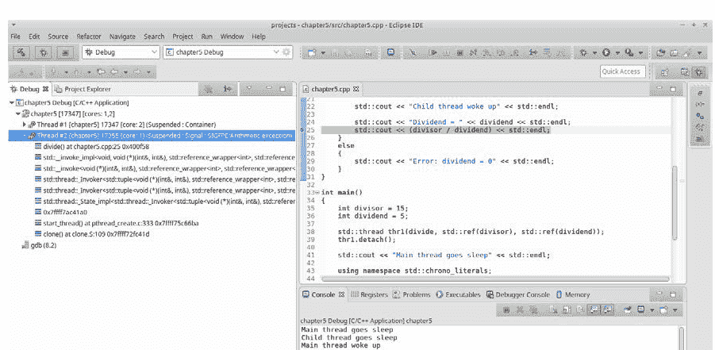

图 5.10：存在竞争条件时的练习执行結果

在此练习中，我们考虑了“检查后执行”类型的竞争条件。我们为线程设置了睡眠时间以模拟操作系统中断，但在真实程序中，这种情况可能发生也可能不发生。一切都取决于操作系统及其调度程序。这使得调试和修复竞争条件变得异常困难。为了避免此示例中的竞争条件，我们可以采取几种方式：

+   - 将变量的副本传递给线程函数，而不是传递引用。
+   - 使用标准库原语同步线程之间对共享变量的访问。
+   - 在主线程将 dividend 值更改为 0 之前加入子线程。

让我们再看看几种修复此竞争条件的方法。它们都取决于你尝试实现的一个任务。在下一节中，我们将考虑 C++ 标准库提供的同步原语。

如果线程 B 先执行，会出现困难。它会导致线程 B 在线程 A 读取之前更改值。线程执行的顺序应严格保证。线程 B 只有在线程 A 读取其值之后才能将新值写入变量。以下图表将帮助你澄清导致数据危险的 RAW 数据依赖：

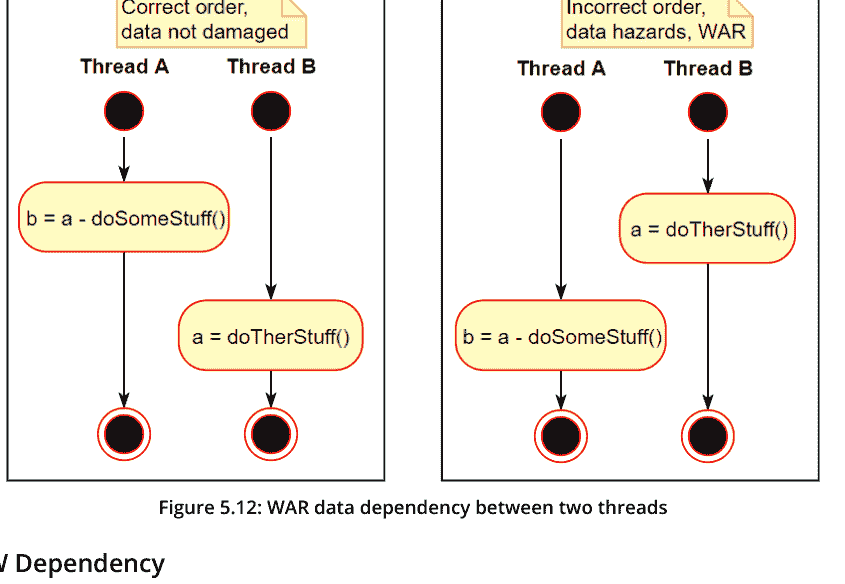

图 5.12：两个线程之间的 WAR 数据依赖

## WAW Dependency

WAW 依赖发生在多个线程更改同一变量的值，并且某些线程为其计算而读取时。例如，线程 A 执行其工作并将结果写入变量。线程 B 读取变量的值并执行其工作。线程 C 执行其工作并将结果写入同一变量。用伪代码表示如下：

```
Thread A: a = doSomeStuff();
Thread B: b = a - doOtherStuff();
Thread C: a = doNewStuff();
```

如果 **Thread C** 在线程 A 和 B 之前执行，会出现困难。这导致 **Thread B** 读取了它不期望读取的值。线程执行的顺序应严格保证。**Thread C** 必须在 **Thread A** 写入其值并且 **Thread B** 已读取它之后，才能将新值写入变量。以下图表将帮助你澄清导致数据危险的 WAW 数据依赖：

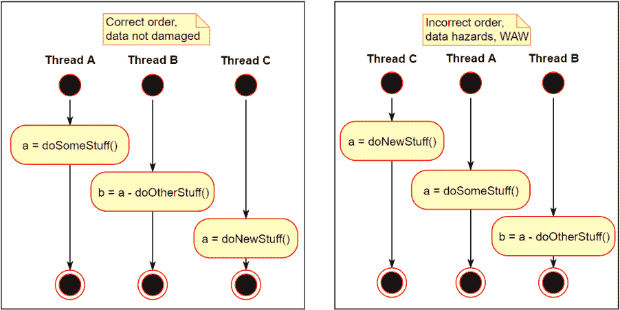

图 5.13：两个线程之间的 WAW 数据依赖

## Resource Synchronization

为防止竞争和数据危险，存在一种共享数据锁定机制，其中一个流打算更改或读取这些数据。该机制称为 **resource synchronization**。对于同步，我们需要分配更改或读取共享资源的代码块。这样的代码块称为 **critical sections**。同步包括在其中一个线程进入时阻塞关键区。其他也打算执行此关键区代码的线程将被阻塞。当执行关键区的线程离开时，锁将被释放。然后，故事将与下一个线程重复。


## 事件同步

线程工作同步还有另一种机制——事件同步。这意味着线程工作的同步，其中一个线程在另一个线程发出某个事件的信号之前暂停其工作。例如，有线程 A，它从另一个进程接收消息。它将消息写入队列并等待新消息。还有另一个线程，线程 B，处理这些消息。它从队列中读取消息并对其执行某些操作。当没有消息时，线程 B 处于休眠状态。当线程 A 收到新消息时，它唤醒线程 B 并处理它。下面的图表清晰地说明了两个线程的事件同步：

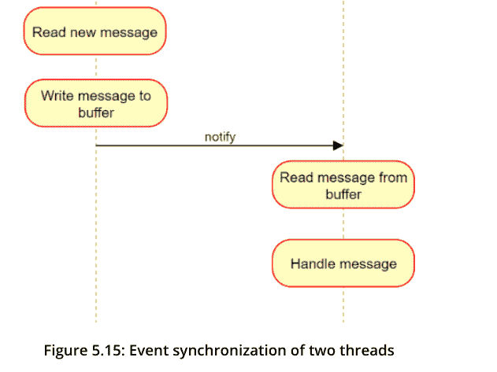

图 5.15：两个线程的事件同步

然而，即使在同步代码中，另一个导致竞态条件的原因也可能出现——类的有缺陷的接口。为了理解这是什么，让我们考虑以下示例：

```
class Messages
{
    public:
    Messages(const int& size)
    : ArraySize(size)
    , currentIdx(0)
```

```
}

}));

thr1.detach();
thr2.detach();
using namespace std::chrono_literals;
std::this_thread::sleep_for(2s);
return 0;
}
```

这里，我们创建了一个 **msgs** 变量，然后创建了第一个线程，该线程向 **msgs** 推送值。然后，我们创建了第二个线程，该线程从数组中弹出值并将其分离。即使我们使用锁定机制保护所有函数，其中一个线程也可以检查数组的大小并被操作系统中断。此时，另一个线程可以更改数组。当第一个线程继续其工作时，它可能尝试向已满的数组推送或从空数组弹出。因此，同步仅在与良好的设计配对时才有效。

## 死锁

还有一个同步问题。让我们回到哲学家就餐的例子。原始问题是其中一位哲学家只有一根筷子。因此，他们可以通过相互分享筷子一口一口地吃寿司。虽然他们完成寿司需要很长时间，但他们都会吃饱。但是如果他们同时拿起一根筷子并且不愿意分享第二根筷子，他们将无法吃寿司，因为他们每个人都在永远等待第二根筷子。这导致了 **死锁**。这发生在两个线程都在等待另一个线程继续其工作时。死锁的原因之一是当一个线程加入另一个线程时，但另一个线程加入第一个线程。因此，当两个线程相互加入时，它们都无法继续工作。让我们考虑以下死锁示例：

```
#include <thread>

std::thread* thr1;

std::thread* thr2;

void someStuff()
{
    thr1->join();
```

```
std::thread thr5(someFunc);

thr1.join();

thr2.join();
thr3.join();
thr4.join();
thr5.join();
```

但更方便的是将一堆线程存储在 STL 容器中，例如线程的 vector：

```
std::vector<std::thread> threads;
```

STL 容器不能与不支持复制语义的对象一起使用。得益于移动语义，我们可以将具有移动构造函数和移动赋值运算符的不可复制对象存储在容器中。然后，我们可以使用 std::move() 函数使用线程的 vector。要在容器中初始化线程，我们可以做如下操作：

```
for (int i = 0; i < 10; i++)
{
    auto t = std::thread([i]()
    {
        std::cout << "thread: " << i << "\n";
    });
    threads.push_back(std::move(t));
}
```

然后，我们可以加入或分离它们全部：

```
for (auto& thr: threads)
{
    if (thr.joinable())
    {
        thr.join();
    }
}
```

移动语义在我们将 std::thread 对象存储为类成员时也很有用。在这种情况下，我们应该仔细设计我们的类，删除复制构造函数和赋值运算符，并实现新的移动构造函数和移动赋值运算符。让我们考虑以下此类类的代码示例：

```
class Handler
{
    std::thread threadHandler;

public:
    Handler(const Handler&) = delete;
    Handler& operator=(const Handler&) = delete;

    Handler(Handler && obj)
    : threadHandler(std::move(obj.threadHandler))
    {}
    Handler & operator=(Handler && obj)
    {
        if (threadHandler.joinable())
        {
            threadHandler.join();
        }
        threadHandler = std::move(obj.threadHandler);
        return *this;
    }
    ~Handler()
    {
        if (threadHandler.joinable())
        {
            threadHandler.join();
        }
    }
};
```

```
std::cout << "Handler& operator=(const Handler&)" << std::endl;
    return *this;
}
Handler(Handler && obj)
{
    std::cout << "Handler(Handler && obj)" << std::endl;
}
Handler & operator=(Handler && obj)
{
    std::cout << "Handler & operator=(Handler && obj)" << std::endl;
    return *this;
}
~Handler()
{
    std::cout << "~Handler()" << std::endl;
}
};
```

3. 实现 doSomeJob() 函数，它在这里实际上什么都不做，只是打印日志消息：

```
void doSomeJob(Handler&& h)
{
    std::cout << "I'm here" << std::endl;
}
```

4. 进入 main() 函数并创建 Handler 类型的 handler 变量。创建 thr1，传递 doSomeJob() 函数，并移动 handler 变量：

```
Handler handler;
std::thread thr1(doSomeJob, std::move(handler));
```

5. 分离 thr1 线程并为主线程添加少量休眠以避免关闭应用程序。我们将能够看到来自分离线程的输出：

```
thr1.detach();
using namespace std::chrono_literals;
std::this_thread::sleep_for(5s);
```

6. 在你的编辑器中运行此代码。在终端日志中，从默认构造函数，你将看到来自移动运算符的两个日志，一个来自析构函数的日志，来自 doSomeJob() 函数的消息，最后来自析构函数的另外两个日志消息。我们可以看到移动构造函数被调用了两次。

你将得到以下输出：

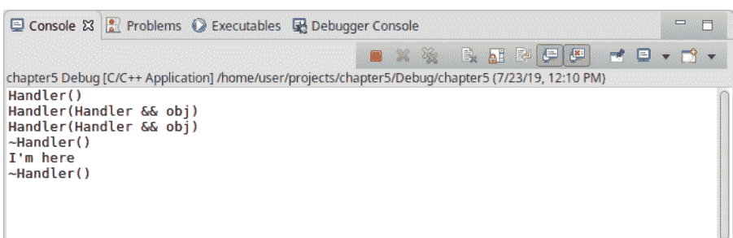

图 5.16：练习执行的結果

正如你所见，Handler 对象被移动到线程函数中。尽管如此，所有未使用 std::ref() 函数传递的参数都被复制到线程的内存中。

让我们考虑一个有趣的问题。正如你可能记得的，当我们初始化 std::thread 时，所有构造函数参数都被复制到线程内存中，包括可调用对象——lambda、函数或 std::function。但如果我们的可调用对象不支持复制语义会怎样？例如，我们创建了一个类，它只有移动构造函数和移动赋值运算符：

```
class Converter
{
    public:

    Converter(Converter&&)
    {
    }

    Converter& operator=(Converter&&)
    {
        return *this;
    }

    Converter() = default;
```

现在，一切都 ok——代码编译并完全按照我们想要的方式工作。

现在，让我们考虑另一个有趣的示例。例如，你有一个 lambda 函数需要捕获一个不可复制的对象，例如 unique_ptr：

```
auto unique = std::make_unique<Converter>();
```

从 C++ 14 开始，我们可以使用 std::move() 来捕获可移动对象。因此，要捕获一个唯一指针，我们可以使用以下代码：

```
std::thread convertThread([ unique = std::move(unique) ] {
    unique->operator()("convert me");
});
```

正如你所见，使用 std::move 通过值捕获 lambda 中的值非常有用。这在我们不想复制某些对象时也很有用，因为复制它们可能需要很长时间。

现在，让我们把我们的知识付诸实践，编写一个应用程序示例，演示如何使用 std::move 与线程。

### 练习 4：创建和操作线程的 STL 容器

在本练习中，我们将编写一个简单的应用程序，我们将在其中使用 std::move() 与线程。首先，我们将实现一个可移动构造的类。此类将把小写文本转换为大写文本。然后，我们将创建一个此类实例的 vector。接下来，我们将创建一个 std::thread 对象的 vector。最后，我们将使用第一个 vector 中的对象初始化线程。

执行以下步骤以完成此练习：

1. 包含用于线程支持的头文件，即 `<thread>`、流支持，即 `<iostream>`，以及 `<vector>`：

```
#include <iostream>
#include <thread>
#include <vector>
#include <string>
```


```
}
}
    result[idx] = bufferOut;
}
catch(...)
{
    std::cout << "Invalid index" << std::endl;
}
}

private:
const std::vector<std::string>& m_bufferIn;
};
```

3. 进入 main() 函数，创建一个名为 numberOfTasks 的常量值，并将其设为 5。然后，创建一个 Converter 对象的 vector 并使用 numberOfTasks 预留其大小。接着，创建一个 std::thread 对象的 vector 并使用 numberOfTasks 预留其大小：

```
const int numberOfTasks = 5;
std::vector<Converter> functions;
functions.reserve(numberOfTasks);
std::vector<std::thread> threads;
threads.reserve(numberOfTasks);
```

4. 创建字符串的 vector textArr，并推送五个不同的大字符串以便转换：

```
std::vector<std::string> textArr;
textArr.emplace_back("In the previous topics, we learned almost all that we need to work with threads. But we still have something interesting to consider - how to synchronize threads using future results. When we considered condition variables we didn't cover the second type of synchronization with future results. Now it's time to learn that.");
textArr.emplace_back("First of all, let's consider a real-life example. Imagine, you just passed the exam at the university. You were asked to wait some amount of time for results. So, you have time to coffee with your mates, and every 10-15 mins you check are results available. Then, when you finished all your other activities, you just come to the door of the lecture room and wait for results.");
textArr.emplace_back("In this exercise, we will write a simple application where we will use std::move() with threads. First of all, we will implement a class that is move constructible. This class will convert lowercase text into uppercase text. Then we will create a vector of
```
```
instances of this class. Next, we will create a vector of std::thread object. Finally, we will initialize threads with an object from the first vector");
textArr.emplace_back("Let's consider one interesting issue. As you remember when we initialize std::thread all constructor arguments are copied into thread memory, including a callable object - lambda, function, std::function. But what if our callable object doesn't support copy semantic? For example, we created a class that has only move constructor and a move assignment operator:");
textArr.emplace_back("Run this code in your editor. You will see in the terminal log from the default constructor, two logs from the move operator, then one log from a destructor, then message from the doSomeJob() function and, finally two other log messages from the destructor. We see that the move constructor is called twice. You will get the output like the following:");
```

+   5. 实现一个 for 循环，将 Converter 对象推送到 functions vector 中：

```
for (int i = 0; i < numberOfTasks; ++i)
{
    functions.push_back(Converter(textArr));
}
```

+   6. 创建一个字符串的 result vector 并推送五个空字符串。然后，创建一个变量作为数组元素的索引：

```
std::vector<std::string> result;
for (int i = 0; i < numberOfTasks; ++i)
{
    result.push_back("");
}
int idx = 0;
```

+   7. 实现另一个 for 循环，将 std::thread 对象推送到 threads vector 中：

```
for (auto iter = functions.begin(); iter != functions.end(); ++iter)
{
    std::thread tmp(std::move(*iter), idx, std::ref(result));
    threads.push_back(std::move(tmp));
    from = to;
    to += step;
}
```

+   8. 实现第三个 **for** 循环以分离 `std::threads`：
+   
+   ```cpp
+   for (auto iter = threads.begin(); iter != threads.end(); ++iter)
+   {
+       (*iter).detach();
+   }
+   ```

+   9. 为主线程添加一个小的休眠以避免应用程序关闭。现在，我们可以看到分离的线程如何工作：
+   
+   ```cpp
+   using namespace std::chrono_literals;
+   std::this_thread::sleep_for(5s);
+   ```

+   10. 最后将结果打印到终端：
+   
+   ```cpp
+   for (const auto& str : result)
+   {
+       std::cout << str;
+   }
+   ```

+   11. 在编辑器中运行此代码。在终端中，你可以看到所有字符串都已大写，这意味着所有线程都已移动并成功运行。你将得到如下输出：

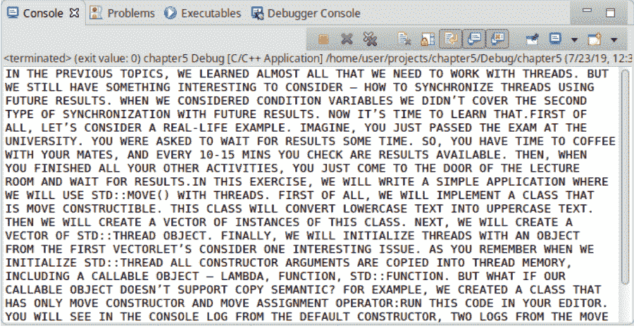

**图 5.18：** 练习执行的結果

在此练习中，我们练习了如何创建仅可移动对象的 STL 容器。我们还考虑了如何将不可复制的对象传递给线程构造函数。这些知识将在下一节帮助我们学习如何从线程获取结果。

## Futures、Promises 和 Async

在上一节中，我们学习了几乎所有使用线程所需的内容。但我们仍有一些有趣的内容需要考虑，即使用未来结果同步线程。当我们考虑条件变量时，我们没有涵盖使用未来结果的第二种同步类型。现在是学习的时候了。

假设存在一种情况，我们运行某个线程并继续其他工作。当我们需要结果时，我们停止并检查它是否已准备好。这种情况描述了实际使用未来结果的工作方式。在 C++ 中，我们有一个名为 <future> 的头文件，其中包含两个表示未来结果的模板类：std::future<> 和 std::shared_future<>。我们使用 std::future<> 当我们需要单个未来结果时，使用 std::shared_future<> 当我们需要多个有效副本时。我们可以将它们与 std::unique_ptr 和 std::shared_ptr 进行比较。

为了使用未来结果，我们需要一种特殊机制在后台运行任务并稍后接收结果：std::async() 模板函数。它接收一个可调用对象作为参数，以及启动模式 – deferred 或 async，以及可调用对象的参数。启动模式 std::launch::async 和 std::launch::deferred 表示如何执行任务。当我们传递 std::launch::async 时，我们期望该函数在单独的线程中执行。当我们传递 std::launch::deferred 时，函数调用将被延迟，直到我们请求结果。我们也可以同时传递两者，例如 std::launch::deferred|std::launch::async。这意味着运行模式将取决于实现。

现在，让我们考虑使用 std::future 与 std::async 的示例。我们有一个 toUppercase() 函数，将给定的字符串转换为大写：

```
std::string toUppercase(const std::string& bufIn)
{
    std::string bufferOut;
    for (std::string::const_iterator iter = bufIn.begin(); iter != bufIn.end(); iter++)
    {
        if (*iter >= 97 && *iter <= 122)
        {
            bufferOut += static_cast<char>(static_cast<int>(*iter) - 32);
```
```
}
else
{
    bufferOut += *iter;
}
}
return bufferOut;
}
```

然后，在 main() 函数中，我们创建一个名为 result 的 std::future 变量，并使用 std::async() 的返回值进行初始化。然后，我们通过 result 对象的 get() 函数获取结果：

```
#include <iostream>
#include <future>

int main()
{
    std::future<std::string> result = std::async(toUppercase, "please, make it uppercase");
    std::cout << "Main thread isn't locked" << std::endl;
    std::cout << "Future result = " << result.get() << std::endl;
    return 0;
}
```

实际上，这里我们创建了一个 future 对象：

```
std::future<std::string> result = std::async(toUppercase, "please, make it uppercase");
```

正如你所见，我们没有向 std::async() 函数传递启动模式，这意味着将使用默认模式：std::launch::deferred | std::launch::async。你可以显式地这样做：

```
std::future<std::string> result = std::async(std::launch::async, toUppercase, "please, make it uppercase");
```

我们也可以使用 **std::future** 对象的 **share()** 成员函数创建共享 future 对象：

```
std::future<std::string> result = std::async(toUppercase, "please, make it uppercase");
std::cout << "Main thread isn't locked" << std::endl;
```

```
auto sharedResult = result.share();
std::cout << "Future result = " << sharedResult.get() << std::endl;
```

请注意，在这两种情况下，**std::future** 对象都变得无效。

另一种从单独线程获取未来结果的方法是使用 **std::packaged_task<>** 模板类。我们如何使用它们？

+   1. 我们创建一个新的 **std::packaged_task** 并声明可调用函数的签名：
+      ```
+      std::packaged_task<std::string(const std::string&)> task(toUppercase);
+      ```
+   2. 然后，我们将未来结果存储在 **std::future** 变量中：
+      ```
+      auto futureResult = task.get_future();
+      ```
+   3. 接下来，我们在单独的线程中运行此任务或将其作为函数调用：
+      ```
+      std::thread thr1(std::move(task), "please, make it uppercase");
+      thr1.detach();
+      ```
+   4. 最后，我们等待未来结果准备就绪：
+      ```
+      std::cout << "Future result = " << futureResult.get() << std::endl;
+      ```

> **注意**
> 
> **std::packaged_task** 是不可复制的。因此，要在单独的线程中运行它，请使用 **std::move()** 函数。


还有一件重要的事情需要注意。如果你不想要线程的任何结果，而是希望等待线程完成其工作，你可以使用 **std::future<void>**。现在，当你调用 **future.get()** 时，当前线程将在此处等待。让我们看一个示例：

```
#include <iostream>
#include <future>

void toUppercase(const std::string& bufIn)
{
    std::string bufferOut;
    for (std::string::const_iterator iter = bufIn.begin(); iter != bufIn.end(); iter++)
    {
        if (*iter >= 97 && *iter <= 122)
        {
            bufferOut += static_cast<char>(static_cast<int>(*iter) - 32);
        }
        else
        {
            bufferOut += *iter;
        }
    }
    using namespace std::chrono_literals;
    std::this_thread::sleep_for(2s);
    std::cout << bufferOut << std::endl;
}

int main()
{
    std::packaged_task<void(const std::string&)> task(toUppercase);
    auto futureResult = task.get_future();
    std::thread thr1(std::move(task), "please, make it uppercase");
```

使用 promise 获取结果的完整示例如下：

```
#include <iostream>
#include <future>

void toUppercase(const std::string& bufIn, std::promise<std::string> result)
{
    std::string bufferOut;
    for (std::string::const_iterator iter = bufIn.begin(); iter != bufIn.end(); iter++)
    {
        if (*iter >= 97 && *iter <= 122)
        {
            bufferOut += static_cast<char>(static_cast<int>(*iter) - 32);
        }
        else
        {
            bufferOut += *iter;
        }
    }

    result.set_value(bufferOut);
}

int main()
{
    std::promise<std::string> stringInUpper;
    std::future<std::string> futureRes = stringInUpper.get_future();
    std::thread thr(toUppercase, "please, make it uppercase", std::move(stringInUpper));
```

```
thr.detach();
std::cout << "Main thread is not blocked here" << std::endl;
futureRes.wait();

std::cout << "Result = " << futureRes.get() << std::endl;
return 0;
}
```

所以，我们几乎涵盖了编写多线程应用程序所需的所有内容，除了一件重要的事情——如果在单独的线程中抛出异常会发生什么？例如，你在线程中传递一个函数，它抛出了一个异常。在这种情况下，将为该线程调用 std::terminate()。其他线程将继续执行它们的工作。让我们考虑一个简单的示例。

我们有一个 getException() 函数，它生成一条包含线程 ID 的消息，并抛出 std::runtime_error：

```
#include <sstream>
#include <exception>
#include <iostream>
#include <future>

std::string getException()
{
    std::stringstream ss;
    ss << "Exception from thread: ";
    ss << std::this_thread::get_id();
    throw std::runtime_error(ss.str());
}
```

我们还有一个 toUppercase() 函数。它将给定的字符串转换为大写，并调用 getException() 函数，该函数会抛出异常：

```
std::string toUppercase(const std::string& bufIn)
{
    std::string bufferOut;
    for (std::string::const_iterator iter = bufIn.begin(); iter != bufIn.end(); iter++)
```

```
{
    if (*iter >= 97 && *iter <= 122)
    {
        bufferOut += static_cast<char>(static_cast<int>(*iter) - 32);
    }
    else
    {
        bufferOut += *iter;
        getException();
    }
}

    return bufferOut;
}
```

下面是 main() 函数，我们在 try-catch 块中创建了一个新线程 thr。我们捕获异常并将消息打印到终端：

```
int main()
{
    try
    {
        std::thread thr(toUppercase, "please, make it uppercase");
        thr.join();
    }
    catch(const std::exception& ex)
    {
        std::cout << "Caught an exception: " << ex.what() << std::endl;
    }
    return 0;
}
```

如果你在 IDE 中运行这段代码，你将看到以下输出：

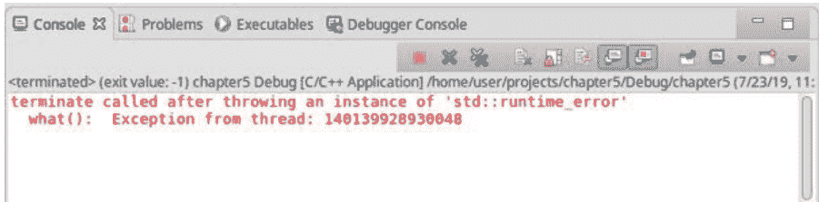

图 5.19：示例执行的结果

我们可以看到，在抛出异常后调用了 std::terminate()。当你的程序中有很多线程时，很难找到线程被终止的正确位置。幸运的是，我们有几种机制可以从另一个线程捕获异常。让我们逐一考虑。

std::async 函数使用 future 结果将异常传递给调用线程。它将 std::exception_ptr 存储在 future 结果中，并设置 ready 标志。然后，当你调用 get() 时，std::future 会检查是否存储了任何 std::exception_ptr，并重新抛出异常。我们需要做的就是在 try-catch 块中放置一个 get() 调用。让我们看一个示例。我们将使用前面示例中的两个辅助函数，即 getException() 和 toUppercase()。它们保持不变。在 main() 函数中，我们创建一个名为 result 的 std::future 对象，并使用 std::async() 函数运行 toUppercase() 函数。然后，我们在 try-catch 块中调用 result 对象的 get() 函数并捕获异常：

```
#include <iostream>

#include <future>

int main()
{
    std::future<std::string> result = std::async(toUppercase, "please, make it uppercase");
    try
    {
        std::cout << "Future result = " << result.get() << std::endl;
    }
    catch(const std::exception& ex)
```

```
```cpp
{
    std::cout << "Caught an exception: " << ex.what() << std::endl;
}
return 0;
}
```
```

如果你在 IDE 中运行上述代码，你将获得以下输出：

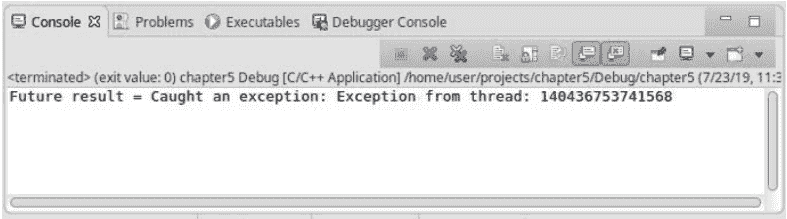

图 5.20：示例执行的结果

正如你所看到的，我们捕获了一个异常，现在我们可以以某种方式处理它。**std::packaged_task<>** 类以同样的方式处理异常——它将 **std::exception_ptr** 存储在 future 结果中，设置 ready 标志，然后 **std::future** 在 **get()** 调用中重新抛出异常。让我们考虑一个小示例。我们将使用前面示例中的两个辅助函数——**getException()** 和 **toUppercase()**。它们保持不变。在 **main()** 函数中，我们创建一个名为 **task** 的 **std::packaged_task** 对象。通过使用我们的 **toUppercase()** 函数的类型，它返回一个整数并接受两个整数作为参数。我们将 **toUppercase()** 函数传递给 **task** 对象。然后，我们创建一个名为 **result** 的 **std::future** 对象，并使用 **get_future()** 函数从 task 对象获取结果。最后，我们在新线程 **thr** 中运行 task 对象，并在 **try-catch** 块中调用 **result** 变量的 **get()** 函数：

```
```cpp
#include <iostream>

#include <future>

int main()
{
    std::packaged_task<std::string(const std::string&)> task(toUppercase);
    auto result = task.get_future();
    std::thread thr(std::move(task), "please, make it uppercase");
    thr.detach();
```

```
try
{
    std::cout << "Future result = " << result.get() << std::endl;
}
catch(const std::exception& ex)
{
    std::cout << "Caught an exception: " << ex.what() << std::endl;
}
return 0;
}
```

如果你在 IDE 中运行这段代码，你将获得以下输出：

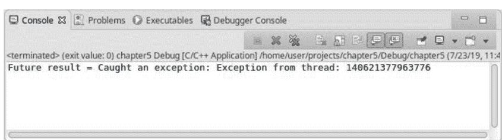

图 5.21：此示例执行的结果

**std::promise<>** 类以另一种方式处理异常。它允许我们使用 set_exception() 或 set_exception_at_thread_exit() 函数手动存储异常。要在 std::promise 中设置异常，我们必须捕获它。如果我们没有捕获异常，在 std::promise 的析构函数中，将在 future 结果中设置一个错误，即 std::future_errc::broken_promise。当你调用 get() 函数时，将重新抛出异常。让我们考虑一个示例。我们将使用前面示例中的辅助函数——getException()。它保持不变。但是，我们将更改 toUppercase() 函数并添加第三个参数 std::promise。现在，我们将在 try 块中调用 getException() 函数，捕获异常，并将其设置到 std::promise 值中：

```
void toUppercase(const std::string& bufIn, std::promise<std::string> result)
{
    std::string bufferOut;
    try
    {
```


```
for (std::string::const_iterator iter = bufIn.begin(); iter != bufIn.end(); iter++)
{
    if (*iter >= 97 && *iter <= 122)
    {
        bufferOut += static_cast<char>(static_cast<int>(*iter) - 32);
    }
    else
    {
        bufferOut += *iter;
        getException();
    }
}
}
catch(const std::exception& ex)
{
    result.set_exception(std::make_exception_ptr(ex));
}

result.set_value(bufferOut);
}
```

## 注意

有几种方法可以将异常设置到 promise 中。首先，我们可以捕获 std::exception，并使用 std::make_exception_ptr() 函数将其转换为 std::exception_ptr。还可以使用 std::current_exception() 函数，该函数会返回 std::exception_ptr 对象。

如果你在 IDE 中运行此代码，你将获得以下输出：


图5.22：此示例执行的结果

以上就是多线程应用程序中处理异常的全部内容。如你所见，这与我们在单线程中所做的非常相似。现在，让我们将所学知识付诸实践，编写一个简单的应用程序示例，演示如何使用不同的 future 结果进行同步。

### 练习5：使用 future 结果进行同步

在本练习中，我们将编写一个简单应用程序，演示如何使用 future 结果从各个线程接收值。我们将运行 ToUppercase() 可调用对象三次。第一个任务使用 std::async() 函数执行，第二个任务使用 std::packaged_task<> 模板类执行，最后一个任务使用 std::thread 和 std::promise 执行。

执行以下步骤以完成此练习：

+   1. 包含线程支持的头文件 <thread>、流支持的头文件 <iostream>，以及用于 future 结果支持的 <future>：

```
#include <iostream>
#include <thread>
#include <future>
```

+   2. 实现一个 ToUppercase 类，用于将给定字符串转换为大写。它有两个重载的 operator() 运算符。第一个 operator() 接受要转换的字符串并返回大写的结果值。第二个 operator() 接受要转换的字符串和一个 std::promise，并将返回值存储在 promise 中：

```
class ToUppercase
{
    public:
    std::string operator()(const std::string& bufIn)
```

```
{
    std::string bufferOut;
    for (std::string::const_iterator iter = bufIn.begin(); iter != bufIn.end(); iter++)
    {
        if (*iter >= 97 && *iter <= 122)
        {
            bufferOut += static_cast<char>(static_cast<int>(*iter) - 32);
        }
        else
        {
            bufferOut += *iter;
        }
    }
    return bufferOut;
}

void operator()(const std::string& bufIn, std::promise<std::string> result)
{
    std::string bufferOut;
    for (std::string::const_iterator iter = bufIn.begin(); iter != bufIn.end(); iter++)
    {
        if (*iter >= 97 && *iter <= 122)
        {
            bufferOut += static_cast<char>(static_cast<int>(*iter) - 32);
        }
        else
        {
            bufferOut += *iter;
        }
    }
    result.set_value(bufferOut);
};
```

+   3. 现在，创建一个 **ToUppercase** 对象，即 **ptConverter**，并创建一个 **std::packaged_task**，即 **upperCaseResult1**，它将 **ptConverter** 对象作为参数。创建一个 **std::future** 值，并从 **upperCaseResult1** 中获取它。在单独的线程中运行此任务：

```cpp
ToUppercase ptConverter;
std::packaged_task<std::string(const std::string&)>
upperCaseResult1(ptConverter);
std::future<std::string> futureUpperResult1= upperCaseResult1.get_
future();
std::thread thr1(std::move(ptConverter), "This is a string for the first
asynchronous task");
thr1.detach();
```

+   4. 现在，创建第二个 **ToUppercase** 对象，即 **fConverter**。创建一个名为 **futureUpperResult2** 的 **std::future** 对象，并从 **std::async()** 中获取它：

```cpp
ToUppercase fConverter;
std::future<std::string> futureUpperResult2 = std::async(fConverter, "This
is a string for the asynchronous task");
```

+   5. 现在，创建第三个 **ToUppercase** 对象，即 **pConverter**。创建一个名为 **promiseResult** 的 **std::promise** 值。然后，创建一个名为 **futureUpperResult3** 的 **std::future** 值，并从 **promiseResult** 中获取它。接下来，在单独的线程中运行 pConverter 任务，并将 **promiseResult** 作为参数传递：

```cpp
ToUppercase pConverter;
std::promise<std::string> promiseResult;
std::future<std::string> futureUpperResult3 = promiseResult.get_future();
std::thread thr2(pConverter, "This is a string for the task that returns a
promise", std::move(promiseResult));
thr2.detach();
```

+   6. 现在，要接收所有线程的结果，请等待 **futureUpperResult3** 就绪，然后获取全部三个结果并打印：

```cpp
futureUpperResult3.wait();
std::cout << "Converted strings:"
          << futureUpperResult1.get() << std::endl
          << futureUpperResult2.get() << std::endl
          << futureUpperResult3.get() << std::endl;
```

7. 在编辑器中运行此代码。你将看到来自全部三个线程的转换后的字符串。

你将获得以下输出：

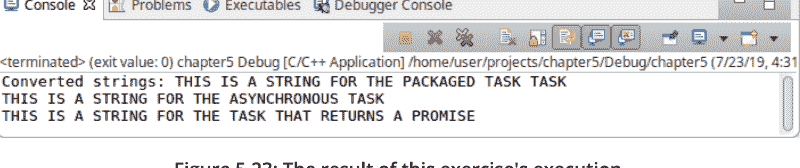

图5.23：此练习执行的结果

那么，我们在这里做了什么？我们将大型计算拆分成较小的部分，并在单独的线程中运行它们。对于长时间计算，这将提高性能。在本练习中，我们学习了如何从线程接收结果。在本节中，我们还学习了如何将在单独线程中抛出的异常传递给调用线程。我们还学习了如何通过事件来同步多个线程的工作，不仅使用条件变量，还使用 future 结果。

### 活动1：创建模拟器来模拟美术馆的运作

在本活动中，我们将创建一个模拟器来模拟美术馆的运作。我们为美术馆设置了访客人数限制——馆内最多只能有 50 人。要实现此模拟，我们需要创建一个 Person 类，用于表示美术馆中的人。此外，我们还需要一个 Persons 类，它是线程安全的人员容器。我们还需要一个 Watchman 类，用于控制馆内的人数。如果人数超过了 Watchman 设定的限制，我们会将所有新来者放入等待列表。最后，我们还需要一个 Generator 类，它有两个线程——一个用于创建新访客，另一个用于通知我们有人必须离开美术馆。因此，我们将涵盖线程、互斥量、条件变量、lock_guard 和 unique_lock 的使用。该模拟器将让我们能够运用本章所学的技术。因此，在尝试此活动之前，请确保你已完成本章前面的所有练习。

我们有以下类：

| 类名 | 描述 |
|---|---|
| Person | 表示美术馆访客的类。 |
| Persons | 存储 Person 类对象的线程安全容器。 |
| PersonGenerator | 负责以不同间隔创建新的 Person 类对象的类。这模拟了美术馆的新访客。它还负责模拟人们离开美术馆的时间。为此，它会以不同间隔触发移除事件。 |
| Watchman | 负责控制进入美术馆的人员的类。每当有新访客时，它都会检查美术馆中的人数，如果人数少于 50，它会将一个 Person 放入美术馆内的人员列表中。如果人数超过限制，它会将该访客放入等待列表。它还会使用由 PersonGenerator 类触发的移除事件，将访客从美术馆内的人员列表中移除。每次移除后，它都会检查等待列表中是否有访客。如果有，它会检查美术馆中的人数。如果人数少于 50，它就会从人员列表中取出一个 Person，放入美术馆。 |

图5.24：本活动中使用的类的说明


让我们在开始实现之前先创建类图。前面提到的所有类及其关系如下图所示：

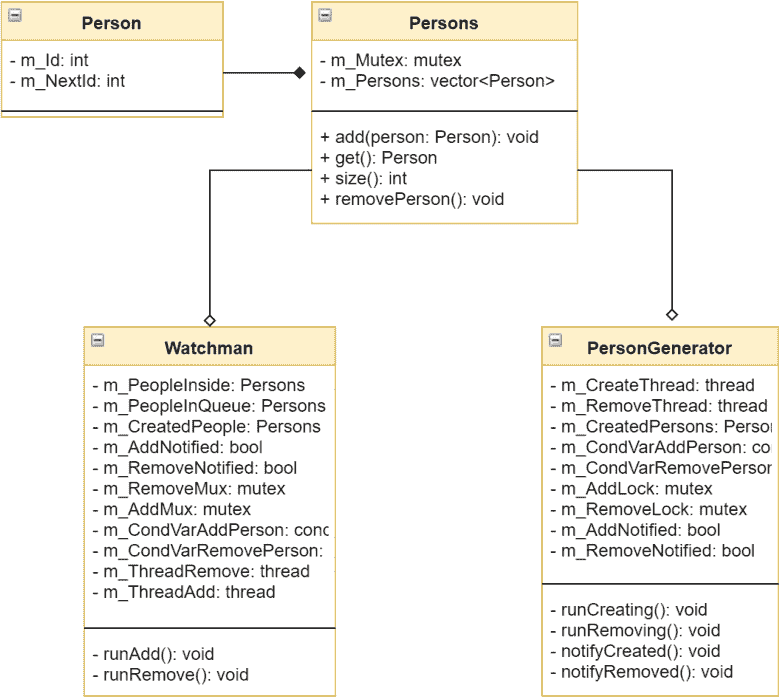

**图 5.25：类图**

按照以下步骤实现此活动：

1. 定义并实现 `Person` 类，该类除了打印日志外不执行任何操作。
2. 创建一个线程安全的 `Person` 存储结构，对 `std::vector` 类进行封装。
3. 实现 `PersonGenerator` 类，使其在不同线程中的无限循环内创建和移除访客，并通知 `Watchman` 类。
4. 创建 `Watchman` 类，使其在独立线程中的无限循环内，在收到 `PersonGenerator` 类的通知后，将访客从一个队列移动到另一个队列。
5. 在 `main()` 函数中声明相应的对象，以模拟艺术画廊及其工作方式。

完成这些步骤后，你应该会得到以下输出，其中可以看到所有已实现类的日志。请确保模拟流程符合预期。预期输出应类似于以下内容：

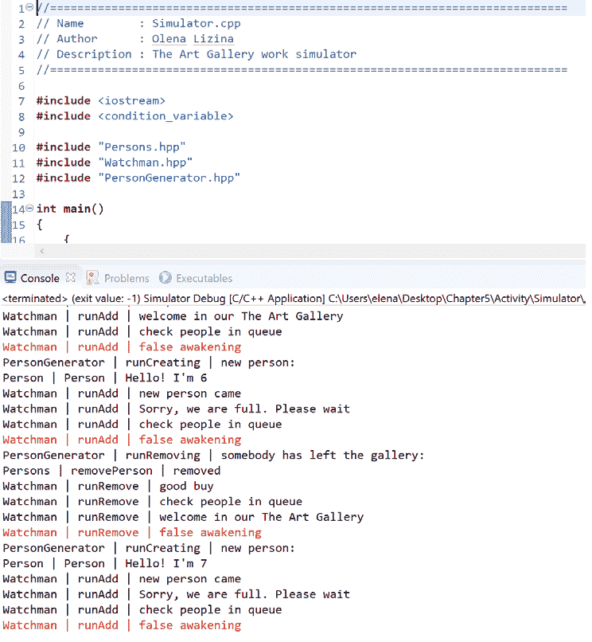

**图 5.26：应用程序执行结果**

> **注意**
>
> 此活动的解决方案位于第 681 页。

## 总结

在本章中，我们学习了如何使用 C++ 标准库所支持的线程。这是编写健壮、快速且清晰的多线程应用程序的基础。

我们首先了解了与并发相关的一般概念——并行执行、并发执行、同步执行、异步执行和线程执行分别是什么。清楚地理解这些概念，有助于我们理解多线程应用程序的架构设计。

接下来，我们研究了开发多线程应用程序时遇到的各种问题，例如数据危险、竞态条件和死锁。理解这些问题有助于我们为项目构建清晰的同步架构。我们结合一些现实生活中的例子研究了同步概念，从而更好地理解编写线程应用程序时可能面临的挑战。

随后，我们尝试使用标准库中不同的同步原语。我们尝试了解如何处理竞态条件，并实现了基于事件的同步和基于数据的同步示例。接下来，我们讨论了移动语义如何应用于多线程。我们学习了线程支持库中的哪些类不可复制但可以移动。我们还研究了移动语义在多线程闭包中的工作方式。最后，我们学习了如何从独立线程接收结果，以及如何使用 future、promise 和 async 同步线程。

我们通过构建艺术画廊模拟器，将所有这些新技能付诸实践。我们构建了一个包含一个主线程和四个子线程的多线程应用程序。我们使用条件变量实现了它们之间的通信，并使用互斥锁保护共享数据。总之，我们运用了本章中学到的所有知识。

下一章，我们将更深入地了解 C++ 中的 I/O 操作和类。我们将首先研究标准库提供的 I/O 支持。然后，我们将继续学习流和异步 I/O 操作。接下来，我们将了解线程与 I/O 之间的交互。我们还将编写一个活动，帮助我们掌握在 C++ 中进行 I/O 操作的技能。
