# 6. 流与 I/O

## 学习目标

完成本章后，你将能够：

- 使用标准 I/O 库向文件或控制台写入数据，以及从文件或控制台读取数据
- 使用内存 I/O 接口格式化和解析数据
- 为用户定义类型扩展标准 I/O 流
- 开发使用多线程标准 I/O 库的应用程序

在本章中，我们将使用标准 I/O 库开发灵活且易于维护的应用程序，学习如何使用流，了解 I/O 库如何应用于多线程应用程序，并最终学习如何使用标准库格式化和解析数据。

## 简介

在上一章中，我们介绍了 C++ 中最具挑战性的主题之一——并发。我们研究了多线程的主要概念，并区分了 C++ 中的同步执行、异步执行和线程执行。我们学习了同步、数据危险和竞态条件的关键知识。最后，我们研究了如何在现代 C++ 中使用线程。在本章中，我们将进一步深入，学习如何在多线程应用程序中处理 I/O。

本章专门介绍 C++ 中的**流**和 **I/O**。I/O 是输入和输出操作的统称。标准库这一部分的主要目的是提供清晰的数据输入和输出接口。但这并不是唯一的目标。在许多情况下，I/O 都能帮助我们开发应用程序。很难想象有什么应用程序不会将错误或异常情况写入日志文件，以便发送给开发团队进行分析。在 GUI 应用程序中，我们经常需要格式化显示的信息或解析用户输入。在复杂且大型的应用程序中，我们通常需要记录内部数据结构，等等。在所有这些情况下，我们都会使用**标准库**中的 I/O 部分。

我们将以标准库输入/输出部分的简要介绍开始本章。我们将了解 I/O 并探索其主要概念和术语。然后，我们将研究默认支持哪些类型，以及如何为用户定义类型扩展流。接下来，我们将学习 I/O 库的结构，并检查可供我们使用的头文件和类。最后，我们将研究如何使用流、读写文件、创建执行输入和输出操作的多线程应用程序，以及如何格式化和解析文本数据。

本章将以一个具有挑战性且令人兴奋的活动作为结尾。在该活动中，我们将改进上一章中的**艺术画廊模拟器**项目，并创建一个健壮、清晰、多线程且易于使用的**日志记录器**。我们将开发一个具有清晰接口的类，使项目中的任何位置都能访问它。接下来，我们将调整它，使其能够与多个线程协同工作。最后，我们将把这个健壮的日志记录器集成到艺术画廊模拟器项目中。

让我们首先了解 C++ 标准库中的 I/O 部分，学习这组工具为我们提供了哪些机会。

### 复习标准库的 I/O 部分

在计算机科学中，I/O 是指程序、设备、计算机等之间通信的术语。在 C++ 中，我们使用标准输入和标准输出这两个术语来描述 I/O 过程。标准输入是传入程序的数据流。为了获取这些数据，程序应执行读取操作。标准输出是从程序传输到外部设备的数据流，例如文件、显示器、套接字、打印机等。为了输出这些数据，程序应执行写入操作。标准输入流和标准输出流继承自主进程，并且所有子线程共享这些流。请查看下图，以便更好地理解上述术语：

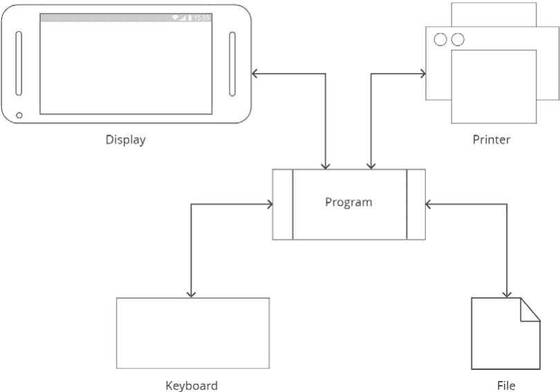

*显示器、打印机、程序、键盘、文件*

**图 6.1：设备之间的 I/O 通信**

在 C++ 标准库中，大多数 I/O 类都是通用的类模板。它们在逻辑上分为两类——抽象和实现。我们已经熟悉抽象类，并且知道可以将它们用于不同目的，而无需重新编译代码。I/O 库也是如此。在这里，有六个抽象类构成了 C++ 中 I/O 操作的基础。我们不会深入探讨这些接口。通常，我们会使用更高级别的类来执行操作，只有在需要实现自己的派生类时才会使用这些接口。


**ios_base** 抽象类负责管理流状态标志、格式化标志、回调以及私有存储。**basic_streambuf** 抽象类为缓冲输入或输出操作提供接口，并提供对输入源（如文件、套接字）或输出接收端（如字符串或向量）的访问。**basic_ios** 抽象类实现了与派生自 **basic_streambuf** 接口的派生类协同工作的设施。**basic_ostream**、**basic_istream** 和 **basic_iostream** 抽象类是派生自 **basic_streambuf** 接口的派生类的包装器，分别提供高级输入/输出接口。让我们简要地考虑它们及其关系，如下图所示类图所示。你可以看到，除了 **ios_base** 之外，它们都是模板类。在每个类的名称下，你可以找到定义该类的文件名：

> **注意**
>
> 在 UML 记法中，我们使用 <<interface>> 关键字来表示该类是一个抽象类。

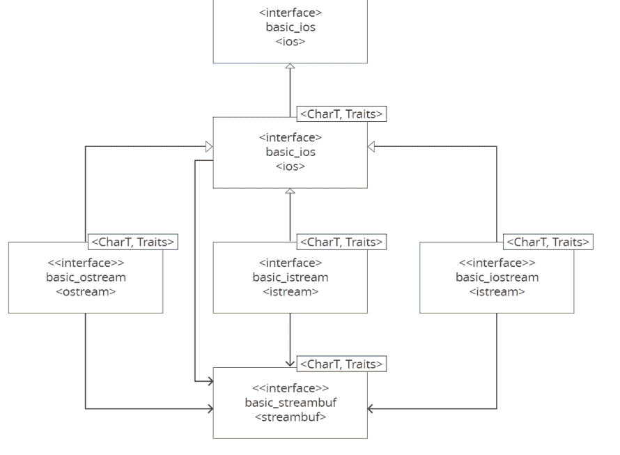

**图 6.2：** I/O 抽象接口的类图

实现类在逻辑上分为以下几类：**文件 I/O**、**字符串 I/O**、**同步 I/O**、**I/O 操作符**，以及预定义的标准流对象。它们都派生自上述提到的抽象类。让我们在接下来的章节中详细考虑它们。

## 预定义的标准流对象

我们将从已经熟悉的来自 `<iostream>` 头文件的 **std::cout** 类开始认识 I/O 标准库。我们用它向终端输出数据。你可能也知道用于读取用户输入的 **std::cin** 类——但并非每个人都知道 **std::cout** 和 **std::cin** 是预定义的标准流对象，用于格式化向终端的输入和输出。`<iostream>` 头文件还包含 **std::cerr** 和 **std::clog** 流对象，用于记录错误。像往常一样，还有它们用于宽字符的类似物，带有 "w" 前缀：**wcout**、**wcin**、**wcerr** 和 **wclog**。所有这些对象都在系统启动时自动创建并初始化。虽然可以安全地从多个线程使用这些对象，但输出可能会混合。让我们回顾一下如何使用它们。由于它们仅为内置类型重载，我们应该为用户定义的类型编写自己的重载。

**std::cout** 流对象经常与 **std::endl** 操作符一起使用。它在输出序列中插入换行字符并刷新它。以下是使用它们的示例：

```
std::string name("Marilyn Monroe");

int age = 18;

std::cout << "Name: " << name << ", age: " << age << std::endl;
```

最初，**std::cin** 对象逐字符读取所有输入字符序列。但它为内置类型提供了重载，可以读取诸如 **数字**、**字符串**、**字符** 等值。读取字符串时有一个小技巧；**std::cin** 读取字符串直到下一个空白或换行符。因此，如果你需要它读取一个字符串，你必须在循环中读取它，逐词读取，或使用 **std::getline()** 函数，该函数将 **std::cin** 对象作为第一个参数，目标字符串作为第二个参数。

> **注意**
>
> **std::cin** 流对象的右移运算符 `>>` 仅从一行中读取一个词。使用 **std::getline(std::cin, str)** 来读取整行。

以下是使用 **std::cin** 处理不同类型的示例：

```
std::string name;
std::string sex;
int age;

std::cout << "Enter your name: " << std::endl;
std::getline(std::cin, name);
std::cout << "Enter your age: " << std::endl;
std::cin >> age;
std::cout << "Enter your sex (male, female):" << std::endl;
std::cin >> sex;
std::cout << "Your name is " << name << ", your age is " << age << ", your sex is " << sex << std::endl;
```

正如你所见，这里，我们使用 **std::getline()** 函数读取姓名，因为用户可以输入两个或三个词。我们还使用右移运算符 **>>** 读取年龄然后读取性别，因为我们只需要读取一个词。然后我们将读取的数据打印出来以确保一切顺利。

**std::cerr** 和 **std::clog** 流对象只有一点不同——**std::cerr** 立即刷新输出序列，而 **std::clog** 缓冲它，仅在缓冲区满时才刷新。就使用而言，它们与 **std::cout** 非常相似。唯一的区别是 **std::cerr** 和 **std::clog** 的消息在大多数 IDE 中颜色为红色。

在下面的屏幕截图中，你可以看到这些流对象的输出：

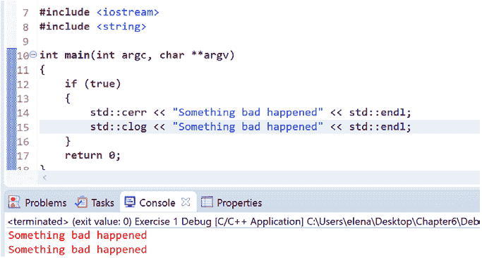

**图 6.3：** std::cerr 和 std::clog 流对象的输出

现在，让我们做一个练习来巩固我们所学的一切。

### 练习 1：为用户定义类型重载左移运算符，<<

在这个练习中，我们将编写一段非常有用的代码，你可以在任何地方使用它来输出用户定义的类型。首先，我们将创建一个名为 Track 的类，表示一个音乐曲目。它将具有以下私有成员：name、singer、length 和 date。然后，我们将为该类重载左移运算符，<<。接下来，我们将创建该类的一个实例并使用 std::cout 流对象输出它。

执行此练习，请按以下步骤操作：

- 1. 包含所需的头文件：<iostream> 用于向控制台输出，<string> 用于字符串支持：

```
#include <iostream>
#include <string>
```

- 2. 声明 Track 类并添加私有部分变量以保存有关曲目的信息，即 m_Name、m_Singer、m_Date 和 m_LengthInSeconds。在公共部分，添加一个带有参数的构造函数以初始化所有私有变量。还为所有类成员添加公共部分 getter：

```
class Track
{
public:
    Track(const std::string& name,
          const std::string& singer,
          const std::string& date,
          const unsigned int& lengthInSeconds)
    : m_Name(name)
    , m_Singer(singer)
    , m_Date(date)
    , m_LengthInSeconds(lengthInSeconds)
{
}

std::string getName() const { return m_Name; }
std::string getSinger() const { return m_Singer; }
std::string getDate() const { return m_Date; }
unsigned int getLength() const { return m_LengthInSeconds; }

private:
    std::string m_Name;
    std::string m_Singer;
    std::string m_Date;
    unsigned int m_LengthInSeconds;
};
```

- 3. 现在是练习中最困难的部分：为 Track 类型编写重载函数。这是一个模板函数，具有两个类型参数：charT 和 Traits：

```
template <typename charT, typename Traits>
```

- 4. 我们将此函数设为内联，以便编译器知道我们希望它对该函数进行优化。此函数的返回类型是对 std::basic_ostream<charT, Traits> 类的引用。该函数的名称是 operator <<。此函数接受两个参数：第一个是对 std::basic_ostream<charT, Traits> 类的引用，第二个是 Track 变量的拷贝。完整的函数声明如下：

```
template <typename charT, typename Traits>
inline std::basic_ostream<charT, Traits>&
operator<<(std::basic_ostream<charT, Traits>& os, Track trackItem);
```

- 5. 现在，添加函数定义。使用 os 变量，就像我们使用 std::cout 对象一样，并按你希望的方式格式化输出。然后，从函数返回 os 变量。重载运算符 << 的完整代码如下：

```
template <typename charT, typename Traits>
inline std::basic_ostream<charT, Traits>&
operator<<(std::basic_ostream<charT, Traits>& os, Track trackItem)
{
    os << "Track information: ["
       << "Name: " << trackItem.getName()
       << ", Singer: " << trackItem.getSinger()
       << ", Date of creation: " << trackItem.getDate()
       << ", Length in seconds: " << trackItem.getLength()
       << "]";
    return os;
}
```


6. 现在，进入主函数并创建并初始化名称为 track_001 的 Track 类型的实例。最后，使用 std::cout 打印 track_001 的值：

```
int main()
{
    Track track_001("Summer night city",
                    "ABBA",
                    "1979",
                    213);

    std::cout << track_001 << std::endl;

    return 0;
}
```

7. 编译并执行应用程序。运行它。你将得到以下输出：

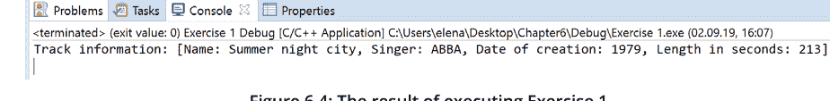

图 6.4：执行练习 1 的结果

做得好。在这里，我们考虑了使用预定义的标准流对象，并学习了如何为用户定义的类型编写自己的重载移位运算符。让我们继续并检查使用 C++ 标准 IO 库进行文件读写。

## 文件 I/O 实现类

文件流管理对文件的输入和输出。它们提供了一个接口，该接口实现了资源获取即初始化（RAII）——文件在流构造时打开，并在其销毁时自动关闭。在标准库中，文件流由以下类表示：basic_ifstream 用于输入操作，basic_ofstream 用于输出操作，basic_fstream 用于输入和输出操作，以及 basic_filebuf 用于原始文件设备的实现。它们都定义在 <fstream> 头文件中。标准库还为 char 和 wchar_t 类型提供了 typedef，即 ifstream、fstream 和 ofstream，以及用于宽字符的带 "w" 前缀的相同名称。

我们可以以两种方式创建文件流。第一种方式是一行完成，即通过将文件名传递给构造函数来打开文件并将流连接到文件：

```
std::ofstream outFile(filename);
std::ifstream outFile(filename);
std::fstream outFile(filename);
```

另一种方式是创建对象然后调用 open() 函数：

```
std::ofstream outFile;
outFile.open(filename);
```

> **注意**
> 
> IO 流具有 bool 变量：**goodbit**、**eofbit**、**failbit** 和 **badbit**。
> 它们用于在每次操作后检查流的状态并指示流上发生的错误。

在对象创建后，我们可以通过检查 failbit 或检查与打开文件关联的流来检查流状态。要检查 failbit，请在文件流上调用 fail() 函数：

```
if (outFile.fail())
{
    std::cerr << filename << " file couldn't be opened"<< std::endl;
}
```

要检查流是否与打开的文件关联，请调用 is_open() 函数：

```
if (!outFile.is_open())
{
    std::cerr << filename << " file couldn't be opened"<< std::endl;
}
```

输入、输出和双向文件流也可以通过使用标志以不同的模式打开。它们在 ios_base 命名空间中声明。除了 ios_base::in 和 ios_base::out 标志外，我们还有 ios_base::ate、ios_base::app、ios_base::trunc 和 ios_base::binary 标志。ios_base::trunc 标志会删除文件的内容。ios_base::app 标志始终将输出写入文件的末尾。即使你决定更改文件中的位置，也无法做到这一点。ios_base::ate 标志将文件描述符的位置设置为文件末尾，但允许你稍后修改位置。最后，ios_base::binary 标志会抑制数据的任何格式化，以便以“原始”格式读取或写入。让我们考虑所有可能的打开模式组合。

默认情况下，std::ofstream 以 ios_base::out 模式打开，std::ifstream 以 ios_base::in 模式打开，std::fstream 以 ios_base::in|ios_base::out 模式打开。ios_base::out|ios_base::trunc 模式如果文件不存在则创建文件，或从现有文件中删除所有内容。ios_base::out|ios_base::app 模式如果文件不存在则创建文件，或打开现有文件并只允许你在文件末尾写入。上述两种模式都可以与 ios_base::in 标志组合，因此文件将同时以读写模式打开。

以下是如何使用上述模式打开文件的示例：

```
std::ofstream outFile(filename, std::ios_base::out|std::ios_base::trunc);
```

你也可以这样做：

```
std::ofstream outFile;

outFile.open(filename, std::ios_base::out|std::ios_base::trunc);
```

在我们以所需模式打开文件流后，我们可以开始向文件读写。文件流允许我们更改文件中的位置。让我们考虑如何做到这一点。要获取当前文件的位置，我们可以在 ios_base::out 模式下调用 tellp() 函数，在 ios_base::in 模式下调用 tellg() 函数。它可以在以后使用，以便在需要时返回此位置。我们还可以使用 ios_base::out 模式下的 seekp() 函数和 ios_base::in 模式下的 seekg() 函数来查找文件中的确切位置。它接受两个参数：要移动的字符数以及应从哪个文件位置开始计数。允许有三种可查找的位置类型：std::ios_base::beg，即文件开头，std::ios_base::end，即文件末尾，以及 std::ios_base::cur，即当前位置。以下是调用 seekp() 函数的示例：

```
outFile.seekp(-5, std::ios_base::end);
```

正如你所见，我们要求将当前文件的位置设置为文件末尾的第五个字符处。

要写入文件，我们可以使用重载的左移运算符 `<<` 进行通用格式化输出，使用 **put()** 函数写入单个字符，或使用 **write()** 函数写入字符块。使用左移运算符是将数据写入文件的最方便方式，因为你可以将任何内置类型作为参数传递：

```
outFile << "This is line No " << 1 << std::endl;
```

**put()** 和 **write()** 函数只能与字符值一起使用。

要从文件读取，我们可以使用重载的右移运算符 `>>`，或使用用于读取字符的一组函数，例如 **read()**、**get()** 和 **getline()**。右移运算符针对所有内置类型进行了重载，我们可以这样使用它：

```
std::ifstream inFile(filename);
```

```
std::string str;
```

```
int num;
```

```
float floatNum;
```

```
// for data: "book 3 24.5"
```

```
inFile >> str >> num >> floatNum;
```

最后，当执行离开可见性范围时，文件流将被关闭，因此我们不需要执行任何额外操作来关闭文件。

> **注意**
> 
> 在从文件读取数据时要小心。右移运算符 `>>` 仅在遇到空白或换行字符时读取字符串。要读取完整字符串，你可以使用循环或像我们在 *练习 1，重载左移运算符 << 用于用户定义类型* 中那样将每个单词读入单独的变量。

现在，让我们练习使用 C++ IO 标准库读写数据到文件。

### 练习 2：向文件读写用户定义数据类型

在这个练习中，我们将为一家书店编写一段代码。我们需要在文件中存储有关图书价格的信息，并在需要时从文件中读取这些信息。为此，我们将创建一个表示图书的类，该类具有名称、作者、出版年份和价格。接下来，我们将创建该类的一个实例并将其写入文件。稍后，我们将从文件中读取有关图书的信息并将其读入图书类的实例。执行以下步骤以完成此练习：

- 1. 包含所需的头文件：**`<iostream>`** 用于向控制台输出，**`<string>`** 用于字符串支持，以及 **`<fstream>`** 用于 I/O 文件库支持：

```
```cpp
#include <fstream>
#include <iostream>
#include <string>
```
```

- 2. 实现 **Book** 类，表示书店中的图书。在私有部分，定义四个具有自解释名称的变量：**m_Name**、**m_Author**、**m_Year** 和 **m_Price**。在公共部分，定义一个带有参数的构造函数，该构造函数初始化所有类成员。此外，在 **public** 部分，为所有类成员定义 getter：

```
```cpp
class Book
{
public:
    Book(const std::string& name,
         const std::string& author,
         const int year,
         const float price)
        : m_Name(name)
        , m_Author(author)
        , m_Year(year)
        , m_Price(price) {}

    std::string getName() const { return m_Name; }
    std::string getAuthor() const { return m_Author; }
    int getYear() const { return m_Year; }
```


- **7.** 编译并执行应用程序。现在，转到项目文件夹，找到 `prices.txt` 文件所在位置。在下面的截图中，你可以看到创建的文件在项目目录中的位置：

  | 名称 | 修改日期 | 大小 |
  | --- | --- | --- |
  | `.settings` | 01.09.2019 17:05 | |
  | `build` | 01.09.2019 17:02 | |
  | `src` | 01.09.2019 17:02 | |
  | `.cproject` | 01.09.2019 17:05 | 2 КБ |
  | `.project` | 01.09.2019 17:02 | 1 КБ |
  | `Makefile` | 01.09.2019 17:03 | 1 КБ |
  | `prices` | 02.09.2019 12:19 | 1 КБ |

  *图 6.5：所创建文件的位置*

- **8.** 在记事本中打开它。在下面的截图中，你可以看到输出到文件的内容：

  

  *图 6.6：用户自定义类型输出到文件的结果*

- **9.** 现在，让我们将这些数据读取到变量中。创建一个 `std::ifstream` 类的实例。打开名为 `pricesFile` 的文件。检查流是否已成功打开，如果没有则打印错误消息：

  ```cpp
  std::ifstream inFile(pricesFile);
  if (inFile.fail())
  {
      std::cerr << "Failed to open file " << pricesFile << std::endl;
      return 1;
  }
  ```

- **10.** 创建将从文件输入时使用的局部变量，即 `name`、`authorName`、`authorSurname`、`year` 和 `price`。它们的名称不言自明：

  ```cpp
  std::string name;
  std::string authorName;
  std::string authorSurname;
  int year;
  float price;
  ```

- **11.** 现在，按照文件中的顺序将数据从文件读取到变量中：

  ```cpp
  inFile >> name >> authorName >> authorSurname >> year >> price;
  ```

- **12.** 创建一个名为 `book_002` 的 `Book` 实例，并用这些读取到的值对其进行初始化：

  ```cpp
  Book book_002(name, std::string(authorName + " " + authorSurname), year,
  price);
  ```

- **13.** 为了检查读取操作是否成功执行，将 `book_002` 变量打印到控制台：

  ```cpp
  std::cout << "Book name: " << book_002.getName() << std::endl
          << "Author name: " << book_002.getAuthor() << std::endl
          << "Year: " << book_002.getYear() << std::endl
          << "Price: " << book_002.getPrice() << std::endl;
  ```

- **14.** 再次编译并执行应用程序。在控制台中，你将看到以下输出：

  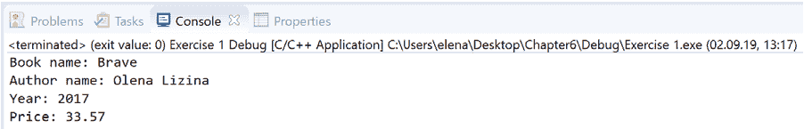

  *图 6.7：执行练习 2 的结果*

正如你所见，我们轻松地从一个文件中读写自定义格式的数据。我们创建了自己的自定义类型，使用 `std::ofstream` 类将其写入文件，并检查所有内容都已成功写入。然后，我们使用 `std::ifstream` 类将这些数据从文件读取到自定义变量中，将其输出到控制台，并确保所有内容都被正确读取。通过这样做，我们学会了如何使用 I/O 标准库向文件读写数据。现在，让我们继续学习 I/O 库的内存部分。

## 字符串 I/O 实现

I/O 标准库不仅允许与文件等设备进行输入输出，还允许与内存进行输入输出，特别是与 `std::string` 对象。在这种情况下，字符串既可以是输入操作的源，也可以是输出操作的目标。在 `<sstream>` 头文件中，声明了管理字符串输入输出的流类。与文件流一样，它们也提供了实现 RAII 的接口——字符串在流创建时打开以供读取或写入，并在流销毁时关闭。它们在标准库中由以下类表示：`basic_stringbuf`（实现原始字符串接口）、`basic_istringstream`（用于输入操作）、`basic_ostringstream`（用于输出操作）以及 `basic_stringstream`（用于输入和输出操作）。标准库还为 `char` 和 `wchar_t` 类型提供了 typedef：`istringstream`、`ostringstream` 和 `stringstream`，以及带有 `w` 前缀的宽字符版本。

要创建 `std::istringstream` 类的对象，我们应该将初始字符串作为构造函数参数传递，或者稍后使用 `str()` 函数设置它：

```cpp
std::string track("ABBA 1967 Vule");
std::istringstream iss(track);
```

或者，我们可以这样做：

```cpp
std::string track("ABBA 1967 Vule");
std::istringstream iss;
iss.str(track);
```

接下来，要从流中读取值，请使用右移运算符 `>>`，它为所有内置类型重载：

```cpp
std::string group;
std::string name;
int year;

iss >> group >> year >> name;
```

要创建 `std::ostringstream` 类的对象，我们只需声明一个该类型的变量：

```cpp
std::ostringstream oss;
```

接下来，要向字符串写入数据，请使用左移运算符 `<<`，它为所有内置类型重载：

```cpp
std::string group("ABBA");
std::string name("Vule");
int year = 1967;
```

```cpp
oss << group << std::endl
    << name << std::endl
    << year << std::endl;
```

要获取结果字符串，请使用 `str()` 函数：

```cpp
std::cout << oss.str();
```

`std::stringstream` 对象是双向工作的，因此它既有默认构造函数，也有接受字符串的构造函数。我们可以通过声明该类型的变量来创建默认的 `std::stringstream` 对象，然后将其用于读取和写入：

```cpp
std::stringstream ss;
ss << "45";
int count;
ss >> count;
```

此外，我们可以使用带有字符串参数的构造函数创建 `std::stringstream`。然后，我们可以像平常一样将其用于读取和写入：

```cpp
std::string employee("Alex Ismailow 26");
std::stringstream ss(employee);
```

或者，我们可以创建一个默认的 `std::stringstream` 对象，并通过 `str()` 函数设置字符串来初始化它：

```cpp
std::string employee("Charlz Buttler 26");
std::stringstream ss;
ss.str(employee);
```

接下来，我们可以使用 `ss` 对象进行读取和写入：

```cpp
std::string name;
std::string surname;
int age;
```

```cpp
ss >> name >> surname >> age;
```

我们还可以为这些类型的流应用打开模式。它们的功能与文件流类似，但略有不同。在处理字符串流时，`ios_base::binary` 无关紧要，而 `ios_base::trunc` 会被忽略。因此，我们可以以四种模式打开任何字符串流：`ios_base::app`、`ios_base::ate`、`ios_base::in` 和 `ios_base::out`。

### 练习 3：创建替换字符串中单词的函数

在这个练习中，我们将实现一个函数，该函数解析给定的字符串并将给定的单词替换为另一个单词。为了完成此练习，我们创建一个可调用类，它接受三个参数：原始字符串、要替换的单词和用于替换的单词。结果应返回新字符串。执行以下步骤以完成此练习：

- **1.** 包含所需的头文件：用于终端输出的 `<iostream>` 和用于字符串 I/O 支持的 `<sstream>`：

  ```cpp
  #include <sstream>
  #include <iostream>
  ```

- **2.** 实现名为 `Replacer` 的可调用类。它只有一个函数——一个重载的括号运算符 `()`，它返回一个字符串并接受三个参数：原始字符串、要替换的单词和用于替换的单词。函数声明如下所示：

  ```cpp
  std::string operator()(const std::string& originalString,
      const std::string& wordToBeReplaced,
      const std::string& wordReplaceBy);
  ```

- **3.** 接下来，创建 `istringstream` 对象，即 `iss`，并将 `originalString` 变量设置为输入源：

  ```cpp
  std::istringstream iss(originalString);
  ```

- **4.** 创建 `ostringstream` 对象，即 `oss`，它将保存转换后的字符串：

  ```cpp
  std::ostringstream oss;
  ```

- **5.** 然后，在循环中，只要还能输入，就将下一个单词读入 `word` 变量。检查该单词是否等于 `wordToBeReplaced` 变量。如果是，则将其替换为 `wordReplaceBy` 变量并写入 `oss` 流。如果不等，则将原始单词写入 `oss` 流。在每个单词后添加一个空格字符，因为 `iss` 流会截断它们。最后，返回结果。完整的类如下：

  ```cpp
  class Replacer
  {
  public:
      std::string operator()(const std::string& originalString,
                              const std::string& wordToBeReplaced,
                              const std::string& wordReplaceBy)
      {
          std::istringstream iss(originalString);
          std::ostringstream oss;

          std::string word;
          while (iss >> word)
          {
              if (0 == word.compare(wordToBeReplaced))
              {
                  oss << wordReplaceBy << " ";
              }
              else
              {
                  oss << word << " ";
              }
          }

          return oss.str();
      }
  };
  ```


6. 进入 main 函数。创建一个名为 worker 的 Replacer 类实例。定义 foodList 变量，并用一个包含食物列表的字符串对其进行初始化；其中一些条目应当重复。定义 changedList 字符串变量，并用 worker() 函数的返回值对其进行初始化。使用 std::cout 在终端中显示结果：

```
int main()
{
    Replacer worker;

    std::string foodList("coffee tomatoes coffee cucumbers sugar");
    std::string changedList(worker(foodList, "coffee", "chocolate"));

    std::cout << changedList;
    return 0;
}
```

7. 编译、构建并运行该练习。结果将得到以下输出：

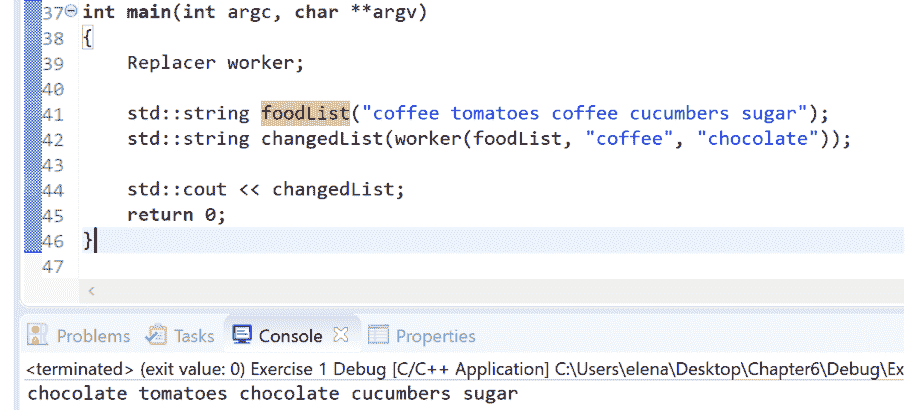

图 6.8：执行练习 3 的结果

做得好！在这里，我们学会了如何使用字符串流来格式化输入和输出。我们创建了一个能够轻松替换句子中单词的应用程序，巩固了所学知识；现在，我们准备学习 I/O 操纵器，以进一步提高处理流的技能。

## I/O 操纵器

到目前为止，我们学习了使用流进行简单输入和输出的方法，但在许多情况下这还不够。为了实现更复杂的 I/O 数据格式化，标准库提供了大量的 I/O 操纵器。这些函数专门与移位运算符（左移 `<<` 和右移 `>>`）配合使用，以控制流的行为。I/O 操纵器分为两类——一类不带参数调用，另一类需要参数。其中一些同时适用于输入和输出。让我们简要了解一下它们的含义和用法。

### 用于更改流数值进制的 I/O 操纵器

在 `<ios>` 头文件中，声明了用于更改流数值进制的函数：`std::dec`、`std::hex` 和 `std::oct`。它们不带参数调用，分别将流的数值进制设置为十进制、十六进制和八进制。在 `<iomanip>` 头文件中，声明了 `std::setbase` 函数，该函数使用以下参数调用：8、10 和 16。它们可以互换，并且既适用于输入操作也适用于输出操作。

在 `<ios>` 头文件中，还有 `std::showbase` 和 `std::noshowbase` 函数，它们控制着流数值进制的显示。它们只影响十六进制和八进制整数的输出（零值除外），以及货币的输入和输出操作。让我们完成一个练习，学习如何在实际中使用它们。

#### 练习 4：以不同数值进制显示输入的数字

在本练习中，我们将开发一个应用程序，它在无限循环中要求用户以以下数值进制之一输入整数：十进制、十六进制或八进制。读取输入后，它会以其他数值表示形式显示该整数。要完成本练习，请执行以下步骤：

- 1. 包含 `<iostream>` 头文件以支持流式输入输出。声明一个名为 `BASE` 的枚举，并定义三个值：`DECIMAL`、`OCTAL` 和 `HEXADECIMAL`：

```
#include <iostream>

enum BASE
{
    DECIMAL,
    OCTAL,
    HEXADECIMAL
};
```

2. 声明一个名为 displayInBases 的函数，该函数接受两个参数——整数和进制。接下来，定义 switch 语句，它测试接收到的数值进制，并以另外两种数值表示形式显示给定整数：

```
void displayInBases(const int number, const BASE numberBase)
{
    switch(numberBase)
    {
    case DECIMAL:
        std::cout << "Your input in octal with base: "
                  << std::showbase << std::oct << number
                  << ", without base: "
                  << std::noshowbase << std::oct << number << std::endl;
        std::cout << "Your input in hexadecimal with base: "
                  << std::showbase << std::hex << number
                  << ", without base: "
                  << std::noshowbase << std::hex << number << std::endl;
        break;
    case OCTAL:
        std::cout << "Your input in hexadecimal with base: "
                  << std::showbase << std::hex << number
                  << ", without base: "
                  << std::noshowbase << std::hex << number << std::endl;
        std::cout << "Your input in decimal with base: "
                  << std::showbase << std::dec << number
                  << ", without base: "
                  << std::noshowbase << std::dec << number << std::endl;
        break;
    case HEXADECIMAL:
        std::cout << "Your input in octal with base: "
                  << std::showbase << std::oct << number
                  << ", without base: "
                  << std::noshowbase << std::oct << number << std::endl;
        std::cout << "Your input in decimal with base: "
                  << std::showbase << std::dec << number
                  << ", without base: "
                  << std::noshowbase << std::dec << number << std::endl;
        break;
    }
}
```

3. 进入 **main** 函数，并定义一个用于读取用户输入的整数变量：

```
int integer;
```

4. 创建一个无限 while 循环。在循环内，要求用户输入一个十进制值。将输入作为十进制整数读取。将其传递给 **displayInBases** 函数。接着，要求用户输入一个十六进制值。将输入作为十六进制整数读取。将其传递给 **displayInBases** 函数。最后，要求用户输入一个八进制值。将输入作为八进制整数读取。将其传递给 **displayInBases** 函数：

```
int main(int argc, char **argv)
{
    int integer;

    while(true)
    {
        std::cout << "Enter the decimal value: ";
        std::cin >> std::dec >> integer;
        displayInBases(integer, BASE::DECIMAL);

        std::cout << "Enter the hexadecimal value: ";
        std::cin >> std::hex >> integer;
        displayInBases(integer, BASE::HEXADECIMAL);

        std::cout << "Enter the octal value: ";
        std::cin >> std::oct >> integer;
        displayInBases(integer, BASE::OCTAL);
    }

    return 0;
}
```

5. 构建并运行应用程序。按照输出提示，以不同的数值表示形式输入，例如 12。输出应如下所示：

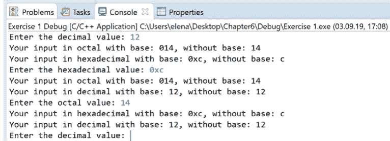

图 6.9：执行练习 4 第 1 部分的结果

6. 现在，让我们将 `std::setbase()` 函数中的 `std::dec`、`std::oct` 和 `std::hex` 替换掉，以检查输出是否相同。首先，添加 `<iomanip>` 头文件以支持 `std::setbase()`。接下来，在 main 函数的循环中，将 `std::dec` 替换为 `std::setbase(10)`，将 `std::hex` 替换为 `std::setbase(16)`，将 `std::oct` 替换为 `std::setbase(8)`：

```
int main(int argc, char **argv)
{
    int integer;

    while(true)
    {
        std::cout << "Enter the decimal value: ";
        std::cin >> std::setbase(10) >> integer;
        displayInBases(integer, BASE::DECIMAL);

        std::cout << "Enter the hexadecimal value: ";
        std::cin >> std::setbase(16) >> integer;
        displayInBases(integer, BASE::HEXADECIMAL);

        std::cout << "Enter the octal value: ";
        std::cin >> std::setbase(8) >> integer;
        displayInBases(integer, BASE::OCTAL);
    }

    return 0;
}
```

7. 再次构建并运行应用程序。按照输出提示，以不同的数值表示形式输入同一个整数（12）。输出应如下所示：

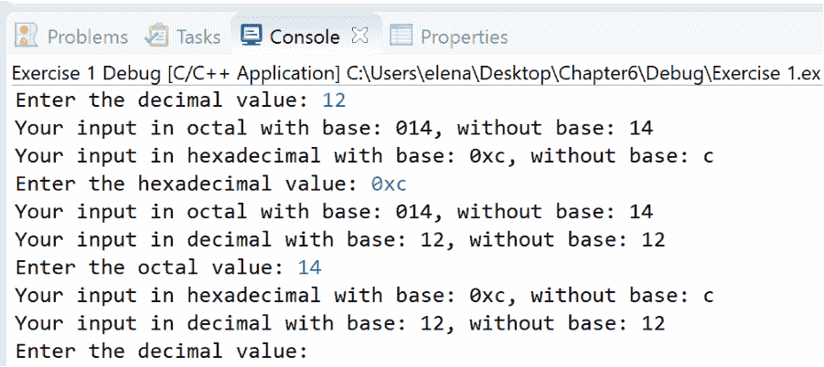

图 6.10：执行练习 4 第 2 部分的结果

现在，比较结果。可以看到，输出完全相同。通过这个操作，我们确认了这些函数是可以互换的。

### 用于浮点格式化的 I/O 操纵器

在 **<ios>** 头文件中，声明了用于更改浮点数字格式化的函数：**std::fixed**、**std::scientific**、**std::hexfloat** 和 **std::defaultfloat**。它们不带参数调用，并分别将 **floatfield** 设置为 fixed、scientific、fixed 和 scientific，以及默认值。还有 **std::showpoint** 和 **std::noshowpoint** 函数，它们控制浮点数字的显示。它们只影响输出。**std::noshowpoint** 函数只影响没有小数部分的浮点数字。

在 **<iomanip>** 头文件中，声明了一个 **std::setprecision** 函数，该函数调用时传入一个表示精度的数字。当小数点右侧的数字被舍去时，结果会四舍五入。如果数字太大而无法以正常方式表示，则精度设置会被忽略，数字会以更便于显示的方式呈现。你只需设置一次精度，并且只在需要不同精度时才更改它。当你选择一种数据类型来存储浮点变量时，应该注意一些技巧。在 C++ 中，有三种可以表示浮点值的数据类型：float、double 和 long double。


float 通常为 4 字节，double 为 8 字节，long double 为 8、12 或 16 字节。因此，它们的精度都是有限的。float 类型最多可以容纳 6–9 位有效数字，double 类型最多可以容纳 15–18 位有效数字，long double 类型最多可以容纳 33–36 位有效数字。如果你想比较它们之间的差异，请看下表：

| 类型 | 内存大小 | 有效数字位数 |
|---|---|---|
| float | 4 字节 | 6–9 |
| double | 8 字节 | 15–18 |
| long double | 8、12、16 字节 | 33–36 |

**图 6.11：浮点类型比较表**

> **注意**
> 
> 当你需要的精度超过 6 位有效数字时，请优先使用 double，否则你会得到意想不到的结果。

让我们完成一个练习，学习如何在实践中使用它们。

#### 练习 5：以不同格式显示输入的浮点数

在本练习中，我们将编写一个应用程序，在无限循环中要求用户输入一个浮点数。读取输入后，它会以不同的格式类型显示该数字。要完成本练习，请执行以下步骤：

- 1. 包含 `<iostream>` 头文件以支持流操作，包含 `<iomanip>` 头文件以支持 `std::setprecision`：

```cpp
#include <iostream>
#include <iomanip>
```

2. 接下来，声明一个模板 **formattingPrint** 函数，它有一个名为 **FloatingPoint** 的模板参数，并接收一个该类型的参数变量。接着，通过调用 **std::cout** 对象中的 **precision()** 函数，将之前的精度存储到一个 auto 变量中。然后，在终端中以不同格式显示给定的数字：带小数点、不带小数点，以及 fixed、scientific、hexfloat 和 defaultfloat 格式。接下来，在 for 循环中，从 0 到 22，以循环计数器的值作为精度显示给定的数字。循环退出后，用我们之前存储的值恢复精度：

```cpp
template< typename FloatingPoint >
void formattingPrint(const FloatingPoint number)
{
    auto precision = std::cout.precision();
    std::cout << "Default formatting with point: "
              << std::showpoint << number << std::endl
              << "Default formatting without point: "
              << std::noshowpoint << number << std::endl
              << "Fixed formatting: "
              << std::fixed << number << std::endl
              << "Scientific formatting: "
              << std::scientific << number << std::endl
              << "Hexfloat formatting: "
              << std::hexfloat << number << std::endl
              << "Defaultfloat formatting: "
              << std::defaultfloat << number << std::endl;

    for (int i = 0; i < 22; i++)
    {
        std::cout << "Precision: " << i
                  << ", number: " << std::setprecision(i)
                  << number << std::endl;
    }
    std::cout << std::setprecision(precision);
}
```

3. 进入 main 函数。声明一个名为 floatNum 的 float 变量、一个名为 doubleNum 的 double 变量，以及一个名为 longDoubleNum 的 long double 变量。然后，在无限 while 循环中，要求用户输入一个浮点数，将输入读取到 longDoubleNum，并将其传递给 formattingPrint 函数。接下来，使用 longDoubleNum 的值初始化 doubleNum，并将其传递给 formattingPrint 函数。接下来，使用 longDoubleNum 的值初始化 floatNum，并将其传递给 formattingPrint 函数：

```cpp
int main(int argc, char **argv)
{
    float floatNum;
    double doubleNum;
    long double longDoubleNum;

    while(true)
    {
        std::cout << "Enter the floating-point digit: ";
        std::cin >> std::setprecision(36) >> longDoubleNum;

        std::cout << "long double output" << std::endl;
        formattingPrint(longDoubleNum);

        doubleNum = longDoubleNum;

        std::cout << "double output" << std::endl;
        formattingPrint(doubleNum);

        floatNum = longDoubleNum;

        std::cout << "float output" << std::endl;
        formattingPrint(floatNum);
    }

    return 0;
}
```

4. 构建并运行应用程序。根据输出提示输入一个具有 22 位有效数字的浮点值，例如，0.2222222222222222222222。我们将得到一长串输出。现在，我们需要将其拆分以供分析。以下是 long double 值输出部分的截图：

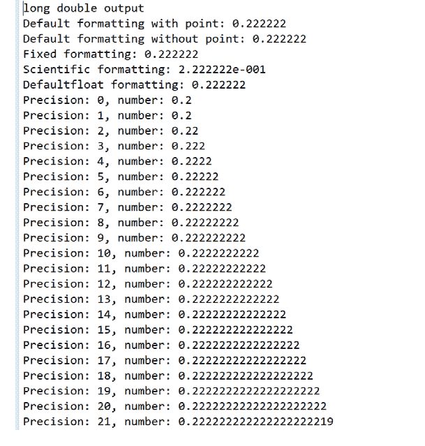

图 6.12：执行练习 5 的结果（第 1 部分）

在这里，我们可以看到格式化结果相同，但精度结果不同。不准确的输出从精度 17 开始。这意味着，在我们的系统上，double 的最大精度是 16 位有效数字。现在，让我们分析 float 值的输出：

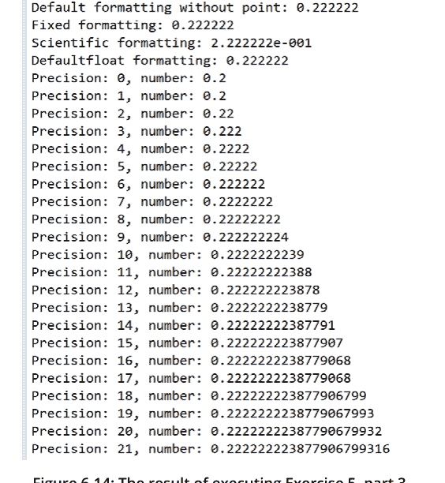

图 6.14：执行练习 5 的结果（第 3 部分）

在这里，我们可以看到格式化结果相同，但精度结果不同。不准确的输出从精度 8 开始。这意味着，在我们的系统上，float 的最大精度是 8 位有效数字。不同系统上的结果应该会有所不同。对它们的分析将帮助你为应用程序选择正确的数据类型。

注意
切勿使用 float 数据类型来表示货币或汇率；你可能会得到错误的结果。

### 用于布尔格式化的 I/O 操纵符

在 `<ios>` 头文件中，声明了用于更改布尔格式的函数：std::boolalpha 和 std::noboolalpha。它们无需参数即可调用，并允许我们分别以文本或数字方式显示布尔值。它们同时用于输入和输出操作。让我们看一个使用这些 I/O 操纵符进行输出操作的示例。我们将同时以文本和数字形式显示布尔值：

```
std::cout << "Default formatting of bool variables: "
    << "true: " << true
    << ", false: " << false << std::endl;
```

```
std::cout << "Formatting of bool variables with boolalpha flag is set: "
    << std::boolalpha
    << "true: " << true
    << ", false: " << false << std::endl;
```

```
std::cout << "Formatting of bool variables with noboolalpha flag is set: "
    << std::noboolalpha
    << "true: " << true
    << ", false: " << false << std::endl;
```

编译并运行此示例后，你将获得以下输出：

```
Default formatting of bool variables: true: 1, false: 0
Formatting of bool variables with boolalpha flag is set: true: true, false: false
Formatting of bool variables with noboolalpha flag is set: true: 1, false: 0
```

如你所见，布尔变量的默认格式化是通过 **std::noboolalpha** 标志执行的。要在输入操作中使用这些函数，我们需要一个包含 true/false 单词或 0/1 符号的源字符串。输入操作中的 **std::boolalpha** 和 **std::noboolalpha** 函数调用如下：

```
bool trueValue, falseValue;
```

```
std::istringstream iss("false true");
iss >> std::boolalpha >> falseValue >> trueValue;
std::istringstream iss("0 1");
iss >> std::noboolalpha >> falseValue >> trueValue;
```

如果随后输出这些变量，你会看到它们通过读取布尔值被正确初始化。

### 用于字段宽度和填充控制的 I/O 操纵符

在标准库中，还有一些函数用于操作输出字段的宽度，当宽度大于输出数据时应使用哪些字符，以及这些填充字符应插入的位置。当你希望将输出向左或向右对齐，或者希望用其他符号替换空格时，这些函数将非常有用。例如，假设你需要以两列格式打印价格。如果使用标准格式，你将得到以下输出：

```
2.33 3.45
2.2 4.55
3.67 3.02
```

这看起来不太好，而且难以阅读。如果我们应用格式化，输出将如下：

```
2.33    3.45
2.2     4.55
3.67    3.02
```


这样看起来更好。不过，你可能还是想检查一下，哪些字符是用来填充空白位置的，哪些是你实际在数字之间插入的空格。例如，让我们将填充字符设为 "*"。你将得到以下输出：

```
2.33* 3.45*
2.2** 4.55*
3.67* 3.02*
```

现在，你可以看到空白处已经用星号填满了。既然我们已经考虑了在输出中设置宽度和填充字符的用途，接下来看看如何使用 I/O 操作符做到这一点。`std::setw` 和 `std::setfill` 函数在 `<iomanip>` 头文件中声明。`std::setw` 接受一个整数值作为参数，并将流的宽度设置为正好 n 个字符。在少数情况下，宽度会被设置为 0，具体如下：

-   当移位运算符与 `std::string` 或 `char` 一起使用时
-   当调用 `std::put_money()` 函数时
-   当调用 `std::quoted()` 函数时

在 `<ios>` 头文件中，声明了用于更改填充字符插入位置的函数：`std::internal`、`std::left` 和 `std::right`。它们仅用于输出操作，并且只影响整数、浮点数和货币值。

现在，让我们看一个将所有这些一起使用的示例。我们以宽度 10 输出正数、负数、浮点数和十六进制值，并将填充字符替换为 "#"：

```
std::cout << "Internal fill: " << std::endl
    << std::setfill('#')
    << std::internal
    << std::setw(10) << -2.38 << std::endl
    << std::setw(10) << 2.38 << std::endl
    << std::setw(10) << std::hex << std::showbase << 0x4b << std::endl;
```

```
std::cout << "Left fill: " << std::endl
    << std::left
    << std::setw(10) << -2.38 << std::endl
    << std::setw(10) << 2.38 << std::endl
    << std::setw(10) << std::hex << std::showbase << 0x4b << std::endl;
```

```
std::cout << "Right fill: " << std::endl
    << std::right
    << std::setw(10) << -2.38 << std::endl
    << std::setw(10) << 2.38 << std::endl
    << std::setw(10) << std::hex << std::showbase << 0x4b << std::endl;
```

构建并运行此示例后，你将得到以下输出：

```
Internal fill:
-#####2.38
######2.38
0x######4b
```

```
Left fill:
-2.38#####
2.38#####
0x4b######
```

```
Right fill:
#####-2.38
######2.38
######0x4b
```

### 用于其他数字格式化的 I/O 操作符

如果需要输出带 "+" 号的正数值，可以使用 `<ios>` 头文件中的另一个 I/O 操作符——`std::showpos` 函数。同样也存在意义相反的操作符——`std::noshowpos` 函数。它们都会对输出产生影响，用法非常简单。让我们看下面的示例：

```
std::cout << "Default formatting: " << 13 << " " << 0 << std::endl;
std::cout << "showpos flag is set: " << std::showpos << 13 << " " << 0 <<
std::endl;
std::cout << "noshowpos flag is set: " << std::noshowpos << 13 << " " << 0 <<
std::endl;
```

这里，我们先以默认格式输出，然后设置 `std::showpos` 标志，最后设置 `std::noshowpos` 标志。如果你构建并运行这个小示例，你会看到默认情况下设置的是 `std::noshowpos` 标志。查看执行结果：

```
Default formatting: 13 0
showpos flag is set: +13 +0
noshowpos flag is set: 13 0
```

你可能还希望以大写字母输出浮点数或十六进制数字，这时可以使用 `<ios>` 头文件中的函数：`std::uppercase` 和 `std::nouppercase`。它们只影响输出。让我们看一个小示例：

```
std::cout << "12345.0 in uppercase with precision 4: "
    << std::setprecision(4) << std::uppercase << 12345.0 << std::endl;
std::cout << "12345.0 in no uppercase with precision 4: "
    << std::setprecision(4) << std::nouppercase << 12345.0 <<
std::endl;

std::cout << "0x2a in uppercase: "
    << std::hex << std::showbase << std::uppercase << 0x2a <<
std::endl;
std::cout << "0x2a in nouppercase: "
    << std::hex << std::showbase << std::nouppercase << 0x2a <<
std::endl;
```

这里，我们分别使用和不使用 `std::uppercase` 标志输出浮点数和十六进制数字。默认情况下，设置的是 `std::nouppercase` 标志。查看执行结果：

```
12345.0 in uppercase with precision 4: 1.234E+004
12345.0 in no uppercase with precision 4: 1.234e+004
0x2a in uppercase: 0X2A
0x2a in nouppercase: 0x2a
```

### 用于空白处理的 I/O 操作符

标准库中有用于处理空白的函数。`<istream>` 头文件中的 `std::ws` 函数只适用于输入流，用于丢弃开头的空白字符。`<ios>` 头文件中的 `std::skipws` 和 `std::noskipws` 函数用于控制读取和写入开头的空白字符。它们同时适用于输入流和输出流。当设置 `std::skipws` 标志时，流会忽略字符序列输入前面的空白字符。默认情况下，`std::skipws` 标志是设置的。让我们看一个使用这些 I/O 操作符的示例。首先，我们以默认格式读取输入，并输出所读取的内容。接下来，我们清空字符串，并通过 `std::noskipws` 标志读取数据：

```
std::string name;

std::string surname;

std::istringstream("Peppy Ping") >> name >> surname;

std::cout << "Your name: " << name << ", your surname: " << surname <<
std::endl;

name.clear();

surname.clear();

std::istringstream("Peppy Ping") >> std::noskipws >> name >> surname;
std::cout << "Your name: " << name << ", your surname: " << surname <<
std::endl;
```

构建并运行此示例后，我们将得到以下输出：

```
Your name: Peppy, your surname: Ping

Your name: Peppy, your surname:
```

从前面的输出可以看出，如果我们设置了 `std::noskipws` 标志，也会读取空白字符。

在 `<iomanip>` 头文件中，声明了一个对这个头文件来说不同寻常的操作符：`std::quoted`。当此函数应用于输入时，它会将给定的字符串用引号括起来，并对特殊字符进行转义。如果输入的字符串已经包含转义后的引号，它也会一并读取。为了理解这一点，让我们看一个小示例。我们将用一个没有引号的文本来初始化一个源字符串，用带转义引号的文本初始化另一个字符串。接下来，我们不设置任何标志，使用 `std::ostringstream` 读取它们，并通过 `std::cout` 提供输出。请看以下示例：

```
std::string str1("String without quotes");
std::string str2("String with quotes \"right here\"");

std::ostringstream ss;
ss << str1;
std::cout << "[" << ss.str() << "]" << std::endl;
ss.str("");

ss << str2;
std::cout << "[" << ss.str() << "]" << std::endl;
```

结果，我们将得到以下输出：

```
[String without quotes]
[String with quotes "right here"]
```

现在，让我们做同样的输出，但使用 `std::quoted` 调用：

```
std::string str1("String without quotes");
std::string str2("String with quotes \"right here\"");

std::ostringstream ss;
ss << std::quoted(str1);
std::cout << "[" << ss.str() << "]" << std::endl;
ss.str("");

ss << std::quoted(str2);
std::cout << "[" << ss.str() << "]" << std::endl;
```

现在，我们会得到不同的结果：

```
["String without quotes"]
["String with quotes \"right here\""]
```

你是否注意到，第一个字符串被引号括了起来，而第二个字符串中的子字符串 "right here" 在存储时带有转义字符？

现在，你已经知道如何将任意字符串用引号括起来。你甚至可以编写自己的包装器，以减少使用 `std::quoted()` 时的代码行数。例如，我们将流相关操作移到了一个单独的函数中：

```
std::string quote(const std::string& str)
{
    std::ostringstream oss;
    oss << std::quoted(str);
    return oss.str();
}
```

然后，在需要调用我们的包装器时，我们执行以下操作：

```
std::string str1("String without quotes");
std::string str2("String with quotes \"right here\"");

std::cout << "[" << quote(str1) << "]" << std::endl;
std::cout << "[" << quote(str2) << "]" << std::endl;
```

现在，它看起来好多了。第一个主题到此结束，让我们回顾一下刚刚学到的内容。在实践中，我们了解了预定义流对象的使用、带内部存储的文件 I/O 操作、I/O 格式化以及用户自定义类型的 I/O。现在，我们已经完整理解了如何在 C++ 中使用 I/O 库，接下来我们将考虑当标准流不够用时该怎么办。

## 创建额外的流

当流提供的接口不足以解决你的任务时，你可能需要创建一个额外的流，并复用一个现有接口。你可能需要从特定的外部设备输出或提供输入，或者你可能需要添加调用 I/O 操作的线程 ID。有几种方法可以做到这一点。你可以创建一个新类，将现有的某个流作为私有成员聚合起来。它将通过已有的流函数实现所有需要的功能，例如移位运算符。另一种方法是继承现有类之一，并按你需要的方式覆盖所有虚函数。


首先，你必须选择要使用的合适的类。你的选择应取决于你想要添加的修改。选择 `std::basic_istream`、`std::basic_ostream` 和 `std::basic_iostream` 如果你需要修改输入或输出操作。选择 `std::ios_base` 如果你想要修改状态信息、控制信息、私有存储等等。选择 `std::basic_ios` 如果你想要修改与流缓冲区相关的内容。在你选择正确的基类后，继承上述其中一个类来创建一个附加流。

还有一件事你必须知道——如何正确初始化标准流。就文件流或字符串流以及基本流类的初始化而言，存在一些很大的差异。让我们回顾一下它们。要初始化派生自文件流类的对象的实例，你需要传递文件名。要初始化派生自字符串流类的对象的实例，你需要调用默认构造函数。它们各自都有自己的流缓冲区，因此在初始化时不需要额外的操作。要初始化派生自基本流类的对象的实例，你需要传递一个指向流缓冲区的指针。你可以创建一个缓冲区的变量，或者你可以使用预定义流对象的缓冲区，例如 `std::cout` 或 `std::cerr`。

让我们详细回顾这两种创建附加流的方法。

### 如何制作附加流 – 组合

组合意味着你在类的私有部分声明一些标准流对象作为类的成员。当你选择合适的标准流类时，前往其头文件并注意它有哪些构造函数。然后，你需要在你类的构造函数中正确初始化该成员。为了将你的类用作流对象，你需要实现基本的函数，例如移位运算符、`str()` 等等。正如你可能记得的，每个流类都为内置类型重载了移位运算符。它们也为预定义函数重载了移位运算符，例如 `std::endl`。你需要能够将你的类用作真正的流对象。不要声明全部 18 个重载的移位运算符，我们只需要创建一个模板。此外，为了允许使用预定义的操纵符，我们必须声明一个接受指向函数的指针的移位运算符。

这看起来并不很难，所以让我们尝试为 `std::ostream` 对象实现这样一个“包装器”。

#### 练习 6：在用户定义类中组合标准流对象

在本练习中，我们将创建一个自己的流对象，它包装 `std::ostream` 对象并添加额外的功能。我们将创建一个名为 extendedOstream 的类，它将数据输出到终端，并在每段输出前面插入以下数据：日期和时间以及线程 ID。为了完成本练习，请执行以下步骤：

- 1. 包含所需的头文件：<iostream> 用于 std::endl 支持，<sstream> 用于 std::ostream 支持，<thread> 用于 std::this_thread::get_id() 支持，<chrono> 用于 std::chrono::system_clock::now()，以及 <ctime> 用于将时间戳转换为可读表示：

注意
不要忘记在 Eclipse 项目设置中添加 pthread 链接器标志以获得线程支持：Project -> Properties -> C/C++ Build -> Settings -> G++ Linker -> Miscellaneous -> Linker flags 输入 '-pthread'。此路径适用于 Eclipse 版本：3.8.1；对于不同版本可能有所不同。

```
#include <iostream>
#include <sstream>
#include <thread>
#include <chrono>
#include <ctime>
```

- 2. 接下来，声明 extendedOstream 类。声明名为 m_oss 的 std::ostream 变量和名为 writeAdditionalInfo 的 bool 变量。此 bool 变量将用于指示是否应打印扩展数据：

```
class extendedOstream
{
private:
    std::ostream& m_oss;
    bool writeAdditionalInfo;
};
```

3. 接下来，在 public 部分，定义默认构造函数并用 std::cout 初始化 m_oss 以将输出重定向到终端。将 writeAdditionalInfo 初始化为 true：

```
extendedOstream()
    : m_oss(std::cout)
    , writeAdditionalInfo(true)
{
}
```

4. 定义一个模板重载的左移运算符 <<，它返回 extendedOstream 的引用并接受名为 value 的模板参数。然后，如果 writeAdditionalInfo 为 true，则输出时间、线程 ID 和给定的 value，然后将 writeAdditionalInfo 设置为 false。如果 writeAdditionalInfo 为 false，则仅输出给定的 value。此函数将用于所有内置类型的输出：

```
template<typename T>
extendedOstream& operator<<(const T& value)
{
    if (writeAdditionalInfo)
    {
        std::string time = fTime();
        auto id = threadId();
        m_oss << time << id << value;
        writeAdditionalInfo = false;
    }
    else
    {
        m_oss << value;
    }
    return *this;
}
```

5. 定义另一个重载的左移运算符，它接受指向函数的指针作为参数并返回对 std::ostream 的引用。在函数体中，将 writeAdditionalInfo 设置为 true，调用给定的函数并将 m_oss 作为参数传递。此重载运算符将用于预定义函数，例如 std::endl：

```
extendedOstream&
operator<<(std::ostream& (*pfn)(std::ostream&))
{
    writeAdditionalInfo = true;
    pfn(m_oss);
    return *this;
}
```

6. 在 private 部分，定义 fTime 函数，它返回 std::string。它获取系统时间。将它格式化为可读表示并返回它：

```
std::string fTime()
{
    auto now = std::chrono::system_clock::now();
    std::time_t time = std::chrono::system_clock::to_time_t(now);
    std::ostringstream oss;
    std::string strTime(std::ctime(&time));
    strTime.pop_back();
    oss << "[" << strTime << "]";
    return oss.str();
}
```

7. 在 private 部分，定义 threadId() 函数，它返回一个字符串。获取当前线程的 id，对其进行格式化并返回它：

```
std::string threadId()
{
    auto id = std::this_thread::get_id();
    std::ostringstream oss;
    oss << "[" << std::dec << id << "]";
    return oss.str();
}
```

- 8. 输入 **main** 函数。为了测试我们的流对象的工作方式，创建一个名为 **oss** 的 **extendedOstream** 类型的对象。输出不同的数据，例如整数、浮点数、十六进制和布尔值：

```
extendedOstream oss;
oss << "Integer: " << 156 << std::endl;
oss << "Float: " << 156.12 << std::endl;
oss << "Hexadecimal: " << std::hex << std::showbase
    << std::uppercase << 0x2a << std::endl;
oss << "Bool: " << std::boolalpha << false << std::endl;
```

- 9. 然后，创建一个线程，用 lambda 函数初始化它，并在 lambda 中放入相同的输出。不要忘记加入线程：

```
std::thread thr1([]()
{
    extendedOstream oss;
    oss << "Integer: " << 156 << std::endl;
    oss << "Float: " << 156.12 << std::endl;
    oss << "Hexadecimal: " << std::hex << std::showbase
        << std::uppercase << 0x2a << std::endl;
    oss << "Bool: " << std::boolalpha << false << std::endl;
});
thr1.join();
```

- 10. 现在，构建并运行应用程序。你将得到以下输出：

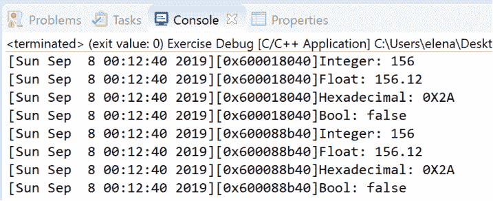

考虑输出的每一行。你可以看到输出的下一个格式：“[日期和时间][线程 ID]输出数据。” 确保线程 ID 从线程到线程不同。然后，数据以预期的格式输出。所以，正如你所见，使用标准流的组合实现自己的 I/O 流对象并不太难。

输入操作的缓冲字符传输如下工作：

- 1. **sgetc()** 函数从内部缓冲区读取字符。
- 2. **sgetc()** 函数调用 **s ungetc()** 函数，使已消耗的字符再次可用。
- 3. 如果内部缓冲区为空，**sgetc()** 函数调用 **underflow()** 函数。
- 4. **underflow()** 函数从外部设备读取字符到内部缓冲区。

**sgetc()** 和 **underflow()** 函数始终返回相同的字符。为了每次读取不同的字符，我们还有另一对函数：**sbumpc()** 和 **uflow()**。使用它们的读取字符算法是相同的：

- 1. **sbumpc()** 函数从内部缓冲区读取字符。
- 2. **sbumpc()** 函数调用 **sputbackc()** 函数，使下一个字符可用于输入。
- 3. 如果内部缓冲区为空，**sbumpc()** 函数调用 **uflow()** 函数。
- 4. **uflow()** 函数从外部设备读取字符到内部缓冲区。

输入操作的非缓冲字符传输如下工作：

- 1. **sgetc()** 函数调用一个受保护的虚成员，即 **underflow()**。
- 2. **underflow()** 函数从外部设备读取字符到内部缓冲区。
- 3. **sbumpc()** 函数调用一个受保护的虚成员，即 **uflow()**。
- 4. **uflow()** 函数从外部设备读取字符到内部缓冲区。

在任何错误的情况下，受保护的虚成员 **pbackfail()** 都会被调用，它处理错误情况。所以，正如你所见，要重写 **std::basic_streambuf** 类，我们需要重写与外部设备工作的虚成员。对于输入 **streambuf**，我们应该重写 **underflow()**、**uflow()** 和 **pbackfail()** 成员。对于输出 **streambuf**，我们应该重写 **overflow()** 和 **sync()** 成员。

让我们更详细地考虑所有这些步骤。


### 练习 7：继承标准流对象

在本练习中，我们将创建一个名为 **extended_streambuf** 的类，它继承自 **std::basic_streambuf**。我们将使用 **std::cout** 流对象的缓冲区，并重写 overflow() 函数，以便将数据写入外部设备（stdout）。接下来，我们将编写一个继承自 **std::basic_ostream** 类的 **extended_ostream** 类，并将流缓冲区设置为 **extended_streambuf**。最后，我们会对包装类做一些小改动，并将 **extended_ostream** 用作私有流成员。请按以下步骤完成本练习：

- 1. 包含所需的头文件：用于支持 std::endl 的 <iostream>，用于支持 std::ostream 和 std::basic_streambuf 的 <sstream>，用于支持 std::this_thread::get_id() 的 <thread>，用于支持 std::chrono::system_clock::now() 的 <chrono>，以及用于将时间戳转换为可读格式的 <ctime>。
- 2. 创建一个名为 **extended_streambuf** 的模板类，使其继承自 **std::basic_streambuf** 类。重写一个名为 **overflow()** 的公有成员函数，该函数将字符写入输出流，并返回 EOF 或写入的字符：

```
template< class CharT, class Traits = std::char_traits<CharT> >
class extended_streambuf : public std::basic_streambuf< CharT, Traits >
{
public:
    int overflow( int c = EOF ) override
    {
        if (!Traits::eq_int_type(c, EOF))
        {
            return fputc(c, stdout);
        }
        return Traits::not_eof(c);
    }
};
```

```
{
    if (writeAdditionalInfo)
    {
        std::string time = fTime();
        auto id = threadId();
        m_log << time << id << value;
        writeAdditionalInfo = false;
    }
    else
    {
        m_log << value;
    }
    return *this;
}

logger&
operator<<(std::ostream& (*pfn)(std::ostream&))
{
    writeAdditionalInfo = true;
    pfn(m_log);
    return *this;
}

private:
    std::string fTime()
    {
        auto now = std::chrono::system_clock::now();
        std::time_t time = std::chrono::system_clock::to_time_t(now);
        std::ostringstream log;
        std::string strTime(std::ctime(&time));
        strTime.pop_back();
        log << "[" << strTime << "]";
        return log.str();
    }

    std::string threadId()
    {
        auto id = std::this_thread::get_id();
        std::ostringstream log;
```

```
log << "[" << std::dec << id << "]";
return log.str();
}

private:
    extended_ostream<char> m_log;
    bool writeAdditionalInfo;
};
```

- 5. 进入 **main** 函数，将 **extendedOstream** 对象改为 **logger** 对象。其余代码保持不变。现在，构建并运行本练习。你会看到与上一练习相同的输出，但这次我们使用了自己的流缓冲区、自己的流对象，以及一个能向输出添加额外信息的包装类。请查看以下屏幕截图中的执行结果，并与上一练习的结果进行比较。确保两者相似。如果相似，就说明我们做得不错，继承的类也按预期工作：

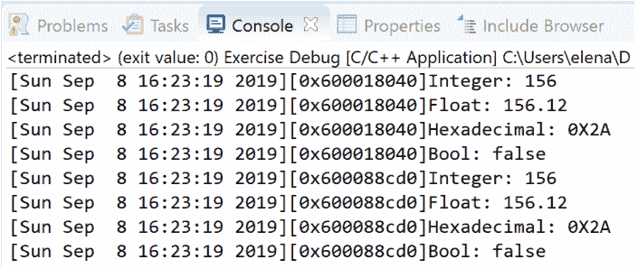

本节中，我们完成了很多内容，并学习了如何以不同方式创建额外的流。我们考察了适合继承的各类，以及针对不同需求应使用哪个类。我们还学习了如何继承基本的 streambuf 类，以实现与外部设备的交互。现在，我们将学习如何以异步方式使用 I/O 流。

## 利用异步 I/O

在许多情况下，I/O 操作可能耗时很长，例如创建备份文件、搜索大型数据库、读取大型文件等。你可以使用线程执行 I/O 操作，从而避免阻塞应用程序的执行。但对于某些应用程序而言，这并不是处理耗时 I/O 的合适方式，例如每秒可能发生数千次 I/O 操作的情况。在这些情况下，C++ 开发人员会使用异步 I/O。它可以节省线程资源，并确保执行线程不会被阻塞。下面我们来了解同步 I/O 和异步 I/O。

你可能还记得第 5 章“哲学家晚餐——线程与并发”中的内容：同步操作意味着某个线程发起操作并等待其完成。应用程序可以是单线程的，也可以是多线程的。关键在于，线程会等待 I/O 操作完成。

异步执行是指某项操作不会阻塞工作线程的执行。执行异步 I/O 操作的线程会发送异步请求，然后继续执行其他任务。操作完成后，初始线程会收到完成通知，并可按需处理结果。

由此看来，异步 I/O 似乎比同步 I/O 好得多，但这取决于具体情况。如果需要执行大量快速 I/O 操作，那么考虑到处理内核 I/O 请求和信号的开销，采用同步方式可能更合适。因此，在为应用程序设计架构时，需要考虑所有可能的场景。

标准库不支持异步 I/O 操作。因此，要使用异步 I/O，我们需要考虑使用其他库，或者自行实现。首先，我们来看看依赖平台的实现，然后再了解跨平台库。

### Windows 平台上的异步 I/O

Windows 支持对多种设备执行 I/O 操作，包括文件、目录、驱动器、端口、管道、套接字、终端等。通常，我们对这些设备使用相同的 I/O 接口，但不同设备的某些设置有所不同。下面我们来看看在 Windows 中对文件执行的 I/O 操作。

在 Windows 中，我们需要打开设备并获取其句柄。不同设备的打开方式各不相同。要打开文件、目录、驱动器或端口，我们使用 `<Windows.h>` 头文件中的 `CreateFile` 函数。要打开管道，我们使用 `CreateNamedPipe` 函数。要打开套接字，我们使用 socket() 和 accept() 函数。要打开终端，我们使用 `CreateConsoleScreenBuffer` 和 `GetStdHandle` 函数。这些函数都会返回一个设备句柄，之后对该设备的所有操作都会使用这个句柄。

`CreateFile` 函数有七个参数，用于控制打开设备后的操作。函数声明如下：

```
HANDLE CreateFile( PCTSTR pszName,
                   DWORD dwDesiredAccess,
                   DWORD dwShareMode,
                   PSECURITY_ATTRIBUTES psa,
                   DWORD dwCreationDisposition,
                   DWORD dwFlagsAndAttributes,
                   HANDLE hFileTemplate);
```

第一个参数是 `pszName`——文件路径。第二个参数名为 `dwDesiredAccess`，用于控制对设备的访问权限。它可以取以下值之一：

```
0 // 仅用于更改配置
GENERIC_READ // 仅用于读取
GENERIC_WRITE // 仅用于写入
GENERIC_READ | GENERIC_WRITE // 同时用于读取和写入
```

第三个参数 `dwShareMode` 用于控制当文件已经打开时，操作系统应如何处理所有新的 `CreateFile` 调用。它可以取以下值之一：

```
0 // 同一时间只能有一个应用程序打开该设备
FILE_SHARE_READ // 允许多个应用程序同时读取
FILE_SHARE_WRITE // 允许多个应用程序同时写入
FILE_SHARE_READ | FILE_SHARE_WRITE // 允许多个应用程序同时读取和写入
FILE_SHARE_DELETE // 允许多个应用程序同时移动或删除
```

第四个参数 psa 通常设为 NULL。第五个参数 dwCreationDisposition 用于控制打开文件还是创建文件。它可以取以下值之一：

```
CREATE_NEW // 创建新文件；如果文件已存在则失败
CREATE_ALWAYS // 创建新文件；如果文件已存在则覆盖
OPEN_EXISTING // 打开文件；如果文件不存在则失败
OPEN_ALWAYS // 打开或创建文件
TRUNCATE_EXISTING // 打开现有文件并截断；如果文件不存在则失败
```

第六个参数 dwFlagsAndAttributes 用于控制缓存或文件操作。管理缓存时，它可以取以下值之一：

```
FILE_FLAG_NO_BUFFERING // 不使用缓存
FILE_FLAG_SEQUENTIAL_SCAN // 告知操作系统将按顺序读取文件
FILE_FLAG_RANDOM_ACCESS // 告知操作系统不会按顺序读取文件
FILE_FLAG_WRITE_THROUGH // 写入时不使用缓存，读取时使用缓存
```

管理文件操作时，它可以取以下值之一：

```
FILE_FLAG_DELETE_ON_CLOSE // 关闭后删除文件（用于临时文件）
FILE_FLAG_BACKUP_SEMANTICS // 用于备份和恢复程序
FILE_FLAG_POSIX_SEMANTICS // 创建或打开文件时用于设置区分大小写
FILE_FLAG_OPEN_REPARSE_POINT // 允许以不同方式打开、读取、写入和关闭文件
FILE_FLAG_OPEN_NO_RECALL // 防止系统从归档介质中恢复文件内容
FILE_FLAG_OVERLAPPED // 允许以异步方式操作设备
```

作为文件属性时，它可以取以下值之一：

```
FILE_ATTRIBUTE_ARCHIVE // 应删除文件
FILE_ATTRIBUTE_ENCRYPTED // 文件已加密
FILE_ATTRIBUTE_HIDDEN // 文件为隐藏文件
FILE_ATTRIBUTE_NORMAL // 未设置其他属性
FILE_ATTRIBUTE_NOT_CONTENT_INDEXED // 文件正在由索引服务处理
```


FILE_ATTRIBUTE_OFFLINE // 文件已传输到归档介质
FILE_ATTRIBUTE_READONLY // 仅读访问
FILE_ATTRIBUTE_SYSTEM // 系统文件
FILE_ATTRIBUTE_TEMPORARY // 临时文件

最后一个参数 hFileTemplate 接受一个打开文件的句柄或 NULL 作为参数。如果传递了文件句柄，CreateFile 函数会忽略所有属性和标志，并使用打开文件的属性和标志。

关于 CreateFile 参数就这些了。如果它无法打开设备，则返回 INVALID_HANDLE_VALUE。以下示例演示如何打开文件进行读取：

```
#include <iostream>
#include <Windows.h>

int main()
{
    HANDLE hFile = CreateFile(TEXT("Test.txt"), GENERIC_READ,
                            FILE_SHARE_READ | FILE_SHARE_WRITE,
                            NULL, OPEN_ALWAYS, FILE_ATTRIBUTE_NORMAL,
NULL);

    if (INVALID_HANDLE_VALUE == hFile)
        std::cout << "Failed to open file for reading" << std::endl;
    else
        std::cout << "Successfully opened file for reading" << std::endl;

    CloseHandle(hFile);

    return 0;
}
```

接下来，要执行输入操作，我们使用 **ReadFile** 函数。它将文件描述符作为第一个参数，源缓冲区作为第二个参数，要读取的最大字节数作为第三个参数，读取字节数作为第四个参数，以及用于同步执行时的 **NULL** 值或指向有效且唯一的 OVERLAPPED 结构的指针作为最后一个参数。如果操作成功，**ReadFile** 返回 true，否则返回 false。以下示例演示如何从之前打开的用于读取的文件中输入：

```
BYTE pb[20];

DWORD dwNumBytes;

ReadFile(hFile, pb, 20, &dwNumBytes, NULL);
```

要执行输出操作，我们使用 **WriteFile** 函数。它的声明与 **ReadFile** 相同，但第三个参数设置要写入的字节数，第五个参数是已写入的字节数。以下示例演示如何向之前打开的用于写入的文件输出：

```
BYTE pb[20] = "Some information\0";

DWORD dwNumBytes;

WriteFile(hFile, pb, 20, &dwNumBytes, NULL);
```

要将缓存的数据写入设备，请使用 **FlushFileBuffer** 函数。它接受一个参数——文件描述符。让我们转向异步 I/O。为了让操作系统知道你计划异步地与设备工作，你需要使用 **FILE_FLAG_OVERLAPPED** 标志打开它。现在，为写入或读取打开文件如下所示：

```
#include <iostream>

#include <Windows.h>

int main()
{
    HANDLE hFile = CreateFile(TEXT("Test.txt"), GENERIC_READ,
                            FILE_SHARE_READ | FILE_SHARE_WRITE,
                            NULL, OPEN_ALWAYS, FILE_FLAG_OVERLAPPED,
NULL);

    if (INVALID_HANDLE_VALUE == hFile)
        std::cout << "Failed to open file for reading" << std::endl;
    else
        std::cout << "Successfully opened file for reading" << std::endl;

    CloseHandle(hFile);

    return 0;
}
```

我们使用相同的操作来执行文件的读取或写入，即 **ReadFile** 和 **WriteFile**，唯一的区别是读取或写入的字节数设置为 NULL，并且我们必须传递一个有效且唯一的 **OVERLAPPED** 对象。让我们考虑 OVERLAPPED 对象的结构是什么：

```
typedef struct _OVERLAPPED {
DWORD Internal; // for error code
DWORD InternalHigh; // for number of read bytes
DWORD Offset;
DWORD OffsetHigh;
HANDLE hEvent; // handle to an event
} OVERLAPPED, *LPOVERLAPPED;
```

Internal 成员设置为 **STATUS_PENDING**，这意味着操作尚未开始。读取或写入的字节数将写入 **InternalHigh** 成员。**Offset** 和 **OffsetHigh** 在异步操作中被忽略。**hEvent** 成员用于接收关于异步操作完成的事件。

> **Note**
> 
> I/O 操作的顺序不能保证，因此你不能依赖它。如果你计划在一个地方写入文件，在另一个地方从文件读取，你不能依赖顺序。

在异步模式下使用 **ReadFile** 和 **WriteFile** 时有一个不寻常的事情。它们在 I/O 请求同步执行时返回非零值。如果它们返回 **FALSE**，你需要调用 **GetLastError** 函数来检查为什么返回了 **FALSE**。如果错误代码是 **ERROR_IO_PENDING**，这意味着 I/O 请求已成功处理，处于挂起状态，将在以后执行。

你应该记住的最后一件事是，在 I/O 操作完成之前，你不能移动或删除 **OVERLAPPED** 对象或包含数据的缓冲区。对于每个 I/O 操作，你应该创建一个新的 **OVERLAPPED** 对象。

最后，让我们考虑系统通知我们 I/O 操作完成的方式。有几种这样的机制：释放设备、释放事件、产生警报和使用 I/O 端口。

**“糟糕”的方法：** **WriteFile** 和 **ReadFile** 函数将设备设置为“占用”状态。当 I/O 操作完成时，驱动程序将设备设置为“空闲”状态。我们可以检查完成的 I/O 操作是否调用 **WaitForSingleObject** 或 **WaitForMultipleObject** 函数。以下示例演示了这种方法：

```
```cpp
#include <Windows.h>

#include <WinError.h>

int main()
{
    HANDLE hFile = CreateFile(TEXT("Test.txt"), GENERIC_READ,
                               FILE_SHARE_READ | FILE_SHARE_WRITE,
    NULL,
                               OPEN_ALWAYS, FILE_FLAG_OVERLAPPED,
    NULL);

    BYTE bBuffer[100];
    OVERLAPPED o = { 0 };
    BOOL bResult = ReadFile(hFile, bBuffer, 100, NULL, &o);
    DWORD dwError = GetLastError();

    if (bResult && (dwError == ERROR_IO_PENDING))
    {
        WaitForSingleObject(hFile, INFINITE);
        bResult = TRUE;
    }

    CloseHandle(hFile);

    return 0;
}
```
```

这是检查 I/O 操作是否已完成的最简单方法。但这种方法使调用线程在 `WaitForSingleObject` 调用上等待，因此它成为同步调用。此外，你可以为该设备启动多个 I/O 操作，但你不能确定线程会在设备释放的所需时刻唤醒。

**有点好，但不是最好的方法：** 你还记得重叠结构的最后一个成员吗？你通过调用 `CreateEvent` 函数创建一个事件并将其设置为 `OVERLAPPED` 对象。然后，当 I/O 操作完成时，系统通过调用 `SetEvent` 函数释放此事件。接下来，当调用线程需要获取正在执行的 I/O 操作的结果时，你调用 `WaitForSingleObject` 并传递此事件的描述符。以下示例演示了这种方法：

```
```c
#include <Windows.h>
#include <synchapi.h>

int main()
{
    HANDLE hFile = CreateFile(TEXT("Test.txt"), GENERIC_READ,
                              FILE_SHARE_READ | FILE_SHARE_WRITE,
                              NULL, OPEN_ALWAYS, FILE_FLAG_OVERLAPPED,
    NULL);

    BYTE bInBuffer[10];
    OVERLAPPED o = { 0 };
    o.hEvent = CreateEvent(NULL,TRUE,FALSE,"IOEvent");
    ReadFile(hFile, bInBuffer, 10, NULL, &o);

    ///// do some work

    HANDLE hEvent = o.hEvent;

    WaitForSingleObject(hEvent, INFINITE);

    CloseHandle(hFile);

    return 0;
}
```
```

如果你希望通知调用线程 I/O 操作的结束，这是一个相当简单的方法。但这不是理想的方法，因为当有大量此类操作时，你需要为每个操作创建一个事件对象。

**另一种不是最好的方法：** 可警报的 I/O 工作方式如下。我们调用 **ReadFileEx** 和 **WriteFileEx** 进行输入/输出。它们与标准的 **ReadFile** 和 **WriteFile** 类似，但我们不传递存储读取或写入字符数的变量，并传递回调函数的地址。此回调函数称为完成例程，其声明如下：

```
```cpp
VOID WINAPI

CompletionRoutine(DWORD dwError,
                  DWORD dwNumBytes,
                  OVERLAPPED* po);
```
```

**ReadFileEx** 和 **WriteFileEx** 将回调函数的地址传递给设备驱动程序。当设备上的操作完成时，驱动程序将回调函数的地址添加到 APC 队列并指向 OVERLAPPED 结构的指针。然后，操作系统调用此函数并传递读取或写入的字节数、错误代码和指向 OVERLAPPED 结构的指针。

这种方法的主要缺点是编写回调函数并使用大量全局变量，因为回调函数在上下文中只有少量信息。另一个不使用这种方法的原因是，只有调用线程可以接收关于完成的通知。


现在我们已经讨论了不好的做法，让我们来看一下处理 I/O 结果的最佳方法 – I/O 端口。I/O 完成端口是为与线程池一起使用而开发的。要创建这样一个端口，我们使用 CreateIoCompletionPort。该函数的声明如下：

```
HANDLE
CreateIoCompletionPort(HANDLE hFile,
    HANDLE hExistingCompletionPort,
    ULONG_PTR CompletionKey,
    DWORD dwNumberOfConcurrentThreads);
```

该函数创建一个 I/O 完成端口并将设备与此端口关联。要完成此操作，我们需要调用它两次。要创建新的完成端口，我们调用 CreateIoCompletionPort 函数并将 INVALID_HANDLE_VALUE 作为第一个参数传递，将 NULL 作为第二个参数传递，将 0 作为第三个参数传递，并传递此端口的线程数。将第四个参数传递为 0 将使线程数等于处理器数量。

> Note
> 
> 对于 I/O 完成端口，建议使用的线程数等于处理器数量的两倍。

接下来，我们需要将此端口与输入/输出设备关联。因此，我们第二次调用 CreateIoCompletionPort 函数并传递设备的描述符、已创建完成端口的描述符、将指示对设备进行读写操作的常量，以及 0 作为线程数。然后，当我们需要获取完成结果时，我们从端口描述符调用 GetQueuedCompletionStatus。如果操作完成，函数会立即返回结果。如果没有，则线程等待完成。以下示例演示了这种方法：

```
#include <Windows.h>

#include <synchapi.h>

int main()
{
    HANDLE hFile = CreateFile(TEXT("Test.txt"), GENERIC_READ,
        FILE_SHARE_READ | FILE_SHARE_WRITE,
```

```
NULL, OPEN_ALWAYS, FILE_FLAG_OVERLAPPED,
NULL);

    HANDLE m_hIOcp = CreateIoCompletionPort(INVALID_HANDLE_VALUE, NULL, 0, 0);
    CreateIoCompletionPort(hFile, m_hIOcp, 1, 0);

    BYTE bInBuffer[10];
    OVERLAPPED o = { 0 };
    ReadFile(hFile, bInBuffer, 10, NULL, &o);

    DWORD dwNumBytes;
    ULONG_PTR completionKey;
    GetQueuedCompletionStatus(m_hIOcp, &dwNumBytes, &completionKey, (OVERLAPPED**) &o, INFINITE);

    CloseHandle(hFile);

    return 0;
}
```

### Asynchronous I/O on Linux Platforms

Linux 平台上的异步 I/O 支持对不同设备（如套接字、管道和 TTY）进行输入和输出，除了文件。是的，这很奇怪，但 Linux 开发者决定文件 I/O 操作已经足够快了。

要打开一个 I/O 设备，我们使用 open() 函数。它的声明如下：

```
int open (const char *filename, int flags[, mode_t mode])
```

第一个参数是文件名，而第二个参数是一个位掩码，控制文件应如何打开。如果系统无法打开设备，open() 返回 -1 的值。成功时，它返回设备描述符。open 模式的可能标志为 O_RDONLY、O_WRONLY 和 O_RDWR。

要执行输入/输出操作，我们使用名为 aio 的 POSIX 接口。它们有一组定义的函数，如 aio_read、aio_write、aio_fsync 等。它们用于启动异步操作。要获取执行结果，我们可以使用信号通知或线程的实例化。或者，我们也可以选择完全不接收通知。它们都声明在 <aio.h> 头文件中。

几乎所有这些都以 aiocb 结构（异步 IO 控制块）作为参数。它控制 IO 操作。此结构的声明如下：

```
struct aiocb
{
    int aio_fildes;
    off_t aio_offset;
    volatile void *aio_buf;
    size_t aio_nbytes;
    int aio_reqprio;
    struct sigevent aio_sigevent;
    int aio_lio_opcode;
};
```

aio_fildes 成员是打开设备的描述符，而 aio_offset 成员是设备中应进行读或写操作的偏移量。aio_buf 成员是指向要读写缓冲区的指针。aio_nbytes 成员是缓冲区的大小。aio_reqprio 成员是此 IO 操作执行的优先级。aio_sigevent 成员是一个结构，指出调用线程应如何被通知完成。aio_lio_opcode 成员是 I/O 操作的类型。以下示例演示如何初始化 aiocb 结构：

```
std::string fileContent;

constexpr int BUF_SIZE = 20;

fileContent.resize(BUF_SIZE, 0);

aiocb aiocbObj;

aiocbObj.aio_fildes = open("test.txt", O_RDONLY);
if (aiocbObj.aio_fildes == -1)
{
```

```
#include <unistd.h>
#include <iostream>
#include <chrono>
#include <thread>
```

2. 创建一个名为 **isDone** 的 bool 变量，它将指示操作是否已完成：

```
bool isDone{};
```

3. 定义函数作为我们的信号处理程序，即 **aioSigHandler**。当异步操作完成时它将被调用。信号处理程序应具有以下签名：

```
void name(int number, siginfo_t* si, void* additional)
```

4. 第一个参数是信号号，第二个参数是包含信号生成原因信息的结构，最后一个参数是附加信息。它可以转换为 **ucontext_t** 结构的指针，以便我们接收被此信号中断的线程上下文。在 **aioSigHandler** 中，检查与异步 I/O 操作相关的信号是否使用 **SI_ASYNCIO** 为常量。如果是，则输出一条消息。接下来，将 **isDone** 设置为 **true**：

```
void
aioSigHandler(int no, siginfo_t* si, void*)
{
    std::cout << "Signo: " << no << std::endl;
    if (si->si_code == SI_ASYNCIO)
    {
        std::cout << "I/O completion signal received" << std::endl;
    }
    isDone = true;
}
```

5. 定义另一个帮助函数名为 **initSigAct**。它将初始化 **sigaction** 结构。此结构定义了在 I/O 操作完成时将发送哪个信号以及应调用哪个处理程序。这里，我们选择了 **SIGUSR1** – 一个用户定义的信号。在 **sa_flags** 中，设置我们希望此信号在操作重启或接收信息时被传递：

```
bool
initSigAct(struct sigaction& item)
{
    item.sa_flags = SA_RESTART | SA_SIGINFO;
    item.sa_sigaction = aioSigHandler;
```

- 8. 创建一个名为 **fileName** 的变量，它保存一个名为 "Test.txt" 的文件。然后，以只读访问权限打开此文件：

```
const std::string fileName("Test.txt");
int descriptor = open(fileName.c_str(), O_RDONLY);
if (-1 == descriptor)
{
    std::cerr << "Failed to open file for reading" << std::endl;
    return -1;
}
std::cout << "Successfully opened file for reading" << std::endl;
```

- 9. 创建一个 **sigaction** 结构并使用 **initSigAct** 函数初始化它：

```
struct sigaction sa;
if (!initSigAct(sa))
{
    std::cerr << "failed registering signal" << std::endl;
    return -1;
}
```

- 10. 创建一个 **aiocb** 结构并使用 **fillAiocb** 函数初始化它：

```
aiocb aiocbObj;
fillAiocb(aiocbObj, descriptor, buffer, bufSize);
```

- 11. 使用 **aio_read** 函数执行 **read** 操作：

```
if (-1 == aio_read(&aiocbObj))
{
    std::cerr << "aio_read failed" << std::endl;
}
```

- 12. 接下来，在循环中评估 **isDone** 变量。如果为 false，则使线程休眠 3ms。通过这样做，我们将等待 I/O 操作完成：

```
while (!isDone)
{
    using namespace std::chrono_literals;
    std::this_thread::sleep_for(3ms);
}
std::cout << "Successfully finished read operation. Buffer: " << std::endl
<< buffer;
```

- 13. 在运行此练习之前，在项目目录中创建一个 `Test.txt` 文件并写入不同的符号。例如，我们的文件包含以下数据：

```
a1a"1 a1\\a1 a1    a1
a1a"1 a1\\a1 a1    a1
a1a"1 a1\\a1 a1    a1
a1a"1 a1\\a1 a1    a1
a1a"1 a1\\a1 a1    a1
a1a"1 a1\\a1 a1    a1
a1a"1 a1\\a1 a1    a1
a1a"1 a1\\a1 a1    a1
a1a"1 a1\\a1 a1    a1
a1a"1 a1\\a1 a1    a1
a1a"1 a1\\a1 a1    a1
a1a"1 a1\\a1 a1    a1
a1a"1 a1\\a1 a1    a1
a1a"1 a1\\a1 a1    a1
a1a"1 a1\\a1 a1    a1
```

这里有字母字符、数字字符、特殊符号、空格、制表符和换行符。

- 14. 现在，在你的 IDE 中构建并运行此练习。你的输出将类似于以下内容：

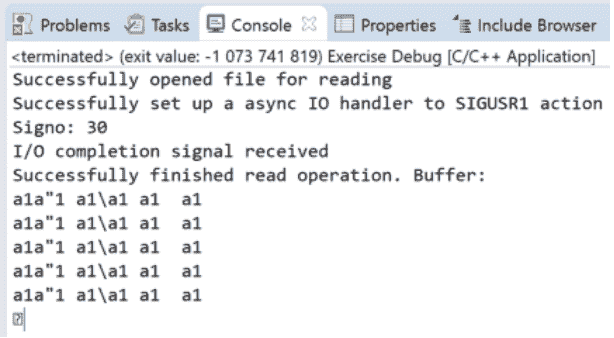

你可以看到文件已成功以只读方式打开，并且我们已成功为其设置 **SIGUSR1** 信号和处理程序。然后，我们接收到信号号 30，即 **SI_ASYNCIO** 信号。最后，我们可以输出读取的内容并与文件内容进行比较。通过这样做，我们可以确保所有数据都已正确读取。


Linux 系统中的异步 I/O 就介绍到这里。

> **注意**
> 
> 你可以在 Linux 的 man 手册中找到有关 Linux 中异步 IO 的更多信息：[http://man7.org/linux/man-pages/man7/aio.7.html](http://man7.org/linux/man-pages/man7/aio.7.html)。

现在，让我们来学习一下我们可以用于跨平台应用程序的东西。

### 异步跨平台 I/O 库

我们已经考虑了异步 I/O 的平台相关决策。现在，要编写跨平台应用程序，你可以使用这些平台相关的方案并通过预处理器指令使用它们；例如：

```
```cpp
#ifdef WIN

#include <WinAIO.hpp>

#else

#include <LinAIO.hpp>

#endif
```
```

在两个头文件中，你可以为平台相关的实现声明相同的接口。你也可以实现自己的 AIO 库，它将在单独的线程中使用一些状态机或队列。此外，你可以使用一些实现了必要功能的免费库。最受欢迎的库是 **Boost.Asio**。它提供了大量用于异步工作的接口，例如以下内容：

- 无线程的并发
- 线程
- 缓冲区
- 流
- 协程
- TCP、UDP 和 ICMP
- 套接字
- SSL
- 定时器
- 串口

让我们简要考虑一下它对 I/O 操作的接口。我们可以使用 **Asio** 库的接口进行同步和异步操作。所有 I/O 操作都从 **io_service** 类开始，它提供了核心 I/O 功能。它在 **<boost/asio/io_service.hpp>** 头文件中声明。同步 I/O 调用 **io_service** 对象的 **run()** 函数，用于单次操作，该操作会阻塞调用线程直到作业完成。异步 I/O 使用 **run()**、**run_one()**、**poll()** 和 **poll_one()** 函数。**run()** 函数运行事件循环以处理请求处理器。**run_one()** 函数做同样的事情，但事件循环应仅处理一个处理器。**poll()** 函数运行事件循环以执行所有就绪的处理器。**poll_one()** 做同样的事情但仅针对一个处理器。以下示例演示了所有这些函数的使用：

```
boost::asio::io_service io_service1;

io_service1.run();

boost::asio::io_service io_service2;

io_service2.run_one();

boost::asio::io_service io_service3;

io_service3.poll();

boost::asio::io_service io_service4;

io_service4.poll_one();
```

可以在实际调用 I/O 操作之前运行事件处理器。使用工作类与 **io_service** 类一起在代码中实现此功能。工作类保证 run 函数不会返回，直到你决定不再有未来的 I/O 操作为止。例如，你可以将工作类作为另一个类的成员，并在析构函数中将其移除。因此，在你的类生命周期内，**io_service** 将一直运行：

```
boost::asio::io_service io_service1;
boost::asio::io_service::work work(io_service1);
io_service1.run();

boost::asio::io_service io_service2;
boost::asio::io_service::work work(io_service2);
io_service2.poll();
```

接下来，要执行任何 I/O 操作，我们需要确切的 I/O 设备，例如文件、套接字等。有许多类实现了与不同 I/O 设备的交互，例如来自 `<boost/asio/ip/tcp.hpp>` 头文件的 **boost::asio::ip::tcp::socket**。接下来，要读取和写入套接字，我们使用 **boost::asio::async_read** 和 **boost::asio::async_write**。它们接受套接字、**boost::asio::buffer** 和回调函数作为参数。当异步操作执行时，回调函数将被调用。我们可以传递一个 lambda 函数作为回调函数，也可以使用 boost::bind 函数绑定现有函数。**boost::bind** 创建一个可调用对象。以下示例演示了如何使用 Boost::Asio 写入套接字：

```
boost::asio::io_service ioService;

tcp::socket socket;

int length = 15;

char* msg = new char(length);

msg = "Hello, world!";

auto postHandler = [=]()
{
    auto writeHandler = [=](boost::system::error_code ec, std::size_t length)
    {
        if (ec)
        {
            socket_.close();
        }
        else
        {
```

```
// wrote length characters
}
};
boost::asio::async_write(socket, boost::asio::buffer(msg, length),
writeHandler);
};

ioService.post(postHandler);
```

这里，我们使用了 lambda 函数作为异步 I/O 操作的回调。

> **注意**
> 
> **Boost.Asio** 在 https://www.boost.org/doc/libs/1_63_0/doc/html/boost_asio.html 上有很好的文档说明。有大量使用不同 IO 设备和不同方法的示例。如果你决定在项目中使用 **Boost.Asio**，可以参考此文档。

这里，我们考虑了可以实现异步 I/O 操作的不同方法。根据你的需求、环境和允许的实用程序，你可以选择合适的方式在应用程序中实现异步 I/O。请记住，如果你选择执行许多快速的 I/O 操作，最好以同步方式执行，因为它不会占用太多系统资源。现在我们知道了如何利用异步 I/O，让我们学习如何在多线程应用程序中使用 I/O。

## 线程与 I/O 的交互

I/O 标准库不是线程安全的。在标准库的文档中，我们可以找到解释，说明对流或流缓冲区的并发访问可能导致数据竞争，从而导致未定义行为。为了避免这种情况，我们应该使用我们在 *第 5 章，哲学家晚餐 – 线程与并发* 中学到的技术来同步对流和缓冲区的访问。

让我们谈谈 **std::cin** 和 **std::cout** 对象。每次调用它们都是线程安全的，但让我们考虑以下示例：

```
```cpp
std::cout << "Counter: " << counter << std::endl;
```
```

在这行代码中，我们看到 **std::cout** 被调用一次，但每次对移位运算符的调用实际上是对 **std::cout** 对象的不同调用。因此，我们可以重写此行如下：

```
```cpp
std::cout << "Counter: ";
std::cout << counter;
std::cout << std::endl;
```
```

此代码与之前的单行完全相同，即，如果你从不同的线程调用此单行，你的输出将被混合且不清晰。你可以修改它使其真正线程安全，如下所示：

```
```cpp
std::stringstream ss;
ss << "Counter: " << counter << std::endl;
std::cout << ss.str();
```
```

因此，如果你使用第二种方法向终端输出，你的输出将清晰且线程安全。此行为可能因编译器或 std 库版本而异。你还必须知道 **std::cout** 和 **std::cin** 之间是同步的。这意味着调用 **std::cout** 总是会刷新 **std::cin** 流，而调用 **std::cin** 总是会刷新 **std::cout** 流。

最佳方法是使用守卫类包装所有 I/O 操作，该类将使用互斥锁控制对流的访问。如果你需要从多个线程使用 **std::cout** 向终端输出，你可以实现一个非常简单的类，它除了锁定互斥锁并调用 **std::cout** 之外什么都不做。让我们完成一个练习并创建此类。

### 练习 9：为 std::cout 开发线程安全包装器

在本练习中，我们将开发一个简单的 **std::cout** 包装器以产生线程安全的输出。我们将编写一个小的测试函数来检查其工作原理。让我们开始并执行以下步骤：

- 1. 包含所有必需的头文件：

```
```cpp
#include <iostream>  // for std::cout
#include <thread>   // for std::thread
#include <mutex>    // for std::mutex
#include <sstream>  // for std::ostringstream
```
```

现在，让我们思考一下我们的包装器。我们可以在某个地方创建一个此类变量并将其传递给每个创建的线程。然而，这是个坏主意，因为在复杂的应用中，这将需要大量的精力。我们也可以将其作为单例实现，以便我们可以从任何地方访问它。接下来，我们必须考虑我们类的内容。实际上，我们可以使用我们在 *练习 7，继承标准流对象* 中创建的类。在该练习中，我们重载了 `std::basic_streambuf` 和 `std::basic_ostream` 并将 `std::cout` 设置为输出设备。我们可以在重载函数中添加一个互斥锁并照常使用它。请注意，我们不需要任何额外的逻辑——只是使用 `std::cout` 输出数据。为此，我们可以创建一个更简单的类。如果我们没有设置输出设备，应用左移运算符将不会生效并将数据存储在内部缓冲区中。太好了！现在，我们需要考虑如何将此缓冲区使用 `std::cout` 输出。

- 2. 实现一个 `write()` 函数，它将锁定互斥锁并从内部缓冲区输出到 `std::cout`。此函数的使用方式如下：
  
  ```cpp
  mtcout cout;
  cout << msg << std::endl;
  cout.write();
  ```

- 3. 我们有一个函数将始终自动调用，我们可以将 write 函数的代码放入其中。它是析构函数。在这种情况下，我们将创建和销毁合并为一行。此类对象的使用方式如下：
  
  ```cpp
  mtcout{} << msg << std::endl;
  ```

- 4. 现在，让我们定义我们的 `mtcout`（多线程 cout）类。它有一个公共默认构造函数。在私有部分，它有一个静态互斥变量。正如你可能回忆的那样，静态变量在类的所有实例之间共享。在析构函数中，我们锁定互斥锁并使用 cout 输出。添加前缀到输出——当前线程的 ID 和一个空格字符：

```
class mtcout : public std::ostringstream
{
public:
    mtcout() = default;
    ~mtcout()
    {
```


std::lock_guard<std::mutex> lock(m_mux);
std::cout << std::this_thread::get_id() << " " << this->str();
}
private:
    static std::mutex m_mux;
};

+   5. 接下来，在类外部声明 **mutex** 变量。我们这样做的原因是必须在任何源文件中声明静态变量：
+   
+   ```cpp
+   std::mutex mtcout::m_mux;
+   ```

+   6. 进入主函数。创建一个名为 **func** 的 lambda。它将测试我们的 **mtcout** 类。它接受一个字符串作为参数，并使用 **mtcout** 在从 0 到 1000 的循环中输出该字符串。使用 `std::cout` 添加相同的输出，并将其注释掉。比较两种情况下的输出：
+   
+   ```cpp
   auto func = [](const std::string msg)
   {
       using namespace std::chrono_literals;
       for (int i = 0; i < 1000; ++i)
       {
           mtcout{} << msg << std::endl;
           //      std::cout << std::this_thread::get_id() << " " << msg <<
   std::endl;
       }
   };
   ```

+   7. 创建四个线程，并将一个 lambda 函数作为参数传递。向每个线程传递不同的字符串。最后，join 所有四个线程：
+   
+   ```cpp
   std::thread thr1(func, "111111111");
   std::thread thr2(func, "222222222");
   std::thread thr3(func, "333333333");
   std::thread thr4(func, "444444444");
   
   thr1.join();
   thr2.join();
   thr3.join();
   thr4.join();
   ```

## 使用宏

在本章的任务中，我们将使用宏定义来简化和美化代码，所以让我们回顾一下如何使用它们。宏定义是预处理器指令。宏定义的语法如下：

```
```c
#define [name] [expression]
```
```

其中，[name] 是任何有意义的名称，[expression] 是任何小函数或值。

当预处理器遇到宏名称时，它会用表达式替换它。例如，假设你有以下宏：

```
```c
#define MAX_NUMBER 15
```
```

然后，你在代码中的几个地方使用它：

```
```c
if (val < MAX_NUMBER)

while (val < MAX_NUMBER)
```
```

当预处理器完成其工作后，代码将如下所示：

```
```c
if (val < 15)

while (val < 15)
```
```

预处理器对函数也执行相同的工作。例如，假设你有一个用于获取最大数的宏：

```
```c
#define max(a, b) a < b ? b : a
```
```

然后，你在代码中的几个地方使用它：

```
```cpp
int res = max (5, 3);
```
```

```
```cpp
std::cout << (max (a, b));
```
```

当预处理器完成其工作后，代码将如下所示：

```
```cpp
int res = 5 < 3 ? 3 : 5;
```
```

```
```cpp
std::cout << (a < b ? b : a);
```
```

作为表达式，你可以使用任何有效的表达式，例如函数调用、内联函数、值等。如果需要将表达式写成多行，请使用反斜杠运算符“\\”。例如，max 定义可以写成两行，如下所示：

```
```cpp
#define max(a, b) \\
a < b ? b : a
```
```

> **注意**
> 
> 宏定义来自 C 语言。最好改用 const 变量或内联函数。不过，在某些情况下使用宏定义仍然更方便，例如在日志系统中，当你希望定义不同的日志级别时。

现在，我们已经知道完成任务所需的一切。因此，让我们总结一下本章所学内容，并改进我们在*第5章 哲学家晚宴——线程与并发*中编写的项目。我们将开发一个线程安全的日志记录器，并将其集成到我们的项目中。

### 任务1：美术馆模拟器的日志系统

在此任务中，我们将开发一个日志记录器，用于向终端输出格式化日志。我们将按以下格式输出日志：

```
[dateTime][threadId][logLevel][file:line][function] | message
```

我们将为不同的日志级别实现宏定义，以替代直接调用。该日志记录器将是线程安全的，我们将从不同线程同时调用它。最后，我们将把它集成到项目——美术馆模拟器中。我们将运行模拟并观察美化后的日志。我们将创建一个额外的流，使用并发流，并格式化输出。我们将实现本章所学的大部分内容。我们还将采用前一章中的同步技术。

因此，在尝试此任务之前，请确保你已完成本章之前的所有练习。

在实现此应用程序之前，让我们描述一下我们的类。我们有如下新建的类：

| 类名 | 描述 |
|---|---|
| LoggerUtils | 提供输出格式化接口的类。 |
| StreamLogger | 向终端输出数据的线程安全日志记录器。 |

图 6.20：应实现的类的描述

我们还有以下已在美术馆模拟器项目中实现的类：

| 类名 | 描述 |
|---|---|
| Person | 表示美术馆访客的类。 |
| Persons | 保存 Person 类对象的线程安全存储。 |
| PersonGenerator | 负责按不同时间间隔创建 Person 类的新对象。这模拟了美术馆的新访客。它还负责模拟人们离开美术馆的情况。为此，它按不同时间间隔触发移除事件。 |
| Watchman | 负责控制美术馆入口的类。每当有新访客时，它检查美术馆内的人数，如果人数少于 50，则将一个新的 Person 放入美术馆内的人员列表中。如果该人数超过限制，则将访客放入等待列表。它还通过使用由 PersonGenerator 类触发的移除事件，将访客从美术馆内的人员列表中移除。每次移除后，它检查等待列表中是否有访客。如果有，则检查美术馆内的人数，如果人数少于 50，则将 Person 放入美术馆内的人员列表中。 |

图 6.21：美术馆模拟器项目中已实现类的表

在开始实现之前，让我们将新类添加到类图中。所有描述过的类及其关系组合在以下类图中：

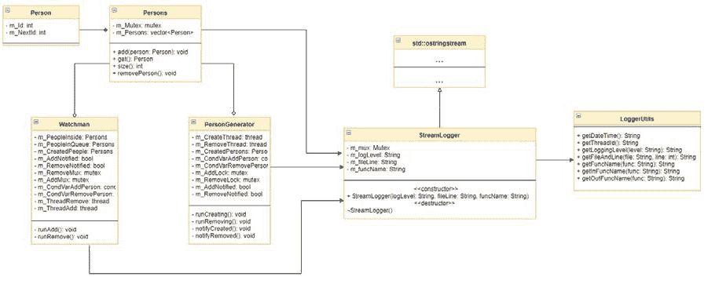

**图 6.22：类图**

为了获得所需格式的输出，**LoggerUtils** 类应具有以下**静态**函数：

| 函数 | 描述 |
|---|---|
| getDateTime | 获取当前系统日期和时间，并将其转换为以下格式：`[dd.mm.yyThh:mm:ss]` |
| getThreadId | 获取当前线程 id，并将其转换为以下格式：`[hex]` |
| getLoggingLevel | 将给定的日志级别转换为以下格式：`[logging level]` |
| getFileAndLine | 将给定的文件和行字符串转换为以下格式：`[file:line - ]` |
| getFuncName | 将给定的函数名转换为以下格式：`[name() ---]` |
| getInFuncName | 将给定的函数名转换为以下格式：`[name() --> ]` |
| getOutFuncName | 将给定的函数名转换为以下格式：`[name() <-- ]` |

**图 6.23：LoggerUtils 成员函数的描述**

按照以下步骤完成此任务：

+   1. 定义并实现 LoggerUtils 类，该类提供输出格式化的接口。它包含将给定数据格式化为所需表示的静态变量。
+   2. 定义并实现 StreamLogger 类，该类为向终端输出提供线程安全接口。它应按如下格式格式化输出：
+      [dateTime][threadId][logLevel][file:line: ][function] | message
+   3. 在单独的头文件中，为不同的日志级别声明宏定义，这些宏定义返回 StreamLogger 类的临时对象。
+   4. 将实现的日志记录器集成到美术馆模拟器的类中。
+   5. 用适当的宏定义调用替换所有 std::cout 的调用。

完成上述步骤后，你应该在终端上看到来自所有已实现类的日志输出。请查看并确保日志按所需格式输出。预期输出应如下所示：

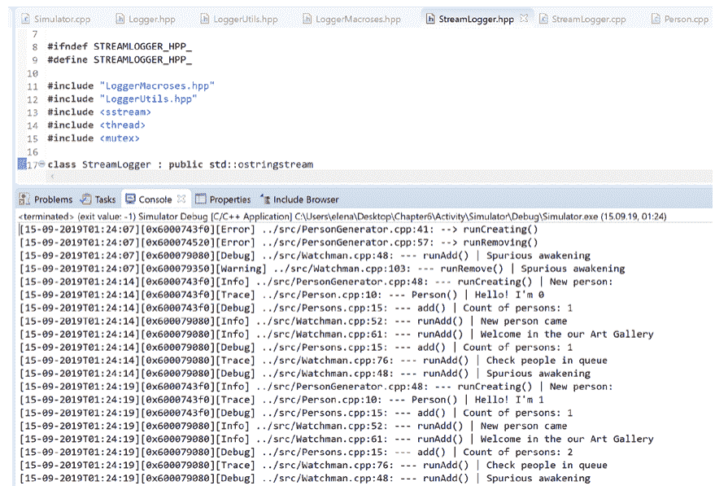


> 注意
> 本活动的解决方案可在第 696 页找到。

## 摘要

在本章中，我们学习了 C++ 中的 I/O 操作。我们探讨了 I/O 标准库，它为同步 I/O 操作提供了接口。此外，我们还考虑了用于异步 I/O 的依赖于平台的原生工具，以及用于跨平台异步 I/O 操作的 Boost.Asio 库。我们还学习了如何在多线程应用程序中使用 I/O 流。

我们首先了解了标准库为 I/O 操作提供的基本特性。我们学习了预定义的流对象，例如 std::cin 和 std::cout。在实践中，我们学习了如何使用标准流并重载移位运算符，以便轻松读写自定义数据类型。

接下来，我们练习了如何创建额外的流。我们从基础的流类继承，实现了我们自己的流缓冲区类，并在练习中实践了它们的用法。我们了解了最适合继承的流类，并考虑了它们的优缺点。

然后，我们探讨了在不同操作系统上进行异步 I/O 操作的方法。我们简要考虑了使用名为 Boost.Asio 的跨平台 I/O 库，它为同步和异步操作都提供了接口。

最后，我们学习了如何在多线程应用程序中执行 I/O 操作。我们通过构建一个多线程日志记录器将所有新技能付诸实践。我们创建了一个日志记录器抽象，并将其应用于艺术画廊模拟器中。最终，我们创建了一个简单、清晰且健壮的日志系统，使我们可以轻松地使用日志调试应用程序。总之，我们运用了本章所学的所有知识。

在下一章中，我们将深入了解应用程序的测试与调试。我们将从学习断言和安全网（异常处理）开始。然后，我们将练习为接口编写单元测试和模拟（mock）。之后，我们将在 IDE 中练习调试应用程序：使用断点、监视点和数据可视化。最后，我们将编写一个活动来掌握我们的代码测试技能。

## 引言

在**软件开发生命周期（SDLC）**中，一旦需求收集阶段完成，通常就会进入设计与架构阶段，在此阶段定义项目的高层流程，并将其分解为更小的模块组件。当项目中有许多团队成员时，有必要明确分配每个团队成员负责模块的特定部分，并让他们了解自己的需求。这样，他们就可以在隔离的环境中独立编写自己的代码部分，并确保其正常运行。一旦他们的工作部分完成，他们就可以将自己的模块与其他开发者的模块集成，并确保整个项目按照需求执行。

这个概念也适用于小型项目，开发者完全专注于一个需求，将其分解为更小的组件，在隔离的环境中开发组件，确保其按计划执行，集成所有小模块以完成项目，最后进行测试以确保整个项目运行良好。

当整个项目集成并执行时，需要进行大量的测试。可能会有一个专门的团队（称为**质量保证**，即**QA**）来执行此任务。与其在项目级别发现问题，不如在每个隔离阶段测试代码，这是一个很好的策略。这种测试需要由负责该模块的开发者来执行。这种类型的测试称为单元测试。在这里，开发者可以模拟运行该模块所需的环境，并确保测试模块中编写的特定功能部分。

例如，假设在一个大型项目中，有一个小模块的功能是解析配置文件并获取设置环境所需的参数。如果解析文件的代码部分将**IP 地址**作为**字符串**，那么开发者需要确保其格式为**XXX.XXX.XXX.XXX**，其中**X**是**0–9**之间的数字。字符串的长度必须是有限的。

在这里，开发者可以创建一个测试程序来执行他们的代码部分：解析文件，将**IP 地址**提取为字符串，并测试其格式是否正确。类似地，如果配置中还有其他需要解析的参数，并且它们需要采用特定格式，例如**用户 ID / 密码**、日志文件位置或挂载点等，那么所有这些都将属于该模块单元测试的一部分。在本章中，我们将解释**断言、安全网（异常处理）、单元测试、模拟、断点、监视点和数据可视化**等技术，以查明错误根源并限制其蔓延。在下一节中，我们将探讨断言技术。

## 断言

针对上述场景使用测试条件将有助于项目更好地发展，因为缺陷将在基础层面被发现，而不是在之后的 QA 层面。在某些场景中，即使在编写了单元测试用例并成功执行代码之后，仍可能会发现问题，例如应用程序崩溃、程序意外退出或行为不符合预期。为了应对这些场景，开发者通常会使用调试模式的二进制文件来重现问题。断言用于确保条件得到检查，否则程序执行将被终止。

这样，问题就可以被快速追踪。此外，在调试模式下，开发者可以逐行遍历程序的实际执行过程，并检查代码流程是否符合预期，或者变量是否按预期设置并正确访问。有时，如果指针变量没有指向有效的内存位置，访问它们会导致意外行为。

在编写代码时，我们可以检查必要条件是否得到满足。如果没有满足，程序员可能不希望继续执行代码。使用断言可以轻松完成这一操作。断言是一个宏，用于检查特定条件，如果不满足条件，则会调用 abort（程序执行停止）并将错误消息作为标准错误输出。这通常是运行时断言。也可以在编译时进行断言。我们稍后会讨论这一点。在下一节中，我们将解决一个练习，在其中编写并测试我们的第一个断言。

### 练习 1：编写并测试我们的第一个断言

在本练习中，我们将编写一个函数来解析 IP 地址并检查其是否有效。作为需求的一部分，IP 地址将以**XXX.XXX.XXX.XXX**格式的字符串字面量传入。在此格式中，X 代表 0-9 之间的数字。因此，作为测试的一部分，为了检查被解析的字符串是否正确，我们需要确保字符串不为空且长度小于 16。按照以下步骤实现此练习：

- 1. 创建一个名为 `AssertSample.cpp` 的新文件。

- 2. 打开文件并编写以下代码以包含头文件：

```
#include<iostream>
#include<cassert>
#include<cstring>

using std::cout;
using std::endl;
```

在上述代码中，`#include<cassert>` 表示我们需要包含定义了 assert 的 cassert 文件。

- 3. 创建一个名为 `checkValidIp()` 的函数，该函数将 IP 地址作为输入，如果 IP 地址满足我们的要求，则返回 true。编写以下代码来定义该函数：

```
bool checkValidIp(const char * ip){
    assert(ip != NULL);
    assert(strlen(ip) < 16);
    cout << "strlen: " << strlen(ip) << endl;
    return true;
}
```

在这里，`assert(ip != NULL)` 表示使用 assert 宏来检查传入的 "ip" 变量是否为非 NULL。如果它为 NULL，则会中止并显示错误消息。此外，`assert(strlen(ip) < 16)` 表示使用 assert 来检查 "ip" 是否为 16 个字符或更少。如果不是，则会中止并显示错误消息。

- 4. 现在，创建一个主函数，将不同的字符串字面量传递给我们的 `checkValidIp()` 函数，并确保它可以被适当地测试。为主函数编写以下代码：

```
int main(){
    const char * ip;
    ip = NULL;
    bool check = checkValidIp(ip);
    cout << " IP address is validated as :" << (check ? "true" : "false") << endl;
    return 0;
}
```

在上述代码中，我们故意将 NULL 传递给 ip 变量，以确保 assert 被调用。

- 5. 打开命令提示符，进入存储 `AssertSample.cpp` 文件的位置。通过输入以下命令使用 g++ 编译器编译它：

```
g++ AssertSample.cpp
```

使用此命令，将生成 a.out 二进制文件。


在前面的截图中，断言抛出错误，因为传入的 **ip** 长度大于 **16**。

- 8. 现在，为了满足 **assert** 条件使二进制程序正常运行，我们需要在 **main** 函数中更新 **ip** 的值。编写以下代码来实现此操作：

```
ip = "111.111.111.111";
```

再次打开编译器，编译 **.cpp** 文件，并运行生成的二进制文件。编译器中显示以下输出：

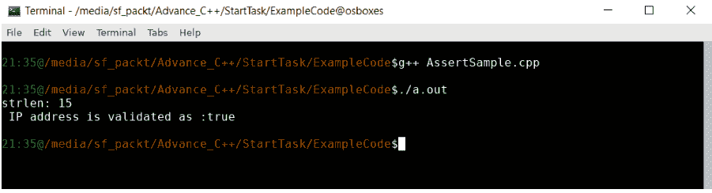

图 7.3：在命令提示符上运行断言二进制文件

**注意：** 由于我们只是处理 **assert**，因此我们没有向我们的 **checkValidIP()** 函数添加任何额外功能。但是，我们将在 *异常处理* 和 *单元测试* 部分使用相同的示例，在其中我们将为我们的函数添加更多功能。

- 9. 如果我们不希望在生产或发布环境中由于断言而导致可执行文件中止，请从代码中删除 **assert** 宏调用。首先，我们将更新长度大于 **16** 的 **ip** 值。向文件添加以下代码：

```
ip = "111.111.111.11111";
```

- 10. 现在，在编译期间，传递 **-DNDEBUG** 宏。这将确保断言不会在二进制文件中被调用。在终端中编写以下命令来编译我们的 **.cpp** 文件：

```
g++ -DNDEBUG AssertSample.cpp
```

之后，当我们执行二进制文件时，会生成以下输出：

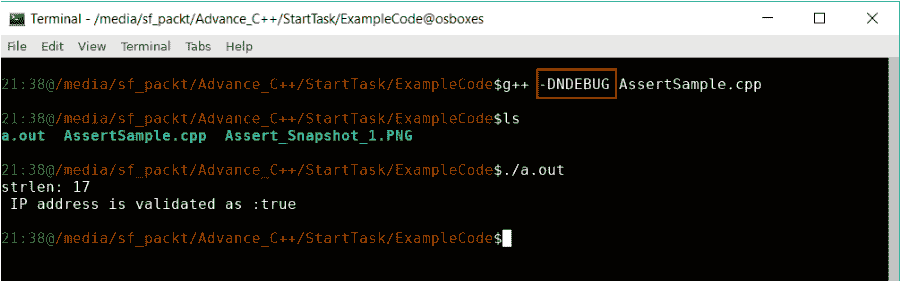

**图 7.4：在命令提示符上运行断言二进制文件**

在前面的截图中，由于未调用 **assert**，它将显示字符串长度为 **17**，并且 **true** 值将验证 IP 地址。在本练习中，我们看到在执行二进制文件时调用了断言。我们也可以在代码编译期间进行断言。这是在 C++11 中引入的。它被称为 **静态断言**，我们将在下一节中探索它。

## 静态断言

有时，我们可以在编译时进行条件检查以避免任何未来的错误。例如，在一个项目中，我们可能会使用一个第三方库，其中声明了一些数据结构。我们可以从其头文件中得知该结构信息，例如其大小和 **成员变量**。利用这些信息，我们可以正确地分配或释放内存，以及操作其成员变量。该结构属性可能会在第三方库的不同版本中发生变化。但是，如果我们的项目代码仍在使用早期版本的结构，那么在使用它时就会出现问题。我们可能在运行二进制文件时在后期阶段遇到错误。我们可以使用 **静态断言** 在编译时本身捕获此错误。我们可以比较静态数据，例如库的版本号，从而确保我们的代码不会遇到任何问题。在下一节中，我们将基于此解决一个练习。

### 练习 2：测试静态断言

在本练习中，我们将通过进行静态断言来比较两个头文件的版本号。如果版本号小于 1，则会抛出静态断言错误。执行以下步骤来实现此练习：

- 1. 创建一个名为 PersonLibrary_ver1.h 的头文件并添加以下代码：

```
#ifndef __PERSON_H__
#define __PERSON_H__

#include<string>

using std::string;

#define PERSON_LIB_VERSION 1

struct person{
    string name;
    int age;
    string address;
};

#endif
```

在前面的代码中，struct person 被定义并包含以下属性：name、age 和 address。它还具有版本号 1。

- 2. 创建另一个名为 PersonLibrary_ver2.h 的头文件并添加以下代码：

```
#ifndef __PERSON_H__
#define __PERSON_H__

#include<string>

using std::string;

#define PERSON_LIB_VERSION 2

struct person{
    string name;
    int age;
    string address;
    string Mobile_No;
};

#endif
```

在前面的代码中，struct person 被定义并包含以下属性：name、age、address 和 Mobile_No。它还具有版本号 2。现在，版本 1 是旧版本，版本 2 是新版本。以下是两个头文件并排显示的截图：

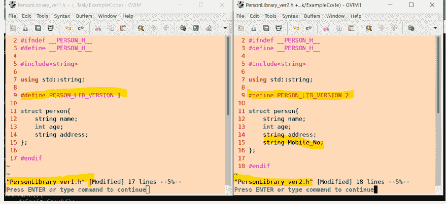

图 7.5：具有不同版本的库文件

- 3. 创建一个名为 StaticAssertionSample.cpp 的文件并添加以下代码：

```
#include<iostream>
#include"PersonLibrary.h"

void doSanityCheck(){
    static_assert(PERSON_LIB_VERSION > 1 , "PERSON LIBRARY VERSION not greater than 1");
    // Do any more sanity check before starting app ...
}

int main(){
    doSanityCheck();
    return 0;
}
```

在前面的代码中，我们在构建和执行项目之前对其进行健全性检查。我们创建了一个名为 doSanityCheck() 的函数来执行库的版本检查。它使用静态断言完成，并在编译时执行。代码的第二行显示包含 PersonLibrary.h 文件。在 doSanityCheck() 函数内部，static_assert() 函数检查此库版本是否大于 1。

**注意：** 如果你的项目需要在版本 2 或更高版本的库中定义 person 结构体才能正确执行它，我们需要匹配版本 2 的文件，即 PERSON_LIB_VERSION 至少应设置为 2。如果开发人员获取了库的版本 1 并尝试为项目创建二进制文件，它可能会在执行时造成问题。为了避免这种情况，在项目的 main 代码中，我们在构建和执行之前对项目进行健全性检查。

- 4. 要在我们的 .cpp 文件中包含库的版本 1，请打开终端并编写以下命令：

```
ln -s PersonLibrary_ver1.h PersonLibrary.h
```

前面的命令将创建一个名为 PersonLibrary.h 的 PersonLibrary_ver1.h 文件的软链接。这就像模拟使用版本 1 的 PersonLibrary.h 的环境。

- 5. 使用终端中的以下命令编译我们的 .cpp 文件：

```
g++ StaticAssertionSample.cpp
```

以下是终端中生成的输出：

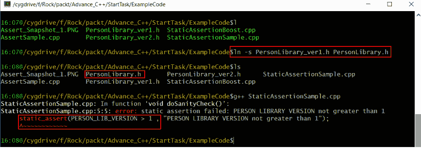

图 7.6：看到静态错误

在前面的截图中，有三个区域用红色圈出。第一个给出创建软链接的命令。第二个命令显示我们创建的 **PersonLibrary.h** 文件。第三个区域显示由于库版本不匹配而抛出的 **static_assert** 错误。

- 6. 现在，为了正确编译程序，请删除 **PersonLibrary** 的软链接并创建一个新的软链接指向 **版本 2**，然后再次编译。这次它将编译正常。在终端中输入以下命令以删除软链接：

```
rm PersonLibrary.h
ln -s PersonLibrary_ver2.h PersonLibrary.h
g++ StaticAssertionSample.cpp
```

以下是相同的截图：

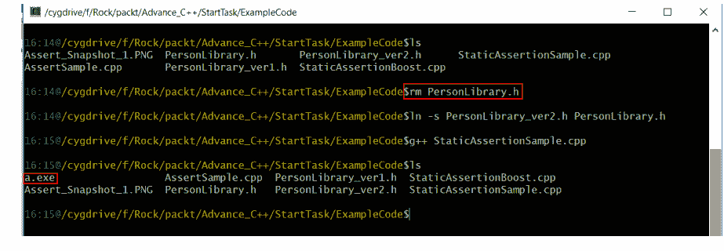

图 7.7：静态断言编译文件

正如你所见，一个用红色标记的区域显示使用了正确的 **PersonLibrary** 版本，编译顺利进行，没有任何问题。编译后，会创建一个名为 "**a.exe**" 的二进制文件。在本练习中，我们通过比较两个头文件的版本号执行了静态断言。在下一节中，我们将探索异常处理的概念。

## 理解异常处理

正如我们在调试模式二进制文件中看到的，我们可以使用运行时断言在某些条件不满足时中止程序。但在发布模式二进制文件或生产环境中，当客户端使用此产品时，突然中止程序并不是一个好主意。最好处理此类错误条件并继续执行二进制文件的下一部分。


```
cout << "Error in checkValidIp :"<< str << endl;
    return false;
}
catch(int len){
    cout << "Error in checkValidIp, ip len:" << len <<" greater than
15 characters, condition fail" << endl;
    return false;
}

    cout << "strlen: " << strlen(ip) << endl;
    return true;
}
```

在前面的代码中，你可以看到检查条件的 try 块。在 try 块内部，如果 ip 为 NULL，则会抛出 (const char *) 类型的异常。在下一个条件中，如果 ip 大于 15，则会抛出 int 参数类型的异常。该抛出会被正确的 catch 捕获，匹配的参数为 (int 或 const char *)。两个异常都返回 false 并附带一些错误信息。或者，在 catch 块中，你可以执行额外的步骤，如果需要清理，或者使用在异常中用于比较的变量的默认值。

> **注意**
> 
> 有一个默认异常；例如，如果有嵌套函数抛出带有不同参数的错误，它可以用更高级别的函数捕获，参数如 catch(...)。同样，在通用的 catch 中，你可以为异常处理创建默认行为。

-   4. 创建 main() 函数并在其中写入以下代码：

```
int main(){
    const char * ip;
    ip = NULL;
    if (checkValidIp(ip))
        cout << "IP address is correctly validated" << endl;
    else {
```

```
```cpp
/// work on error condition
// if needed exit program gracefully.
return -1;
}
return 0;
}
```
```

-   5. 打开终端，编译我们的文件并运行二进制文件。你将看到以下输出：

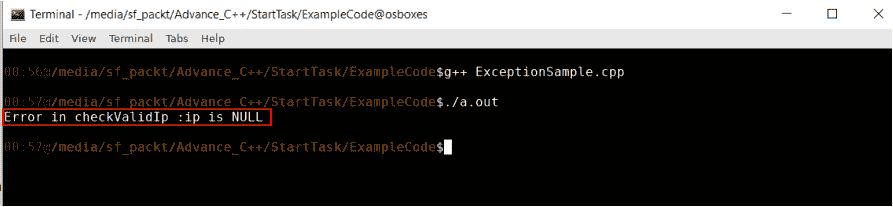

**图 7.8：带有异常处理的示例执行代码**

前面的示例因 **ip** 为 **NULL** 而抛出异常并优雅退出。

-   6. 现在，修改 **main** 函数中 **ip** 的值，提供超过 **15** 个字符。编写以下代码来执行此操作：

```
```cpp
ip = "111.111.111.11111";
```
```

-   7. 打开终端，编译我们的文件并运行二进制文件。你将看到以下输出：

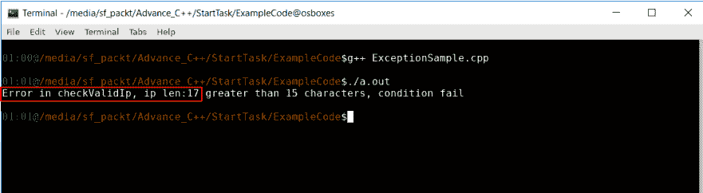

**图 7.9：异常处理的另一个示例**

它因 **ip 字符串** 的 **长度不匹配** 而抛出错误。

8. 再次，修改 main 函数中 ip 的值，提供少于 15 个字符。编写以下代码来执行此操作：

```
ip = "111.111.111.111";
```

9. 打开终端，编译我们的文件并运行二进制文件。你将看到以下输出：

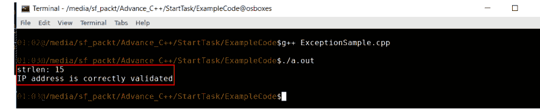

图 7.10：二进制文件正常运行，未抛出异常

正如你从前面的截图中看到的，二进制文件在没有任何异常的情况下正确执行。现在你已经了解了如何处理异常，在下一节中，我们将探索单元测试和模拟测试的概念。

## 单元测试和模拟测试

当开发人员开始编写代码时，他们需要确保代码在单元级别得到正确测试。可能会发生边界条件被遗漏的情况，并且代码在客户端站点运行时可能会中断。为了避免这种情况，通常最好对代码进行单元测试。单元测试是在代码的单元级别或基础级别执行的测试，在那里开发人员可以在隔离的环境中测试他们的代码，假设已满足运行代码功能的必要设置。通常，将模块分解为小的函数并分别测试每个函数是良好的实践。

例如，假设部分功能是读取配置文件并使用来自配置文件的参数设置环境。我们可以创建一个专用函数来编写此功能。因此，为了测试此函数，我们可以创建一个单元测试用例集，它将检查可能失败或行为不正确的各种组合。一旦确定了这些测试用例，开发人员就可以编写代码来覆盖该功能并确保它通过所有单元测试用例。这是在开发过程中良好的实践，你首先不断添加测试用例，然后相应地添加代码，然后运行该函数的全部测试用例并确保它们表现得当。

有许多工具可用于为项目编写和集成单元测试用例。其中一些是 **cppunit、Google Test、Microsoft Unit Testing Framework** 和 **catch**。为我们的示例目的，我们将使用 **Google Test 框架**。它是免费提供的，可以与项目集成。它使用 **xUnit 测试框架** 并有一组断言，可用于测试测试用例的条件。在下一节中，我们将解决一个练习，在其中我们将创建我们的第一个单元测试用例。

### 练习 4：创建我们的第一个单元测试用例

在本练习中，我们将使用上一节讨论的相同场景，其中开发人员被要求编写一个函数来解析 **配置文件**。在配置文件中传递不同的有效参数，例如 **产品可执行名称、版本号、数据库连接信息、连接到服务器的 IP 地址** 等。假设开发人员将解析文件并设置和测试各个属性的参数的所有此功能分解到单独的函数中。在我们的例子中，我们假设开发人员正在编写功能，他们已将 **IP 地址** 解析为 **字符串**，并希望推断 **字符串** 是否为有效的 **IP 地址**。目前，使 IP 地址有效需要满足以下条件：

-   - **字符串** 不应为空。
-   - **字符串** 不应包含超过 16 个字符
-   - **字符串** 应采用 `XXX.XXX.XXX.XXX` 格式，其中 X 必须是 0–9 的数字。

执行以下步骤来实现此练习：

-   1. 创建 **CheckIp.h** 头文件并在其中写入以下代码：

```
```cpp
#ifndef _CHECK_IP_H_
#define _CHECK_IP_H_
#include <iostream>
#include <cstring>
using namespace std;
bool checkValidIp(const char *);
#endif
```
```

在前面的代码中，我们编写了一个名为 **checkValidIp()** 的函数来检查 **IP 地址** 是否有效。同样，只是为了理解 **Google 单元测试**，我们将编写最少的代码来理解该功能。

2. 创建一个 **CheckIp.cpp** 文件并写入以下代码，其中我们将检查 ip 是否为 **非 NULL** 且长度小于 16：

```
```cpp
#include "CheckIp.h"
#include<string>
#include<sstream>
bool checkValidIp(const char * ip){
    if(ip == NULL){
        cout << "Error : IP passes is NULL " << endl;
        return false;
    }
    if(strlen(ip) > 15){
        cout << "Error: IP size is greater than 15" << endl;
        return false;
    }
    cout << "strlen: " << strlen(ip) << endl;
    return true;
}
```
```

在前面的代码中，如果两个条件都失败，函数返回 **false**。

3. 调用 **checkValidIp()** 函数创建一个名为 **MainIp.cpp** 的新文件。该文件通常将包含项目的 main 流程，但对于我们的练习目的，我们只是调用我们的 **checkValidIP()** 函数。在其中添加以下代码：

```
```cpp
#include"CheckIp.h"

int main(){
    const char * ip;
    //ip = "111.111.111.111";
    ip = "111.111.111.11111";

    if (checkValidIp(ip))
        cout << "IP address is correctly validated" << endl;
    else {
        /// work on error condition
        // if needed exit program gracefully.
        cout << " Got error in valid ip " << endl;
        return -1;
    }
    return 0;
}
```
```

4. 为了创建测试代码，我们将创建我们的第一个 .cpp 文件，即 TestCases.cpp。它将包含我们 checkValidIp 函数的测试用例。在其中写入以下代码：

```
#include"CheckIp.h"
#include<gtest/gtest.h>
using namespace std;
const char * testIp;
TEST(CheckIp, testNull){
    testIp=NULL;
    ASSERT_FALSE(checkValidIp(testIp));
}
TEST(CheckIp, BadLength){
    testIp = "232.13.1231.1321.123";
    ASSERT_FALSE(checkValidIp(testIp));
}
```

在前面的代码第二行中，我们包含了 gtest.h 文件。我们还使用 TEST 函数调用测试用例，它接受两个参数：第一个是测试套件名称，第二个是测试用例名称。对于我们的情况，我们创建了 TestSuite CheckIp。在 TEST 块中，你会看到我们有 Google 测试定义了一个断言称为 ASSERT_FALSE，它将检查条件是否为 false。如果不是，它将使测试用例失败并在结果中显示相同。

## 注意

通常，对于 Google 测试用例和测试套件，你可以将它们分组到一个公共命名空间中并调用 RUN_ALL_TESTS 宏，该宏运行附加到测试二进制文件的所有测试用例。对于每个测试用例，它调用 SetUp 函数进行初始化（如类中的构造函数），然后它调用实际的测试用例，最后它调用 TearDown 函数（如类中的析构函数）。除非你需要为测试用例初始化某些内容，否则不必编写 SetUp 和 TearDown 函数。

5. 现在，为了运行测试用例，我们将为测试用例创建 main .cpp 文件并调用 RUN_ALL_TESTS 宏。或者，我们可以通过链接 Google Test 库创建可执行文件来调用 RUN_ALL_TESTS。对于我们的情况，我们将采用后者。打开终端并运行以下命令来创建测试运行二进制文件：

```
g++ -c CheckIp.cpp
```

这将包含 CheckIp.cpp 的对象文件，因为 CheckValidIp 函数在其中定义。


- 6. 现在，输入以下命令，以添加创建二进制文件所需链接的库：

```
g++ CheckIp.o TestCases.cpp -lgtest -lgtest_main -pthread -o TestRun
```

- 7. 现在，使用以下命令运行二进制文件：

```
./TestRun
```

这将显示 CheckIp 测试套件中两个已通过的测试用例。第一个测试用例 CheckIp.testNull 被调用并成功通过。第二个测试用例 CheckIp.BadLength 被调用并成功通过。下面的截图中可以看到这一结果：

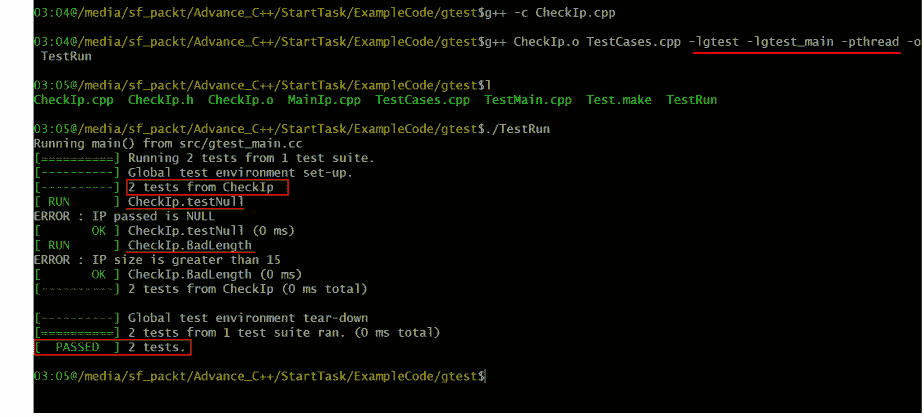

*图 7.11：编译并执行测试用例*

> **注意**
>
> 在 Google Test 中，我们也可以使用其他断言，但对于我们的测试用例来说，使用 ASSERT_FALSE 就足够了，因为我们只需要检查传入的 IP 地址对应的条件是否为 false。

- 8. 现在，我们将添加更多测试用例，以使代码更加健壮。通常，这是编写代码的良好实践。首先，创建测试用例，并确保代码对于新测试用例和旧测试用例都能正确运行，同时保持代码功能正确。要添加更多测试用例，请将以下代码添加到 **TestCases.cpp** 文件中：

```cpp
TEST(CheckIp, WrongTokenCount){
    testIp = "22.13111.11";
    ASSERT_FALSE(checkValidIp(testIp));
}
TEST(CheckIp, WrongTokenEmpty){
    testIp = "22.131..11";
    ASSERT_FALSE(checkValidIp(testIp));
}
TEST(CheckIp, WrongTokenStart){
    testIp = ".2.1.31.11";
    ASSERT_FALSE(checkValidIp(testIp));
}
TEST(CheckIp, WrongTokenEnd){
    testIp = "2.13.11.1.";
    ASSERT_FALSE(checkValidIp(testIp));
}
TEST(CheckIp, SpaceToken){
    testIp = "2.13.11. 1";
    ASSERT_FALSE(checkValidIp(testIp));
}
TEST(CheckIp, NonDigit){
    testIp = "2.13.b1.A1";
    ASSERT_FALSE(checkValidIp(testIp));
}
TEST(CheckIp, NonValidDigit){
    testIp = "2.13.521.61";
    ASSERT_FALSE(checkValidIp(testIp));
}
TEST(CheckIp, CorrectIp){
    testIp = "232.13.123.1";
    ASSERT_TRUE(checkValidIp(testIp));
}
```

在上述代码中，第一个和第二个用例应因令牌（token）不正确而失败。第三个用例应在 IP 以“.”开头时失败。第四个用例应在 IP 以“.”结尾时失败。第五个用例应在 IP 中间包含空格时失败。第六个用例应在 IP 包含任何非数字字符时失败。第七个用例应在 IP 中的某个令牌值小于 0 或大于 255 时失败。最后一个用例应在 IP 有效时通过。

- 9. 现在，在 **CheckIp.cpp** 文件的 **CheckValidIp()** 函数内部添加以下代码。这段代码用于处理新的测试用例：

```cpp
if(ip[strlen(ip)-1] == '.'){
    cout<<"ERROR : Incorrect token at end"<<endl;
    return false;
}
istringstream istrstr(ip);
vector<string> tokens;
string token;
regex expression("[^0-9]");
smatch m;
while(getline(istrstr, token, '.')){
    if(token.empty()){
        cout<<"ERROR : Got empty token"<<endl;
        return false;
    }
    if(token.find(' ') != string::npos){
        cout<<"ERROR : Space character in token"<<endl;
        return false;
    }
    if(regex_search(token,m,expression)){
        cout<<"ERROR : NonDigit character in token"<<endl;
        return false;
    }
    int val = atoi(token.c_str());
    if(val<0 || val>255){
        cout<<"ERROR : Invalid digit in token"<<endl;
        return false;
    }
    tokens.push_back(token);
}
if(tokens.size()!=4){
    cout<<"ERROR : Incorrect IP tokens used"<<endl;
    return false;
}
cout<<"strlen: "<<strlen(ip)<<endl;
return true;
}
```

- 10. 打开终端，输入以下命令来运行二进制文件：

```
./TestRun
```

所有测试用例都已执行，如下面的截图所示：

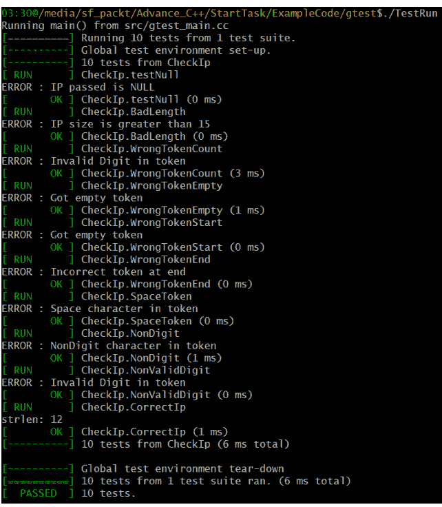

*图 7.12：测试用例运行的输出*

上述截图显示，CheckIp 测试套件中有 10 个测试用例，并且所有测试用例都运行正常。在下一节中，我们将学习如何使用模拟对象进行单元测试。

## 使用模拟对象进行单元测试

当开发人员进行单元测试时，可能会遇到这样的场景：某些接口是在具体操作执行之后才被调用的。例如，正如我们在前面的场景中讨论过的，假设项目是这样设计的：在执行之前，它会从数据库中获取所有的配置信息。它查询数据库以获得特定参数，例如 Web 服务器的 IP 地址、用户名和密码。然后，它会尝试连接 Web 服务器（也许还有另一个模块处理与网络相关的任务），或者开始处理实际项目所需的事项。此前，我们测试了 IP 地址的有效性。现在，我们将更进一步。假设 IP 地址是从数据库中获取的，并且我们有一个工具类负责处理数据库连接和 IP 地址查询。

现在，要测试 IP 地址的有效性，我们需要假设数据库连接已经建立。这意味着应用程序可以正确查询数据库并获取查询结果，其中之一就是 IP 地址。只有这样，我们才能测试 IP 地址的有效性。为了执行此类测试，我们必须假设所有必要的活动都已完成，并且我们有了一个 IP 地址可供测试。这时，模拟对象登场了，它的行为类似于真实对象。它为单元测试提供了便利，使应用程序认为 IP 地址已经从数据库中获取，但实际上，我们只是模拟了它。要创建模拟对象，我们需要从它要模拟的类中继承。在下一节中，我们将通过一个练习来更好地理解模拟对象。

### 练习 5：创建模拟对象

在本练习中，我们将假设所有接口都按预期工作，从而创建模拟对象。使用这些对象，我们将测试一些功能，例如验证 IP 地址、检查数据库连接，以及检查用户名和密码的格式是否正确。一旦所有测试都通过，我们将确认应用程序，并为 QA 做好准备。执行以下步骤来实现本练习：

- 1. 创建一个名为 Misc.h 的头文件，并包含必要的库：

```cpp
#include<iostream>
#include<string>
#include<sstream>
#include<vector>
#include<iterator>
#include<regex>
using namespace std;
```

- 2. 创建一个名为 ConnectDatabase 的类，它将连接到数据库并返回查询结果。在该类中，声明 Dbname、user 和 passwd 变量。同时，声明一个构造函数和两个虚函数。在这两个虚函数中，第一个必须是析构函数，第二个必须是 getResult() 函数，它从数据库返回查询结果。添加以下代码来实现：

```cpp
class ConnectDatabase{
    string DBname;
    string user;
    string passwd;

public:
    ConnectDatabase() {}
    ConnectDatabase(string _dbname, string _uname, string _passwd) :
        DBname(_dbname), user(_uname), passwd(_passwd) { }

    virtual ~ConnectDatabase() {}
    virtual string getResult(string query);
};
```

- 3. 创建另一个名为 WebServerConnect 的类。在类内部声明三个字符串变量，即 Webserver、uname 和 passwd。创建构造函数和两个虚函数。在这两个虚函数中，第一个必须是析构函数，第二个必须是 getRequest() 函数。添加以下代码来实现：

```cpp
class WebServerConnect{
    string Webserver;
    string uname;
    string passwd;

    public :
    WebServerConnect(string _sname, string _uname, string _passwd) :
        Webserver(_sname), uname(_uname), passwd(_passwd) { }

    virtual ~WebServerConnect() {}
    virtual string getRequest(string req);
};
```

> **注意**
>
> 我们需要 **虚函数**，因为我们将从上述类中创建一个 Mock 类并调用这些函数。

- 4. 创建一个名为 App 的类。创建构造函数和析构函数，并调用所有函数。添加以下代码来实现：

```cpp
class App {
    ConnectDatabase *DB;
    WebServerConnect *WB;

    public :
        App():DB(NULL), WB(NULL) {}
        ~App() {
            if ( DB ) delete DB;
            if ( WB ) delete WB;
        }
        bool checkValidIp(string ip);
        string getDBResult(string query);
        string getWebResult(string query);
```


```
void connectDB(string, string, string);
void connectDB(ConnectDatabase *db);
void connectWeb(string, string, string);
void run();
};
```

在上述代码中，应用会首先查询数据库并获得**IP地址**。然后，它会使用必要的信息连接到 Web 服务器，并查询它以获取所需的信息。

- 5. 创建一个名为 **MockMisc.h** 的类，并添加以下代码：

```
#include"Misc.h"
#include<gtest/gtest.h>
#include<gmock/gmock.h>

class MockDB : public ConnectDatabase {
    public :
        MockDB() {}
        virtual ~MockDB(){}

        MOCK_METHOD1(getResult, string( string) );
};
```

在上述代码中，你可以看到我们包含了 **gmock** 头文件，这是创建模拟类所必需的。此外，**MockDB** 类继承自 **ConnectDatabase** 类。**MOCK_METHOD1(getResult, string(string))**; 这一行表明我们将要模拟 **getResult** 接口。因此，在单元测试期间，我们可以直接以期望的结果调用 **getResult** 函数，而无需创建 **ConnectDatabase** 类并执行对数据库的真实查询。这里需要注意的一个重要点是，我们需要模拟的函数必须使用 **MOCK_METHOD[N]** 宏来定义，其中 N 是接口将接受的参数数量。在我们的例子中，**getResult** 接口接受一个参数。因此，它使用 **MOCK_METHOD1** 宏来模拟。

- 6. 创建一个名为 **Misc.cpp** 的文件，并添加以下代码：

```
#include"Misc.h"
#include <unistd.h>

string ConnectDatabase::getResult(string query){
    // dummy func, need to implement..
    // assuming query sent to DB is success and
    // will return some dummy string
    return string("DB returned success");
```

```
}

bool App::checkValidIp(string ip){
    if(ip.empty()){
        cout << "ERROR : IP passed is NULL " << endl;
        return false;
    }

    if(ip.size() > 15){
        cout << "ERROR : IP size is greater than 15" <<endl;
        return false;
    }

    //check if last character in ip is not '.' as that is not captured in tokenizing
    if (ip[ip.size()-1] == '.'){
        cout <<"ERROR : Incorrect token at end" << endl;
        return false;
    }

    istringstream istrstr(ip);
    vector<string> tokens;
    string token;
    regex expression("[^\0-9]");
    smatch m;
    while( getline(istrstr, token, '.') ){
        if ( token.empty() ){
            cout << "ERROR : Got empty token " << endl;
            return false;
        }
        if ( token.find(' ') != string::npos){
            cout << "ERROR : Space character in token " << endl;
            return false;
        }
        if ( regex_search(token, m, expression) ){
            cout << "ERROR : NonDigit character in token " << endl;
            return false;
        }
        int val = atoi(token.c_str());
        if ( val < 0 || val > 255 ){
            cout << "ERROR : Invalid Digit in token " << endl;
```

```
```cpp
return false;
}
tokens.push_back(token);
}
if ( tokens.size() != 4 ){
    cout << " ERROR : Incorect IP tokens used" << endl;
    return false;
}
}
cout << "strlen: " << ip.size() << endl;
return true;
}
```
```

在上述代码中，我们创建了一个最小接口和虚拟参数来使其运行，以便我们能够理解实际功能。我们为 **getResult()** 和 **getRequest()** 函数开发了基本功能，其中数据库查询和 **WebServer** 查询返回一个默认字符串。在这里，**App::run()** 函数假定数据库连接和 Web 服务器连接都已执行，现在它可以按固定时间间隔执行 Web 查询。每次查询结束时，它默认会返回字符串 **"Webserver returned success"**。

- 7. 现在，创建一个名为 **RunApp.cpp** 的文件，并在 `main` 函数中编写以下代码：

```
```cpp
#include"Misc.h"

int main(){

    App app;
    app.connectDB("dbname","dbuser", "dbpasswd");
    string ip = app.getDBResult("dummy");
    // DB query to get Webserver IP
    // Similarly some miscellaneous activities to get configuratio
information
    // Like querying DB to get correct username/passwd to connect to
WebServer..

    // After getting IP from DB, check if the IP is valid..
    //app.checkValidIp(ip);

    // Now connect to webserver with parameters extracted from DB.
    app.connectWeb("webname","user", "passwd");
```

```
// Now run the App, like sending some request to webserver,
// getting result and doing activity with received data.
app.run();

return 0;
}
```

正如你在上述代码中所看到的，App 类的实例被创建了。使用这个实例，我们借助虚拟参数（即 dbname、duser 和 dbpasswd）连接到数据库。然后，我们查询数据库以获取 IP 地址和其他配置参数。我们注释掉了 `app.checkValidIp(ip)` 这一行，因为我们假设从数据库获取的 IP 地址需要被验证。此外，这个函数需要进行单元测试。使用 `connectWeb()` 函数，我们可以通过传递虚拟参数（如 webname、user 和 passwd）来连接到 Web 服务器。最后，我们调用 `run()` 函数，该函数将循环运行，从而查询 Web 服务器并给出默认输出。

8. 保存所有文件并打开终端。为了获得执行项目所需的基本功能，我们将构建二进制文件并执行它以查看结果。在终端中运行以下命令：

```
g++ Misc.cpp RunApp.cpp -o RunApp
```

上述代码将在当前文件夹中创建一个名为 RunApp 的二进制文件。

9. 现在，编写以下命令来运行可执行文件：

```
./RunApp
```

上述命令在终端中生成以下输出：

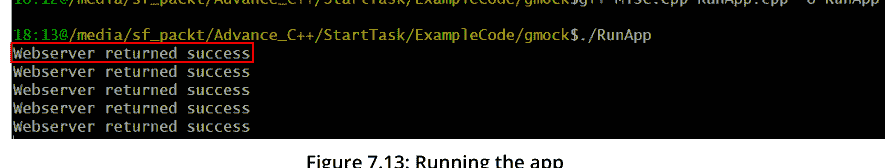

图 7.13：运行应用

正如你在上面的截图中所看到的，二进制文件及时地显示了输出 "Webserver returned success"。到目前为止，我们的应用运行正常，因为它假设所有接口都按预期工作。但在准备好进行 QA 之前，我们仍然需要测试一些功能，例如验证 IP 地址、数据库连接、检查用户名和密码格式是否正确等。

10. 使用相同的基础设施，开始对每个功能进行单元测试。对于我们的练习，我们假设数据库连接已经完成，并且已经查询获取了 IP 地址。之后，我们可以开始对 IP 地址的有效性进行单元测试。因此，在我们的测试用例中，需要模拟 Database 类，并且 `getDBResult` 函数必须返回 IP 地址。这个 IP 地址稍后将被传递给 `checkValidIP` 函数，我们将在那里对其进行测试。为了实现这一点，创建一个名为 TestApp.cpp 的类，在其中我们将调用 `checkValidIP` 函数：

```
#include"MockMisc.h"

using ::testing:: _;
using ::testing::Return;

class TestApp : public ::testing::Test {
    protected :
        App testApp;
        MockDB *mdb;

        void SetUp(){
            mdb = new MockDB();
            testApp.connectDB(mdb);
        }

        void TearDown(){
        }
};

TEST_F(TestApp, NullIP){
    EXPECT_CALL(*mdb, getResult(_)).
        WillOnce(Return(""));

    ASSERT_FALSE(testApp.checkValidIp(testApp.getDBResult("")));
}

TEST_F(TestApp, SpaceTokenIP){
```

在上述命令中，我们还链接了 gmock 库。现在，输入以下命令来运行测试用例：

```
./TestApp
```

上述命令生成以下输出：

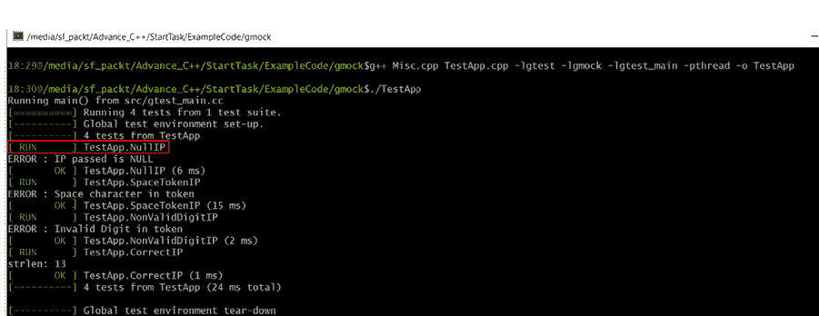

图 7.14：运行 Gmock 测试

从前面的命令中，我们可以看到所有测试用例都成功执行并通过。在下一节中，我们将讨论断点、监视点和数据可视化。

## 断点、监视点和数据可视化

在上一节中，我们讨论了单元测试需要在开发人员将代码检入到仓库分支之前完成，并且可以让其他团队成员看到，以便他们能够将其与其他模块集成。尽管单元测试完成得很好，开发人员也检入了代码，但在代码被集成且 QA 团队开始测试时，仍然有可能在代码中发现错误。通常，在这种情况下，错误可能在一个模块中被抛出，而这可能是由于另一个模块中的更改引起的。团队可能很难找到此类问题的真正原因。在这种情况下，调试就应运而生了。它确切地告诉我们代码的行为方式，开发人员可以获得代码执行的详细信息。开发人员可以看到函数接收了什么参数以及它返回了什么值。它可以确切地告诉变量或指针被赋了什么值，或者内存中的内容是什么。这对开发人员识别问题出在代码的哪个部分非常有帮助。在下一节中，我们将实现一个栈并对其执行一些操作。


## 使用栈数据结构

假设有一个场景，开发人员被要求开发自己的栈结构，该结构可以接受任何参数。在这里，栈结构必须遵循后进先出（LIFO）原则，元素彼此堆叠，当它们从栈中移除时，最后一个元素应先被移除。它应具有以下函数：

- **push()** 将新元素置于栈顶
- **top()** 显示栈顶元素（如果有）
- **pop()** 从栈中移除最后插入的元素
- **is_empty()** 检查栈是否为空
- **size()** 显示栈中元素的数量
- **clean()** 如果栈中有元素则清空栈

以下代码行展示了如何在 **Stack.h** 头文件中包含必要的库：

```
#ifndef STACK_H__
#define STACK_H__
#include<iostream>
using namespace std;
```

正如我们所知，栈由各种操作组成。为了定义这些函数，我们将编写以下代码：

```
template<typename T>
struct Node{
    T element;
    Node<T> *next;
};

template<typename T>
class Stack{
    Node<T> *head;
    int sz;

public :
    Stack():head(nullptr), sz(0){}
    ~Stack();

    bool is_empty();
    int size();
    T top();
    void pop();
    void push(T);
    void clean();
};

template<typename T>
Stack<T>::~Stack(){
    if ( head ) clean();
}

template<typename T>
void Stack<T>::clean(){
    Node<T> *tmp;
    while( head ){
        tmp = head;
        head = head -> next;
        delete tmp;
        sz--;
    }
}

template<typename T>
int Stack<T>::size(){
    return sz;
}

template<typename T>
bool Stack<T>::is_empty(){
    return (head == nullptr) ? true : false;
}
```

```
template<typename T>
T Stack<T>::top(){
    if ( head == nullptr){
        // throw error ...
        throw(string("Cannot see top of empty stack"));
    }else {
        return head -> element;
    }
}

template<typename T>
void Stack<T>::pop(){
    if ( head == nullptr ){
        // throw error
        throw(string("Cannot pop empty stack"));
    }else {
        Node<T> *tmp = head ;
        head = head -> next;
        delete tmp;
        sz--;
    }
}

template<typename T>
void Stack<T>::push(T val){
    Node<T> *tmp = new Node<T>();
    tmp -> element = val;
    tmp -> next = head;
    head = tmp;
    sz++;
}

// Miscellaneous functions for stack..
template<typename T>
void displayStackStats(Stack<T> st){
    cout << endl << "--------------------------------" << endl;
    cout << "Showing Stack basic Stats ...  " << endl;
    cout << "Stack is empty : " << (st.is_empty() ? "true" : "false") << endl;
    cout << "Stack size :" << st.size() << endl;
    cout << "-----------------------------" << endl << endl;
}

#endif
```

到目前为止，我们已经看到了如何使用单链表实现栈。每当在 Stack 中调用 push 时，都会创建一个具有给定值的新元素并附加到栈的开头。我们称之为 head 成员变量，head 将指向栈中的下一个元素，依此类推。当调用 pop 时，head 将从栈中移除并指向栈的下一个元素。

让我们在 Main.cpp 文件中编写之前创建的 Stack 的实现。main 函数包含一个 try 块，该块创建了一个整数栈和一个字符栈。对两者都进行了几次 push 和 pop 操作，中间调用栈顶以显示最新元素。对于整数栈，开始时有三次 push：22、426 和 57。当调用 displayStackStats() 函数时，它应将栈的大小声明为 3。然后，我们从栈中弹出 57，栈顶元素必须显示为 426。我们将对字符栈执行相同的操作。以下是栈的完整实现：

```
#include "Stack.h"
int main(){
    try {
        Stack<int> si;
        displayStackStats<int>(si);
        si.push(22);
        si.push(426);
        cout << "Top of stack contains " << si.top() << endl;
        si.push(57);
        displayStackStats<int>(si);
```

前面的命令生成以下输出：

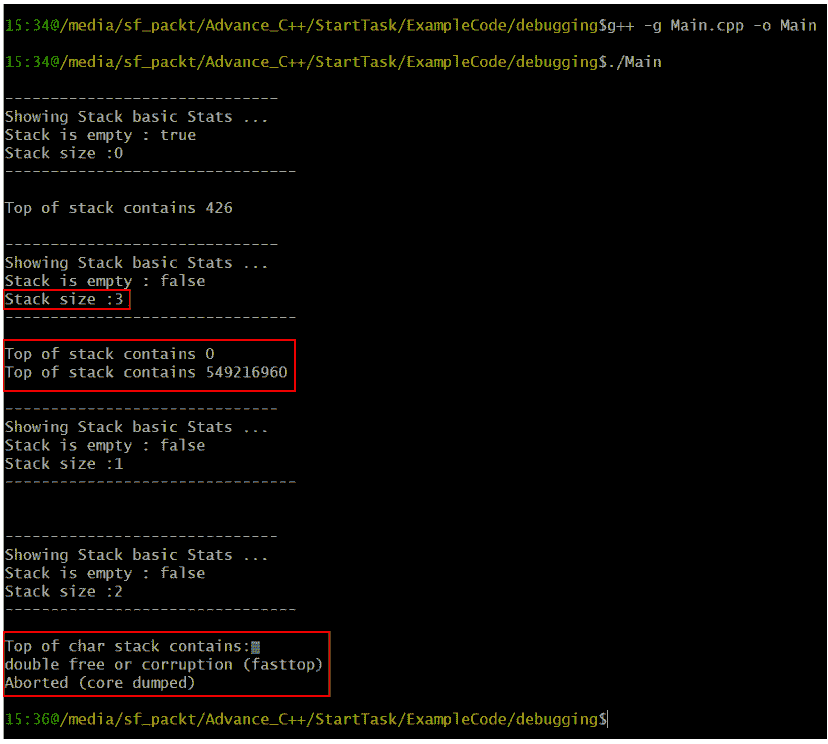

图 7.15：使用 Stack 类的 main 函数

在前面的输出中，第二次调用统计函数时的红色墨水显示了 int 栈中包含三个元素的正确信息。然而，int 栈顶的红色墨水调用显示了随机或垃圾值。如果再次运行程序，它将显示其他随机数字，而不是预期的 57 和 426 的值。同样，对于字符栈，用红色墨水突出显示的部分，即字符栈顶，显示了垃圾值而不是预期值，即 “I”。后来，执行显示了 double free or corruption 的错误，这意味着 free 被再次调用到同一个内存位置。最后，可执行文件导致了 core dump。程序没有按预期执行，并且从显示中可能不清楚实际错误所在。为了调试 Main，我们将编写以下命令：

```
gdb ./Main
```

前面的命令生成以下输出：

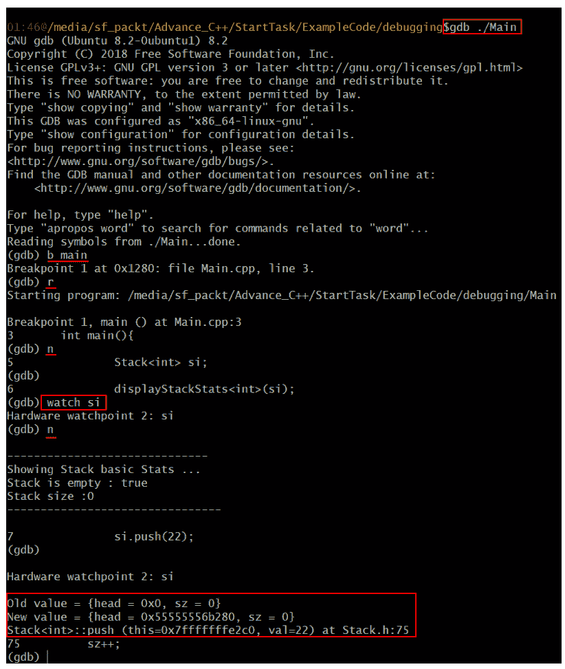

图 7.16：调试器显示 – I

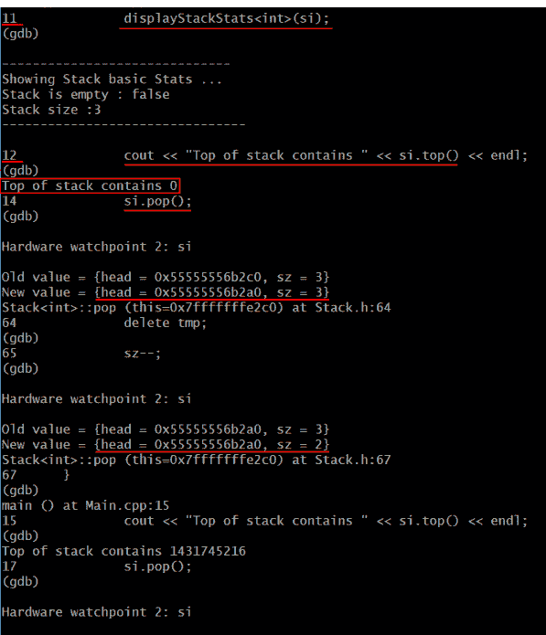

图 7.18：调试器显示 – III

按 Enter 后，你会看到 displayStackStats 在第 11 行被调用。在 Main.cpp 程序中，下一个命令显示栈顶元素，该命令在第 12 行被调用。然而，显示的值为 0，而不是预期的 57 值。这是一个我们仍无法弄清楚的错误——值是如何改变的？然而，很明显，值可能在 main 函数的前几次调用中发生了变化。所以，这可能不会让我们对继续调试感兴趣。然而，我们需要继续并从头开始调试。

以下屏幕截图显示了用于调试代码的命令：

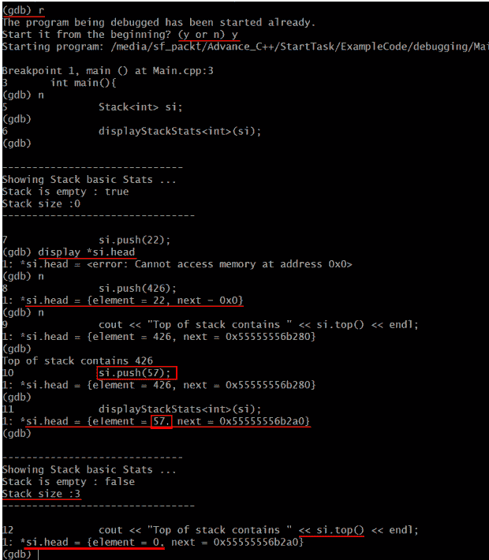

图 7.19：调试器显示 - IV

要从头重新运行程序，我们必须按 r，并为确认和继续按 y，这意味着我们从头重新运行程序。它会要求确认；按 y 继续。所有这些命令在前面的屏幕截图中以蓝色突出显示。在第 7 行执行时，我们需要运行 'display *si.head' 命令，这将在执行每条语句后持续显示 si.head 内存位置的内容。如红色墨水所示，在将 22 压入栈后，head 会更新为正确的值。同样，对于值 426 和 57，当使用 push 插入到栈中时，对 head 的调用也会正确更新。

后来，当调用 **displayStackStats** 时，它显示了正确的 **size** 为 3。但当调用 top 命令时，head 中显示的值错误。这在红色墨水中突出显示。现在，top 命令的代码不会改变 head 的值，所以很明显，错误发生在执行的上一条语句中，即在 **displayStackStats** 处。

因此，我们已经缩小了可能存在问题的代码范围。我们可以运行调试器指向 **displayStackStats** 并进入 **displayStackStats** 以找到导致 Stack 中的值被更改的原因。以下是同一屏幕截图，其中用户需要从头开始调试器：

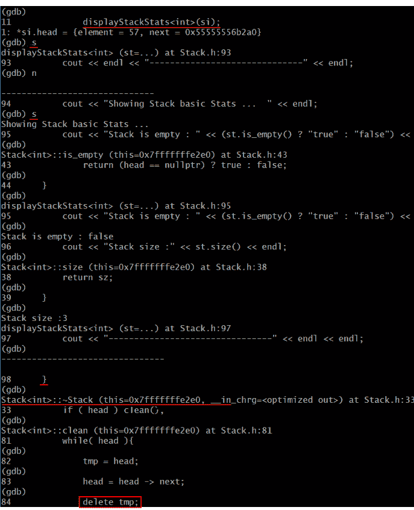

图 7.20：调试器显示 – IV

从头重新启动调试器并来到第 11 行执行点处调用 `displayStackStats` 时，我们需要逐步进入。流程是进入 `displayStackStats` 函数的开始处。并且我们需要执行下一条语句。由于函数中的初始检查是清晰的，它们不会改变 head 的值，我们可以按 Enter 执行下一步。当我们怀疑下一步可能会改变我们正在查找的变量的值时，我们需要逐步进入。这在前面的快照中以红色突出显示。随后的执行来到第 97 行，即 `displayStackStats` 函数的最后一行。

在输入 s 后，执行移动到 Stack 的析构函数并在第 81 行调用 clean 函数。此 clean 命令删除 `tmp` 变量，其值与 head 相同。该函数清空了栈，而这本不应该运行。调用和执行 `displayStackStats` 函数本应最终返回到 main 函数。但由于函数中超出作用域的局部变量，可能会调用析构函数。在这里，局部变量是作为参数声明给 `displayStackStats` 函数的变量，在第 92 行。当调用 `displayStackStats` 函数时，main 函数中的 `si` 变量的本地副本被创建。当该变量超出作用域时，它调用了 Stack 的析构函数。现在，`si` 变量的指针已被复制到临时变量，并在最后错误地删除了指针。这不是开发者的意图。因此，在代码执行结束时，报告了 double free 错误。`si` 变量必须在超出作用域时调用 Stack 析构函数，因为它将再次尝试释放相同的内存。为了解决这个问题，很明显，`displayStackStats` 函数必须作为引用传递参数调用。为此，我们必须更新 `Stack.h` 文件中 `displayStackStats` 函数的代码：

```
template<typename T>

void displayStackStats(Stack<T> &st){
    cout << endl << "------------------------------" << endl;

    cout << "Showing Stack basic Stats ...  " << endl;

    cout << "Stack is empty : " << (st.is_empty() ? "true" : "false") << endl;

    cout << "Stack size :" << st.size() << endl;

    cout << "------------------------------" << endl << endl;
}
```

现在，当我们保存并编译 **Main.cpp** 文件时，二进制文件将被生成：

```
./Main
```


上述命令将在终端中生成以下输出：

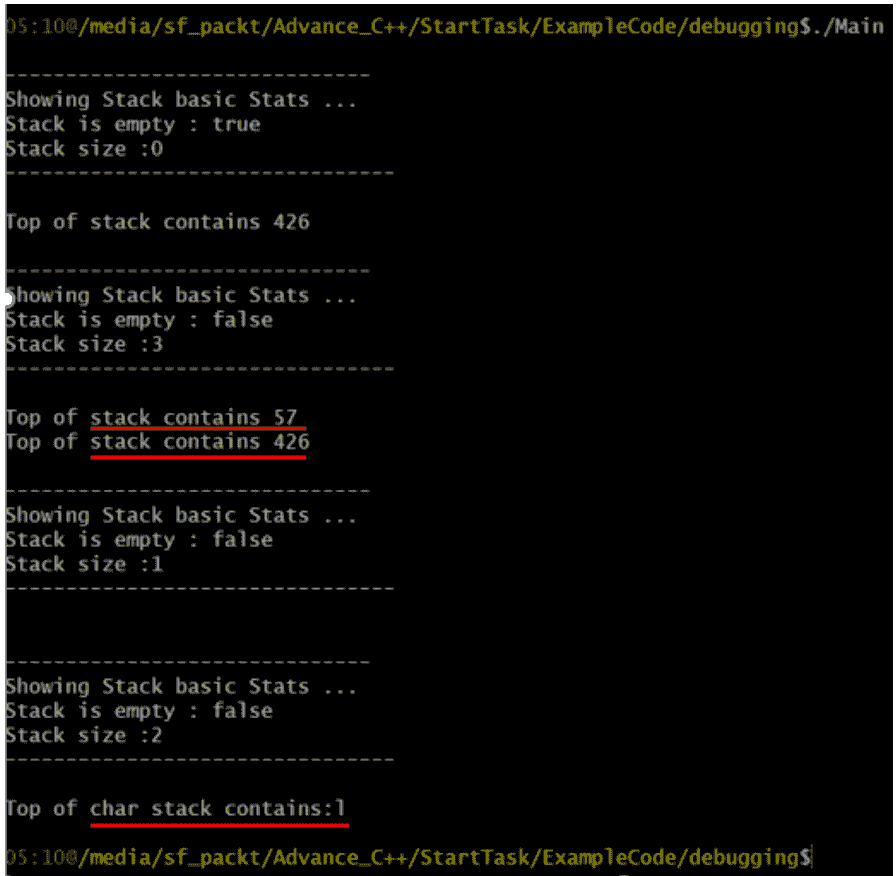

图7.21：调试器显示 – IV

从前面的截图中，我们可以看到期望值57和426显示在堆栈顶部。`displayStackStats`函数还能够正确显示`int`类型和`char`类型栈的信息。最后，我们使用调试器定位并修复了错误。在下一节中，我们将解决一个活动，其中我们将开发用于解析文件的函数，并编写测试用例来检查这些函数的准确性。

### 活动1：使用测试用例检查函数的准确性并理解测试驱动开发（TDD）

在本活动中，我们将开发函数来解析文件，然后编写测试用例以检查所开发函数的正确性。

一家大型零售组织的IT团队希望跟踪产品销售情况，将产品详情和客户详情存储在其数据库中，作为对账流程的一部分。销售部门会定期以简单的文本格式向IT团队提供这些数据。作为开发人员，你需要确保在公司将记录存入数据库之前，对数据进行基本的合理性检查，并确保所有记录都被正确解析。销售部门将提供两个文本文件，其中包含所有销售交易的客户信息和货币信息。你需要编写解析函数来处理这些文件。这两个文件分别是`RecordFile.txt`和`CurrencyConversion.txt`。`RecordFile.txt`文件包含客户详情、他们购买的产品以及本币和外币计价的总价。`CurrencyConversion.txt`文件包含两个字段，即`Currency`和`ConversionRatio`。

该项目环境搭建所需的全部信息都保存在配置文件中。该文件还将保存在名为`parse.conf`的文件中的文件名以及其他参数（如DB、RESTAPI等）和变量值。每行包含两个字段，以“=”分隔符隔开。第一行是标题行，内容为“CONFIGURATION_FILE”。对于记录文件，变量名为`recordFile`；类似地，对于货币文件，变量名为`currencyFile`。

以下是我们要编写的用于检查解析`CurrencyConversion.txt`文件的函数准确性的测试条件：

-   第一行应为标题行，其第一个字段应包含`"Currency"`字符串。
-   `Currency`字段应由三个字符组成。例如：“USD”、“GBP”是有效的。
-   `ConversionRatio`字段应由浮点数组成。例如，1.2、0.06是有效的。
-   每行应恰好包含两个字段。
-   记录使用的分隔符为“|”。

以下是我们要编写的用于检查解析`RecordFile.txt`文件的函数准确性的测试条件：

-   第一行应包含标题行，其第一个字段应包含`"Customer Id"`字符串。
-   `Customer Id`、`Order Id`、`Product Id`和`Quantity`都应为整数值。例如，12312、4531134是有效的。
-   `TotalPrice (Regional Currency)`和`TotalPrice (USD)`应为浮点数值。例如，2433.34、3434.11是有效的。
-   `RegionalCurrency`字段的值应存在于`CurrencyConversion.txt`文件中或`std::map`中。
-   每行应恰好包含九个字段，如文件中的标题信息所定义。
-   记录的分隔符为“|”。

按照以下步骤实现此活动：

1. 解析`parse.conf`配置文件，其中包含项目运行所需的环境变量。
2. 从步骤1中正确设置`recordFile`和`currencyFile`变量。
3. 使用从配置文件中检索到的这些变量，解析货币文件并满足所有条件。如果不满足条件，则返回相应的错误消息。
4. 解析记录文件并满足所有条件。如果不满足，则返回错误消息。
5. 创建一个名为`CommonHeader.h`的头文件，并声明所有实用函数，即`isAllNumbers()`、`isDigit()`、`parseLine()`、`checkFile()`、`parseConfig()`、`parseCurrencyParameters()`、`fillCurrencyMap()`、`parseRecordFile()`、`checkRecord()`、`displayCurrencyMap()`和`displayRecords()`。
6. 创建一个名为`Util.cpp`的文件，并定义所有实用函数。
7. 创建一个名为`ParseFiles.cpp`的文件，并调用`parseConfig()`、`fillCurrencyMap()`和`parseRecordFile()`函数。
8. 编译并执行`Util.cpp`和`ParseFiles.cpp`文件。

9. 创建一个名为**ParseFileTestCases.cpp**的文件，并为以下函数编写测试用例，即**trim()**、**isAllNumbers()**、**isDigit()**、**parseCurrencyParameters()**、**checkFile()**、**parseConfig()**、**fillCurrencyMap()**和**parseRecordFile()**。

10. 编译并执行**Util.cpp**和**ParseFileTestCases.cpp**文件。

以下是解析不同文件和显示信息的流程图：

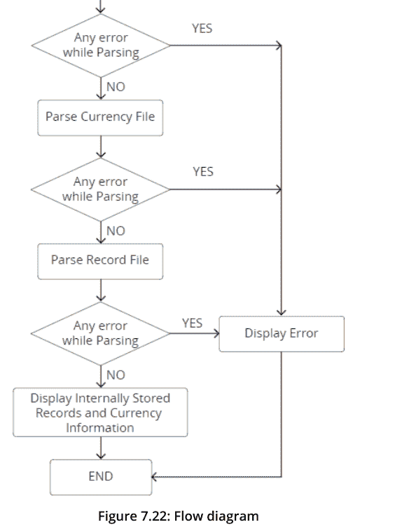

图7.22：流程图

从上面的流程图，我们对执行流程有了大致的了解。为了在编写代码前有清晰的理解，让我们看一下更详细的细节。这将有助于为每个执行块定义测试用例。

对于解析配置文件块，我们可以将步骤分解如下：

1. 检查配置文件是否存在且具有读取权限。
2. 检查是否具有适当的标题。
3. 逐行解析整个文件。
4. 对于每一行，以“=”作为分隔符解析字段。
5. 如果上述步骤产生2个字段，则处理判断其是否为货币文件或记录文件变量，并适当地存储。
6. 如果步骤4没有产生2个字段，则继续下一行。
7. 完全解析文件后，检查上述步骤中的两个变量是否都不为空。
8. 如果为空，则返回错误。

对于解析货币文件块，我们可以将步骤分解如下：

1. 读取`CurrencyFile`变量，并检查文件是否存在且具有读取权限。
2. 检查是否具有适当的标题。
3. 逐行解析整个文件，以“|”作为分隔符。
4. 如果每行恰好找到2个字段，则将第一个视为货币字段，第二个视为转换字段。
5. 如果步骤3中未找到2个字段，则返回相应的错误消息。
6. 根据步骤4，对货币字段（应为3个字符）和转换字段（应为数字）进行所有检查。
7. 如果通过步骤6，则将货币/转换值作为键值对存储到映射中，键为货币，值为数字。
8. 如果未通过步骤6，则返回针对该货币的错误消息。
9. 货币文件解析完成后，将创建一个映射，其中包含所有货币的转换值。

对于解析记录文件块，我们可以将步骤分解如下：

1. 读取`RecordFile`变量，并检查文件是否存在且具有读取权限。
2. 检查是否具有适当的标题。
3. 逐行解析整个文件，以“|”作为分隔符。

4. 如果上述步骤未找到9个字段，则返回相应的错误消息。
5. 如果找到9个字段，则对活动开头列出的所有字段执行相应的检查。
6. 如果步骤5未通过，则返回相应的错误消息。
7. 如果步骤5通过，则将记录存储在记录向量中。
8. 记录文件解析完成后，所有记录将存储在记录向量中。

在创建解析所有三个文件的流程时，我们发现三个文件中有一些重复的步骤，例如：

检查文件是否存在且可读

检查文件是否具有正确的标题信息

使用分隔符解析记录

检查字段是否为数字（在货币文件和记录文件中常见）

检查字段是否为数值（在货币文件和记录文件中常见）

以上几点将有助于重构代码。此外，将有一个通用函数用于使用分隔符解析字段，即`trim`函数。因此，当我们使用分隔符解析记录时，可能会在开头或结尾得到带有空格或制表符的值，这可能不需要，因此我们需要在解析记录时进行一次修剪。

现在我们知道了上述常见步骤，可以分别为它们编写单独的函数。要开始使用TDD，我们首先理解函数的需求，并首先编写单元测试用例来测试这些功能。然后我们编写函数以使其通过单元测试用例。如果少数测试用例失败，我们迭代更新函数和执行测试用例的步骤，直到所有测试用例通过。

对于我们的示例，我们可以编写`trim`函数。

现在我们知道在`trim`函数中，我们需要去除首尾多余的空格/制表符。例如，如果字符串包含“ AA ”，`trim`应返回“AA”，去除所有空格。

`trim`函数可以返回一个具有期望值的新字符串，也可以更新传递给它的原始字符串。

```
string trim ( string & ) ;
```


我们可以为它编写以下测试用例：

+   - 只有额外字符（"  "），返回空字符串（）。
+   - 只有开头为空字符("  AA") 返回末尾字符的字符串 ("AA")
+   - 只有末尾为空字符("AA  ")，应返回开头字符的字符串("AA")
+   - 中间有字符 ("  AA  ") 返回字符的字符串 ("AA")
+   - 中间有空格 ("AA  BB")，返回相同的字符串 ("AA BB")
+   - 所有步骤 3,4,5 使用单个字符。应返回单个字符的字符串。

要创建测试用例，请检查文件 **ParseFileTestCases.cpp**，`trim` 函数的测试用例已写入测试套件 `trim`。现在编写 **Util.cpp** 文件（所有杂项函数都写在 **Util.cpp** 中）。在文件中编写签名如上所示的 `trim` 函数。执行 `trim` 函数的测试用例并检查是否通过。它没有适当更改函数并再次测试它。重复直到所有测试用例都通过。

现在我们有信心在项目中使用 `trim` 函数。对其余的常用函数（`isDigit`、`isNumeric`、`parseHeader` 等）重复类似步骤。请参考 **Util.cpp** 文件和 **ParseFiletestCases.cpp** 进行操作并测试所有常用函数。

完成常用函数后，我们可以分别编写解析每个文件的函数。这里要理解和学习的主要内容是如何将模块分解为小函数。找到小的重复任务并为每个任务创建小函数以便重构。理解这些小函数的详细功能并创建适当的单元测试用例。

完成单个函数并彻底测试它，如果失败，则更新函数直到通过所有测试用例。同样，完成其他函数。然后为更大的函数编写并执行测试用例，这应该相对容易，因为我们在这些更大的函数中调用了上面测试过的小函数。

在实施上述步骤后，我们将得到以下输出：

```
00:35@/media/sf_packt/Advance_C++/StartTask/Activity/unitTesting$ ./ParseFileTestCases
Running main() from src/gtest_main.cc
========== Running 32 tests from 8 test suites.
[----------] Global test environment set-up.
[----------] 8 tests from trim
[ RUN      ] trim.empty
[       OK ] trim.empty (1 ms)
[ RUN      ] trim.start_space
[       OK ] trim.start_space (0 ms)
[ RUN      ] trim.end_space
[       OK ] trim.end_space (0 ms)
[ RUN      ] trim.string_middle
[       OK ] trim.string_middle (0 ms)
[ RUN      ] trim.space_middle
[       OK ] trim.space_middle (0 ms)
[ RUN      ] trim.single_char_start
[       OK ] trim.single_char_start (0 ms)
[ RUN      ] trim.single_char_end
[       OK ] trim.single_char_end (0 ms)
[ RUN      ] trim.single_char_middle
[       OK ] trim.single_char_middle (0 ms)
[----------] 8 tests from trim (1 ms total)

[----------] 5 tests from isNumber
[ RUN      ] isNumber.alphabets_present
[       OK ] isNumber.alphabets_present (0 ms)
[ RUN      ] isNumber.special_character_present
[       OK ] isNumber.special_character_present (0 ms)
[ RUN      ] isNumber.correct_number
[       OK ] isNumber.correct_number (0 ms)
[ RUN      ] isNumber.decimal_begin
[       OK ] isNumber.decimal_begin (0 ms)
[ RUN      ] isNumber.decimal_end
[       OK ] isNumber.decimal_end (0 ms)
[----------] 5 tests from isNumber (0 ms total)

[----------] 3 tests from isDigit
[ RUN      ] isDigit.alphabet_present
[       OK ] isDigit.alphabet_present (1 ms)
[ RUN      ] isDigit.decimal_present
[       OK ] isDigit.decimal_present (0 ms)
[ RUN      ] isDigit.correct_digit
[       OK ] isDigit.correct_digit (0 ms)
[----------] 3 tests from isDigit (1 ms total)

[----------] 2 tests from CurrencyParameters
[ RUN      ] CurrencyParameters.extra_currency_chararcters
[       OK ] CurrencyParameters.extra_currency_chararcters (0 ms)
[ RUN      ] CurrencyParameters.correct_parameters
[       OK ] CurrencyParameters.correct_parameters (0 ms)
[----------] 2 tests from CurrencyParameters (0 ms total)
```

Figure 7.23: All tests running properly

下面是下一步的截图：

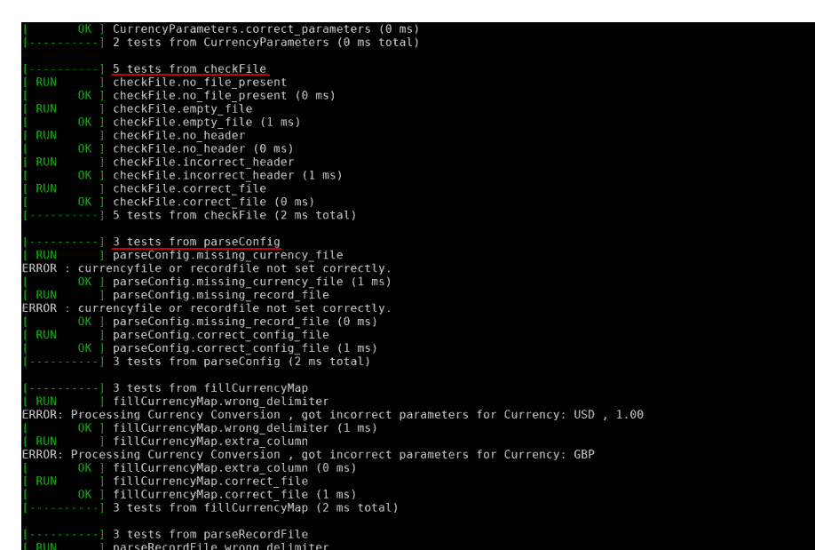

Figure 7.24: All tests running properly

## Note

本活动的解决方案可在第 706 页找到。

## Summary

在本章中，我们研究了各种方法，通过使用断言在编译时和运行时捕获可执行文件抛出的错误。我们还了解了静态断言。我们理解了异常是如何生成的以及如何在代码中处理它们。我们还看到了单元测试如何成为开发者的救星，因为他们能够在开始时识别代码中的任何问题。我们利用模拟对象来用于测试用例中需要使用的类。然后我们学习了调试器、断点、观察点和可视化数据。我们能够使用调试器定位代码中的问题并修复它们。我们还解决了一个活动，其中我们编写了必要的测试用例来检查用于解析文件的函数的准确性。

在下一章中，我们将学习如何优化我们的代码。我们将回顾处理器如何执行代码并访问内存。我们还将学习如何确定软件执行所需的多余时间。最后，我们将学习内存对齐和缓存访问。
