# 8

# Need for Speed – Performance and Optimization

## Learning Objectives

本章结束时，你将能够：

+   - 手动计时代码性能
+   - 使用源代码检测来测量代码执行时间
+   - 使用 perf 工具分析程序性能
+   - 使用 godbolt 编译器资源管理器工具分析编译器生成的机器代码
+   - 使用编译器标志生成更好的代码
+   - 应用导致性能的代码惯用法
+   - 编写缓存友好的代码
+   - 对现实世界问题应用算法级优化

在本章中，我们将探索概念，这些概念将使我们能够在一般情况下编写快速代码，以及特别适用于 C++ 的几种实用技术。

## Introduction

在当今极其庞大和复杂的软件系统世界中，**稳定性**和**可维护性**通常被认为是对大多数软件项目的主要目标，而自 2000 年代以来，优化并没有被广泛视为一个值得的目标。这是因为硬件技术的快速加速定期超过了软件需求。

多年来，似乎硬件改进将继续跟上软件性能需求，但应用程序继续变得更大、更复杂。与 C 和 C++ 等低级原生编译语言相比，**Python** 或 **Ruby** 等性能较低但更易于使用的解释型语言的流行度下降。

然而，到 2000 年代末，CPU 晶体管数量（和性能）每 18 个月翻一番的趋势（**摩尔定律**的结果）已经停止，性能改进趋于平稳。由于物理和制造成本的限制，广泛提供 5 到 10 GHz 处理器的预期从未实现。然而，移动设备的快速采用和数据科学和机器学习的高性能计算应用的兴起，突然使对快速高效代码的需求复苏。每瓦性能已成为新的目标指标，因为大型数据中心消耗了巨大的电力。例如，2017 年美国的 Google 服务器使用的电力超过了整个英国国家。

到目前为止，在本书中，我们了解到 C++ 语言在易用性方面是如何发展的，而不会牺牲相对于传统语言如 C 的任何性能潜力。这意味着我们可以在不 necessarily 牺牲可读性或稳定性的情况下用 C++ 编写快速代码。在下一节中，我们将学习性能测量的概念。

## Performance Measurement

优化最重要的方面是**代码执行时间的测量**。除非我们使用各种输入数据集测量应用程序的性能，否则我们将不知道哪一部分花费了最多时间，我们的优化工作将盲目进行，没有保证结果。有几种测量方法，其中一些列在这里：

+   - 运行时检测或分析
+   - 源代码检测


+   - 手动计时执行
+   - 研究生成的汇编代码
+   - 通过研究代码和所用算法进行手动估算

上述列表按测量准确度排序（最准确的方法排在最前面）。然而，这些方法各有优势。选择哪种方法取决于优化工作的目标和范围。如果全力以赴追求尽可能快的实现，则可能需要用到所有这些方法。我们将在接下来的章节中逐一探讨这些方法。

### 手动估算

性能提升的最大可能出现在我们用更优的算法替换原有算法时。例如，考虑一个对从 1 到 n 的整数求和的小函数的两个版本：

```
int sum1(int n)
{
    int ret = 0;
    for(int i = 1; i <= n; ++i)
    {
        ret += i;
    }
    return ret;
}
int sum2(int n)
{
    return (n * (n + 1)) / 2;
}
```

第一个函数 sum1 使用简单的循环来计算总和，其运行时复杂度与 n 成正比；而第二个函数 sum2 使用代数求和公式，所需时间与 n 无关，是常数时间。在这个相当刻意设计的示例中，我们仅通过运用基础的代数知识就优化了一个函数。

对于每一种能想到的操作，都有许多已被证明是最优的著名算法。让代码尽可能快速运行的最佳方式就是使用算法。

掌握算法词汇至关重要。我们不必成为算法专家，但至少需要知晓各个领域中高效算法的存在，即使我们无法从零开始实现它们。对算法稍作深入了解，将有助于我们发现程序中与知名算法执行相似（即便不完全相同）计算的部分。某些代码特征，如嵌套循环或线性扫描数据，通常都是明显的改进候选对象——前提是我们能确认这些结构位于代码的热点区域。**热点**是指运行非常频繁且对性能有显著影响的代码段。C++ 标准库包含大量基本算法，可以作为构建块来提高许多常见操作的效率。

### 研究生成的汇编代码

**汇编语言**是实际在处理器上执行的二进制机器码的人类可读表示。对于任何认真使用 C++ 等编译型语言的程序员来说，汇编语言的基本知识都是一笔巨大的财富。

研究程序生成的汇编代码，可以让我们深入了解编译器的工作方式，并帮助评估代码效率。在许多情况下，这是确定效率瓶颈的唯一可行方法。

此外，汇编语言的基本知识对于调试 C++ 代码也是必不可少的，因为一些最难捕获的 bug 恰恰与底层生成的代码有关。

一个非常强大且流行的在线工具是**Compiler Explorer**，它用于分析编译器生成的代码，本章我们将使用它。

> **注意**
> 
> **Godbolt compiler explorer** 可以在 https://godbolt.org 找到。

在上面的截图中，前几行被称为**函数序言**，也就是用于设置**栈帧**和局部变量的指令。栈帧表示函数中的局部数据，包括参数和局部变量。当函数返回时，栈帧被丢弃。**mov** 指令用常量值初始化寄存器或内存位置。这里的汇编语法称为**Intel 语法**。这种语法的约定是目标操作数总是第一个。例如，**MOV RAX, RBX** 汇编代码表示将 **RBX** 寄存器中的值移动到 **RAX** 寄存器。

> **注意**
> 
> 汇编语言通常不区分大小写，因此 **EAX** 和 **eax** 含义相同。

汇编中的 **DWORD PTR [rbp-8]** 表达式等价于 C 表达式 **(*(DWORD*)(rbp - 8))**。换句话说，内存地址 **rbp-8** 被当作一个 4 字节的 **DWORD**（内存中的一个双字——32 位）来访问。汇编代码中的方括号表示解引用，就像 C/C++ 中的 * 运算符一样。**rbp** 寄存器是基址指针，它始终保存当前执行函数栈基址的地址。我们不必确切了解栈帧是如何工作的，但要记住：由于栈从较高的地址开始并向下增长，因此函数参数和局部变量的地址是相对于 **rbp** 的负偏移。如果你看到某个从 **rbp** 开始的负偏移，它引用的就是局部变量或参数。

在上面的截图中，第一条 **mov** 指令将 **edi** 寄存器中的值放入栈中——在本例中，它表示传入的 **n** 参数。最后两条 **mov** 指令分别将我们代码中的 **ret** 变量和 **i** 循环变量初始化为 **0** 和 **1**。

现在，查看紧跟序言和初始化之后的汇编代码快照——这就是我们的 **for()** 循环：

```
·L3:
    mov     eax, DWORD PTR [rbp-8]
    cmp     eax, DWORD PTR [rbp-20]
    jg      .L2
```

**图 8.5：for 循环的汇编代码**

在上面的截图中，带冒号的字符串行称为**标签**。它们与 **BASIC**、**C/C++** 或 **Pascal** 等编程语言中的标签非常相似，并被用作**跳转**指令（相当于 goto 语句的汇编形式）的目标。

x86 汇编中以 J 开头的指令都是跳转指令，例如 JMP、JG、JGE、JL、JLE、JE、JNE 等。跳转指令是有条件或无条件的分支。在上面的截图中，mov 指令将变量 i 的值从内存加载到 eax 寄存器。然后使用 cmp 指令将其与内存中的 n 值进行比较。

> 注意
> 这里的 JG 指令表示“如果大于则跳转”。

如果比较结果为大于，则执行跳转到 .L2 标签（位于循环外部）。如果不是，则继续执行下一条指令，如下所示：

```
mov eax, DWORD PTR [rbp-8]
add DWORD PTR [rbp-4], eax
add DWORD PTR [rbp-8], 1
jmp .L3
```

图 8.6：下一条指令的汇编代码

这里，i 的值再次被加载到 eax 中，这看起来似乎没有必要。但请记住，这段汇编代码未经优化，因此编译器生成的代码可能不是最优的，并且可能包含不必要的工作。然后，eax 中的值被加到 ret 上，之后 i 自增 1。最后，执行跳回 .L3 标签。位于 .L2 和 .L3 标签之间的这些指令构成了执行 for 循环并累加从 1 到 n 的整数序列的代码，如下所示：

```
.L2:
mov eax, DWORD PTR [rbp-4]
pop rbp
ret
```

图 8.7：for 循环的汇编代码

这称为函数尾声。首先，要返回的值 ret 被移入 eax 寄存器——这里通常是存放函数返回值的寄存器。然后，栈帧被重置，最后 ret 从 sum() 函数返回。

> 注意
> 上述汇编列表中的 “ret” 是 RETURN 指令的助记符，不应与我们 C++ 代码示例中的 “ret” 变量混淆。

要弄清一段汇编指令序列的作用并非易事，但通过观察以下几点，可以大致了解源代码与指令之间的映射关系：

+   - 代码中的常量值可以在汇编中直接识别出来。
+   - 诸如 add、sub、imul、idiv 等算术运算可以被识别。
+   - 条件跳转对应于循环和条件语句。
+   - 函数调用可以直接读出（函数名称会出现在汇编代码中）。

现在，让我们观察一下，如果在右上角的编译器选项字段中添加一个优化编译标志，代码会产生什么效果：

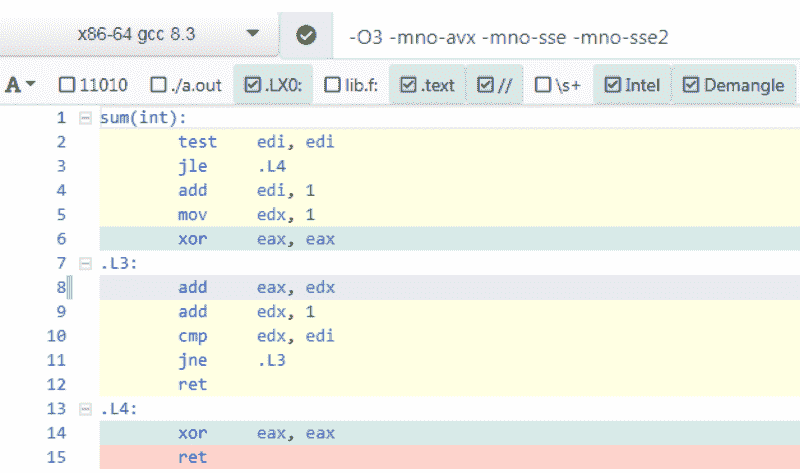

图 8.8：添加优化编译标志

在上面的截图中，O3 表示最大优化。其他标志，如 -mno-avx、-mno-sse 和 -mno-sse2，用于防止编译器生成与当前示例无关的向量指令。我们可以看到，编译器不再访问内存，而只使用寄存器。注意这一行 xor eax, eax，其效果是将 0 存入 eax——这比从内存中加载常量 0 到寄存器更高效。由于访问内存需要数个时钟周期（从 5 到 100 个时钟周期不等），仅使用寄存器本身就能带来巨大的加速。


当下拉菜单中的编译器更改为 x86-64 clang 8.0.0 时，汇编代码发生了变化，可以在下面的截图中看到：

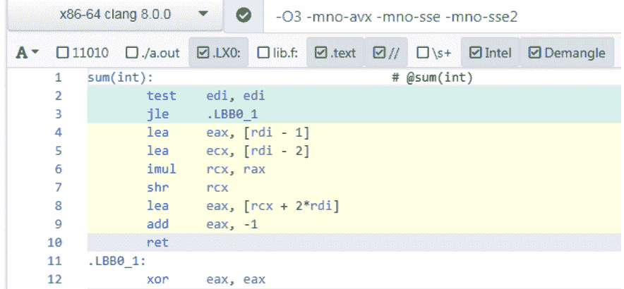

**Figure 8.9:** 使用新编译器的汇编代码

在前面的汇编列表中，注意到没有以 J 开头的指令（用于跳转）。因此，根本没有循环结构！让我们来看看编译器是如何计算 1 到 n 的和的。如果 n 的值 <= 0，则它会跳转到 .LBB0_1 标签处退出，返回 0。让我们分析以下指令：

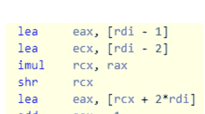

**Figure 8.10:** 使用新编译器的汇编代码

以下代码是前面指令的 C 等价物。请记住 n 在 EDI 寄存器中（因此也在 RDI 寄存器中，因为它们重叠）：

```
eax = n - 1;
ecx = n - 2;
rcx *= rax;
rcx >>= 1;
eax = rcx + 2 * n;
eax--;
return eax;
```

或者，如果我们将其写成一行，它看起来像这样：

```
return ((n-1) * (n-2) / 2) + (n * 2) - 1;
```

如果我们简化这个表达式，我们得到以下内容：

```
((n^2 - 3n + 2) / 2) + 2n - 1
```

或者，我们可以按以下格式编写：

```
((n^2 - 3n + 2) + 4n - 2) / 2
```

这可以简化为以下内容：

```
(n^2 + n) / 2
```

或者，我们可以写成以下形式：

```
(n * (n+1)) / 2
```

这是从 1 到 n 包含求和的闭式方程，也是计算它的最快方法。编译器非常聪明——它不仅仅逐行查看我们的代码，而是推断出我们循环的效果是计算和，并且自行推导出代数。它没有推导出最简单的可能表达式，而是推导出一个等价的、需要额外几次操作的表达式。尽管如此，去除循环使此函数非常优化。

如果我们修改 for 循环中 i 变量的初始值或最终值以创建不同的求和，编译器仍然能够执行必要的代数操作来推导出不需要循环的闭式解。

这只是编译器变得极其高效且几乎显得智能的一个例子。然而，我们必须明白，这种对求和的特定优化是专门编程到 clang 编译器中的。它并不意味着编译器可以对任何可能的循环计算都做这种技巧——这实际上需要编译器具备通用人工智能，以及世界上所有的数学知识。

让我们探索另一个通过生成的汇编代码进行的编译器优化示例。看下面的代码：

```
#include <vector>

int three()
{
    const std::vector<int> v = {1, 2};
    return v[0] + v[1];
}
```

在编译器选项中，如果我们选择 x86-64 clang 8.0.0 编译器并添加 -O3 -stdlib=libc++，则会生成以下汇编代码：

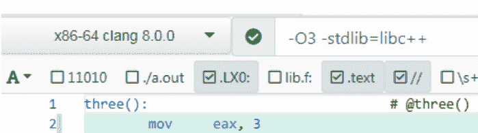

**Figure 8.11:** 使用新编译器生成的汇编代码

正如你在前面的截图中看到的，编译器正确地决定向量与函数无关并移除了所有负担。它还在编译时完成了加法并直接使用结果 3 作为常量。从本节中需要带走的主要内容如下：

- 在正确的选项下，编译器在优化代码时可以极其聪明。
- 研究生成的汇编代码对于高层次估计执行复杂度非常有用。
- 任何 C++ 程序员都很有价值地具备机器代码如何工作的基本理解。

在下一节中，我们将学习手动执行计时。

## Manual Execution Timing

这是快速计时小型程序的最简单方法。我们可以使用命令行工具来测量程序执行所需的时间。在 Windows 7 及以上版本中，可以使用以下 PowerShell 命令：

```
powershell -Command "Measure-Command {<your program and arguments here>}"
```

在 **Linux**、**macOS** 和其他 **UNIX-like** 系统上，可以使用 `time` 命令：

`time <your program and arguments here>`

在下一节中，我们将实现一个小型程序并检查关于一般计时程序执行的一些注意事项。

### Exercise 1: Timing a Program's Execution

在本练习中，我们将编写一个程序对数组进行求和。这里的想法是计时求和函数。当我们希望在隔离状态下测试一个函数时，此方法很有用。因此，测试程序的唯一目的是执行单个函数。由于计算非常简单，我们需要多次运行该函数才能获得可测量的执行时间。在这种情况下，我们只需从 `main()` 函数调用 `sumVector()` 函数，并传递一个随机整数的 `std::vector`。

> **Note**
>
> 一个旨在测试单个函数的程序有时被称为 **driver program**（不要与设备驱动程序混淆）。

执行以下步骤完成此练习：

1. 创建一个名为 **Snippet1.cpp** 的文件。
2. 定义一个名为 `sumVector` 的函数，在循环中对每个元素求和：

```
int sumVector(std::vector<int> &v)
{
    int ret = 0;
    for(int i: v)
    {
        ret += i;
    }

    return ret;
}
```

从前面的输出来看，它似乎仍然花费完全相同的时间。这似乎不可能，但实际上发生的是，由于我们从未在程序中引起任何副作用，例如打印和，编译器可以自由地将我们的代码替换为空程序。在功能上，根据 C++ 标准，此程序和空程序是相同的，因为运行它没有任何副作用。

8. 打开 Compiler Explorer 并粘贴整个代码。将编译器选项设置为 **-O3** 并观察生成的代码：

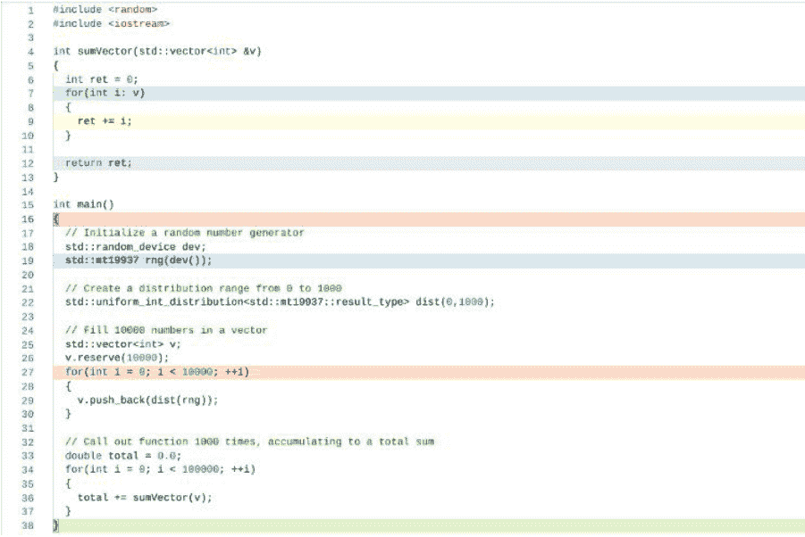

**Figure 8.15:** Compiler Explorer 中的 Snippet1.cpp 代码

正如你在前面的截图中看到的，**for** 循环内的行没有颜色编码，并且没有为它们生成汇编代码。

9. 修改代码以确保必须执行求和，通过打印依赖于计算的值的以下行：

```
std::cout<<"Total:"<<total<<std::endl;
```

10. 在这里，我们只是多次将 `sumVector()` 的结果求和到一个虚拟的 double 值并打印它。修改代码后，打开终端并写入以下命令：

```
$ g++ -O3 Snippet1.cpp
$ time ./a.out
```

前一个命令的输出如下：

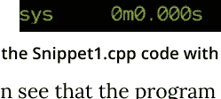

**Figure 8.16:** 使用打印值的副作用计时 Snippet1.cpp 代码的输出

在前面的输出中，我们可以看到程序实际上执行了计算，而不是作为空程序运行。将总和打印到 `cout` 是一个副作用，会导致编译器不省略代码。引起一个依赖于代码执行的副作用（例如打印结果）是防止编译器优化器删除代码的一种方法。在下一节中，我们将学习如何在没有副作用的情况下计时程序。

### Timing Programs without Side Effects

正如前面的练习所示，我们需要在程序中创建一个副作用（使用 `cout`），以便编译器不会忽略我们编写的所有代码。另一种让编译器相信某段代码具有副作用的技术是将结果赋给一个 volatile 变量。volatile 限定符告诉编译器：“此变量必须始终从内存中读取并写入内存，而不是从寄存器中读取。” volatile 变量的主要目的是访问设备内存，而此类设备内存访问必须遵循上述规则。有效地，编译器将 volatile 变量视为可能因当前程序之外的效果而改变，因此永远不会被优化。我们将在即将到来的章节中使用此技术。

还有更高级的方法可以绕过此问题，即通过指定特殊的汇编代码指令给编译器而不是使用副作用。但它们超出了本入门材料的范围。对于以下示例，我们将始终添加代码以确保函数的结果在副作用中使用或被赋给 volatile 变量。在未来的章节中，我们将学习如何检查编译器生成的汇编代码并检测编译器为优化目的省略代码的实例。


# 源代码插桩

**插桩**（Instrumentation）是一个术语，指的是在不改变程序行为的前提下，向程序中添加额外代码，并在程序执行时捕获信息的过程。这可能包括性能计时（以及其他测量，如内存分配或磁盘使用模式）。在源代码插桩的情况下，我们手动添加代码来对程序执行进行计时，并在程序结束时记录这些数据以供分析。这种方法的优点是它具有可移植性，并且无需任何外部工具。它还允许我们选择性地将计时添加到我们选择的任何代码部分。

### 练习 2：编写代码计时器类

在本练习中，我们将创建一个 **RAII** 类，用于测量各个代码块的执行时间。我们将在后续练习中将其作为代码的主要计时机制。它不如其他性能测量方法复杂，但更易于使用，并能满足大多数需求。我们类的基本要求如下：

- 我们需要能够记录一个代码块所花费的累计时间。
- 我们需要能够记录它被调用的次数。

执行以下步骤以完成本练习：

1. 创建一个名为 **Snippet2.cpp** 的文件。
2. 包含以下头文件：

```
#include <map>
#include <string>
#include <chrono>
#include <iostream>
#include <cstdint>

using std::map;
using std::string;
using std::cerr;
using std::endl;
```

3. 通过编写以下代码来定义 **Timer** 类及类的成员函数：

```
class Timer
{
    static map<string, int64_t> ms_Counts;
    static map<string, int64_t> ms_Times;
    const string &m_sName;
    std::chrono::time_point<std::chrono::high_resolution_clock> m_tmStart;
```

如前面的代码所示，类成员由一个名称、一个起始时间戳和两个**静态映射**组成。此类的每个实例都用于对某个代码块进行计时。该代码块可以是函数作用域，也可以是任何其他由花括号分隔的块。用法模式是在代码块顶部定义一个 **Timer** 类的实例，同时传入一个名称（可以是函数名或其他方便的标签）。实例化时，会记录当前时间戳；当代码块退出时，此类的析构函数会记录该代码块累计经过的时间，以及该代码块执行的次数。时间和次数分别存储在静态映射 **ms_Times** 和 **ms_Counts** 中。

4. 通过编写以下代码来定义 **Timer** 类的构造函数：

```
public:
    // When constructed, save the name and current clock time
    Timer(const string &sName): m_sName(sName)
    {
        m_tmStart = std::chrono::high_resolution_clock::now();
    }
```

5. 通过编写以下代码来定义 **Timer** 类的析构函数：

```
// When destroyed, add the time elapsed and also increment the count under this name
~Timer()
{
    auto tmNow = std::chrono::high_resolution_clock::now();
    auto msElapsed = std::chrono::duration_cast<std::chrono::milliseconds>(tmNow - m_tmStart);
    ms_Counts[m_sName]++;
    ms_Times[m_sName] += msElapsed.count();
}
```

在前面的代码中，经过的时间以毫秒为单位计算。然后，我们将其累加到该代码块名称对应的累计经过时间中，并增加该代码块被执行的次数计数。

6. 定义一个名为 dump() 的静态函数，用于打印计时结果的摘要：

```
// Print out the stats for each measured block/function
static void dump()
{
    cerr << "Name\t\t\tCount\t\t\tTime(ms)\t\tAverage(ms)\n";
    cerr << "-------------------------------------------------------------------------------\n";
    for(const auto& it: ms_Times)
    {
        auto iCount = ms_Counts[it.first];
        cerr << it.first << "\t\t\t" << iCount << "\t\t\t" << it.second << "\t\t\t" << it.second / iCount << "\n";
    }
};
```

在前面的代码中，名称、执行次数、总时间和平均时间以表格形式打印。我们在字段名称和字段值之间使用多个制表符，以使它们在控制台上垂直对齐。这个函数可以根据我们的需要修改。例如，我们可以修改这段代码，将输出转储为 CSV 文件，以便将其导入电子表格进行进一步分析。

7. 最后，定义静态成员以完成该类：

```
// Define static members
map<string, int64_t> Timer::ms_Counts;
map<string, int64_t> Timer::ms_Times;
const int64_t N = 1'000'000'000;
```

8. 既然我们已经定义了 Timer 类，现在定义两个简单的函数作为示例来进行计时。一个函数执行加法，另一个执行乘法。由于这些操作很简单，我们将循环 10 亿次，以便获得一些可测量的结果。

### 注意

C++ 14 及更高版本允许我们在整数常量中使用单引号以提高可读性；例如，我们可以写 1'000'000 而不是 1000000。

编写加法和乘法函数。这两个函数分别对从 1 到 N 的整数进行加法和乘法：

```
unsigned int testMul()
{
    Timer t("Mul");

    unsigned int x = 1;
    for(int i = 0; i < N; ++i)
    {
        x *= i;
    }

    return x;
}
```

```
unsigned int testAdd()
{
    Timer t("Add");

    unsigned int x = 1;
    for(int i = 0; i < N; ++i)
    {
        x += i;
    }

    return x;
}
```

在前面的代码中，我们对反复进行加法/乘法的变量使用了 unsigned int。我们使用无符号类型是为了确保算术运算中的溢出不会导致未定义行为。如果我们使用有符号类型，程序将具有未定义行为，并且无法保证以任何方式正常工作。其次，我们从 testAdd() 和 testMul() 函数返回计算值，以确保编译器不会删除代码（因为没有副作用）。为了对这些函数进行计时，我们只需在函数开头声明一个带有适当标签的 Timer 类实例即可。计时在 Timer 对象实例化时立即开始，并在该对象超出作用域时停止。

在前面的输出中，请注意现在打印的是实际函数名。使用这个宏的另一个优点是，我们可以默认将其添加到所有可能耗时的函数中，并在生产构建中通过简单地将定义改为空操作来禁用它，这样计时代码将永远不会运行——从而避免了大量编辑代码的需要。在接下来的练习中，我们将使用这个相同的 Timer 类对代码进行计时。

## 运行时性能分析

**性能分析**（Profiling）是一种非侵入式地测量程序中函数性能的方法。分析器通过频繁地采样程序当前的执行地址（每秒数百次）并记录当时正在执行的函数来工作。这是一种具有合理准确度的统计采样方法。不过，有时结果可能会令人困惑，因为程序可能会在属于操作系统内核的函数上花费大量时间。Linux 上最流行的运行时分析工具是 **perf**。在下一节中，我们将使用 perf 来分析我们的程序。

### 练习 3：使用 perf 分析程序

**perf** 可以通过以下方式安装在 **Ubuntu** 上：

```
apt-get install linux-tools-common linux-tools-generic
```

为了熟悉使用 **perf** 的基础知识，我们将借助 **perf** 工具对上一个练习中的程序进行分析。执行以下步骤以完成本练习：

1. 打开我们在上一个练习中创建的 **Snippet2.cpp** 文件，并从两个函数中移除 **TIME_IT** 宏。
2. 打开终端，使用 **-O3** 标志重新编译代码，然后使用 **perf** 创建性能分析数据样本，如下所示：

```
$ g++ -O3 Snippet2.cpp
$ perf record ./a.out
```

前一个命令的输出如下：

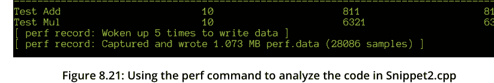

图 8.21：使用 perf 命令分析 Snippet2.cpp 中的代码


这会创建一个名为 **`perf.data`** 的文件，可以对其进行分析或可视化。

- 3. 现在，使用以下命令将记录的数据可视化：

```
`$ perf report`
```

执行上一条命令后，一个基于控制台的 GUI 会显示以下数据：

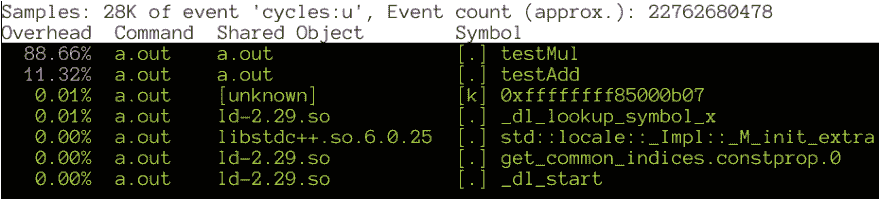

图 8.22：使用 perf 命令分析 Snippet2.cpp 中的代码

你可以上下移动光标以选择函数，然后按 *Enter* 获取选项列表。

- 4. 突出显示 **testMul**，按 *Enter*，然后在结果列表中选择 **Annotate testMul**。随后会显示汇编代码列表，并带有描述每行代码执行时间百分比的注释，如下所示：

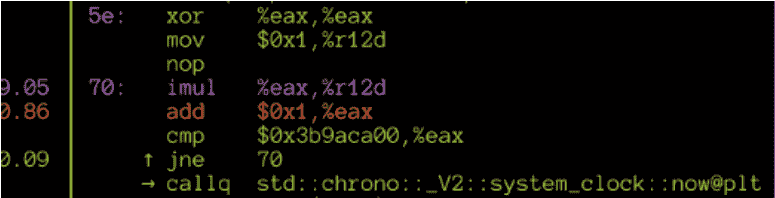

图 8.23：使用 perf 命令查看 Snippet2.cpp 代码的计时统计信息

请注意，**整数乘法（IMUL）**指令（整数乘法）占用了超过 **99%** 的执行时间。传统上，在 **x86** 架构上，整数乘法运算始终代价高昂，即使在最新一代 CPU 中也是如此。该注释视图会在每条跳转或分支指令旁显示箭头；当高亮显示时，它会用线条图显示该指令关联的比较指令以及跳转到的地址。你可以按左箭头键返回到上一个视图，并使用 *q* 键退出程序。

尽管现代处理器通过**分支预测**和**推测执行**电路减轻了分支开销，但循环展开仍然能带来性能收益。在 **gcc** 和 **clang** 系列编译器上，可以通过 **-funroll-loops** 命令行标志启用循环展开优化。在下一节中，我们将测试一个程序在启用和未启用循环展开时的性能。

### 练习 4：使用循环展开优化

在本练习中，我们将编写一个使用嵌套循环的简单程序，并测试它在启用和未启用循环展开时的性能。我们将了解编译器实现自动循环展开的方式。

执行以下步骤完成本练习：

- 1. 创建一个名为 **Snippet3.cpp** 的文件。
- 2. 编写一个程序，取前 **10,000** 个数字，并打印出其中有多少数字互为因数（完整代码见 **Snippet3.cpp**）：
- 3. 保存程序并打开终端。首先使用 **-O3** 标志编译程序，并使用以下命令进行计时：

```
### include <iostream>
int main()
{
    int ret = 0;
    for(size_t i = 1; i < 10000; ++i)
    {
        for(size_t j = 1; j < 10000; ++j)
        {
            if(i % j == 0)
            {
                ++ret;
            }
        }
    }

    std::cout << "Result: " << ret << std::endl;
}
```

```
$ g++ -O3 Snippet3.cpp
$ time ./a.out
```

上一条命令的输出如下：

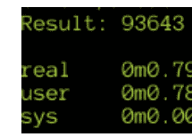

图 8.24：Snippet3.cpp 中代码的输出

- 4. 现在，在启用循环展开的情况下编译相同的代码，并再次计时：

```
$ g++ -O3 -funroll-loops Snippet3.cpp
$ time ./a.out
```

上一条命令的输出如下：

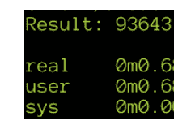

图 8.25：使用循环展开选项编译的 Snippet3.cpp 代码的输出

- 5. 打开 Godbolt 编译器资源管理器，并将前面的完整代码粘贴到左侧。
- 6. 在右侧，从编译器选项中选择 x86-64 gcc 8.3，并在选项中填写 -O3 标志。将会生成汇编代码。对于 for 循环，你会看到以下输出：

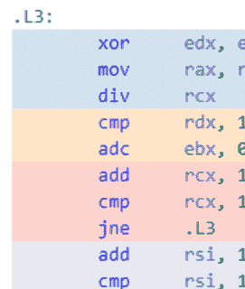

图 8.26：for 循环的汇编代码

### 练习 5：使用配置文件引导优化

在本练习中，我们将在上一个练习的代码上使用配置文件引导优化。我们将了解如何将配置文件引导优化与 gcc 编译器一起使用。

执行以下步骤完成本练习：

- 1. 打开终端，并在启用性能分析（profiling）的情况下编译上一个练习中的代码。加上我们需要的其他优化标志（此处为 -O3）。编写以下代码来实现这一点：

  $ g++ -O3 -fprofile-generate Snippet3.cpp

- 2. 现在，通过编写以下命令来运行已生成性能分析数据的代码版本：

  $ ./a.out

程序正常运行并打印结果，看不到其他输出——但它会生成一个文件，其中包含的数据将在下一步中帮助编译器。请注意，启用性能分析后，程序执行速度会比正常情况下慢几倍。对于大型程序，这一点需要牢记。执行上述命令后，将生成一个名为 Snippet3.gcda 的文件，其中包含性能分析数据。在对大型复杂应用程序执行此操作时，务必使用程序在生产环境中最常遇到的数据集和工作流来运行它。在这里正确选择数据，最终会获得更高的性能提升。

- 3. 使用 PGO 优化标志重新编译，即 -fprofile-use 和 -fprofile-correction，如下代码所示：

  $ g++ -O3 -fprofile-use -fprofile-correction Snippet3.cpp

请注意，除了与性能分析相关的编译器选项外，其他选项必须与上一个编译步骤中的选项完全相同。

- 4. 现在，如果我们对可执行文件进行计时，将看到显著的性能提升：

  $ time ./a.out

上一条命令的输出如下：

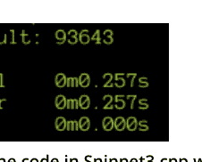

图 8.28：使用 PGO 优化的 Snippet3.cpp 代码的计时结果

```
using std::endl;
int main()
{
    // Fill 100,000,000 1s in a vector
    std::vector<int> v( 100'000'000, 1);
    // Call accumulate 100 times, accumulating to a total sum
    uint64_t total = 0;
    for(int i = 0; i < 100; ++i)
    {
        total += std::accumulate(v.begin(), v.end(), 0);
    }
    std::cout << "Total: " << total << std::endl;
}
```

3. 保存程序并打开终端。按正常方式编译程序，并使用以下命令计时执行：

```
$ g++ -O3 Snippet4.cpp
$ time ./a.out
```

上一条命令的输出如下：

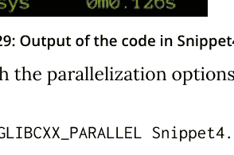

图 8.29：Snippet4.cpp 中代码的输出

4. 现在，使用并行化选项编译代码，即 -O3 -fopenmp 和 -D_GLIBCXX_PARALLEL：

```
$ g++ -O3 -fopenmp -D_GLIBCXX_PARALLEL Snippet4.cpp
$ time ./a.out
```

输出如下：

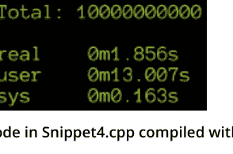

图 8.30：使用并行化选项编译的 Snippet4.cpp 代码的输出

通过使用 **reserve()** 方法，我们可以避免这些多次分配和复制。当我们知道一个向量将包含多少元素时，调用 **reserve()** 方法预分配存储空间会产生很大的不同。让我们在下一节中实现一个练习来优化向量的增长。

### 练习 7：优化向量增长

在本练习中，我们将分别对循环中调用和不调用 reserve 方法时的 **push_back** 方法进行计时。首先，我们将把前面章节中使用的 **Timer** 类提取到一个单独的头文件和实现文件中——这样我们就可以将它作为所有后续代码片段的公共代码来使用。执行以下步骤完成本练习：

- 1. 创建一个名为 **Timer.h** 的头文件。
- 2. 包含必要的头文件：

```
#include <map>
#include <string>
#include <chrono>
#include <cstdint>
```

- 3. 创建一个名为 **Timer** 的类。在 **Timer** 类中，声明四个变量，即 **ms_Counts**、**ms_Times**、**m_tmStart** 和 **m_sName**。声明构造函数、析构函数和 **dump()** 方法。添加以下代码来实现这一点：

```
class Timer
{
    static std::map<std::string, int64_t> ms_Counts;
    static std::map<std::string, int64_t> ms_Times;
    std::string m_sName;
    std::chrono::time_point<std::chrono::high_resolution_clock> m_tmStart;
public:
    // When constructed, save the name and current clock time
    Timer(std::string sName);
    // When destroyed, add the time elapsed and also increment the count under this name
    ~Timer();
    // Print out the stats for each measured block/function
    static void dump();
};
```


+   4. 定义一个名为 **TIME_IT** 的辅助宏，用于对函数计时，编写以下代码：

```
```cpp
// Helper macro to time functions
#define TIME_IT Timer t(__func__)
```
```

+   5. 创建头文件后，新建一个名为 **Timer.cpp** 的文件，并在其中包含 **Timer.h** 文件。同时，在 **Timer.cpp** 文件中为构造函数、析构函数和 `dump()` 方法编写实际实现。编写以下代码来实现：

```
```cpp
#include <string>
#include <iostream>
#include <cstdint>
#include "Timer.h"

using std::map;
using std::string;
using std::cerr;
using std::endl;

// When constructed, save the name and current clock time
Timer::Timer(string sName): m_sName(sName)
{
    m_tmStart = std::chrono::high_resolution_clock::now();
}
// When destroyed, add the time elapsed and also increment the count under
// this name
Timer::~Timer()
{
    auto tmNow = std::chrono::high_resolution_clock::now();
    auto msElapsed = std::chrono::duration_cast<std::chrono::milliseconds>(tmNow - m_tmStart);
    ms_Counts[m_sName]++;
    ms_Times[m_sName] += msElapsed.count();
}
// Print out the stats for each measured block/function
void Timer::dump()
{
    cerr << "Name\t\t\tCount\t\t\tTime(ms)\t\tAverage(ms)\n";
    cerr << "-------------------------------------------------------------\n";
    for(const auto& it: ms_Times)
```

正如我们所看到的，调用 **reserve()** 的效果使得执行时间提升了约 4%。在长时间运行的大型程序中，系统内存常常变得非常碎片化。在这种情况下，通过 **reserve()** 预分配内存所带来的改进可能会更好。一般来说，预先保留内存通常比在运行时逐步分配更快。即使是 Java 虚拟机，出于性能原因，也会在启动时预先分配一大块内存。

## 短路逻辑运算符

&& 和 || 逻辑运算符是**短路**的，这意味着：

- 如果 || 运算符左侧为 **true**，则不计算右侧。
- 如果 && 运算符左侧为 **false**，则不计算右侧。

通过把更不可能成立（或开销更小）的表达式放在左侧，我们可以减少需要完成的工作量。在下一节中，我们将解决一个练习，学习如何最优地编写逻辑表达式。

### 练习 8：优化逻辑运算符

在本练习中，我们将研究在逻辑运算符中使用条件表达式时，排列顺序所产生的影响。执行以下步骤以完成本练习：

+   1. 创建一个名为 **Snippet6.cpp** 的新文件。
+   2. 通过编写以下代码，包含必要的库以及我们在前面练习中创建的 Timer.h 文件：

```
#include <vector>
#include <string>
#include <iostream>
#include <random>

#include "Timer.h"

using std::vector;
using std::cerr;
using std::endl;
```

3. 定义一个名为 sum1() 的函数，计算 0 到 N 之间整数的和。只有当每个数字满足两个特定条件之一时，才会将其相加。第一个条件是数字必须小于 N/2。第二个条件是数字除以 3 后的余数必须为 2。这里，我们将 N 设置为 100,000,000，以便代码能够消耗可测量的时间。编写以下代码来实现：

```
const uint64_t N = 100000000;

uint64_t sum1()
{
    TIME_IT;
    uint64_t ret = 0;
    for(uint64_t b=0; b < N; ++b)
    {
        if(b % 3 == 2 || b < N/2)
        {
            ret += b;
        }
    }

    return ret;
}
```

4. 现在，定义另一个名为 sum2() 的函数。它的逻辑必须与之前为 sum1() 编写的逻辑相同。这里唯一的改动是我们反转 if 语句中条件表达式的顺序。编写以下代码来实现：

```
uint64_t sum2()
{
    TIME_IT;
    uint64_t ret = 0;
    for(uint64_t b=0; b < N; ++b)
    {
        if(b < N/2 || b % 3 == 2)
        {
            ret += b;
        }
    }

    return ret;
}
```

注意，在 sum2 函数中，b < N/2 条件有一半的时间会求值为 true。因此，第二个条件，即 b % 3 == 2，只有一半的迭代会被求值。为简单起见，如果假设两个条件表达式各占用 1 个单位时间，则 sum2() 的总耗时为 N/2 + (2 * N/2) = N * 3/2。对于 sum1() 函数，左侧的条件表达式只有 33% 的时间会求值为 true，而其余 66% 的时间两个条件都会被求值。因此，估计耗时为 N/3 + (2 * N * 2/3) = N * 5/3。我们预计 sum1 与 sum2 函数的时间比应为 5/3 比 3/2，也就是说，sum1 慢了 11%。

5. 在 main 函数中添加以下代码：

```
int main()
{
    volatile uint64_t dummy = 0;
    for(int i = 0; i < 100; ++i)
    {
        dummy = sum1();
    }
    for(int i = 0; i < 100; ++i)
    {
        dummy = sum2();
    }
    Timer::dump();
}
```

6. 保存文件并打开终端。通过编写以下命令，编译并计时上面的程序以及 Timer.cpp 文件：

```
$ g++ -O3 Snippet6.cpp Timer.cpp
$ ./a.out
```

输出如下：

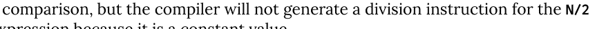

图 8.32：Snippet6.cpp 中代码的输出，展示了优化布尔条件的效果

从前面的输出可以看出，我们最终获得了约 38% 的速度提升，这远远超出了预期。为什么会发生这种情况？答案是 % 运算符会执行整数除法，这远比一次比较代价高昂，但编译器不会为 N/2 表达式生成除法指令，因为它是一个常量值。

对于第一个函数，外层循环在退出时仅发生一次分支预测失败，但内层循环每次退出时都会发生分支预测失败，共 **100,000,000** 次。对于第二个函数，外层循环同样只在退出时发生一次分支预测失败，但内层循环每次退出时发生分支预测失败，共 100 次。**1,000,000** 倍的预测失败次数差异将导致第一个函数比第二个慢。执行以下步骤来完成本练习：

+   1. 创建一个名为 **Snippet7.cpp** 的文件，并包含必要的库：

```
```cpp
#include <vector>
#include <string>
#include <iostream>
#include <random>
#include "Timer.h"

using std::vector;
using std::cerr;
using std::endl;
```
```

+   2. 定义一个名为 **sum1()** 的函数，其中包含一个嵌套循环。外层 for 循环应循环 N 次，而内层 for 循环应迭代 100 次。将 **N 的值设为 100000000**。编写以下代码来实现：

```
```cpp
const uint64_t N = 100000000;
uint64_t sum1()
{
    TIME_IT;
    uint64_t ret = 0;
    for(int i = 0; i < N; ++i)
    {
        for(int j = 0; j < 100; ++j)
        {
            ret += i ^ j;
        }
    }
    return ret;
}
```
```

如果我们假设处理器会预测循环中的分支（从统计上看，循环末尾的分支指令更有可能跳转到循环开头，而不是不跳转），那么当 j 达到 100 时，每次都会出现预测错误——换句话说，共 N 次。

3. 定义一个新函数 sum2()，其中包含一个嵌套循环。这里唯一的改动是必须将内层循环计数设置为 N，外层循环计数设置为 100。添加以下代码来实现：

```
uint64_t sum2()
{
    TIME_IT;
    uint64_t ret = 0;
    for(int i = 0; i < 100; ++i)
    {
        for(int j = 0; j < N; ++j)
        {
            ret += i ^ j;
        }
    }
    return ret;
}
```

4. 在 main 函数中添加以下代码：

```
int main()
{
    volatile uint64_t dummy;
    dummy = sum1();
    dummy = sum2();
    Timer::dump();
}
```

5. 保存文件并打开终端。使用以下命令编译上面的程序以及 Timer.cpp 文件，并对它们进行计时。请记住，你需要在同一目录中具有之前创建的 Timer.cpp 和 Timer.h 文件：

```
$ g++ -O3 Snippet7.cpp Timer.cpp
$ ./a.out
```

执行上述命令的输出如下：

| 名称 | 次数 | 时间(ms) | 平均(ms) |
|------|-------|----------|-------------|
| sum1 | 1 | 2442 | 2442 |
| sum2 | 1 | 2377 | 2377 |

图 8.33：Snippet7.cpp 中代码的输出，展示了分支预测优化的效果


从前面的输出可以看出，处理器对分支预测能力更好，使得 sum2 函数大约有 2% 的小幅但显著的加速。在下一节中，我们将探索更多优化技术。

## 进一步优化

在编码时可以实现多种其他技术；其中有些并不能保证产生更好的代码，但只需付出很少的努力就能改变编码习惯，使其成为本能。它们几乎不花费成本，但可能带来收益。其中一些技术如下：

- 在可能的情况下，将非原始类型的参数按 const 引用传递。即使移动构造函数可以使复制变得廉价，但它们仍然比使用 const 引用涉及更多的开销。
- 使用前置递增 (++i) 或前置递减 (--i) 运算符，而不是后缀版本。对于简单的类型如整数，这通常没有用处，但对于具有自定义递增运算符的复杂类型可能有用。养成写 ++i 而不是 i++ 的习惯是良好的做法，除非后缀递增确实是期望的行为。除了性能优势外，这种代码通过使用正确的运算符更清晰地声明了意图。
- 尽可能晚地声明变量——在 C 中在函数顶部声明所有变量很常见，但在 C++ 中，由于变量可能具有非平凡的构造函数，因此最好只在实际使用它们的块中声明它们。
- 就循环提升而言，如果循环中存在不随循环迭代而改变的代码或计算，则最好将其移出循环之外。这包括在循环体中创建对象。通常，更有效的做法是在循环外部一次性声明它们。现代编译器会自动执行此操作，但自己动手也不需要额外精力。
- 尽可能使用 const。它不会改变代码的含义，但它使编译器能够对代码做出更强的假设，从而可能带来更好的优化。除此之外，使用 const 使代码更具可读性和合理性。
- 整数除法、取模和乘法（尤其是乘以非 2 的幂的数）在 X86 硬件上是一些最慢的操作之一。如果需要在循环中执行此类操作，也许可以通过一些代数运算来消除它们。

- 3. 创建一个常量整数变量 N，并将其值设为 100000：

    ```
    const int N = 100000;
    ```

- 4. 初始化一个随机数生成器并创建一个从 0 到 N 的分布范围。添加以下代码来实现此功能：

    ```
    std::random_device dev;
    std::mt19937 rng(dev());
    std::uniform_int_distribution<std::mt19937::result_type> dist(0,N);
    ```

- 5. 创建一个名为 insertRandom() 的方法，并以随机位置将元素从 0 到 N 插入到容器中。添加以下代码来实现此功能：

    ```
    template<class C> void insertRandom(C &l)
    {
        // insert one element to initialize
        l.insert(l.end(), 0);
        for(int i = 0; i < N; ++i)
        {
            int pos = dist(rng) % l.size();
            auto it = l.begin();
            advance(it, pos);
            l.insert(it, i);
        }
    }
    ```

- 6. 创建一个名为 insertStart() 的方法，并将元素从 0 到 N 插入到容器的开头。添加以下代码来实现此功能：

    ```
    template<class C> void insertStart(C &l)
    {
        for(int i = 0; i < N; ++i)
        {
            l.insert(l.begin(), i);
        }
    }
    ```

- 7. 创建一个名为 **insertEnd()** 的方法，并将元素从 **0** 到 **N** 插入到容器的末尾。添加以下代码来实现此功能：

    ```
    template<class C> void insertEnd(C &l)
    {
        for(int i = 0; i < N; ++i)
        {
            l.insert(l.end(), i);
        }
    }
    ```

- 8. 在 **main** 方法中编写以下代码：

    ```
    int main()
    {
        std::list<int> l;
        std::vector<int> v;
        // list
        {
            Timer t("list random");
            insertRandom(l);
        }

        {
            Timer t("list end");
            insertEnd(l);
        }
        {
            Timer t("list start");
            insertStart(l);
        }
        // vector
        {
            Timer t("vect random");
            insertRandom(v);
        }

        {
            Timer t("vect end");
            insertEnd(v);
        }
        {
            Timer t("vect start");
    ```

历史上，处理器在 1980 年到 2010 年间速度提高了约 16,000 倍。与此同时，RAM 速度的提升要小一个数量级——不到 100 倍。因此，指令对 RAM 的单次访问可能导致 CPU 等待大量时钟周期。这将是不可接受的性能下降，因此出现了许多技术来缓解此问题。在我们探索这个问题之前，让我们在下一个练习中测量内存访问的影响。

### 练习 11：测量内存访问的影响

在本练习中，我们将检查随机访问内存的性能影响。执行以下步骤来完成此练习：

- 1. 创建一个名为 Snippet9.cpp 的新文件。

- 2. 包含必要的库以及 Timer.h 头文件。创建两个常量整数变量 SIZE 和 N，并将其值设为 100000000。另创建一个随机数生成器和一个从 0 到 N-1 的分布范围。编写以下代码来实现此功能：

    ```
    #include <vector>
    #include <list>
    #include <algorithm>
    #include <string>
    #include <iostream>
    #include <random>
    #include "Timer.h"

    using std::vector;
    using std::list;
    using std::cerr;
    using std::endl;

    const int SIZE = 100'000'000;
    const int N = 100'000'000;

    std::random_device dev;
    std::mt19937 rng(dev());

    std::uniform_int_distribution<std::mt19937::result_type> dist(0,SIZE-1);
    ```

- 3. 创建 getPRIIndex() 函数，该函数返回介于 0 和 SIZE-1 之间的伪随机索引，其中 SIZE 是数组中的元素数。编写以下代码来实现此功能：

    > Note
    > 我们稍后会讨论为什么使用随机数。

    ```
    uint64_t getPRIIndex(uint64_t i)
    {
        return (15485863 * i) % SIZE;
    }
    ```

- 4. 编写一个名为 sum1() 的函数，该函数随机访问大型数据数组并对这些元素求和：

    ```
    uint64_t sum1(vector<int> &v)
    {
        TIME_IT;
        uint64_t sum = 0;
        for(int i = 0; i < N; ++i)
        {
            sum += v[getPRIIndex(i)];
        }
        return sum;
    }
    ```

- 5. 编写一个名为 sum2() 的函数，该函数对随机数求和而没有任何内存访问：

    ```
    uint64_t sum2()
    {
        TIME_IT;
        uint64_t sum = 0;
        for(int i = 0; i < N; ++i)
        {
            sum += getPRIIndex(i);
        }
        return sum;
    }
    ```

## 缓存

现代处理器在处理器寄存器和 RAM 之间具有多层缓存内存。这些缓存被标记为 L1、L2、L3、L4 等，其中 L1 最接近处理器，L4 最远。每层缓存都比其下层更快（通常也更小）。以下是 Haswell 系列处理器缓存/内存大小和延迟的示例：

| Cache/Memory | Size | Latency |
| --- | --- | --- |
| L1 | 32 KB | 4 cycles |
| L2 | 256 KB | 12 cycles |
| L3 | 6 MB | 20 cycles |
| L4 | 128 MB | 58 cycles |
| RAM | many GB | 115 cycles |

缓存工作以帮助性能的简单模型如下：当访问内存地址时，会在 L1 缓存中查找——如果找到，则从那里检索。如果没有找到，则在 L2 缓存中查找，如果仍未找到，则查找 L3 缓存，依此类推——如果在任何缓存中都未找到，则从内存中获取。当从内存中获取时，它会被存储在每一层缓存中以便以后更快访问。这种方法本身几乎没用，因为它只有在我们一遍又一遍地访问同一个内存地址时才会提高性能。第二方面，称为预取，是使缓存真正发挥作用的机制。

### 预取

预取是一个过程，即在执行内存访问时，附近的数据也会被提取到缓存中，即使它没有被直接访问。预取的第一方面与内存总线粒度有关——可以认为“RAM 子系统可以向处理器发送的最小数据量是多少？”。在大多数现代处理器中，这是 64 位——换句话说，无论你从内存中请求单个字节还是 64 位值，包含该地址的整个 64 位机器字都会从 RAM 中读取。这些数据存储在每一层缓存中以便以后更快访问。显然，这会立即改善内存性能——假设我们读取地址 0x1000 处的内存字节；我们还将该地址之后的其他 7 个字节带入缓存。如果我们随后访问地址 0x1001 处的字节，它将来自缓存，避免了昂贵的 RAM 访问。


预取的第二个方面在此基础上更进一步——当读取某个地址的 RAM 内容时，处理器不仅读取该内存字，还会读取更多内容。在 x86 系列处理器上，这在 32 到 128 字节之间。这被称为 **缓存行** 大小——处理器总是以该大小的块来读写内存。当 CPU 硬件检测到内存以线性方式被访问时，它会根据对随后可能被访问的地址的预测，将内存预取到一个缓存行中。

CPU 在检测正向和反向的规律访问模式方面非常聪明，并且会高效地进行预取。你也可以使用特殊指令向处理器提供提示，使其根据程序员的指示预取数据。这些指令在大多数编译器中作为内在函数提供，以避免使用内联汇编语言。当读取或写入的内存地址不在缓存中时，被称为 **缓存未命中**，这是一个非常昂贵的事件，必须不惜一切代价避免。CPU 硬件会尽力减轻缓存未命中的影响，但程序员可以分析和修改数据访问模式以最大程度地减少缓存未命中。此处对缓存的描述是一个简化的教学模型——实际上，CPU 具有用于指令和数据的 L1 缓存、多个缓存行，以及非常复杂的机制来确保多个处理器能够保持其各自缓存的同步。

> **注意**
> 
> 关于缓存实现（以及有关内存子系统的大量其他信息）的全面描述，可以在以下著名的在线文章中找到：
> https://lwn.net/Articles/250967/。

## 缓存对算法的影响

了解了缓存之后，我们现在可以解释为什么我们第一个关于向量与列表的示例显示出令人惊讶的结果——从计算机科学的角度来看，以下是正确的：

**对于列表：**

- 迭代到第 N 个位置的复杂度为 N 阶。
- 插入或删除一个元素的复杂度为 1 阶。

### 对于数组（或向量）：

- 迭代到第 N 个位置的复杂度为 1 阶。
- 在位置 N 插入或删除一个元素的复杂度与 (S - N) 成正比，其中 S 为数组的大小。

然而，对于现代架构，内存访问的成本极高，但随后访问相邻地址的成本几乎为 0，因为它很可能已经在缓存中。这意味着 std::list 中位于内存中非顺序位置的元素在迭代时很可能总是导致缓存未命中，从而导致性能缓慢。另一方面，由于数组或 std::vector 的元素总是相邻的，缓存和预取会将复制 (S-N) 个元素到新位置的总体成本降低非常大的幅度。因此，传统上对这两种数据结构的分析，即列表在随机插入时表现更好，虽然在技术上是正确的，但在实践中并不成立，尤其是在考虑到现代 CPU 硬件明显复杂的缓存行为的情况下。当我们的程序受数据限制时，算法复杂度的分析必须通过对数据局部性的理解来补充。

数据局部性可以简单地定义为刚刚访问的内存地址与之前访问的内存地址之间的平均距离。换句话说，在相距很远的地址之间进行内存访问会造成严重的减速，因为更接近的地址的数据很可能已被预取到缓存中。当数据已存在于缓存中时，被称为“热”；否则，被称为“冷”。利用缓存的代码被称为缓存友好。另一方面，缓存不友好的代码会导致缓存行被浪费地重新加载（称为缓存失效）。在本节的剩余部分，我们将研究如何编写缓存友好代码的策略。

## 优化缓存友好性

在过去，代码优化涉及尝试最小化代码中的机器指令数量，使用更高效的指令，甚至重新排序指令以使流水线保持满载。到了今天，编译器会以大多数程序员无法达到的水平执行上述所有优化——尤其是考虑到编译器可以在数亿条指令的整个程序中进行优化。即使现在，程序员仍然坚定地负责优化数据访问模式以利用缓存。

任务非常简单——确保内存的访问接近之前访问的内存——但实现这一目标的方法可能需要大量努力。

> **注意**
> 
> 著名的游戏程序员和代码优化大师 Terje Mathisen 在 90 年代据称说过：“所有编程都是缓存练习。” 今天，在 2019 年，这一说法在编写快速代码这一子领域中比以往任何时候都更适用。

提高缓存友好性的一些基本经验法则是：

- 栈总是“热”的，因此我们应尽可能使用局部变量。
- 动态分配的对象很少彼此具有数据局部性——避免它们或使用预分配的对象池，使它们在内存中顺序排列。
- 基于指针的数据结构，如树——尤其是列表——由多个在堆上分配的节点组成，是非常不利于缓存的。
- OO 代码中虚拟函数的运行时分派会使指令缓存失效——在性能关键代码中避免动态分派。

在下一节中，我们将探讨堆分配的成本。

### 练习 12：探索堆分配的成本

在本练习中，我们将检查动态分配内存的性能影响，并检查堆内存如何影响代码的性能。执行以下步骤来完成此练习：

- 1. 创建一个名为 **Snippet11.cpp** 的文件。
- 2. 添加以下代码以包含必要的库：

```
#include <string>
#include <iostream>
#include <random>
#include "Timer.h"

using std::string;
using std::cerr;
using std::endl;
```

- 3. 声明一个常量变量 N 和一个名为 fruits 的字符数组。为它们赋值：

```
```cpp
const int N = 10'000'000;
const char* fruits[] =
{"apple", "banana", "cherry", "durian", "guava", "jackfruit", "kumquat",
"mango", "orange", "pear"};
```
```

- 4. 创建一个名为 **fun1()** 的函数，该函数仅遍历 fruits 中的每个字符串，将其复制到一个字符串，并对该字符串的字符求和：

```
```cpp
uint64_t fun1()
{
    TIME_IT;
    uint64_t sum = 0;
    string s1;
    for(uint64_t i = 0; i < N; ++i)
    {
        s1 = fruits[i % 10];
        for(int k = 0; k < s1.size(); ++k) sum += s1[k];
    }
    return sum;
}
```
```

- 5. 创建另一个名为 **sum2()** 的函数，该函数使用局部声明的字符数组而不是字符串和循环进行复制：

```
```cpp
uint64_t fun2()
{
    TIME_IT;
    uint64_t sum = 0;
    char s1[32];

    for(uint64_t i = 0; i < N; ++i)
    {
        char *ps1 = s1;
        const char *p1 = fruits[i % 10];
        do { *ps1++ = *p1; } while(*p1++);
        for(ps1 = s1, *ps1; ++ps1) sum += *ps1;
    }
    return sum;
}
```
```

6. 在 main() 函数内编写以下代码：

```
int main()
{
    for(int i = 0; i < 10; ++i)
    {
        volatile uint64_t asum1 = fun1();
        volatile uint64_t asum2 = fun2();
    }
    Timer::dump();
}
```

7. 保存文件并打开终端。编译并运行程序：

```
$ g++ -O3 Snippet11.cpp Timer.cpp
$ ./a.out
```

前述命令生成以下输出：

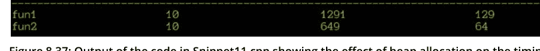

图 8.37：Snippet11.cpp 中代码的输出，显示堆分配对时间的影响

从前述输出中，注意到 fun2() 的速度几乎是 fun1() 的两倍。

8. 现在，使用 perf 命令进行分析：

```
$ perf record ./a.out
```

前述命令生成以下输出：

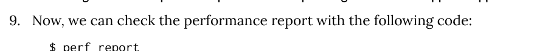

图 8.38：使用 perf 命令分析 Snippet11.cpp 中代码的输出

9. 现在，我们可以使用以下代码检查性能报告：

```
$ perf report
```


我们收到以下输出：

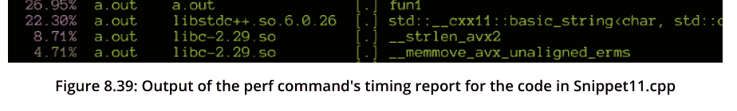

图 8.39：Snippet11.cpp 中代码的 perf 命令时序报告输出

在前面的输出中，注意到约 33% 的执行时间被 std::string 构造函数、strlen() 和 memmove() 占用。所有这些都与 fun1() 中使用的 std::string 相关。尤其是堆分配是最慢的操作。

## Struct of Arrays Pattern

在许多程序中，我们经常使用相同类型的对象数组——这些可能代表数据库中的记录、游戏中的实体等等。一种常见模式是遍历一个大型结构体数组并对某些字段执行操作。即使结构体在内存中是顺序的，如果我们只访问少数几个字段，更大的结构体大小会使缓存效果变差。

处理器可能会预取多个结构体到缓存中，但程序只访问了该缓存数据的一部分。由于它没有使用每个结构体的每个字段，大部分缓存数据都被丢弃。为了避免这种情况，可以使用另一种数据布局——而不是使用数组的数组 AoS 模式，我们使用结构体数组 SoA 模式。在下一节中，我们将解决一个练习，其中我们将检查使用 SoA 模式与 AoS 模式的性能优势。

### Exercise 13: Using the Struct of Arrays Pattern

在本练习中，我们将检查使用 SoA 与 AoS 模式的性能优势。执行以下步骤来完成此练习：

- 1. 创建一个名为 Snippet12.cpp 的文件。
- 2. 包含必要的库以及 Timer.h 头文件。初始化一个随机数生成器并创建一个从 1 到 N-1 的分布范围。创建一个常量整数变量 N 并将其初始化为 100,000,000。添加以下代码来实现此功能：

```
#include <vector>
#include <list>
#include <algorithm>
#include <string>
```

```
#include <iostream>
#include <random>
#include "Timer.h"

using std::vector;
using std::list;
using std::cerr;
using std::endl;

const int N = 100'000'000;

std::random_device dev;
std::mt19937 rng(dev());

std::uniform_int_distribution<std::mt19937::result_type> dist(1,N-1);
```

3. 编写两种不同的数据表示方式——结构体数组和结构体数组。使用六个 uint64_t 字段，以便我们可以模拟一个更大的结构，这更能代表真实世界的程序：

```
struct Data1
{
    uint64_t field1;
    uint64_t field2;
    uint64_t field3;
    uint64_t field4;
    uint64_t field5;
    uint64_t field6;
};
struct Data2
{
    vector<uint64_t> field1;
    vector<uint64_t> field2;
    vector<uint64_t> field3;
    vector<uint64_t> field4;
    vector<uint64_t> field5;
    vector<uint64_t> field6;
};
```

- 5. 在 `main` 函数内编写以下代码：

```
```cpp
int main()
{
    vector<Data1> arrOfStruct;
    Data2 structOfArr;

    // Reserve space
    structOfArr.field1.reserve(N);
    structOfArr.field2.reserve(N);
    structOfArr.field3.reserve(N);
    arrOfStruct.reserve(N);
    // Fill random values
    for(int i = 0; i < N; ++i)
    {
        Data1 temp;
        temp.field1 = dist(rng);
        temp.field2 = dist(rng);
        temp.field3 = dist(rng);
        arrOfStruct.push_back(temp);
        structOfArr.field1.push_back(temp.field1);
        structOfArr.field2.push_back(temp.field2);
        structOfArr.field3.push_back(temp.field3);
    }
    Sum s1 = sumAOS(arrOfStruct);
    Sum s2 = sumSOA(structOfArr);
    Timer::dump();
}
```
```

- 6. 保存程序并打开终端。通过添加以下命令来计时程序：

```
```sh
$ g++ -O3 Snippet12.cpp Timer.cpp
$ ./a.out
```
```

前面的代码生成以下输出：

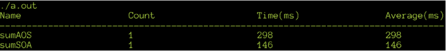

图 8.40：Snippet12.cpp 中代码的输出，对比 AOS 和 SOA 模式的时序

```
Timer t("Read file");
buf << ifs.rdbuf();
sContent = buf.str();
sContent.push_back(' ');
}
cerr << wordCount(sContent) << endl;
}
Timer::dump();
}
```

我们将使用一个虚拟块来分隔读取文件的代码的计时，并同时计时 main() 本身以获得整体执行时间。

请注意 push_back 添加了一个空格在末尾——这确保数据以空白字符结尾，简化了我们使用的算法。

- 2. 编写一个基本的词计数函数。逻辑非常简单——对于字符串中的每个字符，如果该字符不是空白且下一个是，则它是单词的结尾，应计数。由于我们的样板代码已添加了空格，任何最终单词都将被计数。此函数定义在 Snippet13.cpp 中：

```
int wordCount(const std::string &s)
{
    int count = 0;
    for(int i = 0, j = 1; i < s.size() - 1; ++i, ++j)
    {
        if(!isspace(s[i]) && isspace(s[j]))
        {
            ++count;
        }
    }
    return count;
}
```

- 3. 让我们编译、运行并了解性能。我们将通过将我们的代码结果与标准 wc 程序的结果进行比较来验证其是否正确：

```
$ g++ -O3 Snippet13.cpp SnippetWC.cpp Timer.cpp
$ ./a.out data.txt
```

我们收到以下输出：

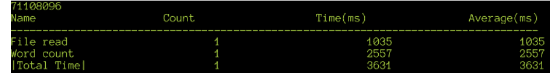

图 8.41：Snippet13.cpp 中代码的输出，具有基线词计数实现

让我们计时 wc 程序：

```
$ time wc -w data.txt
```

我们收到以下输出：

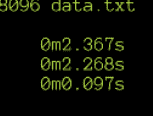

图 8.42：计时 wc 程序的输出

wc 程序显示相同的词数，即 71108096，因此我们知道我们的代码是正确的。我们的代码花费了约 3.6 秒，包括读取文件，这比 wc 慢得多。

- 4. 我们优化的第一个策略是看看是否可以用更好的方式实现 isspace()。不用函数，我们可以使用一个查找表来判断一个字符是否为空白（此代码可在 Snippet14.cpp 中找到）：

```
int wordCount(const std::string &s)
{
    // Create a lookup table
    bool isSpace[256];
    for(int i = 0; i < 256; ++i)
    {
        isSpace[i] = isspace((unsigned char)i);
    }
    int count = 0;
    int len = s.size() - 1;
    for(int i = 0, j = 1; i < len; ++i, ++j)
    {
        count += !isSpace[s[i]] & isSpace[s[j]];
    }
    return count;
}
```

```
int idx = j + i * 256;
table[idx] = !isspace(j) && isspace(i);
}
```

用于计数单词的循环变为如下所示（完整代码可在 Snippet15.cpp 中找到）：

```
int count = 0;
for(int i = 0; i < s.size() - 1; ++i)
{
    // grab the 2 bytes at s[i] as a 16 bit value
    unsigned short idx;
    memcpy(&idx, &s[i], 2);
    count += table[idx];
}
```

我们将字符串的每个字符作为单个 16 位值读取。直接将指针从 char* 强制转换为另一种类型并解引用它是未定义行为——正确的方法是使用 memcpy()。编译器足够智能，可以使用 CPU 内存访问指令而不是实际调用 memcpy() 处理 2 字节。我们最终得到一个循环中不包含条件语句，这应该使其更快。记住 X86 架构是小端——因此从字符数组读取的 16 位值将第一个字符作为其 LSB，第二个作为 MSB。

- 7. 现在，计时我们编写的代码：

```
$ g++ -O3 Snippet15.cpp SnippetWC.cpp Timer.cpp
$ ./a.out data.txt
```

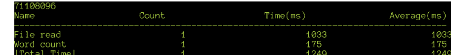

图 8.44：Snippet15.cpp 中代码的输出

这个更大的查找表使 wordCount() 的速度提高了 1.8 倍。让我们退一步从另一个角度来看，以便我们可以有效地使用现有的标准库。其优点是两方面的——首先，代码出错的可能性更小，其次，我们可以利用某些编译器提供的并行化。


## 追求速度——性能与优化

让我们使用标准算法重写使用 **isspace** 查找表的程序版本。如果观察统计单词数量的主循环，我们会取出两个字符，并根据某些逻辑将 1 或 0 累加到 **count** 变量中。这是许多代码中常见的模式：

```
X OP (a[0] OP2 b[0]) OP (a[1] OP2 b[1]) OP (a[2] OP2 b[2]) ... OP (a[N] OP2 b[N])
```

这里，**a** 和 **b** 是大小为 **N** 的数组，**X** 是初始值，**OP** 和 **OP2** 是运算符。有一个封装了这种模式的标准算法，名为 **std::inner_product**——它接收两个序列，对每对元素之间应用一个运算符（OP2），并在这些结果之上应用另一个运算符（OP），起始值为初始值 X。

- 8. 我们可以按如下方式编写该函数（完整代码可在 **Snippet16.cpp** 中找到）：

```cpp
int wordCount(const std::string &s)
{
    // Create a lookup table for every char
    bool table[256];
    for(int i = 0; i < 256; ++i)
    {
        table[i] = isspace((unsigned char)i) ? 1 : 0;
    }

    auto isWordEnd = [&](char a, char b)
    {
        return !table[a] & table[b];
    };

    return std::inner_product(s.begin(), s.end()-1, s.begin()+1, 0,
    std::plus<int>(), isWordEnd);
}
```

这个 **inner_product()** 调用会对每对 **s[n]** 和 **s[n+1]** 应用 **isWordEnd()** lambda，并在这些结果之间应用标准加法函数。实际上，当 **s[n]** 和 **s[n+1]** 构成单词结尾时，我们就会向总数加 1。

> **注意**
>
> 尽管这看起来像是许多嵌套函数调用，但编译器会内联所有内容，不会产生任何开销。

- 11. 编译并计时运行代码：

```bash
$ g++ -O3 Snippet17.cpp SnippetWC.cpp Timer.cpp
$ ./a.out data.txt
```

我们得到以下输出：

| 名称 | 次数 | 时间(ms) | 平均(ms) |
|---|---:|---:|---:|
| 文件读取 | 1 | 1016 | 1016 |
| 单词统计 | 1 | 251 | 251 |
| 总时间 | 1 | 1308 | 1308 |

图 8.46：Snippet17.cpp 中代码的输出

这段代码不如我们在 **Snippet15.cpp** 中基于 loop() 的版本那么快。原因在于，在循环版本中，我们将 2 个字节合并为一个 **short** 来获取索引，这不需要任何计算；但在这里，我们通过位运算将 2 个字节读入一个 **short**。

- 12. 现在我们的代码中大部分工作由标准库函数完成，我们可以免费获得自动并行化——编译并测试如下：

```bash
$ g++ -O3 -fopenmp -D_GLIBCXX_PARALLEL Snippet17.cpp SnippetWC.cpp Timer.cpp
$ ./a.out data.txt
```

我们得到以下输出：

| 名称 | 次数 | 时间(ms) | 平均(ms) |
|---|---:|---:|---:|
| 文件读取 | 1 | 1032 | 1032 |
| 单词统计 | 1 | 89 | 89 |
| 总时间 | 1 | 1166 | 1166 |

图 8.47：Snippet17.cpp 中代码在并行化标准库下的输出

显然，它无法完全并行化，因此我们在速度上只获得了大约 2.5 倍的提升，而且无需对代码做任何修改。我们能否以同样的方式让基于循环的代码并行化？理论上可以——我们可以手动使用 **OpenMP** 指令来实现；然而，这需要修改代码并了解如何使用 OpenMP。那么 **Snippet16.cpp** 中的版本呢？

```bash
$ g++ -O3 -fopenmp -D_GLIBCXX_PARALLEL Snippet16.cpp SnippetWC.cpp Timer.cpp
$ ./a.out data.txt
```

我们得到以下输出：

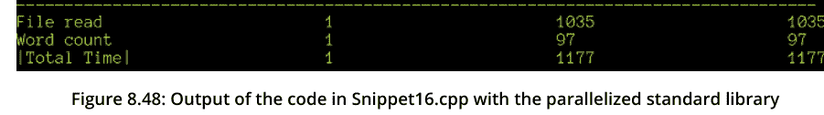

图 8.48：Snippet16.cpp 中代码在并行化标准库下的输出

这个版本也能看到类似的改进。我们完成了吗？还是可以更快？著名游戏程序员 Michael Abrash 提出了缩写词 TANSTAAFC——它代表"There ain't no such thing as the fastest code"（不存在最快的代码）。他的意思是，只要付出足够的努力，代码总是有可能变得更快。这似乎不可能，但人们一次又一次地找到了越来越快的计算方法——我们的代码也不例外，我们还可以更进一步。我们可以为优化做出的一种权衡是降低代码的通用性——我们已经对代码施加了一些约束——例如，我们只处理 ASCII 英文文本。通过对输入数据添加更多约束，我们可以做得更好。假设文件中没有不可打印字符。对于我们的输入数据来说，这是一个合理的假设。如果我们这样假设，那么就可以简化检测空白的条件——由于所有空白字符都大于或等于 ASCII 32，我们可以完全省去查找表。

- 13. 让我们基于之前的想法实现代码（完整代码可在 Snippet18.cpp 中找到）：

```cpp
int wordCount(const std::string &s)
{
    auto isWordEnd = [&](char a, char b)
    {
        return a > 32 & b < 33;
    };
    return std::inner_product(s.begin(), s.end()-1, s.begin()+1, 0,
    std::plus<int>(), isWordEnd);
}
```

- 14. 编译并运行程序：

```bash
$ g++ -O3 Snippet18.cpp SnippetWC.cpp Timer.cpp
$ ./a.out data.txt
```

```cpp
int wc;
{
    Timer t("Word count");
    wc = wordCount(sContent);
}
```

- 16. 编译并运行上述代码：

```bash
$ g++ -O3 Snippet18.cpp SnippetWC2.cpp Timer.cpp
$ ./a.out data.txt
```

我们得到以下输出：

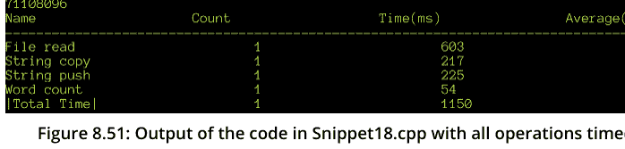

图 8.51：Snippet18.cpp 中代码对所有操作计时后的输出

大部分时间都花在了 push_back() 和复制字符串上。由于字符串的大小恰好等于文件的大小，push_back() 最终会为字符串分配一个新的缓冲区并复制内容。我们如何消除这个 push_back() 调用？我们在末尾附加了一个空格，以便能够一致地统计最后一个单词（如果有的话），因为我们的算法统计的是单词的结尾。有三种方法可以避免这种情况：统计单词的开头而不是结尾；单独统计最后一个单词（如果有的话）；以及使用 c_str() 函数，这样末尾就会有一个 NUL 字符。现在让我们依次尝试每一种方法。

- 17. 首先，编写不使用 push_back 的 main 函数（完整代码可在 SnippetWC3.cpp 中找到）：

```cpp
{
    Timer t("File read");
    buf << ifs.rdbuf();
}
{
    Timer t("String copy");
    sContent = buf.str();
}
int wc;
{
    Timer t("Word count");
    wc = wordCount(sContent);
}
```

- 18. 修改 wordCount() 中的代码，将 **isWordEnd()** 重命名为 **isWordStart()** 并反转逻辑。如果当前字符是空格而下一个字符不是，则认为一个单词开始。此外，如果字符串以非空格字符开头，则额外计数一个单词（完整代码可在 **Snippet19.cpp** 中找到）：

```cpp
int wordCount(const std::string &s)
{
    auto isWordStart = [&](char a, char b)
    {
        return a < 33 & b > 32;
    };
    // Count the first word if any
    int count = s[0] > 32;
    // count the remaining
    return std::inner_product(s.begin(), s.end()-1, s.begin()+1, count,
        std::plus<int>(), isWordStart);
}
```

- 19. 现在编写第二种替代方案——统计最后一个单词（如果有的话）。除了检查最后一个单词之外，代码与 **Snippet18.cpp** 版本几乎相同（完整代码可在 **Snippet20.cpp** 中找到）：

```cpp
int count = std::inner_product(s.begin(), s.end()-1, s.begin()+1, 0,
    std::plus<int>(), isWordEnd);

// count the last word if any
if(s.back() > 32)
{
    ++count;
}

return count;
```

- 20. 编写使用 **c_str()** 的第三个版本——我们只需要更改 **inner_product()** 的参数（完整代码可在 **Snippet21.cpp** 中找到）：

```cpp
int wordCount(const std::string &s)
{
    auto isWordEnd = [&](char a, char b)
    {
        return a > 32 & b < 33;
    };
    const char *p = s.c_str();
```


请注意，字典只是一个示例，因此不要假设所有有效单词都存在于其中——输出中的许多单词很可能本来就是拼写正确的单词。骨架代码会读取字典文件和文本文件，并对其调用拼写检查代码（由你编写）。之后，它会把结果输出与 **out.txt** 的内容进行比较，并打印程序是否按预期工作。执行拼写检查的函数会返回一个由不在字典中的单词索引组成的 vector。由于我们只关注拼写检查算法，因此只对该代码计时。读取文件和比较输出所花费的时间不计入在内。你将依次开发该程序的更快版本——reference 文件夹中提供了参考实现，即 **Speller1.cpp**、**Speller2.cpp**，依此类推。

在每一步中，你只会得到关于修改什么以使其更快的提示——只需修改 `getMisspelt()` 函数中的代码，其他任何代码都不得修改。学生可以自由地以任何方式实现代码，只要它能产生正确结果，并且不更改 `main()` 内的代码即可。

## 注意

优化是一个具有创造性且不确定的过程——不能保证、也不总是有可能让学生写出与参考实现相同的代码。如果你编写的代码性能不如参考实现，也不必感到惊讶。事实上，你的代码甚至有可能比参考实现更快。

请执行以下步骤来完成本活动：

将 Speller.cpp 复制一份，命名为 Speller1.cpp，并为 `getMisspelt()` 函数实现代码。使用 `std::set` 及其 `count()` 方法来实现。

+   1. 将程序的下一版本编写为 Speller2.cpp，然后像之前一样编译并计时。尝试使用 `std::unordered_set` 而不是 `std::set`。使用此实现，你应该会获得约 2 倍的加速。

在最终版本 **Speller3.cpp** 中，使用**布隆过滤器（Bloom filter）**数据结构来实现拼写检查算法。尝试不同数量的哈希函数和不同的布隆过滤器大小，看看哪种效果最好。

2. 对于上述每个步骤，请按如下方式编译并运行程序（如有需要，请更改输入文件名）：

```
$ g++ -O3 Speller1.cpp Timer.cpp
$ ./a.out
```

注意
你不应期望计时结果与这里显示的完全相同，但如果你正确实现了代码，速度的相对提升应与这里看到的结果接近。

针对每个步骤执行上述命令后，将生成以下输出。这些输出会显示你的代码的计时结果；如果你的输出正确，还会显示一条初始消息。以下是步骤 1 的输出：

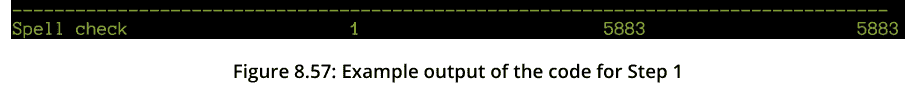

图 8.57：步骤 1 代码的示例输出

以下是步骤 2 的输出：

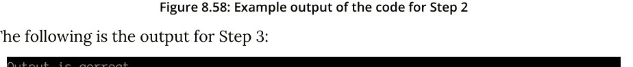

图 8.58：步骤 2 代码的示例输出

以下是步骤 3 的输出：

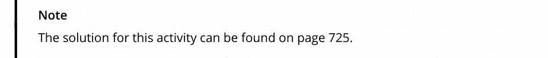

图 8.59：步骤 3 代码的示例输出

注意
本活动的解答可在第 725 页找到。

## 总结

本章涵盖了大量复杂的内容。优化代码对任何现代 C++ 开发者来说都是一项困难但必要的技能。机器学习、超写实游戏、大数据分析和节能计算等需求，使其成为任何 C++ 专业人士都必须学习的重要领域。我们已经了解到，性能优化的过程分为两个阶段。

首先，优化始于恰当的性能测量策略，测试条件应模拟真实世界的数据和使用模式。我们学习了如何通过各种方法测量性能——研究汇编代码、手动计时、源代码插桩，以及使用运行时分析器。一旦有了准确的测量结果，我们就能真正了解程序中哪些部分实际上很慢，并将精力集中在那里以获得最大改进。第二阶段涉及实际修改程序——我们学习了几种策略，首先是为代码使用最佳的编译器选项、使用并行化特性，以及利用性能分析数据来帮助编译器，然后是一些简单的代码变换，这些变换无需重大代码更改即可带来微小但有用的性能提升。随后，我们学习了如何通过以更有利于分支预测的方式组织循环和条件语句来提升性能。

然后，我们了解了缓存对性能产生的巨大且显著的影响，并研究了一些技术，例如 SOA 模式，以使我们的代码充分利用现代 CPU 中的缓存。最后，我们将所有这些内容整合到一个真实世界的示例中——一个单词计数程序和一个简单的拼写检查器，以动手实践我们所学的知识。除了本章内容之外，还有很多其他高级技术和理论需要学习，但我们在这里介绍的内容应该能为任何学生今后的学习奠定坚实的基础。

到这些章节结束时，你已经探索了许多与使用高级 C++ 相关的主题。在最初的几章中，你学习了如何编写可移植软件、如何利用模板发挥类型系统的优势，以及如何有效地使用指针和继承。随后，你探索了 C++ 标准库，包括流和并发，它们是构建大型真实世界应用的重要工具。在最后几个部分，你学习了如何测试和调试程序，并优化代码以高效运行。在广泛使用的编程语言中，C++ 或许是最复杂的，同时也是最具表现力的。本书只是一个开始，它将为你继续深入学习提供一个坚实的平台。


