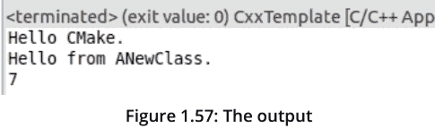
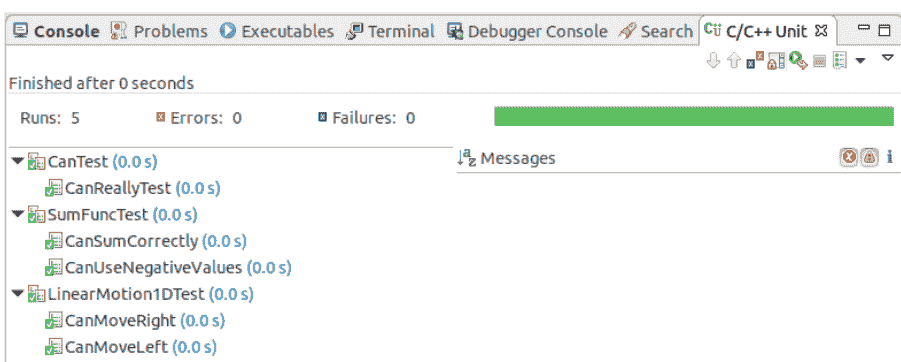
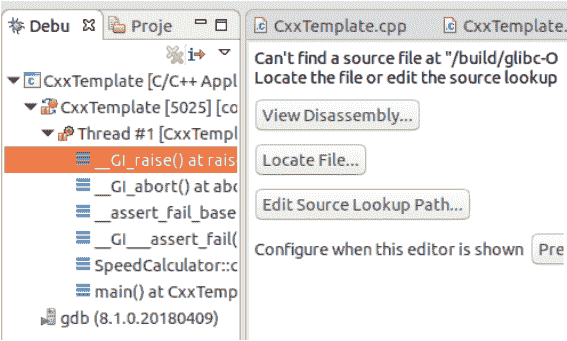
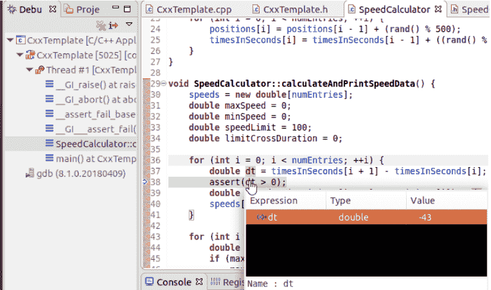
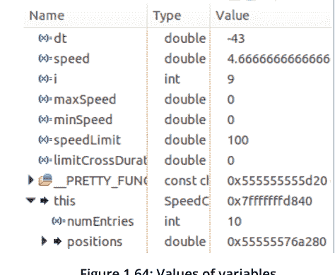
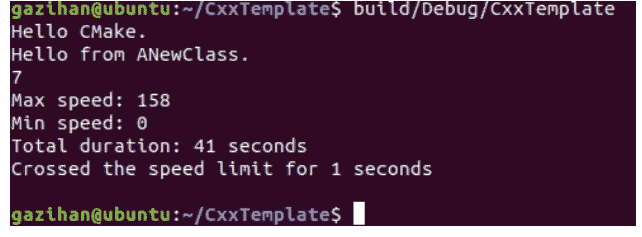
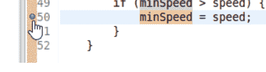

# 附录

## 关于

本节用于帮助学生完成书中的活动。其中包含学生为实现活动目标而需要执行的详细步骤。

4. 接下来，按如下所示编辑 SumFunc.cpp 文件：

```
#include "SumFunc.h"
#include <iostream>

int sum(int a, int b) {
    return a + b;
}
```

在此文件中，我们包含头文件并提供函数体，该函数将两个给定的整数相加并返回结果。

5. 编辑 CMakeFiles.txt 文件，使其 add_executable 部分与以下代码一致：

```
add_executable(CxxTemplate
    src/CxxTemplate.cpp
    src/ANewClass.cpp
    src/SumFunc.cpp
)
```

这里，我们将 src/SumFunc.cpp 文件添加到了可执行源文件列表中，以便它被链接到可执行文件中。

6. 在 CxxTemplate.cpp 中进行以下修改：

```
#include "CxxTemplate.h"
#include "ANewClass.h"
#include "SumFunc.h" //add this line
```

...

```
CxxApplication::CxxApplication( int argc, char *argv[] ) {
    std::cout << "Hello CMake." << std::endl;
    ANewClass anew;
    anew.run();
    std::cout << sum(3, 4) << std::endl; // add this line
}
```

## 注意

此文件的完整代码可在这里找到：https://github.com/TrainingBy-Packt/Advanced-CPlusPlus/blob/master/Lesson1/Activity01/src/CxxTemplate.cpp。

这里，我们添加了一行代码，调用 **sum** 函数并传入 **3** 和 **4**，然后将结果打印到控制台。

+   7. 构建并运行项目（**项目 | 全部构建 | 运行 | 运行**）。你应该会看到如下输出：



图 1.57：输出结果

通过本活动，你练习了向项目添加一对新的源文件-头文件。这类文件对是 C++ 开发中非常常见的模式。它们可以承载全局函数，例如本活动中用到的这些函数。更常见的是，它们承载类及其定义。在开发过程中，你将向应用程序中添加更多源文件-头文件对。因此，重要的是要习惯添加它们，不要拖延，否则会产生难以维护和测试的大型单体文件。

## 活动 2：添加新类及其测试

在本活动中，我们将添加一个新类来模拟一维线性运动。该类将拥有 **position** 和 **velocity** 这两个 double 字段。它还将有一个 **advanceTimeBy()** 方法，该方法接收一个 double 类型的 **dt** 参数，并根据 **velocity** 的值修改 **position**。对于 double 值，请使用 **EXPECT_DOUBLE_EQ** 而不是 **EXPECT_EQ**。在本活动中，我们将向项目添加一个新类及其测试。请按照以下步骤完成本活动：

+   1. 打开 Eclipse IDE，并加载我们现有的项目。要创建新类，请在**项目资源管理器**窗格中右键单击 **src** 文件夹，然后选择**新建 | 类**。输入 **LinearMotion1D** 作为名称，然后创建该类。


6. 现在修改我们的 CMake 配置文件，使我们生成的这些源文件也被使用。对于 LinearMotion1D 类，将其 .cpp 文件添加为可执行文件，以便将其与其它源文件一起编译和链接。以下是 CMakeLists.txt 中 add_executable 部分的内容：

```
add_executable(CxxTemplate
    src/CxxTemplate.cpp
    src/ANewClass.cpp
    src/SumFunc.cpp
    src/LinearMotion1D.cpp # added
)
```

7. 对于我们刚刚创建的测试，编辑 tests/CMakeLists.txt。在那里，我们需要同时添加测试源文件 LinearMotion1DTest.cpp 和它所使用的类的源文件 LinearMotion1D.cpp。由于它们位于不同的目录中，请将其作为 ../src/LinearMotion1D.cpp 访问。以下是 tests/CMakeLists.txt 中 add_executable 部分的内容：

```
add_executable(tests
    CanTest.cpp
    SumFuncTest.cpp
    ../src/SumFunc.cpp
    LinearMotion1DTest.cpp # added
    ../src/LinearMotion1D.cpp # added
)
```

8. 构建项目并运行测试。我们将看到所有测试都成功了：



通过此活动，你执行了向项目添加新类及其测试的任务。你创建了一个模拟一维运动的类，并编写了单元测试以确保其正常工作。

## 活动 3：使代码更具可读性

在此活动中，你将练习改进给定代码的质量。按照以下步骤实现此活动：

1. 打开 Eclipse CDT 并在 Eclipse 中以源头-头文件配对的方式创建一个类。为此，在 **Project Explorer** 中右键单击 **src** 文件夹。从弹出菜单中选择 **New | Class**。

2. 输入 **SpeedCalculator** 作为头文件名并单击 **Finish**。它将创建两个文件：**SpeedCalculator.h** 和 **SpeedCalculator.cpp**。我们已在上面提供了两个文件的代码。添加为每个文件提供的代码。

3. 现在我们需要将该类添加到 CMake 项目中。打开项目根目录（**src** 文件夹之外）的 **CMakeLists.txt** 文件，并在文件中进行以下更改：

```
src/LinearMotion1D.cpp
src/SpeedCalculator.cpp # add this line
)
```

4. 现在选择 **File | Save All** 保存所有文件，并通过选择 **Project | Build All** 构建项目。确保没有错误。

5. 在我们的 **main()** 函数中创建 **SpeedCalculator** 类的一个实例并调用其 **run()** 方法。打开 **CxxTemplate.cpp** 并包含我们新的类，然后通过添加以下代码编辑 **main** 函数：

```
#include "SpeedCalculator.h"

int main( int argc, char *argv[] ) {
    cxx::CxxApplication app( argc, argv );

    // add these three lines
    SpeedCalculator speedCalculator;
    speedCalculator.initializeData(10);
    speedCalculator.calculateAndPrintSpeedData();

    return 0;
}
```

6. 要修复样式，只需使用 **Source | Format** 并选择格式化整个文件。幸运的是，变量名没有任何问题。

7. 简化代码以使其更易于理解。**calculateAndPrintSpeedData** 中的循环同时做了几件事。它正在计算速度，查找其最小值和最大值，检查是否超过了阈值，并存储速度。如果速度是瞬时值，将其拆分意味着将其存储在某处以便再次循环处理它。然而，由于我们无论如何都将其存储在 speeds 数组中，我们可以再循环一次以提高代码的清晰度。以下是循环的更新版本：

```
for (int i = 0; i < numEntries; ++i) {
    double dt = timesInSeconds[i + 1] - timesInSeconds[i];
    assert(dt > 0);
    double speed = (positions[i + 1] - positions[i]) / dt;
    speeds[i] = speed;
}
```

```
for (int i = 0; i < numEntries; ++i) {
    double speed = speeds[i];
    if (maxSpeed < speed) {
        maxSpeed = speed;
    }

    if (minSpeed > speed) {
        minSpeed = speed;
    }
}
```

```
for (int i = 0; i < numEntries; ++i) {
    double speed = speeds[i];
    double dt = timesInSeconds[i + 1] - timesInSeconds[i];

    if (speed > speedLimit) {
        limitCrossDuration += dt;
    }
}
```

13. 让我们调查为什么我们的 dt 最终不大于零。为此，我们再次启动调试器。它在此奇怪的地方停止：



14. 实际错误是在库深处引发的。然而，我们自己的函数仍然在堆栈上，我们可以在那时调查它们的状态。单击左侧树中 **main** 上方的 **SpeedCalculator**：



看起来我们的 dt 在这里变成了 -43（确切的值并不重要）。查看 Variables 视图，我们意识到 i 是 9，这是我们输入数组的最后一个元素：



这看起来像是一个边界问题。仔细查看代码，我们意识到我们正在使用 timesInSeconds[10]，这是数组中不存在的第十一个元素。进一步思考，我们意识到当我们有 10 个位置时，我们只能进行 9 次位置对减法，从而得到 9 个速度。这是 C++ 中非常常见且难以捕获的错误，因为 C++ 不强制你保持在数组范围内。

15. 重新处理我们对此问题的整个代码：

```
void SpeedCalculator::calculateAndPrintSpeedData() {
    speeds = new double[numEntries - 1];
    double maxSpeed = 0;

    ...

    for (int i = 0; i < numEntries - 1; ++i) {
        double dt = timesInSeconds[i + 1] - timesInSeconds[i];

    ...

    for (int i = 0; i < numEntries - 1; ++i) {
        double speed = speeds[i];

        ....

        for (int i = 0; i < numEntries - 1; ++i) {
            double speed = speeds[i];
```

最后，我们的代码似乎在没有任何错误的情况下运行，正如我们在以下输出中看到的那样：



16. 然而，这里有一个好奇的点：无论你运行多少次，最小速度始终为 0。要进行调查，让我们在以下行设置一个断点：



17. 当我们调试代码时，我们看到它从未在此处停止。这显然是错误的。进一步调查后，我们意识到 minSpeed 最初为 0，而所有其他速度值都大于它。我们应该将其初始化为一个非常大的值，或者我们需要获取第一个元素作为最小值。在这里，我们选择第二种方法：

```
for (int i = 0; i < numEntries - 1; ++i) {
    double speed = speeds[i];
    if (i == 0 || minSpeed > speed) { // changed
        minSpeed = speed;
    }
```
