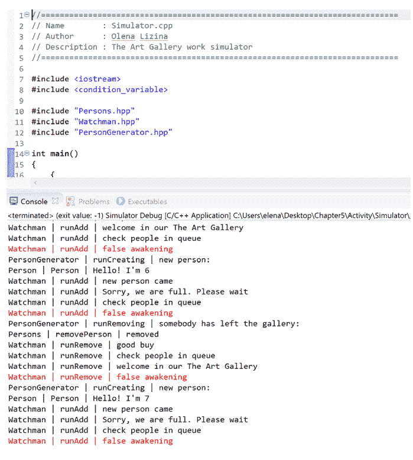

## Chapter 5 - The Philosophers' Dinner – Threads and Concurrency

### Activity 1: Creating a Simulator to Model the Work of the Art Gallery

艺术画廊工作模拟器是一个模拟游客和看守人行为的应用程序。游客数量有限，即同时只能有 50 人在画廊内。游客不断来到画廊。看守人检查游客数量是否超过限制。如果超过，他会要求新游客等待并将他们列入等待名单。如果没有，他会允许他们进入画廊。游客可以随时离开画廊。如果有人离开画廊，看守人会让等待名单中的某人进入画廊。

按照以下步骤实现此活动：

- 1. 创建一个文件来包含我们此项目所需的所有常量——`Common.hpp`。

- 2. 添加包含保护和第一个变量 `CountPeopleInside`，它表示游客限制为 50 人：

```cpp
#ifndef COMMON_HPP
#define COMMON_HPP
constexpr size_t CountPeopleInside = 50;
#endif // COMMON_HPP
```

- 3. 现在，创建 `Person` 类的头文件和源文件，即 `Person.hpp` 和 `Person.cpp`。同时添加包含保护。定义 `Person` 类并删除拷贝构造函数和拷贝赋值运算符；我们将只使用用户定义的默认构造函数、移动构造函数和移动赋值运算符以及默认析构函数。添加一个私有变量 `m_Id`；我们将用它进行日志记录。还添加一个私有静态变量 `m_NextId`；它将用于生成唯一的 ID：

```cpp
#ifndef PERSON_HPP
#define PERSON_HPP

class Person
{
public:
    Person();
    Person& operator=(Person&&);
    Person(Person&&);
    ~Person() = default;

    Person(const Person&) = delete;
    Person& operator=(const Person&) = delete;

private:
    int m_Id;
    static int m_NextId;
};

#endif // PERSON_HPP
```

- 4. 在源文件中，定义我们的静态变量 `m_NextId`。然后，在构造函数中，用 `m_NextId` 的值初始化 `m_Id` 变量。在构造函数中打印日志。实现移动构造函数和移动赋值运算符。现在，实现我们 `Person` 对象的线程安全存储。创建所需的头文件和源文件，即 `Persons.hpp` 和 `Persons.cpp`。同时添加包含保护。包含 `Person.hpp` 和 `<mutex>` 和 `<vector>` 头文件。定义 `Persons` 类，具有用户定义的默认构造函数和默认析构函数。声明用于添加 `Person` 的 `add()` 函数和用于获取 `Person` 并从列表中移除的 `get()`。定义 `size()` 函数以获取 `Person` 元素的数量，以及 `removePerson()`，它从存储中移除任何人。在私有部分，声明互斥体类型的变量，即 `m_Mutex`，以及用于存储 `Persons` 的向量，即 `m_Persons`：

```cpp
#ifndef PERSONS_HPP
#define PERSONS_HPP

#include "Person.hpp"
#include <mutex>
#include <vector>

class Persons
{
public:
    Persons();
    ~Persons() = default;

    void add(Person&& person);
    Person get();

    size_t size() const;
    void removePerson();

private:
    std::mutex m_Mutex;
```


```cpp
std::vector<Person> m_Persons;
};

#endif // PERSONS_HPP
```

- **5.** 在源文件中，声明用户自定义的构造函数，我们在其中将向量的大小保留为 50 个元素（以避免在增长过程中进行调整）：

```cpp
Persons::Persons()
{
    m_Persons.reserve(CountPeopleInside);
}
```

- **6.** 声明 `add()` 函数，它接受 `Person` 类型的右值参数，锁定互斥锁，并使用 `std::move()` 函数将 `Person` 添加到向量中：

```cpp
void Persons::add(Person&& person)
{
    std::lock_guard<std::mutex> m_lock(m_Mutex);
    m_Persons.emplace_back(std::move(person));
}
```

- **7.** 声明 `get()` 函数，它锁定互斥锁并返回最后一个元素然后将其从向量中移除。如果向量为空，则会抛出异常：

```cpp
Person Persons::get()
{
    std::lock_guard<std::mutex> m_lock(m_Mutex);
    if (m_Persons.empty())
    {
        throw "Empty Persons storage";
    }

    Person result = std::move(m_Persons.back());
    m_Persons.pop_back();
    return result;
}
```

- **8.** 声明 `size()` 函数，它返回向量的大小：

```cpp
size_t Persons::size() const
{
    return m_Persons.size();
}
```

- **9.** 最后，声明 `removePerson()` 函数，它锁定互斥锁并从向量中移除最后一项：

```cpp
void Persons::removePerson()
{
    std::lock_guard<std::mutex> m_lock(m_Mutex);
    m_Persons.pop_back();
    std::cout << "Persons | removePerson | removed" << std::endl;
}
```

- **10.** 现在，实现 `PersonGenerator` 类，它负责创建和移除 `Person` 项。创建相应的头文件和源文件，即 `PersonGenerator.hpp` 和 `PersonGenerator.cpp`。同时，添加包含保护。包含 `"Persons.hpp"`、`<thread>` 和 `<condition_variable>` 头文件。定义 `PersonGenerator` 类。在私有部分，定义两个 `std::thread` 变量，分别为 `m_CreateThread` 和 `m_RemoveThread`。在一个线程中，我们将创建新的 `Person` 对象，并在另一个线程中异步通知用户移除 `Person` 对象。定义一个对 `Persons` 类型共享变量的引用，即 `m_CreatedPersons`。我们将把每个新人员放入其中。`m_CreatedPersons` 将在多个线程之间共享。定义两个对 `std::condition_variable` 的引用，即 `m_CondVarAddPerson` 和 `m_CondVarRemovePerson`。它们将用于线程间的通信。定义两个对 `std::mutex` 变量的引用，即 `m_AddLock` 和 `m_RemoveLock`。它们将用于接收对条件变量的访问。最后，定义两个对 `bool` 值的引用，即 `m_AddNotified` 和 `m_RemoveNotified`。它们将用于检查通知是否为真或假。此外，在私有部分，定义两个将作为线程启动函数的函数 – `runCreating()` 和 `runRemoving()`。接下来，定义两个将触发条件变量的函数，即 `notifyCreated()` 和 `notifyRemoved()`。在公共部分，定义一个构造函数，它将我们在私有部分定义的所有引用作为参数。最后，定义一个析构函数。这将确保其他默认生成的函数被删除：

```cpp
#ifndef PERSON_GENERATOR_HPP
#define PERSON_GENERATOR_HPP

#include "Persons.hpp"
#include <condition_variable>
#include <thread>

class PersonGenerator
{
public:
    PersonGenerator(Persons& persons,
```

- **11.** 现在，转到源文件。包含 `<stdlib.h>` 文件，以便我们可以访问用于随机数生成的 `srand()` 和 `rand()` 函数。包含 `<time.h>` 头文件，以便我们可以访问 `time()` 函数，以及 `std::chrono` 命名空间。它们用于我们在处理时间时使用。包含 `<ratio>` 文件，它用于 typedef，以便我们可以与时间库一起工作：

```cpp
#include "PersonGenerator.hpp"
#include <iostream>
#include <stdlib.h>    /* srand, rand */
#include <time.h>      /* time */
#include <chrono>      /* chrono */
#include <ratio>       /* std::milli */
```

- **12.** 声明构造函数并在初始化列表中初始化除线程之外的所有参数。在构造函数体中用适当的函数初始化线程：

```cpp
PersonGenerator::PersonGenerator(Persons& persons,
    std::condition_variable& add_person,
    std::condition_variable& remove_person,
    std::mutex& add_lock,
    std::mutex& remove_lock,
    bool& addNotified,
    bool& removeNotified)
: m_CreatedPersons(persons)
, m_CondVarAddPerson(add_person)
, m_AddLock(add_lock)
, m_AddNotified(addNotified)
, m_CondVarRemovePerson(remove_person)
, m_RemoveLock(remove_lock)
, m_RemoveNotified(removeNotified)
{
    m_CreateThread = std::thread(&PersonGenerator::runCreating, this);
    m_RemoveThread = std::thread(&PersonGenerator::runRemoving, this);
}
```

- **13.** 声明析构函数并检查线程是否可连接。如果不可连接则连接它们：

```cpp
PersonGenerator::~PersonGenerator()
{
    if (m_CreateThread.joinable())
    {
        m_CreateThread.join();
    }
    if (m_RemoveThread.joinable())
    {
        m_RemoveThread.join();
    }
}
```

- **14.** 声明 `runCreating()` 函数，它是 `m_CreateThread` 线程的启动函数。在此函数中，在无限循环中，我们将生成 1 到 10 之间的随机数并使当前线程休眠此时间。之后，创建一个 `Person` 值，将其添加到共享容器中，并通知其他线程：

```cpp
void PersonGenerator::runCreating()
{
    using namespace std::chrono_literals;
    srand(time(NULL));
    while (true)
    {
        std::chrono::duration<int, std::milli> duration((rand() % 10 + 1) * 1000);
        std::this_thread::sleep_for(duration);
        std::cout << "PersonGenerator | runCreating | new person:" << std::endl;
        m_CreatedPersons.add(std::move(Person()));
        notifyCreated();
    }
}
```

- **15.** 声明 `runRemoving()` 函数，它是 `m_RemoveThread` 线程的启动函数。在此函数中，在无限循环中，我们将生成 20 到 30 之间的随机数并使当前线程休眠此时间。之后，通知其他线程应移除部分访客：

```cpp
void PersonGenerator::runRemoving()
{
    using namespace std::chrono_literals;
    srand(time(NULL));
    while (true)
    {
        std::chrono::duration<int, std::milli> duration((rand() % 10 + 20) * 1000);
        std::this_thread::sleep_for(duration);
        std::cout << "PersonGenerator | runRemoving | somebody has left the gallery:" << std::endl;
    }
}
```

```cpp
#ifndef WATCHMAN_HPP
#define WATCHMAN_HPP
#include <mutex>
#include <thread>
#include <condition_variable>
#include "Persons.hpp"
class Watchman
{
public:
    Watchman(std::condition_variable&,
             std::condition_variable&,
             std::mutex&,
             std::mutex&,
             bool&,
             bool&,
             Persons&,
             Persons&,
             Persons&);
    ~Watchman();
    Watchman(const Watchman&) = delete;
    Watchman(Watchman&&) = delete;
    Watchman& operator=(const Watchman&) = delete;
    Watchman& operator=(Watchman&&) = delete;
private:
    void runAdd();
    void runRemove();
private:
    std::thread m_ThreadAdd;
    std::thread m_ThreadRemove;
    std::condition_variable& m_CondVarRemovePerson;
    std::condition_variable& m_CondVarAddPerson;
    std::mutex& m_AddMux;
    std::mutex& m_RemoveMux;
    bool& m_AddNotified;
    bool& m_RemoveNotified;
    Persons& m_PeopleInside;
    Persons& m_PeopleInQueue;
    Persons& m_CreatedPeople;
};
#endif // WATCHMAN_HPP
```

- **18.** 现在，转到源文件。包含 `"Common.hpp"` 头文件，以便我们可以访问 `CountPeopleInside` 变量和其他必要的头文件：

```cpp
#include "Watchman.hpp"
#include "Common.hpp"
#include <iostream>
```

- **19.** 声明构造函数并在初始化列表中初始化除线程之外的所有参数。在构造函数体中用适当的函数初始化线程：

```cpp
Watchman::Watchman(std::condition_variable& addPerson,
    std::condition_variable& removePerson,
    std::mutex& addMux,
    std::mutex& removeMux,
    bool& addNotified,
    bool& removeNotified,
    Persons& peopleInside,
    Persons& peopleInQueue,
    Persons& createdPeople)
: m_CondVarRemovePerson(removePerson)
, m_CondVarAddPerson(addPerson)
, m_AddMux(addMux)
, m_RemoveMux(removeMux)
, m_AddNotified(addNotified)
, m_RemoveNotified(removeNotified)
, m_PeopleInside(peopleInside)
, m_PeopleInQueue(peopleInQueue)
, m_CreatedPeople(createdPeople)
{
    m_ThreadAdd = std::thread(&Watchman::runAdd, this);
    m_ThreadRemove = std::thread(&Watchman::runRemove, this);
}
```

- **20.** 声明析构函数并检查线程是否可连接。如果不可连接则连接它们：

```cpp
Watchman::~Watchman()
{
    if (m_ThreadAdd.joinable())
    {
        m_ThreadAdd.join();
    }
    if (m_ThreadRemove.joinable())
    {
```


21. 声明 runAdd() 函数。在这里，我们创建了一个无限循环。在循环中，我们正在等待一个条件变量。当条件变量发出通知时，我们从 m_CreatedPeople 列表中取出人员并将它们移动到适当的列表中，即 m_PeopleInside，或者如果超过了限制则移动到 m_PeopleInQueue。然后，我们检查 m_PeopleInQueue 列表中是否有人员，并且如果 m_PeopleInside 未满，则将它们移入该列表：

```
void Watchman::runAdd()
{
    while (true)
    {
        std::unique_lock<std::mutex> locker(m_AddMux);
        while(!m_AddNotified)
        {
            std::cerr << "Watchman | runAdd | false awakening" <<
            std::endl;
            m_CondVarAddPerson.wait(locker);
        }
        std::cout << "Watchman | runAdd | new person came" << std::endl;
        m_AddNotified = false;
        while (m_CreatedPeople.size() > 0)
        {
            try
            {
                auto person = m_CreatedPeople.get();
                if (m_PeopleInside.size() < CountPeopleInside)
                {
                    std::cout << "Watchman | runAdd | welcome in our The Art Gallery" << std::endl;
                    m_PeopleInside.add(std::move(person));
                }
                else
                {
                    std::cout << "Watchman | runAdd | Sorry, we are full. Please wait" << std::endl;
                    m_PeopleInQueue.add(std::move(person));
                }
            }
            catch(const std::string& e)
            {
                std::cout << e << std::endl;
            }
        }
        std::cout << "Watchman | runAdd | check people in queue" << std::endl;
        if (m_PeopleInQueue.size() > 0)
        {
            while (m_PeopleInside.size() < CountPeopleInside)
            {
                try
                {
                    auto person = m_PeopleInQueue.get();
                    std::cout << "Watchman | runAdd | welcome in our The Art Gallery" << std::endl;
                    m_PeopleInside.add(std::move(person));
                }
                catch(const std::string& e)
                {
                    std::cout << e << std::endl;
                }
            }
        }
    }
}
```

22. 接下来，声明 runRemove() 函数，在其中我们将从 m_PeopleInside 中移除访客。在这里，也在无限循环中，我们等待 m_CondVarRemovePerson 条件变量。当它通知线程时，我们从访客列表中移除人员。接下来，我们将检查 m_PeopleInQueue 列表中是否有任何人，并且如果未超过限制，则将他们添加到 m_PeopleInside：

```
void Watchman::runRemove()
{
    while (true)
    {
        std::unique_lock<std::mutex> locker(m_RemoveMux);
        while(!m_RemoveNotified)
        {
            std::cerr << "Watchman | runRemove | false awakening" << std::endl;
            m_CondVarRemovePerson.wait(locker);
        }
    }
```

```
std::mutex g_AddMux;
std::mutex g_RemoveMux;
bool g_AddNotified = false;;
bool g_RemoveNotified = false;
Persons g_PeopleInside;
Persons g_PeopleInqueue;
Persons g_CreatedPersons;
PersonGenerator generator(g_CreatedPersons, g_CondVarAddPerson, g_CondVarRemovePerson, g_AddMux, g_RemoveMux, g_AddNotified, g_RemoveNotified);
Watchman watchman(g_CondVarAddPerson, g_CondVarRemovePerson, g_AddMux, g_RemoveMux, g_AddNotified, g_RemoveNotified, g_PeopleInside, g_PeopleInqueue, g_CreatedPersons);
}

char a;
std::cin >> a;
return 0;
}
```

24. 编译并运行应用程序。在终端中，你将看到来自不同线程的日志，关于创建人员以及人员从一个列表移动到另一个列表。你的输出将类似于以下截图：



图 5.27：应用程序执行的結果

正如你所见，所有线程以非常简单和清晰的方式相互通信。我们通过使用互斥锁保护共享数据，以避免竞态条件。在这里，我们使用异常来警告空列表，并在线程的函数中捕获它们，以便我们的线程自行处理异常。我们还在析构函数中加入线程之前检查线程是否可加入。这使我们能够避免程序的意外终止。因此，这个小型项目展示了我们在处理线程方面的技能。
