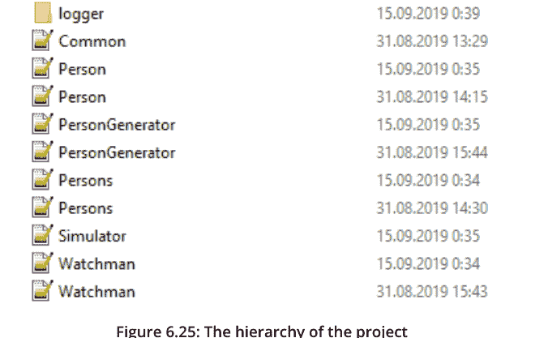
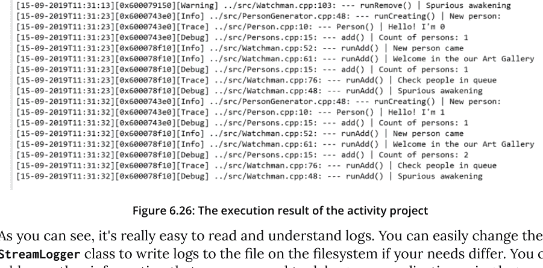

# 第 6 章 – 流和 I/O

### 活动 1 The Art Gallery 模拟器的日志系统

线程安全的记录器允许我们同时向终端输出数据。我们通过继承 std::ostringstream 类并使用互斥锁进行同步来实现此记录器。我们将实现一个类，为格式化输出提供接口，我们的记录器将使用它来扩展基本输出。我们为不同的日志级别定义宏定义，以提供易于且清晰使用的接口。按照以下步骤完成此活动：

- 1. 打开 Lesson6 中的项目。
- 2. 在 src/ 目录内创建一个名为 logger 的新目录。你将得到以下层次结构：



图 6.25：项目的层次结构

- 3. 创建一个名为 LoggerUtils 的头文件和源文件。在 LoggerUtils.hpp 中，添加包含保护。包含 <string> 头文件以添加对字符串操作的支持。定义一个名为 logger 的命名空间，然后在其中定义一个名为 utils 的嵌套命名空间。在 utils 命名空间中，声明 LoggerUtils 类。

- 4. 在 public 部分，声明以下静态函数：getDateTime、getThreadId、getLoggingLevel、getFileAndLine、getFuncName、getInFuncName 和 getOutFuncName。你的类应如下所示：

```
#ifndef LOGGERUTILS_HPP_
#define LOGGERUTILS_HPP_

#include <string>
```

```
namespace logger
{
namespace utils
{
class LoggerUtils
{
public:
    static std::string getDateTime();
    static std::string getThreadId();
    static std::string getLoggingLevel(const std::string& level);
    static std::string getFileAndLine(const std::string& file, const int& line);
    static std::string getFuncName(const std::string& func);
    static std::string getInFuncName(const std::string& func);
    static std::string getOutFuncName(const std::string& func);
};
} // namespace utils
} // namespace logger

#endif /* LOGGERUTILS_HPP_ */
```

5. 在 LoggerUtils.cpp 中，添加所需的包含： "LoggerUtils.hpp" 头文件、<sstream> 用于 std::stringstream 支持，以及 <ctime> 用于日期和时间支持：

```
#include "LoggerUtils.hpp"
#include <sstream>
#include <ctime>
#include <thread>
```

6. 进入 logger 和 utils 命名空间。编写所需的函数定义。在 getDateTime() 函数中，使用 localtime() 函数获取本地时间。使用 strftime() 函数将其格式化为字符串。使用 std::stringstream 将其转换为所需格式：

```
std::string LoggerUtils::getDateTime()
{
    time_t rawtime;
    struct tm * timeinfo;
    char buffer[80];

    time (&rawtime);
    timeinfo = localtime(&rawtime);

strftime(buffer,sizeof(buffer),"%d-%m-%Y T%H:%M:%S",timeinfo);
std::stringstream ss;
ss << "[";
ss << buffer;
ss << "]";
return ss.str();
}
```

7. 在 getThreadId() 函数中，获取当前线程 ID 并使用 std::stringstream 将其转换为所需格式：

```
std::string LoggerUtils::getThreadId()
{
    std::stringstream ss;
    ss << "[";
    ss << std::this_thread::get_id();
    ss << "]";
    return ss.str();
}
```

8. 在 getLoggingLevel() 函数中，使用 std::stringstream 将给定的字符串转换为所需格式：

```
std::string LoggerUtils::getLoggingLevel(const std::string& level)
{
    std::stringstream ss;
    ss << "[";
    ss << level;
    ss << "]";
    return ss.str();
}
```

9. 在 getFileAndLine() 函数中，使用 std::stringstream 将给定的文件和行号转换为所需格式：

```
std::string LoggerUtils::getFileAndLine(const std::string& file, const int& line)
{
    std::stringstream ss;
    ss << " ";
    ss << file;
    ss << ":";
```


- 13. 创建一个名为 LoggerMacroses.hpp 的头文件。添加头文件保护宏。为每个 LoggerUtils 函数创建宏定义：为 getDateTime() 函数定义 DATETIME，为 getThreadId() 函数定义 THREAD_ID，为 getLoggingLevel() 函数定义 LOG_LEVEL，为 getFileAndLine() 函数定义 FILE_LINE，为 getFuncName() 函数定义 FUNC_NAME，为 getInFuncName() 函数定义 FUNC_ENTRY_NAME，为 getOutFuncName() 函数定义 FUNC_EXIT_NAME。最终，头文件内容应如下所示：

```
#ifndef LOGGERMACROSES_HPP_
#define LOGGERMACROSES_HPP_
#define DATETIME \
    logger::utils::LoggerUtils::getDateTime()
#define THREAD_ID \
    logger::utils::LoggerUtils::getThreadId()
#define LOG_LEVEL( level ) \
    logger::utils::LoggerUtils::getLoggingLevel(level)
#define FILE_LINE \
    logger::utils::LoggerUtils::getFileAndLine(__FILE__, __LINE__)
#define FUNC_NAME \
    logger::utils::LoggerUtils::getFuncName(__FUNCTION__)
#define FUNC_ENTRY_NAME \
    logger::utils::LoggerUtils::getInFuncName(__FUNCTION__)
#define FUNC_EXIT_NAME \
    logger::utils::LoggerUtils::getOutFuncName(__FUNCTION__)
#endif /* LOGGERMACROSES_HPP_ */
```

- 14. 创建名为 StreamLogger 的头文件和源文件。在 StreamLogger.hpp 中添加必要的头文件保护宏。包含 LoggerMacroses.hpp 和 LoggerUtils.hpp 头文件。然后，包含 <sstream> 头文件以支持 std::ostringstream，包含 <thread> 头文件以支持 std::thread，包含 <mutex> 头文件以支持 std::mutex：

```
#include "LoggerMacroses.hpp"
#include "LoggerUtils.hpp"
#include <sstream>
#include <thread>
#include <mutex>
```

- 15. 进入 logger 命名空间。声明 StreamLogger 类，它继承自 std::ostringstream 类。这种继承允许我们使用重载的左移运算符 << 进行日志记录。我们不设置输出设备，因此不会真正输出，而只是将数据存储在内部缓冲区中。在私有部分，声明一个名为 m_mux 的静态 std::mutex 变量。声明常量字符串，以便存储日志级别、文件名与行号以及函数名。在公有部分，声明一个构造函数，该函数接受日志级别、文件名与行号以及函数名作为参数。声明一个类析构函数。类声明应如下所示：

```
namespace logger
{
class StreamLogger : public std::ostringstream
{
public:
    StreamLogger(const std::string logLevel,
                 const std::string fileLine,
                 const std::string funcName);
    ~StreamLogger();
private:
    static std::mutex m_mux;
    const std::string m_logLevel;
    const std::string m_fileLine;
    const std::string m_funcName;
};
} // namespace logger
```

- 16. 在 StreamLogger.cpp 中，包含 StreamLogger.hpp 和 <iostream> 头文件以支持 std::cout。进入 logger 命名空间。定义构造函数并在初始化列表中初始化所有成员。然后，定义析构函数并进入其作用域。锁定 m_mux 互斥锁。如果内部缓冲区为空，仅输出日期时间、线程 ID、日志级别、文件名与行号以及函数名。这样，我们将得到如下格式的行：[dateTime][threadId][logLevel][file:line: ][name() --- ]。如果内部缓冲区包含任何数据，则输出相同的字符串，并在末尾附加缓冲区内容。这样，我们将得到如下格式的行：[dateTime][threadId][logLevel][file:line: ][name() --- ] | message。完整的源文件应如下所示：

```
#include "StreamLogger.hpp"
#include <iostream>

std::mutex logger::StreamLogger::m_mux;

namespace logger
{
StreamLogger::StreamLogger(const std::string logLevel,
    const std::string fileLine,
    const std::string funcName)
    : m_logLevel(logLevel)
    , m_fileLine(fileLine)
    , m_funcName(funcName)
{}

StreamLogger::~StreamLogger()
{
    std::lock_guard<std::mutex> lock(m_mux);
    if (this->str().empty())
    {
        std::cout << DATETIME << THREAD_ID << m_logLevel << m_fileLine << m_funcName << std::endl;
    }
    else
    {
        std::cout << DATETIME << THREAD_ID << m_logLevel << m_fileLine << m_funcName << " | " << this->str() << std::endl;
    }
}
}
```

- 17. 创建名为 Logger.hpp 的头文件，并添加必要的头文件保护宏。包含 StreamLogger.hpp 和 LoggerMacroses.hpp 头文件。接下来，为不同的日志级别创建宏定义：LOG_TRACE()、LOG_DEBUG()、LOG_WARN()、LOG_TRACE()、LOG_INFO()、LOG_ERROR()、LOG_TRACE_ENTRY() 和 LOG_TRACE_EXIT()。完整的头文件应如下所示：

```
#ifndef LOGGER_HPP_
#define LOGGER_HPP_

#include "StreamLogger.hpp"
#include "LoggerMacroses.hpp"

#define LOG_TRACE() logger::StreamLogger{LOG_LEVEL("Trace"), FILE_LINE, FUNC_NAME}
#define LOG_DEBUG() logger::StreamLogger{LOG_LEVEL("Debug"), FILE_LINE, FUNC_NAME}
#define LOG_WARN() logger::StreamLogger{LOG_LEVEL("Warning"), FILE_LINE,
FUNC_NAME}
#define LOG_TRACE() logger::StreamLogger{LOG_LEVEL("Trace"), FILE_LINE, FUNC_NAME}
#define LOG_INFO() logger::StreamLogger{LOG_LEVEL("Info"), FILE_LINE, FUNC_NAME}
#define LOG_ERROR() logger::StreamLogger{LOG_LEVEL("Error"), FILE_LINE, FUNC_NAME}
#define LOG_TRACE_ENTRY() logger::StreamLogger{LOG_LEVEL("Error"), FILE_LINE, FUNC_ENTRY_NAME}
#define LOG_TRACE_EXIT() logger::StreamLogger{LOG_LEVEL("Error"), FILE_LINE, FUNC_EXIT_NAME}

#endif /* LOGGER_HPP_ */
```

- 18. 将所有 std::cout 调用替换为适当的宏定义调用。在 Watchman.cpp 源文件中包含 logger/Logger.hpp 头文件。在 runAdd() 函数中，将所有的 std::cout 实例替换为不同日志级别的宏定义。runAdd() 函数应如下所示：

```
void Watchman::runAdd()
{
    while (true)
    {
        std::unique_lock<std::mutex> locker(m_AddMux);
        while(!m_AddNotified)
        {
            LOG_DEBUG() << "Spurious awakening";
            m_CondVarAddPerson.wait(locker);
        }

        LOG_INFO() << "New person came";
        m_AddNotified = false;
        while (m_CreatedPeople.size() > 0)
        {
            try
            {
                auto person = m_CreatedPeople.get();
                if (m_PeopleInside.size() < CountPeopleInside)
                {
                    LOG_INFO() << "Welcome in the our Art Gallery";
                    m_PeopleInside.add(std::move(person));
                }
            else
```

- 21. 构建并运行该应用程序。在终端中，您将看到来自不同线程的日志消息，这些消息带有不同的日志级别和有用的信息。过一段时间后，您将获得类似于以下内容的输出：



图 6.26：活动项目的执行结果

如您所见，日志非常易于阅读和理解。如果您的需求不同，您可以轻松修改 StreamLogger 类，将日志写入文件系统中的文件。您还可以添加调试应用程序时可能需要的任何其他信息，例如输出函数参数。您还可以为自定义类型重载左移运算符，以轻松输出调试信息。

在本项目中，我们应用了本章学到的许多知识。我们创建了一个额外的流用于线程安全输出，将输出格式化为所需的形式，使用 std::stringstream 执行数据格式化，并使用宏定义来方便地使用日志记录器。因此，本项目展示了我们在并发 I/O 方面的技能。
